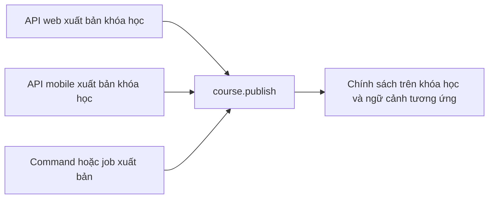

# Action và operation trong phân quyền

## 1. Vì sao cần làm rõ hai khái niệm?

Một nền tảng học tập cho phép giảng viên sửa mô tả khóa học nhưng chỉ người có thẩm quyền xuất bản được đưa khóa học ra công khai. Nếu cả hai hành vi chỉ được bảo vệ bằng quyền `course.update`, người được sửa nội dung có thể vô tình được quyền xuất bản.

Vấn đề không nằm ở việc API dùng `POST` hay `PATCH`. Cần xác định chính xác hành động nghiệp vụ nào đang được thực hiện, trên tài nguyên nào và thao tác kỹ thuật nào có thể tạo ra hành động đó.

Trong bài học này:

- **Action** là hành động có ý nghĩa đối với quyết định phân quyền, chẳng hạn `course.read`, `course.edit` hoặc `course.publish`.
- **Operation** là thao tác cụ thể mà hệ thống tiếp nhận hoặc thực thi, chẳng hạn một API endpoint, mutation, command hay phương thức dịch vụ.

Cách phân biệt này phục vụ thiết kế của bài. Các sản phẩm và tiêu chuẩn có thể dùng hai từ gần nghĩa hoặc gọi action là operation. Điều cần thống nhất là ý nghĩa, phạm vi và điểm kiểm tra, không phải ép mọi hệ thống dùng cùng một bộ thuật ngữ.

Trong nền tảng IAM, action kết nối danh tính đã xác thực với tài nguyên và chính sách RBAC, ABAC hoặc quan hệ truy cập. Operation là nơi hệ thống phải thực thi quyết định đó. Phiên hợp lệ, MFA hay SSO thành công xác nhận một phần ngữ cảnh danh tính; chúng không tự cho phép mọi action.

Sau bài học, người học có thể:

- Phân biệt action, operation, HTTP method, role và permission.
- Xây dựng danh mục action có ý nghĩa nghiệp vụ ổn định.
- Ánh xạ nhiều đường thực thi về cùng yêu cầu phân quyền.
- Xử lý operation cần nhiều action hoặc nhiều tài nguyên.
- Ngăn việc đổi endpoint, payload hoặc đường gọi nội bộ làm vượt quyền.
- Ghi nhận và kiểm tra đủ cặp operation–action trong hệ thống.

## 2. Phân biệt action với các khái niệm liên quan

### 2.1. Bảng khái niệm

| Khái niệm | Câu hỏi được trả lời | Ví dụ |
|---|---|---|
| Principal/subject | Ai đang yêu cầu? | Người dùng, dịch vụ, workload hoặc bên được ủy quyền. |
| Action | Muốn làm việc gì theo chính sách? | `course.publish`. |
| Resource | Việc đó tác động lên đối tượng nào? | Khóa học có ID nội bộ cụ thể trong một tenant. |
| Context | Có điều kiện bổ sung nào? | Mức xác thực, thời gian, trạng thái và phạm vi ủy quyền. |
| Operation | Đường thực thi cụ thể là gì? | `POST /courses/{id}/publish`. |
| Permission/grant | Quyền được cấp trong phạm vi nào? | Cho phép xuất bản các khóa học được phân công trong tenant A. |
| Role | Tập hoặc cơ chế gom quyền theo trách nhiệm | Biên tập viên, người xuất bản, quản trị tenant. |

Một tên action đứng riêng chưa mô tả đầy đủ quyền. `course.read` trên khóa học A không tự cho phép đọc khóa học B hoặc toàn bộ tenant.

### 2.2. Mô hình yêu cầu phân quyền

```text
decision = authorize(principal, action, resource, context)

operation:
    lấy principal đã xác thực
    xác định action thực sự cần thực hiện
    lấy resource và context đáng tin cậy
    thực thi quyết định trước khi trả dữ liệu hoặc tạo tác động
```

Trong [Cedar Terms & concepts](https://docs.cedarpolicy.com/overview/terminology.html), principal, action và resource là những thành phần của mô hình chính sách. [Schema Cedar](https://docs.cedarpolicy.com/schema/json-schema.html) còn mô tả loại principal, resource và context phù hợp với từng action. Đây là một ví dụ công cụ hóa danh mục hành động; khai báo schema không tự thay việc cấp quyền bằng chính sách và thực thi trong ứng dụng.

### 2.3. Role không nên thay cho tên hành động

Một operation chỉ kiểm tra `isAdmin()` thường che khuất câu hỏi quản trị viên được làm gì và trong phạm vi nào. Quản trị viên tenant A không tự là quản trị viên tenant B; người quản lý nội dung không tự có quyền cấp credential.

Role có thể là một đầu vào để suy ra quyền trên action. ABAC hoặc quan hệ còn có thể giới hạn theo tenant, chủ sở hữu, phân công, trạng thái tài nguyên và mức xác thực. Việc phân quyền hiệu quả cần xét các yếu tố đó cùng nhau theo chính sách đã chọn.

## 3. Ánh xạ action và operation

### 3.1. Một action có nhiều operation thực hiện



Nếu cùng tạo ra hành vi xuất bản, các đường này cần được đánh giá theo yêu cầu nghiệp vụ tương ứng. Không cho phép job bỏ qua mọi kiểm tra chỉ vì được gọi từ backend. Job có thể dùng danh tính workload và phạm vi ủy quyền khác người dùng, nhưng vẫn cần căn cứ được phép thực hiện action.

| Operation | Action chính minh họa | Resource cần kiểm tra |
|---|---|---|
| `GET /courses/{id}` | `course.read` | Khóa học được yêu cầu. |
| `PATCH /courses/{id}/content` | `course.edit` | Khóa học và phần nội dung được phép sửa. |
| `POST /courses/{id}/publish` | `course.publish` | Khóa học trong trạng thái được phép xuất bản. |
| Mutation `publishCourse` | `course.publish` | Cùng khóa học và ngữ cảnh tương ứng. |
| Command `PublishCourse` | `course.publish` | Tài nguyên trong phạm vi actor hoặc ủy quyền của command. |

Việc thêm đường API mới không nên làm thay đổi nghĩa của action nếu hành vi và phạm vi vẫn như cũ. Nó cần bổ sung mapping và điểm thực thi tương ứng.

### 3.2. Một operation có thể cần nhiều action

Giả sử operation “xuất gói đào tạo” thu thập nội dung khóa học, đề kiểm tra và tạo file tải xuống. Theo một chính sách minh họa, nó có thể cần:

```text
course.export trên khóa học
AND assessment.read trên các đề kiểm tra được đưa vào gói
```

Có quyền xuất khóa học chưa chắc có quyền đọc mọi đề kiểm tra liên kết. Cần xác định tổ hợp điều kiện, phạm vi tài nguyên và cách phản hồi khi thiếu một phần quyền.

Không tự dùng phép OR chỉ vì trong cấu hình có một danh sách action. `allOf` và `anyOf` có ý nghĩa rất khác nhau; tên trường và bộ đánh giá phải biểu diễn rõ.

### 3.3. Action có thể tồn tại ngoài CRUD

CRUD là điểm bắt đầu hữu ích nhưng thường không đủ cho nghiệp vụ:

| Hành vi | Vì sao có thể cần action riêng? |
|---|---|
| Xuất bản | Làm nội dung có thể được người khác truy cập. |
| Phê duyệt | Thể hiện thẩm quyền xác nhận, có thể khác người tạo. |
| Xuất dữ liệu | Tạo bản sao có thể lưu và phân phối ngoài hệ thống. |
| Chia sẻ | Thay đổi phạm vi người được truy cập. |
| Chuyển sở hữu | Thay đổi quan hệ làm căn cứ phân quyền. |
| Đặt lại MFA | Tác động quyền kiểm soát credential. |
| Cấp role | Là thao tác quản lý quyền, không chỉ sửa hồ sơ người dùng. |

Quyền sửa mô tả và quyền cấp role đều có thể đi qua API cập nhật, nhưng mức tác động khác nhau. Ranh giới action cần bám vào ý nghĩa đó.

## 4. HTTP method và operationId không quyết định quyền

### 4.1. GET, POST, PUT, PATCH và DELETE là ngữ nghĩa giao thức

`GET` có thể trả dữ liệu rất nhạy cảm. `POST` có thể là một truy vấn tìm kiếm thay vì thao tác tạo mới. Một endpoint `DELETE` có thể xóa mềm hoặc xóa vĩnh viễn, với yêu cầu quyền khác nhau.

[RFC 9110, mục Safe Methods](https://www.rfc-editor.org/rfc/rfc9110.html#section-9.2.1) mô tả tính safe theo ngữ nghĩa yêu cầu không nhằm thay đổi trạng thái. Tính chất đó không có nghĩa tài nguyên được công khai hoặc bỏ qua phân quyền. Tương tự, idempotency không phải quyền thực hiện thao tác.

Không suy ra toàn bộ policy bằng quy tắc “GET cần read, mọi POST cần create”. Có thể dùng quy ước làm điểm khởi đầu, nhưng mapping cuối cùng phải phản ánh hành vi thực tế.

### 4.2. `operationId` là định danh mô tả API

[OpenAPI 3.1.1](https://spec.openapis.org/oas/v3.1.1.html#operation-object) quy định `operationId` là định danh duy nhất cho operation trong API được mô tả và có phân biệt hoa/thường. Nó hữu ích cho tài liệu và công cụ sinh client.

`operationId=publishCourseV2` không tự tạo hoặc thực thi quyền `course.publish`. Ngược lại, đổi tên operation để sinh SDK không nhất thiết phải đổi tên quyền đã cấp cho khách hàng.

Nếu dùng phần mở rộng OpenAPI để mô tả action, cần có công cụ hoặc code thực thi mapping đó. Một trường tài liệu không được đọc ở runtime không tạo ra kiểm soát truy cập.

### 4.3. Method Java cũng không phải danh mục quyền mặc định

Một hàm `save()` có thể lưu bản nháp, chuyển trạng thái xuất bản hoặc đổi chủ sở hữu. Cùng tên kỹ thuật chưa nói rõ action nghiệp vụ.

Không dùng reflection để tự cho phép mọi public method có tên bắt đầu bằng `get`, hoặc tự ánh xạ tên class vào role. Quy ước kỹ thuật cần được kiểm chứng bằng nghĩa hành vi, tài nguyên và phạm vi.

## 5. Thiết kế danh mục action

### 5.1. Đặt tên ổn định và có nghĩa

Một quy ước có thể là `<resource-domain>.<verb>`:

```text
course.read
course.edit
course.publish
course.archive
course.export
course.share
```

Đây là quy ước minh họa, không phải cú pháp bắt buộc. Các hệ thống có thể dùng dấu phân tách hoặc namespace khác. Quan trọng là tên có định nghĩa rõ, được quản lý và không thay đổi theo những chi tiết triển khai không liên quan.

Tránh tên như `button3`, `apiV2Method7`, `adminOperation` hoặc `doAnything` cho danh mục quyền nghiệp vụ. Chúng khó giải thích khi rà soát hoặc điều tra sự cố.

### 5.2. Mỗi action cần một hợp đồng

| Thuộc tính | Ví dụ với `course.publish` |
|---|---|
| Mô tả | Chuyển một phiên bản khóa học đã đủ điều kiện sang trạng thái xuất bản. |
| Loại resource | Course hoặc phiên bản Course theo mô hình dữ liệu. |
| Phạm vi | Tenant và tập khóa học mà principal được phép quản lý. |
| Điều kiện | Trạng thái hợp lệ, policy và bằng chứng bổ sung nếu yêu cầu. |
| Không bao gồm | Cấp role, đổi sở hữu, xuất đề kiểm tra hoặc bỏ qua phê duyệt. |
| Đường thực thi | API, command, batch và công cụ quản trị đã liệt kê. |
| Bằng chứng | Quyết định policy và kết quả chuyển trạng thái được liên kết. |

Không cần tạo một action mới cho từng dòng code. Tách action khi có lý do cấp quyền khác nhau, phạm vi khác nhau hoặc tác động cần được kiểm soát độc lập.

### 5.3. Phân cấp và nhóm action phải được định nghĩa rõ

Một role có thể gom `course.read` và `course.edit`, nhưng không có quy tắc tự nhiên bắt buộc `edit` luôn kéo theo `publish` hay `delete`. Nếu hệ thống muốn một action bao hàm action khác, quan hệ đó phải được định nghĩa và kiểm chứng.

Wildcard như `course.*` có thể vô tình bao gồm action nhạy cảm được thêm trong tương lai. Khi mở rộng danh mục, cần biết những grant hoặc nhóm nào sẽ nhận thêm quyền theo cơ chế wildcard hay kế thừa.

Không đổi nghĩa một action cũ từ “sửa nội dung” thành “sửa mọi trạng thái và quyền” mà giữ nguyên grant đã cấp. Thay đổi đó là mở rộng quyền, không chỉ refactor tên phương thức.

## 6. Payload có thể thay đổi action thực sự

### 6.1. Ví dụ endpoint cập nhật quá rộng

```http
PATCH /courses/course-demo
Content-Type: application/json

{
  "title": "Nội dung mới",
  "status": "PUBLISHED",
  "ownerId": "another-user"
}
```

Nếu service chỉ kiểm tra `course.edit` rồi bind toàn bộ payload vào entity, nó có thể cho phép xuất bản và chuyển sở hữu qua một đường không kiểm tra các quyền tương ứng.

Có thể chọn tách command/endpoint theo hành vi, hoặc phân tích thay đổi được yêu cầu và kiểm tra đầy đủ action trước khi ghi. Cả hai đều cần giới hạn field và kiểm tra trạng thái thực tế; đổi tên URL không tự giải quyết mass assignment.

### 6.2. Client không chọn action để được kiểm tra

Không nhận `action=course.read` từ client rồi dùng nó để kiểm tra cho một operation thực sự đang xuất bản. Action phải được xác định từ đường thực thi và ý định nghiệp vụ đã được server phân tích.

Nếu một API nhận command type, cần ánh xạ command qua danh mục đã biết, kiểm tra payload tương ứng và từ chối giá trị không được hỗ trợ. Không cho phép tên action tự do trở thành cách gọi bất kỳ phương thức nội bộ nào.

### 6.3. Kiểm tra field và dữ liệu trả về

Quyền đọc một khóa học không mặc nhiên bao gồm trường ghi chú nội bộ, ngân hàng đề hoặc thông tin cá nhân của học viên. Operation trả về dữ liệu cần thực thi giới hạn field phù hợp với action và tài nguyên.

Ở chiều cập nhật, không chỉ bỏ field trên giao diện. Backend phải từ chối hoặc xử lý theo chính sách các field người gọi không được sửa, kể cả khi chúng được gửi thủ công qua API.
