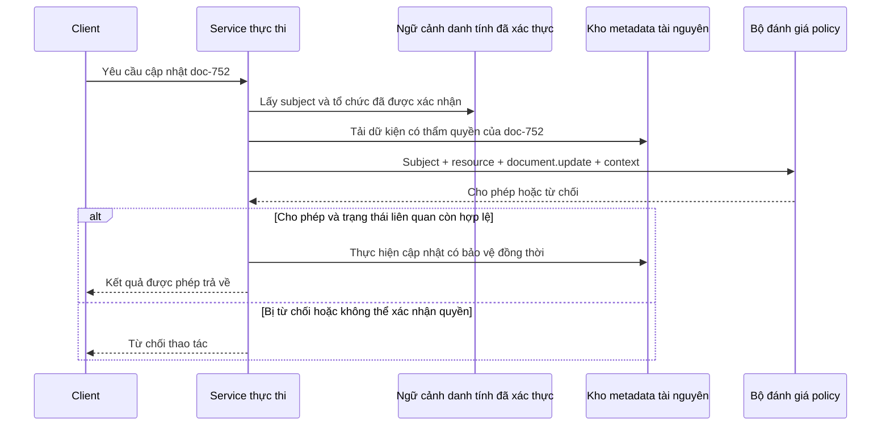

# Subject-resource-action

## 1. Đặt đúng câu hỏi khi kiểm tra quyền

Trong một hệ thống quản lý danh tính và quyền truy cập, biết người gọi là ai chưa đủ để cho phép họ thực hiện nghiệp vụ. Một nhân viên đăng nhập thành công vẫn có thể không được xem hồ sơ của đồng nghiệp, sửa hóa đơn đã chốt hoặc cấp quyền quản trị cho người khác.

Đơn vị cơ bản để diễn đạt một yêu cầu truy cập là bộ ba **subject — resource — action**:

> Chủ thể nào muốn thực hiện hành động gì trên tài nguyên nào?

Ví dụ: “Người dùng Lan muốn sửa tài liệu kế hoạch ngân sách của phòng Kế toán”. Khi tách câu này thành dữ liệu, ta có:

| Thành phần | Giá trị minh họa | Câu hỏi cần trả lời |
|---|---|---|
| Subject | Danh tính đã xác thực của Lan | Ai đang yêu cầu thực hiện? |
| Resource | Tài liệu `doc-752` trong tổ chức `org-a` | Đối tượng cụ thể nào bị truy cập hoặc thay đổi? |
| Action | `document.update` | Nghiệp vụ nào được yêu cầu? |

Hệ thống đưa bộ ba này vào chính sách phân quyền, kết hợp những điều kiện cần thiết như trạng thái tài khoản, quan hệ sở hữu, tổ chức và trạng thái tài liệu. Kết quả có thể là cho phép hoặc từ chối; một số cơ chế còn trả về nghĩa vụ phải thực thi, chẳng hạn che trường nhạy cảm.

Tài liệu này dùng “resource” để gọi tài nguyên được bảo vệ. Trong tài liệu kiểm soát truy cập, “object” cũng thường được dùng với nghĩa tương ứng. NIST mô tả ABAC bằng việc đánh giá thuộc tính của chủ thể, đối tượng, thao tác và điều kiện môi trường theo chính sách. Đây là một cách triển khai quyết định dựa trên bộ ba, chứ bộ ba không chỉ dành riêng cho ABAC. [Nguồn: NIST SP 800-162](https://csrc.nist.gov/pubs/sp/800/162/upd2/final).

## 2. Subject: danh tính đang yêu cầu hành động

### 2.1. Subject có thể là người hoặc workload

Subject là thực thể mà quyết định phân quyền đang xét đến. Tùy hệ thống, đó có thể là:

- Người dùng tương tác qua trình duyệt hoặc ứng dụng di động.
- Tài khoản dịch vụ chạy tác vụ định kỳ.
- Workload như một service, pod hoặc tiến trình xử lý hàng đợi.
- Danh tính đại diện cho một bên gọi thay mặt người dùng, nếu mô hình ủy quyền có phân biệt rõ các bên.

Không nên ngầm đồng nhất subject với một bản ghi `users` dành cho con người. Ví dụ, service xuất báo cáo có thể được đọc tập dữ liệu được cấp riêng nhưng không có quyền đổi mật khẩu nhân viên hay thêm quản trị viên.

### 2.2. Danh tính cần ổn định và có phạm vi

Tên hiển thị hoặc địa chỉ email không phải lúc nào cũng là khóa thích hợp để xác định chủ thể. Chúng có thể thay đổi, được tái sử dụng hoặc xuất hiện ở nhiều hệ thống phát hành danh tính.

Với một hệ thống tiếp nhận nhiều nhà cung cấp danh tính, cách mô hình hóa hữu ích là giữ riêng cặp:

```text
SubjectIdentity = (trustedIssuer, subjectIdWithinIssuer)
```

Ví dụ, `subjectId=42` do hệ thống A phát hành không tự động chỉ cùng một người với `subjectId=42` do hệ thống B phát hành. Việc liên kết hai danh tính phải là một quy trình có chủ đích, không phải so sánh trùng chuỗi hoặc trùng email rồi tự gộp.

Sau xác thực, ứng dụng có thể ánh xạ cặp danh tính bên ngoài sang một ID nội bộ ổn định. Khi đó các quan hệ như chủ sở hữu tài liệu tham chiếu ID nội bộ ấy. Điều cần giữ là không làm mất ranh giới giữa các miền danh tính.

### 2.3. Phân biệt danh tính và các thuộc tính quyền

Một subject có thể đi kèm nhiều dữ kiện:

```text
identity       = người dùng nội bộ u-27
accountState   = ACTIVE
membership     = thành viên org-a
department     = finance
roles          = [editor]
authentication = phiên đã qua bước xác thực cần thiết
```

Các dữ kiện này có nguồn và vòng đời khác nhau. Định danh người dùng có thể ổn định lâu dài, trong khi membership hoặc vai trò có thể vừa bị thu hồi. Có một token chưa hết hạn không có nghĩa mọi quyền chứa trong đó vẫn phản ánh trạng thái hiện tại.

Đối với quyền nhạy cảm, thiết kế phải xác định rõ khi nào tra cứu dữ liệu quyền hiện hành, khi nào chấp nhận dữ liệu được lưu tạm và thời gian tối đa mà một quyền đã thu hồi còn có thể có hiệu lực.

### 2.4. Không lấy subject từ một trường tùy ý của request

Ví dụ sau không đủ để xác định người dùng hiện tại:

```http
PATCH /documents/doc-752
X-User-Id: u-27
Content-Type: application/json

{"title":"Ngân sách mới"}
```

Nếu người gọi có thể tự đặt `X-User-Id`, giá trị đó chỉ là dữ liệu chưa đáng tin cậy. Subject phải xuất phát từ cơ chế xác thực đã kiểm tra hoặc một kênh nội bộ được bảo vệ và có hợp đồng tin cậy rõ ràng. Không thể biến một header do client gửi thành bằng chứng danh tính chỉ bằng cách đổi tên nó thành `trustedUserId`.

## 3. Resource: đối tượng cụ thể được bảo vệ

### 3.1. Loại tài nguyên và một tài nguyên cụ thể

`Document` là loại tài nguyên. `doc-752` là một thực thể cụ thể của loại đó. Kiểm tra “được dùng chức năng sửa tài liệu” có thể là điều kiện cần, nhưng chưa trả lời được người gọi có quyền sửa chính `doc-752` hay không.

Một mô hình tài nguyên phục vụ phân quyền có thể gồm:

```text
type         = document
id           = doc-752
tenantId     = org-a
ownerId      = u-27
projectId    = project-19
state        = DRAFT
classification = INTERNAL
```

Không phải mọi bài toán đều cần tất cả trường này. Chỉ đưa vào quyết định những dữ kiện phục vụ chính sách, đồng thời xác định hệ thống nào có thẩm quyền cung cấp từng dữ kiện.

### 3.2. Resource không chỉ là một hàng trong cơ sở dữ liệu

Những đối tượng sau cũng có thể cần kiểm soát truy cập:

- Một collection như danh sách giao dịch của tài khoản.
- Một trường nhạy cảm như lương hoặc số định danh cá nhân.
- Một tệp tải xuống, bản sao lưu hoặc báo cáo đã xuất.
- Một hàng đợi, secret, khóa mã hóa hoặc chức năng quản trị.
- Một đối tượng chưa tồn tại, chẳng hạn tài liệu đang được tạo trong một thư mục.

Với thao tác tạo mới, không thể bắt buộc kiểm tra ID của đối tượng chưa được tạo. Thay vào đó, kiểm tra quyền tạo trong tài nguyên chứa nó, ví dụ:

```text
subject  = u-27
resource = folder-19 thuộc org-a
action   = document.create
```

Sau đó server xác lập các thuộc tính được bảo vệ của tài liệu mới, như tổ chức và chủ sở hữu, theo quy tắc nghiệp vụ. Client không được tự gán một tổ chức khác hoặc một chủ sở hữu đặc quyền nếu chưa có quyền tương ứng.

### 3.3. ID giúp tìm đối tượng, không chứng minh quyền

Khi người dùng cung cấp `doc-752`, hệ thống mới chỉ biết họ muốn tham chiếu tài liệu nào. ID dễ đoán, UUID khó đoán hay đường dẫn dài đều không thay thế kiểm tra quyền trên tài liệu được tìm thấy.

Một lỗi thường gặp là kiểm tra người dùng đã đăng nhập, sau đó gọi `findById(id)` và trả toàn bộ dữ liệu. Người gọi có thể đổi ID để tham chiếu tài liệu của người khác. Vấn đề cốt lõi là thiếu mối ràng buộc giữa subject, resource cụ thể và action, không phải chỉ ở cách sinh ID.

### 3.4. Thuộc tính tài nguyên phải lấy từ nguồn đáng tin cậy

Giả sử body gửi lên chứa:

```json
{
  "documentId": "doc-752",
  "tenantId": "org-a",
  "ownerId": "u-27"
}
```

Không được kết luận tài liệu thuộc `org-a` và do `u-27` sở hữu chỉ từ body đó. Server cần tra cứu metadata có thẩm quyền của `doc-752`. Nếu endpoint cho phép thay chủ sở hữu, chính sự thay đổi ấy phải có hành động và chính sách riêng.

Quyền cập nhật nội dung thông thường cũng không nên tự động bao gồm quyền sửa mọi thuộc tính điều khiển truy cập. Một tài khoản được sửa `title` không vì thế được sửa `tenantId`, `ownerId` hoặc danh sách người được chia sẻ.

## 4. Action: hành động nghiệp vụ được yêu cầu

### 4.1. Dùng hành động đủ rõ để chính sách diễn đạt đúng ý định

Các hành động như `read`, `write`, `delete` hữu ích nhưng có thể quá rộng. Với một số hệ thống, cần tách:

```text
document.read
document.update
document.share
document.transferOwnership
document.archive
document.export
```

Đọc một tài liệu trên giao diện và xuất hàng nghìn tài liệu ra tệp có thể tạo ra mức ảnh hưởng khác nhau. Tách action giúp áp dụng quyền, xác thực bổ sung và kiểm toán theo đúng nghiệp vụ.

Tuy nhiên, không cần biến mọi chi tiết kỹ thuật thành một permission mới. Ranh giới action nên bám vào sự khác biệt có ý nghĩa về dữ liệu, tác động và thẩm quyền.

### 4.2. HTTP method không phải toàn bộ ngữ nghĩa quyền

Một endpoint `POST /documents/doc-752/share` thực hiện chia sẻ, không chỉ là một thao tác “POST”. Một endpoint `GET /documents/export` có thể tiết lộ tập dữ liệu lớn. Chính sách cần ánh xạ route và nghiệp vụ sang action ổn định.

Action được kiểm tra phải khớp thao tác server thực sự thực hiện. Không để client gửi `action=document.read` trong body rồi dùng giá trị đó để xin phép cho một nhánh code đang xóa tài liệu.

### 4.3. Không tự suy ra quan hệ giữa các hành động

Quyền `document.update` không mặc nhiên suy ra quyền `document.share`. Quyền `document.read` không mặc nhiên bao gồm `document.export`. Nếu hệ thống có kế thừa quyền, quan hệ ấy phải được khai báo và kiểm tra rõ ràng.

Tương tự, vai trò có tên `admin` chưa xác định được phạm vi. Một quản trị viên của `org-a` có thể được quản lý tài liệu trong tổ chức ấy mà không có bất kỳ quyền nào trên `org-b`.

## 5. Bộ ba kết hợp với context và policy

Mô hình quyết định có thể viết dưới dạng:

```text
decision = authorize(subject, resource, action, context, policy)
```

Context bổ sung những yếu tố của lần truy cập hiện tại, chẳng hạn thời điểm, mức xác thực đã đạt, thiết bị hoặc mục đích sử dụng. Context không làm mất vai trò của bộ ba; nó trả lời điều kiện nào phải đúng khi chủ thể thực hiện hành động trên đối tượng ấy.

Ví dụ chính sách cho một hệ thống tài liệu nội bộ:

```text
Cho phép document.update khi đồng thời:
  tài khoản subject đang hoạt động;
  subject có membership đang hiệu lực trong tổ chức của resource;
  subject có quyền document.update trong tổ chức ấy;
  subject là chủ sở hữu resource;
  resource chưa bị đóng băng.

Những trường hợp còn lại bị từ chối.
```

Đây là chính sách minh họa được chọn cho bài học. Một sản phẩm khác có thể cho phép thành viên nhóm biên tập sửa tài liệu của nhau. Khi đó thay điều kiện quan hệ bằng quy tắc phù hợp; không xem “phải là chủ sở hữu” như một quy luật chung cho mọi ứng dụng.

Những giá trị context cũng cần nguồn đáng tin cậy. Thời gian do server xác định khác với trường `currentTime` do client gửi. Một cờ `mfaCompleted=true` trong body không chứng minh phiên đã xác thực đa yếu tố.

### Bảng quyết định cho cùng một tài liệu

Giả sử `doc-752` thuộc `org-a`, do Lan sở hữu và đang được phép chỉnh sửa:

| Subject và dữ kiện hiện hành | Action | Kết quả theo chính sách minh họa | Điều kiện quyết định |
|---|---|---|---|
| Lan, thành viên `org-a`, có quyền cập nhật | `document.update` | Cho phép | Đủ quyền, đúng tổ chức, đúng chủ sở hữu |
| Minh, thành viên `org-a`, có quyền cập nhật | `document.update` | Từ chối | Không phải chủ sở hữu |
| Lan, membership `org-a` đã bị thu hồi | `document.update` | Từ chối | Không còn membership hợp lệ |
| Lan, đủ quyền cập nhật nhưng tài liệu đã đóng băng | `document.update` | Từ chối | Trạng thái tài nguyên không cho phép |
| Lan, đủ quyền cập nhật nhưng chưa có quyền chia sẻ | `document.share` | Từ chối | Quyền cập nhật không bao gồm chia sẻ |
| Quản trị viên `org-b` | `document.update` | Từ chối | Quyền ở tổ chức khác không áp dụng |

Bảng này cho thấy kết luận có thể đổi khi thay một thành phần hoặc một thuộc tính liên quan. Không thể rút gọn toàn bộ thành “đã đăng nhập và có một role”.

## 6. Bộ ba xuất hiện thế nào trong RBAC, ABAC và quan hệ

Subject-resource-action là cách mô tả yêu cầu truy cập. RBAC, ABAC và mô hình dựa trên quan hệ là những cách tổ chức dữ liệu và chính sách để trả lời yêu cầu ấy.

| Cách tổ chức quyền | Dữ liệu nổi bật | Cách áp dụng vào yêu cầu |
|---|---|---|
| RBAC | Role của subject và permission gắn với role | Role `editor` cung cấp `document.update` trong phạm vi được cấp |
| ABAC | Thuộc tính subject, resource và context | Cùng tổ chức, đúng phòng ban, tài liệu chưa đóng băng |
| Dựa trên quan hệ | Quan hệ giữa subject và resource hoặc nhóm liên quan | Subject là chủ sở hữu hoặc thành viên nhóm biên tập của tài liệu |

Các cách này có thể kết hợp. Một ứng dụng có thể dùng role để cấp hành động cơ bản, membership để giới hạn tổ chức và quan hệ sở hữu để giới hạn đối tượng cụ thể.

Điều cần kiểm tra khi kết hợp là cấu trúc logic. Ví dụ:

```text
cùng_tổ_chức AND có_quyền_cập_nhật AND là_chủ_sở_hữu
```

khác hoàn toàn với:

```text
cùng_tổ_chức OR có_quyền_cập_nhật OR là_chủ_sở_hữu
```

Ở biểu thức thứ hai, chỉ cần cùng tổ chức đã đủ để vượt qua mọi điều kiện còn lại. Tên các điều kiện có vẻ hợp lý không bảo đảm phép kết hợp của chúng đúng với nghiệp vụ.

## 7. Luồng thực thi: kiểm tra phải gắn với thao tác thật

Một luồng xử lý có thể gồm các bước sau:



Nơi chặn hoặc cho thao tác tiếp tục thường được gọi là điểm thực thi chính sách. Phần tính toán quyết định có thể là một hàm trong ứng dụng hoặc một thành phần riêng. Điều quan trọng là mọi đường vào nghiệp vụ đều đi qua việc thực thi thích hợp.

Ẩn nút “Sửa” trên giao diện chỉ hỗ trợ trải nghiệm. Người gọi vẫn có thể gửi request trực tiếp. Chỉ bảo vệ controller cũng chưa chắc đủ nếu cùng nghiệp vụ còn được gọi qua consumer, tác vụ nền hoặc một endpoint khác.

Ứng dụng nên từ chối khi chưa có quy tắc cho phép và kiểm tra quyền trên mọi yêu cầu truy cập cần được bảo vệ. OWASP nhấn mạnh hai nguyên tắc này trong hướng dẫn phân quyền. [Nguồn: OWASP Authorization Cheat Sheet](https://cheatsheetseries.owasp.org/cheatsheets/Authorization_Cheat_Sheet.html).

Nếu một lần kiểm tra không lấy được dữ liệu cần thiết hoặc bộ đánh giá policy gặp lỗi, không chuyển lỗi đó thành “cho phép”. Hệ thống có thể phân biệt lỗi vận hành và từ chối do chính sách trong log nội bộ, trong khi vẫn bảo đảm thao tác chưa được cấp quyền không diễn ra.

## 8. Minh họa bằng Java: đánh giá trên dữ kiện đã được xác nhận

Ví dụ dưới đây dùng cú pháp Java 17 và mô hình đơn giản: mọi quyền trong `tenantPermissions` chỉ có hiệu lực đối với `tenantId` của subject. Hệ thống cho thành viên có quyền đọc xem tài liệu cùng tổ chức; cập nhật còn yêu cầu là chủ sở hữu và tài liệu chưa đóng băng.

```java
import java.util.Objects;
import java.util.Set;
import java.util.UUID;

public final class DocumentAuthorization {
    public enum Action {
        READ, UPDATE
    }

    public enum Decision {
        PERMIT, DENY
    }

    public record SubjectId(String issuer, String localId) {
        public SubjectId {
            Objects.requireNonNull(issuer);
            Objects.requireNonNull(localId);
        }
    }

    public record Subject(
            SubjectId id,
            UUID tenantId,
            boolean accountActive,
            boolean membershipActive,
            Set<Action> tenantPermissions) {
        public Subject {
            Objects.requireNonNull(id);
            Objects.requireNonNull(tenantId);
            tenantPermissions = Set.copyOf(tenantPermissions);
        }
    }

    public record DocumentFacts(
            UUID id,
            UUID tenantId,
            SubjectId ownerId,
            boolean frozen) {
        public DocumentFacts {
            Objects.requireNonNull(id);
            Objects.requireNonNull(tenantId);
            Objects.requireNonNull(ownerId);
        }
    }

    public static Decision decide(
            Subject subject,
            DocumentFacts resource,
            Action action) {
        if (subject == null || resource == null || action == null) {
            return Decision.DENY;
        }
        if (!subject.accountActive() || !subject.membershipActive()) {
            return Decision.DENY;
        }
        if (!subject.tenantId().equals(resource.tenantId())) {
            return Decision.DENY;
        }
        if (!subject.tenantPermissions().contains(action)) {
            return Decision.DENY;
        }

        return switch (action) {
            case READ -> Decision.PERMIT;
            case UPDATE -> subject.id().equals(resource.ownerId())
                    && !resource.frozen()
                    ? Decision.PERMIT
                    : Decision.DENY;
        };
    }
}
```

Hàm này làm rõ ba thành phần mà không phụ thuộc framework. `Subject` chứa dữ kiện về bên gọi; `DocumentFacts` chứa dữ kiện của đối tượng đã được tra cứu; `Action` diễn tả nghiệp vụ server muốn thực hiện.

Các record chỉ giữ dữ liệu; chúng không tự chứng minh dữ liệu đúng. Việc tạo `Subject` phải do phần server đã xác thực và giải quyết membership thực hiện. Việc tạo `DocumentFacts` phải dựa vào kho tài nguyên có thẩm quyền. Không nhận trực tiếp hai record này từ JSON của client rồi gọi `decide`.

Ví dụ cũng cố ý không có nhánh “admin được làm mọi thứ”. Nếu cần quyền quản trị, phải mô hình hóa đúng loại quản trị, phạm vi và hành động được cấp. Một nhãn rộng không nên vô tình vô hiệu hóa ranh giới tổ chức.

Khi tích hợp vào nghiệp vụ, chỉ `Decision.PERMIT` mới cho phép tiếp tục. Kết quả `DENY`, lỗi dựng dữ kiện hoặc lỗi lấy policy đều phải chặn thao tác. Code minh họa phần quyết định, chưa bao gồm xác thực, truy vấn dữ liệu, xử lý HTTP, giao dịch và cơ chế thu hồi quyền.

## 9. Các tình huống đòi hỏi xác định resource cẩn thận

### 9.1. Chuyển tài liệu giữa hai thư mục

Chuyển `doc-752` từ `folder-a` sang `folder-b` có thể tác động nhiều tài nguyên. Chính sách có thể cần đồng thời quyền di chuyển tài liệu, quyền lấy khỏi thư mục nguồn và quyền thêm vào thư mục đích.

Không thể chỉ kiểm tra quyền trên thư mục nguồn rồi cho phép chuyển vào một thư mục mà subject không được sử dụng. Tương tự, nếu việc di chuyển làm thay đổi tổ chức hoặc quyền thừa kế, phải kiểm tra hệ quả đó như một phần của nghiệp vụ.

### 9.2. Danh sách, tìm kiếm và phân trang

`document.list` không nhất thiết có nghĩa được đọc mọi tài liệu trong cơ sở dữ liệu. Một collection có thể cần ràng buộc bởi tổ chức và tập đối tượng được phép xem.

Nếu lấy một trang toàn cục rồi lọc trong bộ nhớ, số lượng kết quả, tổng bản ghi hoặc cách phân trang có thể tiết lộ dữ liệu ngoài quyền và cho trải nghiệm sai. Khi có thể, chuyển điều kiện quyền phù hợp xuống truy vấn hoặc dùng một cơ chế liệt kê đã biểu diễn đúng tập đối tượng được phép.

Lọc truy vấn phải tương đương với chính sách thực tế. Điều kiện `tenant_id = ?` bảo vệ ranh giới tổ chức nhưng chưa đủ nếu trong một tổ chức vẫn có tài liệu riêng tư theo người hoặc dự án.

### 9.3. Thao tác hàng loạt

Với yêu cầu cập nhật 100 tài liệu, không lấy một tài liệu mẫu để quyết định cho cả lô. Có thể có 99 đối tượng hợp lệ và một đối tượng thuộc tổ chức khác.

Nghiệp vụ cần xác định rõ một trong hai cách: toàn bộ lô chỉ chạy khi mọi đối tượng đều được phép, hoặc xử lý từng đối tượng với kết quả riêng. Cả hai đều phải bảo đảm đối tượng không được cấp quyền không bị thay đổi và phản hồi không tiết lộ thông tin trái phép.

### 9.4. Trường dữ liệu và thao tác đặc quyền

Một endpoint cập nhật hồ sơ thường nhận nhiều trường. Quyền `profile.update` đối với tên hiển thị không tự động cho phép cập nhật `salary`, `role`, `accountState` hay thông tin dùng để khôi phục tài khoản.

Có thể cần kiểm tra quyền ở cấp trường, chia command theo nghiệp vụ hoặc tách endpoint. Chọn cách nào cũng phải tránh ánh xạ toàn bộ body vào entity làm thay đổi cả những trường người gọi không được sửa.

## 10. Ủy quyền, SSO và danh tính workload

SSO giúp ứng dụng xác lập danh tính từ một cơ chế đăng nhập dùng chung. Sau khi đăng nhập, ứng dụng vẫn cần giải quyết quyền đối với tài nguyên và hành động của mình. Danh tính liên kết chỉ cung cấp đầu vào cho quyết định, không tự cấp toàn quyền nghiệp vụ.

Trong luồng gọi thay mặt người dùng, nên làm rõ ít nhất hai vai trò:

```text
người dùng được đại diện = Lan
workload đang gọi       = reporting-service
resource                = báo cáo doanh thu org-a
action                  = report.export
```

Một chính sách minh họa có thể yêu cầu người dùng được phép xuất báo cáo, workload được phép gọi API xuất và sự ủy quyền còn hiệu lực với đúng mục đích. Đây là lựa chọn thiết kế cho ví dụ; cách kết hợp quyền thực tế phải theo hợp đồng ủy quyền của hệ thống.

Nếu service chỉ dùng tài khoản mạnh của mình và bỏ qua người dùng được đại diện, nó có thể trở thành bên thực thi đặc quyền cho yêu cầu mà người dùng không được phép thực hiện. Vì vậy, log và quyết định nên giữ đủ thông tin bên gọi thực tế cùng chủ thể được đại diện khi cần.

Một scope hoặc claim trong token cũng phải được hiểu theo tài nguyên đích và hợp đồng của API. Claim chỉ là dữ kiện đã được phát hành; policy của ứng dụng mới xác định dữ kiện ấy cho phép hành động nào trên đối tượng nào.

## 11. Thời điểm kiểm tra, thay đổi đồng thời và tác vụ nền

### 11.1. Quyền đúng lúc kiểm tra có thể khác lúc sử dụng

Giả sử service đọc `doc-752` với `frozen=false`, cho phép cập nhật, rồi một tiến trình khác đóng băng tài liệu trước khi bản cập nhật được ghi. Nếu không có cơ chế phối hợp, thao tác có thể chạy trên trạng thái không còn thỏa chính sách.

Tùy kiến trúc, có thể dùng cập nhật có điều kiện với phiên bản bản ghi, khóa thích hợp hoặc kiểm tra lại dữ kiện liên quan trước khi ghi. Một giao dịch chỉ hữu ích nếu mức cô lập và cách truy vấn thực sự bảo vệ những điều kiện cần giữ; đặt hai lệnh vào cùng giao dịch không tự loại bỏ mọi thay đổi đồng thời.

Nếu policy và dữ liệu tài nguyên ở nhiều hệ thống, cần xác định rõ những điều kiện nào có thể bảo đảm nguyên tử, những thay đổi nào có độ trễ và cách xử lý khi không thể lấy dữ liệu đủ tin cậy. Không hứa rằng một kết quả `PERMIT` cũ có giá trị vô thời hạn.

### 11.2. Cache phải gắn với đủ dữ kiện

Lưu tạm kết quả theo `subjectId` đơn lẻ sẽ nhầm quyền đọc với quyền sửa, hoặc nhầm tài liệu của hai tổ chức. Khóa và cơ chế làm mới cần phản ánh resource, action, phạm vi, phiên bản policy và những thuộc tính có thể làm đổi quyết định.

Không có một thời gian sống cache phù hợp cho mọi quyền. Với thao tác rủi ro cao, cần thiết kế mục tiêu thu hồi quyền cụ thể và chọn cơ chế đáp ứng mục tiêu đó.

### 11.3. Hàng đợi và lịch chạy không xóa bỏ bài toán quyền

Một yêu cầu xuất báo cáo được đưa vào hàng đợi lúc 09:00 nhưng thực thi lúc 10:00. Trong khoảng đó, người yêu cầu có thể đã rời tổ chức hoặc mất quyền xuất.

Hệ thống phải định nghĩa tác vụ thực thi theo quyền hiện tại hay theo một ủy quyền được chụp tại thời điểm tiếp nhận. Nếu dùng ủy quyền có thời hạn, cần ghi nhận phạm vi và hạn dùng; nếu dùng quyền hiện tại, worker thực thi phải kiểm tra lại bằng dữ kiện hiện hành. Không mặc định “đã được thêm vào hàng đợi” tương đương được phép chạy mãi về sau.

## 12. Quan sát quyết định và kiểm chứng chính sách

Một bản ghi kiểm toán hữu ích có thể chứa:

```text
requestId     = req-918
subjectId     = u-27
actorId       = reporting-service, nếu có
tenantId      = org-a
resourceType  = document
resourceId    = doc-752
action        = document.update
decision      = DENY
reasonCode    = RESOURCE_FROZEN
policyVersion = document-policy-v3
```

Không ghi access token, mật khẩu hay toàn bộ nội dung tài liệu vào log chỉ để giải thích quyền. Log cũng cần phân quyền truy cập và chính sách lưu giữ phù hợp.

Lý do chi tiết giúp người vận hành phân tích quyết định nhưng không nhất thiết được trả nguyên văn cho client. Một thông báo kiểu “tài liệu mật của phòng Tài chính tồn tại nhưng bạn không có quyền” có thể tiết lộ chính thông tin cần bảo vệ. Hợp đồng phản hồi nên xác định khi nào dùng lỗi thiếu quyền, khi nào che sự tồn tại của đối tượng, đồng thời giữ dấu vết nội bộ để điều tra.

Để kiểm chứng chính sách, bắt đầu từ một yêu cầu được phép rồi lần lượt thay một dữ kiện:

| Thay đổi so với ca hợp lệ | Kết quả mong đợi trong ví dụ |
|---|---|
| Đổi subject sang người khác cùng tổ chức | Cập nhật bị từ chối nếu thiếu quan hệ sở hữu |
| Đổi resource sang tài liệu của tổ chức khác | Bị từ chối dù action và role giữ nguyên |
| Đổi action từ đọc sang chia sẻ | Không kế thừa quyền đọc hoặc cập nhật |
| Thu hồi membership nhưng vẫn giữ phiên đăng nhập | Bị chặn theo cơ chế cập nhật quyền đã thiết kế |
| Giả mạo `ownerId` hoặc `tenantId` trong body | Không làm đổi dữ kiện có thẩm quyền dùng để quyết định |
| Gọi cùng nghiệp vụ qua consumer hoặc endpoint khác | Vẫn chịu chính sách tương ứng |
| Không lấy được dữ kiện quyền bắt buộc | Thao tác chưa được cho phép không diễn ra |

Đây là các tình huống kiểm chứng để người học áp dụng khi triển khai. Chúng không thay cho việc xác định chính sách nghiệp vụ: muốn kiểm tra đúng, trước hết phải thống nhất ai được làm gì trên tài nguyên nào và trong điều kiện nào.

## 13. Bài tập vận dụng

Một ứng dụng có ba tổ chức. Mỗi dự án thuộc một tổ chức, mỗi tài liệu thuộc một dự án. Thành viên dự án có thể đọc tài liệu, người biên tập được cập nhật nội dung và chỉ người quản lý dự án mới được chia sẻ tài liệu ra ngoài.

Hãy mô hình hóa ba yêu cầu sau bằng subject, resource và action:

1. Lan đọc một tài liệu trong dự án mà Lan là thành viên.
2. Lan cập nhật tài liệu của dự án khác trong cùng tổ chức.
3. Tác vụ nền xuất tài liệu thay mặt Lan sau khi Lan đã rời dự án.

Với mỗi yêu cầu, xác định dữ kiện nào lấy từ danh tính đã xác thực, dữ kiện nào tra cứu từ tài nguyên và dữ kiện nào có thể thay đổi trước thời điểm thực thi.

Gợi ý phân tích:

- Yêu cầu thứ nhất cần quan hệ thành viên của đúng dự án và quyền đọc, không chỉ so sánh tổ chức.
- Yêu cầu thứ hai cần kiểm tra quyền biên tập đối với đúng dự án chứa tài liệu; cùng tổ chức chưa đủ theo chính sách đã nêu.
- Yêu cầu thứ ba cần làm rõ hợp đồng ủy quyền của tác vụ và thời điểm đánh giá quyền. Quyền kỹ thuật của tác vụ nền không tự thay thế quyền của Lan.

Khi mô hình đã rõ, hãy diễn đạt mỗi policy thành điều kiện có thể kiểm chứng và chỉ ra điểm trong service nơi thao tác phải bị chặn nếu điều kiện không đạt. Việc này nối mô hình danh tính, vòng đời quyền, kiểm toán và nguyên tắc ít quyền nhất vào cùng một quyết định truy cập cụ thể.
