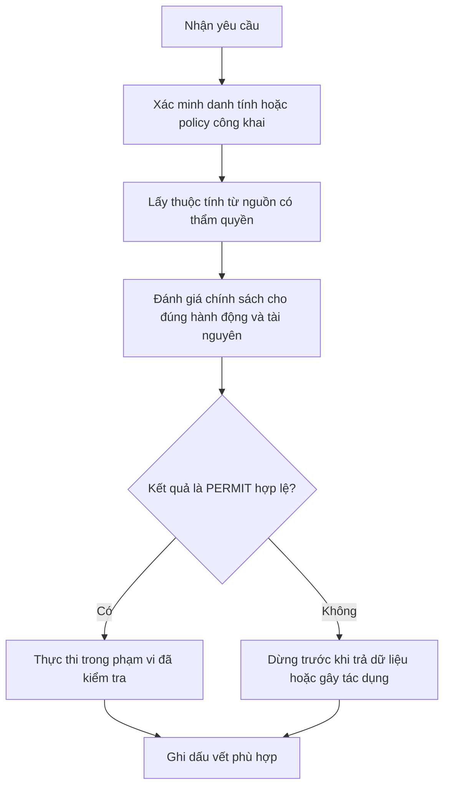

# Deny by default

## 1. Một yêu cầu chưa được cho phép phải dừng ở đâu?

Một hệ thống quản lý tài liệu có API đọc, sửa và xuất tài liệu. Nhóm phát triển đã quy định ai được đọc và ai được sửa. Vài tháng sau, một API xuất dữ liệu được thêm vào nhưng chưa có chính sách phân quyền tương ứng. Người dùng đã đăng nhập gọi API mới này.

Nếu hệ thống cho phép vì không tìm thấy quy tắc cấm, chức năng mới trở thành một đường truy cập ngoài dự kiến. Nếu hệ thống yêu cầu có quy tắc cho phép phù hợp trước khi thực hiện, yêu cầu sẽ bị chặn cho tới khi quyền xuất dữ liệu được thiết kế rõ ràng.

**Deny by default** là nguyên tắc mặc định từ chối quyền truy cập: trong phạm vi tài nguyên được bảo vệ, yêu cầu chỉ được thực hiện khi có căn cứ cho phép hợp lệ, áp dụng cho đúng chủ thể, hành động, tài nguyên và điều kiện hiện tại.

Không có quyền cho phép phù hợp không đồng nghĩa với được phép. Đăng nhập thành công cũng không tạo ra quyền đối với mọi tài nguyên.

OWASP khuyến nghị đặt mặc định từ chối, đồng thời cấu hình rõ hành vi này thay vì phụ thuộc hoàn toàn vào mặc định của thư viện. Đây là một phần của thiết kế authorization, không chỉ là một lựa chọn trong màn hình cấu hình. [OWASP Authorization Cheat Sheet — Deny by Default](https://cheatsheetseries.owasp.org/cheatsheets/Authorization_Cheat_Sheet.html#deny-by-default).

Trong phạm vi IAM, nguyên tắc này áp dụng cho người dùng, tài khoản quản trị và danh tính workload. Một service đã xác thực bằng chứng thư hoặc access token vẫn phải được cấp quyền cho thao tác cụ thể mà nó yêu cầu.

## 2. Deny by default liên quan thế nào đến các nguyên tắc khác?

| Khái niệm | Câu hỏi chính | Ví dụ trong hệ thống tài liệu |
| --- | --- | --- |
| Authentication | Chủ thể là ai và bằng chứng danh tính có hợp lệ không? | Token hợp lệ đại diện cho người dùng An |
| Authorization | Chủ thể có được làm việc này với tài nguyên này không? | An được sửa tài liệu D-42 hay chỉ được đọc? |
| Deny by default | Khi chưa xác lập được quyền cho phép, hệ thống làm gì? | Không có rule cho `document:export` thì chặn xuất |
| Least privilege | Quyền được cấp nên rộng đến đâu? | Chỉ cấp đọc tài liệu thuộc bộ phận cần thiết |
| Fail closed | Khi cơ chế kiểm soát lỗi, hệ thống có mở quyền không? | Không gọi được policy service thì không thực hiện thao tác được bảo vệ |
| Explicit deny | Một lệnh cấm cụ thể xử lý trường hợp nào? | Tài khoản bị đình chỉ không được sửa tài liệu |

Least privilege định hướng phạm vi của những quyền được cấp. Deny by default xác định kết quả của những trường hợp chưa được cấp quyền. Một hệ thống có mặc định từ chối vẫn có thể vi phạm least privilege nếu rule cho phép quá rộng, chẳng hạn cấp `document:*` cho mọi nhân viên.

Fail closed bổ sung hành vi khi kiểm soát gặp lỗi. Hệ thống có thể mặc định từ chối khi không khớp rule nhưng lại mở quyền khi policy service timeout. Khi đó, chỉ đường đi bình thường tuân thủ deny by default; đường đi lỗi vẫn làm hỏng ranh giới bảo vệ.

Explicit deny là một quy tắc cấm cụ thể, còn default deny là kết quả khi không có căn cứ cho phép. Hai khái niệm này cần được phân biệt khi đọc log và khi thiết kế thuật toán kết hợp nhiều policy.

## 3. Mô hình quyết định: chủ thể, hành động, tài nguyên, ngữ cảnh

Có thể biểu diễn một yêu cầu phân quyền bằng bộ dữ liệu:

```text
authorize(subject, action, resource, context)
```

Trong đó:

- `subject`: danh tính đã được xác minh và thuộc tính liên quan, như tenant, trạng thái tài khoản, quyền được cấp.
- `action`: hành động nghiệp vụ cụ thể, như `document:read`, `document:update`, `document:export`.
- `resource`: tài nguyên đích và thuộc tính do hệ thống quản lý, như tenant sở hữu, chủ sở hữu, trạng thái tài liệu.
- `context`: điều kiện đánh giá cần thiết, như thời điểm, mức xác thực hoặc thông tin phiên nếu policy yêu cầu.

Trong ví dụ của bài này, một yêu cầu được thực hiện khi đồng thời thỏa mãn:

```text
Danh tính hợp lệ
AND các ràng buộc bắt buộc đều đạt
AND có rule cho phép phù hợp
AND không có quyết định cấm ưu tiên theo mô hình policy đã chọn
AND kết quả đánh giá có thể được tin cậy tại thời điểm thực thi
```

Đây là mô hình thiết kế cho ví dụ, không phải một thuật toán kết hợp policy duy nhất dùng cho mọi sản phẩm IAM. Từng hệ thống phải xác định rõ thứ tự đánh giá và cách xử lý xung đột.

### 3.1. Không biến dữ liệu từ client thành bằng chứng quyền hạn

Giả sử request gửi:

```json
{
  "documentId": "D-42",
  "tenantId": "T-A",
  "ownerId": "an",
  "isAdmin": true
}
```

Client có thể đang chọn một tài liệu, nhưng không được tự chứng minh rằng mình là chủ tài liệu hoặc là quản trị viên. Server phải lấy danh tính từ cơ chế xác thực đã kiểm chứng; tenant, chủ sở hữu và trạng thái tài nguyên phải lấy từ nguồn có thẩm quyền.

Nếu ứng dụng cho người dùng chọn tenant đang thao tác, server còn phải xác minh người dùng có quan hệ hợp lệ với tenant đó. Header `X-Tenant-Id` tự nó chỉ là dữ liệu yêu cầu.

Không có tenant đáng tin cậy thì không được suy ra quyền truy cập mọi tenant. Không tải được danh sách quyền thì không được suy ra danh sách không hạn chế.

### 3.2. Phân biệt các kết quả đánh giá

Một mô hình giảng dạy hữu ích gồm bốn trạng thái:

| Kết quả | Ý nghĩa | Hành vi tại điểm thực thi |
| --- | --- | --- |
| `PERMIT` | Đã xác lập được quyền phù hợp | Có thể tiếp tục trong đúng phạm vi đã đánh giá |
| `DENY` | Có điều kiện hoặc quy tắc cấm | Chặn thao tác |
| `NOT_APPLICABLE` | Không có rule áp dụng để cấp quyền | Chặn thao tác theo mặc định |
| `INDETERMINATE` | Thiếu dữ liệu hoặc không đánh giá được đáng tin cậy | Chặn thao tác và phân biệt lỗi vận hành |

Không phải policy engine nào cũng dùng bốn tên này. Điều cần giữ là hợp đồng giữa nơi quyết định và nơi thực thi: chỉ một kết quả cho phép hợp lệ mới mở đường thực hiện thao tác.

```text
Thực hiện thao tác được bảo vệ chỉ khi decision == PERMIT
```

Một điều kiện như `decision != DENY` có thể vô tình cho `NOT_APPLICABLE`, `INDETERMINATE` hoặc `null` đi qua. Việc giữ lý do từ chối riêng vẫn quan trọng: thiếu quyền và lỗi hạ tầng có thể cùng chặn thao tác nhưng cần phản hồi, cảnh báo và cách khắc phục khác nhau.

## 4. Ví dụ chính sách cho ứng dụng nhiều tenant

Giả sử ứng dụng tài liệu có các quyền sau:

- `document:read:own`: đọc tài liệu của chính mình trong tenant đang được xác minh.
- `document:read:tenant`: đọc tài liệu trong tenant đang được xác minh.
- `document:update:own`: sửa tài liệu nháp của chính mình trong tenant đó.

Mọi yêu cầu đều phải qua ràng buộc tài khoản hoạt động và tenant của chủ thể trùng tenant tài nguyên. Bài này chưa cấp quyền xóa hay xuất tài liệu.

| Chủ thể và tài nguyên | Hành động | Kết quả | Căn cứ |
| --- | --- | --- | --- |
| An có `read:own`, là chủ D-42 trong T-A | Đọc D-42 | Cho phép | Khớp rule đọc tài liệu của mình |
| Bình có `read:own`, không phải chủ D-42 trong T-A | Đọc D-42 | Từ chối | Không có quyền đọc tài liệu người khác |
| Chi có `read:tenant`, thuộc T-A | Đọc D-42 của An trong T-A | Cho phép | Quyền đọc trong tenant áp dụng |
| Chi có `read:tenant`, thuộc T-A | Đọc D-99 trong T-B | Từ chối | Vi phạm ranh giới tenant |
| An có `update:own`, sở hữu D-42 đang nháp | Sửa D-42 | Cho phép | Khớp chủ sở hữu, quyền và trạng thái |
| An có `update:own`, sở hữu D-42 đã duyệt | Sửa D-42 | Từ chối | Rule sửa bản nháp không áp dụng |
| An có đầy đủ ba quyền kể trên | Xuất tài liệu | Từ chối | Chưa có rule cho `document:export` |
| An bị đình chỉ | Đọc tài liệu của mình | Từ chối | Ràng buộc tài khoản hoạt động không đạt |
| Không xác định được tenant của tài nguyên | Đọc tài liệu | Không thực hiện | Thiếu thuộc tính cần để quyết định |

Quyền đọc không tự bao hàm quyền sửa hoặc xuất. Chức danh quản lý cũng không tự bao hàm quyền vượt tenant, trừ khi hệ thống có chính sách cho phép cụ thể và được thực thi rõ ràng.

Khi cần chức năng hỗ trợ xuyên tenant, hãy thiết kế một quyền chuyên biệt cùng điều kiện sử dụng, phạm vi tenant, thời hạn và dấu vết kiểm toán. Không thêm một nhánh `isAdmin -> true` đứng trước toàn bộ ràng buộc của hệ thống.

## 5. Đặt cổng kiểm soát trước tác dụng của thao tác

Hai thành phần thường được tách về mặt trách nhiệm:

- **Policy Decision Point — PDP**: đánh giá và đưa ra quyết định.
- **Policy Enforcement Point — PEP**: chặn hoặc cho tiếp tục tại ranh giới thực thi.

PDP trả `DENY` sẽ không có tác dụng nếu PEP vẫn gọi hàm xuất dữ liệu. PEP kiểm tra đúng cũng chưa đủ nếu tồn tại một đường gọi khác bỏ qua nó.



Trong sơ đồ, việc đọc metadata tối thiểu phục vụ đánh giá có thể xảy ra trước quyết định. Điều đó không cho phép trả nội dung tài liệu, gửi email, phát hành URL tải hoặc ghi thay đổi nghiệp vụ trước khi có quyền.

Một thứ tự nguy hiểm là:

```text
1. Sinh file xuất chứa dữ liệu nhạy cảm.
2. Đưa file lên một bucket có thể truy cập.
3. Kiểm tra người gọi có quyền xuất không.
4. Trả lỗi nếu không có quyền.
```

Trả lỗi ở bước cuối không thu hồi được dữ liệu đã lộ. Thứ tự phù hợp phải xác lập quyền trước khi tạo hoặc công bố đầu ra nhạy cảm. Nếu công việc kéo dài, còn cần xác định thời điểm kiểm tra lại quyền và kiểm tra quyền tải kết quả.

## 6. Ví dụ Java: chỉ mở quyền ở những nhánh xác định

Ví dụ dưới đây dùng cú pháp Java 17, độc lập với framework. Nó minh họa policy đọc và sửa tài liệu ở mục trước; chưa triển khai xác thực token, HTTP, cơ sở dữ liệu, cache hoặc hệ thống kiểm toán.

`Subject` phải được dựng từ danh tính đã xác minh. `Document` phải là metadata server tải từ nguồn có thẩm quyền. Trong ứng dụng thực tế, tập quyền của `Subject` nên là snapshot bất biến, chẳng hạn được sao chép bằng `Set.copyOf` sau khi kiểm tra dữ liệu.

```java
import java.util.Set;

public final class DenyByDefaultDemo {
    enum Decision {
        PERMIT, DENY, NOT_APPLICABLE, INDETERMINATE
    }

    enum State {
        DRAFT, APPROVED
    }

    record Subject(
            String id,
            String tenantId,
            boolean active,
            Set<String> permissions) {
    }

    record Document(
            String id,
            String tenantId,
            String ownerId,
            State state) {
    }

    private static boolean missing(String value) {
        return value == null || value.isBlank();
    }

    static Decision evaluate(Subject subject,
                             String action,
                             Document document) {
        if (subject == null || document == null || missing(action)) {
            return Decision.INDETERMINATE;
        }

        if (missing(subject.id())
                || missing(subject.tenantId())
                || subject.permissions() == null
                || missing(document.id())
                || missing(document.tenantId())
                || missing(document.ownerId())
                || document.state() == null) {
            return Decision.INDETERMINATE;
        }

        // Ràng buộc bắt buộc đứng trước các rule cấp quyền.
        if (!subject.active()) {
            return Decision.DENY;
        }
        if (!subject.tenantId().equals(document.tenantId())) {
            return Decision.DENY;
        }

        boolean owner = subject.id().equals(document.ownerId());
        Set<String> permissions = subject.permissions();

        return switch (action) {
            case "document:read" -> {
                boolean canReadTenant =
                        permissions.contains("document:read:tenant");
                boolean canReadOwn = owner
                        && permissions.contains("document:read:own");
                yield canReadTenant || canReadOwn
                        ? Decision.PERMIT : Decision.DENY;
            }
            case "document:update" -> {
                boolean canUpdate = owner
                        && document.state() == State.DRAFT
                        && permissions.contains("document:update:own");
                yield canUpdate ? Decision.PERMIT : Decision.DENY;
            }
            default -> Decision.NOT_APPLICABLE;
        };
    }

    static void requirePermit(Decision decision) {
        if (decision != Decision.PERMIT) {
            throw new SecurityException(
                    "Protected operation is not permitted");
        }
    }

    public static void main(String[] args) {
        Subject an = new Subject(
                "an", "T-A", true,
                Set.of("document:read:own", "document:update:own"));

        Document ownDraft = new Document(
                "D-42", "T-A", "an", State.DRAFT);
        Document otherTenant = new Document(
                "D-99", "T-B", "an", State.DRAFT);

        System.out.println(evaluate(an, "document:read", ownDraft));
        System.out.println(evaluate(an, "document:export", ownDraft));
        System.out.println(evaluate(an, "document:read", otherTenant));
        System.out.println(evaluate(an, "document:read", null));

        requirePermit(evaluate(an, "document:update", ownDraft));
        System.out.println("Authorized update may now begin");
    }
}
```

Đầu ra dự kiến:

```text
PERMIT
NOT_APPLICABLE
DENY
INDETERMINATE
Authorized update may now begin
```

Có ba chi tiết cần quan sát. Nhánh `default` không cấp quyền cho action mới. Ràng buộc tenant được kiểm tra trước các nhánh `PERMIT`. Hàm `requirePermit` chặn mọi giá trị khác `PERMIT`, kể cả `null`.

Trong ví dụ, `SecurityException` chỉ biểu diễn việc dừng luồng thực thi. Ứng dụng HTTP nên có lớp chuyển đổi quyết định và lỗi sang phản hồi phù hợp; không mặc định rằng mọi exception này đều phải trả cùng một mã trạng thái.

### 6.1. Những biến thể dễ mở quyền ngoài dự kiến

```java
// Nguy hiểm: hành động chưa biết được phép mặc định.
return switch (action) {
    case "document:delete" -> hasDeletePermission;
    default -> true;
};
```

Ví dụ trên chỉ kiểm soát hành động xóa. Một hành động mới như `document:export-all` sẽ được cho phép ngay khi xuất hiện.

```java
// Nguy hiểm: kết quả chưa xác định cũng có thể được đi qua.
if (decision != Decision.DENY) {
    performProtectedOperation();
}
```

Điều kiện phù hợp với hợp đồng của ví dụ là kiểm tra chính xác `PERMIT` trước khi gọi thao tác. Nếu policy trả kèm nghĩa vụ như che trường dữ liệu hoặc giới hạn hàng được đọc, PEP còn phải thực hiện các nghĩa vụ đó; một cờ cho phép không được làm mất các giới hạn đi kèm.

## 7. Default deny phải tồn tại ở từng bề mặt truy cập

### 7.1. Route và phương thức HTTP

Một danh sách các URL được bảo vệ có thể bỏ sót endpoint mới. Thay vào đó, có thể thiết kế bộ phân loại route với nhóm công khai được khai báo rõ, nhóm được bảo vệ có policy và phần còn lại bị chặn.

```text
GET  /public/help                  -> policy công khai
GET  /documents/{id}               -> document:read trên tài liệu đích
PATCH /documents/{id}              -> document:update trên tài liệu đích
POST /documents/{id}/export        -> chưa có policy: không thực hiện
Các route khác                    -> không được mở quyền ngầm
```

Đây là ví dụ mô tả policy, không phải cấu hình sao chép trực tiếp vào một framework. Route không tồn tại vẫn có thể trả `404`; ý nghĩa bảo mật là nó không được rơi vào một handler nhạy cảm có mặc định cho phép.

Quy tắc route cần xét cả phương thức HTTP. Quyền `GET /documents/{id}` không tự áp dụng cho `PATCH`, `DELETE` hay một API bulk. Các wildcard rộng như `/api/** -> authenticated` có thể xác lập yêu cầu đăng nhập nhưng chưa đủ để quyết định quyền nghiệp vụ.

Tài nguyên công khai là một trường hợp cho phép được thiết kế chủ động. Trang hướng dẫn công khai không cần buộc người dùng đăng nhập. Tuy nhiên, không nên vì mở `/public/help` mà cho phép mọi đường dẫn có tiền tố giống nhau truy cập dữ liệu nội bộ.

### 7.2. Tài nguyên cụ thể và kết quả dạng danh sách

Quyền gọi endpoint không thay thế quyền trên từng đối tượng. Nếu An gọi `/documents/D-99`, server phải kiểm tra D-99 thực sự nằm trong phạm vi An được phép truy cập. ID khó đoán chỉ giảm khả năng tìm thấy tài nguyên; nó không cấp quyền cho người biết ID.

Đối với API danh sách, phạm vi phân quyền còn phải đi vào truy vấn. Đếm tổng số bản ghi, tính tổng tiền hoặc tạo thống kê từ toàn bộ tenant rồi chỉ lọc các hàng trả về vẫn có thể làm lộ thông tin qua số liệu tổng hợp.

Ví dụ, nếu policy chỉ cho An đọc tài liệu của mình trong T-A, truy vấn cần áp dụng cả điều kiện tenant và chủ sở hữu trước khi phân trang hoặc tính tổng tương ứng. Nếu An có quyền đọc toàn tenant, điều kiện chủ sở hữu có thể được mở theo đúng rule đó; điều kiện tenant vẫn giữ nguyên trong mô hình này.

### 7.3. Tệp, URL tải và dữ liệu cache

Một API kiểm tra quyền đúng vẫn có thể lộ tài liệu nếu bucket lưu file cho phép truy cập công khai. Đường dẫn tải trực tiếp, bản xem trước, thumbnail, file đính kèm và kết quả export đều cần nằm trong thiết kế quyền truy cập.

Với URL ký sẵn, việc phát hành URL phải dựa trên quyền hợp lệ và giới hạn tài nguyên, thao tác, thời hạn. Người nắm URL có thể sử dụng nó theo cơ chế bearer mà nơi lưu trữ triển khai. Thu hồi quyền trong ứng dụng không nhất thiết làm URL đã phát hành mất hiệu lực ngay; phải tính cả giới hạn này khi chọn thời hạn hoặc cơ chế tải qua server.

Cache phản hồi cũng cần tách đúng đối tượng và phạm vi quyền. Một bản tài liệu đã được phép trả cho An không được trở thành phản hồi dùng chung cho Bình chỉ vì hai request có cùng đường dẫn.

### 7.4. Job nền và danh tính workload

Một yêu cầu export có thể đi qua HTTP, hàng đợi, worker nền và kho lưu trữ. Cần xác định rõ danh tính nào đang hành động ở mỗi chặng và ai được quyền lấy kết quả.

Nếu worker dùng tài khoản kỹ thuật có quyền đọc toàn bộ cơ sở dữ liệu, quyền kỹ thuật đó không tự chứng minh người yêu cầu export được đọc tất cả dữ liệu. Job phải mang ngữ cảnh ủy quyền đủ tin cậy, hoặc worker phải tra lại phạm vi được phép từ nguồn có thẩm quyền.

Đối với job chạy lâu, thiết kế phải nêu rõ quyền được chốt khi nhận job hay được đánh giá lại lúc chạy. Các tác vụ nhạy cảm có thể cần kiểm tra lại khi bắt đầu thực thi và khi phát hành kết quả. Không để lựa chọn này phụ thuộc ngẫu nhiên vào thời gian chờ hàng đợi.

## 8. Lỗi policy, cache và nguy cơ fail open

### 8.1. Timeout không phải quyết định cho phép

Xem giả mã sau:

```text
try:
    decision = policyService.evaluate(request)
catch Timeout:
    decision = PERMIT
```

Khi policy service gặp sự cố, hệ thống chuyển từ phân quyền sang cho phép rộng. Chính đường xử lý lỗi đã mở quyền.

Với thao tác được bảo vệ, cách xử lý phù hợp là dừng thực thi khi chưa có quyết định đáng tin cậy, giữ nguyên lý do lỗi và trả phản hồi dịch vụ phù hợp. Circuit breaker có thể giúp tránh gọi lặp vào dependency đang hỏng; nó không tạo ra quyền truy cập mới.

Không phải mọi thành phần đều phải chờ một policy service từ xa. Hệ thống có thể sử dụng policy đã tải về để đánh giá tại chỗ. Điều cần kiểm soát là policy có được xác thực, còn hiệu lực, đủ dữ liệu và đáp ứng yêu cầu thu hồi quyền hay không.

### 8.2. Cache cho phép phải có phạm vi rõ

Giả sử hệ thống cache kết quả `An được đọc D-42`. Nếu khóa cache chỉ gồm `subjectId`, một request đọc D-99 có thể dùng nhầm kết quả của D-42.

Tùy policy, khóa và điều kiện hợp lệ của cache có thể cần gắn với:

- Chủ thể và tenant đang có hiệu lực.
- Hành động cùng tài nguyên hoặc phạm vi tài nguyên đã được đánh giá.
- Phiên bản policy, phiên bản quyền hoặc thuộc tính có liên quan.
- Ngữ cảnh có ảnh hưởng đến quyết định, như yêu cầu xác thực tăng cường.
- Thời hạn và cơ chế vô hiệu hóa khi quyền hoặc tài nguyên thay đổi.

Thời gian sống ngắn vẫn tạo ra một khoảng quyền cũ có thể còn hiệu lực. Nếu nghiệp vụ yêu cầu thu hồi ngay, cần một cơ chế phù hợp hơn chỉ đặt TTL.

Một cache entry đã quá hạn không phải là quyền cho phép hợp lệ theo hợp đồng yêu cầu dữ liệu còn hạn. Tiếp tục dùng entry đó khi dependency lỗi là một lựa chọn mở rộng thời gian sử dụng quyền cũ, phải được thiết kế rõ; không nên coi đó là deny by default đầy đủ.

### 8.3. Dữ liệu thiếu không phải giá trị trung lập

Các phép chuyển đổi sau có thể âm thầm mở quyền:

```text
Không có tenantId      -> bỏ điều kiện tenant khỏi truy vấn.
Không tải được grants -> coi là tài khoản đặc biệt không bị giới hạn.
Không biết action     -> coi như document:read.
Không có ownerId      -> mọi thành viên đều là chủ sở hữu.
Không có policy       -> dùng policy cho phép chung.
```

Hãy xác định dữ liệu nào bắt buộc cho từng quyết định. Khi thiếu dữ liệu bắt buộc, hệ thống dừng thao tác và ghi lý do; không dùng một giá trị thay thế làm tăng quyền.

### 8.4. Kiểm tra đúng nhưng thực thi với dữ liệu đã đổi

An được phép sửa D-42 khi tài liệu còn nháp. Sau khi kiểm tra quyền, một giao dịch khác duyệt tài liệu. Nếu thao tác sửa vẫn tiếp tục mà không xét thay đổi, quyền được kiểm tra cho một trạng thái khác với trạng thái được cập nhật.

Đây là vấn đề khoảng cách giữa kiểm tra và sử dụng. Tùy mô hình lưu trữ, có thể dùng giao dịch, khóa phù hợp hoặc câu lệnh cập nhật có điều kiện gồm tenant, chủ sở hữu, trạng thái và phiên bản bản ghi. Nếu điều kiện không còn đúng, thao tác phải thất bại hoặc được đánh giá lại.

Default deny không tự giải quyết tính đồng thời. Quyền cho phép chỉ có ý nghĩa khi thao tác thực tế vẫn nằm trong điều kiện đã được cho phép.

## 9. Default deny và thuật toán kết hợp nhiều policy

Giả sử một policy cấp quyền đọc trong tenant, một policy cấm tài khoản bị đình chỉ và một policy cấp quyền hỗ trợ vận hành. Cần định nghĩa cách tổng hợp khi nhiều policy cùng áp dụng.

Một mô hình có thể yêu cầu tất cả ràng buộc bắt buộc đạt, sau đó cần ít nhất một rule cho phép phù hợp. Một mô hình khác có thuật toán ưu tiên deny hoặc đánh giá theo thứ tự. Không được suy ra hành vi tổng hợp chỉ từ nhãn “default deny”.

Đặc biệt, deny by default không tự có nghĩa là mọi explicit deny luôn thắng mọi allow trong mọi công nghệ IAM. Phải đọc hợp đồng đánh giá của sản phẩm đang dùng và kiểm thử chính cấu hình đó.

Với Open Policy Agent, Rego cho phép khai báo `default allow := false`; khi không rule cùng tên nào xác định được giá trị, giá trị mặc định được dùng. Đây là một cơ chế cụ thể để biểu diễn nền tảng từ chối. Nó không tự xử lý lỗi gọi dịch vụ hoặc lỗi adapter bên ngoài OPA. [OPA Policy Language — Default Keyword](https://www.openpolicyagent.org/docs/policy-language/#default-keyword).

Do đó, một thiết kế hoàn chỉnh phải kiểm tra cả hai phía: policy có mặc định đúng và ứng dụng tích hợp có chỉ chấp nhận kết quả cho phép hợp lệ hay không. Ví dụ, JSON phản hồi không có field `allow` không được chuyển thành `true` vì một giá trị mặc định trong bộ giải mã.

## 10. Phản hồi cho người gọi và dấu vết vận hành

### 10.1. Chặn thao tác không có nghĩa luôn trả cùng một mã HTTP

Đối với API HTTP, cần phân biệt tình huống theo ngữ nghĩa giao thức:

- `401`: thiếu thông tin xác thực hợp lệ; phản hồi phải có `WWW-Authenticate` phù hợp.
- `403`: server hiểu request nhưng từ chối thực hiện.
- `404`: có thể được dùng khi server chủ động không tiết lộ sự tồn tại của tài nguyên bị cấm.

Các ngữ nghĩa trên được mô tả trong [RFC 9110, mục 15.5.2–15.5.5](https://www.rfc-editor.org/rfc/rfc9110.html#name-401-unauthorized).

Khi dependency phân quyền lỗi tạm thời làm dịch vụ không thể xử lý request, ứng dụng có thể thiết kế phản hồi `503` phù hợp với tình trạng không sẵn sàng. Cần phân biệt lỗi này với một quyết định thiếu quyền đã được xác lập. [RFC 9110 — 503 Service Unavailable](https://www.rfc-editor.org/rfc/rfc9110.html#name-503-service-unavailable).

Phản hồi lỗi không được chứa nội dung tài liệu hay thông tin nội bộ không cần thiết. Nếu chọn che giấu tài nguyên bằng `404`, phải xét cả endpoint danh sách, thống kê, thông báo lỗi và các đường truy cập liên quan; đổi riêng mã trạng thái chưa tạo ra một cơ chế che giấu nhất quán.

### 10.2. Giữ lý do đủ để điều tra

Một bản ghi quyết định có thể có dạng:

```json
{
  "event": "authorization_decision",
  "requestId": "req-2058",
  "subjectId": "an",
  "tenantId": "T-A",
  "action": "document:export",
  "resourceId": "D-42",
  "decision": "NOT_APPLICABLE",
  "enforcement": "BLOCKED",
  "reasonCode": "NO_APPLICABLE_ALLOW",
  "policyVersion": "documents-v7"
}
```

Đây là schema minh họa. Hệ thống thực tế cần xác định trường nào được phép ghi theo phân loại dữ liệu và quyền đọc log. Không ghi nguyên access token, mật khẩu hoặc nội dung tài liệu vào log quyết định.

Hai biến động đáng theo dõi là số lần `NO_APPLICABLE_ALLOW` tăng sau khi thêm chức năng và số lần `INDETERMINATE` tăng do dependency lỗi. Trường hợp đầu có thể chỉ ra thiếu policy; trường hợp sau có thể chỉ ra vấn đề vận hành. Không xử lý cả hai bằng cách thêm một rule cho phép mọi người.

## 11. Thiết kế kiểm thử cho default deny

Kiểm thử chỉ có trường hợp người hợp lệ đọc được tài liệu chưa chứng minh được mặc định từ chối. Cần có các trường hợp không được cấp quyền và các trường hợp thiếu căn cứ để đánh giá.

| Tình huống kiểm thử | Kết quả cần quan sát |
| --- | --- |
| Chủ sở hữu có `read:own`, đúng tenant | Được đọc đúng tài liệu |
| Người khác chỉ có `read:own` | Không nhận được nội dung tài liệu |
| Có quyền đọc nhưng gọi hành động cập nhật | Không cập nhật được dữ liệu |
| Có quyền đọc trong T-A nhưng truy cập T-B | Không đọc được dữ liệu T-B |
| Action mới chưa được khai báo | Bị chặn mặc định |
| Endpoint mới chưa có policy | Không được mở quyền tự động |
| Thiếu tenant hoặc thuộc tính bắt buộc | Không thực hiện thao tác được bảo vệ |
| Policy service timeout hoặc trả kết quả sai định dạng | Không chạy handler nhạy cảm |
| Quyết định là `null` hoặc không xác định | Không được coi là cho phép |
| Tài khoản bị đình chỉ nhưng vẫn có grants cũ | Bị chặn theo ràng buộc tài khoản |
| Gọi trực tiếp API thay vì qua giao diện | Kết quả phân quyền vẫn được thực thi |
| Đọc trực tiếp tệp hoặc kết quả export | Không có đường truy cập ngoài policy đã thiết kế |
| Cache có permit của tài nguyên khác | Không tái sử dụng sai phạm vi |
| Tài nguyên thay đổi trạng thái sau bước kiểm tra | Không thực hiện cập nhật trái với điều kiện |

Một ca kiểm thử âm cần quan sát cả tác dụng của thao tác. API trả lỗi nhưng vẫn ghi dữ liệu, phát message hoặc tạo file nhạy cảm là thất bại. Với thao tác đọc, cần kiểm tra body, header và đường tải phụ không chứa dữ liệu ngoài phạm vi.

Có thể chia việc xác minh thành kiểm thử hàm policy, kiểm thử tích hợp qua cổng thực thi và kiểm thử bao phủ các bề mặt truy cập. Việc tự động liệt kê route rồi phát hiện route thiếu phân loại có ích, nhưng chỉ phát hiện được thiếu khai báo; nó chưa chứng minh rule phân quyền đã phản ánh đúng nghiệp vụ.

Với API bulk, phải chọn hợp đồng rõ: từ chối cả yêu cầu nếu có phần tử không hợp lệ, hoặc chỉ thực hiện các phần tử được phép và báo kết quả theo thiết kế. Trong cả hai trường hợp, một phần tử không được phép không được tạo tác dụng chỉ vì nó nằm cạnh một phần tử hợp lệ.

## 12. Áp dụng vào hệ thống đang có người sử dụng

Chuyển sang mặc định từ chối có thể phát hiện nhiều đường truy cập trước đây chưa được mô tả. Cách triển khai cần giúp đội vận hành nhận ra thiếu policy mà vẫn giữ mục tiêu bảo vệ.

Một lộ trình thực tế gồm:

1. Lập danh mục tài nguyên, hành động, danh tính và điểm thực thi, bao gồm API nội bộ, job nền và đường tải file.
2. Viết các trường hợp cho phép theo nhu cầu nghiệp vụ; xác định ràng buộc tenant, chủ sở hữu và trạng thái.
3. Chọn cách kết hợp policy, kết quả mặc định và cách xử lý lỗi ở adapter.
4. Thêm kiểm thử cho cả đường được phép, bị cấm, chưa có rule và dependency lỗi.
5. Triển khai có quan sát, kiểm soát phạm vi thay đổi và chuẩn bị phương án quay lui chính xác.
6. Sửa các rule thiếu đã được xác minh, rồi tiếp tục rà soát quyền theo vòng đời tài khoản và chức năng.

Nếu dùng chế độ chỉ ghi nhận quyết định dự kiến, giai đoạn đó chưa thực thi default deny. Các tài nguyên cần bảo vệ vẫn phải được kiểm soát bằng cơ chế đang có; log dự kiến không thay thế cổng thực thi.

Không nên chữa lỗi gián đoạn bằng `permit all` ở cuối danh sách rule. Nếu cần ngoại lệ vận hành, ngoại lệ phải trở thành một quyền cho phép được giới hạn, có điều kiện sử dụng và có thời điểm hết hiệu lực. Quyền khẩn cấp cũng cần một chính sách rõ ràng, thay vì một đường đi bỏ qua toàn bộ hệ thống phân quyền.

## 13. Bài tập tình huống

Một ứng dụng lưu hóa đơn có ba sự kiện sau:

1. Nhóm phát triển thêm `POST /invoices/bulk-export` và chỉ yêu cầu người gọi đã đăng nhập.
2. Khi dịch vụ quyền không phản hồi, ứng dụng dùng kết quả `allow = true` để tránh gián đoạn.
3. Người dùng được quyền đọc hóa đơn A nhận URL tải có thể truy cập thêm các hóa đơn khác bằng cách đổi ID trong đường dẫn.

Hãy xác định điều kiện cho phép cần có, vị trí chặn và hành vi khi không đủ dữ liệu.

### Gợi ý phân tích

Ở sự kiện thứ nhất, đăng nhập chỉ xác lập danh tính. Bulk export cần một hành động phân quyền riêng cùng phạm vi hóa đơn mà người gọi được phép xuất. Nếu policy chưa được định nghĩa, endpoint không được tự mở quyền. Việc chỉ kiểm tra quyền đọc một hóa đơn trong danh sách cũng không cho phép xuất các hóa đơn còn lại.

Ở sự kiện thứ hai, lỗi dependency đã bị chuyển thành quyền mới. Điểm thực thi phải dừng trước khi đọc hoặc công bố dữ liệu xuất, phân biệt lỗi vận hành với thiếu quyền và trả phản hồi phù hợp. Một policy cục bộ còn hiệu lực có thể là phương án kiến trúc nếu được thiết kế từ trước; `allow = true` trong nhánh timeout không phải một policy hợp lệ.

Ở sự kiện thứ ba, cổng kiểm soát API không bao phủ đường tải. Cần xác định URL là đường truy cập qua server hay URL ủy quyền có giới hạn do kho lưu trữ thực thi. Quyền tải phải gắn với đúng tài nguyên và điều kiện đã cấp; không dựa vào việc người dùng chỉ biết một ID ban đầu.

Trong cả ba sự kiện, câu hỏi thiết kế cần trả lời là: **căn cứ cho phép cụ thể nằm ở đâu, áp dụng cho phạm vi nào, và điều gì chặn thao tác khi căn cứ đó không tồn tại hoặc không còn đáng tin cậy?**

## 14. Tài liệu tham khảo

- [OWASP Authorization Cheat Sheet](https://cheatsheetseries.owasp.org/cheatsheets/Authorization_Cheat_Sheet.html): khuyến nghị mặc định từ chối và các điểm cần lưu ý khi thiết kế authorization.
- [Open Policy Agent — Policy Language, Default Keyword](https://www.openpolicyagent.org/docs/policy-language/#default-keyword): cách khai báo giá trị mặc định và ý nghĩa của kết quả chưa được xác định trong Rego.
- [RFC 9110 — HTTP Semantics](https://www.rfc-editor.org/rfc/rfc9110.html): ngữ nghĩa phản hồi HTTP khi xác thực, từ chối truy cập hoặc dịch vụ không sẵn sàng.
