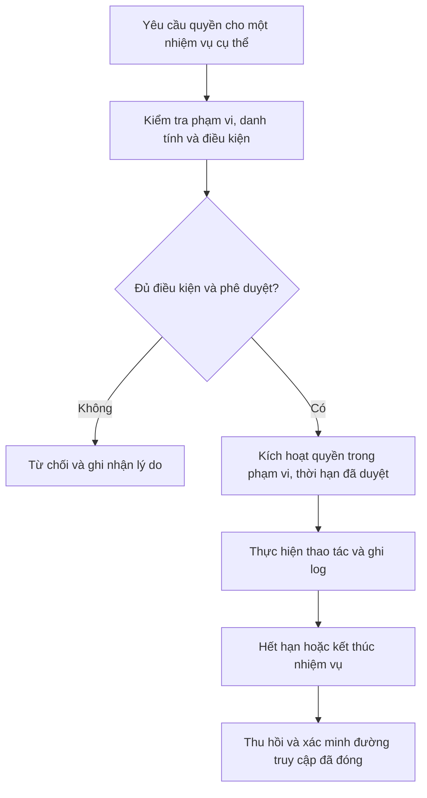

# Least privilege — Nguyên tắc ít quyền nhất

## 1. Vì sao một tài khoản đăng nhập hợp lệ vẫn có thể gây sự cố lớn?

Một nhân viên hỗ trợ cần xem trạng thái hóa đơn của khách hàng đang được hỗ trợ. Để cấu hình nhanh, đội vận hành gán cho nhân viên vai trò `billing-admin`. Vai trò này còn cho phép xuất toàn bộ dữ liệu hóa đơn, hoàn tiền và cấp quyền cho người khác.

Nhân viên có thể làm việc ngay, nhưng hệ thống đã trao nhiều khả năng hơn công việc yêu cầu. Khi tài khoản bị chiếm, khi nhân viên thao tác nhầm hoặc khi một công cụ tự động dùng sai credential, hậu quả không còn giới hạn ở việc xem một hóa đơn.

**Least privilege** yêu cầu mỗi danh tính chỉ có quyền cần thiết để thực hiện nhiệm vụ đã được giao. Định nghĩa của NIST áp dụng cho cả người dùng và tiến trình hoạt động thay người dùng. Vì vậy, nguyên tắc này liên quan đến nhân viên, quản trị viên, ứng dụng, job CI/CD và danh tính workload. [NIST — Least privilege](https://csrc.nist.gov/glossary/term/least_privilege).

Trong chương Authorization fundamentals, câu hỏi trọng tâm của bài là:

> Danh tính này cần thực hiện thao tác nào, trên tài nguyên nào, trong điều kiện nào và đến khi nào?

Sau bài học, bạn có thể mô tả một quyền đủ cụ thể để triển khai, nhận ra quyền dư thừa trong nhiều lớp hệ thống, và thiết kế cách cấp, sử dụng, thu hồi quyền gắn với một nhiệm vụ nghiệp vụ.

## 2. Authentication xác nhận danh tính; authorization giới hạn khả năng

Giả sử Lan đăng nhập bằng mật khẩu và MFA. Hệ thống có thể tin cậy hơn rằng người đang sử dụng phiên là Lan. Điều đó chưa trả lời Lan có được hoàn tiền hóa đơn `INV-731` hay không.

Một yêu cầu truy cập cần được xét theo bốn thành phần:

| Thành phần | Câu hỏi | Ví dụ trong hệ thống hóa đơn |
| --- | --- | --- |
| Subject | Ai đang yêu cầu? | Lan, nhân viên hỗ trợ đang hoạt động |
| Action | Muốn làm gì? | Xem thông tin tóm tắt hóa đơn |
| Resource | Tác động lên đối tượng nào? | Hóa đơn INV-731 của tenant acme |
| Context | Điều kiện hiện tại có phù hợp? | Đang được giao xử lý yêu cầu hỗ trợ, quyền chưa hết hạn |

MFA giải quyết một phần rủi ro giả mạo danh tính. Authorization quyết định thao tác có được phép thực hiện. Least privilege định hướng việc thiết kế các quyền mà authorization sẽ kiểm tra.

Ví dụ, một phiên đã xác thực mạnh vẫn phải bị từ chối khi gọi chức năng xuất dữ liệu của tenant khác. Ngược lại, nhân viên cần quyền xem đúng hóa đơn để xử lý công việc; việc từ chối mọi thao tác cũng không phải mục tiêu thiết kế.

Có thể phân biệt thêm ba khái niệm thường gặp:

- **Quyền** là khả năng thực hiện một thao tác trong phạm vi xác định.
- **Role** là cách đóng gói một nhóm quyền để quản lý.
- **Credential hoặc token** là phương tiện chứng minh danh tính hay mang thông tin cấp quyền trong một cơ chế cụ thể.

Một role có tên `viewer` vẫn có thể quá rộng nếu nó đọc được mọi dữ liệu nhạy cảm. Token sống ngắn vẫn có thể gây thiệt hại lớn nếu được dùng để quản trị toàn bộ hệ thống trong khoảng thời gian còn hiệu lực.

## 3. Quyền tối thiểu cần được xác định theo nhiều chiều

### 3.1. Đúng thao tác

Tách các hành động có hậu quả khác nhau:

```text
invoice:read-summary
invoice:read-sensitive
invoice:export
invoice:refund
invoice:delete
invoice:grant-access
```

Một tác vụ xem trạng thái hóa đơn không tự động cần quyền xuất dữ liệu hoặc cấp quyền. Việc sử dụng một quyền chung như `invoice:manage` khiến các khác biệt đó khó biểu diễn và khó kiểm tra.

Tách nhỏ quyền phải phục vụ một ranh giới nghiệp vụ có ý nghĩa. Nếu mỗi chi tiết giao diện đều trở thành một quyền độc lập, hệ thống dễ tạo ra hàng nghìn quyền khó quản lý. Điểm xuất phát phù hợp là thao tác nghiệp vụ và tác động bảo mật của nó.

### 3.2. Đúng tập tài nguyên

Quyền `invoice:read-summary` có thể áp dụng cho:

- Một hóa đơn cụ thể.
- Các hóa đơn thuộc một khách hàng được giao phụ trách.
- Các hóa đơn thuộc một tenant.
- Mọi tenant trong hệ thống.

Bốn phạm vi này có hậu quả rất khác nhau. Thu hẹp action mà giữ resource là toàn hệ thống vẫn có thể làm lộ dữ liệu diện rộng.

Trong ứng dụng đa tenant, việc xác định `tenantId` phải dựa trên danh tính và membership đã được xác minh. Một tham số `tenantId` do client gửi lên chỉ là dữ liệu đầu vào cần kiểm tra, chưa phải bằng chứng về quyền truy cập.

### 3.3. Đúng dữ liệu và quy mô thao tác

Hai người cùng được xem một hóa đơn chưa chắc cần cùng tập trường dữ liệu. Nhân viên hỗ trợ có thể cần mã hóa đơn, tổng tiền và trạng thái; bộ phận xử lý tranh chấp có thể cần thêm thông tin khác theo chính sách.

Tương tự, xem từng hóa đơn để xử lý yêu cầu hỗ trợ khác với xuất hàng triệu dòng. Với những tác vụ có tác động lớn, cần cân nhắc quyền export riêng, giới hạn khối lượng hoặc luồng phê duyệt tương ứng.

Giới hạn tốc độ giúp kiểm soát tần suất thao tác. Nó bổ sung cho authorization; một yêu cầu truy cập tài nguyên không được phép vẫn phải bị từ chối dù chưa chạm giới hạn tốc độ.

### 3.4. Đúng thời gian và môi trường

Một kỹ sư cần điều tra lỗi production trong 45 phút không nhất thiết cần giữ quyền đọc log production suốt thời gian làm việc tại công ty.

Các chiều giới hạn có thể bao gồm thời điểm bắt đầu, thời điểm hết hạn, môi trường, dự án và điều kiện xác thực tăng cường. Các con số như 45 phút trong bài chỉ là giả định phục vụ ví dụ; thời hạn thực tế phải phù hợp với nhiệm vụ và khả năng thu hồi của hệ thống.

### 3.5. Đúng khả năng trao quyền tiếp

Một danh tính có thể không trực tiếp đọc dữ liệu nhạy cảm nhưng lại có quyền:

```text
sửa policy → cấp role → lấy credential của role → đọc dữ liệu
```

Khi đó, quyền hiệu lực của danh tính lớn hơn những action đọc dữ liệu được gán trực tiếp. Những khả năng như sửa nhóm, đổi role binding, tạo credential, sửa pipeline hoặc thay chương trình chạy dưới tài khoản đặc quyền đều cần được xét.

Điều này giải thích vì sao đánh giá least privilege cần xem cả đường đi đến quyền khác, thay vì chỉ đếm số permission trong một policy.

## 4. Mô hình tư duy về quyền hiệu lực

Tại một thời điểm và ngữ cảnh nhất định, gọi:

- `N` là tập thao tác nghiệp vụ mà danh tính thực sự cần thực hiện.
- `E` là tập thao tác mà hệ thống thực tế cho danh tính thực hiện.
- `E − N` là phần quyền dư.
- `N − E` là phần quyền còn thiếu để làm việc.

Mỗi phần tử ở đây nên hiểu là một yêu cầu cụ thể gồm action, resource và context, không chỉ là một chuỗi tên quyền.

Mục tiêu thiết kế là làm cho `E` khớp với nhu cầu đã được xác nhận trong phạm vi đang xét. Trong thực tế, `N` không luôn biết đầy đủ từ đầu và thay đổi khi nhiệm vụ thay đổi. Vì vậy, đây là một quá trình rà soát liên tục.

```text
Nhu cầu nghiệp vụ
        ↓
Quyền dự kiến được cấp
        ↓
Role, group, policy, resource policy, delegation
        ↓
Quyền hiệu lực trên hệ thống thực
        ↓
Hành vi quan sát được và kết quả rà soát
        ↺
```

Không có một công thức hợp hoặc giao policy duy nhất áp dụng cho mọi nền tảng. Có nền tảng cộng quyền từ nhiều nguồn; có nơi áp dụng explicit deny, permission boundary, resource policy hoặc quy tắc kết hợp riêng.

Khi triển khai, phải đọc semantics của nền tảng được dùng và kiểm tra quyền hiệu lực. Phép biểu diễn tập hợp trong bài giúp đặt câu hỏi; nó không thay thế thuật toán đánh giá policy của một sản phẩm.

Một trường hợp dễ bỏ sót:

```text
Role trực tiếp:           chỉ đọc hóa đơn
Group finance-legacy:     cho phép hoàn tiền
Delegation đang hiệu lực: cho phép xuất dữ liệu

Kết luận: bỏ quyền hoàn tiền khỏi role trực tiếp chưa đủ.
```

Nếu người dùng vẫn thuộc `finance-legacy`, khả năng hoàn tiền có thể tiếp tục tồn tại. Việc thu hồi phải xử lý đúng nguồn đang cấp quyền.

## 5. Từ nhiệm vụ nghiệp vụ đến ma trận quyền

Xét một dịch vụ hóa đơn có nhiều tenant. Ta bắt đầu bằng bốn nhiệm vụ thay vì bắt đầu từ các role có sẵn:

1. Khách hàng xem hóa đơn của mình.
2. Nhân viên hỗ trợ xem tóm tắt hóa đơn liên quan yêu cầu được giao.
3. Nhân viên tài chính hoàn tiền theo hạn mức và điều kiện nghiệp vụ.
4. Job tổng hợp tạo báo cáo từ một tập dữ liệu đã xác định.

Một ma trận minh họa:

| Danh tính và nhiệm vụ | Action được cấp | Phạm vi tài nguyên | Điều kiện quan trọng | Quyền không đi kèm |
| --- | --- | --- | --- | --- |
| Khách hàng xem hóa đơn | read-summary | Hóa đơn thuộc khách hàng trong tenant hợp lệ | Tài khoản và quan hệ sở hữu còn hiệu lực | Hóa đơn khách hàng khác, refund, export toàn tenant |
| Nhân viên hỗ trợ xử lý ticket | read-summary | Hóa đơn gắn với ticket được giao | Assignment và quyền truy cập còn hiệu lực | Đọc dữ liệu thanh toán nhạy cảm, cấp quyền |
| Nhân viên tài chính hoàn tiền | refund | Hóa đơn thuộc phạm vi được giao | Chưa vượt số tiền có thể hoàn, đáp ứng quy trình phê duyệt | Tự thay hạn mức, tự duyệt ngoại lệ |
| Job tổng hợp báo cáo | read-report-input, write-report | Nguồn dữ liệu và vùng báo cáo của job | Danh tính workload đúng môi trường | Sửa hóa đơn, quản trị IAM, đọc secret ngoài nhiệm vụ |

Đây là thiết kế cho tình huống giả định, không phải tập role chuẩn cho mọi doanh nghiệp.

Ma trận cần làm rõ cả điều kiện cho phép và ranh giới bị từ chối. Cụm từ “hỗ trợ khách hàng” quá rộng để chuyển trực tiếp thành policy. Cụm từ “đọc tóm tắt các hóa đơn gắn với ticket đang được giao trong tenant đã xác minh” có thể được chuyển thành điều kiện kiểm tra.

### 5.1. RBAC và ABAC giúp triển khai ma trận như thế nào?

Với RBAC, role `support-agent` có thể biểu diễn nhóm khả năng cơ bản của nhân viên hỗ trợ. Với ABAC, quyết định còn xét thuộc tính của danh tính, tài nguyên và môi trường. Với kiểm soát dựa trên quan hệ, hệ thống có thể xét ai đang được giao ticket và ticket liên kết hóa đơn nào.

Ví dụ:

```text
Cho phép xem tóm tắt khi:
  người dùng đang hoạt động
  VÀ có chức năng hỗ trợ
  VÀ tenant phù hợp
  VÀ đang được giao ticket liên quan hóa đơn
  VÀ quyền truy cập chưa hết hạn
```

Least privilege là mục tiêu của thiết kế; RBAC, ABAC hoặc quan hệ là công cụ biểu diễn. Không thể kết luận một hệ thống đã ít quyền chỉ vì nó sử dụng một mô hình phân quyền cụ thể.

### 5.2. Điểm thực thi phải nằm ở nơi tin cậy

Ẩn nút Export trên giao diện giúp người dùng tránh thao tác không phù hợp, nhưng API vẫn phải kiểm tra quyền khi nhận yêu cầu. OWASP khuyến nghị deny by default, xác minh quyền trên mỗi request và rà soát sự tích lũy quyền theo thời gian. Các kiểm tra cần bao phủ cả truy cập trực tiếp đối tượng, thay vì chỉ xét quyền vào một màn hình. [OWASP — Authorization Cheat Sheet](https://cheatsheetseries.owasp.org/cheatsheets/Authorization_Cheat_Sheet.html).

Ví dụ, `GET /invoices/INV-731` phải kiểm tra quyền trên `INV-731`. Việc người dùng đã truy cập được `GET /invoices` không đủ để suy ra họ được đọc mọi hóa đơn khi tự thay ID.

Mã định danh khó đoán có thể giảm khả năng dò tìm, nhưng không thay thế việc kiểm tra quyền trên đối tượng.

## 6. Minh họa Java: đọc đúng hóa đơn, đúng tenant, đúng thời hạn

Ví dụ sau dùng Java 17 trở lên, không phụ thuộc framework. Nó minh họa một luồng đọc tóm tắt hóa đơn cho nhân viên được cấp grant theo từng hóa đơn.

Các giả định của ví dụ:

- Lớp xác thực đã tạo `Principal` từ một nguồn tin cậy.
- `tenantId` và danh sách grant của principal đã được phía server xác minh.
- Client chỉ cung cấp ID hóa đơn muốn đọc; client không được tự tạo principal hay grant.
- Repository thực hiện truy vấn có điều kiện tenant và chỉ lấy các trường cần cho tóm tắt.
- Cơ chế lấy, làm mới và thu hồi grant nằm ngoài đoạn mã này.

```java
import java.math.BigDecimal;
import java.time.Clock;
import java.time.Instant;
import java.util.Objects;
import java.util.Optional;
import java.util.Set;

enum Action {
    READ_SUMMARY,
    EXPORT,
    REFUND
}

record Grant(
        Action action,
        String tenantId,
        String invoiceId,
        Instant expiresAt
) {
    Grant {
        Objects.requireNonNull(action);
        Objects.requireNonNull(tenantId);
        Objects.requireNonNull(invoiceId);
        Objects.requireNonNull(expiresAt);
    }
}

record Principal(
        String subjectId,
        String tenantId,
        boolean active,
        Set<Grant> grants
) {
    Principal {
        Objects.requireNonNull(subjectId);
        Objects.requireNonNull(tenantId);
        grants = Set.copyOf(grants);
    }
}

record InvoiceFacts(
        String invoiceId,
        String tenantId,
        BigDecimal total,
        String status
) {}

record InvoiceSummary(
        String invoiceId,
        BigDecimal total,
        String status
) {}

interface InvoiceRepository {
    Optional<InvoiceFacts> findSummaryFactsByTenantAndId(
            String tenantId,
            String invoiceId
    );
}

final class AccessDeniedException extends RuntimeException {
    AccessDeniedException() {
        super("Access denied");
    }
}

final class InvoiceNotFoundException extends RuntimeException {
    InvoiceNotFoundException() {
        super("Invoice not found");
    }
}

final class InvoicePolicy {
    private final Clock clock;

    InvoicePolicy(Clock clock) {
        this.clock = Objects.requireNonNull(clock);
    }

    void requireReadSummary(Principal principal, InvoiceFacts invoice) {
        if (principal == null || !principal.active()) {
            throw new AccessDeniedException();
        }

        if (!principal.tenantId().equals(invoice.tenantId())) {
            throw new AccessDeniedException();
        }

        Instant now = clock.instant();

        boolean allowed = principal.grants().stream().anyMatch(grant ->
                grant.action() == Action.READ_SUMMARY
                && grant.tenantId().equals(invoice.tenantId())
                && grant.invoiceId().equals(invoice.invoiceId())
                && now.isBefore(grant.expiresAt())
        );

        if (!allowed) {
            throw new AccessDeniedException();
        }
    }
}

final class InvoiceReadService {
    private final InvoiceRepository repository;
    private final InvoicePolicy policy;

    InvoiceReadService(
            InvoiceRepository repository,
            InvoicePolicy policy
    ) {
        this.repository = Objects.requireNonNull(repository);
        this.policy = Objects.requireNonNull(policy);
    }

    InvoiceSummary readSummary(Principal principal, String invoiceId) {
        if (principal == null || !principal.active()) {
            throw new AccessDeniedException();
        }

        InvoiceFacts invoice = repository
                .findSummaryFactsByTenantAndId(
                        principal.tenantId(),
                        Objects.requireNonNull(invoiceId)
                )
                .orElseThrow(InvoiceNotFoundException::new);

        policy.requireReadSummary(principal, invoice);

        return new InvoiceSummary(
                invoice.invoiceId(),
                invoice.total(),
                invoice.status()
        );
    }
}
```

### 6.1. Những ranh giới được thể hiện trong đoạn mã

`Action.READ_SUMMARY` không khớp với `EXPORT` hoặc `REFUND`. Khi không có grant phù hợp, luồng đọc ném lỗi truy cập. Tên action mới trong enum cũng không tự động được dùng cho luồng đọc.

Grant phải khớp đồng thời tenant và ID hóa đơn. Giả sử hai tenant cùng có hóa đơn mang ID `INV-731`, việc khớp riêng ID sẽ không đủ.

Thời điểm hết hạn là cận trên loại trừ: khi `now` bằng `expiresAt`, điều kiện `isBefore` trả về false. Cách xử lý biên thời gian cần được quy định rõ để tránh các nơi thực thi hiểu khác nhau.

Repository lấy dữ liệu trong tenant của principal. Policy kiểm tra lại tenant của kết quả và grant. Hai ranh giới này giúp phát hiện sai lệch giữa truy vấn dữ liệu và quyết định phân quyền.

DTO đầu ra chỉ gồm mã hóa đơn, tổng tiền và trạng thái. Repository trong thiết kế này cũng chỉ truy vấn các trường phục vụ việc đọc tóm tắt, tránh tải thêm dữ liệu nhạy cảm rồi trông chờ serializer loại bỏ.

### 6.2. Phạm vi mà ví dụ chưa triển khai

Một danh sách grant trong bộ nhớ chỉ phản ánh dữ liệu ở thời điểm nó được tạo. Nếu quyền bị thu hồi sau đó, cần một chiến lược làm mới hoặc kiểm tra trạng thái cấp quyền để đáp ứng yêu cầu thu hồi.

Đoạn mã không triển khai HTTP, kiểm tra token, logging, chống enumeration hoặc cơ chế phê duyệt. Khi gắn vào API, lớp HTTP phải ánh xạ các lỗi theo chính sách công bố tài nguyên của ứng dụng. Có hệ thống trả về 404 cho tài nguyên người dùng không được phép biết là tồn tại; chính sách phải nhất quán và không làm lộ dữ liệu qua thông báo lỗi.

Việc đọc dữ liệu sau khi kiểm tra chưa phải vấn đề duy nhất cần xét. Với thao tác ghi như hoàn tiền, nếu trạng thái hóa đơn, quyền hoặc hạn mức có thể thay đổi giữa bước kiểm tra và bước cập nhật, cần thiết kế giao dịch, kiểm soát đồng thời và kiểm tra lại điều kiện ở thời điểm thực hiện thích hợp.

### 6.3. Những tình huống cần chứng minh khi tích hợp

| Tình huống | Kết quả mong đợi |
| --- | --- |
| Principal hoạt động, tenant đúng, grant READ_SUMMARY đúng hóa đơn và còn hạn | Trả về InvoiceSummary |
| Principal chỉ có grant REFUND | Từ chối luồng đọc tóm tắt |
| Grant đúng action nhưng khác invoiceId | Từ chối |
| Grant đúng invoiceId nhưng khác tenant | Từ chối |
| Grant hết hạn đúng thời điểm hiện tại | Từ chối |
| Principal bị vô hiệu hóa | Từ chối |
| Hóa đơn thuộc tenant khác | Truy vấn đã giới hạn tenant không trả tài nguyên đó |
| Dữ liệu nội bộ có thêm trường nhạy cảm | Response tóm tắt không tự động xuất thêm trường |

Bảng này mô tả hành vi mà thiết kế cần đáp ứng. Một kiểm thử chỉ chứng minh người dùng hợp lệ đọc được hóa đơn sẽ bỏ sót phần lớn ranh giới ít quyền nhất.

## 7. Quyền của ứng dụng và workload cũng phải được thu hẹp

Một ứng dụng có giao diện phân quyền tốt vẫn có thể sử dụng credential cơ sở dữ liệu quá mạnh. Nếu tài khoản database của dịch vụ hóa đơn được phép đọc mọi bảng và thay đổi schema, lỗi trong ứng dụng có thể mở ra phạm vi tác động vượt xa chức năng hóa đơn.

Cần phân tích riêng khả năng của từng danh tính máy:

| Danh tính | Nhu cầu minh họa | Phạm vi nên xem xét | Dấu hiệu quyền quá rộng |
| --- | --- | --- | --- |
| Dịch vụ đọc hóa đơn | Đọc projection phục vụ hóa đơn | Database/schema/view cần thiết | Có quyền quản trị database hoặc đọc dữ liệu nhân sự |
| Job xuất báo cáo | Đọc nguồn báo cáo, ghi kết quả | Dữ liệu của báo cáo và vùng lưu tương ứng | Được sửa hóa đơn gốc hoặc đổi policy IAM |
| Pipeline build | Lấy mã nguồn, tạo artifact | Repository và artifact store của build | Có credential production trong mọi bước build |
| Pipeline deploy | Đưa artifact đã duyệt vào môi trường | Đúng dịch vụ, đúng môi trường | Có thể tự sửa mọi runtime identity |
| Tác vụ migration | Thay đổi schema theo kế hoạch | Database và giai đoạn migration | Credential migration được dùng thường trực bởi ứng dụng |

Không phải mọi nền tảng đều biểu diễn được quyền xuống từng hàng hoặc từng đối tượng ứng dụng. Khi một credential runtime cần quyền đọc bảng rộng hơn quyền của từng người dùng, lớp ứng dụng vẫn phải thực thi điều kiện tenant và đối tượng. Có thể bổ sung view hoặc kiểm soát mức hàng nếu nền tảng hỗ trợ và thiết kế phù hợp.

Cần ghi nhận rõ ranh giới còn lại: giới hạn ở API không tự động bảo vệ dữ liệu khi credential database của ứng dụng bị lộ. Ngược lại, quyền database hẹp cũng không tự động hiểu quan hệ nghiệp vụ như “nhân viên đang được giao ticket này”.

### 7.1. Tách danh tính theo nhiệm vụ

Một credential dùng chung cho API, migration và job báo cáo tạo ra tập quyền gộp của nhiều nhiệm vụ. Khi tách danh tính, mỗi thành phần có thể được cấp đúng quyền và có dấu vết sử dụng riêng.

Ví dụ:

```text
billing-api-prod      → đọc/ghi dữ liệu nghiệp vụ cần cho API
billing-report-prod   → đọc dữ liệu báo cáo, ghi kết quả báo cáo
billing-migrate-prod  → thay đổi schema theo đợt triển khai được phép
billing-api-staging   → tài nguyên staging
```

Tên danh tính chỉ hỗ trợ nhận biết. Chính policy, trust relationship và cách phát credential mới quyết định một danh tính staging có thực sự bị chặn khỏi production hay không.

Hướng dẫn IAM của AWS khuyến nghị credential tạm thời cho workload, quyền phù hợp nhu cầu, điều kiện giới hạn và rà soát danh tính, quyền, credential không còn sử dụng. Những cơ chế cụ thể cần được áp dụng theo semantics của AWS nếu hệ thống dùng nền tảng đó. [AWS — Security best practices in IAM](https://docs.aws.amazon.com/IAM/latest/UserGuide/best-practices.html).

### 7.2. Tách danh tính chỉ có ý nghĩa khi đường sử dụng cũng được giới hạn

Giả sử có hai role:

```text
report-reader: đọc dữ liệu báo cáo
billing-admin: quản trị hóa đơn và quyền truy cập
```

Nếu `report-reader` được tự do chuyển sang `billing-admin`, sự phân tách trên danh sách role chưa tạo ra giới hạn thực tế.

Khi đánh giá một workload, cần biết nó có thể lấy credential nào, gọi dịch vụ nào, sửa cấu hình nào và chạy chương trình dưới danh tính nào. Khả năng điều khiển một workload có thể quan trọng ngang khả năng gọi trực tiếp API dữ liệu.

## 8. Quyền gián tiếp và đường leo thang đặc quyền

Xét một pipeline chỉ có quyền cập nhật cấu hình triển khai ứng dụng. Đọc policy trực tiếp có thể không thấy quyền `read-secret`. Tuy nhiên, môi trường giả định cho phép pipeline đổi image thành chương trình tùy ý, và chương trình đó chạy dưới runtime identity có quyền đọc secret.

Đường đi trở thành:

```text
Pipeline bị chiếm
       ↓
Thay image hoặc command của workload
       ↓
Chương trình mới chạy dưới runtime identity
       ↓
Dùng credential của runtime identity
       ↓
Đọc tài nguyên mà runtime identity được phép đọc
```

Đây là lý do quyền triển khai mã vào production phải được đánh giá như một khả năng nhạy cảm. Các biện pháp như ràng buộc artifact được duyệt, kiểm soát cấu hình runtime identity và phê duyệt triển khai phải được thiết kế cho đường đi cụ thể.

Tài liệu Kubernetes nêu rõ quyền tạo workload trong namespace có thể gián tiếp cho phép tiếp cận tài nguyên có thể mount và quyền API của ServiceAccount mà workload được chạy cùng. Điều này phụ thuộc thêm các ràng buộc của cluster; không nên xem một RoleBinding hẹp là bằng chứng duy nhất về giới hạn tác động. [Kubernetes — RBAC Good Practices, Workload creation](https://kubernetes.io/docs/concepts/security/rbac-good-practices/#workload-creation).

Một số câu hỏi hữu ích khi duyệt đường quyền:

- Danh tính có thể thêm chính mình vào nhóm nào?
- Có thể tạo, ký, phát hoặc lấy credential của danh tính khác không?
- Có thể đổi policy mà quyền của chính mình phụ thuộc vào không?
- Có thể sửa chương trình chạy dưới tài khoản mạnh hơn không?
- Có thể đọc backup, log hoặc artifact chứa dữ liệu mà API đã giới hạn không?

Một quyền đọc log tưởng như vô hại có thể làm lộ token nếu ứng dụng ghi token vào log. Khi đó cần xử lý cả nội dung log lẫn phạm vi người được đọc. Least privilege và bảo vệ dữ liệu phải khớp nhau ở các đường truy cập thực tế.

## 9. Cấp quyền theo thời hạn và nhiệm vụ

### 9.1. Quyền thường trực tạo ra khoảng phơi nhiễm kéo dài

Một quản trị viên có thể chỉ cần thay cấu hình production vài lần mỗi tháng. Nếu quyền quản trị luôn được kích hoạt, tài khoản hoặc phiên bị chiếm vào một ngày bình thường vẫn có khả năng thực hiện các thao tác đặc quyền.

Có thể thiết kế một luồng cấp quyền tạm thời:



Các tên gọi thường gặp:

- **Just enough access**: thu hẹp action và tài nguyên đến mức đủ làm nhiệm vụ.
- **Just in time access**: kích hoạt quyền khi cần trong một khoảng thời gian xác định.

Hai cơ chế có thể kết hợp. Một quyền quản trị toàn hệ thống được cấp tạm thời vẫn có phạm vi quá rộng nếu công việc chỉ yêu cầu đọc một nhóm log.

### 9.2. Hồ sơ cấp quyền cần đủ thông tin để thực thi và thu hồi

Một hồ sơ minh họa:

```yaml
subject: user-lan
purpose: Investigate billing incident INC-731
action: logs:read
resource: production/billing-api/logs
validUntil: 2026-11-26T05:45:00Z
approvalReference: APR-731
owner: billing-operations
```

Đây là mô hình dữ liệu minh họa, không phải cấu hình của một sản phẩm IAM. Thời gian sử dụng UTC và là giả định cho tình huống.

Thông tin lý do và phê duyệt giúp truy vết quyết định. Chúng chỉ trở thành kiểm soát thực sự khi hệ thống kiểm tra được điều kiện cần thiết. Một trường `validUntil` không có thành phần nào thực thi sẽ không làm quyền tự hết hạn.

### 9.3. Quyền hết hạn và token hết hạn là hai vấn đề liên quan

Giả sử quyền đọc log bị thu hồi lúc 12:00. Một access token đã cấp trước đó có thể còn được dịch vụ chấp nhận đến 12:20 nếu dịch vụ chỉ xác minh chữ ký và thời hạn token.

Vì vậy, cần phân biệt:

1. Nguồn quản lý quyền đã ghi nhận việc thu hồi.
2. Phiên hoặc token đã phát còn mang thông tin gì.
3. Nơi thực thi quyền có kiểm tra lại nguồn hiện tại hay sử dụng cache.
4. Khi nào mọi đường truy cập liên quan thực sự từ chối yêu cầu.

Chiến lược có thể kết hợp token ngắn hạn, kiểm tra trạng thái trực tuyến, vô hiệu phiên, phiên bản quyền hoặc cơ chế thu hồi phù hợp nền tảng. Mỗi cơ chế có giới hạn và chi phí vận hành khác nhau.

Cache quyền cần có quy tắc cập nhật. Nếu cache còn giữ một quyết định allow cũ, việc đổi policy ở nguồn chưa chắc có hiệu lực tức thì. Với thao tác có yêu cầu thu hồi nghiêm ngặt, phải xác định rõ độ trễ tối đa chấp nhận được và thiết kế kiểm tra tương ứng.

### 9.4. OAuth scope hỗ trợ giới hạn nhưng cần khớp tài nguyên nghiệp vụ

RFC 6749 mô tả scope là các chuỗi do authorization server định nghĩa; server quyết định phạm vi thực sự được cấp. Vì vậy, chuỗi như `invoices.read` chỉ có nghĩa cụ thể theo hợp đồng của hệ thống phát và sử dụng token. [RFC 6749 — Section 3.3, Access Token Scope](https://www.rfc-editor.org/rfc/rfc6749.html#section-3.3).

Trong ví dụ của bài, API vẫn cần kiểm tra hóa đơn thuộc tenant nào và người gọi có quyền trên hóa đơn đó hay không. Sở hữu scope đọc hóa đơn không tự động có nghĩa được đọc mọi hóa đơn của mọi tenant.

Các kiểm tra token như nguồn phát, tính toàn vẹn, thời hạn và đối tượng nhận phù hợp phải được thực hiện theo cơ chế token đã chọn. Một token hợp lệ về mặt kỹ thuật vẫn cần đi qua quyết định phân quyền của nghiệp vụ.

## 10. Thu hồi quyền theo vòng đời danh tính

Quyền thường tích lũy khi người dùng đổi nhóm, tham gia dự án tạm thời hoặc được hỗ trợ xử lý sự cố. Sự tích lũy này thường được gọi là **privilege creep**.

Xét hành trình của một nhân viên:

```text
Vào công ty
  → được cấp quyền theo vị trí ban đầu
Tham gia dự án tạm thời
  → nhận thêm quyền trong dự án
Chuyển bộ phận
  → nhận quyền của vị trí mới
Kết thúc dự án
  → cần gỡ quyền tạm thời và quyền không còn phù hợp
Rời công ty
  → vô hiệu danh tính, phiên, credential và các đường ủy quyền liên quan
```

Nếu chỉ cấp quyền mới mà không rà soát quyền cũ, tập quyền thực tế ngày càng xa nhu cầu công việc.

Một quy trình vòng đời cần xử lý ít nhất:

| Sự kiện | Việc cần xác định |
| --- | --- |
| Nhận việc | Quyền nào thuộc nhiệm vụ được phê duyệt, ai là owner |
| Đổi vị trí | Quyền nào của vị trí cũ phải gỡ, quyền nào vẫn có lý do giữ |
| Kết thúc dự án | Group, grant hoặc delegation tạm thời nào phải đóng |
| Khóa tài khoản | Nơi nào còn chấp nhận phiên, token, key hoặc cache cũ |
| Workload ngừng sử dụng | Role, service account, trust policy và secret nào còn tồn tại |
| Đổi chủ sở hữu dịch vụ | Ai chịu trách nhiệm rà soát và phê duyệt quyền tiếp theo |

Quyền không xuất hiện trong log gần đây là tín hiệu để điều tra, chưa đủ kết luận có thể xóa ngay. Một job đối soát cuối quý hoặc quy trình phục hồi sự cố có thể ít chạy nhưng vẫn cần thiết.

Ngược lại, việc quyền từng được sử dụng cũng không chứng minh nó vẫn cần trong hiện tại. Dữ liệu sử dụng phải được đối chiếu với nhiệm vụ hiện hành và chủ sở hữu chịu trách nhiệm.

## 11. Đặc quyền khẩn cấp và sự cố của hệ thống phân quyền

### 11.1. Truy cập khẩn cấp cần được thiết kế trước

Khi hệ thống thông thường gặp sự cố, đội vận hành có thể cần một đường truy cập khẩn cấp, thường gọi là break-glass. Thiết kế cần xác định rõ người được sử dụng, cách bảo vệ credential, phạm vi quyền, cách ghi nhận và quy trình kiểm tra sau sự cố.

Một luồng minh họa:

```text
Xác nhận sự cố và người chịu trách nhiệm
  → kích hoạt quyền khẩn cấp theo cơ chế đã chuẩn bị
  → thực hiện thao tác cần thiết
  → kết thúc phiên, thu hồi hoặc đổi credential liên quan
  → rà soát các thao tác và nguyên nhân phải dùng đường khẩn cấp
```

Khả năng sử dụng đường khẩn cấp cần được kiểm tra định kỳ trong phạm vi phù hợp. Nếu không thể sử dụng khi cần, đội vận hành dễ phát sinh thói quen giữ quyền quản trị thường trực để tự bảo đảm khả năng xử lý sự cố.

### 11.2. Hệ thống policy bị lỗi không nên tự chuyển thành allow

Một thao tác nhạy cảm không nên được phép chỉ vì dịch vụ kiểm tra quyền đang timeout. Cần phân biệt kết quả deny do policy với lỗi không đánh giá được policy, sau đó xử lý theo thiết kế của chức năng.

Ví dụ, chức năng hoàn tiền có thể dừng và trả lỗi tạm thời khi không xác định được quyền. Một dịch vụ khác có thể sử dụng policy đã ký và cache còn hiệu lực trong khoảng giới hạn được phê duyệt. Trường hợp sau cần được thiết kế rõ, bao gồm điều kiện cache, thời hạn và hậu quả khi quyền đã bị thu hồi.

Khả dụng là một yêu cầu cần cân bằng bằng kiến trúc và vận hành. Việc mặc định mở quyền khi thành phần kiểm soát gặp lỗi làm thay đổi ranh giới bảo mật đúng lúc hệ thống khó quan sát nhất.

## 12. Log và đo lường để biết quyền đang hoạt động như thiết kế

Một quyết định truy cập có thể ghi nhận các thông tin cần thiết cho điều tra:

```json
{
  "event": "authorization_decision",
  "subject": "user-lan",
  "action": "invoice:read-summary",
  "resource": "invoice/INV-731",
  "tenant": "acme",
  "decision": "DENY",
  "reason": "GRANT_EXPIRED",
  "policyVersion": "billing-policy-v7",
  "requestId": "req-731"
}
```

Đây là ví dụ log minh họa. Trường subject, resource và tenant có thể chứa thông tin nhạy cảm về hoạt động người dùng; cần giới hạn người đọc log và áp dụng chính sách lưu giữ tương ứng. Không ghi access token, mật khẩu hoặc secret vào log.

Các nhóm tín hiệu hữu ích gồm:

- Số quyền đặc quyền được giữ thường trực và số quyền có thời hạn.
- Các grant đã hết hạn nhưng vẫn còn đường truy cập được chấp nhận.
- Thời gian từ yêu cầu thu hồi đến khi nơi thực thi thực sự từ chối.
- Danh tính hoặc role không có owner chịu trách nhiệm.
- Các trường hợp deny ảnh hưởng tác vụ nghiệp vụ hợp lệ.
- Đường cấp quyền có thể dẫn tới role mạnh hơn dự kiến.

Không có một ngưỡng số lượng role hay tỷ lệ deny chứng minh mọi hệ thống đạt least privilege. Số lượng role ít có thể biểu thị thiết kế đơn giản hoặc quyền bị gom quá rộng. Số lần deny tăng có thể đến từ dò quét, policy sai hoặc thay đổi nhu cầu sử dụng.

Chỉ số cần được đọc cùng bối cảnh và bằng chứng cụ thể.

## 13. Áp dụng vào hệ thống đã có quyền rộng

Với hệ thống đang vận hành, việc thu hẹp quyền nên tạo ra một thay đổi có thể kiểm tra được:

1. **Chọn một luồng cụ thể.** Ví dụ: nhân viên hỗ trợ đọc tóm tắt hóa đơn, thay vì đồng thời sửa toàn bộ IAM.
2. **Xác nhận nhiệm vụ.** Làm rõ ai cần dùng, tài nguyên nào cần truy cập và hành động nào có hậu quả khác nhau.
3. **Lập bản đồ quyền hiện có.** Kiểm tra role trực tiếp, group, quyền trên tài nguyên, ủy quyền và khả năng chuyển sang danh tính khác.
4. **Thiết kế quyền đích.** Định nghĩa action, resource, điều kiện, thời hạn và người chịu trách nhiệm.
5. **Chứng minh các ranh giới.** Bao gồm tác vụ hợp lệ, truy cập chéo tenant, đối tượng ngoài phạm vi, quyền hết hạn và đường API thay thế.
6. **Triển khai có quan sát.** Theo dõi deny, nghiệp vụ bị gián đoạn và khả năng thu hồi thực tế.
7. **Gỡ nguồn cấp quyền cũ.** Xác minh người dùng không còn nhận quyền rộng từ một group hoặc credential khác.
8. **Duy trì rà soát.** Gắn kiểm tra với thay đổi vị trí, dự án, chức năng ứng dụng và danh tính workload.

Nếu hệ thống hỗ trợ đánh giá policy mới ở chế độ chỉ quan sát, có thể dùng kết quả để phát hiện khác biệt trước khi thực thi. Chế độ này chỉ cung cấp bằng chứng dự đoán; quyền rộng vẫn tồn tại cho đến khi policy mới được áp dụng và đường cấp quyền cũ được đóng.

Kế hoạch khôi phục cần khớp phạm vi sự cố. Nếu policy mới thiếu một action cần thiết, hãy xác định và bổ sung action đó theo quy trình thay đổi, thay vì tạo một ngoại lệ quản trị toàn hệ thống rồi để tồn tại lâu dài.

## 14. Tình huống vận dụng: thu hẹp quyền cho nhóm hỗ trợ

### 14.1. Trạng thái ban đầu

Một công ty cung cấp dịch vụ hóa đơn cho nhiều tenant. Mọi nhân viên hỗ trợ đều thuộc group `billing-admin`. Group này cho phép:

```text
Đọc mọi hóa đơn
Đọc dữ liệu thanh toán nhạy cảm
Hoàn tiền
Xuất toàn bộ dữ liệu
Gán role cho người khác
```

Nhiệm vụ hàng ngày của nhóm hỗ trợ chỉ là xác nhận mã hóa đơn, trạng thái và tổng tiền khi xử lý ticket.

### 14.2. Thiết kế quyền theo nhiệm vụ

Thiết kế đề xuất cho tình huống này:

- Role chức năng hỗ trợ cho phép tham gia luồng đọc tóm tắt.
- Quan hệ ticket được giao xác định tập hóa đơn mà nhân viên có thể yêu cầu cấp quyền.
- Grant truy cập có phạm vi tenant và hóa đơn; kết thúc khi hết hạn hoặc khi assignment bị gỡ theo cơ chế của hệ thống.
- API trả DTO tóm tắt, không trả thông tin thanh toán nhạy cảm.
- Hoàn tiền và export đi qua action, đối tượng được cấp và quy trình riêng.
- Quyền gán role thuộc luồng quản trị danh tính với chủ thể chịu trách nhiệm riêng.

Cơ chế quản lý grant phải xác định việc assignment thay đổi có hiệu lực đến các phiên, token và cache trong bao lâu. Nếu yêu cầu chấm dứt quyền ngay khi bỏ giao ticket, chỉ chờ grant hết hạn sẽ không đáp ứng đầy đủ yêu cầu đó.

### 14.3. Bằng chứng cần có trước khi kết luận quyền đã thu hẹp

Nhân viên hỗ trợ cần tiếp tục đọc được tóm tắt hóa đơn đang xử lý. Cùng tài khoản đó phải bị chặn khi đổi ID sang hóa đơn không liên quan, đổi tenant, gọi API export hoặc gọi chức năng quản trị quyền.

Đồng thời, cần xác minh đã gỡ `billing-admin` từ mọi nguồn cấp liên quan. Nếu role mới hoạt động đúng nhưng group cũ vẫn còn, quyền hiệu lực chưa giảm.

Sau khi thử thu hồi một assignment, cần quan sát yêu cầu mới tại nơi thực thi. Một bản ghi “đã thu hồi” trong giao diện quản trị chỉ chứng minh thay đổi ở nguồn, chưa chứng minh API đã ngừng chấp nhận quyền cũ.

Thiết kế này giúp giới hạn phạm vi tác động khi một tài khoản hỗ trợ bị chiếm. Nó vẫn cần đi cùng bảo vệ đăng nhập, giám sát, bảo vệ credential và xử lý sự cố.

## 15. Các ngộ nhận dễ dẫn đến quyền quá rộng

| Ngộ nhận | Điều cần kiểm tra |
| --- | --- |
| Đã bật MFA thì có thể cấp admin cho tiện | MFA không quyết định phạm vi thao tác sau đăng nhập |
| Đã gọi là viewer thì an toàn | Viewer có thể đọc toàn bộ dữ liệu nhạy cảm hoặc mọi tenant |
| Chỉ có quyền đọc nên hậu quả nhỏ | Khả năng đọc và xuất dữ liệu vẫn có thể gây tổn thất lớn |
| Scope đọc hóa đơn cho phép đọc mọi hóa đơn | API còn phải xác minh tenant, đối tượng và điều kiện nghiệp vụ |
| Token sống ngắn đồng nghĩa quyền nhỏ | Thời hạn và phạm vi thao tác là hai chiều cần giới hạn |
| Bỏ một permission là thu hồi xong | Quyền có thể đến từ group, policy hoặc delegation khác |
| Service account nội bộ không cần rà soát | Workload cũng có credential, owner và khả năng bị chiếm |
| Có thể xóa mọi quyền không dùng trong 30 ngày | Cần kiểm tra chu kỳ công việc và tác vụ phục hồi hiếm chạy |
| Có thể luôn cho phép khi policy service lỗi | Cách xử lý lỗi phải bảo toàn ranh giới đã thiết kế |
| Đã có một lần audit thì hoàn thành | Nhu cầu, nhân sự, ứng dụng và đường cấp quyền đều thay đổi |

## 16. Những điểm cần nắm vững

Least privilege gắn quyền với nhiệm vụ cụ thể và xét đồng thời action, resource, dữ liệu, điều kiện, thời gian cùng khả năng trao quyền tiếp. Độ mạnh của đăng nhập và tên role không đủ để suy ra phạm vi quyền.

Khi nhìn một yêu cầu truy cập, hãy mô tả được người gọi, thao tác, tài nguyên và lý do cho phép. Khi nhìn một danh tính, hãy xác định mọi nguồn cấp quyền và các đường dẫn tới danh tính mạnh hơn. Khi nhìn một lần thu hồi, hãy kiểm tra nơi thực thi đã ngừng chấp nhận quyền cũ.

Một thiết kế tốt phải vừa cho phép hoàn thành nhiệm vụ đã được xác nhận, vừa có ranh giới từ chối rõ ràng. Các ranh giới đó cần được thực thi trong ứng dụng, khớp với quyền của workload và được duy trì trong suốt vòng đời danh tính.

## Tài liệu tham khảo

- [NIST CSRC — Least privilege](https://csrc.nist.gov/glossary/term/least_privilege): định nghĩa nền tảng về quyền cần thiết cho nhiệm vụ.
- [OWASP — Authorization Cheat Sheet](https://cheatsheetseries.owasp.org/cheatsheets/Authorization_Cheat_Sheet.html): hướng dẫn thiết kế và thực thi kiểm soát truy cập trong ứng dụng.
- [AWS IAM — Security best practices](https://docs.aws.amazon.com/IAM/latest/UserGuide/best-practices.html): hướng dẫn về danh tính, credential và quản lý quyền trên AWS.
- [Kubernetes — RBAC Good Practices](https://kubernetes.io/docs/concepts/security/rbac-good-practices/): các rủi ro cần xét khi cấp quyền trong cluster, bao gồm quyền gián tiếp qua workload.
- [RFC 6749 — Access Token Scope](https://www.rfc-editor.org/rfc/rfc6749.html#section-3.3): định nghĩa scope trong OAuth 2.0.
