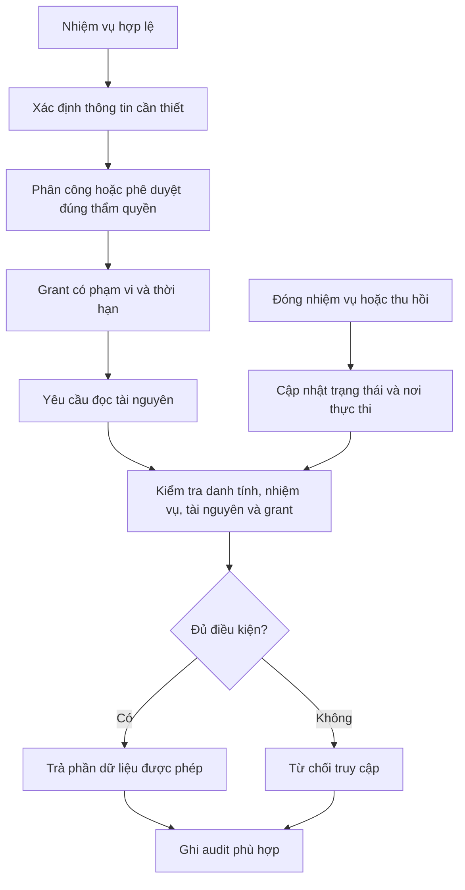

# Need to know — Chỉ truy cập thông tin cần thiết cho nhiệm vụ

## 1. Need to know giải quyết vấn đề gì?

Một nhân viên hỗ trợ khách hàng có thể cần xem tình trạng đăng nhập của một người học để xử lý yêu cầu trợ giúp. Điều đó không có nghĩa nhân viên ấy cần xem mọi bài làm, lịch sử thanh toán hoặc nội dung trao đổi riêng của người học. Cùng một người, cùng một tài khoản đã xác thực, nhưng mỗi nhiệm vụ tạo ra một phạm vi thông tin cần thiết khác nhau.

**Need to know** là nguyên tắc chỉ cho phép chủ thể tiếp cận thông tin khi việc tiếp cận đó cần thiết để thực hiện một nhiệm vụ hợp lệ đã được cho phép. Câu hỏi trung tâm là: **“Vì nhiệm vụ cụ thể nào mà chủ thể này cần biết thông tin này?”**

Thuật ngữ có nguồn gốc sử dụng chặt chẽ trong quản lý thông tin chính thức và thông tin được phân loại. NIST Glossary mô tả việc xác định nhu cầu truy cập thông tin cụ thể để thực hiện nhiệm vụ được phép; định nghĩa cần được đọc trong đúng bối cảnh của tài liệu nguồn. Bài này vận dụng nguyên tắc đó vào thiết kế IAM của ứng dụng doanh nghiệp, không coi mọi hệ thống thương mại là một hệ thống quản lý thông tin mật. Tham khảo [NIST Glossary — need-to-know](https://csrc.nist.gov/glossary/term/need_to_know).

Trong nền tảng quản lý danh tính và quyền truy cập, need to know nối kết ba phần thường bị tách rời: người đang truy cập là ai, nhiệm vụ hiện tại của họ là gì, và dữ liệu nào thực sự cần cho nhiệm vụ đó. Sự kết nối này giúp quyết định quyền đi xa hơn một câu kiểm tra “đã đăng nhập” hoặc “có role nhân viên”.

Sau bài học, người học có thể:

- Diễn đạt nhu cầu thông tin bằng chủ thể, nhiệm vụ, tài nguyên, thao tác và thời hạn.
- Phân biệt need to know với least privilege, mức tin cậy danh tính và chức danh tổ chức.
- Chuyển một yêu cầu nghiệp vụ thành điều kiện phân quyền ở cấp đối tượng và trường dữ liệu.
- Nhận ra các đường truy cập phụ qua danh sách, export, tìm kiếm, workload và cache.
- Thiết kế cấp quyền, kiểm toán và thu hồi sao cho nhu cầu đã hết thì khả năng truy cập cũng kết thúc theo yêu cầu đã đặt ra.

## 2. Nhu cầu biết phải gắn với nhiệm vụ được phép

### 2.1. Có ích không đồng nghĩa với cần thiết

Một người quản lý có thể thấy dữ liệu lương toàn công ty “hữu ích để tham khảo”, nhưng tính hữu ích không tự tạo quyền xem. Một lập trình viên có thể muốn tải dữ liệu production để tái hiện lỗi, nhưng nhu cầu sửa lỗi chưa đủ chứng minh cần toàn bộ dữ liệu định danh của khách hàng.

Khi đánh giá, cần hỏi liệu có thể hoàn thành nhiệm vụ bằng ít dữ liệu hơn: bản tổng hợp, trường đã che, tập dữ liệu giả lập hoặc hồ sơ của đúng giao dịch đang xử lý. Nếu câu trả lời là có, phạm vi được cấp cần phản ánh phương án phù hợp ấy.

Need to know không có nghĩa luôn giấu mọi thông tin cho đến khi có một người phê duyệt thủ công. Những nhu cầu ổn định, lặp lại có thể được thể hiện bằng policy và phân công có sẵn. Ví dụ, giảng viên được phân công một lớp có thể xem bài nộp của lớp đó trong thời gian chấm; hệ thống tự kiểm tra quan hệ phân công mà không cần xin duyệt từng lần mở bài.

### 2.2. Lời khai của người yêu cầu chưa phải bằng chứng

Trường `reason="support"` trong request chỉ là dữ liệu người gọi gửi. Nếu server coi trường này là căn cứ đủ để cấp quyền thì bất kỳ ai cũng có thể tự khai một lý do hợp lệ.

Căn cứ cần được xác minh từ quy trình và nguồn tin cậy: ticket có thật, đúng tenant, còn mở, đang được giao cho người gọi, và loại yêu cầu của ticket thực sự cần loại dữ liệu đó. Người phê duyệt cũng phải có thẩm quyền đối với phạm vi được cấp. Một ticket giả hoặc một người phê duyệt không có quyền không làm cho nhu cầu truy cập trở nên hợp lệ.

### 2.3. Nhu cầu có thời điểm bắt đầu và kết thúc

Nhu cầu truy cập có thể thay đổi khi một ticket đóng, người học chuyển lớp, nhân viên đổi bộ phận hoặc workload hoàn thành tác vụ. Một phân công từng hợp lệ không phải là quyền vĩnh viễn.

Thời hạn có thể được xác định bằng mốc thời gian, trạng thái nghiệp vụ hoặc cả hai. Ví dụ: quyền xem transcript hỗ trợ có hiệu lực trong ca làm việc và chỉ khi ticket vẫn mở. Hết một trong hai điều kiện thì request tiếp theo cần bị từ chối theo policy của hệ thống.

## 3. Phân biệt với các khái niệm gần nhau

| Khái niệm | Câu hỏi chính | Ví dụ trong nền tảng học tập |
| --- | --- | --- |
| Authentication | Chủ thể nào đang sử dụng danh tính này? | Xác minh tài khoản nhân viên qua SSO và MFA |
| Authorization | Chủ thể có được thực hiện thao tác này trên tài nguyên này không? | Cho phép hoặc từ chối mở ticket cụ thể |
| Need to know | Nhiệm vụ được phép nào đòi hỏi thông tin này? | Nhân viên đang xử lý ticket đăng nhập của đúng người học |
| Least privilege | Tập quyền tối thiểu nào đủ để hoàn thành nhiệm vụ? | Chỉ đọc phần chẩn đoán cần thiết, không sửa tài khoản hoặc xuất toàn bộ hồ sơ |
| Separation of duties | Những trách nhiệm nào cần được tách biệt? | Người xin quyền xem dữ liệu đặc biệt không tự phê duyệt yêu cầu của mình |
| Data minimization | Dữ liệu được thu thập, xử lý hoặc cung cấp có vượt mục đích không? | Chỉ trả trạng thái giao dịch thay vì toàn bộ thông tin thanh toán |

Need to know và least privilege hỗ trợ nhau, nhưng không phải hai hộp hoàn toàn tách biệt. Least privilege cũng xét phạm vi tài nguyên và thời gian, không chỉ các động từ `read`, `write`, `delete`. Need to know nhấn mạnh căn cứ nghiệp vụ cho việc tiếp cận thông tin; từ căn cứ đó có thể suy ra một phần phạm vi quyền tối thiểu.

Một tài khoản có quyền chỉ đọc vẫn có thể vượt need to know nếu đọc toàn bộ hồ sơ của mọi tenant. Ngược lại, việc cần xem một hồ sơ không tạo quyền sửa, xóa hoặc cấp lại quyền đối với hồ sơ đó.

MFA làm tăng độ tin cậy của quá trình xác thực theo cơ chế được triển khai. Nó không tự chứng minh rằng người vừa xác thực cần biết dữ liệu của một dự án khác. Tương tự, SSO giúp sử dụng danh tính giữa các hệ thống, nhưng ứng dụng đích vẫn cần xác định nhu cầu và quyền của danh tính đó trong miền dữ liệu của mình.

## 4. Một mô hình diễn đạt nhu cầu truy cập

Thay vì mô tả “bộ phận hỗ trợ được đọc dữ liệu người dùng”, có thể mô tả một nhu cầu cụ thể bằng bộ thông tin sau:

```text
Chủ thể:       nhân viên hỗ trợ đang hoạt động
Nhiệm vụ:      xử lý ticket T-842 được giao cho chính nhân viên đó
Tài nguyên:    bản tóm tắt chẩn đoán gắn với ticket T-842
Thao tác:      đọc
Phạm vi:       cùng tenant, đúng người học của ticket
Điều kiện:     ticket còn mở, grant còn hiệu lực
Thời hạn:      từ lúc được cấp đến mốc hết hạn hoặc khi ticket đóng
Nguồn cấp:     quy trình phân công và phê duyệt hợp lệ
Mức dữ liệu:   các trường cần cho chẩn đoán; không bao gồm secret
```

Đây là mô hình thiết kế của ví dụ, không phải một chuẩn token hay một schema IAM bắt buộc. Tùy nghiệp vụ, một số điều kiện có thể được suy ra từ dữ liệu phân công thay vì lưu thành grant riêng.

Một quyết định minh họa có thể được diễn đạt như sau:

```text
ALLOW nếu đồng thời:
    danh tính và tài khoản hợp lệ
    AND chủ thể thuộc đúng tenant đang xét
    AND có năng lực nghiệp vụ phù hợp
    AND nhiệm vụ hợp lệ đang được giao cho chủ thể
    AND tài nguyên thuộc đúng nhiệm vụ
    AND thao tác và mức dữ liệu nằm trong phạm vi cho phép
    AND grant, thời hạn và trạng thái hiện tại đều đạt policy
```

Không nên chuyển mô hình này thành một công thức cố định áp dụng cho mọi hệ thống. Ví dụ, truy cập nội dung công khai không cần một ticket. Mục tiêu là nhận diện căn cứ cần kiểm tra cho đúng loại truy cập, thay vì thêm điều kiện máy móc hoặc bỏ qua căn cứ nghiệp vụ.

## 5. Chức danh, role và mức phân loại chưa đủ

### 5.1. Cùng role vẫn có phạm vi khác nhau

Lan và Minh đều có role `SUPPORT_AGENT`. Lan đang xử lý ticket T-842 của tenant A; Minh đang xử lý ticket T-901 của cùng tenant. Nếu API chỉ kiểm tra role hỗ trợ, Minh có thể đọc transcript của ticket T-842 dù chưa được phân công.

Kiểm tra role phù hợp cho biết chủ thể thuộc nhóm chức năng nào. Kiểm tra phân công cho biết chủ thể có nhiệm vụ với đối tượng cụ thể nào. Hệ thống có thể cần cả hai, cùng các giới hạn khác.

Chức danh quản lý cũng không tự tạo quyền xem mọi dữ liệu cấp dưới có thể thấy. Người quản lý có thể chỉ cần một báo cáo tổng hợp. Nếu sản phẩm cần quyền giám sát hồ sơ chi tiết, quyền đó phải được xác định riêng, gắn với nhiệm vụ giám sát và phạm vi tương ứng.

### 5.2. Clearance và compartment trong mô hình có phân loại

Trong một hệ thống minh họa dùng phân loại thông tin, policy có thể yêu cầu người nhận đạt mức chấp thuận tương ứng, thuộc đúng miền thông tin và có nhiệm vụ cần tài liệu. Việc đáp ứng một ngưỡng phân loại không tự động đáp ứng quan hệ dự án hoặc nhiệm vụ.

Ví dụ, một người đủ điều kiện tiếp cận tài liệu ở mức nhạy cảm X vẫn có thể không được đọc tài liệu dự án Y nếu chưa được phân công và chưa đáp ứng điều kiện của miền Y. Nhãn chính xác và cách kết hợp điều kiện phụ thuộc policy của từng tổ chức; không suy ra một quy tắc phổ quát từ ví dụ này.

Không nên gắn nhãn “mật” như một giải pháp duy nhất. Nhãn cho biết cách bảo vệ tài nguyên; hệ thống vẫn cần nguồn đáng tin cậy để xác định ai có nhiệm vụ với tài nguyên và nơi nào thực thi điều kiện ấy.

## 6. Thể hiện need to know bằng mô hình phân quyền

### 6.1. RBAC cho nhóm chức năng

RBAC dùng role để tập hợp các permission. Nó phù hợp với những nhu cầu tương đối ổn định như giảng viên, người học hoặc nhân viên hỗ trợ. Tuy nhiên, một role quá rộng thường không thể hiện hết lớp học, dự án, tenant và thời hạn của từng phân công.

Một cách kết hợp là role cho phép tham gia chức năng chấm bài, còn quan hệ giảng viên–lớp và trạng thái kỳ chấm quyết định bài nộp nào được mở. Không cần tạo một role mới cho từng người học nếu quan hệ dữ liệu đã biểu diễn được phạm vi đó.

### 6.2. ABAC cho thuộc tính và điều kiện

ABAC đánh giá thuộc tính của chủ thể, đối tượng, thao tác và có thể cả môi trường theo policy. Đây là một cách biểu diễn các điều kiện như loại dữ liệu, đơn vị, nhiệm vụ đang hoạt động và thời gian truy cập. Cách hiểu nền tảng này được trình bày trong [NIST SP 800-162 — Guide to Attribute Based Access Control](https://csrc.nist.gov/pubs/sp/800/162/upd2/final).

Trong thiết kế minh họa, policy có thể dùng `actor.active`, `ticket.assigneeId`, `ticket.tenantId`, `resource.ticketId` và thời điểm server. Điều quan trọng là nguồn và vòng đời của thuộc tính: `actor.department` do hệ thống nhân sự quản lý khác với một trường cùng tên trong body do trình duyệt gửi.

Một thuộc tính có chữ ký không mặc nhiên phù hợp cho mọi ứng dụng. Cần tin cậy nguồn phát hành cho đúng thuộc tính, đúng audience và mục đích sử dụng. Một role do tổ chức đối tác gán có thể cần ánh xạ trước khi dùng trong tenant local.

### 6.3. Quan hệ và ACL cho đối tượng cụ thể

Quan hệ “được giao xử lý ticket”, “là giảng viên của lớp”, hoặc “là thành viên dự án” thường thể hiện nhu cầu rõ hơn chức danh chung. ACL có thể ghi danh sách chủ thể được đọc một tài liệu; hệ thống dựa trên quan hệ có thể suy ra quyền từ các quan hệ đã quản lý.

Tên gọi mô hình không thay thế tính đúng của dữ liệu. Nếu ai cũng có thể tự thêm mình vào nhóm dự án, kiểm tra thành viên dự án không còn là bằng chứng đủ mạnh. Cần bảo vệ cả thao tác tạo, sửa và thu hồi quan hệ làm đầu vào của policy.

## 7. Luồng cấp và sử dụng quyền theo nhu cầu

Một luồng cho quyền xem transcript hỗ trợ nhạy cảm có thể gồm các bước:

1. Nhân viên được xác thực và nhận phân công ticket qua quy trình hợp lệ.
2. Hệ thống xác định loại dữ liệu cần cho việc xử lý; nếu bản tóm tắt đủ dùng thì chưa cấp transcript đầy đủ.
3. Nếu cần mở rộng, yêu cầu được gửi đến người có thẩm quyền với lý do, phạm vi và thời hạn rõ ràng.
4. Quyết định phê duyệt tạo grant gắn với chủ thể, ticket, loại dữ liệu và hành động được phép.
5. Mỗi truy cập được kiểm tra theo grant và trạng thái nghiệp vụ hiện tại; kết quả được ghi audit phù hợp.
6. Ticket đóng, grant hết hạn, phân công bị thay đổi hoặc grant bị thu hồi sẽ làm mất điều kiện cho phép.



Không phải mọi quyền đều cần quy trình phê duyệt hai bước. Luồng trên phù hợp để minh họa một trường hợp nhạy cảm; quyền thường xuyên có thể được cấp tự động từ một phân công đã được kiểm soát. Dù tự động hay thủ công, phải giải thích được vì sao quyền tồn tại và điều gì làm nó hết hiệu lực.

## 8. Ví dụ Java: đọc dữ liệu của đúng ticket được giao

Ví dụ sau dùng cú pháp record của Java 17 trở lên và chỉ minh họa phần quyết định. Ứng dụng đã xác thực người gọi; service nạp actor, ticket và grant từ các nguồn server đáng tin cậy. Client có thể gửi ID muốn truy cập, nhưng không được tự cung cấp một `Actor` hay `Grant` để làm bằng chứng cho phép.

Policy giả định việc đọc bản tóm tắt và đọc transcript là hai hành động riêng. Grant cho bản tóm tắt không tự suy ra grant cho transcript.

```java
import java.time.Clock;
import java.time.Instant;
import java.util.Objects;
import java.util.Set;

public final class SupportAccessPolicy {
    public enum Action {
        READ_SUMMARY,
        READ_TRANSCRIPT
    }

    public record Actor(
            String id,
            String tenantId,
            boolean active,
            boolean supportAgent) {}

    public record Ticket(
            String id,
            String tenantId,
            String assigneeId,
            boolean open) {}

    public record Grant(
            String actorId,
            String tenantId,
            String ticketId,
            Set<Action> actions,
            Instant validFrom,
            Instant validUntil,
            boolean active) {
        public Grant {
            actions = Set.copyOf(actions);
            Objects.requireNonNull(validFrom);
            Objects.requireNonNull(validUntil);
            if (!validFrom.isBefore(validUntil)) {
                throw new IllegalArgumentException("Invalid validity range");
            }
        }
    }

    public record Decision(boolean allowed, String reasonCode) {}

    private final Clock clock;

    public SupportAccessPolicy(Clock clock) {
        this.clock = Objects.requireNonNull(clock);
    }

    public Decision decide(
            Actor actor, Ticket ticket, Action action, Grant grant) {
        if (actor == null || ticket == null || action == null || grant == null) {
            return deny("MISSING_CONTEXT");
        }
        if (!actor.active() || !actor.supportAgent()) {
            return deny("INELIGIBLE_ACTOR");
        }
        if (actor.id() == null || actor.tenantId() == null
                || ticket.id() == null || ticket.tenantId() == null) {
            return deny("INVALID_CONTEXT");
        }
        if (!actor.tenantId().equals(ticket.tenantId())
                || !actor.tenantId().equals(grant.tenantId())) {
            return deny("TENANT_MISMATCH");
        }
        if (!ticket.open() || !actor.id().equals(ticket.assigneeId())) {
            return deny("NO_ACTIVE_ASSIGNMENT");
        }
        if (!grant.active()
                || !actor.id().equals(grant.actorId())
                || !ticket.id().equals(grant.ticketId())
                || !grant.actions().contains(action)) {
            return deny("GRANT_SCOPE_MISMATCH");
        }

        Instant now = clock.instant();
        if (now.isBefore(grant.validFrom())
                || !now.isBefore(grant.validUntil())) {
            return deny("GRANT_NOT_CURRENT");
        }
        return new Decision(true, "ACTIVE_TASK_AND_GRANT");
    }

    private static Decision deny(String reason) {
        return new Decision(false, reason);
    }
}
```

Khoảng hiệu lực trong ví dụ là `[validFrom, validUntil)`: bắt đầu được tính, thời điểm kết thúc không được tính. `Clock` do server quản lý giúp tránh dùng thời gian do người gọi tự khai và cho phép kiểm tra các mốc thời gian một cách xác định khi ứng dụng triển khai kiểm thử.

Tập `actions` được sao chép khi tạo grant để tránh một thay đổi vô tình ở collection gốc làm đổi quyền của đối tượng đang dùng. Grant có khoảng thời gian không hợp lệ bị từ chối ngay khi dựng. Trong ứng dụng thật, bước nạp dữ liệu còn phải xác thực schema, định danh và nguồn dữ liệu; lỗi nạp policy không được biến thành allow.

Điểm kiểm tra `ticket.assigneeId` thể hiện căn cứ nhiệm vụ. Điểm kiểm tra `grant.ticketId` gắn grant với đối tượng cụ thể. Điểm kiểm tra `actions` giới hạn loại thông tin được mở. Ba kiểm tra này xử lý những vấn đề khác nhau; không được bỏ một kiểm tra chỉ vì hai kiểm tra còn lại đã đạt.

Đây chưa phải toàn bộ đường bảo vệ. Service gọi policy phải:

- Dừng việc đọc và trả dữ liệu nếu `allowed` là `false`; một kết quả quyết định bị bỏ qua không bảo vệ được gì.
- Xác minh tài nguyên transcript hoặc summary thực sự thuộc ticket đã kiểm tra, không kiểm tra ticket A rồi trả file của ticket B.
- Dùng DTO riêng để chỉ trả các trường được phép; không trả toàn bộ entity rồi để trình duyệt tự che.
- Bảo vệ mọi điểm vào tương đương như endpoint tải xuống, export và tác vụ nền.
- Xử lý thay đổi phân công, grant hoặc tài nguyên xảy ra giữa thời điểm đánh giá và thực thi theo mức nhất quán yêu cầu.

Nếu tài nguyên được lưu ở object storage, việc quyết định allow trước khi tạo đường tải xuống vẫn phải gắn với đúng object. Một URL ký sẵn thường có đặc tính quyền và thời hạn riêng; thu hồi grant trong ứng dụng không mặc nhiên vô hiệu hóa mọi URL đã phát hành. Thiết kế cần xét cách giới hạn thời hạn và khả năng thu hồi của cơ chế lưu trữ được chọn.

## 9. Kiểm tra ở cấp bản ghi và trường dữ liệu

### 9.1. Quyền mở ticket không đồng nghĩa mở toàn bộ hồ sơ

Một ticket có thể tham chiếu người học, đơn hàng và khóa học. Không nên suy ra quyền đọc toàn bộ ba đối tượng chỉ vì người gọi được mở ticket.

Hãy xác định dữ liệu cần cho từng chức năng. Với lỗi đăng nhập, bản tóm tắt có thể chỉ chứa mã người học nội bộ, thời điểm đăng nhập gần nhất và mã lỗi đã làm sạch. Không cần trả password hash, seed MFA, recovery code, cookie phiên hoặc access token. Những bí mật xác thực đó không nên xuất hiện trong giao diện chẩn đoán thông thường.

Hai DTO có thể biểu diễn hai mức dữ liệu khác nhau:

```text
SupportSummary:
    ticketId, learnerReference, lastLoginStatus, diagnosticCode

SupportTranscript:
    ticketId, messagesAllowedForSupport, redactedAttachments
```

Các tên trường chỉ minh họa. `redactedAttachments` không phải cam kết rằng việc đặt tên như vậy đã thực hiện che dữ liệu; hệ thống phải có logic và kiểm chứng tương ứng. Khi lấy một view đã được rút gọn, vẫn cần kiểm tra người gọi có được đọc đúng view của đúng đối tượng hay không.

### 9.2. Danh sách, tìm kiếm và thống kê

Một API có thể bảo vệ tốt `GET /tickets/{id}` nhưng để `GET /tickets` trả mọi ticket. Người gọi vẫn biết tên người học, tiêu đề yêu cầu và thời điểm phát sinh ngoài nhiệm vụ của mình.

Phạm vi cần được áp dụng cả cho dữ liệu và metadata của kết quả: số lượng bản ghi, phân trang, gợi ý tìm kiếm, tên tệp đính kèm hoặc dashboard tổng hợp. Nếu actor chỉ được xem ticket đang được giao, truy vấn danh sách phải thể hiện phạm vi ấy theo policy tương ứng.

Không tải tất cả dữ liệu xuống frontend rồi ẩn những dòng không được phép. Khi dữ liệu đã tới client, điều kiện hiển thị không còn là ranh giới bảo mật.

OWASP khuyến nghị từ chối mặc định và kiểm tra quyền trên mỗi request; điểm kiểm tra phải được thực thi nhất quán trong ứng dụng. Các nguyên tắc triển khai này hỗ trợ việc chuyển một nhu cầu nghiệp vụ thành quyết định truy cập thực tế. Xem [OWASP Authorization Cheat Sheet](https://cheatsheetseries.owasp.org/cheatsheets/Authorization_Cheat_Sheet.html).

## 10. Workload, tích hợp và xử lý bất đồng bộ

### 10.1. Danh tính workload cũng cần phạm vi nhiệm vụ

Need to know không chỉ áp dụng cho người dùng giao diện. Một workload tổng hợp số lượng người học theo lớp có thể không cần email hoặc nội dung bài làm. Một service gửi thông báo có thể chỉ cần địa chỉ nhận và mẫu thông báo đã được chọn, thay vì quyền đọc toàn bộ hồ sơ.

Workload identity giúp biết tiến trình nào đang gọi, nhưng vẫn cần xác định dữ liệu và thao tác của tiến trình đó. Dùng một tài khoản service dùng chung với quyền rộng cho mọi tác vụ làm giảm khả năng giới hạn và giải thích nhu cầu của từng tác vụ.

### 10.2. Quyền của service không phải quyền của mọi người gọi

Một service có kết nối database đủ rộng để vận hành không được dùng quyền đó để đáp ứng mọi yêu cầu từ client. Ví dụ, chức năng export báo cáo phải xác minh người yêu cầu được xuất lớp hoặc tenant nào trước khi service đọc dữ liệu.

Thông tin `requestedBy`, `tenantId` hoặc `purpose` trong message không tự chứng minh việc ủy quyền. Cần xác minh bên phát hành message, danh tính được đại diện, phạm vi được giao và quan hệ giữa chúng. Nếu dùng token hoặc capability cho tác vụ, cần giới hạn audience, tài nguyên, hành động và thời hạn phù hợp.

### 10.3. Nhu cầu có thể hết trước khi job chạy

Giả sử nhân viên xin xuất transcript lúc 09:00 nhưng job bắt đầu lúc 09:10, sau khi ticket đã chuyển người xử lý. Hệ thống cần xác định rõ dùng quyền tại thời điểm tiếp nhận hay kiểm tra lại lúc thực thi.

Với policy yêu cầu còn phân công tại thời điểm truy cập, job phải kiểm tra lại. Nếu nghiệp vụ cho phép một yêu cầu đã được duyệt tiếp tục chạy, cần một ủy quyền cho chính job với phạm vi và vòng đời rõ ràng. Không để cách triển khai hàng đợi vô tình quyết định semantics quyền thay cho policy.

## 11. Vòng đời quyền và độ trễ thu hồi

### 11.1. Thay đổi nhiệm vụ phải đi đến nơi thực thi

Đánh dấu ticket “đã đóng” trong một database chưa đủ nếu service đọc transcript vẫn dùng cache phân công cũ. Tương tự, xóa role ở hệ thống quản trị không tự xóa các claim đã nằm trong token còn hiệu lực.

Cần xác định những nơi đang dùng dữ liệu quyền: application server, policy engine, cache, API gateway, worker nền hoặc hệ thống lưu trữ. Sau đó chọn cơ chế phù hợp như đọc trạng thái hiện tại, vô hiệu hóa cache, quản lý phiên hoặc credential có thời hạn ngắn. Mỗi cơ chế có giới hạn riêng; thời hạn token ngắn giới hạn một số khoảng trễ nhưng không thay thế mọi yêu cầu thu hồi tức thời.

### 11.2. Quyết định cache phải đủ ngữ cảnh

Cache chỉ theo `actorId` có thể dùng nhầm quyết định của ticket A cho ticket B. Cache chỉ theo role có thể dùng nhầm quyết định giữa các thành viên cùng bộ phận.

Một thiết kế cache quyết định cần xét những dữ kiện thực sự ảnh hưởng policy: chủ thể, tenant, action, tài nguyên, phiên bản policy và các phiên bản hoặc trạng thái thuộc tính liên quan. TTL phải tôn trọng thời điểm hết hạn của grant; vẫn cần xem xét cách xử lý thu hồi trước hạn và thay đổi phân công.

### 11.3. Kiểm tra gần thời điểm sử dụng

Nếu kiểm tra allow rồi thực hiện một thao tác đọc nhạy cảm sau một khoảng dài, nhu cầu có thể đã thay đổi. Có thể cần transaction, phiên bản tài nguyên, kiểm tra lại hoặc cơ chế nhất quán khác tùy hệ thống.

Transaction của một database không tự bảo đảm tính nhất quán với một kho grant từ xa. Cần nói rõ phạm vi bảo đảm và khoảng trễ chấp nhận được thay vì hứa rằng mọi thành phần đều thấy thay đổi ngay lập tức.

## 12. Audit và khả năng giải thích nhu cầu

Một bản ghi audit nên giúp trả lời: ai truy cập, theo nhiệm vụ nào, dữ liệu nào, thao tác gì, dựa vào grant hoặc policy nào và kết quả ra sao. Chỉ ghi “user mở trang thành công” thường không đủ để giải thích vì sao người đó được xem thông tin.

Ví dụ sự kiện nội bộ:

```text
event_type=SUPPORT_DATA_ACCESS
actor_id=agent-17
tenant_id=tenant-A
task_id=T-842
resource_kind=SUPPORT_TRANSCRIPT
action=READ_TRANSCRIPT
grant_id=grant-524
decision=DENY
reason_code=NO_ACTIVE_ASSIGNMENT
policy_version=support-access-v3
request_id=req-764
```

Các ID và reason code là dữ liệu minh họa của ứng dụng. Response ra ngoài không nhất thiết nên trả toàn bộ lý do nội bộ, vì có thể làm lộ tài nguyên tồn tại hoặc cách tổ chức phân quyền. Chọn thông báo theo hợp đồng API và quyền của bên nhận.

Không ghi nội dung transcript, credential hoặc secret vào log chỉ để chứng minh có truy cập. Audit cũng là một nguồn thông tin cần được bảo vệ và có thời gian lưu phù hợp. Người xử lý ticket không mặc nhiên được đọc hoặc xóa toàn bộ audit của tổ chức.

Rà soát có thể tìm các grant không còn nhiệm vụ hoạt động, tài khoản đã chuyển bộ phận nhưng vẫn có quyền, workload đọc nhiều dữ liệu hơn yêu cầu và quyền tạm không hết hạn đúng cách. Ít sử dụng quyền là tín hiệu cần điều tra, chưa tự đủ để kết luận mọi quyền dự phòng đều không cần thiết.

## 13. Các sai lầm thường gặp

| Cách làm | Vì sao chưa đáp ứng need to know | Hướng xử lý |
| --- | --- | --- |
| Mọi nhân viên hỗ trợ đọc mọi ticket | Role chức năng không thể hiện nhiệm vụ với từng ticket | Kiểm tra phân công, tenant và phạm vi dữ liệu |
| Có MFA nên được mở hồ sơ nhạy cảm | Mức xác thực không tạo căn cứ nghiệp vụ | Kiểm tra nhu cầu và grant riêng |
| Người gọi gửi `purpose=support` là đủ | Mục đích tự khai có thể bị giả mạo | Ràng buộc với nhiệm vụ và quy trình server đã xác minh |
| Có quyền đọc nên cho tải toàn bộ database | Chế độ chỉ đọc vẫn có thể lộ lượng dữ liệu quá lớn | Giới hạn tập bản ghi, trường, cách xuất và thời gian |
| Đóng ticket nhưng giữ grant không hạn | Nhu cầu kết thúc mà quyền vẫn tồn tại | Kết hợp trạng thái nhiệm vụ với thời hạn và thu hồi |
| Chỉ bảo vệ trang chi tiết | Danh sách, tìm kiếm, file và export còn lộ dữ liệu | Bao phủ mọi đường đọc cùng dữ liệu |
| Quản trị hạ tầng luôn được xem mọi nội dung | Quyền vận hành chưa chứng minh nhu cầu đọc nội dung | Tách quyền vận hành và quyền đọc theo nghiệp vụ |
| Mã hóa dữ liệu là đủ | Người được giải mã vẫn có thể nhận quá phạm vi cần biết | Kiểm soát điều kiện giải mã và quyền truy cập đầu ra |

Nguyên tắc cũng không ngăn tuyệt đối việc người đã được đọc hợp lệ nhớ, chụp hoặc sao chép dữ liệu. Sau khi thông tin đã được tiết lộ, thu hồi quyền không làm người nhận quên nội dung. Vì vậy, việc chọn mức dữ liệu ban đầu, giới hạn tải xuống, bảo vệ thiết bị và quy trình quản lý thông tin cần hỗ trợ nhau theo bối cảnh.

## 14. Truy cập khẩn cấp và ngoại lệ có kiểm soát

Một sự cố có thể khiến người trực cần dữ liệu ngoài phân công thông thường. Cách xử lý phù hợp là xác định một nhiệm vụ khẩn cấp hợp lệ và một luồng cấp quyền tương ứng, thay vì coi từ “khẩn cấp” do người gọi nhập là điều kiện bỏ qua mọi kiểm tra.

Ví dụ, người trực được chỉ định có thể xin quyền xem một tập hồ sơ trong thời gian ngắn để điều tra sự cố diện rộng. Quyền có thể yêu cầu xác thực bổ sung, lý do sự cố, phạm vi dữ liệu, thông báo đến người chịu trách nhiệm và hậu kiểm, tùy policy. Quyền kích hoạt ngoại lệ cũng phải được bảo vệ.

Không dùng tài khoản chia sẻ vô thời hạn như một ngoại lệ mặc định. Cần giữ khả năng quy trách nhiệm cho danh tính cụ thể, chấm dứt quyền sau sự cố và kiểm tra các artifact đã tạo như file export hoặc credential phục vụ điều tra.

Một số vai trò phản ứng sự cố có thể cần phạm vi rộng ngay từ trước để bảo đảm khả năng vận hành. Phạm vi ấy vẫn cần một nhiệm vụ được định nghĩa, chủ thể chịu trách nhiệm và cơ chế sử dụng phù hợp. Need to know không có nghĩa cố ý làm chậm mọi hoạt động cần thiết; nó yêu cầu quyền có căn cứ rõ ràng.

## 15. Tình huống vận dụng

Giả sử policy của nền tảng yêu cầu: nhân viên hỗ trợ đang hoạt động, cùng tenant, đang được giao ticket còn mở và có grant còn hạn cho từng loại dữ liệu. Xét các request sau:

| Tình huống | Quyết định theo policy minh họa | Căn cứ |
| --- | --- | --- |
| Lan được giao T-842, grant cho summary còn hạn, đọc summary của T-842 | Cho phép nếu mọi điều kiện còn lại đạt | Đúng nhiệm vụ, dữ liệu và hành động |
| Lan chỉ có grant summary nhưng xin transcript của T-842 | Từ chối | Chưa có phạm vi cho loại dữ liệu ấy |
| Minh có cùng role với Lan nhưng không được giao T-842 | Từ chối | Thiếu phân công đang hoạt động |
| Lan được giao T-842 nhưng request trả file thuộc T-901 | Từ chối | Tài nguyên không thuộc nhiệm vụ đã kiểm tra |
| Lan có grant còn hạn nhưng ticket đã đóng | Từ chối | Điều kiện nhiệm vụ không còn |
| Một quản lý hoàn tất MFA rồi mở mọi transcript để tham khảo | Từ chối nếu không có quyền giám sát tương ứng | Chức danh và MFA không tự tạo nhu cầu đọc |
| Workload thống kê chỉ cần số lượng nhưng xin toàn bộ nội dung bài nộp | Không cấp phạm vi đó nếu chưa có nhu cầu hợp lệ khác | Dữ liệu yêu cầu vượt nhiệm vụ đã mô tả |

Hãy thiết kế policy cho ba nhiệm vụ: giảng viên chấm bài của lớp được giao, kế toán đối soát một giao dịch và workload gửi thông báo đổi lịch học. Với mỗi nhiệm vụ, xác định:

1. Nguồn nào xác nhận chủ thể và phân công là hợp lệ?
2. Bản ghi và trường dữ liệu nào thực sự cần thiết?
3. Hành động nào được phép, hành động nào cần grant khác?
4. Sự kiện nào kết thúc nhu cầu, và nơi thực thi thấy sự kiện ấy sau bao lâu?
5. Danh sách, export, tệp đính kèm và tác vụ nền có cùng giới hạn hay không?
6. Audit nào đủ giải thích quyết định mà không ghi thừa dữ liệu nhạy cảm?

Một thiết kế áp dụng need to know phải giải thích được mối liên hệ giữa chủ thể, nhiệm vụ và thông tin được tiết lộ. Khi liên hệ đó thay đổi, quyết định quyền cũng phải thay đổi theo policy đã xác định.
