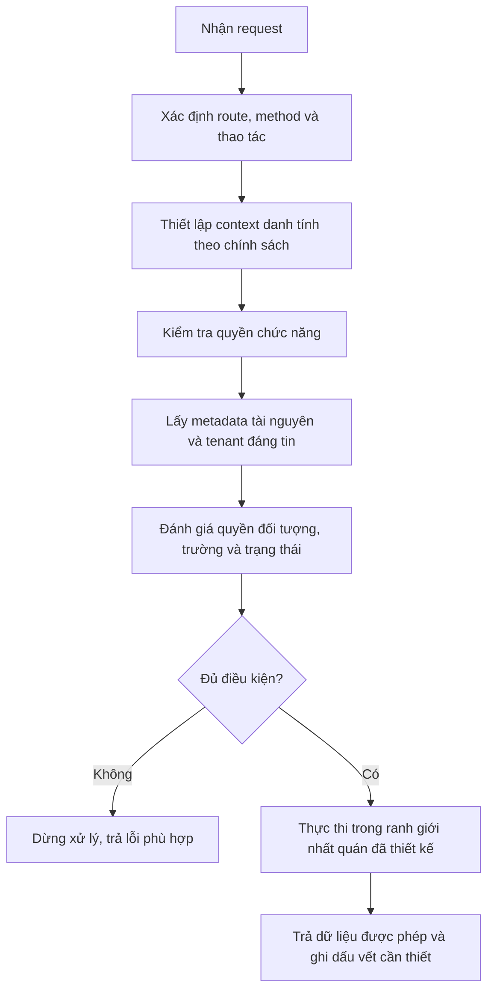

# Every request authorization — Kiểm tra quyền trên từng yêu cầu

## 1. Vì sao đăng nhập thành công vẫn chưa đủ?

Một nhân viên đã đăng nhập vào hệ thống quản lý chi phí không có nghĩa là họ được đọc mọi phiếu chi, sửa mọi khoản tiền hoặc duyệt đề nghị của chính mình. Đăng nhập giúp hệ thống xác định danh tính. Phân quyền phải trả lời một câu hỏi cụ thể hơn: chủ thể này có được thực hiện hành động này trên tài nguyên này, trong ngữ cảnh hiện tại hay không?

Every request authorization là nguyên tắc mỗi yêu cầu truy cập tài nguyên được bảo vệ đều phải đi qua quyết định quyền phù hợp trước khi dữ liệu được trả về hoặc tác động nghiệp vụ xảy ra. OWASP khuyến nghị kiểm tra quyền trên mọi request và sử dụng cơ chế áp dụng nhất quán toàn ứng dụng để giảm nguy cơ bỏ sót. Nguồn: [OWASP Authorization Cheat Sheet](https://cheatsheetseries.owasp.org/cheatsheets/Authorization_Cheat_Sheet.html#validate-the-permissions-on-every-request).

Xét một chuỗi tương tác trong ứng dụng chi phí:

| Yêu cầu | Câu hỏi phân quyền riêng |
| --- | --- |
| Mở danh sách phiếu chi | Người dùng được thấy tập phiếu nào trong tổ chức nào? |
| Đọc phiếu `expense-204` | Người dùng có quyền đọc đúng phiếu này không? |
| Sửa số tiền | Người dùng có quyền sửa và phiếu còn ở trạng thái cho phép không? |
| Duyệt phiếu | Có quyền duyệt, đúng phạm vi và thỏa quy tắc người duyệt khác người lập không? |
| Xuất báo cáo | Có quyền xuất và những bản ghi nào được đưa vào kết quả? |
| Tải file báo cáo đã tạo | Người tải có quyền nhận đúng kết quả xuất này không? |

Quyết định cho hàng đầu tiên không thay thế quyết định cho các hàng sau. Giao diện đã tải được, menu đã hiện hoặc request trước vừa được cho phép đều không phải bằng chứng đủ cho request hiện tại.

Trong phạm vi nền tảng IAM, nguyên tắc này nối danh tính, phiên, role, permission, thuộc tính tài nguyên và vòng đời quyền thành hành vi thực thi tại ứng dụng. RBAC hay ABAC chỉ có giá trị khi quyết định của chúng thực sự kiểm soát đường đọc và ghi dữ liệu.

## 2. Hiểu đúng chữ “từng yêu cầu”

### 2.1. Không bắt người dùng nhập lại mật khẩu ở mọi lần gọi

Một phiên đăng nhập hợp lệ có thể được tái sử dụng qua nhiều request. Với API, client có thể gửi access token theo cơ chế đã chọn. Backend vẫn cần xác định context danh tính đáng tin cho từng request và đánh giá quyền của thao tác đang được yêu cầu.

Việc có cần xác thực lại, MFA bổ sung hay một mức độ xác thực mới hơn là điều kiện của chính sách dành cho thao tác cụ thể. Chẳng hạn, xem phiếu nháp và thay đổi tài khoản nhận tiền có thể có yêu cầu khác nhau.

### 2.2. Không bắt buộc gọi máy chủ IAM qua mạng cho mọi request

Điểm thực thi có thể đánh giá chính sách bằng dữ liệu cục bộ, bản sao được đồng bộ hoặc dịch vụ quyết định quyền. Kiến trúc cần xác định nguồn dữ liệu, độ mới được chấp nhận và cách xử lý khi không đủ bằng chứng. Tài liệu OPA mô tả nhiều cách đưa dữ liệu vào quá trình đánh giá cùng giới hạn độ mới tương ứng. Nguồn: [Open Policy Agent — External Data](https://www.openpolicyagent.org/docs/external-data).

Ví dụ, service chi phí có thể kiểm tra permission đã được xác minh, membership tenant và trạng thái phiếu ngay tại service. Điều cần chứng minh là request được đánh giá bằng chính sách cùng dữ liệu còn hiệu lực theo yêu cầu của hệ thống.

### 2.3. Mọi request không có nghĩa mọi endpoint đều cần tài khoản

Một trang hướng dẫn công khai có thể cho phép anonymous đọc. Đó là một chính sách cho phép rõ ràng đối với tài nguyên công khai.

Ngược lại, một endpoint bị quên cấu hình không được tự trở thành công khai. Nên phân biệt ba trường hợp: công khai có chủ đích, được bảo vệ bằng điều kiện cụ thể và không có quy tắc phù hợp nên bị từ chối.

Không suy từ việc `GET /public/help` công khai thành việc mọi method hoặc mọi đường dẫn bắt đầu bằng `/public` đều an toàn để mở.

## 3. Dữ liệu của một quyết định quyền

Có thể mô hình hóa quyết định như sau:

```text
decision = authorize(subject, action, resource, context)
```

| Thành phần | Ví dụ trong hệ thống chi phí | Yêu cầu về nguồn |
| --- | --- | --- |
| Subject | Nhân viên, người duyệt, workload xuất báo cáo | Lấy từ cơ chế xác thực hoặc truyền danh tính đã được tin cậy |
| Action | expense:read, expense:edit, expense:approve | Suy ra từ thao tác backend đã xác định |
| Resource | Phiếu chi, tập kết quả tìm kiếm, file xuất | Metadata từ nơi lưu trữ có thẩm quyền |
| Context | Tenant đang hoạt động, thời điểm, trạng thái phiếu, mức xác thực | Mỗi thuộc tính cần nguồn và quy tắc kiểm chứng riêng |
| Policy | Quy tắc cho phép đọc, sửa, duyệt | Phiên bản chính sách được quản lý và đưa vào sử dụng |

Client có thể gửi ID phiếu chi, tenant muốn làm việc hoặc tên thao tác trong một protocol. Những giá trị đó là đầu vào cần kiểm tra. Chúng không tự chứng minh quyền.

Ví dụ request sau không làm người gọi trở thành người duyệt:

```http
POST /api/expenses/expense-204/approve
X-User-Role: FINANCE_APPROVER
Content-Type: application/json

{
  "tenantId": "tenant-b",
  "approvedBy": "director-01"
}
```

Backend phải biết ai thực sự gọi, họ có được hoạt động trong tenant đích không và phiếu thật sự thuộc tenant nào. Trường `approvedBy` do client gửi không được thay thế actor đã xác thực.

Nếu dùng danh tính liên kết từ nhiều issuer, cần ánh xạ subject về định danh nội bộ ổn định theo namespace tin cậy. Không giả định chuỗi `sub` hoặc tên đăng nhập từ hai hệ thống khác nhau luôn chỉ cùng một người.

### 3.1. Quyền chức năng và quyền trên đối tượng

Quyền sử dụng chức năng duyệt phiếu chưa chứng minh quyền duyệt phiếu bất kỳ. Một người có thể chỉ duyệt được phiếu trong phòng ban hoặc tenant được giao.

OWASP API1 yêu cầu kiểm tra quyền đối với đối tượng tại endpoint thực hiện thao tác trên đối tượng đó. Đổi ID sang UUID không thay thế kiểm tra này. Nguồn: [OWASP API1:2023 — Broken Object Level Authorization](https://api-security.owasp.org/editions/2023/en/0xa1-broken-object-level-authorization/).

### 3.2. Quyền đọc đối tượng và quyền đọc từng trường

Một người có quyền xem tiến độ phiếu có thể không được xem thông tin tài khoản nhận tiền. Tương tự, được sửa phần mô tả không có nghĩa được sửa `tenantId`, `createdBy` hoặc `approvalStatus`.

Cần kiểm soát cả dữ liệu trả về lẫn thuộc tính được cập nhật. Nguồn: [OWASP API3:2023 — Broken Object Property Level Authorization](https://api-security.owasp.org/editions/2023/en/0xa3-broken-object-property-level-authorization/).

Trong ví dụ này, API chỉnh mô tả nên nhận DTO chứa đúng trường mô tả. API duyệt là thao tác riêng, có quyền riêng và lấy người duyệt từ context đáng tin. Cách tách này giúp hợp đồng dữ liệu thể hiện chính xác hành động được phép.

## 4. Luồng thực thi trước mỗi thao tác được bảo vệ

Một luồng khái niệm có thể được tổ chức như sau:



Sơ đồ minh họa trách nhiệm, không bắt buộc mọi ứng dụng có đúng số lớp hoặc đúng thứ tự truy vấn như nhau. Một truy vấn bị giới hạn theo tenant và quyền có thể kết hợp bước lấy tài nguyên với bước xác định phạm vi.

Trong kiến trúc phân quyền, Policy Enforcement Point, viết tắt PEP, là nơi chặn hoặc cho thao tác đi tiếp. Policy Decision Point, viết tắt PDP, đánh giá chính sách. Hai vai trò có thể cùng nằm trong ứng dụng. Context và dữ liệu đầu vào phải được kiểm chứng dù việc đánh giá nằm ở đâu. Nguồn: [OWASP Authorization Patterns](https://cheatsheetseries.owasp.org/cheatsheets/Authorization_Patterns_Cheat_Sheet.html).

Với phiếu chi, PEP có thể là service nghiệp vụ trước lệnh cập nhật. PDP có thể là một lớp policy được gọi ngay trong process. Bộ lọc HTTP kiểm tra quyền vào endpoint là một điểm thực thi bổ sung, nhưng không có đủ thông tin để tự giải quyết mọi điều kiện của phiếu.

### 4.1. Kiểm tra trước tác động cần được bảo vệ

Đoạn mã sau đặt kiểm tra quá muộn:

```text
expense = loadExpense(id)
sendExpenseToExternalProcessor(expense)
if not canApprove(currentActor, expense):
    return forbidden
```

Dữ liệu đã được gửi ra ngoài trước khi biết người gọi được phép thực hiện hay không. Trả lỗi sau đó không thu hồi được tác động đã xảy ra.

Một thứ tự thích hợp hơn cho ví dụ này:

```text
actor = requireTrustedActor()
expense = loadExpenseWithinAllowedTenant(actor, id)
requireAllowed(actor, APPROVE, expense)
applyApprovalWithConcurrencyControl(expense, actor)
publishApprovedEventAfterSuccessfulCommit()
```

Đọc metadata nội bộ để đánh giá quyền có thể cần thiết. Điều phải ngăn là để dữ liệu hoặc tác động vượt ranh giới được bảo vệ khi chưa có quyết định cho phép tương ứng.

## 5. Ví dụ Java: đánh giá quyền cho từng phiếu chi

### 5.1. Chính sách minh họa

Giả sử sản phẩm quy định:

- `expense:read` cho phép đọc phiếu do chính người dùng lập.
- `expense:read:tenant` cho phép đọc các phiếu trong tenant đang được phép hoạt động.
- `expense:edit` cho phép người lập sửa phiếu còn ở trạng thái nháp.
- `expense:approve` cho phép duyệt phiếu đã nộp trong tenant đó, nhưng người duyệt phải khác người lập.

Đây là chính sách do ví dụ lựa chọn. Một sản phẩm thực tế có thể bổ sung hạn mức tiền, phòng ban, người được ủy quyền và các cấp phê duyệt.

Đoạn Java sau chỉ minh họa hàm quyết định quyền. Nó không cấu hình đăng nhập, xác minh JWT, HTTP exception mapping hay transaction:

```java
import java.util.Set;

public final class ExpensePolicy {

    public enum Action {
        READ, EDIT, APPROVE
    }

    public enum State {
        DRAFT, SUBMITTED, APPROVED
    }

    // Được tạo từ context đã xác thực và membership đã kiểm tra.
    public record Actor(
            String subjectId,
            String authorizedTenantId,
            boolean active,
            Set<String> authorities) {
    }

    // Được đọc từ nguồn dữ liệu tài nguyên có thẩm quyền.
    public record Expense(
            String id,
            String tenantId,
            String createdBy,
            State state,
            long version) {
    }

    public boolean allows(Actor actor, Action action, Expense expense) {
        if (actor == null || action == null || expense == null) {
            return false;
        }

        if (!actor.active()
                || actor.subjectId() == null
                || actor.authorizedTenantId() == null
                || actor.authorities() == null) {
            return false;
        }

        if (!actor.authorizedTenantId().equals(expense.tenantId())) {
            return false;
        }

        boolean creator = actor.subjectId().equals(expense.createdBy());

        return switch (action) {
            case READ ->
                    actor.authorities().contains("expense:read:tenant")
                    || (creator
                        && actor.authorities().contains("expense:read"));

            case EDIT ->
                    creator
                    && expense.state() == State.DRAFT
                    && actor.authorities().contains("expense:edit");

            case APPROVE ->
                    !creator
                    && expense.createdBy() != null
                    && expense.state() == State.SUBMITTED
                    && actor.authorities().contains("expense:approve");
        };
    }
}
```

Các record và switch expression trong ví dụ dùng được với Java 17. Dữ liệu đã nạp phải thỏa invariant của ứng dụng; collection authorities cần được kiểm soát và không bị bên khác sửa trong lúc quyết định. Việc tạo `Actor` không được bind trực tiếp từ JSON của request.

Một vài kết quả theo đúng chính sách ví dụ:

| Actor và phiếu | Hành động | Kết quả dự kiến |
| --- | --- | --- |
| Lan có expense:read, phiếu do Lan lập trong tenant được phép | READ | Cho phép |
| Minh chỉ có expense:read, phiếu do Lan lập | READ | Từ chối |
| Minh có expense:read:tenant, phiếu của Lan cùng tenant | READ | Cho phép |
| Lan có expense:edit, phiếu của Lan đã SUBMITTED | EDIT | Từ chối |
| Minh có expense:approve, phiếu của Lan đã SUBMITTED cùng tenant | APPROVE | Cho phép |
| Lan có expense:approve, phiếu do Lan lập đã SUBMITTED | APPROVE | Từ chối |
| Minh có expense:approve, phiếu nằm ở tenant khác | APPROVE | Từ chối |

Không có một kết quả “Minh đã được duyệt” dùng chung cho cả phiên. Mỗi lần gọi hàm phải gắn với action và metadata của đúng phiếu.

### 5.2. Gọi policy tại đường nghiệp vụ chung

Giả sử cùng thao tác duyệt có thể được gọi từ REST controller, công cụ quản trị và một adapter xử lý message. Nên đặt kiểm soát phù hợp tại ranh giới nghiệp vụ chung để các adapter không vô tình bỏ qua.

```text
approveExpense(expenseId, expectedVersion):
    actor = trustedContext.requireActorWithAuthorizedTenant()

    trong transaction phù hợp:
        expense = repository.loadForDecision(actor.tenantId, expenseId)
        require(policy.allows(actor, APPROVE, expense))

        updated = repository.approveIfUnchanged(
            expenseId,
            actor.tenantId,
            expectedVersion,
            requiredState = SUBMITTED,
            approver = actor.subjectId
        )

        nếu updated khác 1:
            kết thúc bằng lỗi xung đột hoặc lỗi phù hợp với hợp đồng API

        ghi sự kiện nghiệp vụ trong cùng transaction nếu dùng outbox
```

Đây là pseudocode. Một transaction thông thường không tự bảo đảm mọi thuộc tính quyền bên ngoài database còn mới. Thiết kế phải chỉ rõ điều kiện nào được kiểm tra bằng dữ liệu trong transaction và điều kiện nào phụ thuộc nguồn khác.

`expectedVersion` từ client là precondition về phiên bản, không phải bằng chứng quyền. Version phải tăng ở các thay đổi liên quan. Khi ghi, repository cần giữ các điều kiện tenant, trạng thái và cạnh tranh mà thiết kế yêu cầu.

Nếu membership bị thu hồi ở một hệ thống khác, version của phiếu không tự phát hiện thay đổi đó. Có thể cần kiểm tra membership, phiên bản quyền hoặc cơ chế thu hồi riêng theo yêu cầu hiệu lực.

### 5.3. Bổ sung chính sách ở mức HTTP

Với Spring Security, đoạn cấu hình authorization dưới đây minh họa matcher theo method và path trong một security chain đã được cấu hình cơ chế xác thực thích hợp:

```java
http.authorizeHttpRequests(authorize -> authorize
        .requestMatchers(HttpMethod.GET, "/public/help").permitAll()
        .requestMatchers(HttpMethod.GET, "/api/expenses/**")
            .hasAnyAuthority("expense:read", "expense:read:tenant")
        .requestMatchers(HttpMethod.PATCH, "/api/expenses/*")
            .hasAuthority("expense:edit")
        .requestMatchers(HttpMethod.POST, "/api/expenses/*/approve")
            .hasAuthority("expense:approve")
        .anyRequest().denyAll()
);
```

`HttpMethod` thuộc `org.springframework.http`. Đây là phần rules để ghép vào cấu hình ứng dụng, không phải security configuration hoàn chỉnh. Matcher được xét theo thứ tự; cần kiểm tra path thực tế, các chain và dispatcher mà ứng dụng sử dụng. Tài liệu Spring mô tả authorization ở cả request và dispatch. Nguồn: [Spring Security — Authorize HttpServletRequests](https://docs.spring.io/spring-security/reference/servlet/authorization/authorize-http-requests.html).

Bộ rules này kiểm soát quyền vào endpoint. Ví dụ Java ở trên vẫn cần kiểm tra đúng phiếu tại service. Nếu sau này thêm endpoint export, phải khai báo quyền export và phạm vi dữ liệu của nó; không coi `expense:read` tự bao hàm mọi dạng xuất.

## 6. Bao phủ các đường truy cập dễ bị bỏ quên

### 6.1. Khác đường vào nhưng cùng tài nguyên

Trong sản phẩm minh họa, một phiếu có thể xuất hiện qua nhiều đường:

| Đường truy cập | Điều kiện cần xác định |
| --- | --- |
| GET phiếu theo ID | Được đọc đúng phiếu đó |
| GET danh sách, tìm kiếm, count | Tập bản ghi và metadata được phép thấy |
| PATCH mô tả | Được sửa phiếu và đúng các trường cho phép |
| POST approve | Có quyền duyệt và phiếu thỏa điều kiện nghiệp vụ |
| Tải hóa đơn đính kèm | Được truy cập file trong quan hệ với phiếu |
| Export CSV | Có quyền xuất và bộ dữ liệu đã giới hạn đúng |
| API quản trị | Quyền quản trị cụ thể, tenant và dấu vết thao tác |
| API phiên bản cũ | Vẫn thực thi chính sách đang áp dụng cho đường đó |

Đừng chỉ bảo vệ đường mà giao diện hiện tại gọi. Một ứng dụng di động cũ hoặc client tự viết vẫn có thể gửi request đến route còn được triển khai.

Method cũng là một phần của thao tác. Được GET tài nguyên không kéo theo quyền DELETE tài nguyên đó. REST Security Cheat Sheet hướng dẫn kiểm soát method và kiểm tra trình tự nghiệp vụ tại backend. Nguồn: [OWASP REST Security](https://cheatsheetseries.owasp.org/cheatsheets/REST_Security_Cheat_Sheet.html#restrict-http-methods).

Trong ví dụ phiếu chi, gọi thẳng endpoint approve khi phiếu còn DRAFT phải bị chặn dù người gọi có permission duyệt. Frontend đã ẩn nút chưa đủ để thực thi quy tắc trạng thái.

### 6.2. Danh sách, phân trang và batch

Giả sử Lan chỉ được đọc phiếu do Lan lập. Nếu backend lấy mọi phiếu, phân trang, tính tổng rồi mới bỏ các phiếu Lan không được xem, số trang và tổng số bản ghi có thể tiết lộ thông tin hoặc cho kết quả khó hiểu.

Với mô hình đơn giản này, truy vấn có thể giới hạn tenant và người lập trước khi đếm, sắp xếp và phân trang. Nếu chính sách phức tạp hơn, cần cơ chế tìm tập kết quả được phép tương ứng; không bỏ điều kiện để truy vấn chạy nhanh hơn.

Với batch approve nhận 20 ID, kiểm tra ID đầu tiên không bảo vệ 19 ID còn lại. API phải chọn hành vi rõ ràng:

- Toàn bộ batch chỉ thành công khi mọi mục hợp lệ.
- Hoặc xử lý từng mục và trả kết quả riêng theo hợp đồng được phép tiết lộ.

Trong cả hai cách, một ID ở tenant khác phải được xử lý đúng. Tối ưu bằng một truy vấn theo tập hợp là được, miễn vẫn thực thi đầy đủ chính sách cho từng tài nguyên bị tác động.

### 6.3. GraphQL và kết nối dài

Một request GraphQL có thể yêu cầu nhiều đối tượng và trường. Cho phép gọi endpoint GraphQL không tự cho phép mọi resolver. Với sản phẩm ví dụ, resolver trả thông tin tài khoản nhận tiền phải có kiểm soát tương ứng dù resolver trả trạng thái phiếu đã được phép.

WebSocket cũng cần quyền cho từng hành động được gửi sau handshake. Kết nối mở thành công không phải giấy phép cho mọi message. Nguồn: [OWASP WebSocket Security — Message-Level Authorization](https://cheatsheetseries.owasp.org/cheatsheets/WebSocket_Security_Cheat_Sheet.html#message-level-authorization).

Ví dụ, một kết nối nhận thông báo phiếu chi không tự có quyền gửi message duyệt phiếu. Khi membership thay đổi, hệ thống phải xử lý cả quyền gửi lệnh lẫn phạm vi dữ liệu tiếp tục đẩy xuống theo chính sách hiệu lực đã thiết kế.

## 7. Phiên, access token và service phía sau gateway

### 7.1. Token hợp lệ là đầu vào của quyết định

Nếu API sử dụng JWT access token theo RFC 9068, resource server phải kiểm tra profile áp dụng, gồm loại token, issuer, audience, chữ ký và thời hạn. Các claim phân quyền được kết hợp với context để quyết định cuộc gọi có được phép hay không. Nguồn: [RFC 9068, Section 4](https://www.rfc-editor.org/rfc/rfc9068.html#section-4).

Một token dành cho service báo cáo không được mặc nhiên chấp nhận ở service quản trị. Một scope cho phép đọc chi phí không có nghĩa người dùng được đọc phiếu ở tenant bất kỳ. Không đưa ID Token vào vị trí access token chỉ vì cả hai cùng có thể có định dạng JWT.

Với phiên lưu phía server, session chứa role cũng có thể trở thành dữ liệu cũ. Chuyển từ JWT sang session không tự giải quyết vòng đời quyền; ứng dụng vẫn cần biết khi nào dữ liệu quyền được cập nhật hoặc vô hiệu hóa.

### 7.2. Gateway và service có trách nhiệm tương ứng

Gateway có thể chặn request thiếu danh tính hoặc thiếu scope tổng quát. Service giữ dữ liệu thường có context để quyết định quyền trên phiếu, tenant và trạng thái nghiệp vụ. Các cuộc gọi nội bộ cũng cần được bảo vệ. Nguồn: [OWASP Microservices Security](https://cheatsheetseries.owasp.org/cheatsheets/Microservices_Security_Cheat_Sheet.html#service-level-authorization).

Ví dụ, gateway biết Minh có thể dùng API chi phí; service biết `expense-204` thuộc tenant nào và có do Minh lập hay không. Service cần nhận danh tính qua cơ chế đã xác minh và phân biệt danh tính workload gọi trực tiếp với người dùng mà workload đang đại diện.

Một header như `X-User-Id` chỉ có thể được tin trong kiến trúc truyền context đã kiểm soát nguồn gửi, tính toàn vẹn và đường truy cập. Đặt header từ request Internet vào principal mà không có ranh giới tin cậy sẽ làm mất ý nghĩa của kiểm tra quyền phía sau.

Các service không nhất thiết phải lặp lại cùng một phép tính ở mọi hop. Tuy nhiên, hop thực hiện thao tác được bảo vệ phải có đủ bằng chứng đáng tin cho quyết định của nó, không chỉ dựa vào câu “request đã qua mạng nội bộ”.

## 8. Quyền thay đổi trong khi phiên vẫn còn hiệu lực

### 8.1. Một tình huống thu hồi quyền

Giả sử Minh có token còn hạn đến 10:15:

```text
09:58  Minh đăng nhập, token có authority expense:approve.
10:00  Quản trị viên thu hồi quyền duyệt của Minh.
10:01  Minh gửi request duyệt expense-204.
10:15  Token hết hạn theo exp.
```

Nếu service chỉ dựa vào authority đã nhúng trong token và chưa nhận được thông tin thu hồi, việc kiểm tra lại cùng claim ở 10:01 vẫn có thể cho kết quả allow. “Chạy hàm authorize ở mọi request” chưa chứng minh dữ liệu quyền đã phản ánh thay đổi lúc 10:00.

Sản phẩm cần quyết định yêu cầu hiệu lực. Ví dụ, nếu quyền duyệt phải mất trong một khoảng trễ tối đa được cam kết, phải có cơ chế cung cấp dữ liệu và đo được khoảng trễ đó. Có thể lựa chọn tra cứu có thẩm quyền, đồng bộ thay đổi quyền, kiểm tra phiên bản quyền, token ngắn hạn hoặc phối hợp các cách phù hợp.

Việc có token ngắn hạn chỉ giới hạn một phần thời gian sử dụng claim cũ; nó không tự hứa hẹn thu hồi tức thì. Đối với quyền đặc biệt nhạy cảm, có thể cần điều kiện mạnh hơn trước khi thực thi.

### 8.2. Cache quyết định quyền cần đủ phạm vi

Trong ví dụ, cache key chỉ là `expense-204` sẽ làm quyết định của Lan có nguy cơ được dùng cho Minh. Key chỉ gồm user và ID phiếu vẫn có thể nhầm giữa READ và APPROVE.

Một key khái niệm có thể phản ánh:

```text
subject identity
+ authorized tenant
+ action
+ resource identity
+ relevant policy/data revision
+ relevant contextual conditions
```

Không phải hệ thống nào cũng đưa mọi thuộc tính vào key. Có thể dùng vô hiệu hóa, phiên bản hoặc bỏ cache cho quyết định nhạy cảm, miễn thiết kế chứng minh được kết quả không bị dùng ngoài điều kiện cho phép.

Cũng cần phân biệt cache quyết định với cache dữ liệu HTTP. Một response phiếu chi đã kiểm tra quyền cho Lan không được chia sẻ cho Minh chỉ vì cùng URL. Cấu hình cache phải xét tính riêng tư và ngữ nghĩa phân quyền của representation.

### 8.3. Hết hạn cache và lỗi nguồn quyền

TTL được chọn cần nằm trong yêu cầu hiệu lực của dữ liệu. Không gia hạn vô hạn kết quả cũ khi nguồn quyền lỗi. Nếu hệ thống đã có snapshot còn đáp ứng điều kiện chính sách, việc dùng snapshot đó có thể hợp lệ; nếu không thể đáp ứng điều kiện bắt buộc, thao tác bị ảnh hưởng cần dừng.

OWASP lưu ý phải xác định độ mới, theo dõi độ trễ phân phối và xử lý outage phù hợp; dữ liệu cục bộ có sẵn không tự chứng minh dữ liệu còn mới. Nguồn: [Authorization Policy and Data Distribution — Freshness and Outages](https://cheatsheetseries.owasp.org/cheatsheets/Authorization_Policy_And_Data_Distribution_Cheat_Sheet.html#freshness-and-outages).

Đây là yêu cầu thiết kế cụ thể, không phải lời hứa “quyền luôn mới nhất” chỉ vì đã gọi một service qua mạng. Replica và cache ở đường tra cứu cũng có thể trễ.

## 9. Tác vụ nền, retry và quyền được cấp trước

### 9.1. Request tạo job không bao phủ mọi hành động về sau

Lan yêu cầu xuất báo cáo lúc còn ở phòng ban A. Job chạy sau khi Lan chuyển sang phòng ban B. Cần xác định job thực hiện theo quyền hiện hành, một grant đã được cấp có chủ đích hay một snapshot nghiệp vụ được phê duyệt.

Đây là các mô hình khác nhau. Với một job đại diện người dùng và yêu cầu quyền hiện hành, worker cần kiểm tra lại điều kiện thích hợp khi thực thi. Với grant dành riêng cho tác vụ, phải định nghĩa phạm vi, thời hạn và hành vi thu hồi của grant đó.

Danh tính workload giúp chứng minh worker nào đang chạy. Nó không tự cho phép worker lấy mọi ID trong payload để xuất dữ liệu. Kết quả xuất cũng cần được bảo vệ khi lưu, liệt kê và tải xuống.

### 9.2. Retry và idempotency

Một request có idempotency key vẫn phải có danh tính và quyền phù hợp. Key không phải credential và không phải bằng chứng sở hữu kết quả.

Giả sử kết quả duyệt phiếu đã được lưu để trả lại khi client retry. Backend phải bảo đảm người gọi được quyền nhận representation đó và key được ràng buộc đúng phạm vi principal, tenant cùng thao tác. Không trả nguyên response cũ cho bất kỳ ai biết key.

Với tác động đã hoàn tất, chính sách retry có thể trả trạng thái đã xử lý thay vì thực thi lại. Cần thiết kế rõ trường hợp quyền thay đổi giữa lần đầu và lần retry; không dùng idempotency để bỏ toàn bộ kiểm soát truy cập.

### 9.3. Liên kết tải có chữ ký

Một liên kết tải có chữ ký là ví dụ về bằng chứng quyền được cấp trước với phạm vi nhất định. Ở bước tải, hệ thống lưu trữ có thể kiểm tra chữ ký, thời hạn, đối tượng và điều kiện được ràng buộc, thay vì gọi lại ứng dụng IAM.

Vì vậy, nguyên tắc kiểm tra trên từng truy cập vẫn có thể được thực thi bằng cơ chế capability được thiết kế rõ. Nhưng đổi role hoặc vô hiệu hóa phiên ở ứng dụng không tự làm mọi liên kết đã cấp mất hiệu lực.

Trong hệ thống chi phí, nếu yêu cầu dừng quyền tải ngay sau khi nhân viên rời tổ chức, cần chọn cơ chế thu hồi hoặc đường tải có kiểm tra đáp ứng yêu cầu đó. Không suy ra đặc tính này chỉ từ việc URL có chữ ký.

## 10. Từ chối đúng cách và giữ ranh giới dữ liệu

### 10.1. Không biến lỗi đánh giá thành cho phép

Nếu hàm policy gặp lỗi hoặc không lấy được thuộc tính bắt buộc, code không được rơi vào nhánh cho phép chỉ để request tiếp tục chạy. Một kết quả chưa xác định phải được xử lý theo chính sách lỗi đã định nghĩa.

Ví dụ không phù hợp:

```text
try:
    return policy.canApprove(actor, expense)
catch:
    return true
```

Với hệ thống minh họa, nếu không xác định được tenant hoặc trạng thái phiếu cần thiết, không thực hiện duyệt. Lỗi hạ tầng có thể cần phản hồi tạm thời và cảnh báo vận hành; không nên giả vờ đó là một quyết định thiếu permission đã được đánh giá đầy đủ.

### 10.2. Phản hồi HTTP

| Trường hợp | Cách biểu đạt thường dùng |
| --- | --- |
| Thiếu credential hợp lệ cho tài nguyên cần xác thực | 401, kèm WWW-Authenticate thích hợp |
| Request được hiểu nhưng bị từ chối | 403 |
| Cần che giấu sự tồn tại của tài nguyên bị cấm | Có thể dùng 404 theo chính sách |
| Nguồn quyết định cần thiết tạm không khả dụng | Lỗi hạ tầng phù hợp, chẳng hạn 503 nếu đúng ngữ nghĩa |
| Phiếu đã thay đổi khiến precondition ghi không còn thỏa | Mã lỗi cạnh tranh theo hợp đồng, ví dụ 409 hoặc 412 trong trường hợp phù hợp |

RFC 9110 quy định ngữ nghĩa 401, 403 và việc có thể trả 404 để che giấu tài nguyên bị cấm. Nguồn: [RFC 9110, Sections 15.5.2–15.5.5](https://www.rfc-editor.org/rfc/rfc9110.html#section-15.5.2).

Không phải mọi 403 đều có nghĩa credential hợp lệ; việc từ chối còn có thể có nguyên nhân khác. API cần thể hiện đúng cơ chế đang sử dụng.

Nếu dùng 404 để che giấu, thông báo chi tiết bên ngoài không nên lại ghi “phiếu này thuộc tenant-b”. Log nội bộ có thể giữ reason code phục vụ điều tra, với quyền đọc log phù hợp.

### 10.3. Các cơ chế bổ sung không thay thế quyền

CORS kiểm soát một phần tương tác cross-origin của trình duyệt, không chứng minh người gọi được sửa phiếu. CSRF protection xử lý kiểu request bị ép gửi trong bối cảnh credential tự động; nó cũng không cấp quyền nghiệp vụ.

TLS, rate limit và validation đầu vào đều có vai trò riêng. Một request được mã hóa, có JSON hợp lệ và chưa vượt rate limit vẫn có thể bị từ chối vì truy cập phiếu ngoài phạm vi.

## 11. Kiểm toán và kiểm chứng triển khai

### 11.1. Dấu vết của quyết định

Một event nội bộ có thể gồm:

```text
event_type: AUTHORIZATION_DECISION
request_id: request-opaque-reference
actor_id: internal-subject-reference
caller_service: expense-api-client
tenant_id: tenant-a
action: expense:approve
resource_type: expense
resource_reference: expense-204
decision: DENY
reason_code: SELF_APPROVAL_NOT_ALLOWED
policy_revision: expense-policy-v3
```

Đây là schema minh họa, không phải payload gửi cho client. Khi điều tra, cần phân biệt decision ALLOW với việc cập nhật phiếu thành công; request được phép vẫn có thể thất bại do xung đột hoặc lỗi ghi.

Không ghi access token, cookie phiên hoặc nội dung tài khoản nhận tiền chỉ để chứng minh đã kiểm tra quyền. Dữ liệu kiểm toán cần có quyền đọc, thời hạn lưu và cách liên kết với sự kiện nghiệp vụ thích hợp.

### 11.2. Ma trận kiểm chứng của ví dụ

Bảng sau là các tình huống thiết kế để kiểm tra một implementation. Nó không phải báo cáo đã chạy thử một ứng dụng:

| Tình huống | Kết quả cần chứng minh |
| --- | --- |
| Lan đọc phiếu của mình với quyền đọc hợp lệ | Được nhận đúng các trường được phép |
| Minh đổi ID sang phiếu của Lan nhưng chỉ có quyền đọc cá nhân | Bị từ chối theo chính sách |
| Người duyệt có permission nhưng phiếu ở tenant khác | Không vượt được ranh giới tenant |
| Lan tự duyệt phiếu do Lan lập | Bị chặn theo quy tắc của ví dụ |
| Người duyệt gọi approve khi phiếu còn DRAFT | Không bỏ qua trạng thái nộp phiếu |
| Người dùng gửi thêm approvedBy hoặc tenantId trong payload sửa mô tả | Không đổi danh tính hoặc quan hệ quyền trái phép |
| Client gọi endpoint trực tiếp khi nút bị ẩn | Backend vẫn thực thi quyền |
| Client thử method khác hoặc API cũ | Không đi vòng qua điểm kiểm soát |
| Batch chứa cả phiếu được phép và bị cấm | Thực thi đúng chính sách toàn bộ hoặc từng mục đã công bố |
| Hai người duyệt đồng thời cùng một phiên bản | Không tạo hai tác động vượt quy tắc nhất quán |
| Quản trị thu hồi quyền nhưng phiên vẫn còn | Hiệu lực từ chối đạt yêu cầu độ trễ đã xác định |
| Cache từng lưu allow cho READ rồi nhận APPROVE | Không dùng nhầm quyết định |
| Service quyết định quyền lỗi | Không phát sinh allow ngoài chính sách |
| Worker chạy export sau khi người yêu cầu đổi phạm vi | Áp dụng đúng mô hình grant hoặc quyền hiện hành đã chọn |
| Người khác dùng lại idempotency key hoặc URL báo cáo | Không nhận dữ liệu ngoài quyền được cấp |
| Kết nối WebSocket tồn tại qua thay đổi membership | Quyền gửi và nhận được xử lý đúng chính sách hiệu lực |

Nên có kiểm tra ở mức hàm policy để thấy quy tắc và kiểm tra tích hợp qua đường truy cập thật để phát hiện cấu hình bị bỏ sót. Chỉ kiểm tra hàm `allows` không chứng minh controller hay message handler thực sự gọi hàm đó.

Cũng cần kiểm tra trường hợp cho phép. Một hệ thống từ chối mọi request có thể tránh lộ dữ liệu nhưng vẫn không đáp ứng nghiệp vụ hợp lệ.

## 12. Bài tập thiết kế và hướng giải thích

Một ứng dụng đang có ba đặc điểm:

1. Lúc đăng nhập, backend lưu `canApprove=true` vào session.
2. Giao diện dùng giá trị này để hiện nút duyệt.
3. API duyệt chỉ kiểm tra session tồn tại rồi cập nhật phiếu theo ID.

Hãy giải thích vì sao thiết kế chưa thực thi every request authorization, rồi đề xuất luồng duyệt đúng cho hệ thống có nhiều tenant.

Một hướng giải cần nêu rõ:

- Session tồn tại chỉ cung cấp bối cảnh xác thực; request duyệt vẫn cần kiểm tra quyền duyệt còn hiệu lực theo chính sách.
- Backend xác định tenant được phép, tải metadata của đúng phiếu và đánh giá action APPROVE trên phiếu đó.
- Người duyệt phải thỏa quy tắc khác người lập và phiếu phải ở trạng thái SUBMITTED theo giả định bài học.
- Thao tác ghi phải xử lý thay đổi đồng thời và chỉ phát sinh tác động nghiệp vụ sau khi đủ điều kiện.
- Khi quyền bị thu hồi, session, token, cache hoặc bản sao dữ liệu quyền phải phản ánh thay đổi trong giới hạn hiệu lực đã cam kết.
- Các đường REST, quản trị, message và tải kết quả liên quan cần thực thi kiểm soát phù hợp, không phụ thuộc vào việc nút có hiện hay không.

Sau đó mở rộng tình huống: người duyệt đã được cho phép tạo job export, nhưng rời tổ chức trước khi job chạy. Hãy xác định job dùng quyền hiện hành hay grant riêng, ai được tải kết quả và cách thu hồi được bảo đảm. Câu trả lời phải gắn với cơ chế thực thi cụ thể thay vì chỉ nói “đã kiểm tra lúc đăng nhập”.

