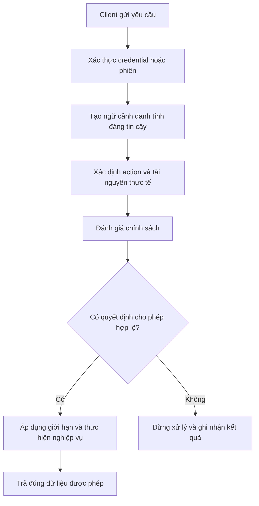

# Server-side enforcement: thực thi phân quyền ở phía máy chủ

## 1. Tình huống mở đầu: ẩn nút không bảo vệ được dữ liệu

Một nền tảng học tập có hai tổ chức độc lập là tenant A và tenant B. Lan là biên tập viên của tenant A, được sửa nội dung một số khóa học nhưng không được xuất bản hay xem điểm của học viên.

Giao diện đã ẩn nút “Xuất bản” và không hiển thị khóa học của tenant B. Tuy vậy, Lan vẫn có thể gửi yêu cầu HTTP bằng một công cụ khác:

```http
POST /api/tenants/tenant-b/courses/course-b/publish
Authorization: Bearer <access-token-cua-lan>
Content-Type: application/json

{}
```

Nếu máy chủ chỉ kiểm tra token hợp lệ rồi gọi hàm xuất bản, yêu cầu có thể thành công dù giao diện không hề cho phép thao tác này.

**Server-side enforcement** là việc thành phần phía máy chủ có thẩm quyền thực sự chặn hoặc cho phép truy cập trước khi dữ liệu được tiết lộ hoặc tác động được thực hiện. Đối tượng được bảo vệ có thể là API, bản ghi, trường dữ liệu, tệp, thông điệp hoặc hành động nghiệp vụ.

Trong module nền tảng IAM, đây là nơi các thông tin về danh tính, phiên, role, thuộc tính, quan hệ và ủy quyền trở thành giới hạn truy cập có hiệu lực. Xác thực qua mật khẩu, MFA hoặc SSO giúp thiết lập danh tính và mức bảo đảm; ứng dụng vẫn phải quyết định danh tính đó được làm gì với tài nguyên cụ thể.

Sau bài này, người học có thể xác định nơi đặt kiểm tra quyền, xây dựng ngữ cảnh đáng tin cậy, bảo vệ các đường thực thi khác nhau và kiểm chứng rằng yêu cầu bị từ chối không tạo tác động trái phép.

## 2. Bất biến cần bảo vệ

Một bất biến thiết kế cho hệ thống minh họa là:

> Mỗi lần đọc dữ liệu được bảo vệ hoặc thực hiện hành động nghiệp vụ phải có căn cứ cho phép phù hợp với chủ thể, hành động, tài nguyên và ngữ cảnh tại thời điểm mà hệ thống quy định.

Bất biến này đặt ra bốn câu hỏi:

| Câu hỏi | Nội dung cần xác định | Ví dụ trong nền tảng học tập |
|---|---|---|
| Ai đang yêu cầu? | Danh tính đã được xác minh và tư cách đang sử dụng | Lan, thành viên tenant A |
| Muốn làm gì? | Action do máy chủ xác định từ hành vi thực tế | `course.publish` |
| Tác động lên đâu? | Tài nguyên và phạm vi sở hữu thực tế | Khóa học thuộc tenant B |
| Trong điều kiện nào? | Trạng thái, quyền hiện hành, mức xác thực, ủy quyền | Không có phân công xuất bản |

Token của Lan còn hạn không chứng minh Lan được xuất bản khóa học của tenant B. Một role có tên `EDITOR` cũng chưa trả lời được câu hỏi đó nếu chưa biết role có hiệu lực trong tenant và phạm vi tài nguyên nào.

OWASP khuyến nghị mặc định từ chối và xác minh quyền trên mọi yêu cầu. Trong bài này, hai nguyên tắc đó được cụ thể hóa bằng các luồng xử lý và ví dụ riêng của nền tảng học tập. [OWASP Authorization Cheat Sheet](https://cheatsheetseries.owasp.org/cheatsheets/Authorization_Cheat_Sheet.html)

“Mọi yêu cầu” không bắt buộc mỗi tầng đều gọi một dịch vụ policy từ xa. Nó yêu cầu mọi đường truy cập được bảo vệ đều đi qua cơ chế thực thi thích hợp. Cơ chế có thể nằm trong tiến trình, tại dịch vụ chuyên trách hoặc được hỗ trợ bằng truy vấn dữ liệu có điều kiện.

Các tài nguyên thực sự công khai vẫn cần được xác định rõ trong chính sách. Không coi route chưa khai báo hoặc action không nhận diện được là tài nguyên công khai.

## 3. Luồng xử lý và ranh giới tin cậy



Luồng này là mô hình khái niệm. Một số hệ thống cần truy vấn metadata tối thiểu của tài nguyên trước khi đánh giá policy; một số cần phối hợp kiểm tra với giao dịch ghi. Điều không được đảo ngược là thực hiện tác động nhạy cảm hoặc tiết lộ dữ liệu trước rồi mới kiểm tra quyền.

### 3.1. Ba vai trò trong cơ chế phân quyền

Có thể phân biệt ba trách nhiệm:

- **Policy Enforcement Point — PEP:** điểm chặn luồng xử lý và thực thi kết quả.
- **Policy Decision Point — PDP:** thành phần đánh giá chính sách để đưa ra quyết định.
- **Nguồn thuộc tính:** nơi cung cấp dữ liệu đáng tin cậy về chủ thể, tài nguyên và môi trường.

Ví dụ, service xuất bản là PEP, bộ đánh giá quyền trong ứng dụng là PDP, còn dữ liệu membership và phân công khóa học là nguồn thuộc tính.

Đây là các vai trò thiết kế, không bắt buộc phải là ba dịch vụ triển khai riêng. Với ứng dụng nhỏ, chúng có thể cùng nằm trong một tiến trình.

Một PDP trả `ALLOW` nhưng ứng dụng bỏ qua phạm vi dữ liệu đi kèm vẫn có thể gây vượt quyền. Kết quả đánh giá chỉ có ý nghĩa khi PEP áp dụng đầy đủ những điều kiện mà hợp đồng của bộ đánh giá yêu cầu.

### 3.2. Quyết định cho phép phải gắn với đúng yêu cầu

Một kết quả như “Lan được phép” là quá thiếu thông tin để tái sử dụng tùy ý. Cần biết Lan được phép thực hiện action nào, trên tài nguyên nào, trong tenant nào và với điều kiện nào.

Nếu bộ đánh giá cho phép đọc bản tóm tắt khóa học, ứng dụng không thể dùng kết quả đó để trả luôn danh sách điểm hoặc ngân hàng đề thi.

## 4. Xây dựng ngữ cảnh danh tính đáng tin cậy

### 4.1. Không dùng lời khai của client làm quyền

Những giá trị sau có thể là dữ liệu đầu vào, nhưng không tự trở thành sự thật có thẩm quyền:

```http
X-User-Id: admin
X-Tenant-Id: tenant-b
X-Roles: SUPER_ADMIN
```

Tương tự, các trường JSON như `actorId`, `isAdmin` hoặc `approved=true` không đủ làm căn cứ cấp quyền.

Trong thiết kế của bài, ngữ cảnh thực thi được dựng từ các nguồn sau:

| Thành phần | Nguồn được sử dụng | Điều cần tránh |
|---|---|---|
| Principal | Kết quả xác thực credential hoặc phiên bằng cơ chế được cấu hình | Tin user ID do client tự khai |
| Tenant đang thao tác | Tenant được yêu cầu kết hợp membership hoặc quyền liên tenant đã xác minh | Tin riêng tenant ID trong URL |
| Role và grant | Nguồn quản lý quyền được hệ thống công nhận | Tin danh sách role trong body |
| Mức xác thực | Bằng chứng được tầng xác thực xác minh theo chính sách | Tin `mfa=true` do client gửi |
| Thuộc tính tài nguyên | Kho dữ liệu hoặc dịch vụ sở hữu tài nguyên | Tin owner hoặc tenant do payload khẳng định |
| Actor và ủy quyền | Thông tin đại diện đã được xác minh, có phạm vi | Cho client tùy ý chọn người bị mạo danh |

Một claim nằm trong token được xác minh vẫn cần được hiểu đúng hợp đồng của bên phát hành và yêu cầu về độ mới. Token có thể chứa snapshot quyền; snapshot đó không tự cập nhật sau khi quản trị viên thu hồi membership.

### 4.2. Tenant là phạm vi phải kiểm chứng

Client có thể chọn tenant để làm việc khi người dùng thuộc nhiều tổ chức. Việc chọn đó chỉ là yêu cầu chuyển ngữ cảnh, không phải bằng chứng người dùng có quyền trong tenant được chọn.

Ví dụ:

```text
requestedTenant = tenant ID từ route
principal = danh tính từ tầng xác thực

membership = nguồn có thẩm quyền xác minh principal với requestedTenant
nếu không có tư cách hợp lệ:
    dừng yêu cầu

effectiveTenant = tenant đã được xác minh
```

Các tài khoản hỗ trợ vận hành có thể có quyền liên tenant riêng. Quyền đó phải được mô hình hóa, giới hạn và kiểm toán; không suy ra từ việc người gọi đến từ mạng nội bộ.

### 4.3. Người dùng và workload đều là chủ thể cần phân quyền

Một job đồng bộ khóa học có thể dùng danh tính workload. Dịch vụ tạo báo cáo có thể vừa mang danh tính dịch vụ vừa thực hiện yêu cầu thay mặt một người dùng.

Thiết kế cần trả lời riêng:

1. Dịch vụ gọi có được thực hiện loại hành động này không?
2. Nếu hành động thay mặt người dùng, phạm vi của người dùng có cho phép không?
3. Hợp đồng ủy quyền có cho phép chuyển tiếp yêu cầu đến dịch vụ nhận không?

Không tự lấy toàn bộ quyền kỹ thuật của service để thay thế giới hạn của người dùng khi nghiệp vụ yêu cầu thực hiện thay mặt người đó.

## 5. Đặt điểm thực thi ở đâu?

### 5.1. Phân công trách nhiệm giữa các tầng

| Tầng | Trách nhiệm thích hợp | Giới hạn cần nhớ |
|---|---|---|
| Gateway hoặc reverse proxy | Chặn credential không hợp lệ, áp dụng quy tắc vào hệ thống, xác minh kênh đến backend | Có thể không biết owner, quan hệ và trạng thái mới nhất của tài nguyên |
| Controller hoặc resolver | Ràng buộc đầu vào, ánh xạ operation, yêu cầu quyền vào chức năng | Một service có thể được gọi từ đường khác |
| Application service | Kiểm tra action trên tài nguyên và điều phối nghiệp vụ | Cần bảo đảm mọi đường gọi liên quan thực sự đi qua điểm kiểm tra |
| Kho dữ liệu | Giới hạn truy vấn theo tenant, quan hệ, trường hoặc hàng | Cơ chế dữ liệu phải phù hợp mô hình quyền và cách dùng connection |
| Kho tệp hoặc dịch vụ nhận | Kiểm soát nơi dữ liệu được tải hoặc tác động cuối cùng xảy ra | Không mặc nhiên kế thừa quyết định từ một thành phần không đáng tin |

Không cần nhân bản cùng một bộ policy rải rác ở mọi tầng. Có thể dùng một thư viện hoặc bộ đánh giá chung, rồi xác định rõ tầng nào chịu trách nhiệm chặn từng đường truy cập.

### 5.2. Vì sao chỉ kiểm tra ở controller có thể thiếu?

Giả sử controller HTTP có kiểm tra `course.publish`, nhưng service xuất bản không có ràng buộc tương đương. Một consumer xử lý hàng đợi hoặc công cụ quản trị có thể gọi thẳng service.

Nếu hai đường đó không có PEP riêng, chúng trở thành lối đi vòng.

Một cách tổ chức là đặt ranh giới nghiệp vụ đã được bảo vệ tại application service, rồi để HTTP, GraphQL và job handler cùng sử dụng ranh giới đó với ngữ cảnh hợp lệ. Những hàm thấp hơn chỉ được gọi trong phạm vi nội bộ đã xác định và không được vô tình xuất thành API công khai.

### 5.3. Vì sao chỉ có annotation chưa đủ bằng chứng?

Một annotation kiểm tra role có thể là một phần của giải pháp, nhưng cần biết nó có thực sự được kích hoạt trên đường gọi hay không, nó kiểm tra điều kiện gì và khi cấu hình thiếu thì hệ thống xử lý thế nào.

Các framework có thể sử dụng proxy, interceptor hoặc cơ chế khác. Chi tiết cách gọi nội bộ, đăng ký thành phần và cấu hình bảo mật ảnh hưởng đến hiệu lực kiểm tra.

Vì bài này không gắn với phiên bản framework cụ thể, ví dụ dưới đây dùng pseudocode và biểu diễn điểm kiểm tra trực tiếp. Khi triển khai thực tế cần xác nhận hành vi theo cơ chế đang sử dụng.

## 6. Ví dụ xuyên suốt: xuất bản khóa học

### 6.1. Chính sách minh họa

Trong nền tảng học tập của bài, một người dùng được xuất bản khóa học khi đồng thời thỏa mãn:

- Tài khoản và membership ở tenant đang hoạt động.
- Khóa học thuộc tenant đang thao tác.
- Người dùng có grant `course.publish` với phạm vi bao gồm khóa học đó.
- Khóa học đang ở trạng thái đủ điều kiện xuất bản theo quy trình nghiệp vụ.
- Bằng chứng xác thực bổ sung đáp ứng yêu cầu của tenant nếu tenant đặt điều kiện này.

Đây là chính sách giả định phục vụ ví dụ. Không phải mọi nền tảng đều phải có cùng role, trạng thái hoặc yêu cầu xác thực.

Có grant không có nghĩa tài nguyên luôn ở trạng thái được phép chuyển đổi. Ngược lại, khóa học đã sẵn sàng cũng không có nghĩa mọi người dùng đều được xuất bản.

### 6.2. Luồng nghiệp vụ minh họa bằng pseudocode

```text
publishCourse(trustedInvocation, requestedTenant, courseId, request):
    principal = trustedInvocation.requireAuthenticatedPrincipal()

    validatePublishRequest(request)
    # Chỉ chấp nhận đầu vào của command xuất bản.
    # Không nhận role, owner hay quyết định ALLOW từ client.

    tenantContext = verifyActiveTenantContext(principal, requestedTenant)

    trong phạm vi phối hợp giao dịch phù hợp:
        course = loadCourseMetadataInTenantForUpdate(
            courseId,
            tenantContext.tenantId
        )
        nếu không tìm thấy:
            kết thúc theo quy ước không tìm thấy hoặc không được truy cập

        facts = loadAuthoritativeAuthorizationFacts(
            principal,
            tenantContext,
            course
        )

        decision = evaluate(
            principal,
            action = "course.publish",
            resource = course,
            context = facts
        )

        nếu decision không phải ALLOW hợp lệ:
            dừng trước mọi thay đổi nghiệp vụ

        applyRequiredRestrictions(decision)
        verifyPublishBusinessPreconditions(course)

        course.publish()
        persistCourse(course)
        persistPublicationOutboxEvent(course, principal)

    chỉ sau commit:
        trả kết quả đã được giới hạn theo quyền
```

`trustedInvocation` là kiểu ngữ cảnh chỉ được tạo bởi tầng xác thực hoặc đường gọi nội bộ đã được xác minh. Nó không phải đối tượng mà client có thể dựng bằng cách gửi JSON có cùng tên trường.

Việc tải metadata được giới hạn theo tenant nhằm lấy sự thật cần thiết để quyết định. Trong giai đoạn này không trả nội dung nhạy cảm cho client, không ghi toàn bộ đối tượng vào log và không gọi dịch vụ ngoài để công bố khóa học.

### 6.3. Ý nghĩa của phạm vi giao dịch

Ví dụ sử dụng cách tải để cập nhật nhằm phối hợp trạng thái khóa học giữa kiểm tra và ghi. Cú pháp khóa, mức cô lập và cách triển khai cụ thể phụ thuộc kho dữ liệu.

Một giao dịch trên bảng khóa học không tự khóa mọi nguồn quyền ở hệ thống khác. Nếu membership và policy nằm ở dịch vụ bên ngoài, vẫn phải xác định độ mới và quy tắc xử lý thu hồi quyền trong lúc yêu cầu đang chạy.

Do đó, “đặt trong transaction” là một phần của giải pháp nhất quán, không phải bảo đảm tổng quát rằng mọi thay đổi quyền đều được quan sát tức thì.

### 6.4. Không tạo tác động rồi mới từ chối

Những việc sau phải nằm sau điểm cho phép phù hợp:

- Thay đổi trạng thái khóa học.
- Đưa công việc xuất bản vào hàng đợi có khả năng được xử lý.
- Gửi email chứa dữ liệu hoặc liên kết truy cập.
- Gọi dịch vụ ngoài để phát hành nội dung.
- Tạo bản sao tải xuống trong một vùng có thể truy cập.

Ghi log về một yêu cầu bị từ chối là tác động vận hành được chủ đích cho phép, khác với thực hiện nghiệp vụ bị cấm.

Với outbox, bản ghi sự kiện được tạo cùng giao dịch của thay đổi đã được cho phép; bên gửi chỉ phát sự kiện sau commit. Nếu không dùng outbox, cần cơ chế khác để tránh việc rollback dữ liệu nhưng hành động ngoài hệ thống đã xảy ra.

## 7. Thực thi quyền trên từng tài nguyên

### 7.1. Được vào chức năng chưa chắc được vào đối tượng

Lan có thể được dùng chức năng sửa khóa học nhưng chỉ đối với các khóa học được phân công. Đổi `courseId` sang khóa học khác không được làm mở rộng quyền.

OWASP API1:2023 mô tả rủi ro khi API nhận định danh đối tượng nhưng không xác minh người gọi có quyền thực hiện hành động trên đối tượng đó. Dùng UUID thay số tăng dần không thay thế kiểm tra quyền. [OWASP Broken Object Level Authorization](https://api-security.owasp.org/editions/2023/en/0xa1-broken-object-level-authorization/)

Đối với ví dụ của bài:

```text
canUseCourseEditor(principal)
```

chỉ có thể là điều kiện vào chức năng. Nó chưa tương đương với:

```text
canEditCourse(principal, tenantId, courseId)
```

Cần xác minh cả phạm vi tài nguyên và hành động thực sự sẽ xảy ra.

### 7.2. Tài nguyên lồng nhau cần quan hệ thực tế

Xét route:

```http
PATCH /tenants/tenant-a/courses/course-a/lessons/lesson-b
```

Không đủ nếu chỉ kiểm tra quyền với `course-a` rồi cập nhật `lesson-b` bằng ID, bởi bài học đó có thể thuộc khóa học hoặc tenant khác.

Thiết kế của bài yêu cầu giải quyết đồng thời:

```text
lesson.id = lessonId được yêu cầu
lesson.courseId = course.id thực tế
course.tenantId = tenant đang được xác minh
principal được phép sửa lesson theo policy
```

Các ID trong URL không tự chứng minh quan hệ cha con. Quan hệ phải được đối chiếu với nguồn dữ liệu có thẩm quyền.

### 7.3. Tạo mới tài nguyên cũng cần phạm vi

Khi tạo khóa học, chưa có bản ghi khóa học để kiểm tra owner. PEP cần đánh giá hành động tạo trong phạm vi chứa, chẳng hạn tenant, thư mục hoặc workspace.

Máy chủ xác định các thuộc tính được kiểm soát như tenant và người tạo từ ngữ cảnh hợp lệ. Nếu nghiệp vụ cho phép tạo thay người khác, đó là hành vi cần được cấp quyền riêng.

## 8. Danh sách, tìm kiếm và thống kê

Một API chi tiết được bảo vệ tốt vẫn chưa đủ nếu API danh sách trả mọi khóa học hoặc làm lộ số lượng tài nguyên của tenant khác.

### 8.1. Giới hạn tập dữ liệu trước khi phân trang

Giả sử quy tắc đọc trong ví dụ là: một người được thấy các khóa học đang được phân công trong tenant đã xác minh.

Truy vấn minh họa có thể là:

```sql
SELECT c.id, c.title, c.status
FROM course c
WHERE c.tenant_id = :verified_tenant_id
  AND EXISTS (
      SELECT 1
      FROM course_assignment a
      WHERE a.course_id = c.id
        AND a.principal_id = :authenticated_principal_id
        AND a.can_read = TRUE
        AND a.active = TRUE
  )
ORDER BY c.id
LIMIT :page_size;
```

Các tham số được bind bằng cơ chế truy vấn có tham số. `verified_tenant_id` và `authenticated_principal_id` đến từ ngữ cảnh đã được xác minh, không phải bản sao lời khai về quyền trong request.

Đây là truy vấn cho chính sách đơn giản đã nêu, không phải cách thay thế tổng quát mọi RBAC hoặc ABAC bằng một bảng assignment. Nếu chính sách có thêm điều kiện, truy vấn hoặc cơ chế kiểm tra phải phản ánh đầy đủ.

Nếu lấy một trang toàn cục rồi mới bỏ các dòng không có quyền, trang có thể thiếu kết quả và tổng số bản ghi có thể làm lộ dữ liệu. Thiết kế phải định nghĩa tập tài nguyên được phép trước khi áp dụng phân trang và tính tổng, hoặc sử dụng thuật toán khác có cùng tính chất bảo mật.

### 8.2. Các đường dữ liệu dễ bị bỏ sót

Phạm vi quyền cần được phản ánh trong:

- Kết quả tìm kiếm và nội dung gợi ý.
- Tổng số bản ghi, biểu đồ và thống kê tổng hợp.
- Quan hệ được mở rộng qua tham số `include`.
- Báo cáo CSV, bảng tải xuống và nội dung email.
- Dữ liệu tra cứu theo ID trong cache.
- Màn hình quản trị và API cũ còn hoạt động.

Ví dụ, API không trả dòng điểm của tenant B nhưng vẫn trả `totalStudents` của tenant B là một quyết định tiết lộ thông tin riêng, cần được chính sách cho phép.

### 8.3. Row-level security là một thành phần hỗ trợ

Nếu cơ sở dữ liệu có cơ chế bảo vệ theo hàng, nó có thể tạo thêm lớp giới hạn phạm vi. Khi sử dụng, phải xác định vai trò cơ sở dữ liệu nào được áp dụng, vai trò nào có thể bỏ qua, và cách truyền tenant hoặc subject vào mỗi giao dịch.

Connection pool đặc biệt cần quản lý ngữ cảnh cẩn thận để connection tái sử dụng không mang tenant của yêu cầu trước. Không coi việc bật một tính năng trong cơ sở dữ liệu là bằng chứng toàn bộ luồng ứng dụng đã được bảo vệ.

## 9. Quyền đối với action và trường dữ liệu

### 9.1. Chặn leo thang qua payload

Một endpoint sửa khóa học nhận payload:

```json
{
  "title": "Tên mới",
  "tenantId": "tenant-b",
  "ownerId": "another-user",
  "status": "PUBLISHED"
}
```

Nếu endpoint chỉ được thiết kế để sửa tiêu đề, request này không được âm thầm biến thành chuyển tenant, chuyển sở hữu hoặc xuất bản.

Có thể dùng DTO hoặc command chỉ nhận các field được phép cho hành động đó. Với hành vi cập nhật linh hoạt, máy chủ phải phân tích thay đổi thực tế và yêu cầu đủ quyền cho từng tác động liên quan.

Một field không xuất hiện trên giao diện vẫn có thể được gửi thủ công. Kiểm tra phải xảy ra ở backend.

### 9.2. Giới hạn dữ liệu phản hồi

Trong ví dụ:

| Action đã được cho phép | Dữ liệu dự kiến được trả | Dữ liệu cần căn cứ bổ sung |
|---|---|---|
| `course.read` | Thông tin khóa học được công bố cho người gọi | Đề thi chưa phát hành |
| `course.edit` | Nội dung phục vụ biên tập | Credential của dịch vụ tích hợp |
| `enrollment.read` | Thông tin đăng ký trong phạm vi được cấp | Điểm chi tiết của mọi học viên |
| `grade.read.self` | Điểm của chính người học theo policy | Điểm của người khác |

Phân quyền đọc không kết thúc ở việc tìm đúng bản ghi. Lớp biểu diễn dữ liệu phải trả đúng các trường được phép và tránh serialize trực tiếp một entity chứa dữ liệu nội bộ.

### 9.3. Một operation có nhiều tác động

Operation sao chép khóa học có thể đọc khóa học nguồn, đọc tài liệu đính kèm và tạo khóa học trong tenant đích. PEP cần biết đầy đủ các điều kiện của hành động tổng hợp.

Trong một chính sách minh họa:

```text
được đọc và sao chép tài nguyên nguồn
AND được tạo tài nguyên trong phạm vi đích
AND được đưa các tài liệu liên quan vào bản sao
```

Một kết quả cho phép trên nguồn không tự cấp quyền ghi vào tenant đích. Thứ tự thực hiện cũng phải tránh sao chép một phần dữ liệu nhạy cảm rồi mới phát hiện thiếu quyền.

## 10. Bao phủ các đường thực thi ngoài HTTP thông thường

### 10.1. Gateway và gọi trực tiếp backend

Nếu backend tin một header danh tính do gateway tạo, ranh giới tin cậy phải bảo đảm client không thể tự chèn header tương đương và không thể gọi một đường backend khác bỏ qua bước xác minh.

Có thể sử dụng kênh đã xác thực, kiểm soát mạng, hoặc thông tin đại diện được bảo vệ bằng mật mã tùy kiến trúc. Cần xác minh nguồn và ý nghĩa của thông tin được chuyển tiếp.

Ngay cả khi header danh tính đáng tin, dịch vụ sở hữu khóa học vẫn cần áp dụng quyền theo tài nguyên mà nó quản lý.

### 10.2. GraphQL và nhiều resolver

Một endpoint GraphQL duy nhất có thể phục vụ đọc khóa học, xem điểm và xuất bản. Kiểm tra “được gọi `/graphql`” không thể hiện đầy đủ quyền cho từng hành vi.

Trong thiết kế của bài, mutation đi qua ranh giới nghiệp vụ đã được bảo vệ; resolver trả trường nhạy cảm áp dụng giới hạn trường tương ứng. Loader hoặc cache dùng chung phải tránh trả kết quả đã lọc theo quyền của một chủ thể cho chủ thể khác.

### 10.3. Job nền và hàng đợi

Có hai thời điểm cần phân biệt:

1. **Lúc nhận yêu cầu:** người gọi có được tạo công việc trong phạm vi này không?
2. **Lúc thực hiện:** job có còn được phép tạo tác động theo mô hình ủy quyền đã chọn không?

Với job xuất dữ liệu thay mặt người dùng trong ví dụ, hệ thống chọn kiểm tra lại quyền hiện hành khi thực hiện và khi tải kết quả. Vì thế, quyền bị thu hồi trong lúc chờ không được bỏ qua chỉ vì job đã được xếp hàng trước đó.

Một quy trình khác có thể dùng lệnh đã được phê duyệt với thời hạn và phạm vi rõ ràng. Khi đó phải kiểm tra chính lệnh ủy quyền đó thay vì tùy ý giả định quyền người dùng vẫn tồn tại.

Thông điệp hàng đợi cần có nguồn gửi được xác minh và dữ liệu đủ để dựng đúng ngữ cảnh. Trường `authorized=true` trong một message không tự là bằng chứng hợp lệ.

### 10.4. Tệp tải xuống và URL có chữ ký

Nếu file báo cáo được lưu ở URL công khai, việc bảo vệ API tạo báo cáo không ngăn người khác tải file sau khi biết URL.

Có thể phục vụ file qua endpoint kiểm tra quyền tại thời điểm tải. Nếu dùng URL có chữ ký, cần coi URL đó là một năng lực truy cập được trao trong phạm vi cụ thể: người giữ URL có thể sử dụng theo điều kiện của cơ chế đó.

Thời hạn, phạm vi đối tượng, khả năng chia sẻ và cơ chế vô hiệu hóa phải phù hợp với yêu cầu. Không tuyên bố thu hồi membership sẽ tự vô hiệu mọi URL đã phát hành nếu hạ tầng không cung cấp bảo đảm đó.

### 10.5. Kết nối sống lâu

Một WebSocket hoặc subscription được mở khi người dùng còn quyền có thể tiếp tục tồn tại sau khi quyền thay đổi.

Ứng dụng cần xác định điểm đánh giá lại: khi đăng ký chủ đề, khi gửi một message có hành động nhạy cảm, khi phát dữ liệu, hoặc khi nhận sự kiện thu hồi quyền. Lựa chọn cụ thể phải đáp ứng khoảng thời gian quyền cũ còn được chấp nhận mà hệ thống đã cam kết.

### 10.6. Batch và thao tác nhiều đối tượng

Một batch gồm mười khóa học không được kiểm tra quyền trên khóa học đầu tiên rồi áp dụng kết quả cho chín khóa học còn lại.

Có thể chọn hợp đồng toàn bộ thành công hoặc hợp đồng xử lý từng phần. Cả hai đều cần kiểm tra đủ phạm vi. Với xử lý từng phần, phản hồi và log phải tránh tiết lộ đối tượng mà người gọi không được biết.

## 11. Mặc định từ chối và xử lý lỗi

### 11.1. Từ chối khác với không đánh giá được

Một bộ đánh giá có thể trả kết quả như:

```text
ALLOW: có căn cứ cho phép hợp lệ
DENY: chính sách không cho phép
INDETERMINATE: không đủ dữ kiện hoặc không đánh giá được
ERROR: lỗi kỹ thuật
```

Tên gọi cụ thể tùy công cụ. Hợp đồng của ví dụ chỉ cho đi tiếp khi nhận được `ALLOW` hợp lệ và áp dụng được các ràng buộc đi kèm.

Timeout, action không nhận diện, thiếu tenant hoặc lỗi đọc grant không được biến thành quyền quản trị mặc định.

Nếu một nhánh công khai được phép hoạt động khi hệ thống policy lỗi, nhánh đó phải được xác định trước với dữ liệu và tác động giới hạn. Không dùng fallback “cho qua tất cả để giữ hệ thống chạy”.

### 11.2. Phản hồi HTTP phải phù hợp nguyên nhân

Trong HTTP, `401` gắn với thiếu credential xác thực hợp lệ và yêu cầu challenge phù hợp; `403` biểu thị máy chủ từ chối thực hiện yêu cầu. Máy chủ có thể dùng `404` khi không muốn tiết lộ rằng tài nguyên bị cấm tồn tại. [RFC 9110, 401–404](https://www.rfc-editor.org/rfc/rfc9110.html#section-15.5.2)

Ứng dụng nên phân biệt lỗi xác thực, từ chối quyền và lỗi vận hành trong xử lý nội bộ. Ví dụ, nếu hệ thống tạm thời không thể đánh giá policy, có thể trả lỗi khả dụng theo hợp đồng API thay vì khẳng định người dùng đã bị policy từ chối.

Dù chọn mã phản hồi nào, không trả dữ liệu được bảo vệ và không thực hiện hành động nghiệp vụ khi chưa có căn cứ cho phép.

### 11.3. CORS, CSRF và rate limit không thay thế phân quyền

CORS điều khiển một số tương tác giữa trình duyệt và origin; client ngoài trình duyệt không bị biến thành chủ thể được cấp quyền bởi cấu hình CORS.

Biện pháp chống CSRF xử lý rủi ro yêu cầu được khởi tạo trong ngữ cảnh dùng credential tự động. Rate limit giới hạn tốc độ hoặc mức dùng tài nguyên.

Những cơ chế đó có thể cần trong cùng hệ thống, nhưng từng yêu cầu vẫn cần quyết định quyền đối với hành động và tài nguyên. TLS cũng không xác định người gọi được phép xuất bản khóa học nào.

## 12. Độ mới của quyền và thay đổi đồng thời

### 12.1. Kiểm tra rồi mới dùng có thể gặp trạng thái thay đổi

Xét diễn tiến:

```text
T1: service đọc Lan đang được phân công khóa học
T2: quản trị viên thu hồi phân công
T3: service thực hiện xuất bản dựa trên dữ kiện ở T1
```

Muốn đánh giá đây có phải vi phạm hay không, trước hết phải xác định yêu cầu nhất quán của hệ thống. “Thu hồi có hiệu lực ngay” cần một điểm hiệu lực rõ ràng: yêu cầu đã bắt đầu có được hoàn tất không, và hành động nào phải bị chặn sau thời điểm thu hồi?

Với thao tác rủi ro cao, thiết kế có thể phối hợp kiểm tra gần lúc commit, sử dụng version của quyền hoặc tài nguyên, kiểm tra điều kiện cập nhật, hay dùng cơ chế khóa phù hợp.

Nếu quyền ở dịch vụ ngoài và dữ liệu ở cơ sở dữ liệu cục bộ, các biện pháp này cần một giao thức phối hợp hoặc một mức chấp nhận độ trễ được nêu rõ. Khóa một hàng dữ liệu không tự đồng bộ hóa mọi nguồn policy bên ngoài.

### 12.2. Cache quyền cần đúng ngữ cảnh

Một cache key chỉ có `userId` thường không đủ cho quyết định phụ thuộc tài nguyên:

```text
principal
+ tenant
+ action
+ resource và thuộc tính liên quan
+ phiên bản policy hoặc grant cần thiết
+ ngữ cảnh có ảnh hưởng đến quyết định
```

Đây là các chiều cần xem xét, không phải yêu cầu mọi hệ thống phải nối tất cả thành một chuỗi. Có thể cache dữ kiện hoặc dùng cache có version thay vì cache quyết định cuối cùng.

Nếu quyết định phụ thuộc thời gian, mức xác thực hoặc trạng thái khóa học, cache phải phản ánh những điều kiện đó và thời hạn hiệu lực. Cache phân quyền và cache response cũng cần được xem xét riêng.

TTL ngắn giới hạn một phần thời gian dữ liệu cũ được sử dụng, nhưng không tự tạo bảo đảm thu hồi tức thì. Event invalidation cũng cần xử lý tình huống sự kiện bị trễ, mất hoặc chưa được mọi instance áp dụng.

### 12.3. Idempotency không tạo thêm quyền

Một yêu cầu được gửi lại với cùng idempotency key vẫn phải được xử lý trong đúng phạm vi chủ thể và tenant.

Đặc biệt, không cho một người dùng khác nhận kết quả nhạy cảm của request trước chỉ bằng cách đoán hoặc dùng lại key. Hợp đồng retry cần nêu rõ hệ thống trả lại kết quả cũ hay đánh giá lại quyền hiện hành, nhất là sau khi quyền bị thu hồi.

## 13. Quan sát và kiểm toán

Một bản ghi quyết định trong hệ thống minh họa có thể gồm:

```json
{
  "event": "authorization_decision",
  "requestId": "req-example",
  "principalId": "user-lan",
  "tenantId": "tenant-a",
  "action": "course.publish",
  "resourceType": "course",
  "resourceId": "course-a",
  "decision": "DENY",
  "reasonCode": "PUBLISH_GRANT_MISSING",
  "policyVersion": "policy-example"
}
```

Đây là ví dụ dữ liệu, không phải schema bắt buộc. ID và reason code cũng có thể nhạy cảm; quyền đọc log và mức chi tiết phải được kiểm soát.

Không ghi access token, cookie phiên, mật khẩu hoặc toàn bộ payload chứa dữ liệu cá nhân vào log quyết định. Nếu có actor dịch vụ và người được đại diện, ghi nhận đủ để truy vết chuỗi thực hiện mà không lộ credential.

Cần phân biệt:

- Quyết định cho phép hoặc từ chối.
- Lỗi không thể đánh giá chính sách.
- Kết quả nghiệp vụ sau quyết định.
- Kết quả gửi sự kiện hoặc phát hành dữ liệu ra hệ thống ngoài.

Một quyết định `ALLOW` không chứng minh giao dịch đã commit. Một phản hồi lỗi cũng không chứng minh chưa có tác động nếu ứng dụng gọi dịch vụ ngoài quá sớm.

Có thể theo dõi số lỗi policy, tỷ lệ từ chối tăng bất thường, yêu cầu xuyên tenant và các operation chưa có mapping action. Cảnh báo phục vụ điều tra; nó không thay thế điểm chặn trực tiếp.

## 14. Kiểm chứng bằng các tình huống đối kháng

Bảng dưới mô tả những kiểm thử nên có khi triển khai cơ chế của bài. Đây là kế hoạch kiểm chứng cho người học, không phải thông báo đã chạy thử một hệ thống thực tế.

| Tình huống | Kết quả cần quan sát |
|---|---|
| Gọi API xuất bản trực tiếp dù giao diện ẩn nút | Backend áp dụng đầy đủ quyền |
| Token hợp lệ nhưng thiếu grant xuất bản | Không đổi trạng thái và không tạo công việc xuất bản |
| Có quyền với khóa học A, đổi ID thành khóa học B | Quyết định được đánh giá với khóa học B |
| Thành viên tenant A gửi route tenant B | Không truy cập dữ liệu hoặc gây tác động trong tenant B |
| Gửi `X-Roles: SUPER_ADMIN` từ client | Header tự khai không mở rộng quyền |
| Gửi owner hoặc status nhạy cảm qua endpoint sửa tiêu đề | Không phát sinh chuyển sở hữu hoặc xuất bản trái phép |
| Ghép course ID hợp lệ với lesson ID thuộc course khác | Quan hệ thực tế được kiểm chứng |
| Gọi cùng nghiệp vụ qua GraphQL hoặc consumer | Không xuất hiện đường gọi bỏ qua quyền |
| Dịch vụ policy timeout | Không thực hiện hành động cần quyết định chưa có |
| Cache có quyết định cho tenant A, gọi tenant B | Không dùng sai kết quả giữa các tenant |
| Thu hồi grant khi job đang chờ | Hành vi phù hợp hợp đồng ủy quyền và độ mới đã công bố |
| Batch chứa cả đối tượng được phép và bị cấm | Đúng hợp đồng toàn bộ hoặc từng phần, không vượt quyền |
| Người khác dùng lại idempotency key | Không nhận dữ liệu hoặc tác động vượt phạm vi |
| Tải file báo cáo qua URL khác với API tạo | Điểm tải áp dụng cơ chế truy cập đã thiết kế |
| Truy vấn danh sách và tổng số kết quả | Cả bản ghi lẫn metadata nằm trong phạm vi được phép |
| Chủ thể có quyền đúng với trạng thái hợp lệ | Tác động hợp lệ thành công và có dấu vết cần thiết |

Điểm quan trọng của kiểm thử từ chối là kiểm tra cả trạng thái sau xử lý. Không chỉ xác nhận mã `403`: cần xác nhận dữ liệu chưa bị sửa, không có message nghiệp vụ có thể được xử lý và không có file nhạy cảm bị phát hành.

Cũng cần kiểm thử trường hợp được phép. Nếu hệ thống từ chối mọi yêu cầu, các ca từ chối vẫn có thể vượt qua mà chức năng thực tế đã hỏng.

Có thể chia kiểm chứng thành ba mức: logic policy với dữ kiện xác định, tích hợp đi qua đường gọi thực tế, và kiểm chứng thay đổi đồng thời hoặc thu hồi quyền theo hợp đồng. Mỗi mức trả lời một câu hỏi khác nhau.

## 15. Cách áp dụng vào một tính năng mới

Khi thêm tính năng “xuất danh sách học viên”, nhóm triển khai có thể thực hiện theo trình tự:

1. Xác định dữ liệu nào được xuất, tenant nào chứa dữ liệu và ai được nhận.
2. Định nghĩa action, phạm vi tài nguyên và các trường được phép xuất.
3. Liệt kê đường HTTP, job, endpoint tải kết quả và các đường quản trị liên quan.
4. Xác định nguồn có thẩm quyền cho principal, membership và điều kiện quyền.
5. Đặt PEP trước khi tạo tác động, đồng thời giới hạn tập dữ liệu được đọc.
6. Chọn quy tắc kiểm tra lại khi job chạy, khi quyền thay đổi và khi tải file.
7. Định nghĩa hành vi khi thiếu dữ kiện, policy lỗi hoặc chỉ một phần đối tượng được phép.
8. Kiểm chứng cả kết quả được phép lẫn từ chối, bao gồm dữ liệu và tác động phụ.

Kết quả cần đạt là một đường thực thi có thể giải thích được: chủ thể nào được làm hành động gì, trên tài nguyên nào, căn cứ nằm ở đâu và thành phần nào chặn việc vượt phạm vi.

Server-side enforcement có hiệu lực khi các giới hạn đó được áp dụng ở nơi dữ liệu hoặc tác động thực sự được kiểm soát, trên mọi đường truy cập thuộc phạm vi bảo vệ.

