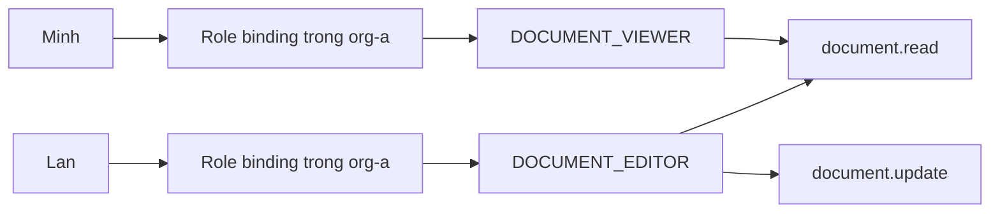

# Role-Based Access Control

## 1. RBAC giải quyết vấn đề gì?

Một ứng dụng quản lý tài liệu có hàng nghìn người dùng. Mỗi người có thể cần đọc, tạo, chỉnh sửa hoặc lưu trữ tài liệu. Nếu quản trị viên phải gán từng quyền riêng lẻ cho từng người, việc tiếp nhận nhân viên mới, chuyển vị trí và thu hồi quyền sẽ khó theo dõi. Hai người làm cùng công việc cũng dễ nhận những tập quyền khác nhau do thao tác thủ công.

**Role-Based Access Control — RBAC** là mô hình kiểm soát truy cập trong đó quyền được tổ chức theo vai trò. Hệ thống gán quyền cho role, rồi gán role phù hợp cho người dùng. Ví dụ:

```text
Lan  → DOCUMENT_EDITOR → document.read, document.update
Minh → DOCUMENT_VIEWER → document.read
```

Role đóng vai trò trung gian giữa danh tính và tập quyền. Khi nhiệm vụ thay đổi, quản trị viên có thể thay role được gán; khi chức năng của một role thay đổi, tập permission của role được cập nhật có kiểm soát.

RBAC thuộc bài toán **phân quyền**. Xác thực trả lời người gọi là ai; RBAC giúp xác định quyền mà người gọi nhận được từ các vai trò. Đăng nhập thành công, kể cả đăng nhập qua SSO và MFA, không tự động cấp quyền đọc mọi tài liệu hoặc quản trị hệ thống.

Cách tổ chức người dùng, vai trò và quyền là nền tảng của mô hình RBAC được NIST mô tả. Các biến thể có thể bổ sung phiên, phân cấp và ràng buộc. [Tham khảo: NIST — Role Based Access Control](https://csrc.nist.gov/projects/role-based-access-control).

## 2. Các thành phần cơ bản

### 2.1. User hoặc principal

Trong mô hình RBAC, user là danh tính được gán role. Khi triển khai IAM, thực thể nhận role có thể là người dùng, tài khoản dịch vụ hoặc một danh tính workload mà nền tảng hỗ trợ.

Ứng dụng cần một định danh ổn định cho thực thể này. Tên hiển thị, tên phòng ban hoặc địa chỉ email không nên được dùng tùy tiện như bằng chứng về quyền. Với danh tính liên kết, phải ánh xạ đúng danh tính do nhà cung cấp tin cậy phát hành sang principal của ứng dụng trước khi giải quyết role.

### 2.2. Permission

Permission biểu diễn thẩm quyền thực hiện một hành động trên một đối tượng hoặc một phạm vi đối tượng. Cách gọi thường gặp trong ứng dụng là:

```text
document.read
document.create
document.update
document.archive
document.share
```

Tên permission phải đủ rõ để người thiết kế chính sách biết nó cho phép điều gì. `document.update` có thể chỉ cho sửa nội dung thông thường; không nên ngầm bao gồm chuyển chủ sở hữu, thay tổ chức hoặc sửa danh sách phân quyền.

Một chuỗi như `write` có thể quá rộng nếu nhiều nghiệp vụ có mức ảnh hưởng khác nhau. Ngược lại, tạo một permission cho từng chi tiết giao diện thường gây khó quản lý. Ranh giới thích hợp nằm ở hành động nghiệp vụ cần kiểm soát độc lập.

### 2.3. Role

Role là tập quyền được đặt tên để phục vụ một trách nhiệm có ý nghĩa. Ví dụ:

| Role | Trách nhiệm dự kiến | Tập quyền minh họa |
|---|---|---|
| `DOCUMENT_VIEWER` | Đọc tài liệu | `document.read` |
| `DOCUMENT_EDITOR` | Biên tập nội dung | `document.read`, `document.update` |
| `DOCUMENT_MANAGER` | Quản lý tài liệu | Quyền của editor, thêm `document.archive`, `document.share` |

Đây là chính sách mẫu của ứng dụng trong bài học. Tên `MANAGER` không tự mang ý nghĩa bảo mật ngoài những permission thực sự được cấu hình.

Role cũng không nhất thiết trùng với chức danh nhân sự. Một người có chức danh “Trưởng nhóm” không vì thế được đọc bảng lương hoặc quản trị khóa mã hóa. Nếu hệ thống muốn ánh xạ chức danh sang role, phải định nghĩa rõ quy tắc ánh xạ và quy trình phê duyệt.

### 2.4. Hai quan hệ gán quyền

Có hai quan hệ khác nhau:

```text
User Assignment       : user → role
Permission Assignment : role → permission
```

Một user có thể được gán nhiều role; một role có thể gán cho nhiều user. Tương tự, nhiều role có thể cùng chứa một permission.

Không nên gộp hai quan hệ này thành một cột chuỗi khó kiểm soát trong bảng người dùng. Tách chúng giúp trả lời được cả “ai đang có role này?” và “role này đang cho phép những hành động nào?”.



Role binding trong hình là bản ghi gán role có phạm vi. Đây là cách triển khai được chọn cho ứng dụng nhiều tổ chức trong bài; mô hình RBAC không bắt buộc mọi sản phẩm phải dùng đúng tên bảng hay cấu trúc bản ghi này.

## 3. Từ role đến quyết định cho phép truy cập

Trong mô hình đơn giản không có phân cấp, hệ thống có thể lấy hợp các permission từ các role đang được sử dụng:

```text
effectivePermissions = hợp các permission của activeRoles

RBAC cho phép hành động nếu:
  tồn tại một role đang có hiệu lực
  và role đó chứa permission tương ứng.
```

Ví dụ Lan có hai role:

```text
DOCUMENT_VIEWER → {document.read}
DOCUMENT_EDITOR → {document.read, document.update}
```

Tập quyền hợp là `{document.read, document.update}`. Có thêm một role không chứa `document.update` không làm mất quyền cập nhật do role editor cung cấp.

Đây là ngữ nghĩa cấp quyền theo phép hợp được dùng trong ví dụ. Việc thêm một permission tên `DENY_UPDATE` không tự tạo cơ chế phủ định. Nếu sản phẩm hỗ trợ quy tắc từ chối tường minh, phải xác định riêng cách kết hợp cho phép, từ chối và các ràng buộc; không được suy ra thứ tự ưu tiên từ tên role.

### Kiểm tra RBAC cần gắn với tài nguyên

Giả sử Lan là editor ở `org-a`. Kết luận “Lan có `document.update`” vẫn cần được đặt trong phạm vi:

```text
subject  = Lan
resource = tài liệu doc-18 thuộc org-a
action   = document.update
```

Nếu đổi resource sang tài liệu của `org-b`, role ở `org-a` không được sử dụng để cấp quyền. Nếu tài liệu trong `org-a` còn có quy tắc riêng tư theo dự án hoặc chủ sở hữu, phải kiểm tra thêm những điều kiện ấy.

Một biểu thức minh họa cho ứng dụng có điều kiện bổ sung là:

```text
cho_phép = tài_khoản_hoạt_động
           AND role_binding_đang_hiệu_lực
           AND role_binding_đúng_phạm_vi
           AND role_cấp_permission
           AND điều_kiện_tài_nguyên_thỏa_mãn
```

RBAC đóng góp phần quyền dựa trên role. Những điều kiện khác phải được thực thi rõ ràng nếu nghiệp vụ yêu cầu; không tự xuất hiện chỉ vì hệ thống đã có bảng role.

## 4. Assigned roles và active roles trong phiên

Role đã được gán cho một user không nhất thiết phải được kích hoạt đồng thời trong mọi phiên. Một người có thể có cả quyền vận hành thông thường và quyền quản trị nhưng chọn chỉ dùng tập quyền thường ngày trong một phiên làm việc.

Ví dụ:

```text
assignedRoles(Lan) = {EMPLOYEE, PRIVILEGED_OPERATOR}

Phiên A: activeRoles = {EMPLOYEE}
Phiên B: activeRoles = {PRIVILEGED_OPERATOR}
```

Trong mô hình cơ bản, các role được kích hoạt phải thuộc tập role mà user được phép sử dụng. Nếu có phân cấp role, hệ thống phải giải quyết thêm các role được ủy quyền qua phân cấp theo quy tắc đã chọn.

Khi kích hoạt quyền cao, ứng dụng có thể yêu cầu bước xác thực bổ sung, lý do công việc hoặc một thời hạn ngắn. Đây là các cơ chế bổ sung vào việc sử dụng role, không phải hệ quả tự động của RBAC.

Một session hợp lệ cũng không thể duy trì vĩnh viễn role vừa bị thu hồi. Cơ chế xử lý phải xét dữ liệu gán role hiện hành hoặc có chính sách hết hạn, vô hiệu hóa và cập nhật phiên phù hợp.

Các khái niệm role assignment, role activation và authorization được giải thích trong phần hỏi đáp về mô hình RBAC của NIST. [Tham khảo: NIST — RBAC FAQs](https://csrc.nist.gov/Projects/role-based-access-control/faqs).

## 5. Phân cấp role và ràng buộc

### 5.1. Phân cấp role

Nếu policy quy định `DOCUMENT_MANAGER` kế thừa permission của `DOCUMENT_EDITOR`, còn editor kế thừa viewer, có thể diễn đạt:

```text
DOCUMENT_MANAGER
  kế thừa permission của DOCUMENT_EDITOR
    kế thừa permission của DOCUMENT_VIEWER
```

Trong ví dụ này, manager nhận các quyền đọc và cập nhật thông qua kế thừa. Chiều kế thừa phải được ghi rõ; một sơ đồ có mũi tên nhưng không giải thích chiều dễ làm người triển khai hiểu ngược.

Phân cấp quyền không phải bản sao bắt buộc của sơ đồ tổ chức. Giám đốc không nhất thiết cần mọi quyền kỹ thuật của quản trị viên cơ sở dữ liệu. Tạo một role đứng trên mọi role khác chỉ để phản ánh cấp bậc có thể cấp nhiều quyền hơn nhu cầu công việc.

Hệ thống cũng cần phát hiện chu trình trong phân cấp và tính đầy đủ quyền bắc cầu. Chỉ kiểm tra các permission gắn trực tiếp mà bỏ qua quyền kế thừa có thể tạo kết quả khác giữa các thành phần.

### 5.2. Phân tách nhiệm vụ

Giả sử quy trình thanh toán có hai role:

```text
PAYMENT_PREPARER → tạo đề nghị thanh toán
PAYMENT_APPROVER → phê duyệt đề nghị thanh toán
```

Một ràng buộc tĩnh có thể cấm gán đồng thời cả hai role cho cùng một người. Một ràng buộc động có thể cho phép người đó được gán cả hai nhưng cấm kích hoạt đồng thời trong một phiên theo mô hình đã chọn.

Tuy nhiên, cấm kích hoạt đồng thời chưa đủ để bảo đảm “người tạo không được phê duyệt chính đề nghị của mình”. Người đó có thể đổi phiên hoặc đổi role giữa hai bước. Quy tắc theo từng đề nghị cần so sánh danh tính người tạo và người phê duyệt trên chính đối tượng nghiệp vụ.

Điều này cho thấy ràng buộc role và ràng buộc giao dịch giải quyết các khía cạnh khác nhau. Khi yêu cầu là hai con người độc lập, không thể thay bằng hai tên role được một người dùng luân phiên sử dụng.

### 5.3. Giới hạn và thời hạn gán role

Ứng dụng có thể bổ sung giới hạn số người giữ một role, thời gian có hiệu lực hoặc điều kiện phê duyệt. Ví dụ, role vận hành đặc quyền chỉ có hiệu lực trong ca trực và phải được cấp bởi người có thẩm quyền.

Các điều kiện này cần được lưu và thực thi. Một trường `expiresAt` trong cơ sở dữ liệu không có tác dụng thu hồi quyền nếu mọi truy vấn cấp quyền đều bỏ qua nó.

## 6. Thiết kế role có phạm vi trong hệ thống nhiều tổ chức

Một ứng dụng SaaS phục vụ nhiều tổ chức không nên chỉ lưu:

```text
Lan → DOCUMENT_EDITOR
```

Vì bản ghi ấy chưa cho biết role có hiệu lực ở đâu. Cấu trúc có phạm vi rõ hơn là:

```text
principal = Lan
role      = DOCUMENT_EDITOR
scopeType = ORGANIZATION
scopeId   = org-a
```

Lan có thể đồng thời là editor của `org-a` và viewer của `org-b`:

| Principal | Role | Phạm vi |
|---|---|---|
| Lan | `DOCUMENT_EDITOR` | `org-a` |
| Lan | `DOCUMENT_VIEWER` | `org-b` |

Khi Lan sửa tài liệu, service phải lấy tổ chức của tài liệu từ dữ liệu có thẩm quyền rồi tìm role binding khớp. Không dùng role editor từ bất kỳ tổ chức nào để cấp phép cho mọi tài liệu.

Tham số `tenantId` trong URL hoặc header có thể cho biết phạm vi người gọi muốn sử dụng, nhưng chưa chứng minh họ được phép sử dụng phạm vi ấy. Metadata của tài liệu, role binding và ngữ cảnh được xác nhận phải nhất quán.

Phạm vi cũng có thể là dự án, workspace hoặc tập tài nguyên khác. Nếu có quan hệ cha–con giữa các phạm vi, phải định nghĩa việc quyền ở phạm vi cha có được áp dụng xuống con hay không. Không tự coi mọi role ở tổ chức là role ở mọi dự án.

### Một mô hình lưu trữ khái niệm

| Nhóm dữ liệu | Trường chính minh họa | Mục đích |
|---|---|---|
| Role catalogue | `roleId`, `roleKey`, mô tả | Định nghĩa ý nghĩa của role |
| Role permissions | `roleId`, `permissionId` | Xác định role cấp hành động nào |
| Role bindings | `principalId`, `roleId`, `scopeType`, `scopeId` | Gán role cho đúng danh tính trong đúng phạm vi |
| Dữ liệu vòng đời | trạng thái, thời hạn, người phê duyệt | Xác định bản ghi gán role còn hiệu lực hay không |

Các khóa ngoại và ràng buộc duy nhất cần ngăn bản ghi mồ côi hoặc gán trùng không mong muốn. Nếu tổ chức được tự tạo role riêng, phải bảo vệ cả phạm vi sở hữu role lẫn tập permission mà role ấy có thể chứa.

## 7. Minh họa Java: RBAC theo phạm vi tổ chức

Đoạn code dùng cú pháp Java 17, không phụ thuộc framework. Nó minh họa chính sách đơn giản: trong cùng tổ chức, viewer được đọc; editor được đọc và cập nhật; manager được thêm quyền chia sẻ và lưu trữ.

Trong ví dụ, `currentBindings` là các role binding đang có hiệu lực mà server đã giải quyết cho principal. Tất cả các binding này được sử dụng trong lần đánh giá. Ví dụ chưa triển khai chọn active roles theo phiên, phân cấp hay phân tách nhiệm vụ.

```java
import java.util.Map;
import java.util.Objects;
import java.util.Set;
import java.util.UUID;

public final class TenantRbac {
    public enum Permission {
        DOCUMENT_READ,
        DOCUMENT_UPDATE,
        DOCUMENT_SHARE,
        DOCUMENT_ARCHIVE
    }

    public enum Role {
        DOCUMENT_VIEWER,
        DOCUMENT_EDITOR,
        DOCUMENT_MANAGER
    }

    public record RoleBinding(UUID tenantId, Role role) {
        public RoleBinding {
            Objects.requireNonNull(tenantId);
            Objects.requireNonNull(role);
        }
    }

    public record Principal(
            UUID id,
            boolean accountActive,
            Set<RoleBinding> currentBindings) {
        public Principal {
            Objects.requireNonNull(id);
            currentBindings = Set.copyOf(currentBindings);
        }
    }

    public record DocumentFacts(UUID id, UUID tenantId) {
        public DocumentFacts {
            Objects.requireNonNull(id);
            Objects.requireNonNull(tenantId);
        }
    }

    private static final Map<Role, Set<Permission>> GRANTS = Map.of(
            Role.DOCUMENT_VIEWER,
            Set.of(Permission.DOCUMENT_READ),
            Role.DOCUMENT_EDITOR,
            Set.of(Permission.DOCUMENT_READ,
                    Permission.DOCUMENT_UPDATE),
            Role.DOCUMENT_MANAGER,
            Set.of(Permission.DOCUMENT_READ,
                    Permission.DOCUMENT_UPDATE,
                    Permission.DOCUMENT_SHARE,
                    Permission.DOCUMENT_ARCHIVE)
    );

    public static boolean permits(
            Principal principal,
            DocumentFacts document,
            Permission required) {
        if (principal == null || document == null || required == null) {
            return false;
        }
        if (!principal.accountActive()) {
            return false;
        }

        return principal.currentBindings().stream()
                .filter(binding -> binding.tenantId()
                        .equals(document.tenantId()))
                .anyMatch(binding -> GRANTS
                        .getOrDefault(binding.role(), Set.of())
                        .contains(required));
    }
}
```

Điểm quyết định nằm ở việc lọc binding theo tổ chức của tài liệu trước khi tìm permission. Cùng một principal có role ở nhiều tổ chức vẫn được đánh giá riêng cho từng tài nguyên.

`DOCUMENT_MANAGER` được khai báo đầy đủ permission trong map. Code không triển khai cây kế thừa; việc manager chứa quyền của editor ở đây là kết quả cấu hình tường minh.

Các cấu trúc immutable giúp hạn chế việc một phần code vô tình sửa tập quyền sau khi tạo đối tượng. Chúng không xác thực nguồn dữ liệu. Server vẫn phải tạo `Principal` từ danh tính đã xác thực và role binding có thẩm quyền; `DocumentFacts` phải lấy từ kho tài nguyên, không nhận nguyên trạng từ JSON của client.

Permission cần kiểm tra do nghiệp vụ server xác định. Nếu nhánh service đang lưu trữ tài liệu, nó phải yêu cầu `DOCUMENT_ARCHIVE`, kể cả khi client gửi một trường mang giá trị `DOCUMENT_READ`.

Code chỉ minh họa quyết định RBAC với phạm vi tổ chức. Nếu trong một tổ chức có tài liệu riêng tư, policy này đang cho viewer đọc toàn bộ tài liệu của tổ chức ấy; cần bổ sung điều kiện đối tượng nếu yêu cầu thực tế hẹp hơn.

## 8. Quản trị role là một bề mặt đặc quyền

### 8.1. Gán role cũng là một hành động phải được phân quyền

Không nên chỉ bảo vệ các API nghiệp vụ rồi để một endpoint quản trị cập nhật role theo dữ liệu client gửi. Người được sửa tên hồ sơ không được tự thêm `DOCUMENT_MANAGER` vào tài khoản của mình.

Với yêu cầu gán role, cần xác định:

```text
ai đang gán;
gán cho principal nào;
role nào được gán;
role có hiệu lực trong phạm vi nào;
người gán được phép cấp những role nào ở phạm vi ấy;
có cần phê duyệt, thời hạn hoặc kiểm tra xung đột nhiệm vụ không.
```

Một người có quyền quản lý thành viên của `org-a` không mặc nhiên được cấp role quản trị toàn nền tảng. Quyền sử dụng một role cũng không đồng nghĩa có quyền gán role đó cho người khác.

Nếu ứng dụng cho phép ủy quyền quản trị, phải xác định riêng tập role có thể được cấp. Không chỉ kiểm tra một cờ chung `canManageUsers` rồi cho phép người gọi chọn mọi role trong catalogue.

### 8.2. Sửa định nghĩa role ảnh hưởng nhiều người

Gán role cho một user làm thay đổi quyền của user ấy. Thêm permission vào một role có thể làm thay đổi quyền của mọi người đang giữ role, và cả những role kế thừa nó.

Ví dụ, thêm `document.share` vào `DOCUMENT_VIEWER` sẽ cho toàn bộ viewer trong phạm vi áp dụng một hành động mới. Tên role vẫn là viewer nên giao diện quản trị hoặc người kiểm toán có thể không nhận ra mức quyền đã tăng nếu chỉ nhìn tên.

Do đó, thay đổi định nghĩa role cần có khả năng xem tập permission trước và sau, đánh giá những danh tính bị ảnh hưởng và lưu dấu vết phê duyệt khi cần. Role catalogue là một phần của chính sách bảo mật, không chỉ là dữ liệu hiển thị.

### 8.3. Ánh xạ group hoặc claim vào role

Một ứng dụng có thể ánh xạ group trong hệ thống danh tính sang role nội bộ. Ví dụ:

```text
group đã xác nhận: finance-document-editors
  → role nội bộ: DOCUMENT_EDITOR
  → phạm vi đã cấu hình: org-a
```

Quy tắc ánh xạ phải xác định nguồn danh tính, ý nghĩa group và phạm vi. Không tự coi mọi claim có tên `admin` từ bất kỳ issuer nào là quản trị viên của ứng dụng.

Nếu nhiều service có role trùng tên, phải giữ ngữ cảnh ứng dụng hoặc miền quyền. `ADMIN` của ứng dụng báo cáo không tự trở thành `ADMIN` của hệ thống quản lý tài khoản.

## 9. Vòng đời role và khả năng thu hồi quyền

RBAC giúp chuẩn hóa việc cấp quyền, nhưng chỉ có ích khi việc thay đổi nhân sự và nhiệm vụ được phản ánh vào dữ liệu quyền.

| Sự kiện | Việc cần xác định trong ứng dụng |
|---|---|
| Tiếp nhận thành viên | Role tối thiểu, đúng tổ chức, người phê duyệt |
| Chuyển vị trí | Role mới cần thêm và role cũ cần bỏ |
| Thực hiện nhiệm vụ tạm thời | Thời hạn, điều kiện kết thúc, quyền bổ sung |
| Rời tổ chức | Thu hồi binding, xử lý phiên và tác vụ đang chờ |
| Sửa một role | Danh tính bị ảnh hưởng và quyền kế thừa phát sinh |
| Rà soát định kỳ | Quyền còn cần thiết, binding không có chủ sở hữu nghiệp vụ |

Một lỗi vận hành thường gặp là khi người dùng chuyển vị trí, hệ thống chỉ thêm role mới mà không bỏ role cũ. Sau vài lần chuyển nhóm, tập quyền trở thành hợp của nhiều nhiệm vụ mà người dùng không còn thực hiện.

Thu hồi một role cũng chưa chắc thu hồi một permission. Nếu permission ấy còn được cấp qua role khác hoặc qua phân cấp, người dùng vẫn có thể thực hiện hành động. Việc rà soát nên truy vết nguồn quyền hiệu lực, không chỉ nhìn một binding vừa xóa.

### Token và cache có thể giữ trạng thái cũ

Nếu ứng dụng đưa danh sách role vào token hoặc lưu tạm kết quả giải quyết quyền, thay đổi cơ sở dữ liệu chưa chắc được phản ánh ngay trong request tiếp theo. Hệ thống cần mục tiêu rõ ràng: quyền đã thu hồi phải ngừng có hiệu lực sau bao lâu và bằng cơ chế nào.

Các lựa chọn có thể gồm thời hạn ngắn, kiểm tra phiên bản quyền, vô hiệu hóa phiên hoặc tra cứu hiện hành ở thao tác nhạy cảm. Cách chọn phụ thuộc kiến trúc và yêu cầu thu hồi; không thể suy ra “đã xóa role trong database” đồng nghĩa mọi token cũ lập tức mất tác dụng.

Cache quyết định cũng không được chỉ có khóa `principalId`. Quyền còn phụ thuộc tài nguyên, action, phạm vi và phiên bản dữ liệu quyền. Lưu kết quả của một yêu cầu đọc ở `org-a` rồi dùng lại cho thao tác chia sẻ ở `org-b` là sai dù principal không đổi.

Với tác vụ nền, cần xác định thực thi bằng danh tính workload hay thay mặt người dùng, và quyền được đánh giá lúc tiếp nhận hay lúc chạy. Role mạnh của workload không nên vô tình bỏ qua giới hạn của người dùng được đại diện.

## 10. Thực thi RBAC ở đâu?

Chính sách phải được thực thi tại đường xử lý có quyền đọc dữ liệu hoặc gây tác động. Ẩn nút trên giao diện giúp người dùng hiểu khả năng của mình nhưng không chặn request được gửi trực tiếp.

Một gateway có thể chặn truy cập vào một nhóm endpoint. Service thường vẫn cần kiểm tra tài nguyên cụ thể, tổ chức và nghiệp vụ. Đặc biệt, cùng một hành động có thể được gọi từ REST API, consumer hoặc lịch chạy; mọi đường vào cần chịu kiểm soát phù hợp.

Không nên rải những chuỗi role khác nhau khắp code:

```java
// Minh họa một cách kiểm tra dễ trở nên khó bảo trì.
if (roles.contains("EDITOR") || roles.contains("MANAGER")) {
    // thực hiện một nghiệp vụ
}
```

Nếu nhiều endpoint tự liệt kê các role được chấp nhận, việc thêm role mới dễ khiến một nơi thiếu quyền trong khi nơi khác thừa quyền. Một lớp chính sách dùng permission nghiệp vụ có thể giúp tập trung ánh xạ role–permission và giữ việc kiểm tra nhất quán.

Tập trung chính sách không có nghĩa mọi request chỉ cần kiểm tra role một lần khi đăng nhập. Mỗi thao tác cần được đánh giá với tài nguyên và dữ kiện phù hợp tại thời điểm sử dụng.

Nếu dữ liệu quyền không truy cập được, không coi đó là danh sách quyền không hạn chế. Khi chưa xác nhận được việc cấp phép, thao tác cần được chặn; log có thể phân biệt lỗi vận hành với một quyết định từ chối thông thường.

OWASP khuyến nghị áp dụng quyền tối thiểu, từ chối mặc định và kiểm tra quyền trên mọi request cần được bảo vệ. Những nguyên tắc này vẫn cần được thực thi khi ứng dụng dùng RBAC. [Tham khảo: OWASP — Authorization Cheat Sheet](https://cheatsheetseries.owasp.org/cheatsheets/Authorization_Cheat_Sheet.html).

## 11. Khi RBAC cần kết hợp với mô hình khác

RBAC phù hợp khi nhiều người chia sẻ một số trách nhiệm tương đối ổn định: người đọc, người biên tập, người quản lý, nhân viên tiếp nhận hoặc người kiểm duyệt.

Khó khăn xuất hiện khi cố biểu diễn mọi tổ hợp điều kiện thành một role riêng:

```text
EDITOR_ORG_A_PROJECT_17_OWNER_ONLY_WORK_HOURS
EDITOR_ORG_A_PROJECT_18_OWNER_ONLY_WORK_HOURS
EDITOR_ORG_B_PROJECT_21_OWNER_ONLY_WORK_HOURS
```

Số role có thể tăng theo tổ hợp tổ chức, dự án, loại dữ liệu và điều kiện môi trường. Khi ấy người quản trị khó hiểu sự khác biệt, còn thay đổi một điều kiện phải sửa hàng loạt role.

Có thể giữ role ở mức trách nhiệm rồi biểu diễn các ranh giới khác bằng phạm vi binding, thuộc tính hoặc quan hệ:

| Yêu cầu | Thành phần chính sách có thể dùng |
|---|---|
| Ai được thực hiện hành động biên tập? | Role cấp `document.update` |
| Role có hiệu lực trong tổ chức nào? | Phạm vi role binding |
| Tài liệu có thuộc dự án mà người gọi tham gia không? | Quan hệ thành viên dự án |
| Tài liệu đã đóng băng chưa? | Thuộc tính trạng thái tài nguyên |
| Phiên có đáp ứng bước xác thực bổ sung không? | Context của lần truy cập |

Đây là cách phân chia cho ví dụ, không phải một công thức bắt buộc cho mọi sản phẩm. Một hệ thống RBAC có thể mô hình hóa permission ở mức đối tượng cụ thể; một hệ thống khác dùng ABAC hoặc mô hình quan hệ để biểu diễn cùng yêu cầu hiệu quả hơn.

Khi kết hợp, cần quy định rõ điều kiện nào là bắt buộc. Nếu người dùng phải vừa có permission vừa là thành viên dự án, phép kết hợp là `AND`. Dùng `OR` sẽ cho phép người chỉ có một trong hai điều kiện vượt qua kiểm tra.

## 12. Kiểm toán và kiểm chứng chính sách

### 12.1. Ghi được lý do cấp quyền

Để điều tra một quyết định, nên có khả năng trả lời:

```text
principal nào đã yêu cầu;
resource nào được truy cập;
action hoặc permission nào được kiểm tra;
role binding và phạm vi nào đã cấp quyền;
phiên bản policy hoặc role definition nào được áp dụng;
kết quả là cho phép, từ chối hay lỗi đánh giá.
```

Không cần ghi access token, secret hoặc nội dung đầy đủ của tài liệu vào log để giải thích một quyết định RBAC. Dấu vết phân quyền cũng cần được bảo vệ vì nó có thể tiết lộ cấu trúc tổ chức và danh tính đặc quyền.

Ngoài log quyết định truy cập, cần theo dõi thay đổi quản trị: ai gán role, ai thu hồi, ai sửa permission của role, phạm vi nào bị ảnh hưởng và vì sao. Hai loại log phục vụ những câu hỏi khác nhau.

### 12.2. Ma trận kiểm chứng cho ví dụ Java

Giả sử Lan có editor ở `org-a` và viewer ở `org-b`. Các tình huống sau giúp kiểm tra việc ánh xạ permission và phạm vi:

| Yêu cầu | Kết quả mong đợi theo ví dụ |
|---|---|
| Đọc tài liệu của `org-a` | Cho phép |
| Cập nhật tài liệu của `org-a` | Cho phép |
| Chia sẻ tài liệu của `org-a` | Từ chối vì editor không có quyền chia sẻ |
| Đọc tài liệu của `org-b` | Cho phép |
| Cập nhật tài liệu của `org-b` | Từ chối; editor ở `org-a` không áp dụng |
| Đọc tài liệu của `org-c` | Từ chối vì không có binding phù hợp |
| Tài khoản Lan bị vô hiệu hóa | Từ chối dù binding vẫn còn |
| Không có role binding nào | Từ chối |

Nếu ứng dụng thêm phân cấp hoặc chọn role theo phiên, cần kiểm chứng thêm quyền bắc cầu, role chưa được kích hoạt và các ràng buộc xung đột. Nếu có dữ liệu riêng tư theo đối tượng, cần bổ sung tình huống cùng role, cùng tổ chức nhưng khác tài liệu.

Một thay đổi định nghĩa role nên được so với ma trận quyền đã thống nhất. Nếu thêm một permission làm nhiều nhóm người được phép thực hiện hành động mới, kết quả đó phải là thay đổi có chủ đích.

## 13. Bài tập vận dụng

Thiết kế quyền cho một ứng dụng quản lý đề nghị thanh toán gồm ba nhiệm vụ: người lập đề nghị, người phê duyệt và người kiểm toán. Mỗi đề nghị thuộc một tổ chức. Người lập được tạo và sửa bản nháp; người phê duyệt được duyệt đề nghị đủ điều kiện; người kiểm toán chỉ đọc lịch sử.

Hãy thực hiện các việc sau:

1. Đặt tên các permission theo nghiệp vụ và lập bảng role–permission.
2. Biểu diễn việc một người là người lập ở `org-a` nhưng chỉ là người kiểm toán ở `org-b`.
3. Chọn cách kiểm soát yêu cầu “không tự phê duyệt đề nghị do mình tạo”.
4. Mô tả điều gì xảy ra với phiên cũ khi người phê duyệt bị thu hồi role.
5. Xác định người nào được phép cấp role phê duyệt và trong phạm vi nào.

Khi phân tích, chú ý rằng quyền sửa bản nháp không đồng nghĩa được sửa một đề nghị đã duyệt. Role cấp một khả năng nghiệp vụ; trạng thái của đối tượng vẫn có thể giới hạn lúc khả năng ấy được sử dụng.

Với yêu cầu không tự phê duyệt, chỉ chia thành hai role chưa đủ nếu một người có thể giữ cả hai. Cần quy tắc phù hợp theo danh tính trên từng đề nghị hoặc một ràng buộc mạnh hơn đáp ứng đúng yêu cầu tổ chức.

Kết quả thiết kế cần cho phép truy vết một quyền từ hành động cần thực hiện, qua permission và role, đến binding của đúng danh tính trong đúng phạm vi. Đường truy vết đó giúp việc cấp quyền, thu hồi và kiểm toán dựa trên dữ liệu có thể kiểm chứng.
