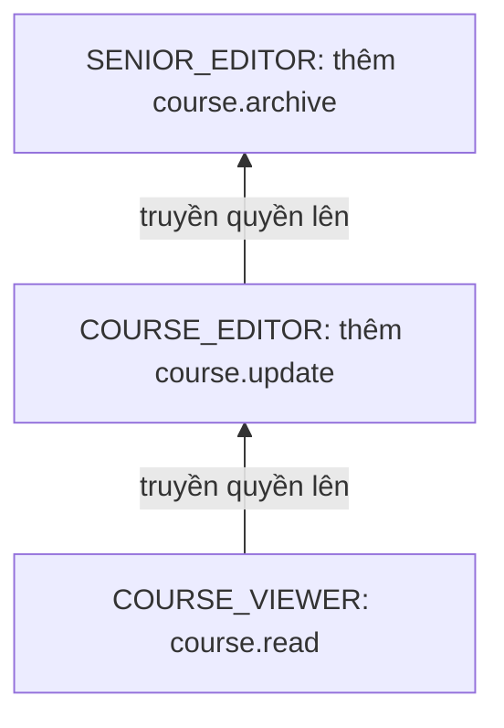

# Permission assignment — Gán quyền cho vai trò trong RBAC

## 1. Permission assignment nằm ở đâu trong RBAC?

Trong Role-Based Access Control, hệ thống tổ chức quyền truy cập thông qua vai trò. Một người dùng được gán vai trò phù hợp với công việc; vai trò chứa những quyền cần thiết để thực hiện công việc đó. **Permission assignment** là quan hệ gán permission cho role: một vai trò được phép thực hiện những thao tác nào trên những loại tài nguyên nào.

Ví dụ, nền tảng học tập có vai trò `COURSE_EDITOR`. Vai trò này có thể được gán `course.read` và `course.update`, nhưng chưa có `course.publish`. Việc một người được gán `COURSE_EDITOR` không tự tạo quyền phát hành nếu permission phát hành chưa nằm trong tập quyền hiệu lực của vai trò ấy.

Có hai quan hệ cần phân biệt ngay từ đầu:

| Quan hệ | Câu hỏi | Ví dụ |
| --- | --- | --- |
| User assignment, thường viết UA | Ai được gán vai trò nào? | Lan được gán `COURSE_EDITOR` |
| Permission assignment, thường viết PA | Vai trò được gán quyền nào? | `COURSE_EDITOR` có `course.update` |

Sửa UA thường thay đổi quyền của một hoặc một nhóm chủ thể được gán. Sửa PA thay đổi nội dung của vai trò và có thể ảnh hưởng đến mọi chủ thể đang sử dụng vai trò ấy, kể cả qua quan hệ kế thừa. Vì vậy, thêm một permission vào role là một thay đổi chính sách truy cập, không chỉ là thêm một dòng cấu hình.

NIST mô tả RBAC theo các thành phần người dùng, vai trò, permission, quan hệ gán và vai trò được kích hoạt trong session. Trong mô hình RBAC thuần, người dùng nhận quyền thông qua vai trò. Các điều kiện bổ sung có thể tiếp tục giới hạn truy cập. Tham khảo [NIST — Role Based Access Control FAQs](https://csrc.nist.gov/projects/role-based-access-control/faqs).

Bài học tập trung vào cách thiết kế và quản lý PA trong một hệ thống IAM: định nghĩa permission, ghép permission với role, tính quyền hiệu lực, kiểm soát việc thay đổi và đưa kết quả đến nơi thực thi. Việc gán người dùng vào role chỉ được nhắc đến khi cần giải thích tác động của PA.

## 2. Permission là một quyền có nghĩa nghiệp vụ rõ ràng

### 2.1. Permission thường kết hợp thao tác và tài nguyên

Một permission cho phép thực hiện một thao tác đối với một đối tượng hoặc một loại đối tượng. Ứng dụng có thể đặt tên:

```text
course.read
course.update
course.publish
enrollment.read
enrollment.manage
role.permissions.manage
```

Chuỗi ký tự chỉ là cách định danh do ứng dụng chọn. Dấu chấm, dấu hai chấm hoặc chữ hoa không tự tạo semantics phân quyền. Hai hệ thống có cùng permission tên `course.read` vẫn có thể áp dụng phạm vi khác nhau; mỗi hệ thống phải định nghĩa ý nghĩa của catalog quyền của mình.

Một mục catalog nên trả lời được:

- Permission cho phép hành động gì và những hành động nào không nằm trong đó?
- Tài nguyên là một đối tượng cụ thể, một loại đối tượng hay một phạm vi đã được tham số hóa?
- Có dữ liệu nhạy cảm, tác dụng phụ hoặc khả năng mở rộng quyền đi kèm không?
- Những endpoint, phương thức service hoặc tác vụ nào thực thi permission này?
- Ai chịu trách nhiệm phê duyệt thay đổi ý nghĩa của permission?

Ví dụ, `course.update` có thể cho sửa bản nháp nhưng không cho phát hành, xóa khóa học hoặc thay người sở hữu. Nếu API cập nhật entity nhận cả những trường ấy mà không kiểm tra riêng, việc phân chia permission trên giấy chưa bảo vệ được hệ thống.

### 2.2. Tránh permission quá rộng hoặc quá vụn

Permission `manage.everything` khó gắn với nguyên tắc ít quyền nhất vì không thể phân biệt nhiệm vụ biên tập và vận hành. Ngược lại, tạo một permission cho từng nút giao diện có thể làm catalog tăng nhanh nhưng vẫn không phản ánh đúng hành động nghiệp vụ.

Một chức năng có thể có nhiều đường vào: giao diện, REST API, batch job và thông điệp nội bộ. Nếu tất cả thực hiện cùng một hành động phát hành khóa học thì nên có một semantics quyền nhất quán, thay vì mỗi màn hình tự đặt một quyền không liên quan.

Các biến thể như `course.read.summary` và `course.read.sensitive` có ích khi hai mức dữ liệu thực sự khác nhau và cần quản lý riêng. Không nên chia nhỏ chỉ vì hai DTO có tên khác nhau.

### 2.3. Permission không tự tạo quan hệ bao hàm

Trong catalog minh họa, `course.publish` không tự bao gồm `course.read`; `course.update` không tự bao gồm `course.delete`. Nếu nghiệp vụ yêu cầu các quyền đi cùng nhau, hãy gán rõ hoặc định nghĩa quy tắc suy diễn có chủ đích.

Tương tự, chuỗi `course.*` chỉ hoạt động nếu policy engine đã định nghĩa wildcard và cách đối chiếu. Một phép so sánh chuỗi chính xác sẽ không hiểu nó là mọi quyền khóa học. Wildcard còn có thể vô tình bao gồm permission nhạy cảm được thêm trong tương lai, nên cần xem xét tác động khi catalog thay đổi.

## 3. Biểu diễn quan hệ PA và quyền hiệu lực

Gọi `U` là tập người dùng, `R` là tập vai trò và `P` là tập permission. Một cách ký hiệu quan hệ là:

```text
UA ⊆ U × R
PA ⊆ P × R

(Lan, COURSE_EDITOR) ∈ UA
(course.update, COURSE_EDITOR) ∈ PA
```

Thứ tự phần tử trong PA ở đây là `(permission, role)`. Khi thiết kế database hoặc API, có thể dùng thứ tự cột khác, miễn mô hình và cách diễn giải nhất quán.

Với một session `s`, giả sử `ActiveRoles(s)` đã được xác minh là tập vai trò mà người dùng được phép kích hoạt. Trong mô hình không có hierarchy:

```text
DirectPermissions(r) = { p ∈ P | (p, r) ∈ PA }

SessionPermissions(s) = hợp DirectPermissions(r)
                        với mọi r ∈ ActiveRoles(s)
```

Ví dụ:

```text
COURSE_EDITOR:   {course.read, course.update}
COURSE_REVIEWER: {course.read, course.publish}

Nếu cả hai role đang active:
    {course.read, course.update, course.publish}
```

Phép hợp loại bỏ phần tử trùng. Việc hai role cùng cấp `course.read` không làm quyền mạnh gấp đôi. Tuy nhiên, hai đường cấp khác nhau ảnh hưởng đến thu hồi: bỏ permission khỏi một role chưa chắc loại được quyền hiệu lực nếu role khác vẫn cấp.

Không nên mặc định mọi role được gán đều active trong mọi request. Một hệ thống có thể kích hoạt tự động toàn bộ role đủ điều kiện; hệ thống khác yêu cầu chọn hoặc kích hoạt role theo session. Cần xác định semantics của triển khai, đặc biệt với đặc quyền tạm thời.

Có permission trong tập hiệu lực cũng chưa đủ để bảo đảm một request được phép. Quyết định cuối còn có thể yêu cầu đúng tenant, đúng tài nguyên, trạng thái nghiệp vụ hợp lệ và các ràng buộc tách nhiệm vụ.

## 4. Thiết kế ma trận role–permission

Một ma trận minh họa cho nền tảng học tập:

| Permission | COURSE_VIEWER | COURSE_EDITOR | COURSE_REVIEWER | ENROLLMENT_OPERATOR |
| --- | --- | --- | --- | --- |
| `course.read` | Có | Có | Có | Có |
| `course.update` | Không | Có | Không | Không |
| `course.publish` | Không | Không | Có | Không |
| `enrollment.read` | Không | Không | Không | Có |
| `enrollment.manage` | Không | Không | Không | Có |

Đây là lựa chọn chính sách của ví dụ, không phải bộ role chuẩn cho mọi nền tảng. Ma trận mô tả gán trực tiếp, chưa có kế thừa. Các quyền trong bảng vẫn phải được giới hạn theo phạm vi mà role được gán và điều kiện tài nguyên của ứng dụng.

Để xây dựng ma trận, bắt đầu từ nhiệm vụ: người biên tập cần sửa bản nháp, người duyệt cần quyết định phát hành, người vận hành ghi danh cần xử lý đăng ký. Sau đó ánh xạ nhiệm vụ vào permission nhỏ nhất đủ dùng. Tránh sao chép toàn bộ quyền của một tài khoản quản trị rồi xóa dần bằng suy đoán.

Các permission quản lý IAM như gán role, sửa PA, tạo credential hoặc thay cấu hình liên kết danh tính cần được phân tích riêng. Chúng có thể tạo ra quyền gián tiếp lớn hơn những gì tên chức năng thể hiện.

Việc tách `COURSE_EDITOR` và `COURSE_REVIEWER` chưa tự bảo đảm một người không thể tự phát hành nội dung mình soạn. Nếu người đó được gán cả hai role, policy còn cần ràng buộc ở mức gán, kích hoạt hoặc giao dịch, tùy yêu cầu tách nhiệm vụ của sản phẩm.

## 5. Hierarchy làm PA lan truyền như thế nào?

Giả sử `SENIOR_EDITOR` kế thừa quyền từ `COURSE_EDITOR`. Trong quy ước của bài, role cấp cao nhận quyền của role cấp thấp:



Khi đó, quyền hiệu lực của `SENIOR_EDITOR` gồm quyền của chính nó và các role thấp hơn có thể đi tới qua quan hệ kế thừa. Không nên suy luận chiều kế thừa từ tên bảng `parent` hoặc chiều mũi tên nếu chưa đọc quy ước của hệ thống.

Một thay đổi PA ở `COURSE_VIEWER` có thể ảnh hưởng đến người dùng `COURSE_EDITOR` và `SENIOR_EDITOR`, dù không sửa quan hệ gán của hai role này. Trước khi thêm quyền nhạy cảm vào một role được kế thừa rộng, cần xem toàn bộ role nhận quyền và các chủ thể liên quan.

Hierarchy nên phản ánh khả năng kế thừa quyền được thiết kế, không tự sao chép cây chức danh tổ chức. Trưởng bộ phận không nhất thiết cần mọi quyền thao tác của từng nhân viên; có thể chỉ cần permission giám sát riêng.

Khi thu hồi `course.update` khỏi một role, cần kiểm tra permission đó có còn được cấp trực tiếp hoặc qua một nhánh hierarchy khác hay không. Với mô hình nhiều đường kế thừa, xóa một cạnh chưa chắc xóa được quyền hiệu lực.

## 6. Gắn permission với tenant và tài nguyên

### 6.1. Role có tên giống nhau không đồng nghĩa cùng phạm vi

Một ứng dụng đa tenant có thể có `COURSE_EDITOR` ở tenant A và tenant B. Người được gán role của tenant A không tự được sửa khóa học thuộc tenant B.

Có thể biểu diễn phạm vi bằng role riêng theo tenant, một role template kết hợp scoped binding hoặc một mô hình policy khác. Đây là lựa chọn triển khai, không phải một cấu trúc duy nhất mà RBAC bắt buộc. Dù chọn cách nào, quyết định cuối phải giữ được mối liên hệ giữa chủ thể, role và phạm vi tài nguyên.

Sai lầm nguy hiểm là làm phẳng mọi binding thành một tập authority toàn cục rồi mất thông tin tenant. Nếu một actor có `course.update` tại A, câu kiểm tra “có chuỗi `course.update`” không đủ để cho sửa khóa học tại B.

### 6.2. Phạm vi trong tenant cũng cần rõ

Một giảng viên có thể chỉ được sửa các khóa học được phân công. Có role hợp lệ trong đúng tenant mới là điều kiện chức năng; quan hệ với khóa học là điều kiện đối tượng.

Ví dụ quyết định:

```text
ALLOW update course nếu:
    actor đang hoạt động
    AND có course.update qua role được phép active trong tenant này
    AND course thuộc đúng tenant đó
    AND actor có quan hệ phân công được policy chấp nhận
    AND trạng thái course cho phép cập nhật
```

Chủ sở hữu tài nguyên, phạm vi nhóm và trạng thái đối tượng phải đến từ nguồn server phù hợp. Một trường `tenantId` hoặc `ownerId` do client gửi có thể dùng làm đầu vào tra cứu, nhưng chưa phải bằng chứng quyền.

### 6.3. Workload cũng nhận permission theo nhiệm vụ

Service phát thông báo có thể dùng role chỉ chứa permission đọc dữ liệu thông báo cần thiết. Nó không cần role vận hành ghi danh chỉ vì cùng gọi một database.

Danh tính workload và thời hạn credential hỗ trợ xác minh bên gọi, nhưng không làm permission quá rộng trở nên phù hợp. PA cho workload cần được rà soát giống PA cho role của người dùng, gồm cả đường cấp quyền gián tiếp như truy cập secret hoặc quyền tự tạo credential mới.

## 7. Mô hình dữ liệu PA tối giản

Một schema quan hệ minh họa có thể tách catalog permission và quan hệ gán cho role. Đoạn DDL dưới đây dùng kiểu dữ liệu thông dụng; cần điều chỉnh theo hệ quản trị được chọn:

```sql
CREATE TABLE iam_permission (
    permission_id VARCHAR(100) PRIMARY KEY,
    description VARCHAR(500) NOT NULL
);

CREATE TABLE iam_role (
    tenant_id VARCHAR(100) NOT NULL,
    role_id VARCHAR(100) NOT NULL,
    display_name VARCHAR(200) NOT NULL,
    policy_version BIGINT NOT NULL,
    PRIMARY KEY (tenant_id, role_id)
);

CREATE TABLE iam_role_permission (
    tenant_id VARCHAR(100) NOT NULL,
    role_id VARCHAR(100) NOT NULL,
    permission_id VARCHAR(100) NOT NULL,
    PRIMARY KEY (tenant_id, role_id, permission_id),
    FOREIGN KEY (tenant_id, role_id)
        REFERENCES iam_role (tenant_id, role_id),
    FOREIGN KEY (permission_id)
        REFERENCES iam_permission (permission_id)
);
```

Catalog trong ví dụ dùng chung toàn ứng dụng; role và PA được tách theo tenant. Khóa ghép giúp một dòng PA tham chiếu đúng role của đúng tenant. Khóa ngoại kiểm tra tính toàn vẹn dữ liệu, không xác minh người đang gửi lệnh SQL có thẩm quyền cấp permission đó.

Khóa chính ngăn gán trùng cùng permission cho cùng role trong cùng tenant. Nó không ngăn một role nhận tập permission nguy hiểm hoặc nhận quyền ngoài thẩm quyền của người quản trị. Những điều kiện ấy thuộc quy trình và policy quản lý quyền.

Schema chưa chứa UA, hierarchy, session, phê duyệt, thời hạn hoặc audit. Không được suy ra rằng ba bảng đã biểu diễn đầy đủ IAM. Nếu có quyền tạm thời, cần xác định nó gắn với PA, với user-role binding hay với trạng thái kích hoạt; mỗi lựa chọn có tác động khác nhau.

Đặc biệt, cấp PA tạm thời cho một role dùng chung có thể mở quyền cho toàn bộ người đang dùng role trong khoảng thời gian ấy. Nếu chỉ một nhân viên cần đặc quyền trong 30 phút, thường phải xem xét binding hoặc cơ chế kích hoạt cho chính nhân viên đó thay vì sửa một role phổ biến.

## 8. Ví dụ Java: kiểm tra permission qua role có phạm vi

Ví dụ sau dùng Java 17 trở lên để minh họa bước kiểm tra permission chức năng. Các binding đã được server nạp cho request hiện tại, xác minh còn hợp lệ và xác định trạng thái active. Nếu triển khai có hierarchy, tầng nạp dữ liệu đã mở rộng permission theo đúng phiên bản hierarchy và PA.

```java
import java.util.List;
import java.util.Objects;
import java.util.Set;

public final class ScopedRbac {
    public enum Permission {
        COURSE_READ,
        COURSE_UPDATE,
        COURSE_PUBLISH
    }

    public record Actor(String subjectId, boolean active) {
        public Actor {
            Objects.requireNonNull(subjectId);
        }
    }

    public record RoleBinding(
            String subjectId,
            String tenantId,
            String roleId,
            boolean active,
            Set<Permission> effectivePermissions) {
        public RoleBinding {
            Objects.requireNonNull(subjectId);
            Objects.requireNonNull(tenantId);
            Objects.requireNonNull(roleId);
            effectivePermissions = Set.copyOf(effectivePermissions);
        }
    }

    public boolean hasPermission(
            Actor actor,
            String targetTenantId,
            Permission required,
            List<RoleBinding> bindings) {
        if (actor == null || !actor.active()
                || targetTenantId == null || required == null
                || bindings == null) {
            return false;
        }

        return bindings.stream()
                .filter(Objects::nonNull)
                .anyMatch(binding -> binding.active()
                        && actor.subjectId().equals(binding.subjectId())
                        && targetTenantId.equals(binding.tenantId())
                        && binding.effectivePermissions().contains(required));
    }
}
```

Enum là một catalog nhỏ phục vụ minh họa, không phải yêu cầu mọi ứng dụng phải biên dịch permission vào mã nguồn. Hệ thống dùng catalog động có thể dùng ID permission ổn định và kiểm tra ID hợp lệ. Dù chọn enum hay database, vẫn cần quản lý ý nghĩa của permission.

`Set.copyOf` tạo tập permission không thể bị sửa qua collection gốc. Kiểm tra `subjectId` và `tenantId` giữ mối liên hệ giữa binding với actor và phạm vi. Không có binding hợp lệ chứa permission cần thiết thì kết quả là `false`.

Giả sử có các binding server-side:

```text
Lan — tenant-A — COURSE_EDITOR — active
    permissions: COURSE_READ, COURSE_UPDATE

Lan — tenant-B — COURSE_VIEWER — active
    permissions: COURSE_READ
```

Khi kiểm tra `COURSE_UPDATE` cho tenant A, kết quả là cho phép ở lớp chức năng. Cùng permission cho tenant B trả về từ chối. Gộp hai tập permission mà bỏ tenant sẽ làm mất sự khác biệt này.

Đoạn mã không tự xác thực người gọi, truy vấn PA, kiểm tra binding hết hạn, xác minh vai trò active được phép, hay giải quyết mọi ràng buộc SoD. Những công việc đó thuộc các thành phần tạo ngữ cảnh đáng tin cậy. `RoleBinding` là dữ liệu nội bộ; nhận một đối tượng cùng hình dạng từ body rồi đưa thẳng vào hàm sẽ cho phép client tự khai quyền.

Sau khi kiểm tra permission chức năng, service vẫn cần kiểm tra đối tượng. Ví dụ, `COURSE_UPDATE` trong tenant A chưa đủ nếu Lan không được phân công khóa học cụ thể hoặc khóa học đã ở trạng thái không cho sửa.

Hãy lấy tenant của tài nguyên từ kết quả tra cứu đã được kiểm soát. Không kiểm tra permission bằng `tenantId` của request rồi cập nhật một entity được tải riêng bằng ID mà không xác nhận entity thuộc tenant ấy.

## 9. Ai được thay đổi permission assignment?

### 9.1. Sử dụng quyền khác với phân phối quyền

Một người có `course.publish` không mặc nhiên được thêm permission ấy vào role của người khác. Quyền thực hiện nghiệp vụ và quyền quản lý PA là hai loại thẩm quyền khác nhau.

Ngược lại, có permission tên `role.permissions.manage` cũng không nên mặc nhiên cho phép sửa mọi role và gán mọi permission. Policy quản trị cần xác định người gọi được quản lý tenant nào, role nào và tập permission nào có thể cấp hoặc thu hồi.

Một ví dụ phân quyền quản trị:

```text
Tenant role administrator:
    Được sửa các custom role của chính tenant.
    Được dùng một catalog permission nghiệp vụ đã phê duyệt.
    Không được sửa platform role hoặc role bảo vệ cơ chế quản trị IAM.
    Thay đổi nhạy cảm cần quy trình phê duyệt tương ứng.
```

Đây là policy quản trị minh họa. Một tổ chức có thể dùng mô hình phân quyền quản trị khác; điểm bắt buộc về thiết kế là phạm vi thẩm quyền phải được xác định và thực thi, không chỉ đặt tên role “admin”.

### 9.2. Tập được cấp lại không nhất thiết là tập đang có

Một quản trị viên được phép quản lý cấu hình của nhóm có thể có một tập `grantablePermissions` riêng. Không nên suy ra máy móc rằng “đang có permission nào thì được cấp permission ấy”, hoặc “được quản lý role thì được cấp toàn bộ catalog”.

Hai hướng suy luận đều có thể sai. Một nhân viên được quyền xem dữ liệu để xử lý công việc không nhất thiết được phân phối quyền xem ấy. Một người quản trị việc phân quyền có thể được cấp một số quyền nghiệp vụ đã quy định mà bản thân không được dùng để đọc dữ liệu.

Policy quản trị cần kiểm tra kết quả của thay đổi. Người quản trị có thể không nhận quyền ngay khi sửa role, nhưng sẽ nhận sau khi tự gán role, thêm mình vào group hoặc kích hoạt một role kế thừa. Chỉ cấm sửa role đang mang tên người gọi không bao phủ đủ các đường tự nâng quyền.

### 9.3. Xem cả người nhận gián tiếp

Trước khi thêm `course.publish` vào `COURSE_EDITOR`, cần xác định:

- Role có những thành viên trực tiếp nào, gồm người dùng và workload?
- Các group hoặc nguồn provisioning nào có thể đưa thêm người vào role?
- Role cấp cao nào kế thừa permission mới?
- Có người nào đồng thời nhận các quyền xung đột sau thay đổi không?
- Token, session hoặc cache nào đang sử dụng snapshot của role?

Nếu role đang dùng cho hàng nghìn người, thêm một permission có thể ảnh hưởng hàng nghìn chủ thể. Việc người thao tác chỉ chọn một dòng role trong giao diện không làm phạm vi tác động nhỏ đi.

## 10. Quy trình thay đổi PA có thể kiểm soát

### 10.1. Mô tả thay đổi bằng chênh lệch

Một yêu cầu thay đổi nên nêu role đích, tenant, phiên bản hiện tại, permission thêm và permission bỏ. Ví dụ:

```text
Role:             COURSE_EDITOR
Tenant:           tenant-A
Expected version: 12
Add:              course.archive
Remove:           không có
Business reason:  biên tập viên cần lưu trữ bản nháp hết hạn
```

Không chỉ xem danh sách mới dài bao nhiêu. Cần xem permission mới có tác dụng gì, có mở đường đọc dữ liệu nhạy cảm hoặc quản lý quyền khác không, và hệ thống sẽ thực thi ở những vị trí nào.

Nếu dùng phê duyệt, quyết định phê duyệt phải gắn với chính thay đổi được duyệt: tenant, role, phiên bản và tập quyền. Không duyệt một yêu cầu `course.archive` rồi cho áp dụng một request đã bị sửa thành `role.permissions.manage`.

### 10.2. Kiểm tra quyền quản trị và tính toàn vẹn trước khi ghi

Một luồng xử lý có thể gồm:

1. Xác thực người gọi và nạp ngữ cảnh quản trị từ server.
2. Xác định role đích trong đúng tenant; kiểm tra role có được phép sửa không.
3. Kiểm tra các permission tồn tại và nằm trong phạm vi được quản lý.
4. Tính tập quyền sau thay đổi, kể cả ảnh hưởng hierarchy và ràng buộc cần thiết.
5. Xác minh phê duyệt nếu policy yêu cầu.
6. Ghi thay đổi PA và tăng phiên bản trong cùng ranh giới nhất quán đã thiết kế.
7. Lưu audit và phát tín hiệu để nơi thực thi cập nhật dữ liệu quyền.

Không trả thành công chỉ vì câu lệnh insert PA chạy được. Thành công quản trị phải có nghĩa thay đổi hợp lệ đã được lưu theo đúng semantics API. Nếu hệ thống áp dụng bất đồng bộ, cần phân biệt trạng thái đã nhận, đã lưu và đã có hiệu lực theo hợp đồng của sản phẩm.

### 10.3. Tránh ghi đè thay đổi đồng thời

Giả sử hai quản trị viên cùng đọc role version 12. Người thứ nhất bỏ `course.publish`; người thứ hai thêm `course.archive` bằng cách gửi lại toàn bộ tập permission cũ. Nếu server thay thế mù, request thứ hai có thể thêm lại `course.publish` vừa bị thu hồi.

Có thể dùng optimistic concurrency: yêu cầu phiên bản kỳ vọng và chỉ chấp nhận thay đổi nếu phiên bản còn khớp. Việc kiểm tra version, sửa PA và cập nhật version phải nằm trong transaction hoặc cơ chế nguyên tử tương ứng. Nếu có xung đột, trả kết quả để người gọi đọc lại và đánh giá chênh lệch mới.

Chỉ kiểm tra version ở đầu request rồi ghi ở cuối mà không bảo vệ khoảng giữa vẫn có race condition. Các quy trình approval và cache cũng cần liên hệ với phiên bản đúng; một role thay đổi sau phê duyệt có thể cần đánh giá lại yêu cầu.

## 11. Quyền hiệu lực, thu hồi và các đường cấp khác

### 11.1. Xóa PA khác với xóa toàn bộ quyền của một người

Giả sử Lan nhận `course.publish` từ cả `COURSE_REVIEWER` và `RELEASE_OPERATOR`. Bỏ PA khỏi `COURSE_REVIEWER` vẫn để lại đường cấp qua `RELEASE_OPERATOR`.

Cần phân biệt mục tiêu thu hồi:

| Mục tiêu | Điều cần kiểm tra |
| --- | --- |
| Role không còn trực tiếp chứa permission | Quan hệ PA trực tiếp của đúng role |
| Role không còn có permission hiệu lực | Cả PA trực tiếp và mọi đường hierarchy |
| Một người không còn dùng permission | Mọi role/binding, nhóm, grant bổ sung và trạng thái kích hoạt liên quan |
| Một request bị cấm trên tài nguyên cụ thể | Quyền chức năng cùng điều kiện đối tượng và policy giới hạn |

Các sản phẩm có thể bổ sung grant trực tiếp, ACL hoặc explicit deny ngoài RBAC thuần. Khi đó, việc tính quyền phải tuân theo mô hình kết hợp đã định nghĩa. Không mặc định một permission có tên `deny.course.publish` sẽ tự ghi đè `course.publish`.

### 11.2. Không có permission và explicit deny khác nhau

Trong cách tính bằng phép hợp ở phần trước, role không cấp permission chỉ có nghĩa không tạo một đường allow. Role khác vẫn có thể cấp permission đó. Một ô “Không” trong ma trận không phải một lệnh cấm có ưu tiên cao hơn mọi role khác.

Nếu hệ thống dùng explicit deny, cần quy định rõ điều kiện áp dụng, phạm vi, thứ tự hoặc thuật toán kết hợp và tương tác với hierarchy. Đây là phần semantics bổ sung của policy engine, không nên tự suy diễn từ biểu diễn PA tối giản.

### 11.3. Thay đổi trong kho quyền chưa chắc có hiệu lực tức thời

Một access token có thể mang snapshot authority được tạo trước khi PA thay đổi. Chữ ký hợp lệ cho biết token được phát hành theo cơ chế xác minh của hệ thống; nó không tự bảo đảm permission trong token khớp trạng thái PA mới nhất.

Ứng dụng cần chọn cách đồng bộ phù hợp: đọc quyền hiện tại khi xử lý, kiểm tra phiên bản policy, quản lý thu hồi phiên/token, làm mới snapshot hoặc dùng thời hạn có giới hạn. Những cơ chế này có phạm vi bảo đảm khác nhau. Token ngắn hạn giúp giới hạn một số khoảng trễ, nhưng không phải lời hứa thu hồi ngay tại mọi thành phần.

Với cache, khóa chỉ có `roleId` có thể dùng nhầm dữ liệu giữa các tenant. Có thể cần tenant, role, phiên bản PA và phiên bản hierarchy liên quan. Cơ chế vô hiệu hóa cache phải xét cả role kế thừa và những snapshot người dùng đã tổng hợp quyền.

Khi nguồn policy lỗi, không được tự thay bằng một tập quyền rộng để duy trì hoạt động. Cách sử dụng snapshot cũ, nếu có, phải nằm trong policy đã thiết kế và đáp ứng yêu cầu về độ trễ thu hồi.

## 12. Đưa PA đến đúng nơi thực thi

PA chỉ có tác dụng khi quyết định quyền được thực thi trên đường xử lý thực tế. Một catalog hoàn chỉnh nhưng endpoint chỉ kiểm tra đăng nhập vẫn để người dùng gọi những chức năng ngoài tập permission.

OWASP khuyến nghị least privilege, deny by default và kiểm tra quyền trên mỗi request. Trong ứng dụng dùng RBAC, các nguyên tắc này giúp bảo đảm rằng PA được dùng nhất quán khi bảo vệ chức năng và tài nguyên. Xem [OWASP Authorization Cheat Sheet](https://cheatsheetseries.owasp.org/cheatsheets/Authorization_Cheat_Sheet.html).

### 12.1. Role check và permission check

Kiểm tra role như `COURSE_EDITOR` gắn điểm thực thi với tên vai trò. Kiểm tra permission như `course.update` gắn điểm thực thi với khả năng nghiệp vụ. Cách thứ hai thường giúp nhiều role dùng chung một chức năng mà không cần sửa từng endpoint khi tạo role mới.

Tuy nhiên, đổi tên phép kiểm tra chưa đủ. Authority phải được tính đúng từ PA và phạm vi, không lấy từ một header do client tự đặt. Một thư viện có thể yêu cầu cấu hình ánh xạ giữa role, permission và authority; ứng dụng cần hiểu rõ ánh xạ đó trước khi sử dụng.

Không giả định role tên `ADMIN` có toàn bộ permission hoặc một prefix tên role sẽ tạo kế thừa. Những hành vi như vậy chỉ tồn tại khi policy hoặc framework đã được cấu hình tương ứng.

### 12.2. Bao phủ mọi đường vào

Chức năng sửa khóa học có thể được gọi qua REST API, import, batch hoặc message consumer. Mỗi đường cần dùng cùng semantics nghiệp vụ thích hợp. Nếu chỉ controller web kiểm tra `course.update` nhưng tác vụ import bỏ qua, người dùng vẫn có thể sửa dữ liệu qua đường import.

API danh sách, tìm kiếm, tải file và export còn cần kiểm tra phạm vi dữ liệu. Có `course.read` không mặc nhiên được tải mọi khóa học của mọi tenant. Kiểm soát UI chỉ giúp người dùng hiểu chức năng có thể dùng; server mới là nơi cần thực thi quyết định.

### 12.3. OAuth/OIDC không tự hoàn thành PA local

Đăng nhập qua OIDC giúp ứng dụng nhận và xác minh thông tin danh tính theo cấu hình tin cậy. Nó không tự xác định người đó được gán role nào trong tenant local hoặc role local có những permission gì.

Một scope OAuth cũng không mặc nhiên tương đương một permission trong catalog ứng dụng. Nếu có ánh xạ, cần xác định issuer, audience, client, phạm vi ủy quyền và policy local tương ứng. Không nhận một role claim từ nguồn không được tin cậy cho tenant rồi đưa thẳng vào tập permission hiệu lực.

## 13. Audit, rà soát và kiểm chứng thiết kế PA

Một sự kiện thay đổi PA cần giúp trả lời ai thay đổi, role và tenant nào, permission nào thêm/bỏ, lý do, phê duyệt và phiên bản trước/sau. Ví dụ:

```text
event_type=ROLE_PERMISSION_ASSIGNMENT_CHANGED
actor_id=admin-14
tenant_id=tenant-A
role_id=COURSE_EDITOR
added_permission=course.archive
removed_permissions=[]
previous_policy_version=12
new_policy_version=13
approval_reference=approval-287
request_id=req-635
```

Đây là schema log minh họa. Không ghi credential, token hoặc secret vào audit. Quyền đọc và xóa audit cũng cần được kiểm soát; một người được sửa PA không mặc nhiên được xóa bằng chứng thay đổi của mình.

Rà soát định kỳ nên xem cả quyền trực tiếp và hiệu lực. Một role có vẻ nhỏ ở bảng PA nhưng có thể nhận nhiều permission qua hierarchy. Một role ít thành viên có thể vẫn rủi ro cao nếu chứa quyền tạo credential hoặc sửa policy.

Khi triển khai, các tình huống cần kiểm chứng gồm:

| Tình huống | Kết quả kỳ vọng trong policy minh họa |
| --- | --- |
| Role không chứa `course.publish`, không có đường cấp khác | Từ chối phát hành |
| Có `course.update` ở tenant A nhưng tài nguyên thuộc B | Từ chối cập nhật |
| Role được gán nhưng chưa được phép active trong session | Không dùng role ấy làm đường cấp quyền cho session |
| Role cấp cao kế thừa một role có permission | Quyền hiệu lực phản ánh hierarchy đã định nghĩa |
| Bỏ permission khỏi một role nhưng role khác vẫn cấp | Permission có thể còn hiệu lực; không báo đã thu hồi toàn bộ |
| Quản trị viên tenant xin sửa platform role | Từ chối nếu ngoài phạm vi quản trị |
| Permission ID không tồn tại trong catalog | Từ chối thay đổi PA |
| Request thay đổi role dùng version cũ | Phát hiện xung đột theo cơ chế đồng thời đã thiết kế |
| Thu hồi PA nhưng token/cache còn snapshot cũ | Hành vi khớp giới hạn thu hồi đã công bố và kiểm chứng |

Kiểm chứng nên bao gồm quyết định ở tầng policy và đường thực thi cuối như API, export hoặc worker. Chỉ kiểm tra rằng bảng `iam_role_permission` đã có dòng dữ liệu chưa chứng minh request thực tế được cho phép hoặc bị từ chối đúng.

## 14. Tình huống thực hành

Nền tảng có hai tenant A và B. Lan được gán `COURSE_EDITOR` tại A và `COURSE_VIEWER` tại B. Minh được gán `COURSE_REVIEWER` tại A. PA trực tiếp giống ma trận ở phần 4 và không có hierarchy.

Trước hết, hãy xác định quyền chức năng của Lan tại từng tenant và giải thích vì sao không được hợp tập permission toàn cục rồi dùng cho cả hai tenant. Sau đó xét đề xuất thêm `course.publish` vào `COURSE_EDITOR` của A:

1. Ai nhận thêm khả năng phát hành, trực tiếp hoặc gián tiếp qua cơ chế gán hiện tại?
2. Thay đổi có làm mất ý nghĩa tách biên tập và duyệt nội dung không?
3. Nếu chỉ Lan cần quyền trong 30 phút, sửa PA của role dùng chung có đúng phạm vi không?
4. Người đề xuất có quyền quản lý permission ấy trên role đích không, và ai có thể phê duyệt?
5. Những session, token và cache nào cần nhìn thấy phiên bản PA mới?
6. Nếu rollback, có đảm bảo các thay đổi hợp lệ khác xảy ra sau đó không bị ghi đè không?

Tiếp theo, giả sử bỏ `course.publish` khỏi `COURSE_REVIEWER` nhưng Minh vẫn phát hành được. Hãy điều tra theo các lớp: có role khác cấp cùng permission không, có hierarchy hoặc grant bổ sung không, session có dùng snapshot cũ không, và endpoint có thực sự kiểm tra permission hay chỉ kiểm tra tên role.

Permission assignment quản lý nội dung quyền của vai trò. Giá trị của nó nằm ở việc liên kết được nhiệm vụ với tập permission rõ ràng, giữ được phạm vi khi tính quyền hiệu lực và kiểm soát được tác động mỗi lần vai trò thay đổi.
