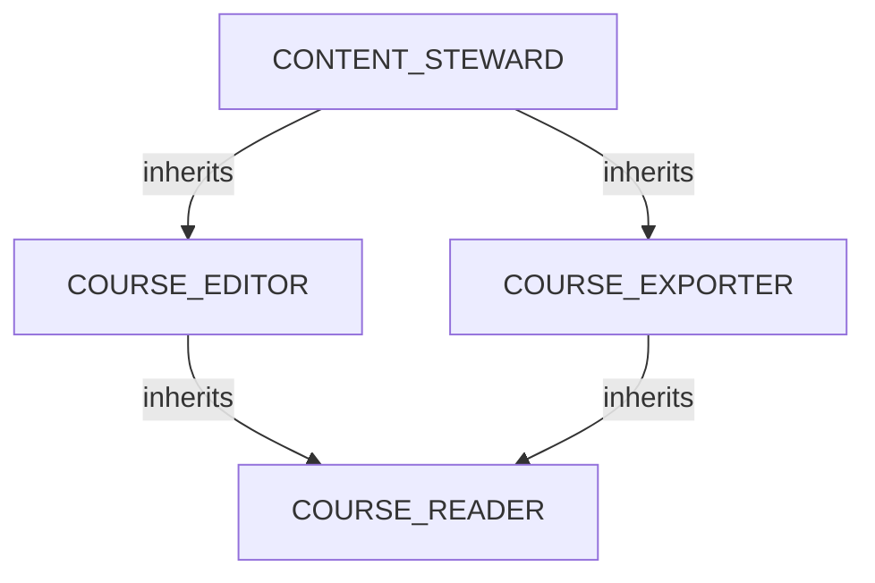

# Role hierarchy: phân cấp và kế thừa vai trò trong RBAC

## 1. Role hierarchy giải quyết vấn đề gì?

Một nền tảng học tập có các vai trò đọc khóa học, biên tập khóa học và quản lý nội dung. Người biên tập cần quyền đọc trước khi sửa; người quản lý nội dung có thể cần toàn bộ quyền biên tập cùng một số quyền bổ sung.

Nếu mỗi vai trò tự liệt kê lại tất cả permission, hệ thống dễ xuất hiện cấu hình không đồng nhất. Khi bổ sung một quyền đọc cần thiết, quản trị viên phải nhớ cập nhật nhiều vai trò. **Role hierarchy** biểu diễn quan hệ kế thừa để một vai trò sử dụng các quyền của vai trò khác theo một cấu trúc đã xác định.

Trong cách hiểu dùng xuyên suốt bài:

> Vai trò senior kế thừa permission của vai trò junior, cộng với permission được gán trực tiếp cho chính nó.

“Senior” và “junior” ở đây mô tả quan hệ quyền, không khẳng định cấp bậc nhân sự. Trưởng phòng không mặc nhiên phải được kế thừa quyền vận hành cơ sở dữ liệu của kỹ sư trong phòng.

NIST phân biệt Hierarchical RBAC với RBAC chỉ có gán người dùng và permission vào role. Thành phần phân cấp bổ sung quan hệ giữa các role và khái niệm quyền, người dùng được cho phép thông qua quan hệ đó. [NIST RBAC FAQ](https://csrc.nist.gov/projects/role-based-access-control/faqs)

Trong nền tảng IAM, hierarchy giúp tổ chức quyền có hệ thống, nhưng vẫn phải đi cùng phạm vi tài nguyên, vòng đời cấp quyền, thực thi ở backend và kiểm toán. Xác thực thành công qua mật khẩu, MFA hoặc SSO không tự làm người dùng đứng ở đỉnh hierarchy.

Sau bài học, người học có thể:

- Đọc đúng chiều kế thừa và tính permission hiệu lực.
- Phân biệt role được gán, role được phép kích hoạt và role đang hoạt động.
- Thiết kế hierarchy có nhiều nhánh mà không mở rộng quyền ngoài ý muốn.
- Giữ phạm vi tenant, tài nguyên và điều kiện khi khai triển quyền.
- Đánh giá ảnh hưởng của việc thêm permission, thêm cạnh hoặc thu hồi quyền.

## 2. Quy ước chiều kế thừa phải rõ ràng

### 2.1. Quy ước dùng trong bài

Bài này viết:

```text
COURSE_EDITOR >= COURSE_READER
```

với nghĩa:

```text
COURSE_EDITOR là senior của COURSE_READER
COURSE_EDITOR kế thừa permission của COURSE_READER
```

Khi vẽ đồ thị, mũi tên chỉ từ role kế thừa sang role được kế thừa:

```text
COURSE_EDITOR --inherits--> COURSE_READER
```

Theo quy ước này, bộ đánh giá bắt đầu ở `COURSE_EDITOR` rồi đi theo mũi tên để thu thập permission. Nói “permission được kế thừa lên senior” và vẽ mũi tên “senior đến junior” vẫn nhất quán, vì mũi tên ở đây biểu diễn quan hệ phụ thuộc, không biểu diễn luồng permission.

Một sản phẩm khác có thể vẽ hoặc đặt tên parent/child ngược lại. Trước khi cấu hình cần đọc chính xác ngữ nghĩa của sản phẩm; không suy ra quyền chỉ từ vị trí trên màn hình.

### 2.2. Những điều không suy ra từ quan hệ này

Nếu `COURSE_EDITOR >= COURSE_READER` thì:

- Editor nhận các permission của reader theo mô hình kế thừa đã chọn.
- Reader không tự nhận permission riêng của editor.
- Người được gán reader không tự được kích hoạt editor.
- Editor không tự có quyền cấp role cho người khác.
- Editor của tenant A không tự trở thành editor của tenant B.

Quyền quản lý role là các permission quản trị riêng. Nếu chúng thật sự được gán vào một role nằm trong hierarchy, chúng cũng có thể bị kế thừa; vì vậy phải kiểm soát chính nơi gán các permission này.

## 3. Ví dụ một hierarchy có nhiều nhánh

### 3.1. Permission được gán trực tiếp

Giả sử nền tảng định nghĩa bốn role:

| Role | Permission trực tiếp | Role được kế thừa trực tiếp |
|---|---|---|
| `COURSE_READER` | `course.read` | Không có |
| `COURSE_EDITOR` | `course.edit` | `COURSE_READER` |
| `COURSE_EXPORTER` | `course.export` | `COURSE_READER` |
| `CONTENT_STEWARD` | `course.archive` | `COURSE_EDITOR`, `COURSE_EXPORTER` |

Đây là chính sách minh họa của bài. Một tổ chức có thể cần tách xuất dữ liệu hoặc lưu trữ khóa học khỏi quản lý nội dung; không nên sao chép hierarchy này nếu trách nhiệm thực tế khác.



`CONTENT_STEWARD` có hai nhánh kế thừa và cả hai đều đi đến `COURSE_READER`. Đây là cấu trúc hình thoi.

### 3.2. Permission hiệu lực

| Role | Permission trực tiếp | Permission hiệu lực sau kế thừa |
|---|---|---|
| `COURSE_READER` | `course.read` | `course.read` |
| `COURSE_EDITOR` | `course.edit` | `course.read`, `course.edit` |
| `COURSE_EXPORTER` | `course.export` | `course.read`, `course.export` |
| `CONTENT_STEWARD` | `course.archive` | `course.read`, `course.edit`, `course.export`, `course.archive` |

Permission được tính theo tập hợp. `course.read` xuất hiện qua hai đường không làm phát sinh hai quyền đọc khác nhau và không được tính hai lần.

Trong đồ thị này, editor và exporter không có quan hệ senior/junior với nhau. Cả hai đều kế thừa reader, nhưng editor không tự được xuất dữ liệu và exporter không tự được sửa nội dung.

### 3.3. Không bắt buộc có một role cao nhất

Có thể tồn tại nhiều nhánh không nối với nhau, chẳng hạn quản lý nội dung, hỗ trợ học viên và vận hành hạ tầng.

Không cần tạo một role “toàn quyền” chỉ để tất cả nhánh có chung một đỉnh. Việc gom các nhánh tạo ra một tập quyền mới có thể rất lớn và cần có lý do nghiệp vụ riêng.

## 4. Mô hình toán học tối thiểu

### 4.1. Quan hệ thứ tự bộ phận

Ký hiệu `r >= q` có nghĩa r là senior của q, bao gồm cả trường hợp r và q là cùng một role.

Một hierarchy theo mô hình thứ tự bộ phận có ba tính chất:

| Tính chất | Nội dung | Ý nghĩa thiết kế |
|---|---|---|
| Phản xạ | `r >= r` | Một role sử dụng permission trực tiếp của chính nó |
| Bắc cầu | Nếu `r >= q` và `q >= t`, thì `r >= t` | Kế thừa đi qua nhiều cấp |
| Phản đối xứng | Nếu `r >= q` và `q >= r`, thì `r = q` | Hai role khác nhau không kế thừa vòng lẫn nhau |

Quan hệ phản xạ thuộc mô hình toán học. Bảng lưu cạnh trực tiếp thường không cần lưu `r -> r`; trong thiết kế minh họa, cạnh tự trỏ bị từ chối vì không mang thêm thông tin.

Tài liệu đề xuất chuẩn RBAC của Ferraiolo và cộng sự mô tả hierarchy bằng quan hệ thứ tự bộ phận, trong đó senior nhận permission từ junior. Đây là tài liệu nền tảng năm 2000, không phải tuyên bố rằng mọi sản phẩm IAM hiện nay triển khai cùng một cơ chế. [A Proposed Standard for Role-Based Access Control, mục Hierarchical RBAC](https://csrc.nist.gov/csrc/media/projects/role-based-access-control/documents/rbac-std-draft.pdf)

### 4.2. Công thức permission hiệu lực

Gọi:

```text
D(r) = tập permission được gán trực tiếp cho role r

C(r) = tập gồm r và mọi role junior có thể đi tới từ r
       bằng không hoặc nhiều cạnh inherits

E(r) = tập permission hiệu lực của role r
```

Trong mô hình kế thừa permission thuần cộng của bài:

```text
E(r) = hợp của D(q), với mọi q thuộc C(r)
```

Ví dụ:

```text
C(COURSE_EDITOR)
    = {COURSE_EDITOR, COURSE_READER}

E(COURSE_EDITOR)
    = {course.edit} hợp {course.read}
    = {course.edit, course.read}
```

Nếu `r >= q`, ta có `E(q)` là tập con của `E(r)` trong mô hình này.

Chiều ngược lại không được suy ra tự động: hai role có tập permission trùng nhau không bắt buộc phải có quan hệ kế thừa. Quan hệ hierarchy là cấu hình chính sách, không phải kết quả đoán từ các permission đang tình cờ giống nhau.

### 4.3. Hierarchy tổng quát và cấu trúc cây

Một cấu trúc cây đơn giản hơn để vận hành, nhưng không biểu diễn được mọi trường hợp tái sử dụng quyền qua nhiều nhánh.

Các mô hình phân cấp tổng quát có thể hỗ trợ nhiều kế thừa như hình thoi ở ví dụ. Khả năng hỗ trợ hierarchy tổng quát hay giới hạn là một điểm cần phân biệt khi đánh giá công cụ. [The NIST Model for Role-Based Access Control: Towards a Unified Standard, mục Hierarchical RBAC](https://tsapps.nist.gov/publication/get_pdf.cfm?pub_id=916402)

Về lưu trữ, một đồ thị có hướng không chu trình của các cạnh giữa role khác nhau có thể biểu diễn hierarchy này; quan hệ đầy đủ được suy ra qua bao đóng bắc cầu và phản xạ.

Không cần tạo cạnh trực tiếp giữa mọi cặp đã có đường đi. Tuy nhiên, xóa một cạnh trực tiếp cũng chưa chắc xóa được quan hệ kế thừa nếu vẫn còn đường khác.

## 5. Role được gán, được phép và đang hoạt động

### 5.1. Phân biệt ba lớp

| Khái niệm | Ví dụ với Lan | Điều cần nhớ |
|---|---|---|
| Role được gán trực tiếp | Lan được gán `CONTENT_STEWARD` | Đây là dữ liệu cấp quyền ban đầu |
| Role được phép thông qua hierarchy | Steward và các junior tương ứng | Không cần ghi thêm nhiều assignment vật lý chỉ để tính kế thừa |
| Role đang hoạt động trong phiên | Lan chọn dùng `COURSE_READER` | Phải nằm trong tập được phép và thỏa ràng buộc kích hoạt |

Trong ví dụ có cơ chế kích hoạt role, Lan có thể dùng một role junior để chỉ đọc nội dung, thay vì kích hoạt steward trong mọi tác vụ.

Bộ đánh giá có thể mô hình hóa:

```text
AuthorizedRoles(user)
    = hợp C(r) cho các role r được gán còn hiệu lực

ActiveRoles(session)
    là tập con được phép của AuthorizedRoles(user)

SessionPermissions(session)
    = hợp E(r) cho các role r đang hoạt động
```

Các công thức ở đây đang xét một phạm vi quyền xác định. Khi có nhiều tenant hoặc nhiều binding với phạm vi khác nhau, phải giữ nguyên phạm vi trên từng quyền như phần tiếp theo.

### 5.2. Kích hoạt senior mang theo permission kế thừa

Nếu phiên kích hoạt `CONTENT_STEWARD` theo mô hình kế thừa permission của bài, phiên sử dụng permission của toàn bộ nhánh junior liên quan.

Không được cho rằng chỉ vì danh sách active role có một phần tử nên phiên chỉ có permission trực tiếp của role đó.

Một số hệ thống có quy ước khác về kế thừa và kích hoạt. Cần phân biệt khả năng được kích hoạt một role với việc tự động có toàn bộ permission của role đó; không trộn hai cách diễn giải trong cùng phép tính.

### 5.3. Phiên và xác thực vẫn là vấn đề riêng

Role đang hoạt động không chứng minh phiên còn hợp lệ, tài khoản chưa bị khóa hoặc yêu cầu MFA đã được đáp ứng.

Khi tài khoản rời tổ chức hoặc bị thu hồi quyền, hệ thống cần xác định cách xử lý assignment, phiên, token và cache đang tồn tại. Đăng nhập lại không phải cơ chế duy nhất để cập nhật quyền, và cũng không nên mặc định người dùng phải tự đăng nhập lại thì việc thu hồi mới có tác dụng.

## 6. Giữ phạm vi tenant và tài nguyên khi kế thừa

### 6.1. Role binding có phạm vi

Trong mô hình ứng dụng của bài, một binding có thể gồm:

```text
principal = user-lan
role = CONTENT_STEWARD
scope = tenant-a / course-collection-1
validUntil = thời hạn được cấp
```

Kế thừa mở rộng những hành động mà binding cho phép, nhưng không tự mở rộng `scope` sang tenant B hay sang mọi khóa học của tenant A.

Việc thêm scope và thời hạn là phần thiết kế ứng dụng quanh mô hình role; không phải yêu cầu mọi triển khai RBAC đều có cùng schema binding.

### 6.2. Tránh tích chéo role và scope

Lan có hai binding:

```text
COURSE_EDITOR tại tenant-a
COURSE_READER tại tenant-b
```

Một cách tính sai là:

```text
roles = {COURSE_EDITOR, COURSE_READER}
tenants = {tenant-a, tenant-b}

cho phép mọi tổ hợp role và tenant
```

Cách này vô tình tạo quyền editor tại tenant B.

Cách đúng cho thiết kế của bài là giữ mỗi binding như một đơn vị:

```text
binding 1:
    course.edit và course.read trong tenant-a

binding 2:
    course.read trong tenant-b
```

Phép khai triển hierarchy không được làm mất quan hệ giữa role, chủ thể và phạm vi gốc.

### 6.3. Permission có điều kiện không được làm phẳng tùy ý

Một permission thực tế có thể là một phát biểu gồm action, phạm vi tài nguyên và điều kiện, thay vì chỉ là chuỗi `course.read`.

Nếu junior chỉ được đọc khóa học đã công bố, kế thừa permission đó không tự xóa điều kiện “đã công bố”. Nếu senior có thêm grant đọc bản nháp, đó là một căn cứ cấp quyền riêng.

Trong một binding, phạm vi sử dụng permission có thể được thiết kế là giao của phạm vi binding và phạm vi phát biểu permission. Các điều kiện toàn cục, chẳng hạn trạng thái tài khoản hoặc cấm tự phê duyệt, tiếp tục được đánh giá theo chính sách.

Nếu chủ thể có nhiều binding hợp lệ, một binding khác có thể cấp quyền rộng hơn. Vì vậy cần phân biệt giới hạn của một grant với lệnh cấm có hiệu lực trên mọi grant. Ngữ nghĩa kết hợp allow/deny phải được định nghĩa rõ trong hệ thống sử dụng.

### 6.4. Hierarchy không thay thế kiểm tra đối tượng

Có `course.edit` qua role không đủ để sửa bất kỳ khóa học nào. Backend vẫn cần đối chiếu tenant, phạm vi binding, quan hệ với khóa học và các điều kiện hiện hành.

Role hierarchy giải quyết quan hệ giữa các vai trò. Nó không tự trả lời toàn bộ bài toán phân quyền trên tài nguyên.

## 7. Biểu diễn dữ liệu và tính bao đóng

### 7.1. Mô hình lưu trữ minh họa

```text
Role(
    roleId,
    policyNamespace
)

RolePermission(
    roleId,
    permissionId
)

RoleInheritance(
    seniorRoleId,
    juniorRoleId
)

RoleBinding(
    bindingId,
    principalId,
    roleId,
    scope,
    validUntil
)
```

`policyNamespace` giúp phân biệt các bộ role do các miền chính sách khác nhau quản lý. Thiết kế phải quy định rõ role nào được phép liên kết với role nào.

Nếu dùng bộ role mẫu chung cho nhiều tenant, binding giữ phạm vi từng tenant. Nếu mỗi tenant có bộ role tùy biến riêng, việc phân giải role và cạnh phải xác minh đúng namespace để tránh nối nhầm hai tổ chức.

Tên hiển thị như “Biên tập viên” không nên là định danh duy nhất nếu nó có thể thay đổi hoặc trùng giữa các miền.

### 7.2. Thuật toán thu thập permission

Pseudocode dưới đây giả định đang đọc một snapshot policy hoàn chỉnh, đã được xác minh không có chu trình:

```text
effectivePermissions(startRole, snapshot):
    yêu cầu startRole tồn tại trong snapshot

    pending = stack chứa startRole
    visited = tập rỗng
    result = tập rỗng

    trong khi pending không rỗng:
        role = lấy một phần tử khỏi pending

        nếu role thuộc visited:
            tiếp tục

        yêu cầu role tồn tại
        thêm role vào visited
        thêm toàn bộ directPermissions(role) vào result

        với mỗi junior thuộc directJuniors(role):
            thêm junior vào pending

    trả result
```

`visited` tránh xử lý lặp khi gặp cấu trúc hình thoi. Nó cũng giúp vòng duyệt kết thúc nếu dữ liệu lỗi có vòng, nhưng **không thay thế việc xác minh tính hợp lệ của hierarchy**.

Không nên âm thầm chấp nhận một cạnh tham chiếu role không tồn tại. Trong thiết kế này, snapshot đó bị coi là không hợp lệ và không được dùng để cấp thêm quyền.

Nếu chỉ tính permission cho một role, chi phí duyệt phụ thuộc số role và cạnh có thể đi tới từ role đó, cộng chi phí hợp các tập permission. Hệ thống lớn có thể tính trước bao đóng, nhưng phải quản lý phiên bản và cập nhật nhất quán.

### 7.3. Không nhất thiết vật lý hóa mọi assignment suy ra

Khi gán steward cho Lan, hệ thống có thể tính được reader, editor và exporter mà không tạo thêm ba bản ghi binding.

Nếu chọn vật lý hóa dữ liệu suy ra để tăng tốc, cần đánh dấu nguồn gốc để biết bản ghi nào đến từ assignment trực tiếp, bản ghi nào đến từ kế thừa và phải cập nhật khi hierarchy thay đổi.

Nếu không giữ nguồn gốc, việc thu hồi một role có thể xóa nhầm quyền được cấp từ nguồn khác hoặc để sót quyền suy ra cũ.

## 8. Chặn chu trình và thay đổi đồng thời

### 8.1. Kiểm tra cạnh mới

Theo quy ước `senior -> junior`, khi thêm cạnh `A -> B`:

```text
1. Xác minh A và B tồn tại, thuộc miền được phép liên kết.
2. Từ chối nếu A = B trong mô hình lưu cạnh trực tiếp này.
3. Kiểm tra có đường đi B -> ... -> A hay không.
4. Nếu có, cạnh mới tạo chu trình và phải bị từ chối.
5. Đánh giá thay đổi permission và các ràng buộc liên quan.
6. Công bố snapshot mới theo cơ chế cập nhật nhất quán.
```

Trong ví dụ, thêm:

```text
COURSE_READER -> CONTENT_STEWARD
```

là không hợp lệ vì đã có đường:

```text
CONTENT_STEWARD -> COURSE_EDITOR -> COURSE_READER
```

Chu trình làm reader nhận quyền theo đường quay về senior và phá vỡ quan hệ thứ tự giữa các role khác nhau.

### 8.2. Hai cập nhật riêng lẻ có thể tạo vòng

Giả sử ban đầu A và B chưa có quan hệ:

```text
Giao dịch 1 kiểm tra A -> B: hợp lệ trên snapshot v10.
Giao dịch 2 kiểm tra B -> A: hợp lệ trên snapshot v10.
Nếu cả hai ghi mà không phối hợp: kết quả có chu trình.
```

Vì vậy, kiểm tra đồ thị phải gắn với phiên bản được công bố. Có thể sử dụng khóa phù hợp, giao dịch với bảo đảm cần thiết, hoặc so sánh phiên bản rồi cập nhật nguyên tử.

Nếu phiên bản đã thay đổi, thao tác phải đánh giá lại trên đồ thị mới, bao gồm cả ảnh hưởng quyền và ràng buộc. Không chỉ thử lại câu lệnh ghi cạnh cũ.

### 8.3. Snapshot hợp lệ khác với quyết định còn mới

Một snapshot không có chu trình vẫn có thể đã cũ so với việc thu hồi quyền vừa được công bố. Do đó có hai yêu cầu riêng:

- Tính nhất quán cấu trúc: không đọc nửa đồ thị cũ, nửa đồ thị mới.
- Độ mới: snapshot đang dùng có đáp ứng thời gian hiệu lực quyền mà hệ thống cam kết hay không.

Cơ chế version, cache và phiên phải phục vụ cả hai yêu cầu theo mức bảo đảm đã chọn.

## 9. Giải thích nguồn gốc của permission

Một giao diện quản trị chỉ hiển thị Lan có `course.read` chưa đủ để xử lý thu hồi quyền.

Trong ví dụ, có thể có hai đường:

```text
binding Lan -> CONTENT_STEWARD
    -> COURSE_EDITOR
    -> COURSE_READER
    -> course.read

binding Lan -> CONTENT_STEWARD
    -> COURSE_EXPORTER
    -> COURSE_READER
    -> course.read
```

Khi giải thích quyền, hệ thống nên chỉ ra được binding nguồn, scope, role đang hoạt động nếu có, đường kế thừa và phát biểu permission liên quan.

Không nhất thiết liệt kê mọi đường đi trong một đồ thị rất lớn. Có thể trả một đường làm chứng và thông tin rằng còn các căn cứ khác, hoặc cung cấp khả năng truy vấn thêm. Điều quan trọng là không khẳng định đã thu hồi toàn bộ chỉ vì đã xóa một đường.

Ví dụ, xóa cạnh:

```text
CONTENT_STEWARD -> COURSE_EDITOR
```

làm steward mất `course.edit` nếu không còn nguồn cấp khác, nhưng vẫn giữ `course.read` qua exporter.

Tương tự, xóa permission trực tiếp không có nghĩa mất permission hiệu lực nếu role còn kế thừa permission đó từ junior.

## 10. Nguyên tắc ít quyền nhất và hierarchy

### 10.1. Lợi ích và rủi ro của tái sử dụng

Hierarchy giảm việc lặp cấu hình. Đổi lại, permission mới ở một junior có thể lan đến nhiều senior và nhiều người dùng.

Giả sử thêm `grade.export` vào `COURSE_READER` để một nhóm báo cáo thuận tiện làm việc. Thay đổi đó cũng làm editor, exporter và steward có ứng viên quyền này trong những phạm vi áp dụng tương ứng.

Vấn đề nằm ở lựa chọn role cơ sở: việc đọc nội dung khóa học và xuất điểm không phải cùng một trách nhiệm. Một role được nhiều nhánh kế thừa nên có tập permission nhỏ, ổn định và phù hợp với mọi bên sử dụng nó.

### 10.2. Không dùng thứ hạng số làm hierarchy tổng quát

Cách kiểm tra sau không biểu diễn được cấu trúc nhiều nhánh:

```text
READER = 10
EDITOR = 20
EXPORTER = 30

nếu userRoleLevel >= requiredRoleLevel thì cho phép
```

Nó làm exporter có vẻ được phép mọi việc của editor, trong khi ví dụ ban đầu không có quan hệ đó.

Thứ tự toàn phần bằng số chỉ phù hợp nếu chính sách thật sự là một chuỗi và mọi quan hệ quyền đều đúng với chuỗi đó. Không dùng cách viết ngắn này để thay cho đồ thị đã được thiết kế.

### 10.3. Không bắt mọi quyền hội tụ vào quản trị viên chung

Quản lý nội dung không tự bao gồm xem mọi điểm, đặt lại MFA, phát hành credential workload hoặc sửa audit log.

Nếu một role cấp cao thật sự cần các quyền đó, việc gom quyền phải được phê duyệt như một quyết định chính sách. Tên `ADMIN` không phải lý do đủ để thêm mọi cạnh.

Có thể tách role vận hành thường ngày, role quản trị quyền và role đặc quyền tạm thời. Việc kích hoạt đặc quyền có thời hạn hoặc cần MFA là điều kiện bổ sung; nó không tự sửa một hierarchy vốn cấp quá nhiều quyền.

## 11. Hierarchy và phân tách nhiệm vụ

### 11.1. Xung đột có thể đến từ quyền kế thừa

Giả sử hai nhiệm vụ phải tách:

```text
COURSE_AUTHOR:
    course.submit

COURSE_APPROVER:
    course.approve
```

Nếu thêm một role kế thừa cả author và approver rồi gán cho một người, người đó có thể nhận cả hai khả năng mà không được gán trực tiếp hai role ban đầu.

Chỉ kiểm tra bảng assignment trực tiếp sẽ bỏ sót xung đột. Chính sách phải nêu rõ kiểm tra trên role được gán, role được cho phép qua hierarchy, permission hiệu lực hay quan hệ nghiệp vụ nào.

NIST phân biệt ràng buộc phân tách nhiệm vụ tĩnh với ràng buộc liên quan role được kích hoạt trong phiên; tài liệu cũng lưu ý phải xét tương tác giữa hierarchy và ràng buộc tĩnh. [NIST RBAC FAQ, các thành phần SSD và DSD](https://csrc.nist.gov/projects/role-based-access-control/faqs)

### 11.2. Kiểm tra active role trực tiếp có thể thiếu

Trong mô hình kế thừa permission, một active role senior có thể mang cả `course.submit` lẫn `course.approve`.

Vì vậy, một kiểm tra chỉ cấm danh sách active role chứa đồng thời hai tên `COURSE_AUTHOR` và `COURSE_APPROVER` chưa đủ nếu senior đã gom cả hai quyền.

Cần thiết kế hierarchy và ràng buộc kích hoạt sao cho không có cách đi qua role tổng hợp để né yêu cầu phân tách.

### 11.3. Tách phiên không bảo đảm tách người

Nếu yêu cầu nghiệp vụ là “người gửi bản nháp không được tự phê duyệt chính bản nháp đó”, người dùng có thể gửi ở phiên author rồi mở phiên approver.

Ràng buộc này cần kiểm tra danh tính người thực hiện và lịch sử của đối tượng, chẳng hạn `submittedBy != approvingPrincipal`, theo chính sách cụ thể. Chỉ hạn chế role hoạt động trong một phiên không đáp ứng toàn bộ yêu cầu.

Role hierarchy hỗ trợ tổ chức quyền; các ràng buộc theo giao dịch hoặc đối tượng vẫn cần được thực thi tại nơi xử lý nghiệp vụ.

## 12. Thay đổi hierarchy là thay đổi quyền

### 12.1. Tính vùng ảnh hưởng

Nếu sửa permission của role q, cần tìm:

```text
q
+ mọi role senior có thể đi đến q
+ các binding và phiên có thể sử dụng những role đó
+ phạm vi tài nguyên tương ứng
```

Nếu thêm hoặc xóa cạnh, cần so sánh quyền hiệu lực trước và sau. Một cạnh mới có thể mở rộng quyền cho những người không hề được sửa assignment.

Thông tin xem trước hữu ích gồm:

| Nội dung | Câu hỏi cần trả lời |
|---|---|
| Permission thêm | Ai nhận khả năng mới, trong phạm vi nào? |
| Permission mất | Tác vụ hợp lệ nào có thể ngừng hoạt động? |
| Xung đột nhiệm vụ | Có kết hợp quyền bị cấm mới xuất hiện không? |
| Quyền quản trị | Có ai gián tiếp nhận khả năng cấp quyền hoặc sửa policy không? |
| Phiên và token | Quyền cũ còn được sử dụng đến thời điểm nào? |
| Nguồn cấp khác | Việc xóa có thật sự loại bỏ permission hiệu lực không? |

### 12.2. Công bố theo phiên bản

Một quy trình quản trị minh họa là:

```text
tạo cấu hình ứng viên
    -> kiểm tra cấu trúc và quyền người thay đổi
    -> tính chênh lệch quyền hiệu lực
    -> kiểm tra ràng buộc
    -> duyệt theo mức tác động
    -> công bố phiên bản policy nguyên tử
    -> cập nhật cache và theo dõi
```

Đây là quy trình thiết kế cho ứng dụng IAM trong bài, không phải yêu cầu chạy một công cụ hay chuyển bước tạo module.

Quyết định được ghi nhận nên gắn với phiên bản policy đã dùng. Khi điều tra, cần phân biệt cấu hình hiện tại với cấu hình thật sự có hiệu lực lúc yêu cầu xảy ra.

### 12.3. Thu hồi cần xét mọi nguồn

Xóa một cạnh không có tác dụng thu hồi toàn bộ nếu permission còn đến từ:

- Một nhánh kế thừa khác.
- Permission được gán trực tiếp vào senior.
- Một binding khác của cùng người dùng.
- Một cơ chế cấp quyền bổ sung ngoài role đang xét.
- Token, phiên hoặc cache vẫn dùng dữ kiện cũ trong khoảng hiệu lực đã cho phép.

Phải xác định mục tiêu thu hồi là xóa một nguồn cấp hay bảo đảm một chủ thể không còn thực hiện được action. Hai mục tiêu này cần cách xác minh khác nhau.

### 12.4. Rollback không đảo ngược mọi tác động

Khôi phục hierarchy cũ có thể khôi phục cấu hình quyền, nhưng không thu hồi được dữ liệu đã xuất hoặc tự đảo ngược mọi hành động đã thực hiện trong thời gian cấp quyền rộng.

Vì vậy, thay đổi có ảnh hưởng lớn cần xem trước, giới hạn phạm vi và kiểm toán. Không coi khả năng rollback cấu hình là lý do để bỏ qua phân tích quyền.

## 13. Ai được sửa hierarchy và cấp role?

Cần phân biệt ít nhất các khả năng:

```text
sử dụng permission nghiệp vụ của role
gán role cho một chủ thể
sửa permission trực tiếp của role
sửa cạnh kế thừa
sửa ràng buộc phân quyền
```

Một người được phép sửa hierarchy có thể tự tạo đường đến role đặc quyền mà không cần chức năng “gán super admin”. Do đó, sửa cạnh là hành vi quản trị nhạy cảm.

Trong một cơ chế quản trị được ủy quyền, có thể giới hạn:

- Những role nào quản trị viên được phép cấp hoặc sửa.
- Tenant và tập tài nguyên mà thao tác quản trị có hiệu lực.
- Tập permission tối đa được phép đưa vào role tùy biến.
- Những cạnh hoặc role được bảo vệ.
- Yêu cầu phê duyệt và thời hạn của thay đổi đặc quyền.

Việc một quản trị viên đang có một permission không tự chứng minh người đó được phép cấp permission ấy cho người khác. Quyền sử dụng và quyền ủy quyền cần chính sách riêng.

Các kiểm tra quản trị cũng phải xét quyền suy ra sau thay đổi. Chặn thêm permission trực tiếp nhưng cho phép nối đến role chứa permission đó vẫn để lại đường nâng quyền.

## 14. Những khái niệm dễ bị nhầm

| Khái niệm | Quan hệ chính | Có tự mang nghĩa role hierarchy của bài không? |
|---|---|---|
| Sơ đồ tổ chức | Ai báo cáo cho ai | Không; trách nhiệm nhân sự chưa chắc tương ứng bao hàm permission |
| Cây tài nguyên | Tệp thuộc thư mục, khóa học thuộc tenant | Không; kế thừa phạm vi tài nguyên là cơ chế khác |
| Nhóm người dùng lồng nhau | Thành viên nhóm này thuộc nhóm khác | Phụ thuộc hệ thống ánh xạ nhóm thành quyền như thế nào |
| Composite role | Gom nhiều role hoặc khả năng | Phải đọc ngữ nghĩa mở rộng và kích hoạt của sản phẩm |
| Role hierarchy | Quan hệ kế thừa giữa các role | Có, khi được định nghĩa theo mô hình đang sử dụng |
| Quy tắc ABAC | Điều kiện trên chủ thể, tài nguyên, môi trường | Có thể bổ sung giới hạn, không tự là một cạnh hierarchy |

Một hierarchy thuần cộng không có phép “senior kế thừa mọi quyền trừ quyền X” chỉ nhờ việc không gán trực tiếp X cho senior. X vẫn đến từ junior nếu đường kế thừa còn tồn tại.

Nếu cần ngoại lệ, có thể thiết kế lại các role cơ sở hoặc dùng cơ chế điều kiện và deny được định nghĩa rõ. Khi thêm deny, không được tiếp tục áp dụng công thức hợp permission thuần cộng rồi coi đó là quyết định cuối cùng.

## 15. Các tình huống kiểm chứng khi triển khai

Bảng sau dùng hierarchy bốn role ở đầu bài. Các kết quả giả định không có grant bổ sung, không có deny và đang xét cùng phạm vi hợp lệ.

| Tình huống | Kết quả mong đợi |
|---|---|
| Tính quyền của reader | Chỉ có `course.read` |
| Tính quyền của editor | Có read và edit, không có export |
| Tính quyền của exporter | Có read và export, không có edit |
| Tính quyền của steward | Có read, edit, export và archive |
| Đi qua hai nhánh đến reader | Read được hợp theo tập, không nhân đôi |
| Người dùng chỉ được gán reader yêu cầu kích hoạt steward | Bị từ chối |
| Steward được kích hoạt theo mô hình của bài | Có các permission kế thừa, không chỉ archive |
| Editor tenant A yêu cầu edit tại tenant B | Không được cấp qua binding tenant A |
| Editor tenant A và reader tenant B | Không xuất hiện editor tenant B |
| Thêm cạnh reader kế thừa steward | Bị từ chối vì tạo chu trình |
| Cạnh trỏ tới role không tồn tại | Cấu hình ứng viên không hợp lệ |
| Hai cập nhật đối nghịch cùng dựa trên một phiên bản | Cơ chế công bố ngăn việc ghép thành vòng |
| Xóa cạnh steward đến editor | Mất edit nhưng vẫn đọc qua exporter |
| Xóa một nguồn read khi còn nguồn khác | Không tuyên bố đã thu hồi toàn bộ read |
| Thêm permission vào reader | Xem trước đầy đủ các senior bị ảnh hưởng |
| Tạo role tổng hợp mang hai nhiệm vụ xung đột | Ràng buộc được kiểm tra trên quyền hoặc role suy ra theo chính sách |

Có thể bổ sung các tính chất kiểm chứng cho bộ tính quyền:

```text
Permission trực tiếp của r luôn nằm trong E(r).

Nếu r >= q thì E(q) là tập con của E(r).

Thứ tự duyệt các nhánh không làm thay đổi E(r).

Hai đường đến cùng một permission không làm thay đổi tập kết quả.

Một snapshot không hợp lệ không được âm thầm tạo thêm quyền.
```

Các tính chất về tập con áp dụng cho mô hình kế thừa permission thuần cộng đang xét. Khi có điều kiện tài nguyên, deny hoặc chính sách kích hoạt riêng, phải kiểm chứng thêm quyết định cuối cùng theo ngữ nghĩa của hệ thống.

Đây là các tình huống để người học thiết kế kiểm thử khi triển khai; bài học không khẳng định đã chạy kiểm thử trên một ứng dụng IAM cụ thể.

## 16. Thiết kế hierarchy có thể vận hành lâu dài

Một hierarchy dễ quản lý bắt đầu từ trách nhiệm thực tế và các tập permission có ý nghĩa ổn định. Mỗi cạnh cần giải thích được tại sao role senior thật sự phải có mọi permission mà nó nhận từ junior.

Khi một quan hệ chỉ đúng với một số tài nguyên, một khoảng thời gian hoặc một quy trình, hãy biểu diễn điều kiện đó trong binding và chính sách thích hợp. Không tạo một cạnh toàn cục để mô phỏng một ngoại lệ hẹp.

Cần nhìn quyền từ cả hai hướng: một role nhận được gì qua các junior, và một thay đổi ở role đó lan đến những senior, chủ thể và phạm vi nào. Khả năng truy vết hai hướng này giúp cấp quyền đúng, thu hồi đúng và phát hiện việc tích lũy đặc quyền qua thời gian.

