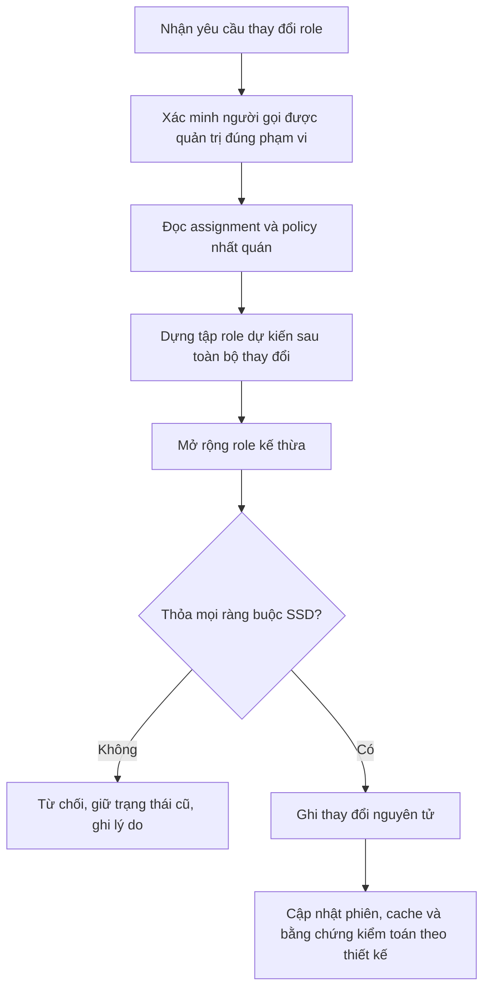

# Static separation of duties — Phân tách nhiệm vụ tĩnh trong RBAC

## 1. Một người có nên vừa lập vừa duyệt lệnh thanh toán?

Một hệ thống thanh toán có hai role:

```text
PAYMENT_MAKER     → lập lệnh thanh toán
PAYMENT_APPROVER  → duyệt lệnh thanh toán
```

Nếu một người được gán cả hai role, người đó có khả năng vừa lập vừa duyệt lệnh. Mỗi permission riêng lẻ đều phục vụ một công việc hợp lệ, nhưng tổ hợp của chúng có thể phá vỡ cơ chế kiểm soát mà tổ chức mong muốn.

**Static separation of duties**, viết tắt **SSD**, đặt ràng buộc lên việc gán role: một người dùng không được đồng thời được ủy quyền cho một tổ hợp role đã xác định là xung đột. Việc kiểm tra diễn ra khi trạng thái phân quyền được tạo hoặc thay đổi, trước khi người dùng thực hiện nghiệp vụ.

NIST mô tả separation of duty là nguyên tắc phân tách khả năng để một người không tự nắm đủ đặc quyền nhằm lạm dụng hệ thống. SSD là một cách triển khai nguyên tắc đó trong RBAC. [NIST — Separation of Duty](https://csrc.nist.gov/glossary/term/separation_of_duty).

Với ví dụ trên, hệ thống quản lý danh tính phải từ chối yêu cầu gán `PAYMENT_APPROVER` cho tài khoản đang có `PAYMENT_MAKER`, nếu cả hai role thuộc cùng phạm vi mà chính sách SSD áp dụng.

Trong bài này, bạn sẽ học cách mô tả ràng buộc SSD, xét role kế thừa, kiểm soát các đường cấp quyền và giữ ràng buộc đúng khi có thay đổi đồng thời. Những ví dụ là thiết kế minh họa cho một ứng dụng IAM; chúng không phải danh sách role bắt buộc cho mọi tổ chức.

## 2. “Tĩnh” nói về ràng buộc gán role

### 2.1. Ba trạng thái cần phân biệt

Một người dùng có thể có:

| Khái niệm | Ý nghĩa |
| --- | --- |
| Role được gán trực tiếp | Role được liên kết trực tiếp với tài khoản |
| Role được ủy quyền, kể cả kế thừa | Role tài khoản có thông qua gán trực tiếp và quan hệ role hierarchy |
| Role đang được kích hoạt | Tập role đang sử dụng trong một phiên theo cơ chế của hệ thống |

SSD quan tâm đến tập role mà người dùng được ủy quyền trong phạm vi chính sách. Việc người dùng đang kích hoạt role nào không làm một tổ hợp role xung đột trở nên hợp lệ.

Ví dụ:

```text
Lan được gán:
  PAYMENT_MAKER
  PAYMENT_APPROVER

Phiên hiện tại chỉ kích hoạt:
  PAYMENT_MAKER
```

Nếu hai role bị ràng buộc SSD, trạng thái gán của Lan đã vi phạm. Lời hứa “Lan sẽ không dùng hai role cùng lúc” không đáp ứng yêu cầu này.

### 2.2. SSD khác với kiểm tra trên phiên và trên giao dịch

NIST phân biệt SSD ở quan hệ gán role với dynamic separation of duties, thường viết là DSD, ở quan hệ kích hoạt role trong phiên. [NIST — RBAC FAQ, Component summary](https://csrc.nist.gov/projects/role-based-access-control/faqs).

Có thể so sánh ba yêu cầu độc lập:

| Yêu cầu | Nơi kiểm tra chính | Dữ liệu cần biết | Ý nghĩa |
| --- | --- | --- | --- |
| Không được đồng thời có role lập lệnh và duyệt lệnh | Khi cấp hoặc thay đổi quyền | Tập role được ủy quyền | SSD |
| Có thể được gán hai role nhưng không được kích hoạt cả hai trong cùng phiên | Khi kích hoạt role | Role đang hoạt động trong phiên | DSD theo mô hình phiên |
| Không được duyệt chính lệnh mà mình đã lập | Khi duyệt một lệnh cụ thể | Danh tính người lập và người duyệt, lịch sử đối tượng | Ràng buộc nghiệp vụ theo đối tượng hoặc lịch sử |

Cách dùng thuật ngữ dynamic SoD trong tài liệu tổng quát có thể rộng hơn DSD theo phiên của mô hình RBAC. Khi thiết kế, cần nói rõ đang chặn tổ hợp được gán, tổ hợp kích hoạt hay việc một người tham gia nhiều bước trên cùng đối tượng.

Một kiểm tra `creatorId != approverId` không thay thế SSD nếu chính sách yêu cầu hai chức năng thuộc hai nhóm người dùng tách biệt. Ngược lại, SSD trên trạng thái hiện tại cũng không tự giải quyết mọi yêu cầu về lịch sử giao dịch.

### 2.3. Tĩnh không có nghĩa là cấu hình bất biến

Role, nhóm và tổ chức vẫn thay đổi. “Tĩnh” không có nghĩa chỉ kiểm tra một lần lúc tạo tài khoản, rồi bỏ qua mọi lần thay đổi sau.

SSD cần giữ đúng sau các thao tác có thể làm thay đổi tập role được ủy quyền: gán role, thêm thành viên nhóm, thay đổi role hierarchy, đồng bộ nguồn danh tính hoặc sửa chính ràng buộc SSD.

## 3. Xác định tổ hợp nhiệm vụ xung đột

Không phải hai role khác nhau thì phải tách biệt. Một người có thể hợp lý khi vừa có `PROFILE_READER` vừa có `PROFILE_EDITOR`. Xung đột cần xuất phát từ quy trình và rủi ro cụ thể.

Một số tình huống minh họa:

| Quy trình | Các chức năng cần xem xét tách biệt | Rủi ro khi cùng một chủ thể kiểm soát |
| --- | --- | --- |
| Thanh toán | Lập lệnh và duyệt lệnh | Tự tạo rồi tự phê duyệt giao dịch |
| Quản lý nhà cung cấp | Thay tài khoản nhận tiền và phát lệnh thanh toán | Chuyển hướng tiền đến tài khoản không phù hợp |
| Quản trị truy cập | Yêu cầu quyền và duyệt cấp quyền đặc biệt | Tự cấp tổ hợp quyền vượt thẩm quyền |
| Vận hành và kiểm toán | Quản trị hệ thống và quản trị bằng chứng kiểm toán | Can thiệp hoạt động rồi sửa dấu vết |
| Phát hành phần mềm | Tạo thay đổi và phê duyệt phát hành | Thiếu người kiểm tra độc lập trước triển khai |

Bảng nêu các rủi ro để phân tích, chưa quyết định mọi cặp role phải áp dụng SSD toàn cục. Có tổ chức cần tách hẳn hai nhóm nhân sự; có tổ chức cho phép nhân viên làm cả hai chức năng nhưng trên các đối tượng khác nhau.

Trước khi viết policy, cần xác nhận:

1. Nhiệm vụ nào tạo ra khả năng gây hại khi kết hợp?
2. Cần tách trong cùng tenant, cùng hệ thống hay trên nhiều hệ thống?
3. Cần tách theo tài khoản hay theo con người đứng sau tài khoản?
4. Cần cấm đồng thời giữ role hay chỉ cấm tự xử lý hai bước của cùng giao dịch?
5. Ai là chủ sở hữu nghiệp vụ chịu trách nhiệm phê duyệt ranh giới này?

Nếu quy trình chỉ yêu cầu “không duyệt lệnh mình đã lập”, một SSD cấm mọi nhân viên giữ cả hai role có thể gây hạn chế vượt nhu cầu. Ngược lại, nếu yêu cầu là hai bộ phận độc lập, chỉ kiểm tra người lập/người duyệt của từng lệnh có thể chưa đủ.

## 4. Biểu diễn SSD bằng tập role và ngưỡng cấm

### 4.1. Trường hợp đơn giản: một cặp role loại trừ nhau

Đặt:

```text
S = {PAYMENT_MAKER, PAYMENT_APPROVER}
n = 2
```

Ý nghĩa: người dùng không được được ủy quyền cho từ hai role trở lên trong tập `S`.

Gọi `A(u)` là tập role được ủy quyền của người dùng `u`. Trạng thái hợp lệ khi:

```text
|A(u) ∩ S| < n
```

Với cặp role và `n = 2`, người dùng có thể có không role nào hoặc một role; có cả hai là vi phạm.

Cách biểu diễn SSD bằng cặp `(role set, n)`, trong đó cấm người dùng có từ `n` role của tập đó, được trình bày trong nghiên cứu Proposed NIST Standard for Role-Based Access Control. Bài học dùng ký hiệu này để giải thích mô hình, không khẳng định mọi sản phẩm IAM có cùng schema cấu hình. [Ferraiolo và cộng sự — Proposed NIST Standard for Role-Based Access Control](https://www.comp.nus.edu.sg/~tankl/cs5322/readings/nistrbac.pdf).

### 4.2. Ngưỡng cấm không phải số role tối đa được phép

Giả sử quy trình có ba role:

```text
S = {
  VENDOR_MAINTAINER,
  PAYMENT_MAKER,
  PAYMENT_RELEASER
}
```

Hai chính sách sau có ý nghĩa khác nhau:

| Chính sách | Số role được phép trong S | Ví dụ |
| --- | --- | --- |
| n = 2 | Tối đa 1 | Có MAKER thì không thể có thêm MAINTAINER hoặc RELEASER |
| n = 3 | Tối đa 2 | Có thể giữ bất kỳ hai role; không được giữ cả ba |

Trong cách ghi của bài, `n` là số lượng bắt đầu bị cấm. Nếu API của một sản phẩm dùng `maxAllowedRoles`, giá trị tương đương trong ví dụ sẽ là `n - 1`. Phải đọc đúng định nghĩa field, tránh nhầm một đơn vị.

Khi `n = 3`, thay chính sách bằng ba cặp role cấm nhau sẽ làm policy mạnh hơn: nó cấm cả những tổ hợp hai role vốn được phép. Một ràng buộc theo tập không phải lúc nào cũng chuyển được thành các cặp loại trừ với cùng ý nghĩa.

### 4.3. Mỗi người có thể chịu nhiều ràng buộc

Ví dụ độc lập:

```text
SSD-PAYMENT:
  S = {PAYMENT_MAKER, PAYMENT_APPROVER}
  n = 2

SSD-END-TO-END:
  S = {VENDOR_MAINTAINER, PAYMENT_MAKER, PAYMENT_RELEASER}
  n = 3
```

Trạng thái gán phải thỏa cả hai. Người có `PAYMENT_MAKER` và `VENDOR_MAINTAINER` có thể chưa vi phạm hai rule trên. Thêm `PAYMENT_APPROVER` vi phạm rule thứ nhất; thêm `PAYMENT_RELEASER` vi phạm rule thứ hai.

Ngưỡng SSD đếm số role xung đột của một người dùng. Nó khác với giới hạn số người tối đa được gán một role, chẳng hạn “chỉ có ba người là quản trị viên”. Hai ràng buộc cùng liên quan đến số lượng nhưng kiểm soát hai quan hệ khác nhau.

## 5. Role hierarchy có thể làm phát sinh xung đột gián tiếp

### 5.1. Phải xét tập role sau kế thừa

Giả sử quan hệ kế thừa được định nghĩa như sau:

```text
FINANCE_MANAGER
       │ kế thừa quyền của
       ▼
PAYMENT_APPROVER
```

Lan được gán trực tiếp:

```text
PAYMENT_MAKER
FINANCE_MANAGER
```

Dù không có dòng gán trực tiếp `PAYMENT_APPROVER`, Lan vẫn được ủy quyền cho khả năng của role đó theo hierarchy đang xét. Tập role dùng để kiểm tra SSD phải bao gồm role kế thừa:

```text
Gán trực tiếp:
  {PAYMENT_MAKER, FINANCE_MANAGER}

Sau mở rộng kế thừa:
  {PAYMENT_MAKER, FINANCE_MANAGER, PAYMENT_APPROVER}

Giao với tập xung đột:
  {PAYMENT_MAKER, PAYMENT_APPROVER}

Kết quả:
  2 >= 2 → vi phạm
```

Mô hình NIST chỉ ra rằng ràng buộc SSD phải được xét cùng quan hệ kế thừa để tránh việc role cấp trên mang theo role xung đột. [Sandhu, Ferraiolo và Kuhn — The NIST Model for Role-Based Access Control, mục 5.1](https://tsapps.nist.gov/publication/get_pdf.cfm?pub_id=916402).

Hướng mũi tên trong ví dụ biểu diễn “role nguồn kế thừa role đích”. Một sản phẩm có thể hiển thị hierarchy theo hướng ngược lại; hãy xác định semantics thay vì suy từ vị trí trên sơ đồ.

### 5.2. Một role tổng hợp có thể tự mang tổ hợp bị cấm

Xét một role mới:

```text
PAYMENT_SUPERUSER
  ├── kế thừa PAYMENT_MAKER
  └── kế thừa PAYMENT_APPROVER
```

Nếu chính sách cấm một người có cả MAKER và APPROVER, việc gán riêng `PAYMENT_SUPERUSER` đã tạo xung đột.

Có thể phát hiện thiết kế role này ngay khi duyệt catalog. Nếu hệ thống vẫn cho phép tồn tại role đó như một cấu hình chưa sử dụng, mọi yêu cầu gán nó trong phạm vi SSD tương ứng phải bị chặn. Không thể kết luận “người dùng chỉ có một role nên hợp lệ”.

### 5.3. Đổi hierarchy cũng là đổi quyền

Một quản trị viên thêm quan hệ kế thừa vào role đã có nhiều người dùng. Không có thao tác gán mới cho từng người, nhưng tập role được ủy quyền của họ vẫn thay đổi.

Vì vậy, thay đổi hierarchy cần xác định các người dùng bị ảnh hưởng và kiểm tra trạng thái dự kiến trước khi áp dụng. Với cây hoặc đồ thị lớn, cần có cách tính tập ảnh hưởng; việc chỉ kiểm tra người đang thao tác quản trị không bảo vệ các thành viên còn lại.

Hierarchy phải được kiểm tra chu trình. Quan hệ kế thừa vòng vừa gây khó hiểu về mô hình, vừa có thể làm thuật toán mở rộng role không dừng nếu triển khai thiếu bảo vệ.

## 6. Xác định đúng danh tính và phạm vi chính sách

### 6.1. Một người có nhiều tài khoản

Giả sử hệ thống chỉ kiểm tra theo `userId`:

```text
account-lan-a → PAYMENT_MAKER
account-lan-b → PAYMENT_APPROVER
```

Mỗi tài khoản riêng lẻ không vi phạm, nhưng cả hai do cùng Lan kiểm soát. Nếu mục tiêu là tách hai con người, kết quả này không đạt mục tiêu nghiệp vụ.

Mô hình gán role theo user cần được kết nối với cơ chế quản lý danh tính đáng tin cậy. Có thể cần một định danh con người để xét nhiều tài khoản liên quan. Đây là mở rộng phạm vi thực thi theo chính sách của tổ chức, không phải tính năng tự có chỉ nhờ khai báo hai role xung đột.

Không nên nối tài khoản chỉ bằng tên hiển thị hoặc email chưa được xác minh. Sai liên kết có thể vừa bỏ sót xung đột vừa chặn nhầm những người khác nhau.

### 6.2. Xung đột trong một tenant hay trên toàn tổ chức?

Hai assignment sau có thể được coi là hợp lệ hoặc xung đột tùy chính sách:

```text
Lan → tenant-A / PAYMENT_MAKER
Lan → tenant-B / PAYMENT_APPROVER
```

Nếu hai tenant là các miền nghiệp vụ độc lập và yêu cầu chỉ tách trong từng tenant, cần đánh giá theo khóa `(subject, tenant)`.

Nếu quy trình chuyển tiền hoặc dữ liệu liên quan giữa hai tenant, ranh giới kiểm soát có thể rộng hơn. Không nên tự động coi tenant là miền độc lập chỉ vì cơ sở dữ liệu có cột `tenant_id`.

Một role assignment cần định vị rõ:

```text
chủ thể + role + phạm vi + nguồn cấp
```

Nguồn cấp có thể là trực tiếp, nhóm, hệ thống nhân sự hoặc ủy quyền. Tập role kiểm tra phải phản ánh mọi nguồn mà ứng dụng thực sự sử dụng để cấp quyền.

### 6.3. Credential dùng chung làm suy yếu sự phân tách

Hai nhân viên có role khác nhau nhưng dùng chung tài khoản đặc quyền có thể vượt qua ranh giới đã thiết kế. Tương tự, một người giữ credential của cả hai tài khoản thì việc tách tên tài khoản chưa tạo ra hai chủ thể độc lập.

Với workload, cần xác định ai hoặc thành phần nào điều khiển được danh tính đó. Một người có quyền sửa chương trình chạy dưới service account có thể điều khiển các thao tác mà service account được phép thực hiện.

SSD theo role là một phần của hệ thống kiểm soát. Nó cần đi cùng quản lý credential, truy vết danh tính thực và bảo vệ các đường ủy quyền.

## 7. Thực thi tại thời điểm thay đổi phân quyền

Một luồng gán role phù hợp cần đánh giá **trạng thái sau thay đổi**:



Hai kiểm tra ở đây có chức năng khác nhau:

- Authorization quản trị xác định người gọi có được phép thay assignment của chủ thể này không.
- SSD xác định trạng thái phân quyền mà họ muốn tạo có hợp lệ không.

Một quản trị viên có quyền gán role không mặc nhiên có quyền bỏ qua SSD.

### 7.1. Kiểm tra cả batch

Một batch có thể thêm nhiều role hoặc vừa xóa role cũ vừa thêm role mới. Cần áp dụng toàn bộ delta vào một trạng thái dự kiến rồi kiểm tra trạng thái đó.

Ví dụ chuyển Lan từ MAKER sang APPROVER:

```text
Trạng thái cũ:       {PAYMENT_MAKER}
Thay đổi dự kiến:    bỏ MAKER, thêm APPROVER
Trạng thái cuối:     {PAYMENT_APPROVER}
```

Nếu chính sách cho phép việc chuyển chức năng này, thay đổi có thể thực hiện nguyên tử. Không được để lộ trạng thái trung gian có cả hai role. Các yêu cầu về lệnh Lan đã lập trước đây vẫn phải được xử lý bằng lịch sử nghiệp vụ.

Ngược lại, batch thêm đồng thời MAKER và APPROVER cho người chưa có role phải bị từ chối. Kiểm tra từng phần tử chỉ dựa trên snapshot ban đầu có thể để lọt tổ hợp cuối cùng.

### 7.2. Bao phủ mọi đường cấp quyền

Nếu giao diện quản trị có kiểm tra SSD nhưng API import, job đồng bộ hoặc công cụ xử lý khẩn cấp bỏ qua, ràng buộc không còn được bảo toàn.

Các đường cần được đưa về cùng cơ chế kiểm soát hoặc được kiểm tra tương đương gồm:

```text
Gán trực tiếp qua UI/API
Thêm hoặc sửa membership của group
Đồng bộ role từ nguồn ngoài
Import hàng loạt
Thay role hierarchy
Sửa định nghĩa tập SSD hoặc ngưỡng cấm
Ủy quyền hoặc kích hoạt quyền tạm thời có thể tạo cùng khả năng
```

Với nguồn ngoài không thể kiểm soát nguyên tử, hệ thống đích cần quy tắc rõ về việc chấp nhận assignment. Không nên cấp ngay tổ hợp quyền xung đột rồi chỉ gửi cảnh báo để xử lý sau.

## 8. Ví dụ Java: kiểm tra trạng thái gán role dự kiến

Đoạn mã sau dùng Java 17 trở lên và minh họa bộ kiểm tra SSD thuần trong bộ nhớ. Nó thực hiện ba việc:

1. Chụp catalog hierarchy và các rule dưới dạng dữ liệu bất biến.
2. Mở rộng tập role được gán thành tập role được ủy quyền, có phát hiện chu trình.
3. Từ chối trạng thái có số role khớp một rule đạt ngưỡng cấm.

Các tên role và rule là ví dụ của bài. Đoạn mã không kết nối cơ sở dữ liệu, không cấp quyền quản trị cho người gọi và không thay thế cơ chế giao dịch.

```java
import java.util.EnumMap;
import java.util.EnumSet;
import java.util.List;
import java.util.Map;
import java.util.Objects;
import java.util.Set;

enum Role {
    PAYMENT_MAKER,
    PAYMENT_APPROVER,
    PAYMENT_RELEASER,
    VENDOR_MAINTAINER,
    PAYMENT_SUPERVISOR,
    FINANCE_MANAGER,
    AUDITOR
}

record SsdRule(
        String id,
        Set<Role> roles,
        int forbiddenCount
) {
    SsdRule {
        Objects.requireNonNull(id);
        if (id.isBlank()) {
            throw new IllegalArgumentException("Rule id is required");
        }

        roles = Set.copyOf(roles);

        if (forbiddenCount < 2 || forbiddenCount > roles.size()) {
            throw new IllegalArgumentException("Invalid SSD threshold");
        }
    }
}

final class SsdViolationException extends RuntimeException {
    SsdViolationException(String ruleId, Set<Role> matchedRoles) {
        super("SSD violated: " + ruleId + "; roles=" + matchedRoles);
    }
}

final class SsdChecker {
    private final Map<Role, Set<Role>> juniorRoles;
    private final List<SsdRule> rules;

    SsdChecker(
            Map<Role, Set<Role>> juniorRoles,
            List<SsdRule> rules
    ) {
        Objects.requireNonNull(juniorRoles);

        var snapshot = new EnumMap<Role, Set<Role>>(Role.class);
        for (Role role : Role.values()) {
            snapshot.put(
                    role,
                    Set.copyOf(juniorRoles.getOrDefault(role, Set.of()))
            );
        }

        this.juniorRoles = Map.copyOf(snapshot);
        this.rules = List.copyOf(rules);

        // Validate the entire hierarchy, including roles not yet assigned.
        authorizedRoles(EnumSet.allOf(Role.class));
    }

    Set<Role> authorizedRoles(Set<Role> assignedRoles) {
        Set<Role> closure = EnumSet.noneOf(Role.class);
        Set<Role> visiting = EnumSet.noneOf(Role.class);

        for (Role role : Set.copyOf(assignedRoles)) {
            expand(role, closure, visiting);
        }

        return Set.copyOf(closure);
    }

    private void expand(
            Role role,
            Set<Role> closure,
            Set<Role> visiting
    ) {
        if (visiting.contains(role)) {
            throw new IllegalArgumentException("Cyclic role hierarchy");
        }

        if (closure.contains(role)) {
            return;
        }

        visiting.add(role);

        for (Role junior : juniorRoles.get(role)) {
            expand(junior, closure, visiting);
        }

        visiting.remove(role);
        closure.add(role);
    }

    void validate(Set<Role> candidateAssignedRoles) {
        Set<Role> authorized = authorizedRoles(candidateAssignedRoles);

        for (SsdRule rule : rules) {
            Set<Role> matched = EnumSet.noneOf(Role.class);
            matched.addAll(authorized);
            matched.retainAll(rule.roles());

            if (matched.size() >= rule.forbiddenCount()) {
                throw new SsdViolationException(
                        rule.id(),
                        Set.copyOf(matched)
                );
            }
        }
    }
}
```

### 8.1. Khởi tạo hierarchy và rule

```java
SsdChecker checker = new SsdChecker(
        Map.of(
                Role.FINANCE_MANAGER,
                Set.of(Role.PAYMENT_APPROVER),
                Role.PAYMENT_SUPERVISOR,
                Set.of(Role.PAYMENT_MAKER)
        ),
        List.of(
                new SsdRule(
                        "SSD-PAYMENT",
                        Set.of(
                                Role.PAYMENT_MAKER,
                                Role.PAYMENT_APPROVER
                        ),
                        2
                ),
                new SsdRule(
                        "SSD-END-TO-END",
                        Set.of(
                                Role.VENDOR_MAINTAINER,
                                Role.PAYMENT_MAKER,
                                Role.PAYMENT_RELEASER
                        ),
                        3
                )
        )
);

// Valid with respect to the two rules above.
checker.validate(Set.of(Role.FINANCE_MANAGER));

// Rejected: FINANCE_MANAGER also authorizes PAYMENT_APPROVER.
checker.validate(Set.of(
        Role.PAYMENT_MAKER,
        Role.FINANCE_MANAGER
));
```

Lời gọi cuối phát sinh `SsdViolationException`. Ứng dụng cần xử lý kết quả này như một yêu cầu thay đổi phân quyền bị từ chối và giữ assignment cũ.

### 8.2. Những điểm quan trọng của thuật toán

Tập role dùng cấu trúc set nên một role được thừa hưởng qua hai đường vẫn chỉ được đếm một lần. SSD đếm số role khác nhau trong tập xung đột, không đếm số đường dẫn trong đồ thị.

Thuật toán mở rộng đi hết các cạnh kế thừa trước khi thêm role vào tập đã hoàn tất. Tập `visiting` giúp nhận ra một role xuất hiện lại trên đường đi hiện tại, tức là có chu trình.

Catalog được sao chép cả map và các set bên trong. Điều này tránh việc một luồng khác sửa một tập con sau khi checker đã được khởi tạo. Tuy nhiên, tính bất biến trong bộ nhớ không đồng nghĩa với việc dữ liệu assignment và catalog trong cơ sở dữ liệu đã được đọc trong cùng một phiên bản.

Rule có `forbiddenCount = 3` chỉ bị vi phạm khi có đủ ba role trong tập của nó. Dùng điều kiện `matched.size() > forbiddenCount` sẽ làm lọt đúng trường hợp chạm ngưỡng; điều kiện phải là `>=`.

### 8.3. Ranh giới của ví dụ

Danh sách `candidateAssignedRoles` phải được dựng từ toàn bộ nguồn role có hiệu lực trong phạm vi đang kiểm tra. Nếu bên gọi chỉ truyền role trực tiếp và bỏ qua role đến từ group, thuật toán không thể tự biết phần dữ liệu bị thiếu.

Ví dụ dùng enum để đơn giản hóa catalog. Với role được lưu bằng ID trong cơ sở dữ liệu, cần kiểm tra ID tồn tại, phạm vi hợp lệ và mapping không bị nhầm giữa các tenant. Role không nhận diện được không nên bị âm thầm bỏ qua như thể không có quyền.

Đoạn mã không đọc lịch sử nghiệp vụ, không gộp các tài khoản của cùng một người và không thu hồi token. Những chức năng đó phải được thiết kế ở lớp phù hợp.

Thông báo lỗi chứa ID rule và tên role phục vụ xử lý nội bộ. API quản trị cần kiểm soát người được xem các chi tiết này, thay vì công bố catalog phân quyền cho mọi người gọi.

## 9. Kiểm tra đúng vẫn có thể thất bại khi cập nhật đồng thời

Giả sử Lan chưa có role nào. Hai quản trị viên cùng lúc gửi hai yêu cầu:

```text
Yêu cầu A: gán PAYMENT_MAKER
Yêu cầu B: gán PAYMENT_APPROVER
```

Nếu kiểm tra và ghi là hai bước không được bảo vệ, diễn tiến có thể là:

| Thời điểm | Yêu cầu A | Yêu cầu B |
| --- | --- | --- |
| 1 | Đọc tập role rỗng | |
| 2 | | Đọc tập role rỗng |
| 3 | Kiểm tra thêm MAKER: hợp lệ | |
| 4 | | Kiểm tra thêm APPROVER: hợp lệ |
| 5 | Ghi assignment MAKER | |
| 6 | | Ghi assignment APPROVER |

Trạng thái cuối có cả hai role. Mỗi phép kiểm tra riêng lẻ đều đúng với snapshot mà nó đọc, nhưng kết quả chung vi phạm SSD.

### 9.1. Bảo vệ đơn vị thay đổi

Một giao thức cập nhật minh họa:

```text
BEGIN

  Xác minh quyền quản trị của người gọi
  Khóa đơn vị assignment của (subject, scope)
  Đọc assignment hiện tại và phiên bản policy hợp lệ
  Áp dụng toàn bộ delta vào trạng thái dự kiến
  Mở rộng role và kiểm tra mọi rule SSD
  Ghi assignment cùng phiên bản thay đổi
  Ghi sự kiện kiểm toán theo cơ chế nhất quán

COMMIT
```

Đây là giả mã, không phải cú pháp giao dịch của một sản phẩm cụ thể.

Có thể triển khai bằng khóa phù hợp, kiểm soát phiên bản hoặc mức cô lập đáp ứng yêu cầu. Điều cốt yếu là không để hai thay đổi dựa trên cùng trạng thái cũ cùng được chấp nhận theo cách tạo ra tổ hợp bị cấm.

Nếu dùng optimistic locking, lần ghi phải kiểm tra phiên bản đã đọc. Khi có xung đột, cần đọc lại và chạy lại kiểm tra SSD; việc chỉ thử lại câu lệnh ghi bỏ qua kiểm tra sẽ không giải quyết vấn đề.

### 9.2. Không chỉ khóa các dòng role hiện có

Người chưa có role có thể chưa có dòng nào trong bảng assignment. Một thiết kế chỉ khóa những dòng đã tồn tại có thể không bảo vệ được trường hợp này.

Cần một đơn vị khóa hoặc cơ chế phiên bản bao phủ chính chủ thể và phạm vi cần cập nhật. Ràng buộc unique như `(user_id, role_id, scope_id)` chỉ chống assignment trùng; nó không cấm hai role khác nhau nhưng xung đột.

### 9.3. Thay policy và hierarchy cũng phải nhất quán

Khóa assignment của Lan chưa đủ nếu một tiến trình khác đồng thời thay hierarchy hoặc ngưỡng SSD. Bộ kiểm tra có thể chấp nhận trạng thái theo policy cũ trong khi hệ thống đã chuyển sang policy mới.

Quy trình cần xác định phiên bản policy mà giao dịch sử dụng và cách phối hợp với việc công bố phiên bản mới. Chẳng hạn, thay đổi catalog có thể phải chờ một hàng rào cập nhật, kiểm tra các chủ thể bị ảnh hưởng và được phát hành theo giao thức nhất quán.

Một hệ thống phân tán không thể dựa vào khóa trong một process để bảo vệ mọi process còn lại. Cơ chế phối hợp cần nằm ở lớp mà mọi đường ghi phải tuân theo.

## 10. Thay đổi policy trên hệ thống đang vận hành

### 10.1. Rule mới có thể xung đột với assignment cũ

Giả sử trước đây người dùng được phép có cả MAKER và APPROVER. Tổ chức quyết định áp dụng SSD từ kỳ vận hành tiếp theo.

Việc thêm rule vào catalog không tự xử lý những tài khoản đang có tổ hợp đó. Trước khi thực thi, cần đánh giá tập người dùng hiện có và xác định cách chuyển đổi.

Một kế hoạch minh họa:

1. Chốt phạm vi rule và owner nghiệp vụ.
2. Tính tập role được ủy quyền hiện tại cho các chủ thể trong phạm vi.
3. Lập danh sách xung đột, bao gồm nguồn cấp trực tiếp và gián tiếp.
4. Quyết định vai trò cần giữ hoặc thay thế theo nhiệm vụ thực tế.
5. Áp dụng thay đổi quyền cùng cơ chế xử lý phiên và cache.
6. Xác minh trạng thái đích rồi mới công bố ràng buộc đã được thực thi đầy đủ.

Trong giai đoạn chỉ quan sát, hệ thống có thể phát hiện các xung đột dự kiến. Cần phân biệt rõ trạng thái “đang phát hiện” với “đã ngăn chặn”: một báo cáo cảnh báo không làm mất các quyền đang tồn tại.

### 10.2. Thay permission của role có thể phá mục tiêu nghiệp vụ

Một rule cấm người dùng đồng thời có role `PAYMENT_MAKER` và `PAYMENT_APPROVER`. Sau đó, có người thêm permission duyệt lệnh trực tiếp vào role MAKER.

Về hình thức, người dùng chỉ có một role và có thể không vi phạm predicate SSD trên tên role. Nhưng mục tiêu tách chức năng lập và duyệt đã bị phá vỡ.

Vì vậy, thiết kế cần bảo vệ cả mapping permission-role. Khi sửa permission của role, phải xem xét role đó có đang trở thành một gói quyền chứa các chức năng cần tách biệt hay không.

Một role `SUPER_ADMIN` không kế thừa MAKER hoặc APPROVER nhưng có các permission tương đương cũng cần được xem xét. Các giới hạn của một rule trên ID role phải được hiểu rõ, tránh coi nó là bằng chứng đủ về mọi đường thực hiện nghiệp vụ.

### 10.3. Xóa một assignment chưa chắc hết quyền

Nếu cùng role đến từ hai nguồn, xóa một nguồn vẫn có thể giữ nguyên quyền:

```text
Nguồn trực tiếp:      PAYMENT_MAKER
Nhóm finance-legacy: PAYMENT_MAKER
```

Khi chuyển người dùng sang APPROVER, phải đánh giá tập role sau khi hợp nhất các nguồn. Không nên báo thành công chỉ vì đã xóa một dòng trực tiếp.

Với job đồng bộ bất đồng bộ, cần xử lý rõ assignment bị từ chối, trạng thái cách ly hoặc quy trình khắc phục. Hệ thống không nên tự bỏ qua role xung đột rồi vẫn báo rằng đã đồng bộ đầy đủ mọi quyền được yêu cầu.

## 11. Các giới hạn của SSD cần được thiết kế bổ sung

### 11.1. SSD không ghi nhớ ai đã làm một bước trước đó

Lan từng là MAKER và đã lập lệnh `PAY-731`. Sau khi chuyển bộ phận, Lan được gỡ MAKER và gán APPROVER. Trạng thái role hiện tại chỉ có APPROVER nên không vi phạm rule cặp role.

Nếu Lan duyệt lại chính `PAY-731`, yêu cầu “người lập không được duyệt cùng lệnh” vẫn bị vi phạm.

Luồng duyệt cần kiểm tra lịch sử chủ thể trên đối tượng, chẳng hạn:

```text
Người duyệt có quyền duyệt lệnh này
VÀ người duyệt không phải người đã lập lệnh
VÀ lệnh đang ở trạng thái có thể duyệt
VÀ các điều kiện nghiệp vụ khác được đáp ứng
```

Các điều kiện này phải được đánh giá tại điểm thực hiện nghiệp vụ. Chúng không thể suy ra chỉ từ assignment hiện tại.

### 11.2. SSD không tự bảo đảm có đủ người làm việc

Rule cấm tổ hợp có thể được thỏa dù toàn bộ tổ chức không còn người nào đủ quyền duyệt. Tính hợp lệ của assignment và khả năng vận hành quy trình là hai yêu cầu khác nhau.

Cần dự kiến người thay thế, bàn giao, nghỉ phép và xử lý sự cố theo quy trình đã phê duyệt. Nếu mỗi lần thiếu người lại cấp cả hai role cho cùng tài khoản, tổ chức đang dùng một đường vận hành đi ngược mục tiêu SSD.

### 11.3. SSD không ngăn thông đồng giữa nhiều chủ thể

Tách nhiệm vụ làm giảm khả năng một người tự hoàn tất toàn bộ chuỗi thao tác nhạy cảm. Hai người ở hai vai trò vẫn có thể phối hợp làm sai.

Kiểm soát nghiệp vụ, truy vết, rà soát và bảo vệ bằng chứng kiểm toán vẫn cần thiết. Không nên mô tả SSD như cơ chế loại bỏ hoàn toàn gian lận.

### 11.4. Token và cache cũ có thể giữ khả năng của role đã gỡ

Khi chuyển Lan từ MAKER sang APPROVER, token cũ có thể còn mang thông tin MAKER nếu các dịch vụ chỉ dựa vào dữ liệu đã phát.

Assignment tại nguồn chỉ có một role, nhưng các đường truy cập thực tế có thể vẫn chấp nhận cả khả năng cũ lẫn mới trong một khoảng thời gian.

Cần xác định cách cập nhật hoặc vô hiệu phiên, kiểm tra phiên bản quyền, làm mới cache hay giới hạn thời hạn token theo kiến trúc. Nếu yêu cầu không chấp nhận khoảng chồng quyền, quy trình chuyển đổi phải bảo đảm khả năng cũ đã bị chấm dứt trước khi khả năng mới được sử dụng.

Thời hạn ngắn có thể giới hạn khoảng tồn tại của quyền cũ; nó không chứng minh rằng việc thu hồi có hiệu lực ngay.

## 12. Quản trị chính ràng buộc SSD

### 12.1. Ai được sửa rule?

Nếu người quản trị assignment có thể tự xóa rule SSD rồi gán role xung đột, ranh giới kiểm soát phụ thuộc vào chính quyền sửa policy đó.

Tùy mô hình quản trị, có thể cần tách người yêu cầu thay đổi, người duyệt chính sách và người triển khai. Các thao tác sửa hierarchy, mapping permission-role và nguồn group cũng cần được đưa vào phạm vi quản trị tương ứng.

Điều này không có nghĩa mọi tổ chức phải có cùng số lớp phê duyệt. Mục tiêu là xác định ai có thể thay đổi các điều kiện đang bảo vệ sự phân tách nhiệm vụ và cách truy vết thay đổi đó.

### 12.2. Ngoại lệ phải thể hiện đúng trạng thái kiểm soát

Một nhu cầu khẩn cấp có thể yêu cầu xử lý ngoài quy trình thông thường. Nếu tổ chức cho phép ngoại lệ SSD, cần xác định rõ phạm vi, người chịu trách nhiệm, thời hạn và biện pháp bù đắp.

Không nên chấp nhận tổ hợp bị cấm rồi vẫn ghi nhận rằng rule đã được thực thi bình thường. Khi có ngoại lệ được phê duyệt, đó là một quyết định quản trị rủi ro riêng cần được nhận diện.

Quyền tạm thời cũng phải được xem xét theo semantics của chính sách. Nếu danh tính có thể dùng quyền tạm thời để kết hợp hai chức năng đang bị cấm, việc grant tự hết hạn về sau không làm tổ hợp hiện tại hợp lệ.

### 12.3. Dữ liệu kiểm toán cần giải thích được quyết định

Một bản ghi từ chối minh họa:

```json
{
  "event": "role_assignment_rejected",
  "actor": "iam-admin-12",
  "subject": "user-lan",
  "scope": "tenant-acme",
  "requestedRole": "PAYMENT_APPROVER",
  "reason": "SSD_VIOLATION",
  "ruleId": "SSD-PAYMENT",
  "matchedRoles": [
    "PAYMENT_MAKER",
    "PAYMENT_APPROVER"
  ],
  "policyVersion": "rbac-policy-v12",
  "requestId": "req-731"
}
```

Các dữ liệu quan trọng gồm người thay đổi, chủ thể nhận quyền, phạm vi, rule, phiên bản policy và kết quả ghi. Log cần đủ phân biệt yêu cầu bị từ chối với assignment thực sự đã được lưu.

Nếu thành công một phần trong một batch được cho phép theo contract quản trị, phải nêu rõ từng kết quả và bảo đảm không có trạng thái đã chấp nhận vi phạm SSD. Một batch được định nghĩa là nguyên tử phải giữ nguyên trạng thái cũ khi toàn bộ yêu cầu bị từ chối.

Thông tin phân quyền cũng là dữ liệu cần kiểm soát truy cập. Log không được chứa mật khẩu, access token hoặc credential phục vụ việc quản trị.

## 13. Tình huống vận dụng: cấp role quản lý tài chính

Giả sử hệ thống có:

```text
FINANCE_MANAGER kế thừa PAYMENT_APPROVER
PAYMENT_SUPERVISOR kế thừa PAYMENT_MAKER

SSD-PAYMENT:
  roles = {PAYMENT_MAKER, PAYMENT_APPROVER}
  forbiddenCount = 2
```

Người dùng Minh đang được gán `PAYMENT_SUPERVISOR` thông qua group `payment-ops`. Một quản trị viên muốn thêm `FINANCE_MANAGER`.

Nếu chỉ đọc assignment trực tiếp, hệ thống có thể thấy Minh chưa có role thanh toán và cho phép gán. Nếu chỉ so hai tên cấp trên, nó cũng có thể bỏ sót xung đột.

Đánh giá đầy đủ:

```text
Role từ group:
  PAYMENT_SUPERVISOR

Role mới:
  FINANCE_MANAGER

Sau kế thừa:
  PAYMENT_SUPERVISOR
  PAYMENT_MAKER
  FINANCE_MANAGER
  PAYMENT_APPROVER

Giao với tập SSD:
  PAYMENT_MAKER
  PAYMENT_APPROVER

Kết quả:
  từ chối yêu cầu thêm FINANCE_MANAGER
```

Nếu Minh thực sự chuyển sang chức năng mới, quy trình cần xác định việc rời group cũ, các nguồn MAKER khác, phiên đang hoạt động và lệnh Minh đã lập. Xóa riêng role trực tiếp không xử lý được role đến từ group.

Các tình huống cần chứng minh khi triển khai:

| Tình huống | Kết quả mong đợi |
| --- | --- |
| Người chưa có role được gán riêng MAKER | Được chấp nhận nếu các điều kiện quản trị khác hợp lệ |
| Người có MAKER được gán APPROVER cùng phạm vi | Bị từ chối |
| Người có PAYMENT_SUPERVISOR được gán FINANCE_MANAGER | Bị từ chối sau khi xét kế thừa |
| Một role kế thừa hai role bị cấm được yêu cầu gán | Bị từ chối |
| Một role xuất hiện qua hai đường kế thừa | Chỉ đếm một lần |
| Batch thêm hai role xung đột | Bị từ chối theo contract nguyên tử |
| Hai yêu cầu đồng thời thêm hai role xung đột | Không được cùng tạo ra trạng thái cuối vi phạm |
| Thêm quan hệ hierarchy làm người hiện có xung đột | Thay đổi phải đi qua kiểm tra tập ảnh hưởng |
| Chuyển MAKER sang APPROVER nhưng còn token cũ | Phải xử lý khả năng cũ theo yêu cầu thu hồi |
| Người từng lập lệnh nay có APPROVER | Luồng duyệt vẫn phải xét người lập nếu nghiệp vụ yêu cầu |

Bảng mô tả các ranh giới của thiết kế; nó không phải kết quả chạy kiểm thử trên một ứng dụng cụ thể.

## 14. Những cách hiểu sai thường gặp

| Cách hiểu sai | Cách hiểu đúng |
| --- | --- |
| SSD là không dùng hai role cùng lúc | SSD chặn tổ hợp role được ủy quyền; role activation thuộc cơ chế khác |
| Có MFA thì có thể giữ cả hai role | MFA xác minh danh tính, không giải quyết xung đột nhiệm vụ |
| Chỉ cần kiểm tra role gán trực tiếp | Cần xét role được ủy quyền qua kế thừa và các nguồn cấp thực tế |
| forbiddenCount = 2 nghĩa là được giữ hai role | Trong mô hình của bài, từ hai role trở lên đã bị cấm |
| Mọi rule theo tập đều có thể thay bằng cặp role cấm nhau | Rule cho phép hai trong ba role có semantics khác cấm từng cặp |
| Đã có một user-role unique constraint là đủ | Nó chỉ chống dòng trùng, không bảo vệ tổ hợp role xung đột |
| Gỡ role cũ rồi cấp role mới bảo đảm không tự duyệt | Còn phải kiểm tra lịch sử giao dịch và quyền cũ ở phiên/token |
| Thêm rule SSD tự sửa hết dữ liệu cũ | Cần đánh giá và xử lý các assignment đã tồn tại |
| Một role duy nhất luôn an toàn | Role có thể kế thừa hoặc chứa các khả năng cần tách biệt |
| Job đồng bộ chỉ cần báo cảnh báo sau khi cấp | Cảnh báo sau cấp không tương đương ngăn trạng thái xung đột |

## 15. Những điểm cần nắm vững

SSD đặt giới hạn lên tổ hợp role mà một người dùng được ủy quyền trong phạm vi chính sách. Một ràng buộc phải mô tả được tập role xung đột, ngưỡng bắt đầu bị cấm và chủ thể cùng phạm vi được xét.

Quyết định cấp quyền cần sử dụng trạng thái sau thay đổi, có role kế thừa và mọi nguồn cấp liên quan. Tính đúng của phép kiểm tra chỉ được bảo toàn khi thao tác đọc, kiểm tra và ghi phối hợp nhất quán với các thay đổi assignment, hierarchy và policy.

SSD hỗ trợ phân tách nhiệm vụ nhưng vẫn cần kiểm soát lịch sử giao dịch, danh tính đứng sau nhiều tài khoản, khả năng của workload và hiệu lực thu hồi tại nơi thực thi. Các ranh giới này quyết định hệ thống có thực sự tách được khả năng của các chủ thể theo yêu cầu nghiệp vụ hay không.

## Tài liệu tham khảo

- [NIST CSRC — Separation of Duty](https://csrc.nist.gov/glossary/term/separation_of_duty): định nghĩa tổng quát về phân tách nhiệm vụ.
- [NIST CSRC — RBAC FAQ](https://csrc.nist.gov/projects/role-based-access-control/faqs): các thành phần RBAC và sự phân biệt SSD, DSD.
- [Sandhu, Ferraiolo và Kuhn — The NIST Model for Role-Based Access Control: Towards a Unified Standard](https://tsapps.nist.gov/publication/get_pdf.cfm?pub_id=916402): mô hình ràng buộc và quan hệ với role hierarchy.
- [Ferraiolo và cộng sự — Proposed NIST Standard for Role-Based Access Control](https://www.comp.nus.edu.sg/~tankl/cs5322/readings/nistrbac.pdf): nghiên cứu mô tả SSD theo tập role, ngưỡng và các chức năng quản trị liên quan.
