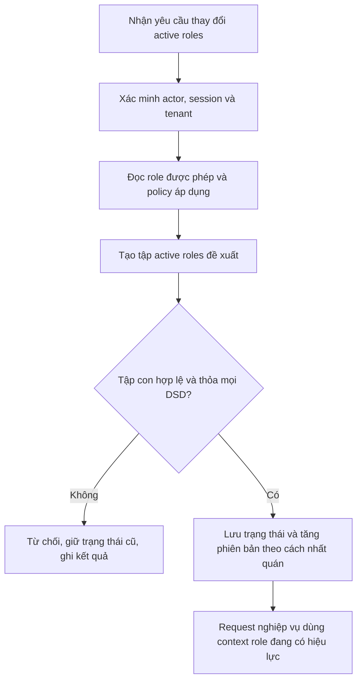

# Dynamic separation of duties — Phân tách nhiệm vụ động trong RBAC

## 1. Bài toán: một người có nhiều năng lực nhưng không được dùng mọi năng lực cùng lúc

Một hệ thống nội bộ có hai vai trò:

- `PAYMENT_INITIATOR`: lập và gửi lệnh thanh toán.
- `PAYMENT_APPROVER`: xét duyệt lệnh thanh toán đã được gửi.

Lan được đào tạo để làm cả hai công việc, giúp đội vận hành thay ca khi thiếu nhân sự. Tuy nhiên, tổ chức muốn kiểm soát cách các năng lực này được sử dụng. Có hai yêu cầu cần phân biệt:

1. Một phiên làm việc không được kích hoạt đồng thời hai role trên.
2. Người lập một lệnh không được tự duyệt chính lệnh đó, kể cả khi đổi phiên hoặc đổi tài khoản.

Yêu cầu thứ nhất là ví dụ về Dynamic Separation of Duties, viết tắt DSD, theo mô hình RBAC dựa trên role đang kích hoạt trong phiên. Yêu cầu thứ hai cần kiểm tra quan hệ giữa người thực hiện và lịch sử của từng lệnh. Hai yêu cầu có thể cùng được triển khai nhưng không thay thế nhau.

NIST mô tả thành phần DSD của RBAC bằng các quan hệ đối với role được kích hoạt trong session; thành phần Static Separation of Duty lại đặt quan hệ lên việc gán role cho người dùng. Nguồn: [NIST RBAC — FAQs](https://csrc.nist.gov/projects/role-based-access-control/faqs).

DSD hữu ích khi tổ chức muốn giữ tính linh hoạt của việc một người được giao nhiều nhiệm vụ nhưng vẫn kiểm soát tổ hợp quyền đang được sử dụng. Nó cần được nối với quản lý phiên, kiểm tra quyền tại backend, vòng đời role và kiểm toán để có hiệu lực thực tế.

## 2. Role được gán khác role đang kích hoạt

### 2.1. Ba tập dữ liệu cần tách

Trong ví dụ này:

```text
authorizedRoles(Lan) = {
    PAYMENT_INITIATOR,
    PAYMENT_APPROVER,
    PAYMENT_VIEWER
}

activeRoles(session-01) = {
    PAYMENT_INITIATOR,
    PAYMENT_VIEWER
}
```

`authorizedRoles` là các role Lan được phép sử dụng trong phạm vi đã xác định. Trong mô hình phẳng, tập này có thể lấy từ role được gán trực tiếp. Nếu có hierarchy, group hoặc cơ chế cấp quyền khác, cần xác định rõ cách suy ra tập role được phép.

`activeRoles` là tập role thực sự được kích hoạt trong một session cụ thể. Một role có trong tập được phép chưa đồng nghĩa nó đã được kích hoạt.

Tập permission của phiên được suy ra từ các role đang kích hoạt theo mô hình quyền của ứng dụng. Ví dụ:

```text
PAYMENT_INITIATOR -> payment:create, payment:submit
PAYMENT_APPROVER  -> payment:approve
PAYMENT_VIEWER    -> payment:read
```

Nếu phiên của Lan chỉ kích hoạt INITIATOR và VIEWER, backend không được cho phép `payment:approve` chỉ vì APPROVER có trong hồ sơ role được gán của Lan.

Tài liệu nền tảng của NIST giải thích role activation và yêu cầu thao tác phải được phép bởi role đang hoạt động. Nguồn: [Role-Based Access Control: Features and Motivations, mục 2.4](https://tsapps.nist.gov/publication/get_pdf.cfm?pub_id=916537).

### 2.2. Điều kiện tập con

Một điều kiện cơ bản là:

```text
activeRoles(session) ⊆ authorizedRoles(user, scope)
```

Trong ứng dụng nhiều tenant, `scope` cần được xác định rõ. Lan có thể là APPROVER trong tenant A và chỉ là VIEWER trong tenant B. Không dùng một role có tên giống nhau ở tenant khác làm bằng chứng cho phép kích hoạt.

Việc client gửi `activeRole=PAYMENT_APPROVER` chỉ là yêu cầu chọn role. Backend phải xác minh danh tính, quyền sử dụng role, phạm vi và các constraint trước khi chấp nhận.

### 2.3. DSD không buộc mọi phiên chỉ có một role

Một phiên có thể đồng thời kích hoạt INITIATOR và VIEWER nếu tổ hợp đó hợp lệ. DSD giới hạn những tổ hợp được chính sách xác định là xung đột; nó không mặc định cấm mọi tổ hợp nhiều role.

Nếu sản phẩm chọn thiết kế một role tại một thời điểm, đó là một cách đơn giản hóa trạng thái hoạt động. Vẫn cần kiểm tra role được chọn và các quyền thực tế mà nó đem lại.

## 3. Phân biệt SSD, DSD theo phiên và phân tách theo giao dịch

| Cơ chế | Đối tượng bị ràng buộc | Ví dụ của bài học | Điều nó chưa tự bảo đảm |
| --- | --- | --- | --- |
| Static Separation of Duties, SSD | Việc một user được gán hoặc được phép có các role xung đột | Không cho cùng user được cấp cả INITIATOR và APPROVER trong phạm vi đã định | Hai account cùng một người không đi vòng nếu chưa có kiểm soát danh tính tương ứng |
| DSD theo session trong RBAC | Tổ hợp role đang kích hoạt của một session | Có thể được cấp cả hai role nhưng không kích hoạt đồng thời trong cùng phiên | Không tự cấm dùng hai phiên khác nhau hoặc đổi role qua thời gian |
| Phân tách theo giao dịch hoặc lịch sử | Ai đã làm bước nào trên đối tượng nào | Người lập payment-204 không được duyệt payment-204 | Người duyệt vẫn phải có quyền và đúng phạm vi |
| Quy tắc hai người khác nhau | Sự khác biệt giữa các tác nhân chịu trách nhiệm | Lệnh cần người lập và người duyệt là hai người được xác minh khác nhau | Không loại bỏ mọi khả năng hai người thông đồng |

Trong tài liệu về kiểm soát truy cập, thuật ngữ dynamic SoD còn có thể được dùng rộng cho kiểm soát tại thời điểm truy cập, gồm two-person rule và ràng buộc theo lịch sử. NIST IR 7316 mô tả các dạng này. Vì vậy, khi thiết kế hoặc mua sản phẩm, cần mô tả rõ phạm vi thay vì chỉ ghi “có DSD”. Nguồn: [NIST IR 7316, mục 5.2.2](https://tsapps.nist.gov/publication/get_pdf.cfm?pub_id=50886).

Bài học dùng cụm “DSD theo phiên” cho ràng buộc active roles và “phân tách theo giao dịch” cho điều kiện dựa trên lịch sử một đối tượng. Cách gọi này giúp tránh nhầm giữa hai bằng chứng khác nhau.

### 3.1. Một tình huống vượt ngoài phạm vi DSD theo phiên

```text
Phiên S1 của Lan:
    activeRoles = { PAYMENT_INITIATOR }
    Lan tạo payment-204.

Phiên S2 của Lan:
    activeRoles = { PAYMENT_APPROVER }
    Lan yêu cầu duyệt payment-204.
```

Mỗi phiên riêng lẻ đều không có cặp role xung đột. Vì vậy, chỉ kiểm tra active roles của từng phiên sẽ không phát hiện việc Lan tự duyệt lệnh đã tạo.

Ngay cả khi Lan đóng S1 rồi dùng S2, vấn đề vẫn còn. Nếu mục tiêu là hai người độc lập, backend phải so sánh actor hiện tại với người đã lập lệnh hoặc với tập người bị loại khỏi bước duyệt.

Có thể bổ sung ràng buộc không cho cùng user kích hoạt hai nhiệm vụ trên mọi phiên đang mở. Nhưng đó là phạm vi kiểm soát rộng hơn DSD theo từng session, và vẫn không thay thế lịch sử giao dịch khi user thực hiện các bước ở những thời điểm khác nhau.

## 4. Biểu diễn ràng buộc DSD

### 4.1. Tập role và ngưỡng xung đột

Một ràng buộc có thể viết thành cặp:

```text
(roleSet, threshold)
```

Trong đó, số role đang kích hoạt thuộc `roleSet` phải nhỏ hơn `threshold`:

```text
|activeRoles(session) ∩ roleSet| < threshold
```

Ngưỡng là số lượng bắt đầu bị cấm, không phải số role tối đa được phép. Với tập hai role và threshold bằng 2, phiên chỉ được kích hoạt tối đa một role trong tập đó.

Biểu diễn này dựa trên định nghĩa DSD trong bài báo đề xuất mô hình chuẩn RBAC của Ferraiolo và cộng sự. Nguồn: [Proposed NIST Standard for Role-Based Access Control, Definition 4](https://ecs.syr.edu/faculty/chin/assurance/readings/rbac/standard.pdf).

Ví dụ chính sách của ứng dụng:

```yaml
constraintId: payment-duty-conflict
roleSet:
  - PAYMENT_INITIATOR
  - PAYMENT_APPROVER
threshold: 2
scope: SESSION_WITHIN_TENANT
```

YAML trên chỉ minh họa cấu hình của ứng dụng, không phải schema chuẩn bắt buộc của NIST hay một nhà cung cấp IAM.

| Active roles trong phiên | Số role giao với tập xung đột | Kết quả |
| --- | --- | --- |
| Không có role | 0 | Không vi phạm constraint này |
| INITIATOR | 1 | Hợp lệ |
| APPROVER | 1 | Hợp lệ |
| INITIATOR, VIEWER | 1 | Hợp lệ |
| INITIATOR, APPROVER | 2 | Vi phạm |
| INITIATOR, APPROVER, VIEWER | 2 | Vi phạm |

Phiên không có role có thể không vi phạm DSD nhưng vẫn không được thực hiện thao tác cần permission. Kiểm tra DSD và kiểm tra quyền thao tác là hai điều kiện khác nhau.

### 4.2. Không phải mọi ràng buộc đều là cặp loại trừ

Giả sử một quy trình có INITIATOR, REVIEWER và RELEASER. Tổ chức muốn cấm một phiên có đủ cả ba nhiệm vụ, nhưng cho phép mọi tổ hợp hai role.

```text
roleSet = { INITIATOR, REVIEWER, RELEASER }
threshold = 3
```

Chính sách này cho phép `{INITIATOR, REVIEWER}`. Nếu chuyển thành ba quy tắc loại trừ từng cặp, hệ thống sẽ chỉ cho một role trong bộ ba, chặt hơn yêu cầu ban đầu.

Ngược lại, constraint threshold bằng 3 vẫn cho một phiên vừa lập vừa kiểm tra nếu hai role đó được phép cùng hoạt động. Phải đối chiếu cấu hình với mục tiêu kiểm soát cụ thể.

### 4.3. Kiểm tra tất cả constraint áp dụng

Một role có thể thuộc nhiều tập xung đột. Khi kích hoạt role, phải kiểm tra toàn bộ constraint có liên quan tới scope và trạng thái đề xuất.

Không dừng ở quy tắc đầu tiên thấy hợp lệ. Để chấp nhận tập active roles mới, mọi ràng buộc bắt buộc đều phải được thỏa mãn.

Cũng cần phân biệt “chính sách được cấu hình hợp lệ và không có constraint” với “không tải được chính sách”. Lỗi tải cấu hình không được âm thầm biến thành danh sách rỗng để cho phép mọi tổ hợp.

## 5. Luồng kích hoạt và chuyển role

### 5.1. Kích hoạt là một thay đổi trạng thái quyền

Một luồng khái niệm:



Backend cần kiểm soát session nào thuộc actor nào. Một user không được truyền ID phiên của người khác rồi chọn role cho phiên đó.

Nếu request thay toàn bộ tập active roles, phải kiểm tra tập thay thế hoàn chỉnh. Nếu request chỉ thêm một role, phải tạo tập đề xuất bằng trạng thái hiện hành cộng role mới, rồi kiểm tra trước khi ghi.

### 5.2. Chuyển nhiệm vụ không phải cộng thêm quyền

Giả sử trạng thái hiện hành là:

```text
{ PAYMENT_INITIATOR, PAYMENT_VIEWER }
```

Thêm APPROVER sẽ vi phạm constraint. Nếu nghiệp vụ cho phép chuyển nhiệm vụ, một yêu cầu thay thế có thể đề xuất:

```text
{ PAYMENT_APPROVER, PAYMENT_VIEWER }
```

Backend đánh giá và lưu toàn bộ tập mới như một thay đổi nhất quán. Không triển khai bằng cách kích hoạt APPROVER trước rồi mới dự định tắt INITIATOR ở một bước có thể thất bại.

Sản phẩm cũng có thể yêu cầu người dùng kết thúc công việc đang mở, nhập lý do hoặc xác thực lại trước khi chuyển sang nhiệm vụ nhạy cảm. Những điều kiện bổ sung cần được quy định riêng; DSD tự nó không quy định lúc nào bắt buộc MFA.

### 5.3. Giao diện chỉ phản ánh quyết định backend

Giao diện có thể hiển thị nhiệm vụ hiện hành và lý do không thể kích hoạt role. Tuy nhiên, việc ẩn một lựa chọn không thay thế kiểm tra tại API.

Hai tab trình duyệt có thể dùng cùng cookie session. Chọn APPROVER ở tab thứ hai không nhất thiết tạo một session RBAC độc lập. Thiết kế cần quy định rõ tab, session ứng dụng và context kích hoạt được liên kết như thế nào.

Không dùng một biến JavaScript làm nguồn chuẩn cho active roles. Mỗi request được bảo vệ cần context role đã được backend xác minh theo cơ chế của hệ thống.

## 6. Ví dụ Java: kiểm tra một tập active roles đề xuất

Ví dụ dưới đây dùng mô hình role phẳng. Các tập role đã được backend xác định đúng user, tenant và phiên bản quyền. Hàm chỉ kiểm tra tập con cùng constraint DSD; nó không triển khai xác thực, session store, role hierarchy hay ghi dữ liệu đồng thời.

```java
import java.util.List;
import java.util.Objects;
import java.util.Set;

public final class DsdPolicy {

    public record Constraint(
            String id,
            Set<String> roles,
            int threshold) {

        public Constraint {
            Objects.requireNonNull(id, "id");
            roles = Set.copyOf(roles);

            if (id.isBlank()
                    || threshold < 2
                    || threshold > roles.size()) {
                throw new IllegalArgumentException(
                        "Invalid DSD constraint");
            }
        }
    }

    public static Set<String> validate(
            Set<String> authorizedRoles,
            Set<String> proposedActiveRoles,
            List<Constraint> constraints) {

        Set<String> authorized = Set.copyOf(authorizedRoles);
        Set<String> proposed = Set.copyOf(proposedActiveRoles);
        List<Constraint> applicable = List.copyOf(constraints);

        if (!authorized.containsAll(proposed)) {
            throw new SecurityException(
                    "Role activation is not authorized");
        }

        for (Constraint constraint : applicable) {
            long activeCount = proposed.stream()
                    .filter(constraint.roles()::contains)
                    .count();

            if (activeCount >= constraint.threshold()) {
                throw new SecurityException(
                        "DSD constraint violated");
            }
        }

        return proposed;
    }
}
```

Code sử dụng record của Java 17 và trả về tập bất biến. Dữ liệu cấu hình không hợp lệ làm phát sinh lỗi; caller phải chuyển lỗi thành hành vi từ chối hoặc lỗi dịch vụ phù hợp, không bắt exception rồi tiếp tục với tập role cũ do client gửi.

Ví dụ cách khai báo:

```java
var authorized = Set.of(
        "PAYMENT_INITIATOR",
        "PAYMENT_APPROVER",
        "PAYMENT_VIEWER");

var constraint = new DsdPolicy.Constraint(
        "payment-duty-conflict",
        Set.of("PAYMENT_INITIATOR", "PAYMENT_APPROVER"),
        2);

var accepted = DsdPolicy.validate(
        authorized,
        Set.of("PAYMENT_APPROVER", "PAYMENT_VIEWER"),
        List.of(constraint));
```

Kết quả mong đợi theo dữ liệu ví dụ:

| Tập đề xuất | Kết quả |
| --- | --- |
| APPROVER, VIEWER | Trả lại tập đề xuất bất biến |
| INITIATOR, APPROVER | Từ chối vì vi phạm DSD |
| SECURITY_ADMIN | Từ chối vì không thuộc authorizedRoles |
| Không có role | Hợp lệ đối với constraint, nhưng không có permission nghiệp vụ từ các role này |

### 6.1. Ranh giới trách nhiệm của hàm

Hàm không biết `authorizedRoles` có còn hiệu lực hay không. Backend phải chịu trách nhiệm lấy đúng tập role có thẩm quyền, không lấy từ payload chưa được xác minh.

Hàm cũng không biết role APPROVER có được gán trong tenant hiện hành không. Không truyền một tập hợp role đã gộp từ mọi tenant rồi cho rằng kiểm tra tập con đã giải quyết scope.

Nếu dùng hierarchy, cần quy định rõ constraint xét role kích hoạt trực tiếp hay một tập hiệu lực được mô hình hóa riêng. Không thêm closure kế thừa vào code một cách tùy tiện rồi gọi đó là cùng một chính sách.

### 6.2. Hàm thuần không bảo đảm việc lưu trạng thái là nguyên tử

Hai request có thể cùng gọi hàm trên với snapshot session đã cũ. Mỗi lời gọi hợp lệ trên dữ liệu nó thấy chưa chứng minh kết quả cuối trong session store hợp lệ.

Một luồng lưu khái niệm:

```text
begin transaction hoặc cơ chế tương đương:

    session = loadSessionForUpdate(trustedSessionId)
    require session thuộc actor và tenant đang được phép
    require session còn hiệu lực
    require expectedVersion khớp session.version

    authorization = loadRequiredRoleAuthorization(actor, tenant)
    policy = loadRequiredDsdPolicy(tenant)

    proposed = buildProposedState(session.activeRoles, request)
    accepted = DsdPolicy.validate(
        authorization.roles,
        proposed,
        policy.constraints
    )

    save session với:
        activeRoles = accepted
        version = version + 1
        policyRevision = policy.revision

commit
```

Đây là pseudocode, không phải một implementation transaction đa hệ thống. Nếu role assignment và policy nằm ngoài database của session, cần cơ chế nhất quán hoặc giới hạn độ trễ phù hợp cho các nguồn đó.

Có thể dùng khóa, compare-and-set hoặc version check theo khả năng của session store. Khóa trong một JVM không đủ nếu nhiều instance cùng ghi trạng thái. Mọi đường cập nhật active roles phải tuân theo cùng invariant.

## 7. Race condition, token cũ và request đang chạy

### 7.1. Hai lần kích hoạt cùng đọc trạng thái cũ

Giả sử phiên chưa kích hoạt role xung đột:

```text
R1 đọc activeRoles = {}
R2 đọc activeRoles = {}

R1 kiểm tra thêm INITIATOR: hợp lệ trên snapshot của R1.
R2 kiểm tra thêm APPROVER: hợp lệ trên snapshot của R2.
```

Nếu các lệnh ghi sau đó cộng dồn role mà không đánh giá lại cùng trạng thái, phiên có thể kết thúc với cả INITIATOR và APPROVER.

Nếu lệnh ghi thay toàn bộ tập, có thể xảy ra mất cập nhật thay vì xuất hiện cả hai role. Vì vậy, lỗi cụ thể phụ thuộc cách lưu; điểm chung là không thể dùng kiểm tra trên snapshot cũ làm bằng chứng cho trạng thái mới.

Version check phải buộc request bị cạnh tranh đọc lại và đánh giá lại hoặc trả lỗi để client làm mới. Không retry bằng cách chỉ ghi lại kết quả kiểm tra cũ.

### 7.2. Token phản ánh lần kích hoạt trước

Giả sử hệ thống cấp token T1 chứa INITIATOR. Sau khi chuyển nhiệm vụ, backend cấp T2 chứa APPROVER. Nếu T1 vẫn được chấp nhận độc lập tới lúc hết hạn, người dùng có thể tiếp tục gửi request với cả hai context quyền.

Điều này không tự có cùng ý nghĩa trong mọi thiết kế. Nếu T1 và T2 là các session độc lập và chính sách chỉ ràng buộc từng session, mỗi session có thể vẫn thỏa DSD. Nếu cả hai đại diện cùng một phiên mà sản phẩm hứa chỉ một tập active roles hiện hành, chấp nhận T1 cũ có thể phá vỡ lời hứa đó.

Có thể ràng buộc token với session và activation version được kiểm tra, dùng cơ chế thu hồi phù hợp hoặc chọn mô hình context khác. Token có thời hạn ngắn chỉ giảm một khoảng trễ; nó không tự làm context cũ mất hiệu lực ngay khi đổi role.

Ví dụ thiết kế cần mô tả rõ:

```text
Session S, version 17: INITIATOR
Chuyển nhiệm vụ thành công.
Session S, version 18: APPROVER

Request mang activationVersion 17:
    xử lý theo quy tắc context cũ đã công bố;
    nếu yêu cầu chỉ dùng trạng thái hiện hành thì phải bị từ chối.
```

Không tin activation version chỉ vì client tự gửi một số. Nó phải gắn với context được xác minh và được đối chiếu với nguồn trạng thái đúng.

### 7.3. Thay role không tự hủy tác động đã được phép

Một request tạo lệnh có thể đã được cho phép trước thời điểm phiên chuyển sang APPROVER. Việc đổi active roles không tự hoàn tác request đang chạy hoặc hủy tác động đã commit.

Nếu mục tiêu nghiệp vụ yêu cầu không có hai nhiệm vụ nhạy cảm đang thực thi đồng thời, cần mô hình hóa thêm ranh giới thực thi, khóa hoặc điều kiện tác vụ. Ràng buộc active roles tại thời điểm quyết định không tự trở thành cơ chế quản lý mọi công việc đang chạy.

Với yêu cầu chống tự duyệt, vẫn cần kiểm tra lịch sử giao dịch dù request tạo và request duyệt chạy tuần tự hay đồng thời.

## 8. Bổ sung phân tách nhiệm vụ theo giao dịch

### 8.1. Đánh giá trên đúng lệnh và đúng người

Với payment-204, hệ thống có thể lưu:

```text
payment_id: payment-204
tenant_id: tenant-a
created_by_person_id: person-lan
status: SUBMITTED
content_revision: 5
version: 12
```

Khi duyệt, các điều kiện minh họa là:

```text
actor đã được xác thực
AND tenant được phép khớp tenant của lệnh
AND active roles cung cấp payment:approve
AND context kích hoạt còn được chấp nhận
AND status là SUBMITTED
AND actor.personId khác createdByPersonId
AND phiên bản lệnh thỏa điều kiện ghi
```

Quy tắc hai người khác nhau là một dạng SoD được NIST mô tả: người thực hiện bước sau phải khác người đã thực hiện bước trước theo chính sách. Nguồn: [NIST Glossary — Separation of Duty](https://csrc.nist.gov/glossary/term/separation_of_duty).

Ở đây, `personId` là định danh nội bộ đã được hệ thống quản lý, không phải trường client tùy ý khai báo. Nếu chính sách chỉ yêu cầu hai account khác nhau, user ID có thể là tiêu chí. Nếu chính sách yêu cầu hai người khác nhau, hai account của Lan phải được nhận diện là cùng một người theo cơ chế quản trị danh tính tương ứng.

### 8.2. Ghi có điều kiện

Một câu SQL minh họa:

```sql
UPDATE payment_orders
SET status = 'APPROVED',
    approved_by_person_id = :verified_person_id,
    version = version + 1
WHERE id = :payment_id
  AND tenant_id = :authorized_tenant_id
  AND status = 'SUBMITTED'
  AND created_by_person_id <> :verified_person_id
  AND version = :expected_version;
```

Các tham số danh tính và tenant phải đến từ context đã kiểm tra. Câu lệnh này không thay thế việc xác minh permission, active roles hoặc hạn mức phê duyệt. Nó minh họa việc giữ một số điều kiện đối tượng tại ranh giới ghi.

Số hàng cập nhật bằng 0 có thể do nhiều nguyên nhân. Backend cần phản hồi theo hợp đồng API mà không tiết lộ thông tin ngoài quyền được phép.

Nếu lịch sử tham gia phức tạp hơn “người tạo”, chẳng hạn ai đã sửa tài khoản nhận tiền cũng không được duyệt, cần một mô hình participant/history phù hợp. Một phép so sánh `createdBy` đơn lẻ sẽ không bao phủ yêu cầu đó.

### 8.3. Phê duyệt phải gắn với nội dung được phê duyệt

Giả sử Minh duyệt một lệnh có số tiền và người nhận cụ thể. Sau đó Lan sửa người nhận. Nếu hệ thống vẫn giữ phê duyệt cũ mà không kiểm tra điều kiện, hai người có tham gia quy trình nhưng không nhất thiết đã đồng ý cùng nội dung cuối.

Trong ví dụ thiết kế, có thể ràng buộc quyết định duyệt với content revision và hủy hiệu lực các phê duyệt liên quan khi nội dung được bảo vệ thay đổi. Cách reset hay yêu cầu duyệt lại cần do chính sách quy trình xác định.

Tương tự, hai lượt duyệt bằng cùng một người không được đếm thành hai người độc lập nếu yêu cầu là hai approver khác nhau. Cần chống ghi lặp theo actor và bước duyệt, đồng thời xử lý request đồng thời.

DSD quản lý tổ hợp role không giải quyết thay việc lưu những bằng chứng nghiệp vụ này.

## 9. Hierarchy, quyền trực tiếp và đường đi vòng

### 9.1. Một role tổng hợp có thể gom cả hai nhiệm vụ

Giả sử sau này có role:

```text
FINANCE_SUPERVISOR
    -> có payment:create
    -> có payment:submit
    -> có payment:approve
```

Nếu constraint chỉ liệt kê INITIATOR và APPROVER, phiên kích hoạt một mình FINANCE_SUPERVISOR có thể không vi phạm phép đếm tên role, nhưng vẫn có cả hai năng lực mà tổ chức muốn phân tách.

Đây không phải bằng chứng công thức DSD sai. Nó cho thấy role engineering và constraint chưa phản ánh mục tiêu nhiệm vụ.

Cần chọn cách thiết kế phù hợp: tránh role tổng hợp xung đột, bổ sung constraint, định nghĩa nhiệm vụ hiệu lực hoặc giữ ràng buộc trên giao dịch. Cách nào được chọn cũng cần kiểm tra cùng permission inheritance và scope.

### 9.2. Không dùng toàn bộ role được gán để tính quyền phiên

Một lỗi triển khai điển hình:

```text
UI hiển thị active role = INITIATOR.

Backend lại lấy mọi role từ hồ sơ Lan:
    INITIATOR + APPROVER + VIEWER.

Backend gộp permission của cả ba role.
```

Trong trường hợp đó, chức năng chọn role chỉ thay đổi giao diện. DSD không kiểm soát tập permission thực sự được sử dụng.

Điểm thực thi phải nhận đúng context kích hoạt và tính quyền theo mô hình đã công bố. Nếu ứng dụng hỗ trợ permission cấp trực tiếp hoặc một cơ chế cấp quyền khác, phải xác định rõ cách chúng tham gia các ràng buộc nhiệm vụ.

### 9.3. Endpoint nội bộ và tài khoản quản trị

API quản trị, batch import hoặc job nền có thể vô tình đi vòng nếu chỉ controller dành cho người dùng kiểm tra phân tách nhiệm vụ.

Ví dụ, một endpoint “sửa trạng thái lệnh” cho phép đổi trực tiếp sang APPROVED sẽ làm mất ý nghĩa của luồng duyệt nếu không có chính sách tương đương cho thao tác đó.

Nếu có cơ chế xử lý khẩn cấp, hãy mô hình hóa nó thành quyền và workflow riêng với phạm vi, điều kiện cùng dấu vết cụ thể. Không dùng một nhánh `if admin then allow` ở mọi nơi rồi tiếp tục khẳng định rằng mọi lệnh đều cần hai người.

Đây là lựa chọn chính sách của sản phẩm; báo cáo kiểm soát phải nêu đúng những trường hợp được áp dụng hoặc được ngoại lệ.

## 10. Vòng đời quyền, workload và vận hành

### 10.1. Thu hồi role và thay đổi constraint

Khi Lan bị thu hồi APPROVER, không chỉ màn hình danh sách role cần thay đổi. Các session, token hoặc context kích hoạt đã tồn tại phải được xử lý theo yêu cầu hiệu lực đã xác định.

Nếu một policy mới cấm tổ hợp đang được kích hoạt ở phiên hiện hữu, hệ thống cần có quy tắc tái đánh giá, loại role, đóng context hoặc từ chối thao tác liên quan. Chỉ kiểm tra constraint khi tạo session sẽ bỏ qua thay đổi giữa vòng đời.

Mức độ mới bắt buộc và cơ chế phân phối là quyết định kiến trúc. Cần đo được giới hạn đã cam kết; không suy ra hiệu lực tức thì chỉ từ việc ghi dữ liệu mới vào kho IAM.

### 10.2. Workload thực hiện thay người dùng

Một job có thể lập lệnh theo yêu cầu của Lan, còn service account là danh tính gọi database. Nếu mọi lệnh đều ghi người lập là service account, kiểm tra “người lập khác người duyệt” có thể không nhận ra Lan đứng sau cả hai bước.

Nên phân biệt tối thiểu:

- Danh tính workload thực thi.
- Actor hoặc người yêu cầu nghiệp vụ đã được xác minh.
- Người được đại diện, nếu có ủy quyền.
- Bằng chứng hoặc grant cho phép thực hiện tác vụ.

Chính sách phải định nghĩa quan hệ nào bị coi là xung đột. Không tự coi hai service khác nhau là hai con người độc lập. Nếu sản phẩm chấp nhận phê duyệt tự động bởi máy, hãy gọi đúng đó là workflow tự động với điều kiện của nó.

### 10.3. DSD, quyền tạm thời và MFA có mục tiêu khác nhau

Quyền được cấp trong một khoảng thời gian ngắn làm giảm thời gian tồn tại của đặc quyền. MFA tăng yêu cầu về bằng chứng xác thực. DSD kiểm soát tổ hợp nhiệm vụ được sử dụng theo phạm vi đã chọn.

Một người có thể vượt qua MFA và kích hoạt quyền tạm thời nhưng vẫn là người đã lập lệnh cần duyệt. Vì vậy, hai cơ chế này không tự chứng minh yêu cầu hai người khác nhau đã được đáp ứng.

Ngược lại, phiên thỏa DSD cũng chưa chứng minh người dùng đáp ứng mức xác thực cần thiết cho thao tác nhạy cảm.

## 11. Kiểm toán và ma trận kiểm chứng

### 11.1. Ghi được trạng thái kích hoạt và quyết định nghiệp vụ

Sự kiện chuyển role minh họa:

```text
event_type: ACTIVE_ROLES_CHANGED
actor_id: internal-user-reference
person_id: internal-person-reference
session_reference: opaque-session-reference
tenant_id: tenant-a
previous_active_roles: [PAYMENT_INITIATOR, PAYMENT_VIEWER]
new_active_roles: [PAYMENT_APPROVER, PAYMENT_VIEWER]
previous_version: 17
new_version: 18
policy_revision: payment-dsd-v4
result: SUCCESS
correlation_id: request-reference
```

Đây là schema minh họa. Session reference phục vụ tương quan không nên là cookie hoặc secret có thể dùng để chiếm phiên. Không ghi access token, mật khẩu hoặc nội dung nhạy cảm của lệnh chỉ để lưu dấu vết role activation.

Nên liên kết sự kiện kích hoạt với quyết định duyệt và kết quả cập nhật lệnh khi cần điều tra. Một lần kích hoạt APPROVER thành công không chứng minh mọi lệnh sau đó đã được duyệt đúng.

Các lần từ chối có thể dùng reason code nội bộ như `DSD_CONFLICT`, `ROLE_NOT_AUTHORIZED`, `STALE_ACTIVATION` hoặc `SAME_PERSON_AS_INITIATOR`. Thông báo bên ngoài không nhất thiết tiết lộ toàn bộ chi tiết chính sách.

### 11.2. Các tình huống cần kiểm tra

Bảng sau là tiêu chí kiểm chứng cho implementation tương lai, không phải báo cáo đã chạy thử ứng dụng:

| Tình huống | Kết quả cần chứng minh |
| --- | --- |
| User có cả INITIATOR và APPROVER nhưng chỉ kích hoạt INITIATOR | Được dùng permission của nhiệm vụ hiện hành, không tự có quyền duyệt |
| Kích hoạt INITIATOR cùng VIEWER | Được phép nếu mọi constraint áp dụng đều thỏa |
| Thêm APPROVER khi INITIATOR đang hoạt động | Bị chặn nếu tập đề xuất chứa cả hai |
| Thay INITIATOR bằng APPROVER | Chuyển trạng thái đúng điều kiện, không tồn tại trạng thái trung gian trái chính sách |
| Kích hoạt role ngoài tập được phép | Bị từ chối |
| Kích hoạt role được gán ở tenant khác | Không đi vòng qua scope |
| Constraint gồm ba role và threshold bằng 3 | Cho phép hai, từ chối ba theo đúng cấu hình |
| Một role thuộc nhiều constraint | Kiểm tra đủ mọi constraint liên quan |
| Hai request kích hoạt đồng thời | Trạng thái lưu và context được cấp vẫn đáp ứng invariant |
| Token chứa activation version cũ | Xử lý đúng chính sách hiệu lực của context |
| Hai tab dùng cùng session | Không giả định hai trạng thái role độc lập nếu backend không thiết kế như vậy |
| Cùng người tạo và duyệt qua hai session | Bị chặn bởi quy tắc giao dịch nếu yêu cầu hai người khác nhau |
| Hai account được ánh xạ cùng personId | Không bị đếm thành hai người trong chính sách theo người |
| Role tổng hợp có cả hai permission | Không bỏ qua mục tiêu phân tách chỉ vì tên role khác |
| Role bị thu hồi hoặc constraint thay đổi | Session hiện hữu được xử lý trong giới hạn hiệu lực yêu cầu |
| Nội dung lệnh đổi sau khi đã được duyệt | Phê duyệt cũ không tự áp dụng trái chính sách cho nội dung mới |
| Job nền thực hiện thay người dùng | Giữ được actor và điều kiện phân tách tương ứng |
| Không tải được policy bắt buộc | Không tự mở toàn bộ role activation |
| Endpoint quản trị đổi trạng thái trực tiếp | Áp dụng đúng quyền và quy trình được thiết kế |

Kiểm tra hàm policy giúp xác nhận phép đếm và tập con. Kiểm tra tích hợp qua session store, token và API mới cho thấy cơ chế được thực thi xuyên suốt.

Cũng cần các trường hợp được phép để chứng minh người dùng vẫn hoàn thành công việc hợp lệ. Một cơ chế luôn từ chối activation không đáp ứng mục tiêu vận hành của DSD.

### 11.3. Giới hạn của bằng chứng

Hai người có role hợp lệ vẫn có thể phối hợp sai phạm. Phân tách nhiệm vụ làm giảm khả năng một chủ thể tự thực hiện trọn chuỗi nhạy cảm theo phạm vi được thiết kế; nó không phải bằng chứng tuyệt đối rằng mọi quyết định nghiệp vụ là đúng.

Log chỉ hỗ trợ phát hiện và điều tra. Nếu API đã cho phép tự duyệt trái chính sách, việc ghi lại hành vi sau đó không thay thế điểm chặn cần có trước tác động.

## 12. Bài tập thiết kế

Một hệ thống thanh toán đang cho user có nhiều role. Mỗi khi đăng nhập, API gộp toàn bộ permission của user vào token. Giao diện có ô chọn “đang làm người lập” hoặc “đang làm người duyệt”, nhưng lựa chọn chỉ được lưu trong local storage.

Tổ chức bổ sung hai yêu cầu:

1. Trong một session, không có đồng thời nhiệm vụ lập và duyệt.
2. Một lệnh phải do người khác với người lập duyệt, kể cả khi người lập dùng account quản trị.

Hãy thiết kế lại các phần sau:

- Tập role được phép, tập role đang kích hoạt và scope tenant.
- Constraint DSD, ý nghĩa threshold và API thay đổi trạng thái.
- Cơ chế lưu phiên bản cùng xử lý hai request kích hoạt đồng thời.
- Cách token hoặc context cũ mất hiệu lực theo yêu cầu của sản phẩm.
- Định danh nào được dùng để biết hai account thuộc cùng một người.
- Điều kiện duyệt tại backend, kiểm soát ghi đồng thời và xử lý nội dung thay đổi.
- Actor được lưu khi workload làm thay người dùng.
- Sự kiện kiểm toán và các tình huống thử thể hiện hai yêu cầu đều được thực thi.

Một lời giải đạt yêu cầu phải chỉ ra cả điểm kiểm soát active roles và điểm kiểm soát lịch sử lệnh. Chỉ bổ sung nút chuyển role sẽ không tạo DSD có hiệu lực; chỉ cấm hai role cùng phiên sẽ chưa đủ chứng minh quy tắc hai người khác nhau trên một giao dịch.
