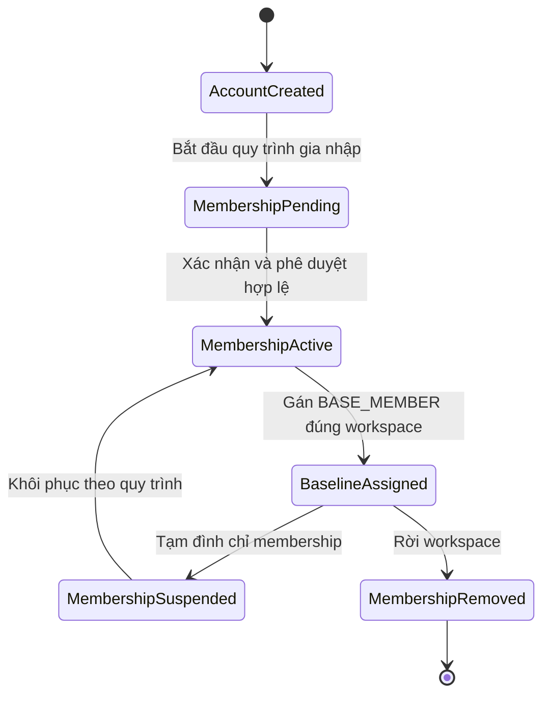

# Default role

## 1. Default role là gì?

Trong RBAC, permission được gom vào role, rồi role được gán cho một danh tính trong phạm vi phù hợp. **Default role**, hay vai trò mặc định, là role được hệ thống lựa chọn để gán theo một chính sách đã định trước khi xảy ra một sự kiện như tạo tài khoản hoặc kích hoạt tư cách thành viên.

Ví dụ, một ứng dụng cộng tác quy định thành viên mới đã hoàn tất quy trình gia nhập workspace được nhận role `BASE_MEMBER`. Role này chỉ cho xem thông tin cơ bản của workspace và xem tư cách thành viên của chính mình. Các quyền biên tập tài liệu, mời người khác và quản trị workspace được cấp qua những role riêng.

```text
Tài khoản đã xác thực
  + tư cách thành viên hợp lệ trong workspace-a
  + hoàn tất điều kiện gia nhập
  → gán BASE_MEMBER trong workspace-a
```

Điểm cần xác định không chỉ là tên role. Chính sách phải trả lời: gán cho ai, khi nào, trong phạm vi nào, role chứa những permission nào và điều gì xảy ra khi điều kiện nhận role không còn đúng.

“Default role” là một khái niệm cấu hình phụ thuộc sản phẩm. Có hệ thống tự gán một role; có hệ thống tự gán nhiều role hoặc sử dụng group mặc định. Chẳng hạn, hướng dẫn Keycloak mô tả default roles dùng để tự động gán role mapping khi người dùng được tạo hoặc được nhập qua identity brokering. Không nên suy diễn cơ chế của một sản phẩm thành hành vi bắt buộc của mọi hệ thống RBAC. [Tham khảo: Keycloak — Using default roles](https://www.keycloak.org/docs/latest/server_admin/index.html#_default_roles).

## 2. Phân biệt những ý nghĩa thường bị nhầm

### 2.1. Default role và deny by default

Default role nói về **cách cấp một tập quyền ban đầu**. Deny by default nói về **cách ra quyết định khi không có cơ sở cho phép**.

Hai khái niệm có thể cùng tồn tại:

```text
BASE_MEMBER cấp workspace.metadata.read.
BASE_MEMBER không cấp member.invite.

Yêu cầu đọc metadata đúng workspace → xét điều kiện và có thể cho phép.
Yêu cầu mời thành viên               → từ chối nếu không có quyền khác.
```

Có role mặc định không có nghĩa mọi hành động chưa được khai báo đều được phép. Khi một endpoint mới xuất hiện, quyền truy cập endpoint đó vẫn cần một quyết định chính sách rõ ràng.

OWASP khuyến nghị từ chối mặc định và chỉ cấp quyền có thể giải thích bằng yêu cầu nghiệp vụ. Nguyên tắc ấy vẫn áp dụng cho người đã đăng nhập và đã nhận role mặc định. [Tham khảo: OWASP — Authorization Cheat Sheet](https://cheatsheetseries.owasp.org/cheatsheets/Authorization_Cheat_Sheet.html).

### 2.2. Default role và role đang được kích hoạt trong phiên

Một người có thể được gán nhiều role nhưng chỉ kích hoạt một tập role trong phiên hiện tại. “Role mặc định khi mở phiên” là lựa chọn tập role được sử dụng ban đầu; nó không đồng nghĩa role mới được cấp cho người đó.

Ví dụ, Lan đã được gán `BASE_MEMBER` và `SUPPORT_OPERATOR`. Phiên thường ngày chỉ dùng `BASE_MEMBER`; khi thực hiện công việc hỗ trợ, Lan cần quy trình kích hoạt role còn lại. Việc chọn role cho phiên không được vượt quá những role mà Lan thực sự được phép sử dụng.

### 2.3. Default role và quyền của người chưa đăng nhập

Quyền đọc một trang công khai có thể áp dụng cho khách chưa xác thực mà không cần tạo user hoặc gán role thành viên. Ngược lại, role dành cho thành viên đã được chấp nhận không nên áp dụng cho mọi người có thể mở trang đăng ký.

Một hệ thống có thể đặt tên role là `GUEST`, nhưng tên đó chưa cho biết nó dành cho khách vô danh, người đã xác thực hay thành viên bên ngoài được mời. Phải đọc định nghĩa và điều kiện gán role.

### 2.4. Default role và giá trị DEFAULT trong cơ sở dữ liệu

Một cột có `DEFAULT 'MEMBER'` chỉ là cơ chế điền giá trị khi ghi dữ liệu. Nó không tự kiểm tra lời mời, tổ chức, trạng thái tài khoản hoặc quyền của người đang tạo bản ghi.

Đặc biệt, khi một principal có thể tham gia nhiều tổ chức, một cột `users.role` không đủ biểu diễn role theo từng tổ chức. Chính sách cấp quyền cần một mô hình phù hợp, không thể thay bằng giá trị mặc định của cột.

## 3. Thiết kế tập quyền nền tối thiểu

Default role thường áp dụng cho số lượng lớn danh tính. Vì thế, một permission quá rộng trong role này có thể trở thành quyền chung của hầu hết người dùng trong phạm vi áp dụng.

Hãy bắt đầu bằng công việc tối thiểu mà người mới cần làm sau khi được chấp nhận, thay vì chọn sẵn một role có tên thân thiện như `USER` rồi giữ mọi permission bên trong.

| Nhu cầu trong ứng dụng minh họa | Permission | Điều kiện bổ sung |
|---|---|---|
| Xem tư cách thành viên của chính mình | `membership.read.self` | Đúng principal và đúng workspace |
| Xem tên, mô tả cơ bản của workspace | `workspace.metadata.read` | Tư cách thành viên đang hoạt động |
| Sửa tài liệu | Không thuộc `BASE_MEMBER` | Cần role biên tập và policy tài nguyên |
| Mời người khác | Không thuộc `BASE_MEMBER` | Cần quyền quản lý thành viên riêng |
| Đổi role của người khác | Không thuộc `BASE_MEMBER` | Cần quyền quản trị được giới hạn |
| Xem mọi tài liệu của tổ chức | Không tự cấp | Cần quyết định theo phân loại dữ liệu |

Đây là một thiết kế mẫu, không phải danh sách permission chuẩn của RBAC. Trong một hệ thống khác, thành viên mới có thể không được đọc bất kỳ dữ liệu workspace nào cho đến khi hoàn tất một bước phê duyệt bổ sung.

### Quyền tự phục vụ vẫn phải giới hạn đối tượng

Permission `membership.read.self` phải được thực thi bằng việc xác nhận bản ghi thành viên thuộc chính người gọi. Chỉ đặt hậu tố `.self` vào tên không tự tạo giới hạn đó.

Tương tự, nếu role cho phép sửa hồ sơ cá nhân, việc sửa phải giới hạn những trường được phép. Không để quyền sửa tên hiển thị bao gồm sửa `roles`, `tenantId`, `accountState` hoặc thuộc tính điều khiển truy cập.

### Quyền đọc cũng có thể rất rộng

Một role `READER` mặc định không tự an toàn hơn mọi role có quyền ghi. Nếu `read` bao gồm đọc toàn bộ hồ sơ khách hàng, secret hoặc báo cáo tài chính, tác động vẫn lớn. Hãy đánh giá dữ liệu được đọc và phạm vi thực tế, không chỉ động từ trong permission.

## 4. Chọn đúng thời điểm gán role

Không phải sự kiện “đã có bản ghi user” nào cũng chứng minh người đó đã đủ điều kiện truy cập một tổ chức. Cần phân biệt vòng đời tài khoản với vòng đời membership.

Một luồng minh họa có thể là:



Sơ đồ mô tả các mốc nghiệp vụ, không yêu cầu lưu chúng thành đúng từng trạng thái trong một bảng. Điều cần giữ là quyền workspace không được sử dụng trước khi điều kiện gia nhập có hiệu lực, và phải bị chặn khi membership bị đình chỉ hoặc kết thúc.

### Các sự kiện cần chính sách riêng

| Sự kiện | Câu hỏi trước khi gán role mặc định |
|---|---|
| Tự đăng ký tài khoản | Có chỉ được tự phục vụ tài khoản hay đã được gia nhập tổ chức? |
| Nhận lời mời | Lời mời còn hiệu lực, đúng người nhận và đúng workspace không? |
| Tạo user qua quản trị | Người tạo có thẩm quyền với phạm vi đích không? |
| Đồng bộ từ hệ thống danh tính | Nguồn và quy tắc ánh xạ có được tin cậy không? |
| Đăng nhập SSO lần đầu | Danh tính đã được liên kết với membership nào có thẩm quyền? |
| Tạo service account | Workload cần tập quyền riêng nào cho nhiệm vụ của nó? |

Không nên dùng một hook “sau mỗi lần đăng nhập” để tự động khôi phục mọi default role bị thiếu nếu chưa có quy tắc rõ ràng. Hook ấy có thể cấp lại role mà quản trị viên vừa thu hồi có chủ đích.

## 5. Phạm vi của role mặc định

Trong ứng dụng nhiều tổ chức, nên mô hình hóa một lần gán role theo đủ các thành phần liên quan:

```text
principalId = u-42
role        = BASE_MEMBER
scopeType   = WORKSPACE
scopeId     = workspace-a
source      = DEFAULT_POLICY
policyVersion = baseline-v1
```

Role trên không cấp membership ở `workspace-b`. Nếu người dùng chọn `workspace-b` bằng header hoặc query parameter, server vẫn phải xác nhận quyền ở phạm vi ấy.

```text
Đúng: Có BASE_MEMBER trong workspace-a
      → chỉ xét permission tương ứng trong workspace-a.

Sai:  Có BASE_MEMBER ở một workspace bất kỳ
      → dùng làm quyền truy cập mọi workspace.
```

OWASP nhấn mạnh rằng tenant ID do client cung cấp chỉ là giá trị chọn phạm vi; hệ thống phải gắn phạm vi với danh tính và membership hoặc ủy quyền đã được server kiểm tra. [Tham khảo: OWASP — Multi-Tenant Security Cheat Sheet](https://cheatsheetseries.owasp.org/cheatsheets/Multi_Tenant_Security_Cheat_Sheet.html).

Với role nền của toàn ứng dụng, hãy giữ rõ nó chỉ cho phép những chức năng toàn cục nào, chẳng hạn thao tác trên tài khoản của chính mình. Không sử dụng một role toàn cục làm bằng chứng rằng người gọi là thành viên của mọi tổ chức.

### Không lấy role mong muốn từ request đăng ký

Ví dụ request:

```json
{
  "displayName": "Lan",
  "workspaceId": "workspace-a",
  "role": "OWNER"
}
```

Client có thể đề nghị một workspace hoặc một công việc mong muốn nếu nghiệp vụ hỗ trợ, nhưng server phải quyết định role được cấp từ chính sách có thẩm quyền. Không ánh xạ trường `role` trong body trực tiếp vào role binding.

Ngay cả một role có tên hợp lệ trong catalogue cũng chưa đủ điều kiện được cấp. Role tồn tại và người dùng được phép nhận role là hai câu hỏi khác nhau.

## 6. Ba cách triển khai và hệ quả thu hồi quyền

### 6.1. Gán role tường minh tại thời điểm onboarding

Khi người dùng đủ điều kiện, hệ thống tạo một role binding có nguồn `DEFAULT_POLICY`. Sau đó, request sử dụng binding hiện hành giống các lần gán role khác.

Ưu điểm là có thể truy vết thời điểm, lý do và phiên bản chính sách cấp role. Tuy nhiên, nếu role bị xóa thì quy trình đồng bộ không được tự ý thêm lại chỉ vì coi đó là dữ liệu bị thiếu.

### 6.2. Suy ra quyền nền từ membership đang hoạt động

Một ứng dụng có thể quy định mọi membership đang hoạt động đều có tập quyền nền, không cần tạo một binding riêng cho từng người. Đây là một lựa chọn thiết kế hợp lệ nếu được mô tả và thực thi nhất quán.

Hệ quả là không thể thu hồi quyền nền bằng cách xóa một binding vốn không phải nguồn cấp quyền. Nếu cần đình chỉ một thành viên hoặc tạo ngoại lệ, phải tác động đúng trạng thái hoặc quy tắc mà policy sử dụng.

### 6.3. Tự chọn role khi không tìm thấy role nào

Một cách triển khai dễ gây nhầm là:

```text
nếu danh sách role rỗng → coi như có BASE_MEMBER
```

Danh sách rỗng có thể do người dùng chưa được cấp quyền, bị thu hồi toàn bộ role, đang ở trạng thái chờ hoặc truy vấn sai phạm vi. Nếu lỗi truy vấn cũng bị chuyển thành danh sách rỗng, hành vi fallback còn biến lỗi hệ thống thành một lần cấp quyền.

Không nên sử dụng cách suy luận này khi chưa xác định chính xác đối tượng đủ điều kiện và cơ chế thu hồi. Nếu thực sự muốn mọi membership hoạt động có quyền nền, hãy biểu diễn trực tiếp quy tắc đó và kiểm tra membership, thay vì đoán từ việc không tìm thấy role.

| Lựa chọn | Nguồn tạo quyền nền | Thu hồi phải tác động vào đâu? |
|---|---|---|
| Binding tường minh | Bản ghi gán role | Binding và các nguồn quyền khác liên quan |
| Quyền suy ra từ membership | Policy dựa trên membership hiện hành | Membership hoặc điều kiện policy |
| Fallback khi role rỗng | Quy tắc fallback | Cần loại bỏ hoặc kiểm soát chính quy tắc fallback |

Một hệ thống có thể dùng nhiều cơ chế cùng lúc. Khi đó, phải tính tổng những nguồn cấp quyền thay vì giả định xóa một bản ghi là đủ.

## 7. Minh họa Java: đề xuất role từ dữ kiện onboarding

Đoạn code dùng Java 17 và lựa chọn cơ chế gán binding tường minh. Nó chỉ đề xuất role mặc định khi tài khoản hoạt động, membership ở trạng thái `ACTIVE` và quy trình gia nhập đã được phê duyệt theo policy của ứng dụng.

```java
import java.util.Objects;
import java.util.Optional;
import java.util.UUID;

public final class DefaultRolePolicy {
    public enum MembershipState {
        PENDING, ACTIVE, SUSPENDED, REMOVED
    }

    public enum Role {
        BASE_MEMBER
    }

    public record EnrollmentFacts(
            UUID principalId,
            UUID workspaceId,
            boolean accountActive,
            MembershipState membershipState,
            boolean onboardingApproved) {
        public EnrollmentFacts {
            Objects.requireNonNull(principalId);
            Objects.requireNonNull(workspaceId);
            Objects.requireNonNull(membershipState);
        }
    }

    public record ProposedBinding(
            UUID principalId,
            UUID workspaceId,
            Role role,
            String source,
            String policyVersion) {
    }

    public static Optional<ProposedBinding> proposeInitialBinding(
            EnrollmentFacts facts) {
        Objects.requireNonNull(facts);

        if (!facts.accountActive()) {
            return Optional.empty();
        }
        if (facts.membershipState() != MembershipState.ACTIVE) {
            return Optional.empty();
        }
        if (!facts.onboardingApproved()) {
            return Optional.empty();
        }

        return Optional.of(new ProposedBinding(
                facts.principalId(),
                facts.workspaceId(),
                Role.BASE_MEMBER,
                "DEFAULT_POLICY",
                "baseline-v1"
        ));
    }
}
```

Hàm không nhận role do client lựa chọn. Đầu ra chỉ có role nền mà chính sách đã cho phép, gắn với đúng principal và workspace trong dữ kiện đầu vào.

`EnrollmentFacts` phải được dựng từ dữ liệu server đã xác nhận. Một record có kiểu dữ liệu rõ ràng vẫn có thể chứa giá trị giả nếu ứng dụng nhận nguyên trạng nó từ body của request đăng ký.

`Optional.empty()` biểu diễn trường hợp đã đánh giá nhưng chưa đủ điều kiện cấp role. Lỗi lấy dữ liệu, dữ kiện hỏng hoặc không dựng được context phải được xử lý như lỗi của quá trình cấp quyền, không được chuyển thành một bộ dữ kiện hợp lệ hay một role mạnh hơn.

Đoạn code chỉ thực hiện lựa chọn policy. Nó chưa ghi database, chưa tiêu thụ lời mời, chưa chống cấp lại sau thu hồi và chưa kiểm soát thay đổi membership đồng thời. Những việc ấy thuộc transaction hoặc quy trình provisioning bao quanh hàm.

Khi xử lý request nghiệp vụ sau này, ứng dụng vẫn cần kiểm tra trạng thái tài khoản, membership, role binding và tài nguyên hiện hành. Một binding được tạo hợp lệ ngày hôm qua không tự chứng minh quyền hôm nay vẫn còn hiệu lực.

## 8. Cấp role đúng khi có retry và xử lý đồng thời

### 8.1. Tính lặp lại an toàn

Một sự kiện “membership được kích hoạt” có thể được giao lại do lỗi mạng hoặc consumer khởi động lại. Quy trình provisioning cần tránh tạo nhiều binding hoặc nhiều tác dụng phụ từ cùng một sự kiện.

Có thể lưu định danh sự kiện hoặc một khóa idempotency gắn với lần gia nhập cụ thể. Ràng buộc dữ liệu cũng cần ngăn binding trùng theo mô hình đã chọn. Tuy nhiên, chống bản ghi trùng chưa giải quyết việc cấp lại role đã bị thu hồi.

Ví dụ:

```text
09:00  Sự kiện E1 được xử lý, BASE_MEMBER được cấp.
10:00  Quản trị viên thu hồi binding theo quyết định hợp lệ.
10:05  E1 được giao lại.
```

Nếu consumer chỉ kiểm tra “binding chưa tồn tại” rồi insert, E1 có thể cấp lại quyền lúc 10:05. Hệ thống cần biết E1 đã được xử lý, hoặc lưu trạng thái thể hiện quyết định thu hồi phải được giữ lại.

Idempotency phải xét lịch sử của tác vụ đã được thực hiện, không chỉ trạng thái hiện tại của bản ghi quyền. Nếu người dùng gia nhập lại sau khi rời workspace, lần gia nhập mới cũng cần được phân biệt với lần cũ.

### 8.2. Nhất quán giữa membership và binding

Giả sử service xác nhận membership còn `ACTIVE`, rồi membership bị chuyển sang `REMOVED` trước khi binding được ghi. Nếu không phối hợp, có thể tồn tại binding vừa được cấp cho một lần gia nhập đã kết thúc.

Một triển khai có thể dùng transaction kết hợp khóa hoặc kiểm tra phiên bản dữ liệu, tùy kho dữ liệu và kiến trúc. Khi membership và role ở hai hệ thống, cần một quy trình có trạng thái, retry có kiểm soát và cơ chế đối soát. Trong khoảng chưa hoàn tất, việc kiểm tra quyền vẫn phải chặn những trạng thái chưa đủ điều kiện.

Không nên đánh dấu onboarding hoàn tất cho chức năng yêu cầu role rồi bỏ qua việc gán role thất bại. Ngược lại, cũng không được sửa lỗi bằng cách tạm cho phép mọi người đang thiếu binding.

### 8.3. Quyền của tiến trình provisioning

Một consumer chỉ làm nhiệm vụ cấp `BASE_MEMBER` không cần quyền gán mọi role. Có thể giới hạn danh tính workload của nó vào đúng nhóm role và phạm vi cần xử lý.

Thông điệp trong hàng đợi cũng phải có nguồn tin cậy và được kiểm tra. Trường `workspaceId` hoặc `approved=true` trong payload không tự chứng minh producer có thẩm quyền xác nhận việc gia nhập workspace ấy.

## 9. Thay đổi default role ảnh hưởng những ai?

“Đổi default role” có thể là hai loại thay đổi rất khác nhau.

### 9.1. Đổi role được chọn cho lần cấp mới

Ví dụ, từ ngày áp dụng policy mới, thành viên mới nhận `BASE_MEMBER_V2` thay vì `BASE_MEMBER_V1`. Với cơ chế binding tường minh theo thời điểm tạo, người cũ có thể vẫn giữ role cũ nếu không có migration.

Không được mặc định mọi sản phẩm đều có hành vi này. Một sản phẩm có thể sử dụng role tổng hợp hoặc cách suy ra động làm cho thay đổi ảnh hưởng cả tài khoản hiện có. Cần xác định cơ chế thật trước khi kết luận phạm vi tác động.

### 9.2. Đổi permission của role đang được nhiều người giữ

Nếu cùng một `BASE_MEMBER` đang được nhiều người sử dụng và ứng dụng giải quyết permission từ định nghĩa hiện hành, thêm permission vào role có thể tăng quyền của toàn bộ nhóm đó.

```text
Trước:
BASE_MEMBER → workspace.metadata.read

Sau:
BASE_MEMBER → workspace.metadata.read, document.export
```

Thay đổi trên không chỉ giúp onboarding người mới. Nó có thể cho mọi người đang giữ role khả năng xuất dữ liệu ngay khi policy mới có hiệu lực tại các điểm kiểm tra.

### Metadata phiên bản không tự cố định tập quyền

Một binding có `policyVersion=baseline-v1` giúp truy vết lý do được cấp. Nếu binding vẫn trỏ đến một role mà permission được sửa trực tiếp, trường phiên bản ấy không tự tạo bản chụp permission cũ.

Muốn giữ những tập quyền khác nhau theo phiên bản, phải có cơ chế thực sự phân biệt chúng, chẳng hạn định nghĩa role có phiên bản hoặc policy được lưu và giải quyết theo phiên bản. Không chỉ thêm một chuỗi version vào log rồi coi quyền đã được cố định.

### Một quy trình thay đổi có thể kiểm chứng

Trước khi áp dụng, xác định những permission được thêm hoặc bỏ, nhóm danh tính chịu tác động, các role kế thừa liên quan và thời gian cache còn giữ quyền cũ. Nếu cần cập nhật người dùng hiện có, đó là một migration có chủ đích với phạm vi và kết quả được đối soát.

Khi sửa cấu hình cấp mới, tránh chạy tác vụ “đồng bộ default role cho toàn bộ tài khoản” mà chưa xét người đã rời tổ chức, bị đình chỉ hoặc có quyết định thu hồi riêng.

## 10. Thu hồi, đình chỉ và khôi phục

### 10.1. Đình chỉ phải tác động vào điều kiện đang được sử dụng

Nếu ứng dụng quy định membership bị đình chỉ không được truy cập workspace, mọi đường vào workspace phải xét điều kiện ấy. Giữ binding để phục vụ lịch sử không nhất thiết sai, miễn là binding không thể được sử dụng khi membership không hợp lệ.

Nếu hệ thống quyết định xóa binding khi rời workspace, cần kiểm tra những nguồn cấp quyền còn lại: group mapping, role kế thừa, quyền nền suy ra hoặc role được gán theo nguồn khác.

```text
Xóa một default binding
  không đồng nghĩa
permission đã biến mất khỏi mọi nguồn cấp quyền.
```

### 10.2. Token và cache cần phản ánh yêu cầu thu hồi

Role hoặc permission có thể đã được đưa vào token, phiên hoặc cache. Thay đổi bản ghi trong database không tự sửa nội dung đã được phát hành.

Thiết kế cần mục tiêu cụ thể về độ trễ thu hồi và cơ chế đáp ứng: tra cứu membership hiện hành, phiên bản quyền, vô hiệu hóa phiên hoặc thời hạn ngắn phù hợp. Với một hành động nhạy cảm, có thể cần đánh giá hiện hành thay vì dựa hoàn toàn vào dữ liệu lưu tạm.

Không được coi token còn hạn là bằng chứng rằng membership vẫn hoạt động nếu hợp đồng hệ thống không bảo đảm điều đó.

### 10.3. Khôi phục membership không phải khôi phục mọi quyền lịch sử

Khi thành viên được khôi phục, có thể cấp lại tập quyền nền nếu policy quy định. Những role đặc quyền từng được cấp tạm thời hoặc đã hết hạn cần được đánh giá riêng.

Phải phân biệt “khôi phục khả năng sử dụng tài khoản” với “trả lại mọi quyền từng có”. Việc dùng một bản sao cũ của toàn bộ role để phục hồi có thể đưa cả quyền không còn cần thiết trở lại.

## 11. Tài khoản đầu tiên và role quản trị

Một ứng dụng có thể cho người tạo workspace trở thành chủ sở hữu ban đầu. Đây là quyết định có điều kiện của thao tác tạo workspace, không phải lý do để mọi tài khoản mới nhận role `OWNER`.

Luồng tạo workspace cần xác nhận người tạo được phép tạo, liên kết owner với đúng workspace mới và bảo đảm kết quả nhất quán. Không dùng quy tắc chung:

```text
không tìm thấy quản trị viên → nâng người đang đăng nhập thành quản trị viên
```

Kết quả truy vấn rỗng có thể do lỗi cấu hình, sai phạm vi hoặc dữ liệu chưa được tải. Ngoài ra, nhiều yêu cầu đồng thời có thể cùng nhìn thấy “chưa có ai” nếu việc khởi tạo không được bảo vệ.

Với quản trị viên toàn hệ thống, nên có quy trình khởi tạo hoặc khôi phục riêng, có thẩm quyền và dấu vết. Không để tài khoản tự đăng ký đi qua nhánh sửa chữa đặc quyền chỉ vì hệ thống đang thiếu một role hoặc một bản ghi.

Tương tự, default role của người dùng tương tác không nên tự áp dụng cho service account. Workload cần quyền theo nhiệm vụ cụ thể; việc tự tạo danh tính kỹ thuật không phải bằng chứng rằng nó cần quyền đọc dữ liệu chung của mọi thành viên.

## 12. Kiểm chứng và kiểm toán chính sách default role

### 12.1. Ma trận tình huống

Giả sử ứng dụng dùng cơ chế binding tường minh, yêu cầu membership được phê duyệt và chỉ cấp `BASE_MEMBER` trong workspace đích:

| Tình huống | Kết quả mong đợi |
|---|---|
| Tài khoản tồn tại, membership còn chờ | Chưa được cấp role workspace |
| Tài khoản hoạt động, membership hợp lệ và đã phê duyệt | Đề xuất role nền đúng workspace |
| Client gửi `role=OWNER` khi đăng ký | Không làm thay đổi role được policy lựa chọn |
| Người dùng có role nền ở workspace-a, chọn workspace-b | Không có quyền ở workspace-b chỉ từ binding cũ |
| Client đổi `principalId` để đọc membership người khác | Permission `.self` không cho phép yêu cầu đó |
| Sự kiện cấp role được giao lại | Không tạo thêm tác dụng phụ hoặc cấp lại quyền đã thu hồi |
| Dịch vụ lấy policy gặp lỗi | Không cấp role thay thế để tiếp tục cho qua |
| Membership bị đình chỉ nhưng binding còn | Chặn quyền workspace theo điều kiện trạng thái |
| Endpoint mới chưa có permission cho role nền | Không tự mở cho người có default role |
| Role nền được thêm một permission | Đánh giá nhóm người hiện có bị tăng quyền |

Các tình huống này phục vụ việc kiểm chứng khi triển khai ứng dụng. Chính sách cụ thể vẫn cần được thống nhất trước: điều kiện đủ để gia nhập, phạm vi dữ liệu được đọc và yêu cầu thu hồi là quyết định của từng hệ thống.

### 12.2. Dấu vết cấp quyền

Một sự kiện gán role có thể ghi:

```text
eventId       = membership-activation-812
principalId   = u-42
workspaceId   = workspace-a
role          = BASE_MEMBER
source        = DEFAULT_POLICY
policyVersion = baseline-v1
membershipRevision = 6
result        = ASSIGNED
```

Khi cần, lưu thêm tiến trình thực hiện, thời điểm và định danh quyết định phê duyệt. Không ghi token đăng nhập hoặc token lời mời nguyên văn vào log chỉ để chứng minh đã kiểm tra.

Dấu vết quyết định từ chối hoặc cấp quyền không thay thế log truy cập nghiệp vụ. Một log cho biết role được gán; log khác cho biết role hoặc policy nào đã được sử dụng để cho phép thao tác trên tài nguyên.

## 13. Bài tập vận dụng

Một ứng dụng quản lý dự án cho phép người dùng tự tạo tài khoản. Người dùng chỉ trở thành thành viên workspace sau khi chấp nhận lời mời còn hiệu lực. Thành viên mới được xem metadata của workspace và membership của mình; chưa được đọc tài liệu dự án nếu chưa tham gia dự án.

Hãy thiết kế policy default role và giải thích các trường hợp sau:

1. Người dùng đã xác minh email nhưng chưa nhận lời mời có được role workspace không?
2. Người dùng chấp nhận lời mời vào workspace-a rồi đổi header sang workspace-b có được truy cập không?
3. Quản trị viên thu hồi role nền, sau đó sự kiện chấp nhận lời mời cũ được giao lại thì xử lý thế nào?
4. Nếu muốn mọi thành viên hoạt động luôn có quyền nền, nên biểu diễn quy tắc đó ra sao và đình chỉ bằng cách nào?
5. Khi thêm quyền đọc tài liệu vào role nền, những người dùng hiện có nào có thể bị ảnh hưởng?

Khi trả lời, giữ riêng bằng chứng xác thực danh tính, bằng chứng được gia nhập workspace và quyết định cấp role. Ba yếu tố này có thể xuất hiện trong cùng một luồng onboarding nhưng không thay thế cho nhau.

Một thiết kế hoàn chỉnh phải chỉ ra cả đường cấp quyền lẫn đường làm quyền ngừng có hiệu lực. Default role khi đó là một chính sách quyền nền có phạm vi và vòng đời rõ ràng, có thể truy vết từ điều kiện gia nhập đến hành động được phép thực hiện.
