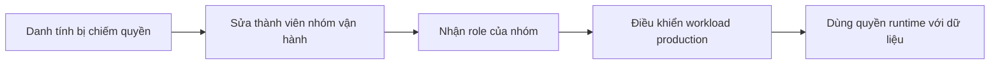

# Privileged role

## 1. Khi nào một vai trò được xem là đặc quyền?

Một nhân viên có thể xem lịch làm việc của mình. Một quản trị viên có thể thay đổi chính sách đăng nhập cho toàn tổ chức. Cả hai đều nhận quyền thông qua vai trò, nhưng hậu quả khi quyền bị sử dụng sai khác nhau rất lớn.

**Privileged role**, hay vai trò đặc quyền, là vai trò mang những năng lực nhạy cảm có thể tác động đáng kể tới danh tính, quyền truy cập, cơ chế bảo vệ, hoạt động hệ thống hoặc dữ liệu quan trọng. Tính đặc quyền xuất phát từ permission thực tế và phạm vi ảnh hưởng, không chỉ từ tên gọi như `ADMIN`, `OWNER` hay `SUPERUSER`.

Một role tên `SupportAgent` vẫn có thể là role đặc quyền nếu nó cho phép đặt lại thông tin xác thực của người khác. Một role chỉ đọc cũng có thể rất nhạy cảm nếu cho phép lấy toàn bộ bản sao dữ liệu, bí mật hoặc thông tin kiểm toán có giá trị cao.

Trong hệ thống IAM, cần đặt câu hỏi: nếu danh tính đang giữ role này bị chiếm quyền hoặc thao tác sai, nó có thể thay đổi điều gì, ảnh hưởng tới ai và tạo thêm quyền cho chủ thể nào?

Microsoft Entra mô tả các quyền nhạy cảm như quản lý thông tin xác thực, thay đổi chính sách xác thực hoặc authorization và truy cập dữ liệu hạn chế. Đây là một ví dụ phân loại của sản phẩm; nhãn và danh sách cụ thể không thay thế việc phân tích permission của ứng dụng đang thiết kế. [Microsoft Learn — Privileged roles and permissions](https://learn.microsoft.com/en-us/entra/identity/role-based-access-control/privileged-roles-permissions).

## 2. Nhận diện đặc quyền theo năng lực thực tế

### 2.1. Quản lý danh tính và thông tin xác thực

Các năng lực cần xem xét gồm tạo hoặc vô hiệu hóa tài khoản, đặt lại mật khẩu, thay đổi phương thức MFA, đăng ký credential mới, thay khóa của workload và thay đổi quan hệ liên kết danh tính.

Quyền đặt lại thông tin xác thực có thể trở thành đường chiếm quyền nếu sau đó người thao tác có thể đăng nhập thay tài khoản đích và vượt qua các kiểm soát còn lại. Mức rủi ro phụ thuộc ai có thể bị tác động và cơ chế khôi phục được bảo vệ ra sao.

Vì vậy, cần phân biệt role hỗ trợ người dùng thông thường với role có thể can thiệp tài khoản quản trị. Không nên cho một role hỗ trợ giới hạn vô tình sửa được thông tin xác thực của danh tính nắm toàn quyền hệ thống.

### 2.2. Cấp, sửa hoặc mở rộng quyền

Một role có thể không đọc dữ liệu nghiệp vụ trực tiếp nhưng lại được gán role đọc dữ liệu đó cho người khác. Nó nắm một năng lực quản trị quyền và cần được đánh giá theo các quyền mà nó có thể tạo ra.

Các đường mở rộng quyền có thể bao gồm:

- Tạo, gia hạn hoặc thay đổi assignment của role nhạy cảm.
- Sửa permission trong định nghĩa role.
- Thêm thành viên vào nhóm đang nhận role đặc quyền.
- Sửa mapping từ nhóm hoặc claim bên ngoài sang role nội bộ.
- Thay người phê duyệt hoặc chính sách kích hoạt role.
- Cấp credential cho một danh tính workload vốn đã có quyền cao.

Nếu một quản trị viên chỉ được gán role `VIEWER` nhưng lại được sửa `VIEWER` thành role chứa mọi permission, giới hạn danh sách role được gán không còn bảo vệ được hệ thống.

### 2.3. Điều khiển hạ tầng và đường thực thi

Quyền triển khai code, sửa pipeline, thay image hoặc chạy lệnh trên máy chủ có thể cho phép thực thi dưới danh tính runtime của ứng dụng. Nếu runtime có quyền đọc bí mật hoặc truy cập cơ sở dữ liệu, người điều khiển đường triển khai có thể tác động gián tiếp tới các tài nguyên đó.

Điều này không có nghĩa mọi quyền triển khai luôn tương đương quyền quản trị toàn hệ thống. Cần kiểm tra môi trường, ranh giới thực thi, quyền runtime, phê duyệt thay đổi và khả năng truy cập credential thực tế.

### 2.4. Kiểm soát bảo vệ, dữ liệu và khả năng phục hồi

Một số permission nhạy cảm khác là tắt logging, đổi nơi gửi log, thay chính sách xác thực, xuất dữ liệu hàng loạt, khôi phục bản sao lưu, xóa tài nguyên hoặc thay cơ chế mã hóa.

Quyền chỉ đọc bản sao lưu có thể tiết lộ nhiều dữ liệu hơn quyền đọc từng bản ghi trong ứng dụng. Quyền sửa chính sách lưu giữ hoặc xóa bản sao lưu có thể ảnh hưởng khả năng phục hồi, ngay cả khi người đó không được sửa dữ liệu đang vận hành.

| Nhóm năng lực | Ví dụ | Vì sao cần kiểm soát đặc quyền? |
| --- | --- | --- |
| Danh tính | Đăng ký credential thay người dùng | Có thể thay đổi ai kiểm soát tài khoản |
| Quản trị quyền | Gán role hoặc sửa role definition | Có thể tạo ra quyền truy cập mới |
| Đường thực thi | Triển khai code production | Có thể chạy tác vụ dưới danh tính runtime |
| Chính sách bảo vệ | Đổi yêu cầu MFA hoặc điều kiện đăng nhập | Có thể làm yếu ranh giới xác thực |
| Dữ liệu nhạy cảm | Xuất toàn bộ dữ liệu khách hàng | Có thể làm lộ dữ liệu trên phạm vi lớn |
| Khả năng phục hồi | Xóa backup hoặc sửa chính sách giữ bản sao | Có thể ngăn khôi phục sau sự cố |
| Kiểm toán | Tắt hoặc đổi cấu hình log | Có thể làm mất dấu vết thao tác |

## 3. Phạm vi ảnh hưởng quan trọng hơn nhãn quản trị

Hai người cùng có role `ServiceOperator` nhưng một người chỉ quản lý service thử nghiệm, người còn lại quản lý mọi service production. Không thể coi hai assignment có mức ảnh hưởng giống nhau chỉ vì trùng role ID.

Khi phân tích một role đặc quyền, nên xét đồng thời:

1. **Năng lực:** được đọc, sửa, xóa, cấp quyền hoặc thực thi những gì?
2. **Phạm vi:** một tài nguyên, một dự án, một tenant hay toàn nền tảng?
3. **Đối tượng đích:** có tác động tới tài khoản quản trị, dữ liệu nhạy cảm hoặc hệ thống cốt lõi không?
4. **Thời gian:** quyền hoạt động thường trực hay chỉ trong một cửa sổ được kiểm soát?
5. **Khả năng tạo quyền khác:** có thể cấp role, thêm credential hoặc điều khiển một danh tính mạnh hơn không?
6. **Kiểm soát kèm theo:** có phê duyệt, giới hạn thao tác và cơ chế phát hiện phù hợp không?

Đây là các chiều phân tích, không phải công thức số học để cộng điểm rủi ro một cách máy móc. Hai permission riêng lẻ có vẻ hẹp có thể tạo ra năng lực mạnh khi kết hợp.

Ví dụ, quyền thêm thành viên vào nhóm X kết hợp với quyền gán X vào một role đặc quyền có thể tạo ra đường tự nâng quyền. Vì vậy, việc rà soát phải xét cả chuỗi quan hệ giữa danh tính, nhóm, role, credential và tài nguyên.



Sơ đồ mô tả một chuỗi khả năng có điều kiện. Mỗi cạnh phải được xác minh trong cấu hình thực tế. Nếu nhóm không nhận role, assignment bị giới hạn scope hoặc runtime không có quyền dữ liệu tương ứng, chuỗi có thể bị chặn.

## 4. Thiết kế role đặc quyền theo nhiệm vụ

NIST diễn giải least privilege là giới hạn quyền và tài nguyên ở mức cần thiết cho chức năng được giao. Với role đặc quyền, điều này đòi hỏi tách rõ nhiệm vụ, phạm vi và thời gian sử dụng, thay vì gom mọi việc quản trị vào một role chung. [NIST Glossary — Least privilege](https://csrc.nist.gov/glossary/term/least_privilege).

Một hệ thống nhiều tenant có thể thiết kế các role như sau:

| Role minh họa | Nhiệm vụ được cấp | Giới hạn cần thể hiện rõ |
| --- | --- | --- |
| `HELPDESK_OPERATOR` | Hỗ trợ khôi phục một nhóm tài khoản thông thường | Không can thiệp tài khoản đặc quyền ngoài phạm vi được giao |
| `SCOPED_ROLE_ADMIN` | Quản lý một danh sách role tại tenant được chỉ định | Không sửa role definition hoặc cấp role ngoài danh sách |
| `SERVICE_RESTART_OPERATOR` | Khởi động lại các service được chỉ định | Không triển khai code mới, xóa service hay cấp credential |
| `SECURITY_POLICY_ADMIN` | Quản lý một nhóm chính sách bảo vệ | Thay đổi nhạy cảm có quy trình kiểm soát tương ứng |
| `AUDIT_READER` | Đọc dấu vết phục vụ điều tra | Không tắt logging hoặc sửa dữ liệu kiểm toán |
| `DATA_EXPORT_OPERATOR` | Xuất dữ liệu theo phạm vi được phê duyệt | Không mặc định truy cập mọi tenant hoặc mọi loại dữ liệu |

Các role trên là ví dụ thiết kế ứng dụng, không phải bộ role tích hợp của một nền tảng cụ thể. Permission phải được triển khai và kiểm tra đúng như mô tả; tên role không tự tạo ra ranh giới.

### 4.1. Tách quyền quản trị và quyền dữ liệu

Có thể thiết kế người quản lý cấu hình hạ tầng không mặc định đọc dữ liệu nghiệp vụ. Tuy nhiên, phải xét những đường gián tiếp như snapshot, backup, credential, code deployment và quyền đổi chính sách.

Nếu người quản lý hạ tầng có thể tự lấy khóa dữ liệu hoặc chạy code dưới danh tính được phép đọc dữ liệu, việc thiếu một permission `data:read` trong role không chứng minh đã tách biệt quyền hiệu quả.

### 4.2. Tách quản lý role khỏi sử dụng role

Người vận hành được restart service không nhất thiết được cấp quyền restart cho người khác. Người quản trị assignment cũng không nên mặc định được thay đổi nội dung role, duyệt yêu cầu của chính mình hoặc quản trị mọi tenant.

Khi cho phép ủy quyền, cần quy định role nào được cấp, scope nào được quản lý, điều kiện nào phải đạt và giới hạn thời gian ra sao. Bất kỳ thay đổi nào làm tăng các giới hạn này cũng phải được bảo vệ tương xứng.

### 4.3. Kiểm soát thay đổi định nghĩa role

Thêm một permission nhạy cảm vào role đang được gán cho nhiều người có thể mở quyền trên diện rộng mà không tạo assignment mới.

Quy trình thay đổi nên thể hiện nội dung trước–sau, những assignment bị ảnh hưởng, các quan hệ kế thừa và người có thẩm quyền phê duyệt. Không chỉ kiểm tra việc cấp role mới rồi bỏ qua việc sửa một role đã tồn tại.

## 5. Quyền thường trực và quyền kích hoạt khi cần

**Standing privilege** là quyền có thể được sử dụng thường xuyên mà không cần một bước nâng quyền riêng cho từng khoảng công việc. **Just-in-time access** hướng tới việc chỉ bật quyền nhạy cảm khi có nhu cầu hợp lệ và giới hạn thời gian hiệu lực.

Trong mô hình có kích hoạt role, có thể phân biệt:

- **Eligible:** người dùng đủ điều kiện yêu cầu sử dụng một role theo chính sách.
- **Active:** role đã có hiệu lực sử dụng, có thể do assignment hoạt động trực tiếp hoặc do một lần kích hoạt được chấp nhận.
- **Expired hoặc revoked:** quyền sử dụng đã hết thời gian hoặc bị thu hồi theo mô hình của hệ thống.

Microsoft Entra PIM là một ví dụ triển khai assignment và activation có thời hạn, phê duyệt, MFA và dấu vết kiểm toán. Khả năng cụ thể phụ thuộc loại tài nguyên và nhà cung cấp được quản lý. [Microsoft Learn — Privileged Identity Management](https://learn.microsoft.com/en-us/entra/id-governance/privileged-identity-management/pim-configure).

Việc chuyển một role sang eligible làm giảm thời gian quyền đang bật, nhưng vẫn phải bảo vệ quyền yêu cầu kích hoạt và chính sách kích hoạt. Nếu người dùng có thể tự bỏ điều kiện phê duyệt rồi kích hoạt, trạng thái eligible không tạo được kiểm soát dự kiến.

Một luồng khái niệm:

```text
Được phê duyệt đủ điều kiện cho role và scope
  -> yêu cầu kích hoạt cho một nhiệm vụ
  -> kiểm tra danh tính, điều kiện và phê duyệt cần thiết
  -> tạo activation có giới hạn
  -> thực thi từng thao tác qua authorization
  -> hết hạn hoặc thu hồi activation
  -> rà soát các thay đổi và quyền phát sinh
```

Không nên coi activation là giấy phép làm mọi việc trong toàn hệ thống. Mỗi thao tác vẫn cần khớp action, resource, scope và điều kiện của role đang được sử dụng.

Thời hạn phù hợp phụ thuộc nhiệm vụ, độ nhạy cảm, yêu cầu thu hồi và cơ chế nền tảng. Không có một số phút chung bảo đảm an toàn cho mọi role và mọi hệ thống.

## 6. Bảo vệ đường vào và phiên quản trị

### 6.1. Danh tính quản trị phải truy nguyên được

Với công việc thông thường, nên có cách liên hệ thao tác đặc quyền với người chịu trách nhiệm. Một tài khoản quản trị dùng chung cho cả đội làm giảm khả năng giải thích ai đã yêu cầu, ai đã sử dụng và ai đã thay đổi cấu hình.

Việc tách tài khoản thường ngày và tài khoản quản trị có thể giảm khả năng dùng nhầm quyền cao trong các hoạt động không cần thiết. Tuy nhiên, hai tài khoản trên cùng một môi trường đã bị kiểm soát không tự tạo ra ranh giới an toàn; cần xét cả thiết bị, phiên trình duyệt, credential và đường thao tác.

Với workload, dùng danh tính chuyên biệt cho nhiệm vụ và môi trường. Không biến tài khoản quản trị cá nhân hoặc một khóa dùng chung toàn công ty thành credential mặc định của pipeline.

### 6.2. Xác thực mạnh không thay thế authorization

Tùy mức rủi ro, hệ thống có thể yêu cầu xác thực tăng cường, phương thức chống lừa đảo phù hợp hoặc thiết bị quản trị được kiểm soát khi sử dụng role nhạy cảm.

MFA giúp tăng độ tin cậy của xác thực nhưng không tự quyết định người dùng được quản trị tenant nào. Người dùng hoàn thành MFA vẫn phải có assignment, activation và scope hợp lệ.

Một phiên đã xác thực cũng có thể bị đánh cắp hoặc bị sử dụng từ môi trường không an toàn. Vì vậy, cần bảo vệ token, giới hạn phiên và có cơ chế thu hồi phù hợp, thay vì coi việc đã MFA một lần là căn cứ mở mọi thao tác về sau.

### 6.3. Phê duyệt phải gắn với yêu cầu cụ thể

Yêu cầu được phê duyệt cho role vận hành service A không được dùng để thao tác service B hoặc đổi sang role quản trị quyền. Nội dung phê duyệt cần gắn với subject, role, scope, thời hạn và mục đích đã được xem xét.

Với thao tác rủi ro cao, có thể cần tách người yêu cầu và người duyệt. Quy tắc này phải được thực thi ở server và phải xét người dùng nhận quyền qua các tài khoản liên quan nếu chính sách yêu cầu kiểm soát ở mức con người.

Một trường `approved=true` do client gửi không chứng minh đã có phê duyệt. Tương tự, việc chỉ nhập một số ticket không chứng minh ticket tồn tại, còn hiệu lực hoặc được duyệt cho đúng thay đổi.

### 6.4. Sự cố dependency không được biến thành mở quyền

Nếu không xác minh được activation hoặc chính sách quyền, không nên cho thao tác đặc quyền đi qua chỉ để tránh gián đoạn. Cần phân biệt lỗi vận hành với thiếu quyền, nhưng cả hai đều không tạo ra căn cứ cho phép mới.

Nếu tổ chức cần đường truy cập khi hệ thống quyền gặp sự cố, đó phải là cơ chế khẩn cấp được thiết kế và bảo vệ riêng. Một nhánh `catch -> allow` không tương đương quy trình truy cập khẩn cấp.

## 7. Ví dụ Java: cổng thực thi một vai trò vận hành đặc quyền

Ví dụ sau dùng Java 17 để minh họa role `SERVICE_OPERATOR`, chỉ được đọc tình trạng hoặc restart một service trong đúng tenant, trong cửa sổ activation và với bằng chứng xác thực tăng cường còn đủ mới theo chính sách.

`Session` và `Activation` phải được dựng từ trạng thái đã được server xác minh. Đặc biệt, `strongAuthVerified`, `revoked` và thời hạn không được lấy từ các field tự khai báo của request. Ví dụ không triển khai xác thực, luồng phê duyệt, cơ sở dữ liệu hoặc thao tác restart thật.

```java
import java.time.Duration;
import java.time.Instant;

public final class PrivilegedRoleDemo {
    enum Role {
        SERVICE_OPERATOR
    }

    enum Action {
        READ_HEALTH, RESTART, DELETE
    }

    record Session(String subjectId,
                   boolean accountEnabled,
                   boolean strongAuthVerified,
                   Instant strongAuthAt) {
    }

    record Activation(String subjectId,
                      Role role,
                      String tenantId,
                      String serviceId,
                      Instant validFrom,
                      Instant validUntil,
                      boolean revoked) {
    }

    record Target(String tenantId, String serviceId) {
    }

    private static boolean missing(String value) {
        return value == null || value.isBlank();
    }

    static boolean mayExecute(Session session,
                              Activation activation,
                              Action action,
                              Target target,
                              Instant now,
                              Duration maxAuthAge) {
        if (session == null || activation == null || action == null
                || target == null || now == null || maxAuthAge == null) {
            return false;
        }

        if (missing(session.subjectId())
                || missing(activation.subjectId())
                || missing(activation.tenantId())
                || missing(activation.serviceId())
                || missing(target.tenantId())
                || missing(target.serviceId())
                || session.strongAuthAt() == null
                || activation.validFrom() == null
                || activation.validUntil() == null
                || maxAuthAge.isNegative() || maxAuthAge.isZero()) {
            return false;
        }

        if (!session.accountEnabled()
                || !session.strongAuthVerified()
                || activation.revoked()
                || !session.subjectId().equals(activation.subjectId())) {
            return false;
        }

        if (!activation.validFrom().isBefore(activation.validUntil())
                || now.isBefore(activation.validFrom())
                || !now.isBefore(activation.validUntil())) {
            return false;
        }

        Duration authAge = Duration.between(session.strongAuthAt(), now);
        if (authAge.isNegative() || authAge.compareTo(maxAuthAge) > 0) {
            return false;
        }

        if (!activation.tenantId().equals(target.tenantId())
                || !activation.serviceId().equals(target.serviceId())) {
            return false;
        }

        return activation.role() == Role.SERVICE_OPERATOR
                && (action == Action.READ_HEALTH || action == Action.RESTART);
    }

    public static void main(String[] args) {
        Instant now = Instant.parse("2026-12-01T08:10:00Z");
        Session session = new Session(
                "operator-an", true, true,
                Instant.parse("2026-12-01T08:08:00Z"));
        Activation activation = new Activation(
                "operator-an", Role.SERVICE_OPERATOR,
                "tenant-a", "billing-api",
                Instant.parse("2026-12-01T08:00:00Z"),
                Instant.parse("2026-12-01T08:30:00Z"), false);

        // Giá trị minh họa của policy, không phải thời hạn chuẩn chung.
        Duration maxAuthAge = Duration.ofMinutes(10);
        Target allowedTarget = new Target("tenant-a", "billing-api");

        System.out.println(mayExecute(session, activation, Action.RESTART,
                allowedTarget, now, maxAuthAge));
        System.out.println(mayExecute(session, activation, Action.DELETE,
                allowedTarget, now, maxAuthAge));
        System.out.println(mayExecute(session, activation, Action.RESTART,
                new Target("tenant-b", "billing-api"), now, maxAuthAge));
        System.out.println(mayExecute(session, activation, Action.RESTART,
                allowedTarget, activation.validUntil(), maxAuthAge));
    }
}
```

Đầu ra dự kiến:

```text
true
false
false
false
```

Role vận hành không có quyền xóa. Cùng một tên service nhưng khác tenant vẫn bị chặn. Đúng tại `validUntil`, activation hết hiệu lực. Bằng chứng xác thực quá cũ hoặc nằm ở tương lai so với thời điểm server đánh giá cũng không được chấp nhận trong mô hình này.

Trong lớp thực thi, chỉ gọi thao tác sau khi quyết định cho phép đã được xác lập. Không gọi restart trước rồi mới đánh giá quyền để quyết định trả thông báo gì.

Đối với thao tác có thay đổi đồng thời, cần bảo đảm service thực tế vẫn là tài nguyên thuộc scope đã kiểm tra. Ví dụ chỉ đánh giá một snapshot đầu vào; nó chưa giải quyết việc trạng thái tài khoản hoặc activation bị thu hồi giữa bước kiểm tra và thực thi.

## 8. Hết hạn role không tự xóa mọi tác động đã tạo

### 8.1. Token và cache có thể giữ quyền cũ

Activation hết hạn tại hệ thống quản trị không bảo đảm mọi ứng dụng lập tức ngừng chấp nhận quyền nếu chúng chỉ dùng token hoặc cache còn chứa role cũ.

Cần xác định thời gian quyền cũ có thể tiếp tục được sử dụng theo thiết kế, cách truyền thay đổi, thời hạn token và cache, cùng cơ chế kiểm tra trực tuyến nếu có. Thời hạn activation và thời hạn token là hai thông tin liên quan nhưng không mặc nhiên đồng nhất.

Nếu một ứng dụng dùng token tự chứa mà không đối chiếu thêm trạng thái quyền, yêu cầu thu hồi tức thời cần một cơ chế bổ sung phù hợp. Không nên hứa thu hồi ngay chỉ vì endpoint quản trị đã trả thành công.

### 8.2. Quyền đặc quyền có thể tạo ra quyền tồn tại lâu hơn

Trong một cửa sổ quản trị ngắn, người dùng có thể tạo assignment mới, thêm credential, phát hành API key hoặc sửa pipeline. Các đối tượng mới có thể còn hiệu lực sau khi role ban đầu hết hạn.

Vì thế, giảm thời gian role đang bật không tự giới hạn tuổi thọ của mọi quyền được tạo ra trong thời gian đó. Hệ thống cần hạn chế những gì role có thể tạo và kiểm toán các thay đổi có tác dụng kéo dài.

Ví dụ, role chỉ dùng để restart service không nên có thêm permission tạo service account hoặc sửa credential. Nếu nhiệm vụ thực sự cần cấp quyền tạm thời cho workload, thời hạn và quy trình thu hồi của quyền workload phải được quản lý riêng.

### 8.3. Tác vụ đang chạy và phiên đã mở

Một truy vấn dữ liệu, phiên remote hoặc job nền có thể đã bắt đầu khi quyền còn hiệu lực. Khi activation kết thúc, hệ thống cần có hợp đồng rõ về việc ngăn yêu cầu mới, đóng phiên hoặc dừng công việc đang chạy.

Không phải nền tảng nào cũng có khả năng ngắt tức thời một thao tác đã bắt đầu. Với nhiệm vụ dài, có thể cần kiểm tra quyền tại các mốc quan trọng, đặc biệt trước khi phát hành kết quả nhạy cảm hoặc thực hiện bước không thể hoàn tác.

Quyền đã thu hồi cũng không xóa một file dữ liệu mà người dùng đã tải xuống. Việc giới hạn đầu ra và bảo vệ dữ liệu phải được thiết kế trước khi thực thi thao tác.

## 9. Danh tính workload và đặc quyền không tương tác

Pipeline, agent triển khai, bộ điều phối và service nền có thể nắm đặc quyền cao dù không có người dùng đăng nhập tương tác.

Các câu hỏi cần trả lời gồm:

- Workload dùng danh tính riêng hay dùng credential của một cá nhân?
- Danh tính đó có quyền trên môi trường nào và tài nguyên nào?
- Ai có thể sửa code, cấu hình hoặc lịch chạy của workload?
- Ai có thể lấy hoặc thay credential của danh tính đó?
- Credential và quyền có thời hạn, nguồn cấp và cách thu hồi nào?
- Khi workload ngừng hoạt động, ai chịu trách nhiệm chấm dứt quyền?

Một service account chỉ dùng để deploy tenant A không nên mặc nhiên triển khai tenant B hoặc sửa quyền toàn tổ chức. Tách danh tính theo nhiệm vụ và môi trường giúp giảm phạm vi ảnh hưởng, nhưng vẫn cần kiểm soát người có thể điều khiển chúng.

MFA của con người không thể được gắn máy móc vào mọi lời gọi tự động. Với workload, cần dùng cơ chế xác thực phù hợp với nền tảng và ràng buộc danh tính nguồn, tài nguyên đích cùng quyền được cấp. Điểm chung vẫn là không để một credential mạnh, dài hạn, dùng chung trở thành đường mở rộng quyền ngoài nhiệm vụ.

## 10. Truy cập khẩn cấp phải được thiết kế riêng

Một hệ thống chỉ có role eligible có thể bị khóa quản trị nếu cơ chế kích hoạt hoặc đường phê duyệt gặp sự cố. Vì vậy, tổ chức cần cân nhắc cách khôi phục quyền quản trị mà không phụ thuộc hoàn toàn vào chính thành phần đang hỏng.

**Emergency access** hoặc **break-glass access** là cơ chế dành cho những trường hợp khẩn cấp đã được xác định. Nó không phải tài khoản dùng hằng ngày và không phải lý do để bỏ bảo vệ mọi tài khoản quản trị.

Các thuộc tính cần thiết kế gồm:

1. Điều kiện nào được sử dụng và ai có thẩm quyền quyết định sử dụng?
2. Đường xác thực còn hoạt động khi dependency thông thường không sẵn sàng là gì?
3. Credential và phương tiện xác thực được bảo vệ, kiểm tra và bàn giao thế nào?
4. Ai được cảnh báo khi đăng nhập hoặc sử dụng quyền khẩn cấp?
5. Sau sự cố, cần rà soát và thu hồi những thay đổi, phiên hoặc credential nào?

Trong hướng dẫn riêng cho Microsoft Entra, Microsoft khuyến nghị tài khoản khẩn cấp được bảo vệ bằng xác thực mạnh và tránh phụ thuộc vào đường xác thực thông thường có thể gặp sự cố. Hướng dẫn còn yêu cầu assignment Global Administrator của tài khoản khẩn cấp là active permanent, thay vì eligible. Đây là ngoại lệ có mục đích khôi phục, không phải chính sách áp dụng cho mọi quản trị viên. [Microsoft Learn — Manage emergency access accounts](https://learn.microsoft.com/en-us/entra/identity/role-based-access-control/security-emergency-access).

Với nền tảng khác, cần thiết kế theo khả năng và yêu cầu của nền tảng đó. Không sao chép danh sách ngoại lệ hay quy tắc tài khoản từ một sản phẩm sang toàn bộ hệ thống IAM.

Việc thử nghiệm đường khẩn cấp cần có phạm vi và quy trình kiểm soát. Một tài khoản được tạo nhiều năm nhưng không còn đăng nhập được không tạo ra khả năng phục hồi thực tế.

## 11. Kiểm toán thao tác đặc quyền

Chỉ ghi rằng người dùng đã nhận role chưa đủ để giải thích họ đã làm gì. Cần liên hệ yêu cầu cấp quyền, activation, phiên và thao tác cụ thể.

Một sự kiện minh họa:

```json
{
  "event": "PRIVILEGED_OPERATION",
  "subjectId": "operator-an",
  "roleId": "service-operator",
  "assignmentId": "ra-27",
  "activationId": "act-92",
  "requestId": "req-158",
  "changeReference": "change-381",
  "tenantId": "tenant-a",
  "resourceId": "billing-api",
  "action": "service:restart",
  "decision": "PERMIT",
  "operationResult": "SUCCESS",
  "policyVersion": "ops-policy-v4",
  "occurredAt": "2026-12-01T08:10:00Z"
}
```

`PERMIT` là quyết định authorization; `SUCCESS` là kết quả thao tác. Một thao tác được cho phép nhưng thất bại kỹ thuật phải được phân biệt với một thao tác bị từ chối trước khi thực hiện.

Đối với thay đổi chính sách, assignment hoặc credential, cần ghi thông tin trước–sau phù hợp, danh tính yêu cầu, người duyệt và danh tính thực thi. Không ghi giá trị mật khẩu, private key hoặc token vào log.

Người sử dụng role vận hành không nên mặc định được sửa hoặc xóa chính dấu vết của mình. Nếu một role quản trị cấp cao có khả năng tác động cấu hình logging, cần có cách lưu và giám sát dấu vết ngoài phạm vi mà role đó dễ dàng can thiệp.

Một số tín hiệu đáng xem xét là kích hoạt ngoài nhiệm vụ dự kiến, mở rộng scope, thêm credential cho danh tính mạnh, thay người phê duyệt và sử dụng tài khoản khẩn cấp. Tín hiệu cần được liên hệ với bối cảnh công việc; nhiều lần đăng nhập không tự chứng minh có hành vi sai.

## 12. Rà soát role và đo khả năng kiểm soát

Việc rà soát cần bao gồm cả người đang có quyền hoạt động, người đủ điều kiện kích hoạt và các danh tính workload liên quan. Chỉ đếm role tên `ADMIN` sẽ bỏ sót role tùy biến, nhóm và các đường cấp quyền gián tiếp.

Các thông tin có ích cho quản trị gồm:

- Những danh tính đang có đặc quyền thường trực và căn cứ của từng trường hợp.
- Role có scope rộng hơn nhiệm vụ được giao.
- Assignment không còn chủ sở hữu, không có căn cứ hoặc đã hết nhu cầu.
- Quan hệ cho phép tự cấp quyền hoặc tự sửa điều kiện kích hoạt.
- Thời gian thay đổi thu hồi đi tới các điểm thực thi.
- Các thay đổi tạo credential hoặc assignment tồn tại lâu hơn activation.
- Tình trạng sẵn sàng của đường truy cập khẩn cấp.

Không nên đánh giá an toàn chỉ bằng tỷ lệ role được chuyển sang eligible. Nếu role vẫn cho phép tạo credential dài hạn hoặc nếu điều kiện kích hoạt dễ bị tự sửa, tỷ lệ đó chưa phản ánh đầy đủ khả năng mở rộng quyền.

Tương tự, không sử dụng role gần đây là căn cứ để xem xét, không phải bằng chứng tuyệt đối rằng role không cần thiết. Một quyền phục hồi hiếm khi dùng vẫn có thể cần duy trì theo thiết kế đã được kiểm tra.

## 13. Các tình huống cần kiểm thử

| Tình huống | Điều cần quan sát |
| --- | --- |
| Người dùng thường gửi request có `role=ADMIN` | Server không chấp nhận role tự khai báo |
| Có activation nhưng khác subject | Không sử dụng activation của người khác |
| Có role đúng nhưng sai tenant hoặc tài nguyên | Không vượt scope |
| Role chỉ cho restart nhưng người gọi yêu cầu xóa | Không thực hiện action ngoài role |
| Đủ điều kiện nhưng chưa kích hoạt theo chính sách | Không có quyền sử dụng đặc quyền đang yêu cầu |
| Activation hết hạn hoặc đã bị thu hồi | Không nhận yêu cầu đặc quyền mới dựa trên activation đó |
| Bằng chứng xác thực không đạt hoặc quá cũ | Không tự coi là đã thỏa điều kiện tăng cường |
| Sửa payload sau khi đã được phê duyệt | Không áp dụng role, scope hoặc thời hạn khác nội dung đã duyệt |
| Không đọc được trạng thái quyền | Không mở quyền qua nhánh xử lý lỗi |
| Token hoặc cache còn chứa role cũ | Hành vi đúng với yêu cầu và giới hạn thu hồi đã thiết kế |
| Người quản trị nhóm thêm mình vào nhóm đặc quyền | Được kiểm soát như một đường cấp quyền nhạy cảm |
| Role definition được thêm permission mới | Phát hiện và kiểm soát phạm vi quyền bị mở rộng |
| Activation kết thúc sau khi đã tạo credential mới | Credential phát sinh không bị bỏ quên trong rà soát |
| Danh tính vận hành tìm cách sửa log của mình | Không vượt quyền kiểm toán đã được thiết kế |
| Đường kích hoạt thông thường không hoạt động | Cơ chế khẩn cấp hoạt động theo thiết kế và có dấu vết |

Kiểm thử âm cần quan sát cả tác dụng thực tế: một API trả lỗi nhưng đã restart service, tạo credential hoặc sửa assignment vẫn là thất bại. Đối với quyền đọc, cần kiểm tra nội dung phản hồi và các đường tải phụ không tiết lộ dữ liệu ngoài phạm vi.

## 14. Bài tập tình huống

Một công ty tạo role `ProductionSupport` cho đội hỗ trợ. Role được kích hoạt có thời hạn và yêu cầu MFA. Tuy nhiên, nó đồng thời có quyền restart service, lấy credential của service account và sửa thành viên nhóm triển khai.

Sau khi xử lý sự cố, activation hết hạn. Đội vận hành kết luận đặc quyền đã chấm dứt hoàn toàn vì người dùng không còn thấy role trên giao diện.

Hãy phân tích kết luận này và đề xuất ranh giới quyền phù hợp với nhiệm vụ hỗ trợ.

### Gợi ý phân tích

Đầu tiên, cần xét năng lực thực tế của từng permission. Nhiệm vụ restart không tự cần quyền lấy credential hoặc quản trị nhóm triển khai. Hai quyền bổ sung có thể mở đường sử dụng danh tính workload hoặc nhận quyền qua nhóm, tùy cấu hình cụ thể.

Tiếp theo, hết hạn activation chỉ chấm dứt một nguồn quyền theo cơ chế đã thiết kế. Cần kiểm tra phiên, token, credential đã lấy, assignment hoặc membership đã tạo và các thay đổi pipeline nếu có. Việc role biến mất khỏi giao diện không chứng minh mọi điểm thực thi đã thu hồi quyền.

Một thiết kế hẹp hơn có thể dùng role chỉ restart các service được chỉ định. Nhiệm vụ thật sự cần thao tác credential hoặc triển khai nên có quyền và điều kiện sử dụng riêng, cùng dấu vết đủ để rà soát tác động sau phiên.

Điều cần chứng minh là mỗi năng lực đặc quyền có nhiệm vụ rõ, phạm vi đúng, thời gian phù hợp và cơ chế thực thi kiểm soát được cả quyền trực tiếp lẫn các quyền mới mà nó có thể tạo ra.

## 15. Tài liệu tham khảo

- [NIST Glossary — Least privilege](https://csrc.nist.gov/glossary/term/least_privilege): nguyên tắc giới hạn quyền và tài nguyên theo nhiệm vụ.
- [Microsoft Learn — Privileged roles and permissions](https://learn.microsoft.com/en-us/entra/identity/role-based-access-control/privileged-roles-permissions): ví dụ nhận diện năng lực nhạy cảm trong một nền tảng IAM; tính năng gắn nhãn trên trang được mô tả là preview tại thời điểm tham khảo.
- [Microsoft Learn — Privileged Identity Management](https://learn.microsoft.com/en-us/entra/id-governance/privileged-identity-management/pim-configure): assignment và kích hoạt quyền có điều kiện, thời hạn và kiểm toán.
- [Microsoft Learn — Manage emergency access accounts](https://learn.microsoft.com/en-us/entra/identity/role-based-access-control/security-emergency-access): thiết kế và bảo vệ đường truy cập khẩn cấp trong Microsoft Entra.
