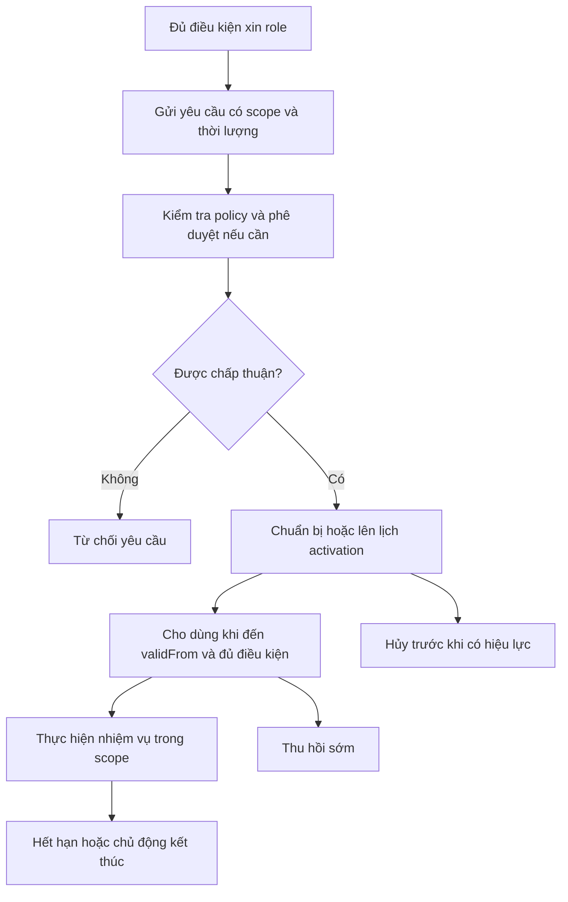

# Temporary role — Vai trò có thời hạn trong RBAC

## 1. Temporary role là gì?

Trong RBAC, role là một tập permission đại diện cho một nhóm nhiệm vụ. **Temporary role** thường chỉ việc một chủ thể được sử dụng role trong một khoảng thời gian hoặc một đợt kích hoạt có giới hạn. Khi điều kiện thời gian hoặc điều kiện nghiệp vụ không còn đạt, đường cấp quyền tạm thời ấy không được tiếp tục cho phép truy cập.

Ví dụ, một giảng viên thường chỉ được sửa bản nháp. Trong ca trực phát hành, người đó được kích hoạt role `COURSE_RELEASE_OPERATOR` cho một khóa học cụ thể trong 30 phút. Sau thời điểm kết thúc, những request mới dựa vào đợt kích hoạt này phải bị từ chối.

Không nhất thiết phải tạo rồi xóa một role definition mới cho mỗi lần sử dụng. Phần tạm thời thường nằm ở **quan hệ gán chủ thể–role** hoặc **activation của quan hệ gán**, còn role definition vẫn được quản lý ổn định trong catalog. Nếu sửa tập permission của một role dùng chung để cấp tạm cho một người, quyền có thể vô tình mở cho mọi thành viên khác của role.

Temporary role giúp giảm thời gian tồn tại của quyền thường trực và gắn đặc quyền với nhu cầu cụ thể. Tuy nhiên, “chỉ có hiệu lực 30 phút” không làm một tập permission quá rộng trở nên phù hợp. Vẫn cần chọn đúng hành động, tenant, tài nguyên, điều kiện sử dụng và người được cấp.

Trong nền tảng IAM, thiết kế này liên quan trực tiếp đến xác thực khi kích hoạt, quản lý phiên, vòng đời tài khoản, RBAC, đặc quyền, workload identity và kiểm toán. Giá trị của giới hạn thời gian phụ thuộc vào nơi thực thi quyền, không chỉ vào bộ đếm trên giao diện quản trị.

## 2. Phân biệt role, assignment, eligibility và activation

Những đối tượng sau có thể tồn tại độc lập trong một thiết kế IAM:

| Khái niệm | Ý nghĩa | Ví dụ |
| --- | --- | --- |
| Role definition | Tập permission và ý nghĩa nghiệp vụ của vai trò | `COURSE_RELEASE_OPERATOR` có quyền phát hành theo phạm vi đã định |
| Assignment | Quan hệ cấp role cho chủ thể trong một phạm vi | Lan được gán role trong tenant A |
| Eligibility | Điều kiện hoặc quyền được xin kích hoạt role | Lan được phép xin kích hoạt trong tuần trực |
| Activation | Một đợt cho phép sử dụng role sau khi đáp ứng policy | Đợt dùng quyền từ 10:00 đến 10:30 |
| Credential/session | Phương tiện mang danh tính hoặc ngữ cảnh truy cập | Access token, phiên ứng dụng hoặc credential workload |

Một người **eligible** chưa chắc đang có quyền sử dụng. Họ có thể phải xác thực bổ sung, nêu lý do, chờ phê duyệt và kích hoạt. Ngược lại, một assignment active có thời hạn có thể được sử dụng trong cửa sổ đã cho mà không cần bước kích hoạt riêng, tùy mô hình sản phẩm.

Microsoft Entra PIM là một ví dụ sản phẩm phân biệt eligible và active assignment, đồng thời có khái niệm time-bound assignment và kích hoạt theo thời gian. Các thuật ngữ và khả năng cụ thể phụ thuộc nhà cung cấp; bài học dùng chúng để giải thích mô hình thiết kế, không giả định mọi IAM đều có cùng API hoặc trạng thái. Tham khảo [Microsoft Learn — What is Privileged Identity Management?](https://learn.microsoft.com/en-us/entra/id-governance/privileged-identity-management/pim-configure).

Hai khoảng thời gian cần được phân biệt:

```text
Eligibility window:   được xin kích hoạt trong thời gian nào?
Activation window:    được thực sự sử dụng quyền trong thời gian nào?
```

Ví dụ, Lan eligible trong một tuần nhưng mỗi lần chỉ được active tối đa 30 phút. Không được lấy thời hạn một tuần làm thời hạn sử dụng của access token chứa đặc quyền, hoặc coi việc eligible là tương đương active suốt tuần.

Các sản phẩm có thể quy định khác nhau về activation bắt đầu gần cuối eligibility window. Trong thiết kế minh họa của bài, activation không được vượt quá thời điểm kết thúc eligibility; đây là một lựa chọn policy cần được thực thi rõ ràng.

## 3. Quyền tạm thời phải giới hạn cả thời gian lẫn phạm vi

Một yêu cầu cấp temporary role nên diễn đạt được:

```text
Chủ thể:       user-17, tài khoản đang hoạt động
Role:          COURSE_RELEASE_OPERATOR
Tenant:        tenant-A
Tài nguyên:    course-301
Nhiệm vụ:      phát hành phiên bản khóa học đã được duyệt
Khoảng active: từ thời điểm server xác nhận đến tối đa 30 phút
Điều kiện:     nhiệm vụ còn hợp lệ, đáp ứng policy kích hoạt
Thu hồi sớm:   được phép khi nhiệm vụ bị hủy hoặc có dấu hiệu bất thường
```

Các ID và thời lượng chỉ là ví dụ. Không có một con số 30 phút phù hợp cho mọi thao tác. Thời hạn nên xuất phát từ độ nhạy cảm, thời gian cần cho nhiệm vụ, khả năng thu hồi và cách sử dụng credential.

Phạm vi hiệu lực có thể được hiểu là phần giao giữa những giới hạn có liên quan:

```text
Quyền thực tế trong đợt kích hoạt
    = khả năng mà role cho phép
      bị giới hạn bởi assignment và scope đã cấp
      bị giới hạn bởi thời gian cùng trạng thái hiện tại
      bị giới hạn bởi policy đối tượng và ràng buộc nghiệp vụ
```

Đây là cách diễn giải thiết kế, không phải một thuật toán kết hợp policy chuẩn áp dụng cho mọi engine. Nếu hệ thống còn có explicit deny, điều kiện tổ chức hoặc ACL, phải dùng semantics kết hợp đã được quy định.

Không nên cấp toàn bộ `PLATFORM_ADMIN` trong một giờ chỉ để xử lý lỗi của một khóa học. Role hẹp theo chức năng và scope hẹp theo tài nguyên thường giúp giảm phạm vi ảnh hưởng nếu tài khoản hoặc credential bị lợi dụng trong cửa sổ active.

Quyền tạm để phát hành cũng không mặc nhiên bao gồm quyền tạo API key, sửa role, đặt lại MFA cho người khác hoặc tạo một tài khoản có quyền lâu dài. Những khả năng ấy có thể biến quyền ngắn hạn thành đường truy cập tồn tại sau khi activation đã hết.

## 4. Vòng đời của một đợt cấp quyền tạm thời

Một quy trình có thể đi qua các giai đoạn sau:



### 4.1. Yêu cầu và phê duyệt

Client có thể đề xuất role, tài nguyên và thời lượng. Server phải kiểm tra người yêu cầu có eligibility phù hợp, role có nằm trong phạm vi được xin, và thời lượng có vượt policy không.

Nếu cần phê duyệt, người phê duyệt phải có thẩm quyền với đúng role và scope. Một văn bản lý do có vẻ hợp lý chưa phải bằng chứng được cấp quyền. Với yêu cầu tách nhiệm vụ, người xin không được tự hoàn thành bước phê duyệt của chính mình bằng một vai trò khác ngoài ý định policy.

Quyết định phê duyệt nên gắn với nội dung đã duyệt: chủ thể, role, tenant, scope, thời hạn và phiên bản policy liên quan. Nếu request bị thay đổi sau khi duyệt, không được tự dùng lại phê duyệt cũ cho phạm vi mới.

### 4.2. Approved chưa chắc đã active

Một yêu cầu được duyệt lúc 09:00 có thể chỉ được lên lịch bắt đầu lúc 10:00. Nếu service thấy `approved=true` rồi cho phép ngay, nó đã bỏ qua cửa sổ hiệu lực.

Activation còn có thể phụ thuộc vào tài khoản đang hoạt động, nhiệm vụ chưa bị hủy và các kiểm tra xác thực theo policy. Thiết kế cần phân biệt “đã được duyệt”, “đã chuẩn bị xong” và “đang dùng được tại thời điểm này”.

### 4.3. Hết hạn không nên phụ thuộc một cron job chạy đúng giây

Một job nền có thể cập nhật trạng thái lưu trữ từ `ENABLED` sang `EXPIRED` để làm sạch và hiển thị. Nhưng nơi thực thi vẫn cần kiểm tra thời gian hiệu lực khi đánh giá quyền.

Nếu cron bị chậm năm phút mà API vẫn chỉ nhìn cờ `ENABLED`, quyền tạm thời có thể kéo dài ngoài ý định. Khi `now >= validUntil`, đường cấp quyền ấy phải hết hiệu lực theo quy ước thời gian của policy, dù bản ghi chưa được job nền đổi tên trạng thái.

Không nên xóa mọi dấu vết assignment khi hết hạn. Có thể cần giữ lịch sử đủ để giải thích ai đã có quyền trong thời gian nào; trạng thái vận hành và chính sách lưu audit cần được quản lý riêng.

## 5. Mô hình dữ liệu và ngữ nghĩa thời gian

Một bản ghi nội bộ minh họa:

```json
{
  "assignmentId": "temp-role-842",
  "subjectId": "user-17",
  "tenantId": "tenant-A",
  "roleId": "COURSE_RELEASE_OPERATOR",
  "resourceScope": { "courseIds": ["course-301"] },
  "validFrom": "2026-11-26T03:00:00Z",
  "validUntil": "2026-11-26T03:30:00Z",
  "state": "ENABLED",
  "requestReference": "request-503",
  "approvalReference": "approval-291",
  "policyVersion": "release-activation-v4"
}
```

Đây là dữ liệu giả định để minh họa, không phải một grant thực đã được tạo. Mốc 03:00 UTC tương ứng 10:00 tại múi giờ UTC+07:00. API có thể nhận thời gian kèm offset và chuẩn hóa thành một thời điểm tuyệt đối; tránh lưu một chuỗi “10 giờ” không có ngày hoặc múi giờ.

### 5.1. Dùng khoảng nửa kín

Một quy ước dễ thực thi là `[validFrom, validUntil)`: bao gồm thời điểm bắt đầu, không bao gồm thời điểm kết thúc.

| Thời điểm server, UTC | Hiệu lực theo riêng điều kiện thời gian của ví dụ |
| --- | --- |
| 02:59:59 | Chưa có hiệu lực |
| 03:00:00 | Bắt đầu có hiệu lực |
| 03:29:59 | Còn trong khoảng hiệu lực |
| 03:30:00 | Đã hết hạn |

Đạt điều kiện thời gian chưa có nghĩa toàn bộ request được phép. Assignment có thể bị thu hồi, tài khoản có thể bị khóa hoặc tài nguyên có thể nằm ngoài scope.

### 5.2. Server quyết định thời điểm cấp và giới hạn cuối

Không lấy đồng hồ trình duyệt làm căn cứ đủ để đánh giá quyền. Server cần nguồn thời gian được quản lý và các thành phần phân tán cần có giới hạn sai lệch phù hợp với yêu cầu của hệ thống.

Trong thiết kế minh họa, thời điểm kết thúc có thể được chặn bởi:

```text
activationEnd = min(
    activationStart + approvedDuration,
    activationStart + policyMaximumDuration,
    eligibilityEnd,
    assignmentEnd,
    taskDeadline nếu policy dùng giới hạn này
)
```

Chỉ áp dụng các giới hạn thực sự tồn tại trong mô hình. Khoảng kết quả phải hợp lệ và có thời lượng dương; nếu phê duyệt đến sau hạn cuối thì không cấp một activation đã hết hiệu lực.

Một khoảng dung sai đồng hồ, nếu được dùng, phải được xem như một phần của semantics thời gian. Tùy tiện cộng thêm vài phút vào mọi request có thể làm thời hạn thực tế rộng hơn thời hạn mà người phê duyệt và người dùng hiểu.

### 5.3. Role thay đổi giữa thời gian active

Nếu role definition nhận thêm permission trong khi temporary assignment còn hạn, người active có được nhận permission mới hay không? Có ít nhất hai lựa chọn thiết kế: dùng definition hiện hành, hoặc gắn activation với một phiên bản/tập quyền đã duyệt.

Không có một câu trả lời chung cho mọi sản phẩm. Cần chọn rõ semantics, đánh giá tác động và thực thi nhất quán. Nếu phê duyệt dựa trên tập quyền hẹp ban đầu, việc role âm thầm mở rộng có thể làm phạm vi thực tế vượt phê duyệt.

## 6. Kiểm soát khi kích hoạt

Một hệ thống có thể yêu cầu xác thực bổ sung hoặc một mức xác thực đủ mới khi kích hoạt đặc quyền. Kết quả xác thực phải gắn với đúng chủ thể và ngữ cảnh; một cờ `mfaDone=true` trong request không phải chứng cứ.

MFA không thay thế kiểm tra eligibility, tenant, scope hoặc phê duyệt. Một người đã hoàn tất MFA vẫn có thể xin role ngoài thẩm quyền hoặc yêu cầu quyền đối với tài nguyên của tenant khác.

Để tránh cấp trùng do retry, API kích hoạt có thể dùng một cơ chế idempotency có phạm vi phù hợp. Cùng một yêu cầu được gửi lại không nên vô tình tạo nhiều activation có cửa sổ khác nhau hoặc cộng dồn thời lượng. Cơ chế đó vẫn phải xác minh actor và nội dung request, không coi một khóa client cung cấp là bằng chứng quyền.

Nếu có giới hạn số activation đồng thời hoặc cấm kích hoạt các role xung đột, việc kiểm tra và tạo activation cần được bảo vệ khỏi race condition. Hai request cùng lúc không được cùng vượt qua kiểm tra dựa trên trạng thái cũ rồi tạo một tổ hợp bị cấm.

Một activation đã tạo cũng cần có định danh riêng để audit và thu hồi đúng đợt. Không dùng tên role đơn lẻ để xóa mọi assignment nếu mục tiêu chỉ là kết thúc một lần kích hoạt của một người.

## 7. Ví dụ Java: kiểm tra một temporary assignment

Đoạn mã dưới đây dùng Java 17 trở lên để minh họa một cổng kiểm tra role có thời hạn. Mỗi assignment chỉ áp dụng cho đúng một tài nguyên. Actor, assignment và metadata tài nguyên đã được server nạp từ nguồn đáng tin cậy; `requiredRoleId` do policy của chức năng chọn.

```java
import java.time.Clock;
import java.time.Instant;
import java.util.Objects;

public final class TemporaryRoleGate {
    public enum State {
        PENDING,
        ENABLED,
        REVOKED,
        CANCELLED
    }

    public record Actor(String subjectId, boolean active) {
        public Actor {
            Objects.requireNonNull(subjectId);
        }
    }

    public record Resource(String tenantId, String resourceId) {
        public Resource {
            Objects.requireNonNull(tenantId);
            Objects.requireNonNull(resourceId);
        }
    }

    public record Assignment(
            String assignmentId,
            String subjectId,
            String tenantId,
            String roleId,
            String resourceId,
            Instant validFrom,
            Instant validUntil,
            State state) {
        public Assignment {
            Objects.requireNonNull(assignmentId);
            Objects.requireNonNull(subjectId);
            Objects.requireNonNull(tenantId);
            Objects.requireNonNull(roleId);
            Objects.requireNonNull(resourceId);
            Objects.requireNonNull(validFrom);
            Objects.requireNonNull(validUntil);
            Objects.requireNonNull(state);
            if (!validFrom.isBefore(validUntil)) {
                throw new IllegalArgumentException("Invalid validity range");
            }
        }
    }

    private final Clock clock;

    public TemporaryRoleGate(Clock clock) {
        this.clock = Objects.requireNonNull(clock);
    }

    public boolean canUseRole(
            Actor actor,
            Resource target,
            String requiredRoleId,
            Assignment assignment) {
        if (actor == null || target == null
                || requiredRoleId == null || assignment == null) {
            return false;
        }
        if (!actor.active() || assignment.state() != State.ENABLED) {
            return false;
        }
        if (!actor.subjectId().equals(assignment.subjectId())
                || !target.tenantId().equals(assignment.tenantId())
                || !target.resourceId().equals(assignment.resourceId())
                || !requiredRoleId.equals(assignment.roleId())) {
            return false;
        }

        Instant now = clock.instant();
        return !now.isBefore(assignment.validFrom())
                && now.isBefore(assignment.validUntil());
    }
}
```

`State.ENABLED` trong ví dụ có nghĩa activation đã được chuẩn bị cho phép sử dụng theo cửa sổ thời gian. Nó không có nghĩa thời gian hiện tại luôn còn hợp lệ. Điều kiện cuối cùng vẫn từ chối khi đến đúng `validUntil`, ngay cả khi state lưu trữ chưa được chuyển thành một trạng thái hết hạn.

`Clock` là dependency do server kiểm soát. Khi triển khai kiểm thử, có thể dùng đồng hồ cố định để kiểm tra trước, đúng và sau hai mốc thời gian mà không cần chờ thật 30 phút. Không truyền một thời điểm do trình duyệt tự khai vào phép đánh giá quyền.

Đoạn mã chỉ kiểm tra khả năng dùng role từ một assignment cụ thể. Nó chưa kiểm tra role definition có permission cho hành động đang thực hiện hay không, chưa thực hiện phê duyệt và chưa bao phủ các ràng buộc nghiệp vụ của tài nguyên. Tầng gọi cần kết hợp các điều kiện đó và thực sự dừng xử lý nếu kết quả là `false`.

Không lấy một JSON có các field tương tự từ request rồi dựng `Assignment` để làm bằng chứng quyền. Record chỉ biểu diễn dữ liệu; constructor kiểm tra null và khoảng thời gian, không chứng minh người phát hành có thẩm quyền cấp role.

Các so sánh trong hàm dựa trên snapshot được truyền vào. Nếu kho assignment đã chuyển sang `REVOKED` nhưng service vẫn giữ một snapshot `ENABLED` cũ, hàm không thể tự biết sự thay đổi ấy. Tính đúng của thu hồi sớm còn phụ thuộc cách tải trạng thái, vô hiệu hóa cache và giới hạn nhất quán của hệ thống.

## 8. Thời hạn role và thời hạn credential là hai việc khác nhau

### 8.1. Token hợp lệ chưa chắc role vẫn còn hiệu lực

Giả sử một activation kết thúc lúc 10:30 nhưng access token có hiệu lực đến 11:00 và mang authority của role tạm. Nếu resource server chỉ kiểm tra chữ ký cùng hạn token, đặc quyền có thể tiếp tục được dùng đến 11:00.

Có hai hướng thiết kế thường gặp:

- Token chứa đặc quyền được giới hạn thời hạn không vượt cửa sổ role, kết hợp với các kiểm tra cần thiết khác.
- Token nhận diện chủ thể/phiên, còn resource server đánh giá assignment hoặc ngữ cảnh quyền hiện hành khi thực hiện thao tác.

Có thể kết hợp hai hướng. Giới hạn thời hạn token theo role giúp xử lý hết hạn theo lịch, nhưng không tự giải quyết việc thu hồi sớm lúc 10:10. Nếu cần thu hồi nhanh, phải có cơ chế tương ứng tại nơi thực thi.

Không đặt mặc định rằng mọi token của người dùng đều phải kết thúc khi role tạm kết thúc. Người dùng có thể vẫn được sử dụng các chức năng thông thường. Thiết kế có thể tách phiên cơ bản khỏi ngữ cảnh đặc quyền hoặc tính lại tập authority hiện hành, tùy kiến trúc.

### 8.2. Refresh không được tự hồi sinh đặc quyền

Một refresh token hoặc một phiên SSO còn tồn tại không có nghĩa activation vẫn active. Khi cấp credential mới, hệ thống phải đánh giá lại những điều kiện cần thiết trước khi đưa đặc quyền vào credential đó.

Nếu cứ sao chép role claim từ token cũ sang token mới, quyền tạm có thể được gia hạn vô hạn qua chuỗi refresh. Tương tự, đổi token hoặc nhận một credential dẫn xuất không được làm mất thông tin về giới hạn scope, thời gian hoặc nguồn ủy quyền mà policy cần giữ.

Một ID token dùng cho luồng đăng nhập cũng không nên bị coi là giấy phép chung để gọi mọi API có đặc quyền. Ứng dụng cần xác định đúng loại credential và hợp đồng xác minh của tài nguyên được truy cập.

### 8.3. Role definition tồn tại lâu vẫn có thể phát credential ngắn hạn

Trong một mô hình cloud, role definition có thể được giữ ổn định, còn các phiên sử dụng role nhận credential có thời hạn. Đây là lý do không nên đồng nhất “temporary role” với “xóa role sau 30 phút”.

AWS mô tả credential tạm thời do STS phát hành có thời gian sống giới hạn và không thể dùng tiếp sau khi credential hết hạn; việc nhận credential mới còn phụ thuộc quyền được phép yêu cầu. Đây là ví dụ về credential ngắn hạn, không phải bằng chứng rằng mọi application role đều tự thu hồi theo cùng cách. Xem [AWS IAM — Temporary security credentials](https://docs.aws.amazon.com/IAM/latest/UserGuide/id_credentials_temp.html).

## 9. Thu hồi sớm, deactivation và cache

### 9.1. Expiration, deactivation và revocation

Ba sự kiện này có thể có lý do và đường xử lý khác nhau:

| Sự kiện | Ý nghĩa trong thiết kế minh họa |
| --- | --- |
| Expiration | Cửa sổ hiệu lực đã kết thúc theo lịch |
| Deactivation | Đợt sử dụng được chủ động kết thúc trước hạn |
| Revocation | Bên có thẩm quyền thu hồi quyền vì thay đổi nhu cầu hoặc rủi ro |

Tên và cách tổ chức trạng thái có thể khác ở từng sản phẩm. Điều quan trọng là biết sự kiện nào chặn việc tiếp tục dùng quyền, việc chặn có hiệu lực ở đâu và sau bao lâu.

Khóa tài khoản vì nhân viên rời tổ chức cũng cần được phản ánh trong quyết định quyền. Không nên để assignment còn hạn trở thành một ngoại lệ cho tài khoản đã không còn được phép hoạt động.

### 9.2. Không chỉ cập nhật một bản ghi quản trị

Một thao tác thu hồi có thể cần cập nhật assignment, chặn activation mới, thông báo cho policy cache và xử lý những session đặc quyền liên quan. Nếu mục tiêu là thu hồi một đợt cụ thể, cần dùng assignment/activation ID để tránh kết thúc nhầm quyền độc lập khác.

Cache quyết định cần đủ ngữ cảnh: chủ thể, tenant, tài nguyên, action hoặc role, assignment và phiên bản policy liên quan. Thời gian sống của một quyết định allow không được tùy tiện vượt `validUntil`; vẫn phải xử lý trường hợp thu hồi trước thời điểm đó.

Nếu hệ thống chấp nhận một khoảng trễ tối đa, khoảng trễ ấy cần được xác định và kiểm chứng trên đường truy cập thực tế. Giao diện hiển thị “đã thu hồi” không tự chứng minh mọi resource server đã ngừng chấp nhận quyền.

### 9.3. Thu hồi một đường cấp có thể chưa loại hết quyền

Một người có thể nhận cùng permission từ role tạm và một role thường trực khác. Khi temporary assignment hết hạn, permission vẫn còn qua đường cấp thường trực. Đây không nhất thiết là lỗi bộ đếm thời gian; có thể là do thiết kế quyền đang cấp trùng.

Khi điều tra vì sao một người vẫn truy cập được, cần xem role trực tiếp, hierarchy, group, grant bổ sung, token snapshot và chính điểm thực thi. Hãy phân biệt “assignment A không còn hiệu lực” với “người dùng không còn bất kỳ đường cấp nào cho hành động này”.

## 10. Phiên đang mở và tác vụ chạy dài

### 10.1. Hết hạn không tự đóng mọi kết nối

Một phiên quản trị, WebSocket hoặc kết nối dài có thể được kiểm tra quyền lúc mở. Nếu sau đó hệ thống không đánh giá lại, role hết hạn chưa chắc làm kết nối chấm dứt hoặc ngăn các lệnh mới trên kết nối ấy.

Thiết kế cần xác định lúc nào kiểm tra lại, có tín hiệu kết thúc session đặc quyền hay không, và cách chặn các hành động mới sau hạn. Việc giữ trang web mở không nên là cách giữ đặc quyền vô thời hạn.

Ngược lại, đăng xuất toàn bộ phiên cơ bản của người dùng sau mỗi đợt role tạm không phải luôn là yêu cầu cần thiết. Có thể kết thúc riêng ngữ cảnh đặc quyền nếu kiến trúc và policy cho phép.

### 10.2. Một thao tác đã bắt đầu cần semantics rõ ràng

Giả sử tác vụ export bắt đầu lúc 10:29 và activation hết hạn lúc 10:30. Hệ thống có thể kiểm tra quyền tại thời điểm tiếp nhận, tại thời điểm job thực thi, tại các bước đọc nhạy cảm hoặc tại thời điểm tải artifact, tùy yêu cầu nghiệp vụ.

Không nên để semantics này phát sinh ngẫu nhiên từ cách viết code. Với nhiệm vụ đòi hỏi quyền còn active trong suốt quá trình, job phải có cơ chế dừng hoặc kiểm tra tại các điểm phù hợp. Với nhiệm vụ được cho phép hoàn tất sau khi đã khởi chạy hợp lệ, cần một ủy quyền cho chính tác vụ có scope và giới hạn rõ ràng.

Hủy một job cũng không tự rollback mọi tác dụng phụ đã xảy ra. Việc phục hồi dữ liệu thuộc thiết kế transaction hoặc nghiệp vụ bù trừ, không phải thuộc tính tự động của temporary role.

### 10.3. Artifact có vòng đời riêng

File đã tải xuống, báo cáo đã xuất, credential đã tạo hoặc URL tải tạm có thể tồn tại sau khi activation kết thúc. Thu hồi role không tự xóa thông tin mà người dùng đã nhận.

Nếu role tạm được dùng để tạo artifact nhạy cảm, cần kiểm soát khả năng tải, thời hạn lưu, chia sẻ và những quyền dẫn xuất. Đặc biệt, không cho phép một role phục vụ nhiệm vụ ngắn hạn âm thầm tạo một credential dài hạn có khả năng tiếp tục thực hiện cùng đặc quyền.

## 11. Gia hạn, cấp lại và workload identity

### 11.1. Gia hạn là một quyết định quyền mới

Nếu nhiệm vụ chưa xong, người dùng có thể cần xin gia hạn. Gia hạn phải kiểm tra lại căn cứ cần thiết theo policy, gồm tài khoản, nhiệm vụ, scope, eligibility, thời lượng tổng và phê duyệt nếu có.

Không coi việc “sắp hết hạn” là lý do tự động đủ để kéo dài. Một cơ chế tự gia hạn vô hạn có thể biến quyền tạm thành quyền thường trực nhưng khó nhận ra hơn.

Có thể phân biệt gia hạn trước khi kết thúc và cấp lại sau khi đã hết hạn. Dù cùng được triển khai bằng cách tạo một activation mới, cần giữ quan hệ với yêu cầu gốc và lịch sử để giải thích thời gian sử dụng thực tế. Không sửa đè lịch sử làm mất dấu mốc quyền đã có hiệu lực.

### 11.2. Workload cũng có thể nhận role theo tác vụ

Một pipeline phát hành có thể nhận role hẹp cho đúng dự án hoặc artifact trong thời gian chạy. Broker hoặc hệ thống phát credential cần xác minh danh tính workload, nguồn thực thi, target và điều kiện ủy quyền phù hợp.

Không được cấp quyền chỉ vì một biến môi trường tự khai `environment=production`. Thuộc tính dùng để cấp role phải đến từ một nguồn mà hệ thống có căn cứ tin cậy cho đúng mục đích.

Credential tự xoay vòng không tự làm quyền ngừng tồn tại. Nếu workload có thể tiếp tục nhận credential mới sau khi nhiệm vụ kết thúc, đường truy cập vẫn tồn tại dù từng credential đều ngắn hạn. Cần kết thúc cả quyền nhận hoặc làm mới credential theo vòng đời nhiệm vụ.

### 11.3. Tránh chuỗi ủy quyền vượt thời hạn gốc

Một workload hoặc người dùng có thể tạo job hoặc gọi service khác trong lúc role active. Nếu service đích dùng quyền riêng của nó, phải xác minh yêu cầu được phép theo mô hình ủy quyền, không để mọi người gọi hưởng toàn bộ quyền của service.

Khi policy yêu cầu quyền dẫn xuất không vượt quyền gốc, cần truyền hoặc tra được giới hạn gốc và kiểm soát việc phát credential/tác vụ tiếp theo. Chỉ đặt thời hạn ngắn ở tầng đầu rồi bỏ qua tầng sau không tạo được giới hạn xuyên suốt.

## 12. Audit và khả năng giải thích vòng đời role

Audit cần nối được các sự kiện: yêu cầu, phê duyệt, kích hoạt, sử dụng, gia hạn, hết hạn hoặc thu hồi. Chỉ log việc “thêm user vào role” chưa đủ để giải thích một khoảng truy cập tạm thời.

Một sự kiện minh họa:

```text
event_type=TEMPORARY_ROLE_ACTIVATED
assignment_id=temp-role-842
subject_id=user-17
tenant_id=tenant-A
role_id=COURSE_RELEASE_OPERATOR
resource_id=course-301
valid_from=2026-11-26T03:00:00Z
valid_until=2026-11-26T03:30:00Z
approval_reference=approval-291
policy_version=release-activation-v4
request_id=req-960
```

Khi sử dụng role, sự kiện quyết định hoặc sự kiện nghiệp vụ nên liên hệ được với activation làm căn cứ. Khi thu hồi, cần biết ai thu hồi, lý do, thời điểm và phạm vi được xử lý.

Không ghi token, credential hoặc secret vào log. Audit cũng cần phân quyền và thời gian lưu phù hợp. Người được kích hoạt role tạm để làm nghiệp vụ không mặc nhiên có quyền xóa lịch sử sử dụng quyền của mình.

Những tín hiệu vận hành hữu ích gồm: activation không gắn nhiệm vụ hợp lệ, quyền tạm được gia hạn liên tục, sử dụng sau thời hạn dự kiến, độ trễ thu hồi vượt giới hạn, và quyền dẫn xuất còn tồn tại sau nhiệm vụ. Các tín hiệu này cần được điều tra theo semantics hệ thống; không kết luận chỉ từ một cờ giao diện.

## 13. Ma trận tình huống cần kiểm chứng khi triển khai

Giả sử policy yêu cầu assignment đang enabled, đúng chủ thể, đúng tenant, đúng tài nguyên, tài khoản hoạt động và thời điểm nằm trong khoảng `[validFrom, validUntil)`.

| Tình huống | Kết quả kỳ vọng đối với đường cấp quyền tạm này |
| --- | --- |
| Đã eligible nhưng chưa hoàn tất activation | Chưa cho sử dụng role |
| Được duyệt nhưng còn trước `validFrom` | Từ chối |
| Đúng `validFrom`, các điều kiện khác đạt | Cho sử dụng role ở lớp kiểm tra assignment |
| Đúng `validUntil` | Từ chối dù state lưu trữ còn `ENABLED` |
| Còn hạn nhưng assignment đã bị thu hồi | Từ chối khi trạng thái thu hồi được thực thi |
| Còn hạn nhưng tài khoản đã bị khóa | Từ chối theo policy tài khoản |
| Role active tại tenant A, request tác động tài nguyên của B | Từ chối |
| Grant chỉ cho course-301, request dùng cho course-302 | Từ chối |
| Token còn hạn nhưng activation đã hết | Không dùng token làm căn cứ kéo dài role tạm |
| Refresh sau khi activation kết thúc | Không sao chép lại đặc quyền đã hết nếu không có căn cứ mới |
| Role tạm hết hạn nhưng một role thường trực khác vẫn cấp quyền | Đánh giá đường cấp còn lại; không suy ra mọi quyền đã mất |
| Job nền chạy sau hạn activation | Xử lý theo policy đã định cho thời điểm thực thi và ủy quyền của job |

Ngoài các mốc bình thường, cần kiểm chứng khi job hết hạn bị chậm, thông báo vô hiệu hóa cache bị trễ hoặc có hai request kích hoạt đồng thời. Mục tiêu là biết hệ thống có giữ được semantics đã định trong những đường xử lý thực tế hay không.

## 14. Bài tập thiết kế

Lan thường có role biên tập tại tenant A. Trong ca trực, Lan được cấp role `COURSE_RELEASE_OPERATOR` cho course-301 từ 10:00 đến 10:30. API phát hành dùng token có hạn đến 11:00; hệ thống cập nhật cache quyền mỗi năm phút.

Hãy trả lời:

1. Nếu API chỉ kiểm tra role claim trong token, Lan có thể tiếp tục phát hành sau 10:30 không? Cần thay đổi điều kiện thực thi nào để phù hợp với giới hạn đã cấp?
2. Nếu thu hồi activation lúc 10:10, giới hạn năm phút của cache có đáp ứng yêu cầu sản phẩm không? Có những nơi nào ngoài cache này còn giữ ngữ cảnh đặc quyền?
3. Nếu chỉ cập nhật trạng thái bằng cron mỗi phút, điều gì xảy ra giữa 10:30:00 và lúc cron chạy tiếp theo?
4. Lan xin gia hạn 30 phút nhưng eligibility kết thúc lúc 10:40. Trong policy của bài, hạn cuối của activation mới cần được giới hạn thế nào?
5. Nếu role definition được thêm quyền tạo API key lúc 10:15, semantics nào bảo đảm activation không vượt tập quyền đã được duyệt?
6. Một export được tạo lúc 10:29 và file sẵn sàng lúc 10:35. Ai được tải file, trong thời gian nào và dựa trên ủy quyền nào?
7. Khi activation kết thúc, làm thế nào xác định Lan còn quyền phát hành qua role hoặc grant khác hay không?

Temporary role cần được thiết kế như một vòng đời quyền có phạm vi, trạng thái và giới hạn thời gian rõ ràng. Giới hạn ấy chỉ có ý nghĩa khi request, phiên, credential và tác vụ liên quan đều được xử lý theo policy sử dụng quyền đã xác định.
