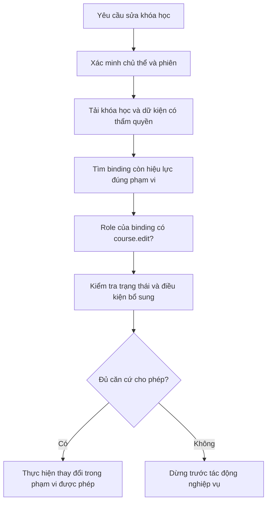

# Role explosion: khi số lượng vai trò vượt khỏi khả năng quản lý

## 1. Từ vài vai trò đến hàng nghìn biến thể

Một nền tảng học tập ban đầu có bốn vai trò: người xem, biên tập viên, người phản biện và người xuất bản. Khi có nhiều tổ chức sử dụng, nhóm phát triển thêm tenant, khóa học và trạng thái tài liệu vào tên role:

```text
TENANT_A_COURSE_01_EDITOR_DRAFT
TENANT_A_COURSE_02_EDITOR_DRAFT
TENANT_A_COURSE_02_EDITOR_REVIEW
TENANT_B_COURSE_01_EDITOR_DRAFT
TENANT_B_COURSE_01_PUBLISHER_REVIEW
```

Sau đó xuất hiện các biến thể dành cho nội dung mật, nhân sự tạm thời, ca trực và từng ngoại lệ cá nhân. Quản trị viên không còn dễ trả lời: role nào thực sự khác về trách nhiệm, role nào chỉ khác tài nguyên, và một người đang được phép làm gì?

**Role explosion** là tình trạng danh mục role phát triển quá nhiều biến thể, thường do dùng role để mã hóa đồng thời nhiều chiều của quyết định truy cập. Hệ quả là việc cấp quyền, rà soát, thu hồi và giải thích quyền trở nên khó kiểm soát.

Không có một con số role áp dụng cho mọi tổ chức để kết luận đã xảy ra role explosion. Một hệ thống lớn có thể cần nhiều vai trò nghiệp vụ hợp lệ. Vấn đề là sự gia tăng có phản ánh trách nhiệm thực tế hay chỉ đang sao chép các tổ hợp dữ liệu và ngoại lệ.

Kuhn, Coyne và Weil mô tả việc dùng nhiều role riêng để xử lý các điều kiện động là một nguyên nhân của role explosion, đồng thời xem xét cách bổ sung thuộc tính vào RBAC. [Adding Attributes to Role-Based Access Control](https://csrc.nist.gov/pubs/journal/2010/06/adding-attributes-to-rolebased-access-control/final)

Trong nền tảng IAM, xử lý vấn đề này nhằm giữ quyền dễ quản trị và đúng nguyên tắc ít quyền nhất. Mục tiêu không phải giảm role bằng mọi giá hay thay việc kiểm soát quyền bằng một role quản trị chung.

Sau bài học, người học có thể:

- Nhận diện những chiều dữ liệu đang bị nhét vào tên role.
- Phân biệt số lượng role, permission, binding và quy tắc chính sách.
- Chọn cách dùng role có phạm vi, hierarchy, thuộc tính hoặc quan hệ phù hợp.
- Đánh giá việc gộp role có làm mở rộng quyền hay phá vỡ phân tách nhiệm vụ không.
- Lập kế hoạch chuyển đổi dựa trên quyết định truy cập và bằng chứng cụ thể.

## 2. Vì sao số role có thể tăng theo tích?

### 2.1. Mỗi chiều tạo thêm một nhóm biến thể

Giả sử một thiết kế tạo role riêng cho mọi tổ hợp của các chiều sau:

| Chiều bị mã hóa vào role | Số giá trị giả định |
|---|---:|
| Trách nhiệm nghiệp vụ | 4 |
| Tenant | 20 |
| Khóa học trong mỗi tenant | 30 |
| Trạng thái khóa học | 3 |
| Mức phân loại nội dung | 2 |

Nếu hệ thống thật sự tạo đủ mọi tổ hợp, số role ứng viên là:

```text
4 × 20 × 30 × 3 × 2 = 14.400 role
```

Đây là phép tính minh họa cho cách thiết kế đang xét. Trong thực tế có thể chỉ một phần tổ hợp tồn tại, hoặc một số tổ hợp không có nghĩa nghiệp vụ. Không được dùng công thức này để khẳng định mọi hệ thống có các chiều trên đều cần 14.400 role.

Điểm đáng chú ý là khi thêm một tenant hoặc một trạng thái, hệ thống có thể phải tạo cả một nhóm role mới dù trách nhiệm của người dùng không đổi.

### 2.2. Trạng thái động biến thành công việc cấp quyền

Nếu role chứa trạng thái như `EDITOR_DRAFT`, khi khóa học chuyển sang review, hệ thống phải chọn một trong hai cách:

- Chuyển assignment sang biến thể role mới theo trạng thái.
- Giữ assignment cũ nhưng bổ sung logic kiểm tra trạng thái thực tế ở nơi khác.

Cách thứ nhất biến thay đổi dữ liệu nghiệp vụ thành chuỗi cập nhật quyền có nguy cơ chậm hoặc không đồng bộ. Cách thứ hai cho thấy tên role chưa tự biểu diễn đầy đủ quyết định cuối cùng.

Một role có tên chứa `DRAFT` không chứng minh khóa học vẫn đang là bản nháp tại thời điểm yêu cầu sửa.

### 2.3. Tổ hợp permission cá nhân làm vấn đề tăng nhanh

Một hướng thiết kế khác tạo role mới cho mỗi tập permission mà một cá nhân yêu cầu:

```text
EDITOR_WITH_EXPORT
EDITOR_WITHOUT_EXPORT
EDITOR_WITH_EXPORT_AND_ARCHIVE
EDITOR_WITH_EXPORT_BUT_ONLY_TEMP
```

Với n permission có thể bật hoặc tắt độc lập, có tối đa 2^n tập con về mặt toán học. Không phải mọi tập con đều nên tồn tại dưới dạng role.

Khi danh mục role trở thành bản sao của mọi tổ hợp tùy chọn hoặc mọi ngoại lệ cá nhân, lớp role dần mất ý nghĩa trách nhiệm nghiệp vụ.

## 3. Đừng nhầm role với các thành phần khác

### 3.1. Những thứ có thể có số lượng khác nhau

| Thành phần | Ý nghĩa trong thiết kế minh họa | Ví dụ |
|---|---|---|
| Permission | Khả năng hoặc phát biểu cho phép thực hiện hành động | `course.edit` |
| Role | Tập khả năng phù hợp với một trách nhiệm | `COURSE_EDITOR` |
| Binding | Gán role cho chủ thể trong một phạm vi và thời hạn | Lan là editor của course A1 |
| Thuộc tính | Dữ kiện tham gia quyết định | Khóa học đang ở trạng thái DRAFT |
| Quan hệ | Liên kết có ý nghĩa phân quyền | Lan được phân công phản biện course A3 |
| Policy | Quy tắc kết hợp các căn cứ và ràng buộc | Không được xuất bản bài do chính mình gửi duyệt |

Một hệ thống chỉ có bốn role vẫn có thể có hàng chục nghìn binding hợp lệ. Nếu mỗi người được phân công những khóa học khác nhau, các quan hệ cấp quyền đó cần được lưu và quản lý ở đâu đó.

Giảm số role không làm biến mất số lượng sự kiện nghiệp vụ “ai được phụ trách tài nguyên nào”. Lợi ích là có thể dùng chung một định nghĩa trách nhiệm thay vì nhân bản định nghĩa permission cho từng tài nguyên.

### 3.2. Đổi tên chưa phải giải quyết

Nếu chuyển 14.400 role thành 14.400 nhóm mà mỗi nhóm vẫn có một bộ policy riêng, độ phức tạp có thể chỉ đổi vị trí.

Tương tự, đưa mọi chuỗi role cũ vào một thuộc tính dạng danh sách rồi viết điều kiện khớp chuỗi không tự tạo ra mô hình dễ quản trị hơn.

Cần đánh giá tổng thể định nghĩa quyền, binding, nhóm, policy, dữ liệu thuộc tính và khả năng giải thích quyết định. Một dashboard hiển thị ít role chưa đủ chứng minh hệ thống đã đơn giản hơn.

### 3.3. Nhiều role không nhất thiết là dư thừa

Một role đặc quyền chỉ dùng bởi một người vẫn có thể hợp lệ nếu nó có trách nhiệm riêng, owner, thời hạn và cơ chế kiểm soát thích hợp.

Hai role có permission hiện tại giống nhau cũng có thể cần tách vì quy trình phê duyệt, quyền ủy quyền, điều kiện kích hoạt hoặc trách nhiệm kiểm toán khác nhau.

Vì vậy, không xóa role chỉ dựa trên số người sử dụng hoặc việc so sánh tên permission.

## 4. Nhận diện nguyên nhân gốc

### 4.1. Phân loại các chiều trong tên role

Xét:

```text
TENANT_A_COURSE_42_EDITOR_CONFIDENTIAL_TEMP
```

Có thể tách ý nghĩa thành:

| Phần | Câu hỏi được trả lời | Nơi biểu diễn có thể phù hợp |
|---|---|---|
| EDITOR | Làm công việc gì? | Role nghiệp vụ |
| TENANT_A | Trong tổ chức nào? | Phạm vi binding và ranh giới tenant |
| COURSE_42 | Với tài nguyên nào? | Phạm vi hoặc quan hệ phân công |
| CONFIDENTIAL | Tài nguyên có đặc điểm gì? | Thuộc tính tài nguyên và policy |
| TEMP | Quyền có hiệu lực đến khi nào? | Thời hạn binding hoặc ủy quyền |

Bảng này là cách phân tích thiết kế, không phải quy tắc bắt buộc rằng mọi phần đều phải chuyển sang một công nghệ khác. Một sản phẩm có giới hạn riêng có thể buộc dùng một số role có phạm vi cụ thể.

Điều cần xác định là chiều nào thật sự thay đổi tập trách nhiệm, chiều nào chỉ giới hạn nơi hoặc thời điểm trách nhiệm được thực hiện.

### 4.2. Các nguyên nhân thường gặp

Những dấu hiệu cần điều tra gồm:

- Mỗi tenant mới được tạo bằng cách sao chép toàn bộ danh mục role.
- Mỗi tài nguyên mới tự sinh một nhóm role gần như giống nhau.
- Mỗi ngoại lệ phát sinh thêm một role mang tên người dùng.
- Role chứa thời gian, trạng thái hoặc kết quả xác thực tạm thời.
- Nhiều ứng dụng định nghĩa cùng trách nhiệm bằng các tên khác nhau.
- Role được sao chép nhưng không có owner hoặc điều kiện ngừng sử dụng.
- Hierarchy sâu khiến quyền hiệu lực khác xa mô tả trực tiếp của role.

Một tổ chức có thể gặp nhiều nguyên nhân cùng lúc. Cần xử lý mô hình và vòng đời quyền, thay vì chỉ dọn danh sách định kỳ.

## 5. Tách trách nhiệm khỏi phạm vi bằng binding

### 5.1. Danh mục role dùng chung

Trong ví dụ nền tảng học tập, có thể bắt đầu bằng:

| Role | Khả năng minh họa |
|---|---|
| `COURSE_VIEWER` | Đọc nội dung được phép |
| `COURSE_EDITOR` | Đọc và sửa nội dung trong quy trình cho phép |
| `COURSE_REVIEWER` | Đọc và ghi nhận kết quả phản biện |
| `COURSE_PUBLISHER` | Đọc và xuất bản nội dung đủ điều kiện |

Publisher không tự kế thừa editor hoặc reviewer trong chính sách này. Đây là lựa chọn để giữ những trách nhiệm cần tách, không phải quan hệ cố định của mọi hệ thống.

Binding có thể được biểu diễn khái niệm như sau:

```yaml
principal: user-lan
role: COURSE_EDITOR
scope:
  tenantId: tenant-a
  courseIds:
    - course-a1
    - course-a2
validUntil: null
```

Ví dụ YAML nằm trong nội dung bài học để giải thích mô hình, không phải schema file metadata của module.

### 5.2. Một role có thể được dùng trong nhiều phạm vi

Lan có thể là editor của A1 và A2, đồng thời là reviewer của A3:

```text
binding 1:
    user-lan + COURSE_EDITOR + tenant-a/{course-a1, course-a2}

binding 2:
    user-lan + COURSE_REVIEWER + tenant-a/{course-a3}
```

Khi có thêm A4, nhóm quản trị cập nhật phân công hoặc thêm binding cần thiết. Không bắt buộc tạo định nghĩa role `COURSE_A4_EDITOR`.

Việc dùng template role chung giảm số định nghĩa role. Nó không cho phép editor của một khóa học sửa mọi khóa học.

### 5.3. Không tạo tích chéo giữa role và phạm vi

Nếu Lan có editor tại tenant A và viewer tại tenant B, bộ đánh giá phải giữ hai binding riêng:

```text
EDITOR -> tenant-a
VIEWER -> tenant-b
```

Không tách thành hai tập role và tenant rồi cho phép mọi tổ hợp. Làm như vậy sẽ vô tình tạo editor tại tenant B.

Khi mở rộng role qua hierarchy hoặc nhóm, hệ thống tiếp tục giữ nguồn binding, phạm vi và điều kiện. Đây là điểm quan trọng để việc giảm role không biến thành mở rộng quyền xuyên tenant.

## 6. Đưa điều kiện động về đúng nơi

### 6.1. Điều kiện không nhất thiết phải là role

Trong thiết kế đang xét, các ràng buộc sau có thể được đánh giá khi xử lý yêu cầu:

```text
course.edit:
    khóa học đang ở DRAFT hoặc CHANGES_REQUESTED

course.review:
    khóa học đang ở REVIEW_PENDING

course.publish:
    khóa học đang ở REVIEW_APPROVED
    và người xuất bản không phải người gửi duyệt
```

Tên và trạng thái trên là giả định của ví dụ. Trạng thái thực tế phải được lấy từ nguồn sở hữu tài nguyên và phối hợp với thao tác ghi để tránh dùng dữ kiện đã lỗi thời.

Nhờ đó, không cần tạo thêm role cho mọi trạng thái. Người dùng vẫn giữ trách nhiệm editor, nhưng không phải lúc nào cũng được sửa mọi phiên bản của khóa học.

### 6.2. Bổ sung thuộc tính và quan hệ khi có lý do

ABAC đánh giá các thuộc tính của chủ thể, đối tượng, thao tác và có thể cả môi trường theo policy. Đây là cách biểu diễn phù hợp cho nhiều điều kiện không ổn định như một trách nhiệm nghề nghiệp. [NIST SP 800-162, định nghĩa ABAC](https://nvlpubs.nist.gov/nistpubs/specialpublications/NIST.sp.800-162.pdf)

Một cách kết hợp minh họa là:

```text
role:
    chủ thể có loại trách nhiệm nào

binding hoặc quan hệ:
    trách nhiệm đó áp dụng cho tài nguyên nào

thuộc tính và ràng buộc:
    trong điều kiện nào được thực hiện

điểm thực thi:
    chặn hoặc cho phép trước khi có tác động
```

Một số quan hệ nên được lưu trực tiếp, chẳng hạn ai được phân công phản biện khóa học. Không cần mã hóa mỗi quan hệ đó thành tên role mới.

Tuy nhiên, chuyển sang điều kiện theo thuộc tính làm phát sinh trách nhiệm quản lý dữ liệu thuộc tính, khả dụng của nguồn cung cấp, độ mới, khả năng giải thích và kiểm thử policy. ABAC không tự loại bỏ độ phức tạp của nghiệp vụ.

### 6.3. Thuộc tính phải có nguồn có thẩm quyền

Những dữ kiện như tenant, mức phân loại nội dung, trạng thái tài khoản hoặc bằng chứng MFA không được tin chỉ vì client gửi chúng:

```json
{
  "tenantId": "tenant-b",
  "classification": "PUBLIC",
  "mfaSatisfied": true
}
```

Máy chủ lấy sự thật từ danh tính đã xác minh, dữ liệu tài nguyên và các nguồn được policy công nhận. Nếu client được phép thay đổi một thuộc tính có ảnh hưởng đến quyền, thao tác thay đổi đó cũng phải được phân quyền.

NIST SP 800-205 nhấn mạnh thuộc tính cần được thiết lập, phát hành và quản lý dưới một thẩm quyền, bao gồm các cơ chế cập nhật và thu hồi. [Attribute Considerations for Access Control Systems](https://www.nist.gov/publications/attribute-considerations-access-control-systems)

Ví dụ, nếu người dùng tự đổi phân loại khóa học từ mật thành công khai mà không cần quyền tương ứng, policy dựa trên phân loại không còn bảo vệ được dữ liệu.

### 6.4. Phân biệt điều kiện của một grant và ràng buộc toàn cục

Một binding có thể chỉ cho phép editor sửa bản nháp. Binding khác có thể cho một người vận hành sửa nội dung trong một quy trình đặc biệt.

Cần xác định rõ liệu một điều kiện chỉ giới hạn grant đó hay là lệnh cấm áp dụng trên toàn bộ quyết định. Nếu chỉ một nhánh grant kiểm tra tài khoản bị khóa mà nhánh khác bỏ qua, yêu cầu có thể vẫn được cho phép qua nhánh còn lại.

Các giới hạn như ranh giới tenant hoặc yêu cầu không tự phê duyệt cần được đặt theo đúng ngữ nghĩa chính sách. Không trông chờ việc giảm số role sẽ tự bảo toàn những điều kiện này.

## 7. Hierarchy và nhóm permission giúp được đến đâu?

### 7.1. Tái sử dụng các tập quyền ổn định

Nếu editor thật sự luôn cần các quyền của viewer trong cùng phạm vi, có thể dùng:

```text
COURSE_EDITOR -> kế thừa COURSE_VIEWER
```

Khi thêm một quyền đọc cần thiết vào viewer, editor có thể nhận quyền đó theo cơ chế hierarchy.

Cách này giảm việc sao chép permission, nhưng không tự xử lý các chiều tenant, khóa học hay thời gian. Nếu mỗi tổ hợp vẫn có role riêng, hierarchy chỉ nối một danh mục role đang tiếp tục phình to.

### 7.2. Không ghép mọi tổ hợp thành composite role

Một số hệ thống hỗ trợ role tổng hợp hoặc nhóm permission có thể dùng lại. Cơ chế này hữu ích khi tổ hợp phản ánh một trách nhiệm ổn định và có owner.

Nếu tạo composite role cho mọi cặp hoặc mọi tập role mà người dùng có thể đồng thời nắm giữ, số biến thể vẫn tăng nhanh:

```text
EDITOR_AND_REVIEWER
EDITOR_AND_PUBLISHER
REVIEWER_AND_PUBLISHER
EDITOR_AND_REVIEWER_AND_PUBLISHER
```

Nhiều trường hợp có thể dùng nhiều binding có kiểm soát thay vì định nghĩa thêm role tổng hợp. Tuy nhiên, những kết hợp vi phạm phân tách nhiệm vụ phải bị chặn, dù được cấp bằng role tổng hợp hay nhiều assignment riêng.

### 7.3. Không giảm số role bằng cách tăng quyền

Gộp editor và publisher thành `CONTENT_ADMIN` có thể làm danh mục ngắn hơn, nhưng đồng thời cho người biên tập quyền xuất bản.

Đó là thay đổi chính sách quyền, không phải chỉ chuẩn hóa cách đặt tên.

Một phép hợp tập permission tạo ra role rộng hơn từng role nguồn. Nếu chuyển mọi người dùng của các role nguồn sang role hợp nhất, mỗi người có thể nhận thêm khả năng chưa từng được cấp.

Cần đánh giá quyết định truy cập và trách nhiệm của từng nhóm người, thay vì chỉ nhìn số lượng role giảm.

## 8. Luồng phân quyền sau khi tách các chiều

### 8.1. Những câu hỏi được giải quyết riêng



Mô hình này giữ role ở mức trách nhiệm. Các chiều khác được biểu diễn bằng dữ liệu và policy rõ ràng.

### 8.2. Pseudocode minh họa cho thao tác sửa

```text
authorizeCourseEdit(trustedPrincipal, courseId, requestedChanges):
    principal = xác minh ngữ cảnh danh tính
    course = tải metadata thực tế của khóa học
    facts = tải dữ kiện quyền có thẩm quyền

    nếu tài khoản hoặc membership cần thiết không còn hoạt động:
        từ chối

    nếu requestedChanges chứa tác động ngoài command sửa nội dung:
        yêu cầu quyền cho tác động đó hoặc từ chối theo hợp đồng API

    nếu trạng thái course không cho phép sửa theo quy trình:
        từ chối

    nếu yêu cầu về phân loại nội dung không được đáp ứng:
        từ chối

    với mỗi binding còn hiệu lực của principal:
        nếu binding.scope không bao gồm course:
            tiếp tục

        nếu role của chính binding này không cấp course.edit:
            tiếp tục

        nếu điều kiện riêng của binding hoặc permission không thỏa:
            tiếp tục

        cho phép với phạm vi và giới hạn được xác định

    nếu không có binding phù hợp:
        từ chối
```

Đây là pseudocode cho chính sách cụ thể của bài, không phải một engine tổng quát cho mọi mô hình allow/deny.

Việc tải dữ kiện và kiểm tra phải được phối hợp với thao tác ghi theo yêu cầu nhất quán. Nếu khóa học đổi tenant hoặc trạng thái trong lúc xử lý, không được tiếp tục dựa trên giả định cũ mà không có cơ chế bảo vệ phù hợp.

### 8.3. Không nhận action do client tự khai để giảm role

Một API sửa nội dung không được cho client gửi `requiredAction=course.read` rồi dùng giá trị đó làm điều kiện kiểm tra.

Action phải xuất phát từ hành vi nghiệp vụ do máy chủ xác định. Việc tách permission khỏi các tên role cụ thể chỉ có ích nếu mapping operation sang action đúng và được thực thi ở backend.

### 8.4. SSO và token không phải nơi nhét toàn bộ tổ hợp quyền

SSO có thể mang thông tin nhóm hoặc claim về danh tính. Ứng dụng vẫn phải xác định ý nghĩa, phạm vi và độ mới của dữ kiện được sử dụng.

Đưa hàng nghìn role theo từng tài nguyên vào token có thể làm tăng kích thước, làm lộ chi tiết phân quyền và tạo khó khăn khi thu hồi. Mặt khác, chuyển toàn bộ dữ liệu sang truy vấn server cũng có chi phí khả dụng và độ trễ.

Cần chọn hợp đồng token và dữ liệu phía server theo yêu cầu cụ thể. Không coi việc token chỉ còn một role chung là cải tiến nếu backend đã mất các giới hạn tài nguyên.

## 9. Ví dụ trước và sau với cùng một nhu cầu

### 9.1. Nhu cầu phải được bảo toàn

Lan có trách nhiệm:

```text
Biên tập course-a1 và course-a2 trong tenant-a.
Phản biện course-a3 trong tenant-a.
Không xuất bản khóa học.
Không có quyền trong tenant-b.
```

Thiết kế cũ có thể gán:

```text
TENANT_A_COURSE_A1_EDITOR_DRAFT
TENANT_A_COURSE_A2_EDITOR_DRAFT
TENANT_A_COURSE_A3_REVIEWER_PENDING
```

Thiết kế mới dùng hai binding ở phần trước cùng policy kiểm tra trạng thái thực tế.

### 9.2. So sánh quyết định mong đợi

| Yêu cầu | Kết quả mong đợi | Căn cứ |
|---|---|---|
| Sửa A1 đang DRAFT | Cho phép | Editor đúng tài nguyên và trạng thái |
| Sửa A2 đang PUBLISHED | Từ chối trong quy trình minh họa | Trạng thái không cho phép sửa |
| Phản biện A3 đang REVIEW_PENDING | Cho phép nếu thỏa các ràng buộc liên quan | Reviewer đúng phạm vi |
| Sửa A3 | Từ chối | Binding reviewer không cấp edit |
| Xuất bản A1 | Từ chối | Không có grant publish |
| Sửa tài nguyên tenant B | Từ chối | Không có binding đúng tenant |
| Sửa A1 sau khi binding hết hạn | Từ chối | Quyền cấp đã hết hiệu lực |

Số role của thiết kế mới có thể ít hơn nhiều, nhưng tiêu chí an toàn là từng quyết định vẫn đúng với chính sách mục tiêu.

Nếu hệ thống cũ vốn đang cho phép sai, không nên coi việc tái tạo chính xác quyền sai đó là yêu cầu bảo toàn. Phần sửa lỗi quyền phải được nhận diện và duyệt như một thay đổi chính sách riêng.

## 10. Đo vấn đề bằng nhiều chỉ số

### 10.1. Chỉ số để điều tra

| Chỉ số | Dấu hiệu có thể cung cấp | Giới hạn khi diễn giải |
|---|---|---|
| Số role theo thời gian | Danh mục đang tăng nhanh | Có thể do sản phẩm mở thêm nghiệp vụ hợp lệ |
| Số role mới trên mỗi tenant hoặc tài nguyên mới | Có đang nhân bản định nghĩa theo dữ liệu không | Một số mô hình cô lập yêu cầu cấu hình riêng |
| Tỷ lệ role có ít người dùng | Nhiều biến thể cá nhân hoặc phạm vi hẹp | Role đặc quyền ít người có thể hoàn toàn hợp lệ |
| Role không có owner hoặc ngày rà soát | Thiếu quản trị vòng đời | Không tự chứng minh permission của role là sai |
| Các role có quyền hiệu lực tương tự | Có cơ hội tái sử dụng hoặc trùng lặp | Phải so cả scope, điều kiện và trách nhiệm |
| Tỷ lệ cấp ngoại lệ | Role hiện tại có thể không phù hợp nghiệp vụ | Ngoại lệ đã kiểm soát không nhất thiết cần role mới |
| Thời gian giải thích hoặc thu hồi quyền | Độ phức tạp vận hành đang tăng | Còn phụ thuộc công cụ và dữ liệu |
| Permission nhạy cảm qua nhiều đường kế thừa | Vùng ảnh hưởng khó thấy | Cần truy vết nguồn cấp, không chỉ đếm cạnh |

Đây là các chỉ số gợi ý cho thiết kế minh họa, không phải ngưỡng chuẩn ngành.

### 10.2. Đánh giá chất lượng thay vì chỉ tối ưu số lượng

Một kết quả cải thiện có thể là:

```text
Số định nghĩa role giảm.
Binding vẫn đủ để thể hiện phân công thực tế.
Các ca vượt tenant tiếp tục bị chặn.
Không có người dùng nhận thêm quyền trái mục tiêu.
Thời gian rà soát và giải thích quyền giảm.
Ngoại lệ có owner và thời hạn rõ ràng hơn.
```

Không nên đặt mục tiêu duy nhất “giảm 80% role” rồi coi mọi phép gộp là thành công.

Cũng cần theo dõi số lượng policy, số ngoại lệ và chất lượng dữ liệu thuộc tính. Nếu giảm role nhưng tạo một mạng điều kiện không thể giải thích, vấn đề quản trị vẫn còn.

## 11. Chuyển đổi mà không làm mất ranh giới quyền

### 11.1. Kiểm kê cả quyền trực tiếp và suy ra

Trước khi gộp hoặc thay role, cần kiểm kê ít nhất:

- Định nghĩa permission và action mà ứng dụng thực sự kiểm tra.
- Role trực tiếp, role tổng hợp và đường kế thừa.
- Binding của người dùng, nhóm và danh tính workload.
- Scope, thời hạn, điều kiện kích hoạt và quyền ủy quyền.
- Quyền cấp trực tiếp ngoài RBAC nếu hệ thống có hỗ trợ.
- Các ứng dụng tiêu thụ claim role từ SSO hoặc token.
- Các ngoại lệ, yêu cầu phân tách nhiệm vụ và role đặc quyền.

Một danh sách tên role xuất từ hệ thống danh tính có thể chưa phản ánh toàn bộ quyền thực thi tại các ứng dụng.

### 11.2. Kết hợp thiết kế theo nghiệp vụ và phân tích dữ liệu hiện có

Có hai góc tiếp cận bổ sung:

| Cách tiếp cận | Câu hỏi chính | Rủi ro nếu dùng riêng |
|---|---|---|
| Từ trách nhiệm nghiệp vụ | Công việc nào cần những khả năng nào? | Có thể bỏ sót khác biệt thực tế của hệ thống |
| Từ dữ liệu cấp quyền hiện có | Những tập permission nào lặp lại giữa các chủ thể? | Có thể hợp thức hóa quyền thừa đã tích lũy |

Role mining hoặc phân cụm permission có thể tìm ra mẫu để điều tra. Nó không chứng minh các quyền đang tồn tại là cần thiết hoặc đúng với trách nhiệm hiện tại.

Cần có owner nghiệp vụ xác nhận mô hình mục tiêu, nhất là khi dữ liệu cũ chứa tài khoản chuyển vị trí nhưng chưa thu hồi quyền.

### 11.3. Mapping phải giữ đủ ngữ nghĩa

Một mapping không nên chỉ là:

```text
mọi OLD_*_EDITOR -> COURSE_EDITOR
```

Mapping cần chuyển được cả các thành phần liên quan:

```text
role cũ
    -> role nghiệp vụ mới
    + scope tài nguyên và tenant
    + thời hạn
    + điều kiện còn cần thiết
    + các ràng buộc và nguồn phê duyệt
```

Không suy ra scope duy nhất từ cách cắt chuỗi tên role nếu dữ liệu cũ không tuân thủ một quy ước đáng tin. Cần xác minh với cấu hình quyền và dữ liệu tài nguyên thực tế.

Nếu tên role cũ dùng `COURSE_01` nhưng tài nguyên đã đổi định danh hoặc chuyển tenant, việc parse tên đơn thuần có thể tạo binding sai.

### 11.4. So sánh quyết định, không chỉ so tập permission

Gọi q là một yêu cầu gồm chủ thể, action, tài nguyên và ngữ cảnh. Với mỗi tình huống cần kiểm chứng, so sánh:

```text
oldDecision(q)
newDecision(q)
targetDecision(q)
```

`targetDecision` là kết quả theo chính sách mục tiêu đã được xác định. Nó giúp phân biệt việc bảo toàn quyền hợp lệ với việc sửa sai có chủ đích.

| Hệ cũ | Hệ mới | Nội dung cần điều tra |
|---|---|---|
| Cho phép | Cho phép | Có cùng phạm vi, trường dữ liệu và tác động không? |
| Từ chối | Từ chối | Hai bên có thực sự từ chối trước tác động không? |
| Cho phép | Từ chối | Mất quyền hợp lệ hay thu hồi được chủ đích? |
| Từ chối | Cho phép | Mở rộng quyền hợp lệ đã được duyệt hay lỗi mô hình mới? |

Hai bên cùng cho phép chưa đủ nếu hệ mới trả thêm dữ liệu nhạy cảm hoặc cho phép cùng action trên phạm vi rộng hơn.

Các kết quả lỗi kỹ thuật hoặc thiếu dữ kiện cũng cần được phân biệt với deny thực sự; không ép mọi kết quả không cho phép vào cùng một loại rồi bỏ qua nguyên nhân.

### 11.5. Dùng đánh giá song song có kiểm soát

Có thể cho engine mới đánh giá thử cùng một yêu cầu trong khi engine cũ còn quyết định chính thức. Engine thử chỉ tính quyết định và bằng chứng cần thiết, không tự thực hiện nghiệp vụ.

Chỉ quan sát traffic thực tế sẽ bỏ sót nhiều đường vượt quyền, đặc biệt các yêu cầu xuyên tenant, ID bị thay đổi và tình huống hết hạn. Cần thêm tình huống tổng hợp có chủ đích.

Không dùng quy tắc tạm thời “engine nào cho phép thì cho qua” để giữ hệ thống hoạt động trong quá trình chuyển đổi. Phép OR đó có thể mở rộng quyền ngay khi một trong hai mô hình còn lỗi.

Nếu chọn cơ chế chuyển đổi khác, phải mô tả rõ bên nào có thẩm quyền quyết định, điều kiện áp dụng theo nhóm tài nguyên và cách xử lý bất đồng.

### 11.6. Đóng các nguồn quyền cũ

Sau khi chuyển đổi, còn phải xử lý:

```text
assignment cũ
mapping nhóm từ nhà cung cấp danh tính
claim và token đã phát hành
cache quyết định và cache thuộc tính
API hoặc job còn kiểm tra tên role cũ
các ứng dụng phụ thuộc vào role đã ngừng dùng
```

Cần có kế hoạch vô hiệu hóa, thời gian hiệu lực và bằng chứng quan sát tương ứng. Xóa tên role trên giao diện quản trị không chứng minh quyền cũ đã biến mất ở mọi nơi.

Khôi phục cấu hình khi có lỗi cũng phải tôn trọng những quyết định thu hồi đã được phê duyệt trong quá trình chuyển đổi. Không tự khôi phục một quyền bị loại vì sai chính sách chỉ để quay về snapshot cũ.

## 12. Quản trị để danh mục không phình trở lại

### 12.1. Khi nào nên tạo role mới?

Một đề xuất role mới cần giải thích:

| Nội dung | Câu hỏi cần trả lời |
|---|---|
| Trách nhiệm | Có công việc hoặc nghĩa vụ thực sự khác không? |
| Permission | Bộ khả năng khác role hiện có ở đâu? |
| Scope | Có thể dùng binding thay vì nhân bản role không? |
| Điều kiện | Khác biệt là bền vững hay chỉ là trạng thái tạm thời? |
| Owner | Ai xác nhận và rà soát role? |
| Kết hợp quyền | Có tạo xung đột hoặc đường nâng quyền gián tiếp không? |
| Vòng đời | Khi nào role hoặc binding không còn cần thiết? |
| Thực thi | Những ứng dụng nào phải hiểu và áp dụng role này? |

Role mới vẫn là lựa chọn đúng khi có trách nhiệm ổn định, quyền ủy quyền riêng hoặc yêu cầu cô lập mà mô hình hiện có không biểu diễn rõ. Không nên ép mọi khác biệt thành một điều kiện khó đọc chỉ để giữ số role thấp.

### 12.2. Tách vòng đời role và binding

Role editor có thể tồn tại lâu dài, nhưng binding editor của một nhà thầu chỉ có hiệu lực đến khi công việc kết thúc.

Khi người dùng chuyển vị trí, cần rà soát và thu hồi binding không còn phù hợp. Nếu chỉ thêm role mới mà giữ toàn bộ role cũ, quyền tiếp tục tích lũy ngay cả khi danh mục role rất gọn.

Tài khoản rời tổ chức, phiên còn sống và credential workload cũng cần vòng đời riêng. Một role có thiết kế tốt không bù được quy trình thu hồi tài khoản bị bỏ sót.

### 12.3. Kiểm soát quyền quản trị mô hình mới

Người có thể sửa scope, phân loại tài nguyên, quan hệ phân công hoặc mapping nhóm có thể làm thay đổi quyền thực tế.

Sau khi chuyển một chiều khỏi role, cần chuyển cả trách nhiệm quản trị và kiểm toán của chiều đó. Không được bảo vệ việc gán role rất chặt nhưng cho phép bất kỳ ai tự thêm mình vào quan hệ reviewer.

Danh tính workload cũng nên được cấp trách nhiệm, scope và thời hạn phù hợp. Không tạo một role vĩnh viễn mới cho mỗi lần chạy job nếu yêu cầu thực tế có thể được biểu diễn bằng binding hoặc credential tạm thời được kiểm soát.

## 13. Những cách sửa dễ làm vấn đề nặng hơn

| Cách làm | Hệ quả có thể xảy ra | Hướng xem xét phù hợp hơn |
|---|---|---|
| Gộp mọi role thành admin | Giảm số role nhưng tăng quyền lớn | Giữ các trách nhiệm cần tách, dùng binding có scope |
| Dùng wildcard cho toàn bộ tài nguyên | Mất giới hạn khóa học hoặc tenant | Biểu diễn phạm vi được cấp rõ ràng |
| Chuyển role thành group nhưng giữ nguyên mọi policy sao chép | Độ phức tạp đổi chỗ | Tái sử dụng định nghĩa và quản trị mapping |
| Tạo role theo từng phiên hoặc từng trạng thái tài nguyên | Cấp quyền chạy theo dữ liệu động | Dùng điều kiện và thời hạn có nguồn đáng tin |
| Cắt tên role để suy ra quyền ở nhiều service | Dễ lệch quy ước và sai mapping | Dùng định danh và mô hình policy có hợp đồng |
| Xóa role ít người dùng tự động | Có thể mất role đặc quyền hợp lệ | Kiểm tra owner, mục đích và quyền hiệu lực |
| Tin thuộc tính trong request để tránh role chi tiết | Client tự chọn điều kiện có lợi | Lấy dữ kiện từ nguồn có thẩm quyền |
| Chỉ kiểm tra giao diện sau khi đổi role | API hoặc job vẫn vượt quyền | Kiểm chứng các điểm thực thi phía server |
| Cho phép nếu engine cũ hoặc mới đồng ý | Hợp các quyền ngoài ý muốn | Xác định rõ cơ chế quyết định trong giai đoạn chuyển đổi |

Một role duy nhất cùng hàng nghìn nhánh điều kiện không có owner cũng có thể khó vận hành. Cần tối ưu khả năng hiểu và kiểm soát quyền, không chỉ độ ngắn của danh sách.

## 14. Tình huống kiểm chứng cho mô hình đã tinh gọn

Các tình huống dưới đây là kế hoạch kiểm thử cho người triển khai. Bài học không khẳng định đã chạy chúng trên một hệ thống thực tế.

| Tình huống | Kết quả cần bảo đảm |
|---|---|
| Editor của A1 sửa A1 đúng trạng thái | Tác vụ hợp lệ được thực hiện |
| Editor của A1 đổi ID thành A2 ngoài phạm vi | Không có quyền qua binding A1 |
| Editor tenant A, viewer tenant B yêu cầu edit tại B | Không xuất hiện tích chéo role và scope |
| Reviewer yêu cầu publish | Role reviewer không tự mở rộng thành publisher |
| Chủ thể có role đúng nhưng binding hết hạn | Không dùng grant đã hết hiệu lực |
| Khóa học đổi trạng thái trước thao tác ghi | Quyết định và tác động theo cơ chế nhất quán đã thiết kế |
| Client khai nội dung mật thành công khai | Dữ kiện tự khai không thay thế phân loại có thẩm quyền |
| Cấp role tổng hợp hoặc nhiều binding xung đột | Ràng buộc phân tách nhiệm vụ vẫn có hiệu lực |
| Xóa một role cũ nhưng quyền còn từ nhóm khác | Cơ chế giải thích chỉ ra nguồn cấp còn lại |
| Tạo tenant hoặc khóa học mới | Không nhận quyền mặc định rộng do template thiếu scope |
| Engine mới cho phép một yêu cầu cũ từ chối | Có giải thích và phê duyệt phù hợp chính sách mục tiêu |
| Engine mới từ chối một tác vụ hợp lệ cũ | Phát hiện được mất quyền trước khi mở rộng triển khai |
| Job hoặc API cũ còn dùng role cũ | Không trở thành đường đi vòng |
| Nguồn thuộc tính không khả dụng | Không tự biến thiếu dữ kiện thành quyền rộng |
| Thu hồi binding khi token hoặc cache còn tồn tại | Hiệu lực thu hồi đáp ứng hợp đồng đã xác định |
| Người dùng chuyển công việc | Binding cũ được xử lý cùng vòng đời cấp quyền |

Với các ca từ chối, cần kiểm tra dữ liệu và tác động sau xử lý, không chỉ mã phản hồi. Không được tạo message nghiệp vụ, phát hành file hoặc sửa bản ghi rồi mới trả lỗi quyền.

Với các ca được phép, cần kiểm tra đúng trường dữ liệu và phạm vi kết quả. Trả một báo cáo toàn tenant khi người dùng chỉ được giao một khóa học vẫn là mở rộng quyền, dù tên action được kiểm tra không đổi.

## 15. Áp dụng vào quyết định thiết kế

Khi gặp một role có tên dài chứa nhiều chiều, hãy bắt đầu bằng câu hỏi: phần nào mô tả trách nhiệm, phần nào mô tả nơi áp dụng, phần nào là dữ kiện hoặc điều kiện thay đổi theo thời gian?

Giữ role cho những trách nhiệm có ý nghĩa; dùng binding và quan hệ để biểu diễn phân công; dùng policy để xử lý các điều kiện phù hợp; quản lý nguồn dữ kiện và thực thi các giới hạn tại backend.

Một thiết kế xử lý tốt role explosion có thể vẫn có nhiều binding và nhiều tình huống phân quyền. Điểm cải thiện là mỗi thành phần có ý nghĩa rõ, thay đổi được truy vết, người quản trị giải thích được quyền hiệu lực và việc giảm danh mục không làm tăng quyền ngoài ý muốn.

