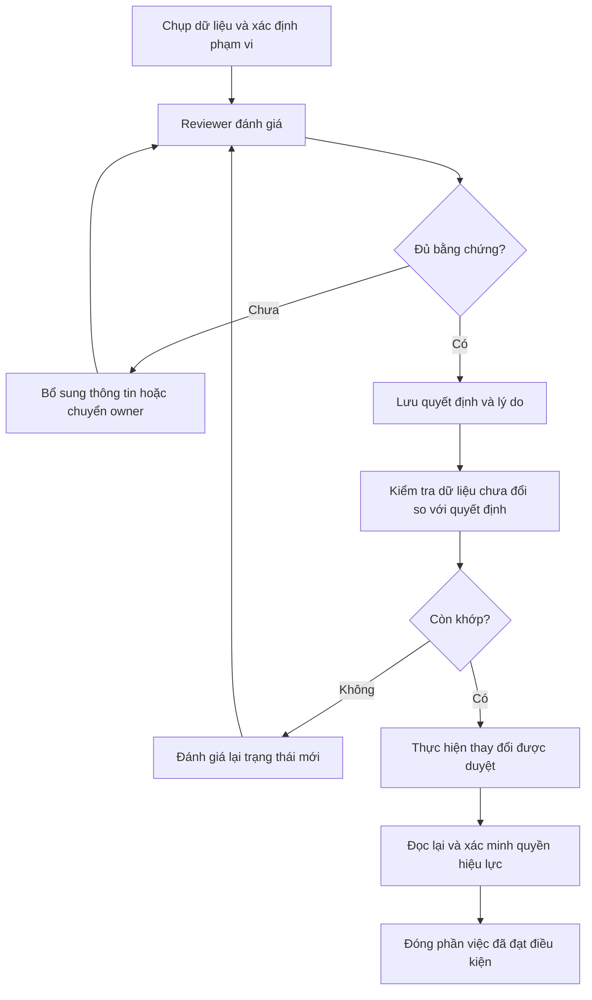

# Role review — Rà soát vai trò và quyền truy cập trong RBAC

## 1. Một role từng hợp lý có thể trở nên quá rộng

Một nhóm hỗ trợ khách hàng dùng role `BILLING_SUPPORT` để xem trạng thái hóa đơn. Theo thời gian, role được bổ sung quyền export để xử lý một chiến dịch, quyền hoàn tiền để hỗ trợ sự cố và quyền quản lý người dùng cho một công việc tạm thời.

Các công việc tạm thời đã kết thúc, nhưng quyền vẫn còn. Một số nhân viên đã chuyển nhóm cũng tiếp tục giữ role qua group cũ.

Khi nhìn danh sách role, hệ thống có vẻ được tổ chức tốt. Khi nhìn khả năng thực tế, một nhân viên hỗ trợ có thể thao tác vượt xa nhiệm vụ hiện tại.

**Role review** là quá trình đánh giá có căn cứ xem một role còn phù hợp với chức năng nghiệp vụ hay không, những khả năng nào thực sự được cấp qua role, ai hoặc workload nào còn cần role đó và thay đổi nào phải được thực hiện.

Trong mô hình RBAC, quan hệ người dùng–role, permission–role và role hierarchy giúp tổ chức việc quản lý quyền. Tài liệu NIST nhấn mạnh rằng role còn liên quan đến quyền kế thừa và các ràng buộc sử dụng; vì vậy, rà soát không thể chỉ nhìn tên role. [NIST — RBAC FAQ](https://csrc.nist.gov/projects/role-based-access-control/faqs).

Mục tiêu của bài là giúp bạn tổ chức một lượt rà soát tạo ra quyết định cụ thể, có người chịu trách nhiệm và có bằng chứng thay đổi đã có hiệu lực.

## 2. Phân biệt ba đối tượng cần rà soát

### 2.1. Định nghĩa role

Câu hỏi là: **role này nên chứa những khả năng nào?**

Cần xem xét:

- Mục đích nghiệp vụ và chủ sở hữu.
- Permission được gán trực tiếp.
- Role được kế thừa và các permission đến từ kế thừa.
- Phạm vi tài nguyên, tenant, môi trường hoặc dự án.
- Điều kiện sử dụng, giới hạn thời gian và quan hệ với các role xung đột.
- Khả năng quản trị quyền, ủy quyền hoặc chuyển sang danh tính khác.

Nếu role hỗ trợ có permission quản trị IAM không còn phục vụ nhiệm vụ, việc chỉ xác nhận danh sách nhân viên hỗ trợ không sửa được phần quyền dư trong role.

### 2.2. Assignment của role

Câu hỏi là: **chủ thể này còn cần giữ role trong phạm vi này hay không?**

Một assignment cần được hiểu đầy đủ:

```text
chủ thể + role + phạm vi + nguồn cấp + điều kiện hiệu lực
```

Ví dụ:

```text
subject: user-lan
role: BILLING_SUPPORT
scope: tenant-acme / production
source: group-customer-support
validity: đang có hiệu lực
```

Hai người giữ cùng role có thể cần quyết định khác nhau. Lan đang làm hỗ trợ nên có thể tiếp tục cần quyền; Minh đã chuyển sang nhân sự nên có thể không còn cần assignment đó.

### 2.3. Cơ chế tạo và duy trì assignment

Câu hỏi là: **vì sao role tiếp tục được cấp, và điều kiện cấp còn đúng không?**

Nếu một job đồng bộ tự thêm mọi thành viên phòng ban vào group, việc xóa assignment thủ công có thể chỉ có hiệu lực đến lần đồng bộ tiếp theo. Cần rà soát mapping nguồn, quy tắc membership, quy trình gia hạn và owner của cơ chế cấp.

| Đối tượng rà soát | Ví dụ phát hiện | Hướng xử lý |
| --- | --- | --- |
| Định nghĩa role | BILLING_SUPPORT có quyền hoàn tiền không còn cần | Thu hẹp hoặc tách role |
| Assignment | Nhân viên đổi bộ phận vẫn giữ BILLING_SUPPORT | Gỡ đúng nguồn assignment |
| Cơ chế cấp | Job đồng bộ cấp role cho cả nhân viên đã rời nhiệm vụ | Sửa điều kiện hoặc mapping nguồn |

Một đợt review có thể bao gồm cả ba, nhưng cần xác định rõ quyết định nào tác động vào đối tượng nào. Gỡ quyền của một người và xóa một permission khỏi role dùng chung có phạm vi ảnh hưởng rất khác nhau.

Microsoft Entra mô tả access review như cơ chế rà soát membership, quyền truy cập ứng dụng và role assignment để đánh giá quyền tiếp tục được giữ. Đây là ví dụ triển khai của một nền tảng; phạm vi role catalog và quyền nghiệp vụ của ứng dụng vẫn cần được xác định riêng. [Microsoft Learn — What are access reviews?](https://learn.microsoft.com/en-us/entra/id-governance/access-reviews-overview).

## 3. Vì sao role bị lệch khỏi nhu cầu ban đầu?

### 3.1. Permission creep trong role

Một role có thể được thêm quyền nhiều lần để giải quyết nhu cầu ngắn hạn. Nếu không có thời hạn hoặc lượt rà soát sau đó, nó dần trở thành gói quyền tổng hợp.

```text
Vai trò ban đầu:
  xem tóm tắt hóa đơn

Sau chiến dịch:
  + xuất dữ liệu

Sau sự cố:
  + hoàn tiền

Sau hỗ trợ quản trị:
  + cấp role cho người khác
```

Không có một thay đổi đơn lẻ nào mang tên “biến nhân viên hỗ trợ thành quản trị viên”, nhưng khả năng cuối cùng có thể gần với quản trị.

### 3.2. Membership creep ở người dùng

Một người nhận role khi vào dự án A, thêm role khi hỗ trợ dự án B, rồi nhận role của vị trí mới. Nếu chỉ cấp thêm mà không đánh giá quyền cũ, tập quyền hiệu lực tăng theo lịch sử công việc.

Trạng thái nhân sự còn hoạt động chỉ trả lời người đó còn thuộc tổ chức. Nó chưa chứng minh mọi assignment đang giữ đều cần thiết.

### 3.3. Hierarchy hoặc role tổng hợp thay đổi

Role cha có thể được sửa mà các role kế thừa không đổi tên:

```text
BILLING_SUPPORT
       │ kế thừa
       ▼
LEGACY_BILLING_OPERATIONS
       ├── đọc hóa đơn
       ├── export
       └── hoàn tiền
```

Reviewer chỉ xem permission trực tiếp của BILLING_SUPPORT có thể bỏ sót export và hoàn tiền.

### 3.4. Nghiệp vụ và tài nguyên đã thay đổi

Một nhóm cần quyền đọc dữ liệu khi hệ thống còn nhỏ. Sau đó, tài nguyên chứa thêm dữ liệu nhạy cảm hoặc được mở rộng sang nhiều tenant. Cùng một policy cũ có thể nay mang rủi ro lớn hơn.

Quyền dùng wildcard cũng cần xem xét khi API hoặc tập tài nguyên phát triển. Một biểu thức cho phép toàn bộ một nhóm action có thể tự bao phủ chức năng mới theo semantics của nền tảng.

### 3.5. Role không còn owner

Dự án đã kết thúc, đội sở hữu giải thể hoặc người duyệt cũ rời công ty. Role vẫn tồn tại và có thành viên, nhưng không ai có đủ trách nhiệm lẫn bối cảnh để giải thích vì sao nó còn cần.

“Không biết ai sở hữu” là một phát hiện cần xử lý. Nó không phải bằng chứng để tự động xác nhận giữ nguyên role.

## 4. Định nghĩa phạm vi để tránh rà soát nhầm

### 4.1. Dùng định danh ổn định

Tên hiển thị như `Support` không đủ phân biệt role ở hai hệ thống hoặc hai tenant. Một đơn vị rà soát có thể cần:

```text
systemId
tenantId
roleId
assignmentId
subjectId
sourceId
```

Tùy mô hình, một số thành phần có thể nằm ở cấp review thay vì từng item. Điều quan trọng là quyết định không bị áp dụng sang role hoặc assignment khác có cùng tên.

Đổi tên role không làm thay đổi mọi khả năng của nó. Ngược lại, giữ nguyên tên role cũng không bảo đảm permission chưa đổi.

### 4.2. Phân biệt quyền được cấp, quyền có thể kích hoạt và quyền đang sử dụng

Một người chưa kích hoạt role đặc quyền trong tháng này vẫn có thể được phép kích hoạt khi muốn. Nếu review chỉ xem phiên hiện tại, khả năng đặc quyền đó sẽ bị bỏ sót.

Một workload không có phiên đăng nhập tương tác vẫn có thể sử dụng credential hoặc nhận token tự động. Vì vậy, dữ liệu “last interactive login” không thể đại diện cho mọi loại danh tính.

Cần định nghĩa trong phạm vi review:

| Loại thông tin | Câu hỏi |
| --- | --- |
| Assignment đang có hiệu lực | Chủ thể hiện được cấp quyền gì? |
| Khả năng kích hoạt hoặc nhận quyền | Chủ thể có thể lấy thêm khả năng nào theo cơ chế hiện tại? |
| Phiên, token, credential đã phát | Quyền nào còn có thể được chấp nhận tại nơi sử dụng? |
| Hành vi quan sát được | Những thao tác nào đã thực sự xuất hiện trong dữ liệu theo dõi? |

### 4.3. Quyền hiệu lực không phải lúc nào cũng là hợp đơn giản

Trong một mô hình RBAC đơn giản, có thể mở rộng role hierarchy rồi hợp permission để mô tả khả năng được cấp. Một nền tảng thực tế còn có điều kiện, policy trên tài nguyên, explicit deny, boundary hoặc quy tắc ủy quyền riêng.

Vì vậy, cần phân biệt:

```text
Permission xuất hiện trong cấu hình
        ↓
Khả năng được ủy quyền theo semantics của nền tảng
        ↓
Yêu cầu cụ thể được nơi thực thi cho phép trong một ngữ cảnh
```

Đếm permission hữu ích để kiểm kê, nhưng không đủ chứng minh ai có thể truy cập dữ liệu nào. Nếu công cụ chỉ dựng tập quyền gần đúng, báo cáo cần nêu rõ giới hạn đó.

### 4.4. Giữ dấu vết nguồn cấp

Giả sử Lan nhận cùng role qua hai nguồn:

```text
Assignment trực tiếp:        BILLING_SUPPORT
Group customer-support-old: BILLING_SUPPORT
```

Gỡ một nguồn chưa chắc làm mất quyền. Reviewer cần thấy cả khả năng hiệu lực lẫn đường dẫn tạo ra nó.

Đối với nhóm lồng nhau, một quan hệ membership ở xa vẫn có thể ảnh hưởng role ở ứng dụng đích. Việc rà soát cần theo đúng mapping mà hệ thống đích sử dụng, thay vì mặc định mọi nền tảng đều mở rộng group giống nhau.

## 5. Ai nên chịu trách nhiệm quyết định?

Một reviewer cần hiểu cả nhu cầu nghiệp vụ lẫn phạm vi tác động của quyền. Người quản lý trực tiếp có thể biết Lan đang làm việc gì nhưng chưa chắc hiểu permission `iam:grant-role`. Chủ hệ thống có thể hiểu permission nhưng không biết Lan đã chuyển nhóm.

Có thể phân vai theo loại quyết định:

| Vai trò trong review | Trách nhiệm minh họa |
| --- | --- |
| Chủ sở hữu role | Xác nhận role phục vụ chức năng nào và permission nào phù hợp |
| Chủ sở hữu tài nguyên hoặc dịch vụ | Đánh giá hậu quả truy cập và yêu cầu bảo vệ tài nguyên |
| Quản lý hoặc người giao nhiệm vụ | Xác nhận người dùng còn cần assignment |
| Chủ sở hữu workload | Giải thích nhu cầu của service account, job hoặc pipeline |
| Nhóm IAM/vận hành | Tạo dữ liệu, thực hiện thay đổi đã được duyệt và xác minh kỹ thuật |
| Nhóm an ninh hoặc kiểm soát nội bộ | Xem xét rủi ro, xung đột và bằng chứng theo phạm vi được giao |

Một người có thể đảm nhiệm nhiều trách nhiệm nếu mô hình tổ chức cho phép. Với quyết định nhạy cảm, cần cân nhắc tính độc lập và tránh tự xác nhận quyền đặc biệt của chính mình.

### 5.1. Giao đủ thông tin để reviewer có thể quyết định

Một danh sách gồm tên người và tên role dễ dẫn đến việc chọn “giữ nguyên” hàng loạt. Reviewer cần biết:

- Role cho phép những thao tác nghiệp vụ nào.
- Phạm vi tài nguyên và dữ liệu bị ảnh hưởng.
- Quyền đến từ đâu và còn nguồn nào khác.
- Nhiệm vụ hoặc lý do cấp ban đầu.
- Bằng chứng sử dụng cùng giới hạn của bằng chứng.
- Điều gì sẽ thay đổi nếu gỡ quyền.
- Mục nào cần owner khác hoặc cần thêm thông tin.

Không cần đưa toàn bộ policy thô cho người chỉ đánh giá nhu cầu nhân sự. Có thể trình bày ngôn ngữ nghiệp vụ và cho phép xem chi tiết kỹ thuật khi cần.

### 5.2. Không có phản hồi phải có cách xử lý rõ

Không phản hồi không đồng nghĩa với việc nhu cầu được xác nhận. Hệ thống cần quy định cách nhắc việc, chuyển người xử lý, đánh dấu quá hạn hoặc áp dụng quyết định mặc định đã được tổ chức phê duyệt.

Cách mặc định có thể khác nhau theo rủi ro và yêu cầu vận hành. Không nên tự tạo quy tắc chung “im lặng là giữ” hoặc “im lặng là xóa” mà không biết tác động của đối tượng đang rà soát.

Một item thiếu bằng chứng hoặc thiếu reviewer phù hợp nên được ghi nhận đúng trạng thái, thay vì tính như đã xác nhận hợp lệ.

## 6. Khi nào cần rà soát?

### 6.1. Kết hợp chu kỳ và sự kiện

Rà soát định kỳ giúp phát hiện quyền cũ còn sót. Rà soát theo sự kiện giúp xử lý những thay đổi không nên chờ đến chu kỳ tiếp theo.

Các sự kiện thường cần xem xét:

```text
Người dùng chuyển vị trí hoặc rời tổ chức
Nhân sự bên ngoài kết thúc hợp đồng
Dự án hoặc workload ngừng hoạt động
Role được thêm permission nhạy cảm
Hierarchy hoặc mapping group thay đổi
Tài nguyên mở rộng sang dữ liệu nhạy cảm hơn
Phát hiện sự cố hoặc đường leo thang quyền
Owner của role hoặc dịch vụ thay đổi
```

Không có một chu kỳ duy nhất phù hợp mọi role. Quyền quản trị production, quyền đọc tài liệu công khai và quyền của job chạy cuối quý có đặc điểm khác nhau.

Nếu dùng các mốc như mỗi tháng hoặc mỗi quý, cần trình bày chúng là lựa chọn trong chính sách của tổ chức, có cơ sở về rủi ro và vận hành. Bài học không đặt ra một lịch bắt buộc chung.

### 6.2. Rà soát định kỳ không thay thế thu hồi theo sự kiện

Một người rời tổ chức không nên tiếp tục giữ quyền chỉ vì lượt review quý chưa bắt đầu. Quy trình vòng đời danh tính phải thực hiện thay đổi cần thiết khi sự kiện xảy ra.

Role review đóng vai trò xác nhận và phát hiện sai lệch của các quy trình cấp/thu hồi. Nó không phải lý do trì hoãn việc xử lý các sự kiện đã biết.

Hướng dẫn IAM của AWS khuyến nghị thường xuyên rà soát và loại bỏ danh tính, role, permission, policy và credential không còn được sử dụng. Việc áp dụng cần xét đúng semantics và công cụ của AWS khi hệ thống sử dụng nền tảng đó. [AWS — Security best practices in IAM](https://docs.aws.amazon.com/IAM/latest/UserGuide/best-practices.html).

## 7. Thu thập bằng chứng đủ để giải thích quyết định

### 7.1. Chụp một trạng thái có thể định vị lại

Một lượt review cần biết mình đang đánh giá phiên bản nào của role và assignment:

```yaml
reviewId: REVIEW-BILLING-731
scope:
  systemId: billing-platform
  tenantId: acme
roleId: role-billing-support
catalogVersion: 12
assignmentVersion: 41
capturedAt: 2026-11-26T03:00:00Z
observationWindow:
  from: 2026-08-26T00:00:00Z
  to: 2026-11-26T00:00:00Z
```

Đây là mô hình dữ liệu minh họa; thời điểm và cửa sổ quan sát được chọn cho tình huống, không phải yêu cầu chung.

Phiên bản hoặc hash giúp phát hiện dữ liệu đã đổi. Chúng không thay thế bản chụp nội dung cần thiết để giải thích reviewer đã nhìn thấy gì. Nếu chỉ lưu một hash mà không có cách truy xuất trạng thái tương ứng, điều tra sau này có thể không đủ dữ liệu.

### 7.2. Các nhóm bằng chứng

| Nhóm dữ liệu | Nội dung cần xem |
| --- | --- |
| Mục đích role | Chức năng, owner, người phê duyệt, mô tả nhiệm vụ |
| Định nghĩa quyền | Action, resource, điều kiện, role kế thừa, quyền quản trị |
| Assignment | Chủ thể, phạm vi, nguồn cấp, thời hạn và trạng thái |
| Vòng đời chủ thể | Vị trí, dự án, hợp đồng, owner workload |
| Dữ liệu sử dụng | Hoạt động theo role hoặc danh tính, cửa sổ quan sát, độ phủ |
| Ràng buộc | SSD/DSD có liên quan, giới hạn nghiệp vụ, điều kiện kích hoạt |
| Phụ thuộc vận hành | Job hiếm chạy, quy trình phục hồi, kế hoạch bàn giao |
| Thay đổi gần đây | Thêm permission, sửa hierarchy, mở rộng tài nguyên |

Cần chú ý quyền điều khiển role khác. Một role có thể không trực tiếp đọc dữ liệu nhạy cảm nhưng được phép sửa policy, đổi nhóm, phát credential hoặc triển khai mã dưới danh tính có quyền đọc.

### 7.3. “Không thấy dùng” là tín hiệu, chưa phải kết luận

Một job chạy cuối quý có thể không tạo hoạt động trong cửa sổ 30 ngày. Một tài khoản phục hồi sự cố có thể ít dùng nhưng vẫn có mục đích được phê duyệt. Log cũng có thể chưa bật cho một dịch vụ hoặc chưa bao phủ đúng loại thao tác.

Ngược lại, một permission đã từng được sử dụng không có nghĩa nó còn cần. Hoạt động có thể thuộc chiến dịch đã kết thúc, hoặc là dấu hiệu lạm dụng cần điều tra.

Cần tách các câu hỏi:

```text
Có quyền không?
Có hoạt động được quan sát không?
Hoạt động đó thành công hay chỉ là một lần thử?
Hoạt động đó phục vụ nhiệm vụ còn hiệu lực không?
Bằng chứng có bao phủ đầy đủ khoảng thời gian và loại truy cập không?
```

IAM Access Analyzer của AWS sử dụng thông tin truy cập gần nhất để tạo phát hiện về quyền không sử dụng trong phạm vi được hỗ trợ. Phát hiện của công cụ là dữ liệu hỗ trợ review; quyết định nghiệp vụ còn cần owner và bối cảnh. [AWS — How IAM Access Analyzer findings work](https://docs.aws.amazon.com/IAM/latest/UserGuide/access-analyzer-concepts.html).

### 7.4. Không suy nhu cầu của mọi người từ hoạt động của cả nhóm

Role có một trăm thành viên và một người sử dụng quyền export không có nghĩa cả một trăm người cần export. Cũng không thể kết luận một thành viên không dùng role chỉ vì log chưa phân biệt được nguồn cấp giữa nhiều role trùng permission.

Khi độ phân giải của dữ liệu không đủ, nên ghi nhận giới hạn và thu thập thêm bằng chứng. Không nên biến một phép suy đoán thành số liệu xác nhận nhu cầu.

## 8. Từ bằng chứng đến quyết định cụ thể

Một quyết định hữu ích phải chỉ rõ đối tượng, hành động, lý do và người chịu trách nhiệm. “Đã review role hỗ trợ” chưa đủ để biết cần thay đổi gì.

### 8.1. Quyết định với định nghĩa role

| Quyết định | Khi nào phù hợp | Phạm vi cần chú ý |
| --- | --- | --- |
| Giữ định nghĩa | Permission, scope và điều kiện vẫn khớp chức năng | Xác nhận đúng phiên bản đã đánh giá |
| Thu hẹp role | Có action hoặc phạm vi tài nguyên không còn cần | Có thể ảnh hưởng mọi assignment sử dụng role |
| Tách role | Một role đang gom nhiều nhiệm vụ có đối tượng sử dụng khác nhau | Cần mapping và kế hoạch chuyển assignment |
| Hợp nhất role | Các role có mục đích và semantics tương đương | Phải xét điều kiện, scope, hierarchy và ràng buộc |
| Ngừng cấp mới, đưa vào giai đoạn loại bỏ | Role không còn phù hợp nhưng còn phụ thuộc cần chuyển đổi | Phải theo dõi tiến độ xử lý thành viên và tài nguyên liên quan |
| Cần thêm bằng chứng | Chưa biết nhu cầu hoặc tác động | Chưa thể coi là đã xác nhận role hợp lệ |

Hai role có cùng danh sách action chưa chắc tương đương. Chúng có thể khác tài nguyên, điều kiện kích hoạt, owner hoặc vị trí trong hierarchy. Hợp nhất chỉ dựa vào tên hay số permission có thể mở rộng quyền.

### 8.2. Quyết định với assignment

Các quyết định thường gặp gồm giữ assignment, gỡ assignment, chuyển sang role hẹp hơn, giới hạn thời hạn hoặc yêu cầu thêm thông tin.

Mỗi quyết định cần được gắn với đúng nguồn cấp. Nếu assignment đến từ group, cần xác định nên thay membership, thay mapping group-role hay điều chỉnh thiết kế khác. Ba thao tác này ảnh hưởng các đối tượng khác nhau.

Ví dụ:

```text
Phát hiện:
  Minh chuyển từ nhóm hỗ trợ sang nhân sự.

Quyết định:
  Gỡ nguồn cấp BILLING_SUPPORT qua group customer-support-old
  cho user-minh trong tenant acme.

Lý do:
  Nhiệm vụ hỗ trợ đã kết thúc.

Không suy ra:
  Xóa BILLING_SUPPORT khỏi toàn bộ hệ thống.
```

### 8.3. Kết quả review và kết quả thực thi là hai trạng thái

Một quyết định “gỡ” có thể đã được duyệt nhưng chưa được thực hiện do lỗi đồng bộ. Một thao tác ghi đã thành công tại IdP có thể chưa đến ứng dụng đích.

Có thể quản lý luồng trạng thái như sau:



Không nên gom mọi trạng thái vào một cờ `reviewed = true`. Ít nhất cần phân biệt đã có quyết định, đang thực hiện, thực hiện thất bại và đã xác minh kết quả.

## 9. Không áp dụng quyết định cũ lên dữ liệu đã thay đổi

Giả sử reviewer xác nhận role ở phiên bản 12 chỉ chứa quyền đọc. Trước khi hệ thống đóng review, một quản trị viên thêm quyền hoàn tiền ở phiên bản 13.

Nếu hệ thống ghi nhận “role đã được xác nhận” mà không kiểm tra phiên bản, bằng chứng review đã bị áp dụng cho một định nghĩa khác với điều reviewer từng xem.

Tương tự, reviewer có thể duyệt gỡ một assignment cũ, nhưng assignment đã được thay thế bằng một nguồn cấp khác phục vụ nhiệm vụ mới. Dùng tên người và tên role để tìm rồi xóa tại thời điểm chạy có thể tác động sai đối tượng.

### 9.1. Ví dụ Java: bảo vệ quyết định trên cùng trạng thái

Ví dụ sau dùng Java 17 trở lên. Nó minh họa một cổng kiểm tra trước khi áp dụng quyết định trên **một assignment**, chưa phải hệ thống review hoàn chỉnh.

Các giả định:

- Target và decision được server tạo, lưu và nạp từ nguồn đã kiểm soát.
- Người đưa ra quyết định đã được kiểm tra quyền review đúng phạm vi.
- `assignmentVersion` thay đổi khi bản assignment đang xét thay đổi.
- `rolePolicyVersion` đại diện phiên bản cấu hình role được dùng trong lượt đánh giá.
- Dữ liệu hiện tại được đọc cùng cơ chế nhất quán mà bước ghi sẽ tuân theo.
- Thời hạn quyết định là một tham số của chính sách, không phải hằng số chung cho mọi tổ chức.

```java
import java.time.Duration;
import java.time.Instant;
import java.util.Objects;

enum ReviewOutcome {
    RETAIN,
    REVOKE,
    NEEDS_EVIDENCE
}

record ReviewTarget(
        String assignmentId,
        String subjectId,
        String roleId,
        String scopeId,
        String sourceId
) {
    ReviewTarget {
        Objects.requireNonNull(assignmentId);
        Objects.requireNonNull(subjectId);
        Objects.requireNonNull(roleId);
        Objects.requireNonNull(scopeId);
        Objects.requireNonNull(sourceId);
    }
}

record ReviewSnapshot(
        ReviewTarget target,
        long assignmentVersion,
        long rolePolicyVersion,
        Instant capturedAt
) {
    ReviewSnapshot {
        Objects.requireNonNull(target);
        Objects.requireNonNull(capturedAt);
    }
}

record ReviewDecision(
        String reviewId,
        String reviewerId,
        ReviewSnapshot snapshot,
        ReviewOutcome outcome,
        String reason,
        Instant decidedAt
) {
    ReviewDecision {
        Objects.requireNonNull(reviewId);
        Objects.requireNonNull(reviewerId);
        Objects.requireNonNull(snapshot);
        Objects.requireNonNull(outcome);
        Objects.requireNonNull(reason);
        Objects.requireNonNull(decidedAt);

        if (reason.isBlank()) {
            throw new IllegalArgumentException("Decision reason is required");
        }

        if (decidedAt.isBefore(snapshot.capturedAt())) {
            throw new IllegalArgumentException("Invalid decision timestamp");
        }
    }
}

final class ReviewDecisionGuard {
    void requireApplicable(
            ReviewDecision decision,
            ReviewSnapshot current,
            Instant now,
            Duration maximumSnapshotAge
    ) {
        Objects.requireNonNull(decision);
        Objects.requireNonNull(current);
        Objects.requireNonNull(now);
        Objects.requireNonNull(maximumSnapshotAge);

        if (maximumSnapshotAge.isNegative()
                || maximumSnapshotAge.isZero()) {
            throw new IllegalArgumentException("Invalid snapshot age limit");
        }

        if (decision.outcome() == ReviewOutcome.NEEDS_EVIDENCE) {
            throw new IllegalStateException("Review is not ready to apply");
        }

        ReviewSnapshot reviewed = decision.snapshot();

        if (!reviewed.target().equals(current.target())) {
            throw new IllegalStateException("Review target has changed");
        }

        if (reviewed.assignmentVersion() != current.assignmentVersion()
                || reviewed.rolePolicyVersion()
                    != current.rolePolicyVersion()) {
            throw new IllegalStateException("Review snapshot is stale");
        }

        if (now.isBefore(decision.decidedAt())
                || !now.isBefore(
                    reviewed.capturedAt().plus(maximumSnapshotAge))) {
            throw new IllegalStateException("Review timing is invalid");
        }
    }
}
```

Cổng kiểm tra này từ chối quyết định thiếu bằng chứng, target không khớp, phiên bản đã đổi hoặc snapshot quá cũ theo tham số chính sách. Nó không tự quyết định người dùng còn cần quyền hay không; điều đó thuộc quá trình đánh giá.

Mốc quá hạn trong ví dụ được tính từ lúc chụp snapshot. Tại đúng thời điểm hết hạn, quyết định không còn được áp dụng. Nếu hệ thống chọn cách tính khác, chẳng hạn từ lúc reviewer quyết định, cần ghi rõ và triển khai nhất quán.

### 9.2. Kiểm tra phiên bản phải gắn với bước ghi

Nếu kiểm tra xong rồi một tiến trình khác sửa assignment trước lúc xóa, vẫn có thể xảy ra sai lệch. Bước ghi cần dùng transaction, compare-and-set hoặc cơ chế tương đương để bảo đảm đúng phiên bản đã được kiểm tra.

Một luồng minh họa:

```text
Nạp quyết định đã lưu
  → đọc và bảo vệ assignment cần thay đổi
  → kiểm tra target và phiên bản
  → áp dụng đúng quyết định trên nguồn cấp đã chỉ định
  → ghi kết quả thực thi
  → commit theo cơ chế nhất quán
  → xác minh tại các nơi liên quan
```

Với nhiều hệ thống không có giao dịch chung, cần tiến trình theo dõi từng kết quả, nhận diện lỗi và có thể tiếp tục an toàn. Không nên ghi thành công toàn bộ chỉ vì một hệ thống nguồn đã nhận yêu cầu.

### 9.3. Phiên bản của một dòng chưa bao phủ mọi phụ thuộc

Một assignment đến từ group còn phụ thuộc membership và mapping. Một role kế thừa còn phụ thuộc catalog hierarchy và permission của role bên dưới.

Nếu các thay đổi đó không làm `rolePolicyVersion` hoặc phiên bản bằng chứng thay đổi, cổng kiểm tra đơn giản trên chưa phát hiện đủ dữ liệu cũ.

Thiết kế thực tế cần xác định tập phụ thuộc và cách phát hiện sự thay đổi của chúng. Có thể dùng snapshot tổng hợp, phiên bản cấu hình, tập hash có provenance hoặc cơ chế đọc nhất quán phù hợp. Không nên coi hai con số phiên bản trong ví dụ là giải pháp tự động cho mọi đồ thị quyền.

## 10. Thực hiện thay đổi mà vẫn giữ đúng phạm vi

### 10.1. Sửa role dùng chung phải xét toàn bộ tập ảnh hưởng

Gỡ permission khỏi một role có thể ảnh hưởng mọi người dùng, group, workload hoặc role cấp trên đang sử dụng nó.

Trước thay đổi, cần xác định:

```text
Role đang sửa
  → role nào kế thừa nó
  → assignment nào đi đến các role đó
  → tài nguyên và nhiệm vụ nào phụ thuộc
  → hành vi cần tiếp tục được phép và hành vi cần bị chặn
```

Thay đổi ở một tenant không nên vô tình sửa role toàn cục dùng cho tenant khác. Nếu catalog dùng role chung, cần biết điều kiện và scope nằm ở đâu trước khi áp dụng.

### 10.2. Tách role cần chuyển assignment có chủ đích

Một role quá rộng có thể được tách thành:

```text
BILLING_SUPPORT_CORE
BILLING_REPORT_EXPORTER
BILLING_REFUND_OPERATOR
```

Tạo ba role mới chưa làm giảm quyền của ai. Nếu mọi người vẫn giữ role cũ hoặc được cấp cả ba role mới, phạm vi quyền có thể không thay đổi.

Cần gán role đích theo nhiệm vụ đã được xác nhận, gỡ nguồn role cũ và xác minh không còn đường kế thừa hoặc ủy quyền duy trì khả năng dư thừa.

Trong giai đoạn chuyển đổi, phải kiểm soát khoảng thời gian người dùng có đồng thời role cũ và role mới. Trình tự cần được chọn theo yêu cầu vận hành và ràng buộc như separation of duties.

### 10.3. Xác minh cả nguồn quản lý và nơi thực thi

Một bằng chứng xác minh đầy đủ theo phạm vi có thể bao gồm:

- Role hoặc assignment tại nguồn đã có trạng thái đúng.
- Mapping/group không tự cấp lại quyền đã gỡ.
- Ứng dụng đích đã nhận thay đổi.
- Token, phiên hoặc cache cũ được xử lý theo yêu cầu thu hồi.
- Yêu cầu ngoài quyền đích bị từ chối tại điểm thực thi.
- Tác vụ nghiệp vụ còn hợp lệ tiếp tục hoạt động.
- Lỗi hoặc ngoại lệ còn lại được ghi nhận đúng trạng thái.

Không nhất thiết mọi review đều cần gọi thử mọi API production. Cách xác minh phải phù hợp rủi ro và nền tảng; cần có bằng chứng đủ cho điều được tuyên bố đã hoàn tất.

### 10.4. Khôi phục thay đổi cũng cần giới hạn

Một thay đổi quyền có thể làm lộ ra phụ thuộc chưa được ghi nhận. Cần có cách khôi phục trong phạm vi phù hợp, kèm owner và thời hạn xử lý nguyên nhân.

Nếu phải cấp lại một quyền để duy trì nghiệp vụ, hãy ghi nhận vì sao quyết định ban đầu cần điều chỉnh và quyền nào thực sự thiếu. Việc trả lại toàn bộ role quản trị rộng mà không theo dõi sẽ làm mất kết quả thu hẹp quyền.

## 11. Tình huống vận dụng: rà soát BILLING_SUPPORT

### 11.1. Trạng thái thu thập được

Giả sử role BILLING_SUPPORT có quyền đọc tóm tắt hóa đơn trực tiếp và kế thừa một role cũ:

```text
BILLING_SUPPORT
  ├── invoice:read-summary
  └── LEGACY_BILLING_ADMIN
       ├── invoice:export-all
       ├── invoice:refund
       └── iam:assign-role
```

Role đang có 24 chủ thể:

```text
19 nhân viên hỗ trợ đang làm đúng nhiệm vụ
 2 nhân viên đã chuyển bộ phận
 2 tài khoản nhà thầu đã kết thúc công việc
 1 service account tạo báo cáo cuối quý
```

Đây là dữ liệu giả định cho bài học. Không nên dùng các con số này làm ngưỡng hoặc tỷ lệ chuẩn.

### 11.2. Đọc bằng chứng theo từng câu hỏi

Với định nghĩa role, owner xác nhận nhiệm vụ hỗ trợ chỉ cần xem mã, trạng thái và tổng tiền của hóa đơn trong phạm vi ticket được giao. Export, hoàn tiền và cấp role không thuộc chức năng đó.

Với assignment, quản lý xác nhận hai người chuyển bộ phận không còn xử lý ticket. Hai tài khoản nhà thầu cũng không còn lý do tiếp tục giữ quyền.

Với service account, owner ứng dụng xác nhận job cuối quý cần xuất một tập dữ liệu báo cáo. Nó không cần hoàn tiền hoặc quản trị IAM.

Log của một nhân viên có thao tác hoàn tiền trong một sự cố trước đây. Điều này chứng minh có hoạt động đã xảy ra trong dữ liệu quan sát, nhưng không đủ để kết luận mọi nhân viên hỗ trợ cần giữ quyền hoàn tiền mãi về sau.

### 11.3. Các quyết định khác nhau cho từng đối tượng

| Đối tượng | Quyết định minh họa | Lý do |
| --- | --- | --- |
| Định nghĩa role hỗ trợ | Dùng role hẹp cho chức năng đọc tóm tắt và bỏ đường kế thừa quản trị | Khớp nhiệm vụ hỗ trợ hiện hành |
| 19 nhân viên hỗ trợ | Chuyển sang quyền hỗ trợ hẹp trong phạm vi phù hợp | Còn nhu cầu nghiệp vụ |
| 2 người chuyển bộ phận | Gỡ assignment hỗ trợ từ đúng nguồn cấp | Nhiệm vụ cũ đã kết thúc |
| 2 tài khoản nhà thầu | Thu hồi quyền và xử lý vòng đời tài khoản theo chính sách | Công việc đã kết thúc |
| Service account báo cáo | Dùng role báo cáo riêng cho tài nguyên đầu vào/đầu ra cần thiết | Nhu cầu export khác nhiệm vụ hỗ trợ |
| Role cũ | Chặn cấp mới và loại bỏ sau khi chuyển hết phụ thuộc đã xác minh | Tránh duy trì gói quyền rộng |

Nếu quyền hoàn tiền khẩn cấp vẫn cần cho một số nhân sự, nó cần đi qua một thiết kế riêng đã được phê duyệt. Không nên giữ quyền đó cho toàn bộ nhóm chỉ vì một lần từng được sử dụng.

### 11.4. Điều kiện để đóng phần việc

Cần xác minh nhân viên còn nhiệm vụ hỗ trợ đọc được đúng dữ liệu, nhưng không thể gọi export, refund hoặc quản trị quyền thông qua role hỗ trợ.

Service account báo cáo cần hoạt động được theo lịch và phạm vi đã xác nhận. Vì job chạy cuối quý, cách kiểm chứng phải xét chu kỳ hoặc môi trường kiểm tra phù hợp; không thể coi “không lỗi trong vài ngày” là đủ bằng chứng.

Các chủ thể bị gỡ phải không còn quyền qua nguồn trực tiếp, group hoặc role kế thừa khác trong phạm vi được review. Token/cache cần được xử lý theo thiết kế thu hồi.

Chỉ khi mọi phần việc có kết quả tương ứng mới có thể tuyên bố đã hoàn tất đúng phạm vi. Nếu còn một ứng dụng đích chưa nhận thay đổi, cần ghi nhận phần đó còn mở.

## 12. Role của workload cần một cách đọc khác role của người dùng

Role review thường tập trung vào nhân viên và quên service account, pipeline, job định kỳ hoặc danh tính workload.

Với workload, cần biết:

| Câu hỏi | Ví dụ bằng chứng |
| --- | --- |
| Ai chịu trách nhiệm? | Owner dịch vụ và nhóm vận hành hiện hành |
| Workload còn tồn tại không? | Deployment, scheduler, repository và trạng thái vận hành |
| Cần làm gì? | API được gọi, dữ liệu đầu vào/đầu ra, chu kỳ chạy |
| Được chạy ở đâu? | Môi trường, namespace, project hoặc account |
| Có thể lấy credential nào? | Trust relationship và điều kiện phát credential |
| Ai có thể điều khiển nó? | Quyền sửa pipeline, image, command hoặc runtime identity |
| Có phụ thuộc hiếm chạy không? | Job cuối kỳ, phục hồi, đối soát, bàn giao |

Một workload có quyền đọc nhỏ nhưng được phép chuyển sang role quản trị vẫn cần được đánh giá trên đường quyền rộng hơn. Một pipeline không giữ credential thường trực vẫn có thể nhận credential mạnh nếu trust policy cho phép.

Xóa role của workload chỉ vì không có đăng nhập tương tác là đọc sai loại bằng chứng. Giữ role chỉ vì workload còn được deploy cũng chưa chứng minh mọi permission đều cần.

## 13. Đo lường kết quả của role review

Số người đã nhấn nút quyết định không phản ánh đầy đủ hiệu quả kiểm soát. Cần phân biệt độ phủ đánh giá với kết quả xử lý.

Một số chỉ số có ích:

| Chỉ số | Cách hiểu |
| --- | --- |
| Độ phủ owner | Tỷ lệ role trong phạm vi có owner hợp lệ |
| Độ phủ quyết định | Tỷ lệ item đã có quyết định đủ căn cứ trên tổng item phải rà soát |
| Độ phủ thực thi | Tỷ lệ quyết định cần thay đổi đã được thực hiện |
| Độ phủ xác minh | Tỷ lệ thay đổi đã có bằng chứng đạt trạng thái đích |
| Việc quá hạn | Item thiếu reviewer, thiếu bằng chứng hoặc chưa xử lý đúng hạn |
| Quyền cấp lại | Trường hợp quyền bị gỡ nhưng xuất hiện lại qua nguồn cũ |
| Tác động nghiệp vụ | Nhiệm vụ hợp lệ bị gián đoạn do quyết định hoặc triển khai thiếu |
| Sai lệch sau review | Role/assignment thay đổi nhưng chưa được đánh giá theo yêu cầu |

Mẫu số phải rõ ràng. Một báo cáo chỉ lấy các item đã xử lý làm mẫu số sẽ che những item bị bỏ sót. Item ở trạng thái cần thêm bằng chứng không nên được tính như đã xác nhận giữ quyền.

Không có một tỷ lệ thu hồi cao luôn là tốt. Thu hồi quá mức có thể làm gián đoạn nhiệm vụ hợp lệ; giữ lại mọi quyền cũng có thể phản ánh đánh giá thiếu căn cứ. Cần đọc số liệu cùng chất lượng quyết định và trạng thái sau thực thi.

## 14. Những sai lầm làm review trở thành thủ tục

| Sai lầm | Hậu quả | Cách điều chỉnh |
| --- | --- | --- |
| Chỉ xem tên role | Bỏ sót permission và phạm vi thực tế | Trình bày khả năng nghiệp vụ, role kế thừa và điều kiện |
| Chỉ xác nhận thành viên | Role vẫn chứa quyền dư cho mọi người | Rà soát cả định nghĩa role |
| Chỉ xem permission trực tiếp | Bỏ sót quyền qua hierarchy | Mở rộng đúng theo mô hình của nền tảng |
| Xóa quyền theo một nguồn | Quyền còn qua group hoặc assignment khác | Theo dõi provenance và quyền hiệu lực |
| Tự động xóa mọi quyền không dùng gần đây | Làm hỏng job ít chạy hoặc tác vụ phục hồi | Kết hợp dữ liệu sử dụng với owner và chu kỳ nghiệp vụ |
| Thấy có sử dụng thì giữ mãi | Hợp thức hóa nhu cầu đã kết thúc | Xác nhận mục đích hiện tại |
| Xác nhận snapshot cũ sau khi role đổi | Reviewer chưa đánh giá quyền mới | Phát hiện thay đổi và đưa lại phần liên quan vào review |
| Tạo role hẹp nhưng giữ role rộng | Khả năng của người dùng không giảm | Chuyển assignment và đóng đường cấp cũ |
| Ghi “hoàn tất” khi mới lưu quyết định | Không biết thay đổi đã có hiệu lực chưa | Theo dõi thực thi và xác minh riêng |
| Thiếu owner thì mặc định giữ nguyên | Role không ai chịu trách nhiệm tiếp tục tồn tại | Chuyển xử lý và áp dụng chính sách quá hạn rõ ràng |
| Chỉ rà soát tài khoản người dùng | Bỏ sót khả năng mạnh của workload | Bao phủ cả danh tính máy và đường điều khiển chúng |

## 15. Những điểm cần nắm vững

Role review cần trả lời ba câu hỏi: role còn chứa đúng khả năng không, chủ thể còn cần assignment không và cơ chế cấp quyền có tiếp tục tạo đúng kết quả không.

Một quyết định đáng tin cậy phải dựa trên dữ liệu được định vị rõ, có xét role kế thừa, phạm vi tài nguyên, nguồn cấp và giới hạn của bằng chứng sử dụng. Người ra quyết định cần đủ bối cảnh để giải thích vì sao giữ, gỡ, sửa hoặc yêu cầu thêm thông tin.

Kết quả review chỉ chuyển thành thay đổi quyền khi được thực thi trên đúng đối tượng và đúng trạng thái đã đánh giá. Việc xác minh tại nguồn và nơi thực thi giúp phân biệt một quyết định đã lưu với một ranh giới truy cập đã được điều chỉnh.

## Tài liệu tham khảo

- [NIST CSRC — Role Based Access Control FAQ](https://csrc.nist.gov/projects/role-based-access-control/faqs): nền tảng về quan hệ người dùng, role, permission, hierarchy và ràng buộc.
- [Microsoft Learn — What are access reviews?](https://learn.microsoft.com/en-us/entra/id-governance/access-reviews-overview): ví dụ quản trị việc rà soát membership, quyền ứng dụng và role assignment.
- [AWS IAM — Security best practices](https://docs.aws.amazon.com/IAM/latest/UserGuide/best-practices.html): hướng dẫn rà soát danh tính, role, permission, policy và credential.
- [AWS IAM — Understand how IAM Access Analyzer findings work](https://docs.aws.amazon.com/IAM/latest/UserGuide/access-analyzer-concepts.html): phạm vi và dữ liệu của các phát hiện phân tích truy cập.
