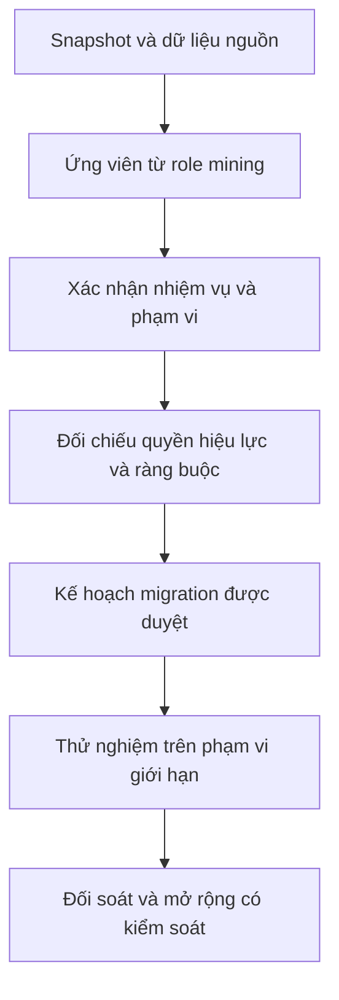

# Role mining

## 1. Từ dữ liệu quyền hiện có đến role ứng viên

Một tổ chức đã vận hành nhiều năm thường có dữ liệu quyền hình thành từ nhiều nguồn: nhóm trong directory, ACL, role của từng ứng dụng, quyền cấp trực tiếp và các ngoại lệ tạm thời. Khi muốn chuẩn hóa sang RBAC hoặc làm gọn một hệ thống RBAC đã phức tạp, câu hỏi đầu tiên là: những tập permission nào đang lặp lại và có thể tổ chức thành role?

**Role mining** là quá trình phân tích dữ liệu quyền hiện có để tìm những cấu trúc role có thể sử dụng. Đầu vào thường thể hiện danh tính nào đang có permission nào; đầu ra có thể gồm role ứng viên, tập permission của role, những danh tính liên quan và thông tin đánh giá ứng viên.

```text
Dữ liệu quyền có nguồn gốc rõ ràng
  → tìm các tập permission lặp lại
  → tạo role ứng viên
  → đối chiếu nhiệm vụ và chính sách
  → thiết kế RBAC được phê duyệt
```

Một role ứng viên chỉ là đề xuất từ dữ liệu. Nó chưa chứng minh rằng mọi permission trong đó đều cần thiết, những người đang giữ quyền đều được cấp đúng hoặc người mới có cùng chức danh phải được nhận toàn bộ tập quyền ấy.

Nghiên cứu về role mining xem dữ liệu gán quyền đang có là cơ sở để phát hiện cấu trúc RBAC và tối ưu hệ thống. Những mục tiêu tối ưu có thể khác nhau, chẳng hạn số role hoặc số quan hệ cần quản lý. [Tham khảo: Purdue CERIAS — Role Mining for Engineering and Optimizing Role Based Access Control Systems](https://www.cerias.purdue.edu/apps/reports_and_papers/view/3329).

## 2. Role mining nằm ở đâu trong role engineering?

Role engineering là công việc thiết kế role phù hợp với trách nhiệm và chính sách của tổ chức. Role mining là một cách cung cấp dữ liệu cho công việc ấy.

| Cách tiếp cận | Điểm xuất phát | Kết quả cần kiểm chứng |
|---|---|---|
| Từ nghiệp vụ xuống quyền | Công việc, quy trình, trách nhiệm | Từng nhiệm vụ thực sự cần những permission nào |
| Từ dữ liệu quyền lên role | Quyền đang được cấp, cấu hình hệ thống | Những tập quyền quan sát được có ý nghĩa và còn hợp lệ không |
| Kết hợp hai hướng | Dữ liệu hiện có cùng yêu cầu nghiệp vụ | Role có đủ quyền cần thiết và loại bỏ phần không còn phù hợp |

Ví dụ, dữ liệu cho thấy nhiều nhân viên cùng có ba permission đọc đề nghị, tạo bản nháp và sửa bản nháp. Người phụ trách nghiệp vụ có thể xác nhận chúng tương ứng trách nhiệm “người lập đề nghị”. Nếu cùng tập dữ liệu còn có quyền quản trị do một lần xử lý sự cố cũ, quyền đó không nên được đưa vào role thường ngày chỉ vì nó xuất hiện trong lịch sử.

Báo cáo do RTI chuẩn bị cho NIST phân biệt role engineering theo hướng nghiệp vụ và theo hướng dữ liệu. Báo cáo cũng chỉ ra rằng khai phá cấu hình quyền không đúng có thể giữ nguyên một chính sách sai dưới hình thức role. [Tham khảo: Economic Analysis of Role-Based Access Control, mục 3.6](https://www.nist.gov/system/files/documents/2018/06/27/no_10_role-based_access_control_2010.pdf).

## 3. Chuẩn bị dữ liệu trước khi tìm role

### 3.1. Xác định danh tính và permission có cùng ngữ nghĩa

Một dòng dữ liệu “Lan có quyền read” chưa đủ cho phân tích. Cần biết Lan là danh tính nào, đọc loại tài nguyên gì và trong phạm vi nào.

Một bản ghi đầu vào có thể gồm:

```text
principalId       = u-27
principalType     = HUMAN
application       = payment-service
permissionKey     = draft.update
scopeType         = ORGANIZATION
scopeId           = org-a
source            = group:payment-preparers
validUntil        = không có thời hạn kết thúc
snapshotId        = snapshot-42
```

Hai permission cùng tên `read` trong hai ứng dụng không mặc nhiên tương đương. Tương tự, `draft.update` ở `org-a` không phải quyền sửa bản nháp ở `org-b`.

Trước khi gom nhóm, cần chuẩn hóa định danh, tên permission, loại scope và ý nghĩa hành động. Việc đổi tất cả tên gần giống nhau thành một nhãn chung có thể làm mất ranh giới bảo mật.

### 3.2. Phân biệt quyền gán trực tiếp và quyền hiệu lực

Một người có thể nhận cùng permission qua nhiều nguồn:

```text
permission trực tiếp
  + group mapping
  + role được gán
  + role kế thừa
  + quyền nền suy ra từ membership
```

Nếu phân tích khả năng truy cập thực tế, cần giải quyết quyền hiệu lực theo cơ chế của hệ thống. Tuy nhiên, nên giữ thông tin nguồn thay vì chỉ lưu một bit cuối cùng. Thông tin nguồn giúp giải thích vì sao quyền xuất hiện và cần thay đổi những gì khi migration.

Chỉ lấy role gán trực tiếp mà bỏ qua phân cấp có thể làm thiếu permission. Ngược lại, tính quyền kế thừa nhưng làm mất phạm vi của binding có thể tạo ra một tập quyền toàn cục sai.

### 3.3. Dùng snapshot có thời điểm và quy tắc rõ ràng

Nếu danh sách người dùng được chụp buổi sáng nhưng quyền được lấy sau một đợt thu hồi buổi chiều, dữ liệu có thể không mô tả cùng một trạng thái hệ thống.

Snapshot cần có định danh, thời điểm, phiên bản cấu hình liên quan và cách xử lý những thay đổi trong lúc thu thập. Với nhiều hệ thống không có snapshot nguyên tử chung, phải ghi nhận giới hạn ấy để người xét duyệt hiểu dữ liệu phản ánh điều gì.

Tài khoản đã khóa, quyền hết hạn, role tạm thời hoặc quyền khẩn cấp nên được phân loại. Không nhất thiết xóa chúng khỏi mọi phân tích, nhưng không nên trộn với quyền thường ngày rồi coi tất cả đều là nhu cầu ổn định.

### 3.4. Log sử dụng chỉ là một nguồn bằng chứng

Quyền đã được cấp và quyền đã được sử dụng là hai dữ liệu khác nhau. Không thấy một permission được dùng trong khoảng quan sát chưa chứng minh permission ấy không cần thiết; công việc có thể diễn ra theo quý hoặc chỉ khi có sự cố.

Ở chiều ngược lại, một lần gọi thành công chỉ cho biết hệ thống từng cho phép thao tác. Nó không chứng minh thao tác đúng với chính sách mong muốn. Log hỗ trợ đánh giá nhu cầu, nhưng cần kết hợp với trách nhiệm nghiệp vụ và nguồn cấp quyền.

## 4. Ma trận user–permission: một ví dụ nhỏ

Giả sử phân tích một ứng dụng quản lý đề nghị trong **cùng tổ chức `org-a`**, với năm permission có định nghĩa thống nhất:

```text
p1 = payment.read
p2 = draft.create
p3 = draft.update
p4 = payment.approve
p5 = audit.export
```

Snapshot gồm sáu người dùng đang hoạt động. Giá trị `1` biểu diễn quyền đang có hiệu lực ở `org-a`, không khẳng định quyền ấy đã được phê duyệt đúng:

| Người dùng | p1 | p2 | p3 | p4 | p5 |
|---|---:|---:|---:|---:|---:|
| Lan | 1 | 1 | 1 | 0 | 0 |
| Minh | 1 | 1 | 1 | 0 | 0 |
| Hà | 1 | 0 | 0 | 1 | 0 |
| Long | 1 | 0 | 0 | 1 | 0 |
| An | 1 | 0 | 0 | 0 | 1 |
| Bình | 1 | 1 | 1 | 1 | 0 |

Quan sát ban đầu:

- Lan và Minh có cùng tập `{p1, p2, p3}`.
- Hà và Long có cùng tập `{p1, p4}`.
- An có tập riêng `{p1, p5}`.
- Bình có cả quyền lập và quyền phê duyệt; cần kiểm tra nguyên nhân.

Ta có thể đề xuất hai role từ các mẫu lặp lại đầu tiên. Tập quyền của An không nên bị bỏ qua chỉ vì chỉ có một người sử dụng. Dòng của Bình cũng không nên tự trở thành role mới “người lập kiêm phê duyệt” khi chưa đối chiếu quy tắc phân tách nhiệm vụ.

### Cách nhìn bằng hai quan hệ RBAC

Gọi `M[u,p]` là quyền quan sát được, `UA[u,r]` là việc gán user vào role và `PA[r,p]` là việc role chứa permission. Trong mô hình cấp quyền theo phép hợp, không có phân cấp hoặc quy tắc từ chối riêng:

```text
M_role[u,p] = OR trên mọi role r của:
             UA[u,r] AND PA[r,p]
```

Biểu thức giúp kiểm tra tập quyền do mô hình role tái tạo. Nó chưa diễn đạt đầy đủ trạng thái membership, điều kiện môi trường hay quy tắc trên từng đối tượng. Khi những điều kiện đó tồn tại, đánh giá migration phải bảo toàn cả ý nghĩa của chúng.

## 5. Những cách tìm role ứng viên

### 5.1. Gom các tập quyền giống hệt nhau

Đây là cách bắt đầu dễ hiểu: tìm những người có cùng tập permission đã chuẩn hóa, rồi dùng tập ấy làm một ứng viên.

Trong ví dụ, Lan–Minh tạo một nhóm, Hà–Long tạo một nhóm. Ưu điểm là role ứng viên chưa cần mở rộng tập quyền để bao phủ những người quan sát được. Hạn chế là người có thêm một quyền ngoại lệ sẽ rơi sang nhóm khác dù phần lớn công việc giống nhau.

### 5.2. Tìm phần giao hoặc tập quyền xuất hiện thường xuyên

Ba người Lan, Minh và Bình đều có `{p1, p2, p3}` dù Bình còn có `p4`. Một phương pháp tìm tập quyền thường xuyên có thể phát hiện phần chung này và đề xuất role lập đề nghị.

Các tham số như số người tối thiểu cùng có một tập quyền giúp giảm số ứng viên cần xét. Tuy nhiên, mức phổ biến là một tiêu chí khai phá, không phải bằng chứng permission đúng hoặc điều kiện đủ để gán cho người mới.

`p1` xuất hiện ở mọi người trong snapshot. Điều đó chưa cho phép biến `payment.read` thành default permission của mọi tài khoản trên nền tảng. Snapshot chỉ đang xét sáu người của một ứng dụng trong một tổ chức.

### 5.3. Gom những hồ sơ gần giống nhau

Có thể sử dụng một độ tương đồng giữa tập permission. Ví dụ với Jaccard:

```text
similarity(A, B) = số phần tử của giao(A, B)
                   / số phần tử của hợp(A, B)
```

Với `{read, create, update}` và `{read, create}`, độ tương đồng là `2/3`. Dù hai tập khá gần nhau, lấy hợp làm role rồi gán cho cả hai người sẽ cấp thêm `update` cho người chưa có quyền đó.

Do đó, gom cụm chỉ tạo ra một cấu trúc để phân tích. Cần xét cách chọn permission cho role và cách xử lý phần khác biệt; không được chuyển trực tiếp độ tương đồng thành quyền mới.

### 5.4. Kết hợp thuộc tính nghiệp vụ

Đơn vị, nhóm công việc, loại danh tính và vòng đời nhiệm vụ có thể giúp giải thích ứng viên. Chẳng hạn, một tài khoản workload có cùng tập permission với nhân viên kiểm toán không nhất thiết nên dùng chung quy trình cấp role.

Thuộc tính cũng có thể gây sai nếu dữ liệu tổ chức đã cũ hoặc bị dùng như khuôn mẫu áp đặt. Hai người cùng phòng có thể làm nhiệm vụ khác nhau; hai phòng khác nhau có thể dùng chung một role kỹ thuật với phạm vi binding khác nhau.

## 6. Không có một thước đo duy nhất cho role tốt

Mục tiêu “ít role nhất” có thể tạo ra một role rất rộng nếu cho phép cấp thừa. Mục tiêu “khớp hoàn toàn snapshot” có thể tạo quá nhiều role ngoại lệ hoặc giữ nguyên quyền cũ đã không còn hợp lệ.

Những yếu tố thường cần xem xét gồm:

| Yếu tố | Câu hỏi đánh giá |
|---|---|
| Số role | Có thể hiểu và quản lý catalogue không? |
| Số lần gán user–role | Việc cấp và thu hồi có quá nhiều thao tác không? |
| Số quan hệ role–permission | Quyền được lặp lại hoặc phân rã thế nào? |
| Quyền cấp thêm | Có người nhận permission chưa được cho phép không? |
| Quyền còn thiếu | Nhiệm vụ hợp lệ nào bị mất khả năng thực hiện? |
| Khả năng giải thích | Chủ sở hữu nghiệp vụ có hiểu role dùng để làm gì không? |
| Ràng buộc | Có vi phạm phạm vi, phân tách nhiệm vụ hoặc yêu cầu đặc quyền không? |

Một hàm chi phí minh họa chỉ xét cấu trúc có thể là:

```text
cost = a × số_role
       + b × số_lần_gán_user_role
       + c × số_quan_hệ_role_permission
```

Đây là biểu thức giản lược để hiểu cách chọn mục tiêu, không phải một tiêu chuẩn đánh giá bắt buộc. Nghiên cứu của Purdue CERIAS đề xuất việc cân trọng số cho các thành phần cấu trúc RBAC để phục vụ các mục tiêu tối ưu khác nhau. [Tham khảo nghiên cứu về weighted structural complexity](https://www.cerias.purdue.edu/apps/reports_and_papers/view/3329).

Những ràng buộc bắt buộc phải được kiểm tra riêng. Không nên cho một thay đổi vượt ranh giới tổ chức chỉ vì nó làm điểm chi phí tổng thấp hơn. Một permission quản trị bị cấp thừa vẫn cần xử lý dù hàng nghìn quan hệ khác được tái tạo đúng.

## 7. Minh họa Java: tạo ứng viên từ các hồ sơ giống nhau

Đoạn code dùng Java 17 và thực hiện một bước đơn giản: gom những principal có tập quyền giống hệt nhau. Nó chỉ tạo đề xuất để xem xét, không đặt tên role chính thức, không gán role và không gọi API quản trị IAM.

```java
import java.util.ArrayList;
import java.util.LinkedHashMap;
import java.util.List;
import java.util.Map;
import java.util.Objects;
import java.util.Set;
import java.util.TreeMap;

public final class RoleMiningCandidates {
    public record Entitlement(String permissionKey, String scopeKey) {
        public Entitlement {
            Objects.requireNonNull(permissionKey);
            Objects.requireNonNull(scopeKey);
            if (permissionKey.isBlank() || scopeKey.isBlank()) {
                throw new IllegalArgumentException("Empty entitlement key");
            }
        }
    }

    public record Candidate(
            Set<Entitlement> permissions,
            List<String> observedSubjects) {
        public Candidate {
            permissions = Set.copyOf(permissions);
            observedSubjects = List.copyOf(observedSubjects);
        }
    }

    public static List<Candidate> groupIdenticalProfiles(
            Map<String, Set<Entitlement>> snapshot,
            int minObservedSubjects) {
        Objects.requireNonNull(snapshot);
        if (minObservedSubjects < 1) {
            throw new IllegalArgumentException("Invalid support threshold");
        }

        Map<Set<Entitlement>, List<String>> groups = new LinkedHashMap<>();

        new TreeMap<>(snapshot).forEach((subjectId, entitlements) -> {
            Objects.requireNonNull(subjectId);
            Set<Entitlement> normalized = Set.copyOf(entitlements);
            if (!normalized.isEmpty()) {
                groups.computeIfAbsent(normalized, key -> new ArrayList<>())
                        .add(subjectId);
            }
        });

        return groups.entrySet().stream()
                .filter(entry -> entry.getValue().size()
                        >= minObservedSubjects)
                .map(entry -> new Candidate(
                        entry.getKey(), entry.getValue()))
                .toList();
    }
}
```

`permissionKey` cần là khóa đã chuẩn hóa và đủ phân biệt ứng dụng, tài nguyên, hành động. `scopeKey` có thể có dạng `organization:org-a`; không nên chỉ dùng chuỗi ID có thể trùng giữa các loại phạm vi. Principal trong map cũng cần được định danh nhất quán từ bước chuẩn bị dữ liệu.

Với ma trận ví dụ và ngưỡng `minObservedSubjects=2`, hàm tạo hai ứng viên tương ứng Lan–Minh và Hà–Long. Hồ sơ riêng của An và Bình không đạt ngưỡng nên không được đưa vào danh sách ứng viên này. Chúng vẫn phải nằm trong tập dữ liệu và hàng đợi xem xét; kết quả lọc không phải quyết định thu hồi quyền.

Đoạn code không tìm phần giao giữa các hồ sơ, không tối ưu phân cấp và không phát hiện ràng buộc nghiệp vụ. Vì vậy, nó có thể bỏ lỡ role chung của Lan, Minh và Bình. Đây là giới hạn của cách tạo ứng viên, không phải bằng chứng rằng Bình không làm công việc lập đề nghị.

Code cũng không tự làm sạch quyền hết hạn hoặc phân biệt tài khoản người dùng với workload. Việc phân vùng dữ liệu và đánh giá ý nghĩa phải được thực hiện trước hoặc sau bước gom nhóm theo một quy trình rõ ràng.

## 8. Xét duyệt ý nghĩa của role ứng viên

### 8.1. Một mẫu quyền cần một lời giải thích nghiệp vụ

Với ứng viên `{p1, p2, p3}`, cần xác nhận:

```text
Trách nhiệm: lập đề nghị.
Permission: đọc đề nghị, tạo bản nháp, sửa bản nháp.
Phạm vi: org-a hoặc tổ chức được ghi trong binding.
Điều kiện: tài khoản và membership đang hoạt động.
Chủ sở hữu role: đơn vị chịu trách nhiệm quy trình lập đề nghị.
```

Tên role chỉ nên được chốt sau khi ý nghĩa được xác nhận. Đặt tên `ROLE_17` có thể hữu ích lúc khai phá nhưng không đủ để người quản trị biết khi nào nên cấp và thu hồi nó.

### 8.2. Cùng tập quyền chưa chắc cùng vòng đời

Hai chức năng có thể dùng cùng permission ở thời điểm hiện tại nhưng có người phê duyệt, thời hạn hoặc yêu cầu kiểm toán khác nhau. Khi ấy có thể dùng chung một role kỹ thuật với các binding được quản trị riêng, hoặc giữ những role nghiệp vụ riêng nếu điều đó làm chính sách dễ giải thích hơn.

Không có yêu cầu phải gộp chỉ vì tập permission giống nhau. Ngược lại, cũng không nên tạo hàng trăm role trùng nhau chỉ vì mỗi phòng ban muốn một tên riêng khi phạm vi binding đã giải quyết được khác biệt.

### 8.3. Ngoại lệ cần được phân loại

Một permission ít xuất hiện có thể là quyền hợp lệ của một nhiệm vụ chuyên biệt, quyền tạm thời, lỗi cấp quyền hoặc dấu hiệu dữ liệu chưa đầy đủ. Tần suất thấp không xác định được trường hợp nào đang xảy ra.

Với An, `audit.export` cần được chủ sở hữu dữ liệu và người phụ trách kiểm toán xác nhận. Nếu hợp lệ, có thể giữ role chuyên biệt dù chỉ một người được gán. Không thêm quyền này vào một role phổ biến chỉ để giảm số role trong catalogue.

### 8.4. Phân tách nhiệm vụ và quyền đặc quyền

Giả sử chính sách của tổ chức quy định một người không được đồng thời có quyền lập và quyền phê duyệt đề nghị trong cùng tổ chức. Khi đó hồ sơ của Bình là xung đột cần xử lý, không phải một mẫu để chuẩn hóa.

Nếu chính sách chỉ cấm tự phê duyệt đề nghị do mình tạo, điều kiện lại khác: cần kiểm tra danh tính trên từng đề nghị. Không thể kết luận mọi người có cả hai permission đều vi phạm chỉ từ ma trận tổng hợp.

Quyền cấp role, sửa policy, sử dụng secret hoặc thực thi đặc quyền cũng cần được đánh giá theo yêu cầu riêng. Không đưa chúng vào role phổ thông chỉ vì một nhóm nhân viên lâu năm đang có các quyền ấy.

## 9. Đo độ bao phủ và chênh lệch quyền

### 9.1. So sánh các tập quan hệ

Gọi `E_before` là tập cặp `(principal, permission có scope)` trước thay đổi, và `E_after` là tập quyền hiệu lực do mô hình đề xuất tạo ra. Có thể tính:

```text
added   = E_after  trừ E_before
removed = E_before trừ E_after
```

Nếu mục tiêu chỉ là thay cách biểu diễn mà giữ nguyên quyền, cả hai tập phải rỗng trong miền phân tích. Nếu mục tiêu đồng thời làm sạch quyền, các phần tử khác biệt cần được đối chiếu với quyết định thay đổi được phê duyệt.

Khi snapshot chứa quyền sai, giữ nguyên toàn bộ `E_before` không phải thành công về bảo mật. Nên có thêm `E_approved`, biểu diễn tập quyền mục tiêu đã được xác nhận, rồi so sánh mô hình với tập ấy.

### 9.2. Ví dụ 16 quan hệ trước và 15 quan hệ mục tiêu

Ma trận ban đầu có 16 ô mang giá trị `1`. Giả sử việc rà soát xác nhận Bình chỉ cần làm người lập đề nghị và permission `payment.approve` còn lại từ vị trí cũ. Quyền xuất kiểm toán của An được xác nhận là cần thiết.

Mô hình được duyệt có thể là:

| Role | Permission | Người được gán sau khi xét duyệt |
|---|---|---|
| `PAYMENT_PREPARER` | `{p1, p2, p3}` | Lan, Minh, Bình |
| `PAYMENT_APPROVER` | `{p1, p4}` | Hà, Long |
| `AUDIT_EXPORTER` | `{p1, p5}` | An |

Việc đưa Bình vào role lập đề nghị là kết quả xác nhận nhiệm vụ, không phải đầu ra tự động của hàm chỉ gom hồ sơ giống nhau ở trên.

Mô hình tạo 15 quan hệ quyền hiệu lực: `3 × 3 + 2 × 2 + 1 × 2 = 15`. So với snapshot, nó không thêm quyền và bỏ một quan hệ đã được xác nhận là không cần thiết.

Nếu chỉ đo độ bao phủ snapshot, kết quả là `15/16 = 93,75%`. Nếu so với tập quyền mục tiêu đã được duyệt, độ bao phủ là `15/15 = 100%`. Hai tỷ lệ trả lời hai câu hỏi khác nhau; không thể gọi phần chênh lệch là lỗi chỉ từ tỷ lệ thứ nhất.

### 9.3. Tỷ lệ tổng hợp không thay thế danh sách thay đổi

Một mô hình có thể bao phủ gần như toàn bộ quyền nhưng cấp thêm một permission rất nhạy cảm cho sai người. Vì thế, báo cáo cần cho xem từng quyền được thêm hoặc bỏ, người liên quan, phạm vi và lý do.

Những permission yêu cầu điều kiện động cũng cần được kiểm chứng qua tình huống truy cập. Ma trận quyền tổng hợp không đủ chứng minh ứng dụng vẫn chặn tài liệu đã khóa, đối tượng ngoài dự án hoặc một giao dịch vi phạm phân tách nhiệm vụ.

## 10. Từ kết quả khai phá đến migration

### 10.1. Giữ kết quả đề xuất tách khỏi quyền đang thực thi

Một bản đề xuất nên có định danh ứng viên, snapshot nguồn, permission đã chuẩn hóa, nhóm principal quan sát được, số liệu đánh giá và quyết định xét duyệt. Không dùng ngay danh sách principal quan sát được như lệnh gán role hàng loạt.

Luồng triển khai có thể gồm:



### 10.2. Tính quyền hiệu lực khi quyền cũ và role mới cùng tồn tại

Trong giai đoạn chuyển đổi, quyền có thể tồn tại qua cả grant trực tiếp và role mới. Xóa grant trực tiếp chỉ an toàn khi nguồn quyền thay thế đã đúng và những điều kiện liên quan vẫn được giữ.

Ngược lại, giữ grant cũ có thể khiến một quyền cần thu hồi vẫn có hiệu lực. Với Bình, bỏ `p4` khỏi role đề xuất chưa đủ nếu group cũ vẫn cấp `payment.approve`.

Ngay cả khi tập permission không tăng, việc gán thêm role cũng có thể đụng ràng buộc trên chính role assignment. Phải kiểm tra cả quyền hiệu lực lẫn các ràng buộc của hệ thống trong từng trạng thái chuyển tiếp.

### 10.3. Xử lý dữ liệu thay đổi sau snapshot

Kế hoạch dựa trên snapshot cũ có thể không còn phù hợp khi người dùng chuyển nhóm hoặc bị thu hồi quyền trước lúc áp dụng. Cần kiểm tra trạng thái hiện hành hoặc phiên bản liên quan trước khi thực hiện.

Nếu phát hiện khác biệt, phải đối soát phần thay đổi và đánh giá lại những ứng viên bị ảnh hưởng. Không khôi phục một grant đã bị thu hồi chỉ để làm dữ liệu hiện tại khớp snapshot cũ.

### 10.4. Đánh giá trước tác động của rollback

Giữ thông tin cấu hình trước thay đổi giúp phục hồi khi migration lỗi. Tuy nhiên, khôi phục toàn bộ quyền cũ có thể cấp lại những quyền đã được quyết định thu hồi.

Kế hoạch phục hồi cần phân biệt lỗi chuyển đổi cấu trúc với thay đổi chính sách có chủ đích, đồng thời bảo toàn các lần thu hồi mới phát sinh. Không coi rollback quyền như một phép copy dữ liệu không cần xét trạng thái hiện tại.

## 11. Role mining trong vòng đời IAM

Một lần khai phá không giữ catalogue đúng mãi. Quy trình công việc, permission và membership đều có thể thay đổi.

Những tín hiệu hữu ích để rà soát lại gồm số grant trực tiếp tăng, nhiều role gần trùng nhau, ngoại lệ không có thời hạn hoặc người dùng vẫn giữ quyền từ vị trí cũ. Việc phát hiện tín hiệu nên dẫn đến phân tích và xét duyệt, không tự động thêm quyền để làm các hồ sơ giống nhau hơn.

Khi dùng dữ liệu từ SSO, group hoặc danh tính liên kết, cần giữ miền phát hành và quy tắc ánh xạ. Một group trùng tên ở hai nguồn không tự mang cùng ý nghĩa. Khi xét workload, cần gắn role với nhiệm vụ, môi trường và vòng đời của danh tính kỹ thuật.

Một role được phát hiện phổ biến cũng không tự trở thành default role. Điều kiện cấp cho người mới phải được xác định từ công việc và chính sách onboarding; mẫu quyền của người dùng lâu năm không đủ để quyết định quyền khởi đầu.

Tập dữ liệu khai phá và báo cáo ứng viên chứa thông tin nhạy cảm về đặc quyền. Hãy giới hạn quyền truy cập, chỉ thu thập thuộc tính cần thiết và lưu nguồn dữ liệu để kết quả có thể kiểm chứng mà không phát tán toàn bộ cấu hình IAM.

## 12. Những lỗi phân tích thường gặp

| Cách làm | Hệ quả có thể xảy ra | Cách đánh giá phù hợp hơn |
|---|---|---|
| Gom quyền chỉ theo tên | Trộn ứng dụng hoặc scope khác nhau | Chuẩn hóa permission cùng phạm vi và ngữ nghĩa |
| Lấy hợp của mọi quyền trong cụm | Cấp thêm permission cho một số người | Tính chênh lệch trên từng principal |
| Bỏ tất cả quyền ít xuất hiện | Làm mất quyền chuyên biệt hợp lệ | Xét nhu cầu và nguồn cấp của ngoại lệ |
| Giữ mọi quyền để đạt bao phủ 100% | Chuẩn hóa cả quyền sai lịch sử | Đối chiếu tập quyền mục tiêu được duyệt |
| Chỉ đọc quyền được dùng trong log | Thiếu nghiệp vụ ít xảy ra | Kết hợp cấu hình và yêu cầu công việc |
| Suy ra role mới từ người có nhiều quyền nhất | Biến quyền tích lũy thành role rất rộng | Kiểm tra nguồn quyền và nhiệm vụ thực tế |
| Áp dụng kết quả từ snapshot cũ | Cấp lại quyền đã thu hồi | Kiểm tra trạng thái hiện hành khi migration |
| Chỉ tối ưu số role | Catalogue nhỏ nhưng quá rộng hoặc khó hiểu | Đánh giá cấu trúc cùng quyền, phạm vi và ràng buộc |

## 13. Bài tập vận dụng

Sử dụng ma trận sáu người ở phần ví dụ và thực hiện các việc sau:

1. Tạo hai role ứng viên từ các hồ sơ giống nhau với ngưỡng tối thiểu hai người.
2. Chỉ ra những hồ sơ không xuất hiện trong đầu ra và giải thích vì sao chúng vẫn cần được xem xét.
3. Đề xuất role chung cho Lan, Minh và Bình bằng cách xét phần giao quyền, rồi liệt kê điều cần xác nhận trước khi gán.
4. Tính quyền bị cấp thêm nếu lấy hợp permission của cả sáu người làm một role và gán cho mọi người.
5. Thiết kế migration khi quyền phê duyệt của Bình được cấp qua một group cũ và phải bị thu hồi.

Với câu thứ tư, role hợp có cả năm permission và tạo `6 × 5 = 30` quan hệ, trong khi snapshot có 16. Phương án ấy cấp thêm 14 quan hệ quyền dù chỉ cần một role. Đây là ví dụ cụ thể cho thấy ít role chưa đủ để kết luận thiết kế tốt.

Khi trình bày kết quả, hãy ghi riêng điều quan sát được từ dữ liệu, điều được nghiệp vụ xác nhận và quyết định thay đổi quyền. Sự phân biệt đó giúp một đề xuất role có thể được xét duyệt và truy vết đến đúng nhiệm vụ, danh tính và phạm vi.
