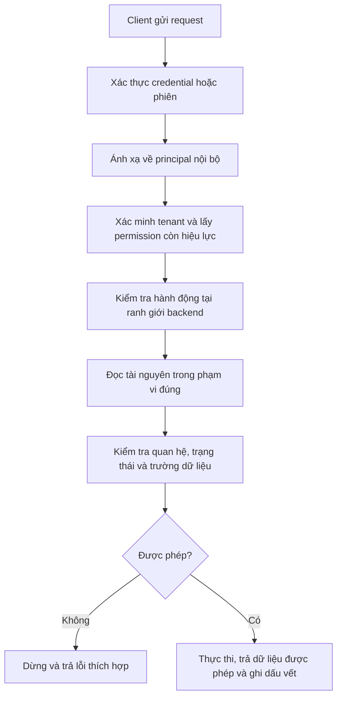

# RBAC trong ứng dụng — Từ role nghiệp vụ đến kiểm soát truy cập tại backend

## 1. RBAC phải trở thành hành vi của ứng dụng

Một ứng dụng có cột `role` trong bảng user chưa chắc đã thực thi Role-Based Access Control, viết tắt RBAC. Điều cần xác định là role đem lại permission nào, được cấp trong phạm vi nào và backend dùng thông tin đó để kiểm soát thao tác ở đâu.

Trong mô hình RBAC, permission được liên kết với role, còn user được liên kết với role. Ứng dụng có thể thêm constraint và kiểm tra quan hệ với tài nguyên để đáp ứng nghiệp vụ. Nguồn nền tảng: [NIST RBAC — FAQs](https://csrc.nist.gov/projects/role-based-access-control/faqs).

Bài học dùng một hệ thống hỗ trợ khách hàng nhiều tenant làm ví dụ. Mỗi tenant là một tổ chức có dữ liệu ticket riêng. Hệ thống có người gửi yêu cầu, nhân viên xử lý, người quản lý hỗ trợ và người quản trị phân quyền.

Một kết quả triển khai cần trả lời được:

- Lan đang hoạt động trong tenant nào và có role nào còn hiệu lực ở đó?
- Những role đó cung cấp permission nào?
- Permission có áp dụng cho ticket cụ thể đang được yêu cầu không?
- Nếu quyền thay đổi, các request tiếp theo nhận biết thay đổi trong khoảng thời gian nào?
- Ai được cấp hoặc thu hồi role, và thay đổi được kiểm toán ra sao?

Đăng nhập, SSO hay xác minh access token giúp thiết lập danh tính. Chúng không tự trả lời toàn bộ các câu hỏi trên.

## 2. Thiết kế role và permission từ nghiệp vụ

### 2.1. Role gom trách nhiệm, permission diễn tả thao tác

Với sản phẩm minh họa, nhóm phát triển thống nhất các role:

| Role | Trách nhiệm |
| --- | --- |
| REQUESTER | Gửi yêu cầu và theo dõi ticket do mình tạo |
| SUPPORT_AGENT | Đọc, xử lý ticket được giao |
| SUPPORT_MANAGER | Xem ticket trong tenant, phân công và đóng ticket |
| ACCESS_ADMIN | Quản lý việc cấp role trong phạm vi được giao |

Đây là thiết kế của ví dụ, không phải bộ role chuẩn cho mọi hệ thống. Chức danh trong sơ đồ tổ chức có thể giúp tìm trách nhiệm, nhưng không nên tự động biến mọi chức danh thành role có quyền rộng.

Các permission được đặt tên theo khả năng của sản phẩm:

```text
ticket:create
ticket:read:own
ticket:read:assigned
ticket:read:tenant
ticket:update:assigned
ticket:assign
ticket:close
access:role:assign
access:role:revoke
```

Hậu tố `own`, `assigned` và `tenant` là quy ước của ứng dụng để diễn đạt phạm vi. Dấu hai chấm không mang ngữ nghĩa bảo mật tự động; code phải thực thi đúng ý nghĩa đã định.

Ví dụ, `ticket:read:assigned` chỉ cho phép đọc ticket mà user hiện hành là người được giao. Không thể kiểm tra chuỗi permission rồi bỏ qua quan hệ assignment của ticket.

### 2.2. Ma trận role–permission

Một ma trận nhỏ làm hợp đồng giữa nghiệp vụ, backend và kiểm thử:

| Permission | REQUESTER | SUPPORT_AGENT | SUPPORT_MANAGER | ACCESS_ADMIN |
| --- | --- | --- | --- | --- |
| ticket:create | Có | Không | Không | Không |
| ticket:read:own | Có | Không | Không | Không |
| ticket:read:assigned | Không | Có | Không | Không |
| ticket:read:tenant | Không | Không | Có | Không |
| ticket:update:assigned | Không | Có | Không | Không |
| ticket:assign | Không | Không | Có | Không |
| ticket:close | Không | Không | Có | Không |
| access:role:assign | Không | Không | Không | Có |
| access:role:revoke | Không | Không | Không | Có |

Trong ma trận này, ACCESS_ADMIN không mặc nhiên được xem nội dung ticket. Nếu cùng một người cần làm cả quản trị quyền và hỗ trợ, sản phẩm có thể cấp thêm role phù hợp.

Ví dụ cũng không mặc định SUPPORT_MANAGER kế thừa SUPPORT_AGENT. Quyền của quản lý được chỉ định theo ma trận. Nếu thực tế muốn kế thừa, cần khai báo và kiểm tra hierarchy có chủ đích.

### 2.3. Tránh rải tên role khắp nghiệp vụ

Một cách dễ làm nhưng khó duy trì:

```text
if user.role == "SUPPORT_MANAGER":
    cho phép phân công ticket
```

Khi tổ chức đổi tên role hoặc có một role khác cũng được phân công, nhiều vị trí code phải thay đổi.

Với ma trận trên, service nghiệp vụ có thể kiểm tra `ticket:assign`, còn cấu hình RBAC quyết định role nào có permission đó. Đây vẫn là RBAC vì permission được suy ra qua role, không phải tự cấp tùy ý cho từng user.

Không phải mọi kiểm tra tên role đều sai. Một quy tắc quản trị có thể cần nói chính xác về role được phép cấp. Điều cần tránh là dùng tên role như lối tắt cho mọi điều kiện nghiệp vụ.

## 3. Role assignment phải có phạm vi

### 3.1. Cùng người, khác tenant, khác quyền

Giả sử:

```text
Lan:
    tenant-a -> SUPPORT_MANAGER
    tenant-b -> REQUESTER
```

Lan được xem ticket trong tenant A theo permission quản lý, nhưng không được dùng quyền đó để xem mọi ticket của tenant B.

Vì vậy, một role assignment thường cần ít nhất bộ thông tin:

```text
principal + role + scope + trạng thái hiệu lực
```

Trong ví dụ, scope là tenant. Một ứng dụng khác có thể dùng project, kho hàng hoặc đơn vị kinh doanh. Không gộp quyền của mọi scope thành một tập permission toàn cục rồi dùng cho mọi tài nguyên.

OWASP hướng dẫn thiết lập context tenant đáng tin và thực thi cách ly dữ liệu xuyên suốt các lớp ứng dụng. Nguồn: [OWASP Multi-Tenant Security](https://cheatsheetseries.owasp.org/cheatsheets/Multi_Tenant_Security_Cheat_Sheet.html).

### 3.2. Tenant từ request là lựa chọn cần xác minh

Một URL có thể là:

```text
GET /api/tenants/tenant-b/tickets/ticket-204
```

`tenant-b` trong URL mô tả tenant client muốn truy cập. Backend phải kiểm tra user được hoạt động ở tenant đó và ticket thực sự nằm trong phạm vi tương ứng.

Không lấy header `X-Tenant-Id` làm bằng chứng quyền chỉ vì tên header trông như dữ liệu nội bộ. Có thể dùng header trong một kiến trúc đã thiết lập ranh giới tin cậy, nhưng phải xác minh nguồn và quan hệ với principal.

Trong mô hình ví dụ, lựa chọn tenant được giải quyết trước khi tạo context permission dùng cho request. Context đó được gắn với đúng tenant và không được tái sử dụng cho tenant khác.

## 4. Mô hình dữ liệu RBAC của ví dụ

### 4.1. Các quan hệ chính

Một schema logic đơn giản:

```text
app_users
    id, status

tenant_memberships
    user_id, tenant_id, status
    khóa duy nhất: (user_id, tenant_id)

roles
    id, code, enabled

permissions
    code, enabled

role_permissions
    role_id, permission_code
    khóa duy nhất: (role_id, permission_code)

role_assignments
    user_id, tenant_id, role_id
    status, valid_from, valid_until
    khóa duy nhất trong ví dụ: (user_id, tenant_id, role_id)

tickets
    id, tenant_id, requester_id, assignee_id
    status, version
```

Đây là schema logic để giải thích quan hệ, chưa phải migration database hoàn chỉnh. Cần bổ sung kiểu dữ liệu, khóa ngoại, index và constraint phù hợp khi triển khai.

Trong thiết kế này, role definitions và permission catalog được quản lý chung. Tenant nhận các assignment theo role có sẵn. Nếu cho mỗi tenant tạo custom role, model phải bổ sung ownership của role và kiểm soát role nào được dùng trong tenant nào.

Một role assignment nên tham chiếu membership và role tồn tại. Các lần gia hạn hoặc thu hồi cần có lịch sử riêng nếu nghiệp vụ yêu cầu truy vết; không suy ra lịch sử chỉ từ bản ghi hiện hành.

### 4.2. Tính permission có hiệu lực

Truy vấn minh họa cho mô hình chưa sử dụng role activation theo phiên:

```sql
SELECT DISTINCT p.code
FROM role_assignments a
JOIN tenant_memberships m
  ON m.user_id = a.user_id
 AND m.tenant_id = a.tenant_id
JOIN app_users u
  ON u.id = a.user_id
JOIN roles r
  ON r.id = a.role_id
JOIN role_permissions rp
  ON rp.role_id = r.id
JOIN permissions p
  ON p.code = rp.permission_code
WHERE a.user_id = :authenticated_user_id
  AND a.tenant_id = :requested_tenant_id
  AND u.status = 'ACTIVE'
  AND m.status = 'ACTIVE'
  AND a.status = 'ACTIVE'
  AND r.enabled = TRUE
  AND p.enabled = TRUE
  AND a.valid_from <= :evaluation_time
  AND (
      a.valid_until IS NULL
      OR :evaluation_time < a.valid_until
  );
```

User ID phải được ánh xạ từ danh tính đã xác thực. Tenant được yêu cầu là tham số truy vấn, còn membership và assignment trong nguồn dữ liệu có thẩm quyền quyết định quyền có hiệu lực. Thời điểm đánh giá do backend kiểm soát.

Ví dụ giả định tenant hiện hành đã được kiểm tra còn hoạt động. Nếu trạng thái tenant ảnh hưởng quyền, nó phải tham gia context hoặc điều kiện tra cứu tương ứng.

Quyền từ nhiều assignment được hợp theo ma trận của ví dụ. Model này không định nghĩa explicit deny. Nếu thêm deny, phải quy định thứ tự ưu tiên và cách kết hợp, không tự cho rằng mọi thư viện RBAC đều có cùng ngữ nghĩa.

### 4.3. Cần biết permission đến từ đâu

Chỉ trả về một tập chuỗi đủ để thực hiện một số kiểm tra đơn giản, nhưng khi điều tra có thể cần biết:

```text
ticket:read:tenant
    đến từ role SUPPORT_MANAGER
    qua assignment của Lan trong tenant-a
    có hiệu lực từ thời điểm được phê duyệt
```

Có thể lưu hoặc truy vấn nguồn cấp quyền để giải thích quyết định. Không nhất thiết nhét toàn bộ bằng chứng vào token hay log của mỗi request.

Nếu sản phẩm có session chọn active roles, bước tính permission phải giới hạn theo active roles được chấp nhận. Không gộp toàn bộ role được gán rồi cho rằng chức năng chọn role trên giao diện đã thực thi constraint động.

## 5. Luồng xử lý một request trong ứng dụng



Luồng này thể hiện trách nhiệm, không buộc mọi ứng dụng dùng đúng số lớp như sơ đồ. Một truy vấn theo phạm vi có thể kết hợp bước tìm tài nguyên và xác định tập tài nguyên được phép.

### 5.1. Xác thực và ánh xạ danh tính

Ứng dụng có thể sử dụng phiên phía server hoặc access token từ IdP. Với danh tính liên kết, cần ánh xạ issuer và subject về user nội bộ theo hợp đồng tin cậy.

Không tự chọn email client gửi làm user ID cho quyết định quyền. Email có thể thay đổi; các issuer khác nhau cũng có thể cung cấp chuỗi subject trùng nhau.

Sau SSO, user có thể được nhận diện hợp lệ nhưng chưa có membership hoặc role tại tenant đang yêu cầu. Khi đó, không tự cấp SUPPORT_AGENT chỉ để tránh màn hình trống.

### 5.2. Điểm thực thi ở backend

Backend cần quyết định quyền trước khi trả dữ liệu nhạy cảm hoặc tạo tác động được bảo vệ. Các đường REST, message handler, công cụ quản trị và job nền phải có kiểm soát phù hợp với cách chúng gọi nghiệp vụ.

OWASP khuyến nghị deny by default và kiểm tra quyền trên mọi request. Nguồn: [OWASP Authorization Cheat Sheet](https://cheatsheetseries.owasp.org/cheatsheets/Authorization_Cheat_Sheet.html).

Trong ví dụ, thêm endpoint tải toàn bộ ticket thành CSV cần quyền cùng phạm vi dữ liệu được định nghĩa riêng. Không mặc định quyền đọc một ticket tự bao gồm mọi hình thức xuất dữ liệu.

### 5.3. Quyền thao tác là điều kiện cần, không phải toàn bộ quyết định

Người có `ticket:update:assigned` chỉ được cập nhật ticket được giao cho mình theo quy tắc của sản phẩm. Nếu ticket đã bị khóa hoặc thao tác chỉ được sửa một số trường, backend còn phải kiểm tra các điều kiện đó.

Khi kết hợp role với quan hệ requester, assignee và trạng thái đối tượng, hệ thống đang dùng RBAC cùng các ràng buộc ở mức tài nguyên. Đây là mô hình thường cần để diễn đạt chính xác nghiệp vụ; không nên tuyên bố một nhãn role đơn lẻ giải quyết mọi quyền đối tượng.

## 6. Ví dụ Java: kiểm tra quyền đọc đúng ticket

### 6.1. Context được tạo từ nguồn đáng tin

Đoạn Java sau minh họa phần quyết định quyền đọc. Nó dùng snapshot permission đã được giải quyết cho đúng user và tenant. Snapshot phải đáp ứng yêu cầu hiệu lực do ứng dụng thiết kế.

```java
import java.util.Objects;
import java.util.Set;
import java.util.UUID;

public final class TicketReadPolicy {

    // Chỉ tạo sau khi đã xác minh user, tenant và nguồn permission.
    public record Context(
            UUID userId,
            UUID tenantId,
            Set<String> permissions) {

        public Context {
            Objects.requireNonNull(userId, "userId");
            Objects.requireNonNull(tenantId, "tenantId");
            permissions = Set.copyOf(permissions);
        }
    }

    // Metadata đọc từ nguồn tài nguyên có thẩm quyền.
    public record Ticket(
            UUID id,
            UUID tenantId,
            UUID requesterId,
            UUID assigneeId) {
    }

    public static boolean canRead(Context context, Ticket ticket) {
        if (context == null || ticket == null) {
            return false;
        }

        if (!context.tenantId().equals(ticket.tenantId())) {
            return false;
        }

        Set<String> permissions = context.permissions();

        if (permissions.contains("ticket:read:tenant")) {
            return true;
        }

        if (permissions.contains("ticket:read:own")
                && context.userId().equals(ticket.requesterId())) {
            return true;
        }

        return permissions.contains("ticket:read:assigned")
                && context.userId().equals(ticket.assigneeId());
    }
}
```

Code sử dụng record của Java 17. Nó không triển khai cơ chế xác thực, truy vấn role, session hay mapping lỗi HTTP.

Các record không biến dữ liệu client thành đáng tin. Không deserialize JSON do client gửi trực tiếp thành `Context` rồi dùng làm bằng chứng quyền.

### 6.2. Kết quả theo ma trận ví dụ

| Context và ticket | Kết quả dự kiến |
| --- | --- |
| Lan có ticket:read:own, ticket do Lan tạo trong tenant hiện hành | Cho phép |
| Lan có ticket:read:own, ticket của Minh trong cùng tenant | Từ chối |
| Minh có ticket:read:assigned, ticket đang giao cho Minh | Cho phép |
| Minh có ticket:read:assigned, ticket đã chuyển cho người khác | Từ chối theo metadata được đánh giá |
| Huy có ticket:read:tenant, ticket cùng tenant | Cho phép |
| Huy có ticket:read:tenant ở tenant A, ticket thuộc tenant B | Từ chối |
| An chỉ có access:role:assign | Không tự có quyền đọc ticket |

Hàm trả về allow chỉ giải quyết quyền đọc đối tượng trong mô hình đã nêu. Response vẫn cần chỉ chứa các trường được phép trả cho loại người dùng đó.

### 6.3. Đặt việc gọi policy vào service

Một mảnh ghép Java/Spring minh họa:

```java
@Service
public class TicketService {

    private final TrustedContexts contexts;
    private final TicketRepository repository;

    public TicketService(
            TrustedContexts contexts,
            TicketRepository repository) {
        this.contexts = contexts;
        this.repository = repository;
    }

    @PreAuthorize("isAuthenticated()")
    public TicketView read(UUID tenantId, UUID ticketId) {
        var context = contexts.requireForTenant(tenantId);

        var ticket = repository
                .findByIdAndTenantId(ticketId, context.tenantId())
                .orElseThrow(TicketNotAccessibleException::new);

        if (!TicketReadPolicy.canRead(context, ticket)) {
            throw new AccessDeniedException("Access denied");
        }

        return TicketView.from(ticket);
    }
}
```

`TrustedContexts`, `TicketRepository`, `TicketView` và exception miền nghiệp vụ là các thành phần ứng dụng cần cung cấp. Repository trong ví dụ trả metadata phù hợp với `TicketReadPolicy.Ticket`; ví dụ chưa trình bày persistence entity và mapping đầy đủ.

`requireForTenant` phải kiểm tra user, membership, scope và dữ liệu permission đúng yêu cầu hiệu lực. Nó không chỉ sao chép tenant ID từ URL.

Annotation ở đây chỉ yêu cầu danh tính được xác thực. Quyết định RBAC có scope và quyền trên ticket nằm ở context cùng policy. Nếu bỏ phần kiểm tra policy, method vẫn chưa đáp ứng yêu cầu đọc của ma trận.

## 7. Tích hợp với Spring Security

### 7.1. Method security cần được bật

Để các annotation bảo vệ method được xử lý, ứng dụng phải cấu hình method security:

```java
@Configuration
@EnableMethodSecurity
public class MethodSecurityConfig {
}
```

Các annotation tương ứng thuộc Spring Framework và Spring Security. Method được bảo vệ cần nằm trên bean do Spring quản lý và được gọi qua cơ chế bảo vệ thích hợp. Spring Boot Starter Security không tự bật method authorization. Nguồn: [Spring Security — Method Security](https://docs.spring.io/spring-security/reference/servlet/authorization/method-security.html).

Ví dụ `TicketService` ở trên giả định điều kiện này đã được đáp ứng. Việc tạo đối tượng service bằng `new` trong một đường xử lý khác không tự gắn interceptor bảo mật cho nó.

Trong cấu hình Spring AOP dựa trên proxy, lời gọi từ một method sang method khác trên chính đối tượng qua `this` đi vòng qua proxy. Không dùng self-invocation làm bằng chứng annotation đã được thực thi. Nguồn: [Spring Framework — Proxying Mechanisms](https://docs.spring.io/spring-framework/reference/core/aop/proxying.html).

### 7.2. Phân biệt role, authority và permission ứng dụng

Spring Security biểu diễn quyền đã cấp thông qua `GrantedAuthority`. Theo mặc định, `hasRole("SUPPORT_MANAGER")` tìm authority có tiền tố `ROLE_`; `hasAuthority` kiểm tra chuỗi authority được chỉ định. Nguồn: [Spring Security — Authorization Architecture](https://docs.spring.io/spring-security/reference/servlet/authorization/architecture.html).

| Biểu thức | Ý nghĩa theo cấu hình mặc định liên quan |
| --- | --- |
| hasRole("SUPPORT_MANAGER") | Tìm ROLE_SUPPORT_MANAGER |
| hasAuthority("ROLE_SUPPORT_MANAGER") | Tìm đúng chuỗi ROLE_SUPPORT_MANAGER |
| hasAuthority("ticket:assign") | Tìm đúng chuỗi ticket:assign |

Nếu ứng dụng ánh xạ permission miền nghiệp vụ thành authorities, có thể dùng `hasAuthority("ticket:assign")` như một phần kiểm soát. Tuy nhiên, tập authority phải giữ đúng scope, hoặc có guard riêng kiểm tra scope trước tác động.

Một authority tên SUPPORT_MANAGER không tự chứa tenant. Nếu đã gộp role quản lý của tenant A vào principal toàn cục, biểu thức role đơn lẻ có thể cho kết quả quá rộng khi endpoint xử lý tenant B.

Ví dụ của bài học giữ quyết định scoped permission trong `TrustedContexts` và policy để làm rõ ranh giới đó.

### 7.3. JWT scope không tự trở thành permission nội bộ

Resource Server của Spring Security mặc định ánh xạ OAuth scope sang authority có tiền tố `SCOPE_`. Claim tùy chỉnh như `roles` không tự có đúng ý nghĩa của ma trận permission nội bộ nếu chưa cấu hình ánh xạ tương ứng. Nguồn: [Spring Security — OAuth 2.0 Resource Server JWT](https://docs.spring.io/spring-security/reference/servlet/oauth2/resource-server/jwt.html#oauth2resourceserver-jwt-authorization).

Có thể chọn:

- IdP phát role hoặc permission theo hợp đồng đáng tin và ứng dụng ánh xạ có kiểm soát.
- Ứng dụng nhận danh tính đã xác thực rồi tra cứu role assignment nội bộ.
- Một mô hình kết hợp, với nguồn chuẩn và quy tắc nhất quán rõ ràng cho từng loại quyền.

Đây là các lựa chọn kiến trúc, không phải lý do để tin mọi claim do client trình bày. Cơ chế xác minh access token, issuer, audience và các điều kiện profile vẫn phải được cấu hình phù hợp.

SSO trả lời việc ai đã đăng nhập. Một group IdP có tên “Support” chỉ được biến thành role hỗ trợ nếu quan hệ ánh xạ đó đã được hệ thống quản lý và chấp nhận.

### 7.4. Rules HTTP cần bao phủ endpoint

Cấu hình request authorization nên khai báo rõ endpoint công khai, endpoint cần bảo vệ và hành vi với đường chưa được cho phép. Cơ chế HTTP bảo vệ cửa vào; service giữ các điều kiện nghiệp vụ có scope và đối tượng.

Không chỉ bảo vệ `GET /tickets/{id}` rồi quên file đính kèm, API tìm kiếm, export hoặc phiên bản API cũ. Endpoint quản trị role cũng là tài nguyên cần phân quyền, không phải vùng được miễn kiểm soát vì nằm trong giao diện quản trị.

## 8. Truy vấn dữ liệu, cập nhật và giao diện

### 8.1. Danh sách phải phản ánh đúng phạm vi

Với REQUESTER, danh sách là ticket do user đó tạo trong tenant được phép. Với SUPPORT_AGENT, danh sách là ticket được giao. Với SUPPORT_MANAGER, danh sách có thể gồm mọi ticket trong tenant theo ma trận.

Backend nên xác định tập dữ liệu được phép trước khi tính count, phân trang và export. Lấy toàn bộ dữ liệu rồi chỉ ẩn dòng trên giao diện sẽ làm lộ dữ liệu hoặc metadata.

Một biểu thức phạm vi khái niệm:

```text
tenant_id = authorizedTenant
AND (
    có ticket:read:tenant
    OR (có ticket:read:own AND requester_id = actor)
    OR (có ticket:read:assigned AND assignee_id = actor)
)
```

Các điều kiện “có permission” phải được backend tính từ context đáng tin. Không đưa cờ `canReadTenant=true` từ request vào truy vấn.

Nếu quan hệ chia sẻ phức tạp hơn, biểu thức cần thay đổi tương ứng. Không mở rộng thành “mọi ticket cùng tenant” chỉ vì truy vấn theo quan hệ khó hơn.

### 8.2. Cập nhật phải giữ điều kiện ở ranh giới ghi

Quyền `ticket:update:assigned` không được biến thành quyền sửa mọi field của entity. Ví dụ, DTO cập nhật nội dung không nên đồng thời cho phép đổi `tenant_id`, requester hoặc assignee.

Giả sử ticket được chuyển cho người khác sau khi request đã đọc metadata. Một lệnh cập nhật cần xử lý điều kiện cạnh tranh phù hợp:

```sql
UPDATE tickets
SET response_draft = :new_draft,
    version = version + 1
WHERE id = :ticket_id
  AND tenant_id = :authorized_tenant_id
  AND assignee_id = :authenticated_user_id
  AND status = 'IN_PROGRESS'
  AND version = :expected_version;
```

Câu lệnh minh họa giả định chỉ cho sửa bản nháp khi ticket đang xử lý. Nó không thay thế kiểm tra permission `ticket:update:assigned` hay trạng thái tài khoản.

Version của ticket không tự phát hiện role vừa bị thu hồi ở một nơi khác. Hệ thống cần xử lý độ mới của dữ liệu quyền bằng cơ chế riêng phù hợp.

### 8.3. Giao diện sử dụng capability để hỗ trợ người dùng

Frontend có thể hỏi backend người dùng được thực hiện thao tác nào trong tenant hiện hành, rồi ẩn hoặc vô hiệu hóa nút không phù hợp.

Ví dụ response minh họa:

```json
{
  "tenantId": "tenant-a",
  "capabilities": [
    "ticket:read:assigned",
    "ticket:update:assigned"
  ]
}
```

Danh sách này giúp điều hướng và trải nghiệm. Nó không thay thế quyết định tại request thao tác, cũng chưa chứng minh quyền trên mọi ticket.

Khi đổi tenant, frontend cần làm mới capability và dữ liệu liên quan. Backend vẫn phải tự kiểm tra scope ngay cả khi frontend có lỗi hoặc client gọi API trực tiếp.

## 9. Quản trị và vòng đời role

### 9.1. Cấp role cũng là một thao tác đặc quyền

Có `access:role:assign` không nên được hiểu là có thể cấp mọi role cho bất kỳ ai ở bất kỳ tenant nào.

Trong ví dụ, policy quản trị cần xác định:

```text
Ai được cấp?
Được cấp role nào?
Cho principal nào?
Trong tenant hoặc scope nào?
Trong khoảng thời gian nào?
Có cần người khác phê duyệt không?
```

Danh sách role được cấp có thể được giới hạn theo trách nhiệm của người quản trị. Không để client tự khai báo tên role mới hoặc thêm permission vào role rồi dùng quyền assign để tự nâng đặc quyền.

Tách quyền sửa định nghĩa role khỏi quyền gán role là một lựa chọn có ích khi mức độ ảnh hưởng khác nhau. Chỉnh một role đang có nhiều người dùng có thể mở rộng quyền cho tất cả assignment liên quan.

### 9.2. Quy trình cấp và thu hồi minh họa

Một luồng cấp role:

1. Xác minh actor và scope quản trị.
2. Kiểm tra principal đích cùng membership hợp lệ.
3. Kiểm tra role đích thuộc danh sách được phép cấp.
4. Áp dụng điều kiện phê duyệt hoặc phân tách nhiệm vụ nếu có.
5. Ghi assignment với thời điểm hiệu lực.
6. Cập nhật hoặc vô hiệu hóa dữ liệu quyền dẫn xuất.
7. Ghi audit event có actor, target, scope, lý do và kết quả.

Thu hồi cần thay đổi nguồn chuẩn và làm cho các điểm thực thi nhận biết trong yêu cầu hiệu lực đã chọn. Xóa role khỏi một màn hình quản trị chưa chứng minh token hoặc cache ở service đã mất quyền.

### 9.3. Onboarding, chuyển vị trí và offboarding

Khi user mới vào tổ chức, nên cấp role theo trách nhiệm được xác nhận. Không lấy role của một nhân viên cũ làm mẫu rồi sao chép nguyên mọi ngoại lệ.

Khi chuyển nhóm, cần xem xét cả quyền mới và quyền cũ. Chỉ thêm role mới sẽ tích lũy quyền theo thời gian.

Khi user rời tổ chức, cần xử lý khả năng đăng nhập, membership, role assignment, phiên và các grant liên quan. Vô hiệu hóa đăng nhập không tự xóa mọi quyền đã được cấp trước; thu hồi role cũng không tự đóng mọi credential theo mọi kiến trúc.

Workload có vòng đời riêng. Một service account xử lý ticket không nên dùng chung credential với nhân viên hoặc được cấp SUPPORT_MANAGER chỉ vì thuận tiện. Nên xác định chính xác thao tác, scope và quan hệ đại diện mà workload cần.

## 10. Cache, token và độ trễ thu hồi

### 10.1. Lưu quyền ở đâu là một quyết định có hệ quả

| Cách cung cấp quyền | Lợi ích của cách làm | Điều cần thiết kế |
| --- | --- | --- |
| Tra cứu từ nguồn có thẩm quyền khi đánh giá | Dễ liên hệ với trạng thái hiện hành | Độ trễ, khả dụng và độ mới thực tế của nguồn |
| Cache hoặc bản sao cục bộ | Giảm chi phí tra cứu | Key đúng scope, vô hiệu hóa, theo dõi độ trễ |
| Role hoặc permission trong access token | Mang được snapshot đến service | Thời hạn, thu hồi và giới hạn của claim cũ |
| Context phiên phía server | Có điểm quản lý trạng thái tập trung hơn | Đồng bộ nhiều instance, cập nhật context và hành vi khi lỗi |

Độ sẵn có không đồng nghĩa độ mới. OWASP khuyến nghị xác định nguồn chuẩn, yêu cầu hiệu lực và hành vi khi không thể có dữ liệu đủ tin cậy cho quyết định. Nguồn: [Authorization Policy and Data Distribution](https://cheatsheetseries.owasp.org/cheatsheets/Authorization_Policy_And_Data_Distribution_Cheat_Sheet.html).

### 10.2. Một tình huống thực tế của ví dụ

```text
09:00  Lan có SUPPORT_MANAGER tại tenant-a.
09:05  Service lưu cache permission của Lan.
09:10  Quyền SUPPORT_MANAGER bị thu hồi.
09:11  Lan gửi request xem danh sách mọi ticket.
```

Nếu cache cũ vẫn được dùng, request 09:11 có thể được cho phép theo snapshot trước khi thu hồi. Việc mỗi request đều gọi hàm kiểm tra permission không tự chứng minh permission đã được làm mới.

Sản phẩm cần chọn giới hạn hiệu lực và cơ chế đáp ứng nó. Có thể dùng cập nhật theo sự kiện, tra cứu bổ sung cho thao tác nhạy cảm, version quyền hoặc các phương án phù hợp khác.

Không tự gia hạn mãi một kết quả allow cũ khi kho quyền lỗi. Nếu dữ liệu không đáp ứng điều kiện bắt buộc, thao tác bị ảnh hưởng phải được xử lý theo chính sách lỗi đã thiết kế.

### 10.3. Cache key cần gắn đúng người và scope

Một cache permission chỉ theo user ID có thể lấy quyền quản lý của tenant A để áp dụng cho tenant B. Cache quyết định chỉ theo ticket ID có thể dùng kết quả của Lan cho Minh.

Thiết kế cần xét những chiều thực sự quyết định kết quả, như principal, tenant, action, tài nguyên và phiên bản dữ liệu liên quan. Có thể dùng key, invalidation hoặc bỏ cache cho một số quyết định, miễn bảo đảm đúng hợp đồng hiệu lực.

Đừng bỏ quên cache response. Một nội dung ticket được phép trả cho quản lý không được chia sẻ cho người khác chỉ vì URL giống nhau.

## 11. Giới hạn RBAC và cách mở rộng có kiểm soát

### 11.1. Role không thay thế quan hệ với tài nguyên

Trong ví dụ, SUPPORT_AGENT chỉ đọc ticket được giao. Nếu tạo một role riêng cho mỗi ticket để diễn tả quan hệ đó, số lượng role sẽ tăng theo tài nguyên và khó quản lý.

Có thể giữ role mô tả trách nhiệm ổn định, còn quan hệ assignee là dữ liệu tài nguyên được kiểm tra tại policy. Với sản phẩm cần chia sẻ, nhóm dự án hoặc nhiều thuộc tính ngữ cảnh, có thể kết hợp kiểm soát theo quan hệ hoặc thuộc tính.

Đó là mở rộng chính sách theo nhu cầu cụ thể. Không cần biến mọi điều kiện thành role và cũng không cần thay toàn bộ hệ thống chỉ vì một endpoint cần thêm quan hệ.

### 11.2. Hierarchy cần được rà soát theo quyền hiệu lực

Nếu khai báo MANAGER kế thừa AGENT, quyền thêm vào AGENT có thể xuất hiện ở MANAGER. Tác động của thay đổi permission không còn giới hạn ở một hàng trong ma trận.

Cần xác định hướng kế thừa, phát hiện chu kỳ theo model và kiểm tra tập quyền hiệu lực. Không suy rằng một role có tên cao hơn về tổ chức luôn nên có mọi quyền của role khác.

### 11.3. Phân tách nhiệm vụ là constraint riêng

Nếu người quản trị không được tự phê duyệt việc cấp role cho mình, phải mô hình hóa điều kiện đó tại luồng cấp quyền. Việc user có hai role khác tên không tự bảo đảm hai người độc lập tham gia.

Tương tự, nếu sản phẩm có role activation theo phiên và cấm một số tổ hợp active roles, điểm thực thi phải dùng đúng tập kích hoạt. Đây là điều kiện bổ sung cho model của ví dụ, không được tự suy ra từ ma trận role–permission.

## 12. Kiểm toán và kiểm chứng triển khai

### 12.1. Dấu vết cấp role

Một event minh họa:

```text
event_type: ROLE_ASSIGNMENT_GRANTED
actor_id: internal-admin-reference
target_principal_id: internal-user-reference
tenant_id: tenant-a
role_code: SUPPORT_AGENT
valid_from: approved-effective-time
valid_until: approved-expiry-or-none
reason_code: APPROVED_SUPPORT_ASSIGNMENT
result: SUCCESS
correlation_id: request-reference
```

Nên phân biệt người yêu cầu, người phê duyệt và hệ thống thực thi nếu workflow có các chủ thể khác nhau. Không ghi token, cookie hoặc mật khẩu vào event.

Khi điều tra một request, cần phân biệt quyết định allow với kết quả nghiệp vụ thành công. Một request được phép cập nhật vẫn có thể thất bại do version của ticket đã thay đổi.

### 12.2. Ma trận tình huống

Bảng dưới đây là tiêu chí kiểm chứng một implementation, không phải báo cáo đã chạy thử ứng dụng:

| Tình huống | Điều cần chứng minh |
| --- | --- |
| REQUESTER đọc ticket do mình tạo | Được phép theo các trường dữ liệu đã định |
| REQUESTER thay ID sang ticket người khác | Không được đọc ngoài quan hệ cho phép |
| AGENT đọc ticket đang được giao | Được phép trong đúng tenant |
| Ticket được chuyển sang AGENT khác | Quan hệ mới được áp dụng theo yêu cầu hiệu lực |
| MANAGER tenant A truy cập ticket tenant B | Không vượt scope bằng cách đổi URL hoặc header |
| ACCESS_ADMIN gọi API đọc ticket | Không tự nhận quyền đọc do tên role quản trị |
| Assignment hết hạn hoặc membership bị khóa | Không tiếp tục cung cấp permission trái chính sách |
| Client gửi thêm role hoặc canReadTenant trong JSON | Không làm thay đổi context quyền đáng tin |
| User có nhiều role trong một tenant | Kết quả phản ánh đúng quy tắc kết hợp đã công bố |
| Role definition được sửa | Hiểu và kiểm tra được tác động đến user liên quan |
| Endpoint export, file đính kèm hoặc API cũ | Có kiểm soát quyền phù hợp |
| Batch chứa tài nguyên của nhiều tenant | Không vượt ranh giới qua một phần tử trong batch |
| Method được gọi qua self-invocation hoặc đối tượng tạo bằng new | Không giả định annotation vẫn được thực thi |
| Token có scope nhưng thiếu permission nội bộ cần thiết | Không tự đồng nhất hai khái niệm |
| Cache còn quyền cũ sau thu hồi | Hành vi đạt giới hạn hiệu lực đã cam kết |
| Kho quyền lỗi | Không tự cấp role mặc định hoặc mở rộng allow |
| Admin thử tự cấp role ngoài phạm vi quản lý | Bị chặn theo chính sách quản trị |
| Job chạy thay người dùng | Giữ được phạm vi và danh tính đại diện cần thiết |

Kiểm tra hàm policy giúp phát hiện sai điều kiện. Kiểm tra tích hợp qua đường API và persistence giúp phát hiện việc chưa gọi policy, mapping authority sai hoặc truy vấn thiếu tenant.

Cần có cả trường hợp cho phép và từ chối. Một hệ thống chặn mọi request không đáp ứng ma trận nghiệp vụ dù không trả dữ liệu ra ngoài.

## 13. Bài tập triển khai

Một hệ thống hiện lưu `role = ADMIN` trên user và kiểm tra role đó ở frontend. API nhận `tenantId` từ header, sau đó dùng `findById(ticketId)` để trả ticket. Nhân viên chuyển bộ phận chỉ được thêm role mới, còn quyền cũ vẫn giữ.

Hãy đề xuất lại thiết kế để đáp ứng các yêu cầu:

1. Một user có thể có vai trò khác nhau ở hai tenant.
2. Nhân viên chỉ đọc ticket được giao; người gửi chỉ đọc ticket của mình.
3. Người quản trị role không mặc nhiên được xem nội dung ticket.
4. Thu hồi role có giới hạn hiệu lực rõ ràng.
5. API quản trị, export và job nền cùng tuân theo phạm vi được phép.

Một hướng giải cần có ma trận role–permission, role assignment có scope, context danh tính đáng tin, điểm kiểm soát tại backend, truy vấn giới hạn dữ liệu và quy trình cấp/thu hồi có kiểm toán.

Với mỗi yêu cầu, hãy chỉ ra dữ liệu nào là bằng chứng và đoạn xử lý nào thực thi quyết định. Thiết kế chỉ thêm tên role hoặc ẩn nút trên giao diện chưa đủ chứng minh RBAC đã hoạt động trong ứng dụng.
