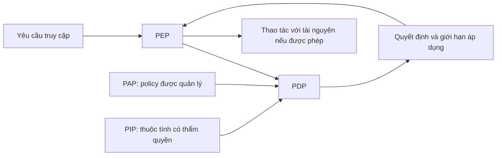

# Attribute-Based Access Control

## 1. Vì sao quyền truy cập cần nhiều hơn một tên vai trò?

An và Bình cùng là kỹ sư trong một công ty. An tham gia dự án Alpha, Bình tham gia dự án Beta. Cả hai cần đọc tài liệu của dự án mình, nhưng không được đọc mọi tài liệu kỹ thuật trong tổ chức. Một số tài liệu mật còn yêu cầu thiết bị được quản lý và bằng chứng xác thực tăng cường phù hợp.

Nếu chỉ kiểm tra `role == ENGINEER`, ứng dụng chưa trả lời được các câu hỏi: tài liệu thuộc tenant nào, người dùng tham gia dự án nào, tài liệu có nhạy cảm không và điều kiện truy cập hiện tại có đạt không?

**Attribute-Based Access Control — ABAC**, hay kiểm soát truy cập dựa trên thuộc tính, là cách đưa ra quyết định authorization bằng việc đánh giá các thuộc tính liên quan theo chính sách. Thuộc tính có thể mô tả chủ thể, tài nguyên, hành động được yêu cầu và môi trường truy cập.

NIST SP 800-162 định nghĩa ABAC dựa trên việc đánh giá những nhóm thuộc tính này theo policy, rule hoặc quan hệ mô tả các thao tác được phép. Đây là mô hình kiểm soát truy cập, không phải tên riêng của một thư viện hay một giao thức đăng nhập. [NIST SP 800-162 — Guide to Attribute Based Access Control](https://csrc.nist.gov/pubs/sp/800/162/upd2/final).

Trong hệ thống IAM, ABAC giúp nối thông tin danh tính với bối cảnh nghiệp vụ tại thời điểm truy cập. Nó vẫn cần authentication đáng tin cậy, dữ liệu thuộc tính có thẩm quyền và một nơi thực thi quyết định.

## 2. Bốn nhóm thuộc tính trong một yêu cầu

Có thể mô tả yêu cầu authorization như sau:

```text
decision = evaluate(policy, subject, action, resource, environment)
```

### 2.1. Subject — chủ thể đang yêu cầu

Chủ thể có thể là người dùng hoặc danh tính workload. Các thuộc tính thường gặp gồm định danh, tenant, trạng thái hoạt động, bộ phận, vai trò, dự án được tham gia và trạng thái đào tạo cần cho một nhiệm vụ.

Ví dụ:

```json
{
  "subjectId": "user-an",
  "tenantId": "tenant-a",
  "active": true,
  "department": "engineering",
  "projectIds": ["alpha"]
}
```

Vai trò có thể là một thuộc tính của chủ thể. ABAC không yêu cầu loại bỏ RBAC, và không cấm sử dụng role trong policy.

### 2.2. Resource — tài nguyên đích

Tài nguyên có thể là một tài liệu, bản ghi, API, secret, service hoặc tập dữ liệu. Những thuộc tính cần cho policy có thể gồm tenant sở hữu, dự án, chủ sở hữu, mức phân loại dữ liệu và trạng thái nghiệp vụ.

```json
{
  "documentId": "doc-42",
  "tenantId": "tenant-a",
  "projectId": "alpha",
  "ownerId": "user-an",
  "classification": "CONFIDENTIAL",
  "state": "DRAFT"
}
```

Client có thể gửi ID để chọn tài liệu. Các thuộc tính dùng làm căn cứ quyền phải được server lấy hoặc xác minh từ nguồn có thẩm quyền. Người gọi không được tự đổi `classification` thành `INTERNAL` trong request để tránh điều kiện truy cập tài liệu mật.

### 2.3. Action — hành động đang được yêu cầu

Các action nên thể hiện đúng nghiệp vụ cần kiểm soát:

```text
document:read
document:update
document:export
document:delete
```

Quyền đọc không tự bao hàm quyền sửa, xuất hoặc xóa. Một HTTP method cũng chưa chắc tương ứng duy nhất với một action: `POST` có thể tạo tài liệu, yêu cầu export hoặc phê duyệt một thay đổi.

Ứng dụng phải ánh xạ request sang action đáng tin cậy. Không để client tự khai `action=document:read` trong khi handler thực tế đang xuất toàn bộ tài liệu.

### 2.4. Environment — điều kiện của lần truy cập

Nhóm này có thể bao gồm thời điểm server đánh giá, trạng thái thiết bị, mức xác thực của phiên hoặc ngữ cảnh mạng đã được xác minh.

```json
{
  "managedDevice": true,
  "strongAuthVerified": true
}
```

Đây là các giá trị đơn giản hóa cho ví dụ. Trong hệ thống thực tế, cần xác định ai cung cấp bằng chứng, bằng chứng gắn với phiên nào và còn đủ mới hay không.

Header `X-Managed-Device: true` do người gọi gửi không tự chứng minh thiết bị được quản lý. Tương tự, IP trong một header chưa được xác minh không tự chứng minh người dùng ở mạng nội bộ.

## 3. Từ yêu cầu nghiệp vụ thành policy

Với ứng dụng tài liệu ở trên, giả sử tổ chức chọn chính sách sau:

1. Chủ thể phải còn hoạt động.
2. Chủ thể và tài liệu phải thuộc cùng tenant.
3. Chủ thể phải tham gia dự án của tài liệu.
4. Đọc tài liệu `INTERNAL` được phép khi ba điều kiện chung đã đạt.
5. Truy cập tài liệu `CONFIDENTIAL` còn yêu cầu thiết bị được quản lý và xác thực tăng cường đã được xác minh.
6. Sửa tài liệu chỉ được phép với chủ sở hữu, khi tài liệu còn nháp và từ thiết bị được quản lý; tài liệu mật vẫn phải đạt điều kiện xác thực tăng cường.
7. Những action khác chưa được policy này cấp quyền.

Đây là chính sách minh họa, không phải quy tắc mặc định cho mọi tổ chức. `INTERNAL` và `CONFIDENTIAL` là hai nhãn của ứng dụng ví dụ; không được tự suy ra một chuẩn phân loại chung chỉ từ tên nhãn.

Một cách viết logic cho quyền đọc là:

```text
PERMIT document:read khi:
    subject.active
    AND subject.tenantId == resource.tenantId
    AND resource.projectId thuộc subject.projectIds
    AND (
        resource.classification == INTERNAL
        OR (
            resource.classification == CONFIDENTIAL
            AND environment.managedDevice
            AND environment.strongAuthVerified
        )
    )
```

Dấu ngoặc có ý nghĩa bảo mật. Nếu tách nhánh `classification == INTERNAL` ra khỏi các điều kiện tenant và membership bằng một phép `OR` đặt sai chỗ, policy có thể vô tình mở quyền đọc tài liệu nội bộ cho mọi tenant.

| Tình huống | Kết quả theo policy ví dụ | Điều kiện quyết định |
| --- | --- | --- |
| An đọc tài liệu nội bộ của Alpha trong tenant A | Cho phép | Đúng tenant, đúng dự án, tài khoản hoạt động |
| Bình chỉ tham gia Beta, đọc tài liệu Alpha | Từ chối | Không đạt membership dự án |
| An đọc tài liệu tenant B | Từ chối | Không đạt ranh giới tenant |
| An đọc tài liệu mật Alpha trên thiết bị chưa đạt | Từ chối | Điều kiện thiết bị không đạt |
| An đọc tài liệu mật, thiếu bằng chứng xác thực cần thiết | Không thực hiện | Chưa xác lập đủ căn cứ cho phép |
| An sửa tài liệu của mình đã được duyệt | Từ chối | Không còn ở trạng thái nháp |
| An gọi export dù đọc tài liệu được phép | Từ chối mặc định | Chưa có rule cấp quyền export |

Một policy có ích phải giải thích được cả trường hợp cho phép lẫn trường hợp bị chặn. Việc chỉ liệt kê các thuộc tính đang có chưa tạo thành một chính sách quyền truy cập.

## 4. ABAC khác RBAC ở điểm nào?

RBAC tổ chức quyền qua các vai trò và quan hệ gán vai trò. ABAC cho phép biểu diễn quyết định theo các thuộc tính liên quan của lần truy cập. Hai cách có thể phối hợp trong cùng một hệ thống.

| Góc nhìn | RBAC | ABAC |
| --- | --- | --- |
| Đơn vị tổ chức quyền thường thấy | Role và permission của role | Thuộc tính cùng biểu thức policy |
| Câu hỏi điển hình | Người này có role nào được phép làm việc này? | Các thuộc tính hiện tại có thỏa policy cho thao tác này không? |
| Ví dụ | `EDITOR` có quyền sửa tài liệu | Chỉ sửa tài liệu mình sở hữu, đúng tenant, khi còn nháp |
| Nơi cần quản trị cẩn thận | Định nghĩa role, assignment, phân cấp | Schema, nguồn thuộc tính, policy và tính nhất quán |
| Cách kết hợp | Role cung cấp nhóm năng lực nghiệp vụ | Thuộc tính giới hạn phạm vi và điều kiện sử dụng |

Không nên kết luận RBAC luôn thiếu điều kiện hoặc ABAC luôn tốt hơn. Một hệ thống RBAC có thể bổ sung các ràng buộc; một policy ABAC vẫn có thể quá rộng hoặc khó quản trị.

Ví dụ kết hợp:

```text
Có role DOCUMENT_EDITOR
AND cùng tenant
AND tham gia dự án
AND là chủ sở hữu
AND tài liệu còn nháp
```

Việc thêm một thuộc tính không tự giải quyết mọi vấn đề phân quyền. Nếu yêu cầu chủ yếu là “ai được làm những nhóm nghiệp vụ nào”, role rõ ràng có thể vẫn là nền tảng dễ quản trị. Khi yêu cầu phụ thuộc tài nguyên và ngữ cảnh, biểu thức thuộc tính giúp mô tả giới hạn cụ thể hơn.

Một quan hệ như membership dự án có thể được cung cấp dưới dạng tập `projectIds` cho policy. Với quan hệ lớn hoặc phức tạp, hệ thống có thể dùng dịch vụ quan hệ hoặc truy vấn phù hợp thay vì nhét toàn bộ tập vào token. Cách biểu diễn đầu vào không làm mất yêu cầu quản trị quan hệ nguồn.

## 5. Quyết định quyền và thực thi quyền

Một kiến trúc ABAC có thể phân tách các trách nhiệm logic:

- **Policy Administration Point — PAP:** quản lý policy, phiên bản và thay đổi được phê duyệt.
- **Policy Information Point — PIP:** cung cấp các thuộc tính cần thiết từ nguồn liên quan.
- **Policy Decision Point — PDP:** đánh giá policy với dữ liệu đầu vào.
- **Policy Enforcement Point — PEP:** chặn hoặc thực thi thao tác theo quyết định.

Đây là cách phân chia trách nhiệm, không bắt buộc phải triển khai thành bốn service độc lập.



PDP không thay ứng dụng thực hiện mọi kiểm soát. PEP phải nằm trước chỗ trả dữ liệu hoặc tạo tác dụng nghiệp vụ. Nếu PDP từ chối nhưng handler vẫn xuất file, hệ thống vẫn bị lỗi phân quyền.

Policy có thể được quản trị tập trung nhưng đánh giá ở gần ứng dụng, chẳng hạn qua thư viện, thành phần cùng tiến trình hoặc một dịch vụ cục bộ. Cũng có thể gọi dịch vụ đánh giá từ xa. Cần chọn theo yêu cầu độ trễ, tính sẵn sàng, độ mới dữ liệu và cách phân phối policy.

Open Policy Agent là một ví dụ engine tách quyết định policy khỏi phần thực thi của ứng dụng, nhận dữ liệu có cấu trúc và đánh giá theo policy. Việc sử dụng OPA không tự bảo đảm các thuộc tính được cung cấp là đúng hoặc mọi đường truy cập đều đã qua PEP. [Open Policy Agent — Introduction](https://www.openpolicyagent.org/docs).

## 6. Thuộc tính phải đáng tin cậy và có ý nghĩa rõ

### 6.1. Xác định nguồn có thẩm quyền

Một bản thiết kế thuộc tính nên trả lời được ai phát hành, ai được sửa, kiểu dữ liệu là gì, giá trị có hiệu lực trong bao lâu và hệ thống xử lý thế nào khi không lấy được thuộc tính.

| Thuộc tính ví dụ | Nguồn có thể có thẩm quyền | Điều cần kiểm soát |
| --- | --- | --- |
| Trạng thái nhân sự | Hệ thống quản lý vòng đời danh tính | Cập nhật khi chuyển việc hoặc rời tổ chức |
| Membership dự án | Hệ thống quản lý dự án được ủy quyền | Ai được thêm và xóa thành viên |
| Tenant của tài liệu | Metadata server quản lý | Không lấy căn cứ duy nhất từ request client |
| Phân loại tài liệu | Quy trình phân loại dữ liệu | Ai được hạ mức phân loại |
| Trạng thái thiết bị | Nguồn quản lý thiết bị được tin cậy | Gắn đúng thiết bị và đủ mới |
| Mức xác thực | Hệ thống xác thực và quản lý phiên | Gắn đúng subject, phiên và thời điểm |

Những nguồn trên là ví dụ kiến trúc; mỗi tổ chức cần chọn nguồn chuẩn thực tế. Một hệ thống có thể vừa chứa thông tin nghiệp vụ vừa là nguồn thuộc tính, nhưng quyền sửa dữ liệu dùng để quyết định truy cập cần được xem xét riêng.

NIST SP 800-205 tập trung vào các cân nhắc về thuộc tính và bảo đảm thuộc tính trong hệ thống kiểm soát truy cập. Giá trị của ABAC phụ thuộc cả cách tổ chức dữ liệu thuộc tính, không chỉ cách viết biểu thức policy. [NIST SP 800-205 — Attribute Considerations for Access Control Systems](https://csrc.nist.gov/pubs/sp/800/205/final).

### 6.2. Thay đổi thuộc tính có thể là thay đổi quyền

Nếu policy cho phép truy cập khi tag dự án của chủ thể trùng tag tài nguyên, việc sửa tag có thể làm thay đổi quyền mà không sửa policy.

AWS IAM là một ví dụ triển khai ABAC bằng tag trên principal và tài nguyên, với policy có thể so sánh các giá trị tag. Khả năng hỗ trợ cụ thể cần được kiểm tra theo service. [AWS IAM — Define permissions based on attributes](https://docs.aws.amazon.com/IAM/latest/UserGuide/introduction_attribute-based-access-control.html).

Trong ứng dụng tài liệu, nếu An tự thêm `alpha` vào danh sách dự án của mình hoặc hạ tài liệu từ `CONFIDENTIAL` xuống `INTERNAL`, An có thể thay đổi kết quả authorization. Vì vậy, các quyền sửa membership, metadata phân loại và mapping thuộc tính phải được bảo vệ như những đường quản trị quyền.

ABAC có thể giảm số policy phải viết cho từng tài nguyên, nhưng không loại bỏ công việc quản trị. Một phần công việc được chuyển sang quản lý dữ liệu và thẩm quyền sửa thuộc tính.

### 6.3. Kiểu dữ liệu và từ vựng phải nhất quán

Một số lỗi thường gặp là coi chuỗi `"false"` như boolean đúng vì chuỗi không rỗng, so sánh sai kiểu số, không phân biệt tập rỗng với dữ liệu chưa tải được hoặc dùng các tên khác nhau cho cùng một tenant.

Cần có schema và từ vựng được quản lý. Ví dụ, `CONFIDENTIAL`, `confidential` và một giá trị lạ không được tùy tiện coi là cùng nhãn. Việc chuẩn hóa có thể được thực hiện có chủ đích tại adapter; không nên âm thầm hạ một nhãn chưa biết xuống mức ít hạn chế hơn.

Đối với thời gian và địa điểm, cần xác định múi giờ, nguồn đồng hồ và độ tin cậy của dữ liệu. Policy giờ làm việc không nên phụ thuộc múi giờ tùy ý do client chọn.

## 7. Thiếu thuộc tính và mặc định từ chối

Một engine hoặc ứng dụng có thể biểu diễn nhiều loại kết quả. Trong mô hình giảng dạy của bài này:

| Kết quả | Ý nghĩa | Hành vi tại PEP |
| --- | --- | --- |
| `PERMIT` | Có căn cứ cho phép phù hợp | Thực thi trong phạm vi được phép |
| `DENY` | Điều kiện cần thiết không đạt hoặc có quy tắc cấm | Chặn thao tác |
| `NOT_APPLICABLE` | Policy chưa cấp quyền cho yêu cầu này | Chặn theo mặc định |
| `INDETERMINATE` | Không đủ dữ liệu hoặc không đánh giá được đáng tin cậy | Chặn và phân biệt lỗi dữ liệu, vận hành |

Tên và ngữ nghĩa chi tiết có thể khác giữa các engine. Hợp đồng cần bảo đảm chỉ quyết định cho phép hợp lệ mới mở đường thực thi.

Không tìm thấy thuộc tính bắt buộc không đồng nghĩa điều kiện đã đạt. Không tải được membership không đồng nghĩa chủ thể thuộc mọi dự án. Không hiểu nhãn phân loại không đồng nghĩa tài liệu công khai.

Tuy nhiên, không cần buộc mọi request phải có mọi thuộc tính tưởng tượng được. Policy đọc tài liệu nội bộ trong ví dụ không dùng trạng thái thiết bị; thiếu thuộc tính đó không phải lý do để tự thêm yêu cầu ngoài policy. Cần phân biệt thuộc tính không liên quan với thuộc tính bắt buộc đang thiếu.

Khi nhiều policy cùng áp dụng, phải xác định cách kết hợp: điều kiện nào là ràng buộc bắt buộc, policy nào có thể cấp quyền và xung đột được xử lý thế nào. Chỉ nói “dùng ABAC” chưa xác định được thứ tự hay ưu tiên giữa permit và deny.

OWASP khuyến nghị mặc định từ chối và kiểm tra quyền trên mọi yêu cầu. Với ABAC, điều này còn đòi hỏi đường xử lý lỗi thuộc tính hoặc lỗi engine không được tự chuyển thành cho phép. [OWASP Authorization Cheat Sheet](https://cheatsheetseries.owasp.org/cheatsheets/Authorization_Cheat_Sheet.html#deny-by-default).

## 8. Ví dụ Java: đánh giá thuộc tính của yêu cầu đọc và sửa tài liệu

Ví dụ dưới đây dùng Java 17, triển khai chính sách ở mục 3. Nó sử dụng dữ liệu đã được xác minh và chỉ đánh giá quyết định; không xác thực token, tải metadata, thực hiện HTTP hay ghi dữ liệu.

`Boolean` trong `Environment` cho phép biểu diễn thiếu bằng chứng bằng `null`, khác với việc đã biết điều kiện không đạt. Adapter đầu vào phải kiểm tra nguồn và kiểu dữ liệu trước khi dựng các đối tượng này.

```java
import java.util.Set;

public final class AbacDocumentDemo {
    enum Decision {
        PERMIT, DENY, NOT_APPLICABLE, INDETERMINATE
    }

    enum Classification {
        INTERNAL, CONFIDENTIAL
    }

    enum State {
        DRAFT, APPROVED
    }

    record Subject(String id,
                   String tenantId,
                   boolean active,
                   Set<String> projectIds) {
        Subject {
            projectIds = projectIds == null ? null : Set.copyOf(projectIds);
        }
    }

    record Document(String id,
                    String tenantId,
                    String projectId,
                    String ownerId,
                    Classification classification,
                    State state) {
    }

    record Environment(Boolean managedDevice, Boolean strongAuthVerified) {
    }

    private static boolean missing(String value) {
        return value == null || value.isBlank();
    }

    static Decision evaluate(Subject subject,
                             String action,
                             Document document,
                             Environment environment) {
        if (subject == null || document == null || missing(action)) {
            return Decision.INDETERMINATE;
        }

        if (missing(subject.id()) || missing(subject.tenantId())
                || subject.projectIds() == null
                || missing(document.id()) || missing(document.tenantId())
                || missing(document.projectId())
                || document.classification() == null) {
            return Decision.INDETERMINATE;
        }

        if (!subject.active()
                || !subject.tenantId().equals(document.tenantId())
                || !subject.projectIds().contains(document.projectId())) {
            return Decision.DENY;
        }

        boolean reading = action.equals("document:read");
        boolean updating = action.equals("document:update");
        if (!reading && !updating) {
            return Decision.NOT_APPLICABLE;
        }

        boolean confidential =
                document.classification() == Classification.CONFIDENTIAL;
        if (updating || confidential) {
            if (environment == null || environment.managedDevice() == null) {
                return Decision.INDETERMINATE;
            }
            if (!environment.managedDevice()) {
                return Decision.DENY;
            }
        }

        if (confidential) {
            if (environment.strongAuthVerified() == null) {
                return Decision.INDETERMINATE;
            }
            if (!environment.strongAuthVerified()) {
                return Decision.DENY;
            }
        }

        if (reading) {
            return Decision.PERMIT;
        }

        if (missing(document.ownerId()) || document.state() == null) {
            return Decision.INDETERMINATE;
        }

        return subject.id().equals(document.ownerId())
                && document.state() == State.DRAFT
                ? Decision.PERMIT : Decision.DENY;
    }

    public static void main(String[] args) {
        Subject an = new Subject(
                "user-an", "tenant-a", true, Set.of("alpha"));
        Document ownDraft = new Document(
                "doc-42", "tenant-a", "alpha", "user-an",
                Classification.CONFIDENTIAL, State.DRAFT);
        Document otherTenant = new Document(
                "doc-99", "tenant-b", "alpha", "user-an",
                Classification.CONFIDENTIAL, State.DRAFT);
        Environment verified = new Environment(true, true);

        System.out.println(evaluate(an, "document:read", ownDraft, verified));
        System.out.println(evaluate(an, "document:update", ownDraft, verified));
        System.out.println(evaluate(an, "document:read", otherTenant, verified));
        System.out.println(evaluate(an, "document:read", ownDraft, null));
        System.out.println(evaluate(an, "document:export", ownDraft, verified));
    }
}
```

Đầu ra dự kiến:

```text
PERMIT
PERMIT
DENY
INDETERMINATE
NOT_APPLICABLE
```

Có thể quan sát ba điểm. Ranh giới tenant và membership được kiểm tra trước các nhánh cấp quyền. Bằng chứng thiết bị và xác thực chỉ bắt buộc khi policy tương ứng cần tới. Action export chưa có rule nên không được suy ra từ quyền đọc.

Ví dụ dùng `projectIds` như một snapshot bất biến của membership. Snapshot bất biến giúp tránh thay đổi ngay trong quá trình đánh giá, nhưng không bảo đảm dữ liệu luôn mới. Hệ thống thực tế còn phải quản lý nguồn, thời hạn và cách cập nhật snapshot.

Lớp thực thi chỉ được trả nội dung hoặc cập nhật tài liệu khi kết quả là `PERMIT`. Các kết quả khác phải dừng thao tác, nhưng nên giữ lý do riêng để phân biệt thiếu quyền với lỗi dữ liệu hoặc dependency.

## 9. Quyết định động phụ thuộc độ mới của dữ liệu

ABAC cho phép kết quả thay đổi khi thuộc tính thay đổi. Tuy nhiên, hệ thống không tự nhận ra thay đổi ngay nếu vẫn đánh giá bằng dữ liệu cũ.

Giả sử An bị xóa khỏi Alpha lúc 10:00, nhưng token hoặc cache vẫn chứa `projectIds=[alpha]` đến 10:30. Nếu policy chỉ nhìn snapshot đó, quyền cũ có thể tiếp tục được chấp nhận theo thiết kế hiện tại.

Tương tự, tài liệu vừa được chuyển sang `CONFIDENTIAL` có thể bị đọc theo nhãn cũ nếu metadata bị cache quá lâu. Việc đúng biểu thức policy không bù được việc dùng sai phiên bản thuộc tính.

Cần xác định yêu cầu độ mới cho từng thuộc tính, chẳng hạn:

- Trạng thái tài khoản và quyền dự án cần phản ánh thay đổi với giới hạn độ trễ nào?
- Phân loại tài liệu có được cập nhật trong cùng giao dịch với nội dung không?
- Bằng chứng thiết bị và xác thực có gắn với phiên hiện tại, còn hiệu lực không?
- Khi nguồn thuộc tính không sẵn sàng, dữ liệu cục bộ nào còn được phép sử dụng?
- Khi cần thu hồi nhanh, cơ chế nào làm mất hiệu lực token, cache hoặc phiên cũ?

Cache quyết định cũng phải gắn với đủ yếu tố ảnh hưởng tới kết quả: chủ thể, action, tài nguyên hoặc phạm vi, phiên bản policy và các thuộc tính, ngữ cảnh liên quan. Dùng kết quả “An được đọc doc-42” cho mọi tài liệu của An là sai phạm vi.

TTL ngắn vẫn để lại một khoảng dữ liệu cũ có thể được dùng. Nếu nghiệp vụ yêu cầu thu hồi nhanh hơn khoảng đó, cần cơ chế bổ sung phù hợp thay vì chỉ gọi hệ thống là “dynamic authorization”.

## 10. Bao phủ các đường truy cập và kết quả dữ liệu

### 10.1. Không chỉ kiểm tra ở giao diện hoặc gateway

Ẩn nút sửa không ngăn người dùng gọi API trực tiếp. Gateway có thể kiểm tra danh tính và một số điều kiện chung, nhưng nếu chưa có metadata tài liệu thì chưa chắc đánh giá được owner, project hoặc state.

Điểm thực thi phải có đủ căn cứ cho hành động đang bảo vệ. Cần kiểm soát cả HTTP handler, job nền, API nội bộ, đường tải file và các tác vụ dùng danh tính workload.

Một worker kỹ thuật có quyền đọc nhiều tài liệu không tự chứng minh người đã yêu cầu job được đọc tất cả số tài liệu đó. Phạm vi ủy quyền của yêu cầu nghiệp vụ phải được bảo toàn qua các chặng xử lý.

### 10.2. Danh sách, thống kê và export cũng cần phạm vi

Policy cho một tài liệu không tự lọc đúng một API trả về hàng nghìn tài liệu. Ứng dụng cần áp dụng điều kiện quyền vào truy vấn hoặc cơ chế lọc đã được kiểm chứng cho đúng ngữ nghĩa policy.

Lọc sau phân trang có thể làm kết quả sai hoặc tạo tín hiệu về dữ liệu ngoài phạm vi. Tính tổng, đếm bản ghi hoặc xuất file từ tập dữ liệu chưa được giới hạn cũng có thể làm lộ thông tin dù các hàng hiển thị đã được lọc.

Không nên tự chuyển tùy ý mọi policy thành một điều kiện SQL nếu chưa bảo đảm hai cách đánh giá tương đương. Một số policy phụ thuộc ngữ cảnh hoặc quan hệ không dễ biểu diễn bằng cùng một truy vấn đơn giản.

### 10.3. Giới hạn đi kèm quyết định phải được thực hiện

Một hệ thống có thể trả quyết định kèm yêu cầu che trường dữ liệu, giới hạn hàng hoặc ghi kiểm toán bắt buộc. Nếu PEP không hỗ trợ yêu cầu cần thiết, nó không được coi việc nhận `PERMIT` là đủ rồi trả toàn bộ dữ liệu.

Ví dụ, policy cho xem báo cáo nhưng không cho xem thông tin định danh phải được thực thi ở đầu ra. Một cờ boolean không được làm mất các giới hạn mà quyết định dựa vào.

### 10.4. Thuộc tính có thể đổi giữa kiểm tra và sử dụng

Tài liệu còn nháp khi kiểm tra, nhưng đã được duyệt trước lúc cập nhật. Hoặc tài liệu được chuyển tenant, project trong một giao dịch khác. Nếu thao tác vẫn dùng căn cứ cũ, kết quả có thể vượt điều kiện đã được cho phép.

Tùy hệ lưu trữ, có thể cần transaction, khóa phù hợp, version tài nguyên hoặc câu lệnh cập nhật có điều kiện. Mục tiêu là thao tác thực tế vẫn khớp trạng thái và phạm vi mà policy đã đánh giá.

## 11. Quản lý policy như một phần của hệ thống quyền

### 11.1. Policy cần có chủ sở hữu và phiên bản

Một policy nên gắn với yêu cầu nghiệp vụ, người chịu trách nhiệm, phạm vi áp dụng và phiên bản. Người sửa policy có thể thay đổi quyền của nhiều chủ thể cùng lúc nên cần thẩm quyền và quy trình kiểm soát tương ứng.

Không nên coi policy là chuỗi biểu thức tùy ý mà mọi người dùng được sửa. Nếu ứng dụng hỗ trợ khách hàng tự viết policy, cần xác định ranh giới tenant, tập thuộc tính được phép dùng và giới hạn năng lực của ngôn ngữ đánh giá.

### 11.2. Thay đổi policy cần có kiểm tra tác động

Một thay đổi nhỏ như đổi `AND` thành `OR`, mở wildcard action hoặc thêm nhánh “không có tenant thì cho qua” có thể ảnh hưởng nhiều tài nguyên.

Trước khi đưa vào thực thi, cần đối chiếu các trường hợp được phép, bị cấm, thiếu thuộc tính và xung đột với policy khác. Có thể so sánh quyết định phiên bản cũ và mới trên tập request đại diện, nhưng kết quả so sánh chỉ có giá trị trong phạm vi dữ liệu đã quan sát.

Nếu dùng chế độ chỉ ghi nhận quyết định dự kiến, giai đoạn đó chưa thực thi chính sách mới. Log dự kiến không thay thế cơ chế bảo vệ hiện tại.

### 11.3. Có thể giải thích mà không làm lộ dữ liệu

Một sự kiện quyết định có thể ghi:

```json
{
  "requestId": "req-204",
  "subjectId": "user-an",
  "action": "document:read",
  "resourceId": "doc-42",
  "policyVersion": "document-access-v3",
  "decision": "DENY",
  "reasonCode": "PROJECT_MEMBERSHIP_REQUIRED",
  "attributeSnapshotId": "snapshot-891"
}
```

Không cần ghi toàn bộ token, danh sách thuộc tính nhạy cảm hoặc nội dung tài liệu để có khả năng điều tra. Trường log, quyền đọc log và thời gian lưu phải được chọn phù hợp với dữ liệu của hệ thống.

Phản hồi cho người gọi cũng không nhất thiết được chứa mọi chi tiết nội bộ của policy. Lý do phục vụ vận hành và thông tin được phép tiết lộ cho client là hai phạm vi khác nhau.

## 12. Kiểm thử ABAC theo thuộc tính và bất biến

| Nhóm kiểm thử | Tình huống tiêu biểu | Kết quả cần xác nhận |
| --- | --- | --- |
| Trường hợp hợp lệ | Đúng tenant, membership và điều kiện tài liệu | Chỉ thao tác dự kiến được phép |
| Ranh giới tenant | Giữ nguyên mọi dữ liệu khác, đổi tenant tài nguyên | Không truy cập chéo tenant |
| Membership | Xóa project khỏi tập tham gia | Mất quyền dựa trên membership đó |
| Phân loại | Đổi từ nội bộ sang mật | Bắt đầu áp dụng điều kiện bổ sung |
| Thuộc tính thiếu | Không có bằng chứng bắt buộc | Không được coi là đã đạt điều kiện |
| Thuộc tính không liên quan | Đọc nội bộ khi không cần trạng thái thiết bị | Không tự thêm điều kiện ngoài policy |
| Kiểu dữ liệu | Boolean bị gửi thành chuỗi hoặc nhãn không hợp lệ | Adapter không diễn giải theo hướng mở quyền |
| Action mới | Gọi export khi chỉ có rule đọc và sửa | Bị chặn mặc định |
| Lỗi dependency | Không tải được thuộc tính cần thiết | Không thực hiện thao tác được bảo vệ |
| Dữ liệu cũ | Membership bị thu hồi nhưng cache chưa đổi | Đáp ứng giới hạn độ trễ đã thiết kế |
| Thực thi | Quyết định từ chối nhưng handler có tác dụng phụ | Không phát sinh tác dụng trái phép |
| Danh sách và export | Có dữ liệu của nhiều tenant, project | Không lộ hàng hoặc số liệu ngoài phạm vi |
| Tính đồng thời | Trạng thái tài liệu đổi sau khi kiểm tra | Không cập nhật theo điều kiện đã lỗi thời |
| Kết hợp policy | Một policy cấp quyền, ràng buộc bắt buộc không đạt | Kết quả đúng thuật toán đã quy định |

Một bất biến quan trọng của ví dụ là: thay tenant của tài nguyên sang tenant khác không thể làm request được cho phép. Một bất biến khác là action chưa được cấp quyền không tự được mở chỉ vì request có đủ thuộc tính.

Không nên giả định “thêm thuộc tính thì quyền chỉ tăng” hoặc “thêm thuộc tính thì quyền chỉ giảm”. Tùy policy, một thuộc tính mới có thể cấp quyền, kích hoạt điều kiện hạn chế hoặc không ảnh hưởng. Kiểm thử cần dựa trên ngữ nghĩa policy cụ thể.

## 13. Khi nào ABAC phù hợp và cần chuẩn bị gì?

ABAC thường có ích khi nhiều yêu cầu phụ thuộc tenant, dự án, quan hệ sở hữu, nhãn dữ liệu hoặc điều kiện sử dụng; hoặc khi việc tạo role cho từng tổ hợp điều kiện khiến mô hình khó quản lý.

Đổi lại, hệ thống phải quản trị schema thuộc tính, nguồn chuẩn, quyền sửa dữ liệu, độ mới, khả năng giải thích và kiểm thử policy. Không cần một engine phức tạp chỉ vì ứng dụng có vài điều kiện; điều cần thiết là chính sách rõ, dữ liệu đáng tin cậy và thực thi đầy đủ.

Một cách triển khai từng phần là chọn một nhóm tài nguyên, viết các trường hợp cho phép rõ ràng, xác định nguồn thuộc tính và đặt điểm thực thi trước. Sau đó mở rộng dựa trên nhu cầu và kết quả kiểm chứng, thay vì thêm nhiều thuộc tính chưa có chủ sở hữu hoặc chưa biết cách sử dụng.

## 14. Bài tập tình huống

Một ứng dụng cho phép đọc tài liệu khi `subject.project == resource.project`. Chủ thể có thể tự sửa project trong hồ sơ. Client gửi project của tài liệu trong request. Khi thiếu hai giá trị, adapter thay cả hai bằng chuỗi rỗng, làm phép so sánh cho kết quả bằng nhau.

Hãy xác định những lỗi thiết kế và các điều kiện cần bổ sung.

### Gợi ý phân tích

Đầu tiên, hai giá trị bằng nhau chưa đủ nếu nguồn dữ liệu không đáng tin cậy. Membership của chủ thể phải được quản lý bởi nguồn có thẩm quyền; project của tài liệu phải lấy từ metadata đã xác minh. Quyền sửa các thuộc tính này cũng phải được kiểm soát.

Tiếp theo, thiếu dữ liệu không được chuẩn hóa thành một giá trị tạo ra quyền. Cần phân biệt dữ liệu chưa có với một giá trị dự án hợp lệ, kiểm tra schema và chặn khi thiếu thuộc tính bắt buộc.

Cuối cùng, policy còn phải xác định tenant, action, trạng thái chủ thể và các điều kiện nghiệp vụ liên quan. Hai tài nguyên có cùng mã project trong hai tenant không tự thuộc cùng phạm vi quyền. ABAC chỉ tạo ra kết quả đúng khi policy, thuộc tính và điểm thực thi cùng phản ánh đúng ranh giới được thiết kế.

## 15. Tài liệu tham khảo

- [NIST SP 800-162 — Guide to Attribute Based Access Control](https://csrc.nist.gov/pubs/sp/800/162/upd2/final): định nghĩa và các cân nhắc nền tảng về ABAC.
- [NIST SP 800-205 — Attribute Considerations for Access Control Systems](https://csrc.nist.gov/pubs/sp/800/205/final): các vấn đề triển khai và bảo đảm thuộc tính.
- [AWS IAM — Define permissions based on attributes](https://docs.aws.amazon.com/IAM/latest/UserGuide/introduction_attribute-based-access-control.html): ví dụ ABAC sử dụng tag trong AWS IAM.
- [Open Policy Agent — Introduction](https://www.openpolicyagent.org/docs): mô hình tách quyết định policy khỏi thực thi và dữ liệu đầu vào có cấu trúc.
- [OWASP Authorization Cheat Sheet](https://cheatsheetseries.owasp.org/cheatsheets/Authorization_Cheat_Sheet.html): các nguyên tắc triển khai kiểm soát truy cập trong ứng dụng.
