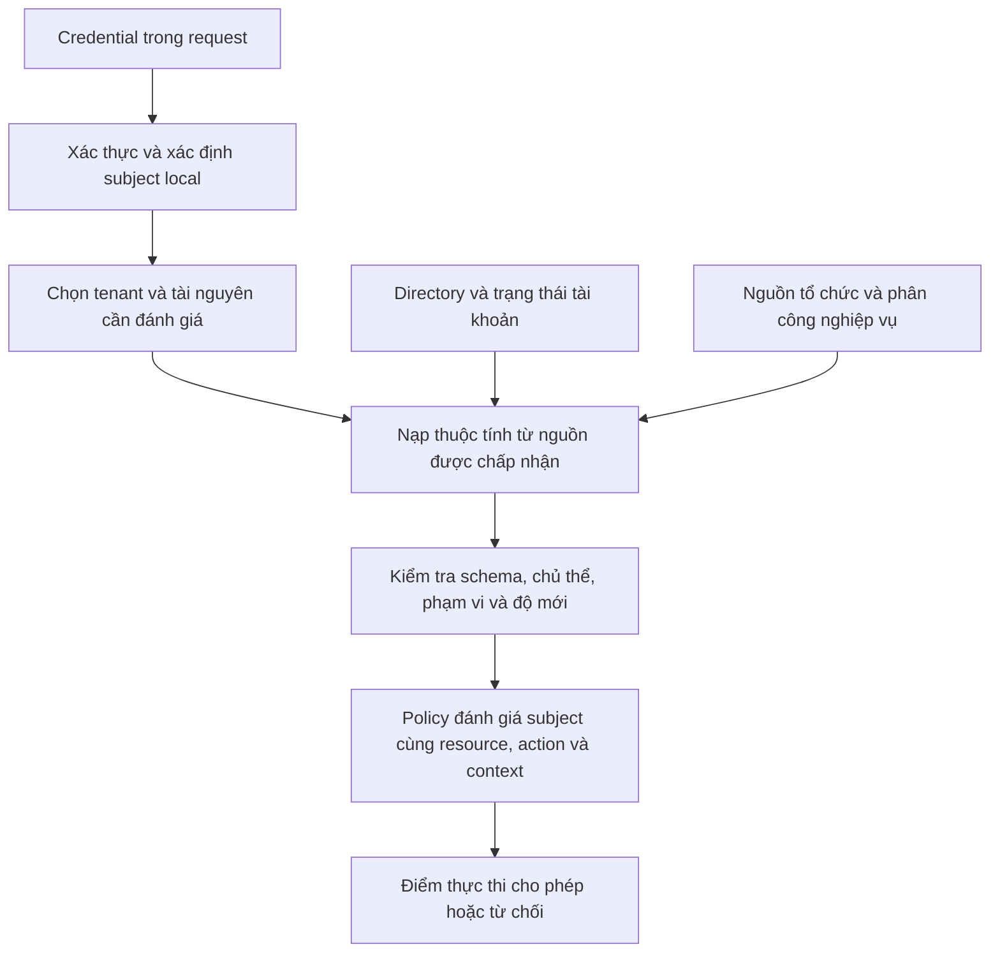

# Subject attributes — Thuộc tính chủ thể trong ABAC

## 1. Subject attributes là gì?

Trong Attribute-Based Access Control, quyết định truy cập dựa trên những thuộc tính liên quan đến chủ thể, tài nguyên, hành động và bối cảnh. **Subject attributes** là các thuộc tính mô tả chủ thể đang yêu cầu thực hiện hành động: định danh, loại chủ thể, trạng thái tài khoản, tổ chức, thành viên tenant hoặc các đặc điểm khác mà policy cần sử dụng.

Chủ thể có thể là một người dùng, service, workload hoặc một danh tính máy khác. Không nên đồng nhất subject với “một bản ghi nhân viên”: pipeline phát hành và ứng dụng tích hợp cũng đưa ra yêu cầu truy cập nhưng có mô hình danh tính khác người dùng tương tác.

Ví dụ, khi một người yêu cầu phát hành khóa học, policy có thể cần biết:

```text
subject.id                  = user-17
subject.type                = HUMAN
subject.accountState        = ACTIVE
subject.tenantMembership    = tenant-A
subject.departmentId        = CONTENT_REVIEW
subject.assignedCourseIds   = {course-301, course-302}
```

Các tên thuộc tính trên là schema minh họa của ứng dụng. Chúng không phải bộ claim bắt buộc của OIDC hoặc một chuẩn ABAC chung. Giá trị chỉ có ý nghĩa khi có định nghĩa, nguồn cung cấp và quy tắc sử dụng rõ ràng.

NIST SP 800-162 mô tả ABAC là phương pháp đánh giá thuộc tính của subject, object, thao tác được yêu cầu và có thể cả môi trường dựa trên policy. Bài học tập trung vào phần subject trong mô hình đó. Tham khảo [NIST SP 800-162 — Guide to Attribute Based Access Control](https://csrc.nist.gov/pubs/sp/800/162/upd2/final).

Một câu điều kiện như `departmentId == CONTENT_REVIEW` nhìn có vẻ đơn giản, nhưng để dùng an toàn, hệ thống còn phải biết ai xác nhận department, xác nhận cho chủ thể nào, dữ liệu còn mới không và department ấy có đủ liên hệ với nhiệm vụ hay chưa. Chất lượng dữ liệu thuộc tính là một phần của cơ chế phân quyền.

## 2. Những nhóm thuộc tính chủ thể thường gặp

| Nhóm | Ví dụ | Câu hỏi cần làm rõ |
| --- | --- | --- |
| Định danh | Internal subject ID, issuer và external subject ID | Dữ liệu đang nói về đúng chủ thể đã xác thực không? |
| Loại chủ thể | Human, service, workload | Policy có đang áp dụng đúng nhánh cho loại danh tính này không? |
| Trạng thái | Active, suspended, terminated | Trạng thái có còn đúng tại thời điểm đánh giá không? |
| Tổ chức | Department, organization ID, employment type | Nguồn nào có thẩm quyền xác nhận quan hệ tổ chức? |
| Thành viên và phân công | Tenant membership, project membership, assigned courses | Quan hệ có đang có hiệu lực và đúng phạm vi không? |
| Năng lực hoặc chấp thuận | Chứng nhận chuyên môn, mức chấp thuận đã xác minh | Chứng nhận còn hạn và phù hợp tác vụ không? |
| Role hoặc entitlement liên quan | Activated role, local entitlement | Thuộc tính có phản ánh đúng grant hiện hành và scope không? |

Danh sách này là những khả năng thiết kế, không phải yêu cầu thu thập mọi thuộc tính cho mọi request. Nếu policy chỉ cần membership của một tenant thì không nên mặc định tải toàn bộ hồ sơ nhân sự hoặc mọi nhóm của chủ thể.

Một số dữ kiện mô tả **phiên hoặc lần xác thực**, chẳng hạn phương thức xác thực, thời điểm xác thực hoặc ngữ cảnh tăng cường. Chúng có thể được đặt trong một nhánh `authentication` hoặc `requestContext` riêng thay vì trộn vào hồ sơ bền vững của subject. Cách phân nhóm phụ thuộc schema policy; điều cần tránh là coi thông tin của một phiên là đặc điểm vĩnh viễn của tài khoản.

Ví dụ, “đã hoàn thành xác thực bổ sung cho phiên này lúc 10:00” khác với “tài khoản có đăng ký MFA”. Trường thứ hai không chứng minh request hiện tại đã trải qua mức xác thực mà policy yêu cầu.

Role cũng có thể được sử dụng như một thuộc tính trong ABAC. Điều đó không có nghĩa ABAC chỉ là kiểm tra role bằng một cú pháp khác. Policy có thể kết hợp role với tenant, phân công, thời gian và dữ liệu tài nguyên; RBAC và ABAC có thể hỗ trợ nhau trong cùng một hệ thống.

## 3. Gắn thuộc tính với đúng danh tính

### 3.1. Thuộc tính của người khác không được dùng thay

Trước khi đánh giá `departmentId` hay `accountState`, phải xác định tập thuộc tính đó thuộc về đúng chủ thể đã xác thực. Nếu người gọi đăng nhập bằng tài khoản A nhưng request được phép chỉ định `subjectId=B` để nạp thuộc tính của B rồi ra quyết định, hệ thống có thể đánh giá quyền của sai người.

Định danh làm khóa nạp thuộc tính nên đến từ ngữ cảnh xác thực đã được kiểm chứng hoặc một cơ chế ủy quyền rõ ràng. Một tham số `requestedBy` do client gửi chỉ là dữ liệu request, chưa phải bằng chứng danh tính.

### 3.2. Định danh cần có miền rõ ràng

Trong hệ thống liên kết danh tính, chuỗi `sub=1234` từ hai issuer khác nhau không mặc nhiên chỉ cùng một người. Ứng dụng cần quản lý khóa danh tính theo miền phát hành và ánh xạ vào định danh nội bộ phù hợp.

OIDC quy định cặp `iss` và `sub` là cơ sở định danh ổn định mà relying party có thể dựa vào trong bối cảnh giao thức; các trường như email không có cùng bảo đảm về tính duy nhất và ổn định. Không dùng email hiển thị như khóa ngầm để gộp tài khoản hoặc cấp quyền mà bỏ qua quy trình liên kết danh tính. Xem [OpenID Connect Core — Claim Stability and Uniqueness](https://openid.net/specs/openid-connect-core-1_0.html#ClaimStability).

Một người có thể có các định danh khác nhau ở các ứng dụng hoặc miền. Khi cần liên kết, phải dùng quy trình có căn cứ để tránh gắn thuộc tính và quyền của hai tài khoản không thuộc cùng chủ thể. Tên giống nhau hoặc địa chỉ email có cùng hậu tố chưa đủ chứng minh quan hệ đó.

### 3.3. Chủ thể người dùng và chủ thể service trong luồng ủy quyền

Khi service gọi thay người dùng, có thể cần phân biệt danh tính service thực hiện cuộc gọi và người dùng được đại diện. Policy phải xác định điều kiện nào áp dụng cho bên nào.

Không lấy quyền rộng của service thay cho quyền của mọi người gọi. Cũng không chấp nhận một header tự khai “tôi đang đại diện user-17” nếu chưa có cơ chế xác minh chuỗi ủy quyền, target và scope. Các thuộc tính cần được gắn với đúng vai trò trong luồng gọi.

## 4. Định nghĩa hợp đồng thuộc tính

Một attribute dùng để phân quyền cần nhiều hơn tên và giá trị. Hợp đồng của nó nên xác định:

- Tên hoặc namespace và ý nghĩa nghiệp vụ.
- Kiểu dữ liệu, tập giá trị hợp lệ và cách biểu diễn nhiều giá trị.
- Chủ thể hoặc miền mà thuộc tính mô tả.
- Nguồn có thẩm quyền, phương thức nạp và cách kiểm chứng.
- Thời điểm hiệu lực, độ mới cần thiết và cách xử lý thay đổi.
- Ai được tạo, sửa, thu hồi thuộc tính và cách ghi audit.
- Cách xử lý khi thiếu, lỗi định dạng, mâu thuẫn hoặc không đọc được nguồn.

NIST SP 800-205 trình bày các cân nhắc về thuộc tính trong hệ thống kiểm soát truy cập và việc chuẩn hóa hệ thống thuộc tính. Nó là tài liệu nền để xem quản trị thuộc tính như một phần riêng cần được thiết kế. Tham khảo [NIST SP 800-205 — Attribute Considerations for Access Control Systems](https://csrc.nist.gov/pubs/sp/800/205/final).

### 4.1. Kiểu dữ liệu quyết định cách đánh giá

`active=true` là một giá trị boolean, không nên bị lẫn với chuỗi `"true"`, chuỗi `"false"` hoặc giá trị rỗng. Một phép kiểm tra “field có tồn tại” không thay thế phép kiểm tra “field có giá trị true”.

Với membership đa giá trị, policy cần dùng phép toán có ý nghĩa. `tenantIds` là một tập ID thì câu hỏi là “có chứa tenant đích không?”, không phải so sánh nó với một chuỗi phân tách bằng dấu phẩy hoặc tìm chuỗi con.

Không tự chuẩn hóa mọi ID bằng lowercase nếu hợp đồng định danh phân biệt hoa thường. Có thể chuẩn hóa nhãn department theo một catalog được kiểm soát, nhưng không được áp dụng cùng quy tắc cho mọi loại khóa.

### 4.2. Phân biệt thiếu, false và không xác minh được

Ví dụ, `accountState=ACTIVE`, `accountState=SUSPENDED`, thiếu `accountState` và nguồn account-state bị lỗi là bốn tình trạng khác nhau. Không tự biến ba tình trạng cuối thành ACTIVE để request đi tiếp.

Một policy engine có thể biểu diễn kết quả trung gian hoặc kết quả lỗi khác nhau. Điểm thực thi cần tuân theo thuật toán kết hợp đã định; không được coi một kết quả không xác định là permit. Có thể phân biệt lý do nội bộ để vận hành và điều tra mà vẫn dùng phản hồi bên ngoài phù hợp.

Nếu có giá trị mặc định, chỉ dùng khi giá trị ấy đã được thiết kế có nghĩa rõ ràng. Ví dụ, mặc định không có phân công để từ chối truy cập ngoài nhiệm vụ khác với mặc định mọi người thuộc cùng tenant.

### 4.3. Thuộc tính là quan hệ phải giữ phạm vi

Department của một người có thể phụ thuộc tổ chức; role và tenant membership thường có scope. Không nên lưu một trường `department=ADMIN` toàn cục rồi dùng nó cho mọi tenant.

Với người thuộc nhiều tenant, có thể nạp thuộc tính của đúng tenant đang đánh giá hoặc dùng một cấu trúc thể hiện rõ quan hệ tenant–membership–entitlement. Không lấy department của tenant A kết hợp với membership của tenant B để tạo ra một tập điều kiện chưa từng được cấp trong thực tế.

## 5. Nguồn thuộc tính và ranh giới tin cậy

### 5.1. Thẩm quyền thường khác nhau theo từng thuộc tính

IdP có thể xác nhận danh tính và sự kiện xác thực. Hệ thống nhân sự có thể quản lý đơn vị làm việc. Directory quản lý trạng thái tài khoản hoặc nhóm theo thiết kế của tổ chức. Ứng dụng nghiệp vụ quản lý phân công giảng viên với khóa học.

Không mặc định một nguồn có thẩm quyền với mọi thuộc tính chỉ vì đã tin cậy nó để đăng nhập. Một đối tác liên kết danh tính có thể xác nhận danh tính người dùng của họ nhưng chưa có thẩm quyền tự gán vai trò quản trị trong tenant local.

Một bảng nguồn minh họa:

| Thuộc tính | Nguồn được lựa chọn trong ví dụ | Điều cần kiểm soát |
| --- | --- | --- |
| Internal subject ID | Dịch vụ danh tính local | Ánh xạ đúng identity domain và subject đã xác thực |
| Account state | Kho trạng thái tài khoản | Cập nhật khóa tài khoản và giới hạn độ trễ |
| Department | Hệ thống quản lý tổ chức | Quyền sửa và lịch hiệu lực thay đổi nhân sự |
| Tenant membership | Dịch vụ membership local | Tenant, trạng thái và thời hạn của quan hệ |
| Assigned courses | Dịch vụ quản lý khóa học | Phân công đang có hiệu lực, đúng tenant |
| Workload owner | Registry workload được kiểm soát | Ràng buộc danh tính workload với đơn vị chịu trách nhiệm |

Đây là lựa chọn ví dụ. Một tổ chức có thể phân chia trách nhiệm khác, nhưng cần biết rõ nguồn nào có thẩm quyền cho từng dữ kiện mà policy dựa vào.

### 5.2. Chữ ký bảo vệ phát biểu, không thay thế semantics

Một token có chữ ký hợp lệ có thể bảo vệ tính toàn vẹn của claim và giúp xác định nguồn phát hành theo cơ chế xác minh. Nó không tự chứng minh issuer được phép xác nhận mọi department, membership hoặc entitlement mà ứng dụng cần.

Ứng dụng phải xác minh đúng loại token, issuer, audience và các điều kiện giao thức liên quan, rồi ánh xạ claim được chấp nhận vào schema local. Token được cấp cho một dịch vụ khác không nên bị coi như nguồn thuộc tính hợp lệ chỉ vì cùng định dạng JWT.

### 5.3. Thuộc tính tự sửa có thể trở thành đường tự cấp quyền

Nếu người dùng được sửa `profile.department` và policy cấp quyền dựa trên chính trường đó, chức năng sửa hồ sơ có thể trở thành chức năng tự cấp quyền. Đây là vấn đề về quyền quản lý thuộc tính, không chỉ là lỗi câu điều kiện ABAC.

Tách dữ liệu hồ sơ do người dùng tự khai khỏi dữ liệu dùng cho quyết định quyền. Cần bảo vệ cả API, import, directory sync và trang quản trị có thể thay đổi những field nhạy cảm; chỉ ẩn field trên UI không đủ.

## 6. Luồng nạp và sử dụng subject attributes

Một luồng minh họa:



Thành phần nạp thuộc tính có thể được gọi là attribute resolver hoặc tham gia vai trò policy information point trong một kiến trúc ABAC. Tên gọi không thay thế trách nhiệm xác minh và quản lý dữ liệu.

Một snapshot nội bộ có thể trông như sau:

```json
{
  "subjectId": "user-17",
  "subjectType": "HUMAN",
  "tenantId": "tenant-A",
  "accountState": "ACTIVE",
  "departmentId": "CONTENT_REVIEW",
  "assignedCourseIds": ["course-301", "course-302"],
  "validFrom": "2026-11-26T03:00:00Z",
  "validUntil": "2026-11-26T03:02:00Z",
  "sourceVersions": {
    "account": "account-v28",
    "membership": "membership-v11",
    "courseAssignments": "assignment-v57"
  }
}
```

Đây là schema ứng dụng và dữ liệu giả định. Không phải cứ có field `sourceVersions` là dữ liệu đã được xác minh; resolver phải thực sự nạp và ràng buộc các phiên bản ấy với giá trị dùng cho quyết định.

Khoảng hiệu lực của snapshot là quyết định quản lý độ mới trong ví dụ. Nó không có nghĩa trạng thái upstream chắc chắn không thay đổi trong hai phút đó. Nếu tài khoản bị khóa sau khi snapshot được tạo, giới hạn thu hồi còn phụ thuộc cơ chế cập nhật hoặc kiểm tra trạng thái hiện hành.

Khi các thuộc tính có độ mới khác nhau, không nên đặt lại một timestamp chung mỗi lần đọc cache rồi coi toàn bộ dữ liệu là mới. Cần giữ tuổi dữ liệu hoặc phiên bản liên quan; hạn dùng của một gói thuộc tính phải tôn trọng những thành phần mà policy yêu cầu.

## 7. Chuyển thuộc tính thành điều kiện truy cập

Giả sử nghiệp vụ cho phép một người duyệt nội dung phát hành khóa học khi thỏa tất cả điều kiện sau:

```text
Hành động đang xét là course.publish.
Chủ thể đã được xác thực và có snapshot thuộc tính tương ứng.
Chủ thể là người dùng nội bộ thuộc nhánh HUMAN của policy.
Tài khoản ACTIVE.
Department trong tenant đang xét là CONTENT_REVIEW.
Chủ thể được phân công đúng khóa học đó.
Khóa học thuộc cùng tenant và đã được duyệt để phát hành.
Các thuộc tính bắt buộc đã được xác minh và còn trong hạn dùng.
```

Department chỉ là một điều kiện trong policy minh họa, không phải giấy phép đọc hoặc sửa mọi tài nguyên của đơn vị. Quan hệ phân công và dữ liệu tài nguyên giúp giới hạn nhu cầu theo đối tượng.

Policy phải dùng action thực sự được chức năng thực hiện. Không nhận `action=read` do client gửi rồi dùng một kết quả allow đó để chạy thao tác phát hành. Tương tự, không đánh giá thuộc tính cho course-301 rồi trả dữ liệu hoặc ghi thay đổi vào course-302.

Nếu sản phẩm còn yêu cầu người soạn không tự phát hành nội dung, cần thêm điều kiện tách nhiệm vụ thích hợp. Việc subject thuộc đúng department chưa tự chứng minh yêu cầu ấy. Nếu yêu cầu xác thực bổ sung đủ mới, cần đánh giá đúng ngữ cảnh xác thực của request; một field nhân sự không thể thay thế.

Các ví dụ trong bài là policy do ứng dụng lựa chọn, không phải quy tắc bắt buộc rằng mọi người phát hành khóa học đều phải thuộc một department cụ thể. Một thiết kế khác có thể dùng chứng nhận, role được kích hoạt hoặc quan hệ người duyệt khác, miễn nguồn và semantics được quản lý rõ ràng.

## 8. Ví dụ Java: đánh giá subject attributes có kiểu dữ liệu rõ ràng

Đoạn mã dùng Java 17 trở lên để minh họa một policy cho đúng hành động phát hành khóa học. Credential đã được kiểm chứng trước đó; `authenticatedSubjectId` là ID nội bộ lấy từ ngữ cảnh xác thực, không phải từ body request. Resolver đã xác minh nguồn của `SubjectAttributes` và chuẩn hóa dữ liệu.

```java
import java.time.Clock;
import java.time.Instant;
import java.util.Objects;
import java.util.Set;

public final class CoursePublishPolicy {
    public enum SubjectType { HUMAN, WORKLOAD }
    public enum AccountState { ACTIVE, SUSPENDED }
    public enum Department { CONTENT_REVIEW, SUPPORT }
    public enum CourseState { DRAFT, APPROVED }

    public record SubjectAttributes(
            String subjectId,
            SubjectType type,
            String tenantId,
            AccountState accountState,
            Department department,
            Set<String> assignedCourseIds,
            Instant validFrom,
            Instant validUntil) {
        public SubjectAttributes {
            Objects.requireNonNull(subjectId);
            Objects.requireNonNull(type);
            Objects.requireNonNull(tenantId);
            Objects.requireNonNull(accountState);
            Objects.requireNonNull(department);
            assignedCourseIds = Set.copyOf(assignedCourseIds);
            Objects.requireNonNull(validFrom);
            Objects.requireNonNull(validUntil);
            if (!validFrom.isBefore(validUntil)) {
                throw new IllegalArgumentException("Invalid attribute window");
            }
        }
    }

    public record Course(
            String courseId,
            String tenantId,
            CourseState state) {
        public Course {
            Objects.requireNonNull(courseId);
            Objects.requireNonNull(tenantId);
            Objects.requireNonNull(state);
        }
    }

    private final Clock clock;

    public CoursePublishPolicy(Clock clock) {
        this.clock = Objects.requireNonNull(clock);
    }

    public boolean canPublish(
            String authenticatedSubjectId,
            SubjectAttributes subject,
            Course course) {
        if (authenticatedSubjectId == null || subject == null || course == null) {
            return false;
        }
        if (!authenticatedSubjectId.equals(subject.subjectId())
                || subject.type() != SubjectType.HUMAN
                || subject.accountState() != AccountState.ACTIVE) {
            return false;
        }

        Instant now = clock.instant();
        if (now.isBefore(subject.validFrom())
                || !now.isBefore(subject.validUntil())) {
            return false;
        }
        return subject.tenantId().equals(course.tenantId())
                && subject.department() == Department.CONTENT_REVIEW
                && subject.assignedCourseIds().contains(course.courseId())
                && course.state() == CourseState.APPROVED;
    }
}
```

Phép so sánh `authenticatedSubjectId` với `subject.subjectId` ngăn dùng nhầm snapshot của một tài khoản khác. Kiểm tra tenant giữ phạm vi tổ chức; kiểm tra phân công giữ phạm vi khóa học. Nhánh WORKLOAD bị từ chối trong policy dành cho người dùng này, không được mặc định hưởng quyền vì thiếu field nhân sự.

Tập phân công được sao chép thành tập không thể sửa qua collection gốc. Enum giới hạn các giá trị mà ví dụ hiểu. Với catalog động hoặc hệ thống có thêm trạng thái, cần mở rộng schema và policy có chủ đích; không tự chuyển một trạng thái không nhận biết thành ACTIVE.

Hạn snapshot dùng khoảng `[validFrom, validUntil)`: đến đúng `validUntil` là hết hạn. `Clock` do server quản lý. Constructor kiểm tra dữ liệu đầu vào của record, nhưng không chứng minh dữ liệu đến từ nguồn đáng tin cậy. Đây là lý do tầng xác thực và resolver vẫn là điều kiện đầu vào của ví dụ.

Nếu nạp dữ liệu thất bại hoặc không dựng được snapshot hợp lệ, tầng gọi không được bỏ qua policy để xử lý tiếp. Hàm trả `false` cũng chỉ có tác dụng khi service thực sự chặn thao tác và không thực hiện ghi dữ liệu trước quyết định.

Ví dụ chưa thực hiện transaction khi phát hành, chưa giải quyết thay đổi phân công đồng thời và chưa kiểm tra các điều kiện bổ sung mà một sản phẩm có thể yêu cầu. Một snapshot còn hạn vẫn có thể đã cũ so với nguồn; việc thu hồi nhanh không thể được bảo đảm chỉ bằng phép so sánh thời gian trong hàm này.

## 9. Độ mới, thay đổi thuộc tính và nhất quán

### 9.1. Thuộc tính thay đổi theo vòng đời danh tính

Một người chuyển bộ phận, kết thúc hợp đồng hoặc rời tenant có thể không còn thỏa policy dù username và credential chưa thay đổi. Vì vậy, quản lý vòng đời tài khoản và membership phải có đường cập nhật đến các nơi đánh giá thuộc tính.

Không nên chỉ cập nhật thuộc tính khi người dùng đăng nhập lại nếu nghiệp vụ cần thu hồi nhanh hơn thời gian sống của phiên. Token hoặc session cũ có thể tiếp tục mang department, role hoặc membership của thời điểm trước thay đổi.

Với workload, những thay đổi tương tự gồm thu hồi danh tính, đổi đơn vị sở hữu, kết thúc deployment hoặc thay trust policy. Không có hồ sơ nhân sự không có nghĩa workload không cần vòng đời thuộc tính.

### 9.2. Chọn chiến lược nạp theo loại thuộc tính

Có thể đọc nguồn hiện hành khi cần, dùng cache với thời hạn xác định, nhận sự kiện cập nhật hoặc kết hợp. Mỗi cách có chi phí và giới hạn nhất quán khác nhau.

Định danh bền vững và tên hiển thị không nhất thiết cần cùng độ mới với trạng thái khóa tài khoản hoặc quyền kích hoạt tạm. Một TTL chung quá dài có thể làm thu hồi chậm; một TTL quá ngắn cho mọi thuộc tính có thể tăng phụ thuộc vào nguồn mà không đáp ứng thêm yêu cầu thực tế nào.

Khi nguồn thay đổi, cần biết những cache nào bị ảnh hưởng: cache thuộc tính của subject, cache membership theo tenant và cache quyết định đã tính sẵn. Xóa cache hồ sơ mà giữ một quyết định allow cũ có thể không đạt mục tiêu thu hồi.

### 9.3. Khóa cache và phiên bản phải giữ đúng miền

Cache chỉ theo email có thể gộp nhầm tài khoản. Cache chỉ theo `sub` có thể nhầm issuer. Cache subject attributes bỏ tenant có thể dùng department của một tổ chức cho request của tổ chức khác.

Một khóa phù hợp thường cần định danh nội bộ hoặc identity domain đã chuẩn hóa, tenant/phạm vi và loại tập thuộc tính. Cache quyết định còn cần resource, action, context và phiên bản policy liên quan tùy cách đánh giá.

Sự kiện cập nhật có thể đến trễ hoặc không theo thứ tự. Không nên để một sự kiện cũ ghi đè trạng thái khóa tài khoản mới hơn. Phiên bản thuộc tính cần được hiểu trong miền nguồn của nó; không so sánh máy móc các version thuộc hai provider khác nhau như thể chúng dùng cùng một thứ tự toàn cục.

### 9.4. Nguồn lỗi và dữ liệu mâu thuẫn

Nếu hai nguồn trả department khác nhau, không chọn giá trị làm request được phép chỉ để duy trì hoạt động. Cần quy tắc nguồn ưu tiên hoặc một cơ chế giải quyết xung đột được xác định từ trước.

Nếu nguồn bắt buộc không truy cập được, có thể phải từ chối thao tác hoặc dùng snapshot còn được policy cho phép trong giới hạn đã đặt ra. Không tự mở rộng hạn snapshot vì gặp lỗi mạng. Một chức năng không cần thuộc tính đó có thể được quyết định bởi policy riêng, nhưng không được dùng điều ấy làm bypass chung cho chức năng nhạy cảm.

## 10. Subject attributes của workload và bên liên kết

### 10.1. Workload cần thuộc tính phù hợp với danh tính máy

Một workload có thể được mô tả bằng service ID, deployment identity, namespace, environment, tổ chức sở hữu hoặc các quan hệ tin cậy đã xác minh. Các thuộc tính này cần gắn với credential hoặc cơ chế chứng minh danh tính của workload đang gọi.

Không cấp quyền production chỉ vì request gửi `environment=production` hoặc process tự đặt một biến môi trường. Nguồn phát biểu phải có thẩm quyền xác nhận môi trường và phải được ràng buộc với workload cụ thể.

Nhãn tài nguyên do bên triển khai tự sửa cũng cần được xem xét thẩm quyền. Nếu cùng một người vừa được tự đặt nhãn đủ điều kiện vừa nhận quyền dựa trên nhãn đó, chính đường quản lý nhãn có thể trở thành đường cấp quyền ngoài ý định.

### 10.2. Không giả lập người dùng cho mọi workload

Một service không có department nhân sự không nên được mặc định gán department của người tạo ra nó để vượt qua policy HUMAN. Có thể cần một nhánh policy riêng cho workload với các điều kiện phù hợp: service được chấp nhận, đúng môi trường, đúng tenant, đúng task và đúng scope.

Nếu workload gọi thay người dùng, cần kiểm tra cả danh tính thực thi và ủy quyền của người dùng theo mô hình đã chọn. Department của workload owner không tự là quyền truy cập dữ liệu của mọi khách hàng mà workload có thể xử lý.

### 10.3. Ánh xạ thuộc tính giữa các miền

Đối tác có thể dùng `department=admin` theo nghĩa quản trị nội bộ của họ. Tenant local không nên tự ánh xạ giá trị đó thành quyền quản trị local. Cần một mapping được quản lý, đúng issuer, tenant, schema và ý nghĩa nghiệp vụ.

Sự tồn tại của SSO không tạo ra một hệ thống thuộc tính thống nhất cho mọi ứng dụng. Cùng một nhãn có thể có ý nghĩa khác nhau; cùng một người có thể có quan hệ khác nhau ở mỗi tổ chức. Mapping phải giữ những khác biệt cần thiết để quyết định quyền.

## 11. Bảo vệ thuộc tính và hạn chế dữ liệu được tiết lộ

### 11.1. Thuộc tính phân quyền cũng là dữ liệu cần phân quyền

Danh sách dự án, department, trạng thái nhân sự hoặc mức chấp thuận có thể tiết lộ thông tin nhạy cảm. Không nên đưa toàn bộ subject profile vào token, response hoặc log chỉ vì policy engine có thể dùng được.

Chỉ nạp và chia sẻ những thuộc tính cần cho quyết định. Nếu một service chỉ cần biết “membership còn hiệu lực”, nó có thể không cần toàn bộ lý do thay đổi trạng thái nhân sự. Một kết quả suy diễn có thể hữu ích, miễn nguồn suy diễn, ý nghĩa và độ mới được quản lý.

Không sao chép credential, password hash, seed MFA hoặc secret vào subject attributes dành cho policy. Policy cần dữ kiện đã được xác minh về trạng thái hay ngữ cảnh, không cần có bản sao các bí mật xác thực ấy.

### 11.2. Kiểm soát quyền sửa thuộc tính

Các thao tác thay department, thêm tenant membership hoặc gán phân công có thể thay đổi quyền hiệu lực dù không sửa trực tiếp file policy. Cần đánh giá chúng như thao tác quản lý quyền ở mức dữ liệu.

Một quyền “sửa hồ sơ” không nên tự bao gồm mọi field dùng cho ABAC. Cần DTO, allowlist field và kiểm tra server phù hợp. Import và sync cũng phải giữ ranh giới này; việc dữ liệu đến qua batch không tự làm nó đáng tin cậy hơn.

### 11.3. Audit cần đủ để giải thích, không cần chép toàn bộ hồ sơ

Một log quyết định có thể ghi:

```text
event_type=ABAC_DECISION
subject_id=user-17
tenant_id=tenant-A
action=course.publish
resource_id=course-301
decision=DENY
reason_code=SUBJECT_ATTRIBUTE_SNAPSHOT_EXPIRED
attribute_snapshot_reference=snapshot-583
policy_version=course-publish-v4
request_id=req-914
```

Các field là schema minh họa của ứng dụng. Reference và version chỉ giúp điều tra nếu hệ thống giữ được lịch sử hoặc bằng chứng liên quan theo chính sách lưu trữ phù hợp. Không nên log một version rồi xóa ngay mọi khả năng xác định dữ liệu đã được dùng nếu nghiệp vụ cần giải thích quyết định sau này.

Reason code nội bộ không nhất thiết được trả nguyên vẹn cho client. Thông báo quá chi tiết có thể lộ department, membership hoặc sự tồn tại của tài nguyên mà người gọi không được biết. Quyền đọc audit và dữ liệu nguồn cũng cần được quản lý.

## 12. Những lỗi thiết kế thường gặp

| Cách làm | Vấn đề | Hướng xử lý |
| --- | --- | --- |
| Dùng `X-Department` từ client làm thuộc tính chính thức | Người gọi có thể tự khai department | Nạp từ nguồn có thẩm quyền hoặc ngữ cảnh đã được xác minh |
| Dùng `subjectId` trong body để chọn người được đánh giá | Có thể đánh giá quyền của sai chủ thể | Ràng buộc với principal hoặc ủy quyền đã được kiểm chứng |
| Dùng email làm khóa duy nhất cho mọi issuer | Có thể trùng, đổi hoặc được cấp lại | Dùng định danh có miền và mapping local rõ ràng |
| Có chữ ký token nên tin mọi claim | Không kiểm tra thẩm quyền của issuer với từng dữ kiện | Xác minh token và áp dụng mapping/allowlist thuộc tính |
| Thiếu department thì mặc định department đặc quyền | Dữ liệu thiếu trở thành đường allow | Từ chối điều kiện yêu cầu thuộc tính đó hoặc xử lý lỗi theo policy |
| Ghép membership của B với department của A | Mất quan hệ scope | Giữ thuộc tính theo tenant hoặc quan hệ đầy đủ |
| Refresh timestamp mỗi lần đọc cache | Dữ liệu cũ trông như mới | Giữ thời điểm và giới hạn độ mới thực sự của nguồn |
| Đổi hồ sơ nhân sự nhưng không cập nhật token/cache | Quyền tiếp tục dựa trên dữ liệu cũ | Thiết kế propagation và giới hạn thu hồi phù hợp |
| Workload thiếu field nhân sự được mặc định qua policy | Nhầm mô hình chủ thể | Dùng nhánh policy rõ cho từng loại danh tính |
| Log toàn bộ token và hồ sơ để debug | Làm lộ credential và dữ liệu không cần thiết | Log quyết định và reference tối thiểu đủ điều tra |

## 13. Tình huống vận dụng và kiểm chứng

Theo policy phát hành minh họa, Lan thuộc CONTENT_REVIEW của tenant A, được phân công course-301 và có tài khoản ACTIVE. Khóa học đã APPROVED. Xét các trường hợp:

| Tình huống | Kết quả dự kiến |
| --- | --- |
| Snapshot đúng Lan, đúng tenant, còn hạn, phân công phù hợp | Có thể cho phép nếu mọi điều kiện của policy đều đạt |
| Người đăng nhập là Minh nhưng resolver trả snapshot của Lan | Từ chối do sai subject |
| Lan có cùng department nhưng không được giao course-302 | Từ chối phát hành course-302 |
| Snapshot đến đúng `validUntil` | Từ chối vì hết hạn snapshot |
| `accountState` không có do nguồn bị lỗi | Không tự coi là ACTIVE |
| Lan gửi `departmentId=CONTENT_REVIEW` trong body | Không dùng dữ liệu tự khai làm căn cứ quyền |
| Membership của tenant A được dùng cho course thuộc B | Từ chối theo phạm vi tenant |
| Workload được gắn label giống department của Lan | Không đi qua nhánh HUMAN chỉ dựa trên label |
| Lan đổi bộ phận nhưng một token cũ vẫn có claim cũ | Xử lý theo cơ chế độ mới và thu hồi đã thiết kế, không chỉ dựa vào tên claim |

Khi triển khai, cần kiểm chứng cả trường hợp thiếu, sai kiểu, nhiều giá trị, sai nguồn và nguồn bị gián đoạn. Một policy có thể đúng với dữ liệu sạch nhưng hoạt động sai khi parser tự chuyển kiểu hoặc resolver dùng giá trị mặc định rộng hơn ý định.

Hãy thiết kế một bộ subject attributes cho ba nhiệm vụ: giảng viên chấm bài của lớp được giao, nhân viên hỗ trợ xem bản chẩn đoán của ticket đang xử lý và workload xuất báo cáo cho một tenant. Với mỗi nhiệm vụ, trả lời:

1. Subject là người, workload hay có cả bên thực thi và bên được đại diện?
2. Thuộc tính nào thực sự cần, kiểu dữ liệu và scope của nó là gì?
3. Nguồn nào có thẩm quyền xác nhận từng thuộc tính và ai được sửa nguồn đó?
4. Làm sao gắn dữ liệu với đúng subject đã xác thực?
5. Những thuộc tính nào cần thu hồi nhanh, và dữ liệu cũ có thể tồn tại ở đâu?
6. Khi nguồn thiếu, mâu thuẫn hoặc bị lỗi, quyết định được xử lý thế nào?
7. Audit nào đủ giải thích mà không tiết lộ thừa hồ sơ chủ thể?

Subject attributes là dữ kiện đầu vào của quyết định quyền, không phải quyền được tạo ra chỉ nhờ tồn tại một field. Một thiết kế ABAC cần giữ được mối liên hệ giữa giá trị, chủ thể, nguồn xác nhận, phạm vi và thời điểm mà giá trị ấy được chấp nhận để ra quyết định.
