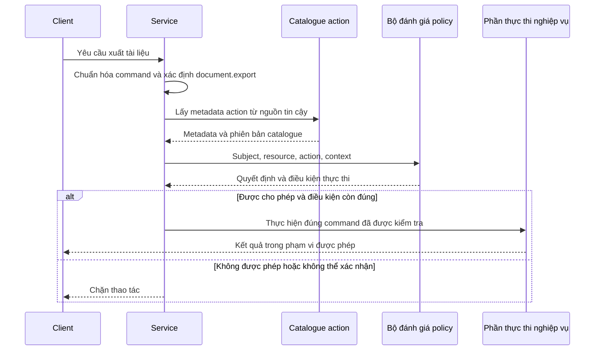

# Action attributes

## 1. Thuộc tính của hành động trong một quyết định ABAC

Một người có thể được đọc tài liệu nhưng không được xuất tài liệu ra tệp, chia sẻ ra ngoài hoặc đổi chủ sở hữu. Nếu hệ thống chỉ biết danh tính người gọi và ID tài liệu, nó chưa đủ dữ kiện để phân biệt những yêu cầu này.

Trong ABAC, **action attributes** là những thuộc tính mô tả hành động đang được yêu cầu. Chúng giúp policy trả lời: thao tác cụ thể là gì, tác động thuộc loại nào và những đặc điểm nào của thao tác có liên quan đến quyền truy cập.

```text
Subject:  Lan, thành viên project-a trong org-a
Resource: tài liệu doc-18, thuộc org-a, có phân loại nội bộ
Action:   document.export, đưa dữ liệu ra một tệp tải xuống
Context:  phiên hiện tại đáp ứng điều kiện xác thực cần thiết
```

Action không chỉ là một nhãn để ghi log. Nó là đầu vào của quyết định cấp phép và phải khớp hành động mà hệ thống thực sự thực hiện sau khi được cho phép.

NIST mô tả ABAC là cách đánh giá thuộc tính liên quan đến chủ thể, đối tượng, thao tác được yêu cầu và điều kiện môi trường theo policy. Thuộc tính hành động là phần mô tả thao tác trong bức tranh đó. [Tham khảo: NIST SP 800-162](https://csrc.nist.gov/pubs/sp/800/162/upd2/final).

## 2. Phân biệt action với các nhóm dữ kiện khác

Giả sử policy xét việc xuất báo cáo:

| Nhóm dữ kiện | Ví dụ | Ý nghĩa |
|---|---|---|
| Subject | Tài khoản đang hoạt động, được giao nhiệm vụ kiểm toán | Ai đang yêu cầu? |
| Resource | Báo cáo của org-a, phân loại nội bộ | Dữ liệu hoặc đối tượng nào bị tác động? |
| Action | `report.export`, có đặc điểm đưa dữ liệu ra tệp | Muốn thực hiện nghiệp vụ gì? |
| Environment/context | Thời điểm hiện tại, phiên đã xác thực bổ sung | Điều kiện của lần truy cập là gì? |

Trạng thái của báo cáo không phải thuộc tính của hành động. Vai trò của người dùng cũng không phải đặc tính của `report.export`. Giữ rõ các nhóm dữ kiện giúp policy dễ đọc và tránh sử dụng nhầm nguồn.

Một trường như `requestedFormat=CSV` có thể được đặt trong nhóm dữ liệu thao tác của ứng dụng. Tuy nhiên, vị trí của trường trong JSON không quyết định nó có đáng tin cậy hay không. Mỗi thuộc tính vẫn cần định nghĩa, nguồn và cách kiểm tra riêng.

## 3. Action ID: định danh chính xác thao tác

### 3.1. Đặt tên theo nghiệp vụ

Một ứng dụng tài liệu có thể định nghĩa:

```text
document.read
document.list
document.updateContent
document.export
document.shareExternal
document.transferOwnership
document.archive
```

Tên cần đủ cụ thể để policy phân biệt những thẩm quyền khác nhau. `document.updateContent` không tự cho phép sửa tenant của tài liệu, thay danh sách quyền hoặc chuyển chủ sở hữu.

Ngược lại, không cần tạo action riêng cho mọi nút giao diện nếu chúng cùng thực hiện một nghiệp vụ có cùng yêu cầu quyền. Action nên bám vào ý nghĩa và tác động của thao tác, thay vì tên màn hình hoặc chi tiết triển khai có thể đổi thường xuyên.

### 3.2. Namespace và phiên bản ngữ nghĩa

Nếu nhiều ứng dụng đều có action `approve`, cần phân biệt duyệt đề nghị, duyệt nội dung hay phê duyệt gán quyền. Có thể dùng namespace ứng dụng hoặc một định danh đầy đủ phù hợp với hệ thống.

Action ID cũng cần ý nghĩa ổn định. Nếu `document.export` ban đầu chỉ xuất một tài liệu nhưng sau đó xuất cả workspace, đó là thay đổi về thẩm quyền thực tế. Cần đánh giá lại policy, hoặc định nghĩa action khác khi ranh giới quyền đã thay đổi.

Không nên giữ nguyên một nhãn cũ rồi mở rộng tác động mà không rà soát những principal đang được cấp quyền cho nhãn ấy.

### 3.3. Không tự suy ra quyền giữa các action

Các quan hệ sau không phải quy tắc mặc định:

```text
được đọc      → được xuất dữ liệu
được cập nhật → được chia sẻ ra ngoài
được tạo      → được chuyển chủ sở hữu
được đọc một  → được liệt kê mọi đối tượng
```

Nếu ứng dụng muốn một action bao hàm action khác, quan hệ đó phải được thiết kế rõ và kiểm chứng. Việc hai thao tác cùng dùng câu truy vấn đọc không làm chúng có cùng yêu cầu bảo mật.

## 4. Metadata có thể mô tả thêm điều gì?

Ngoài action ID, một catalogue phía server có thể lưu những thuộc tính phục vụ policy:

| Thuộc tính minh họa | Giá trị ví dụ | Cách sử dụng có thể có |
|---|---|---|
| `action.id` | `document.export` | Chọn policy cho đúng nghiệp vụ |
| `action.family` | `document` | Giới hạn nhóm nghiệp vụ được policy xử lý |
| `action.effect` | `READ`, `MUTATE`, `ADMINISTER` | Áp dụng điều kiện chung theo loại tác động |
| `action.dataEgress` | `true` | Nhận diện thao tác đưa dữ liệu ra ngoài luồng xem thông thường |
| `action.sensitivity` | `ELEVATED` | Yêu cầu thêm điều kiện nếu policy quy định |
| `action.catalogVersion` | `actions-v3` | Truy vết định nghĩa metadata đã dùng |

Các tên và giá trị trong bảng là schema minh họa của ứng dụng, không phải bộ thuộc tính mà mọi hệ thống ABAC đều phải sử dụng.

### Metadata không thay cho permission

`action.sensitivity=ELEVATED` chỉ mô tả một đặc điểm do ứng dụng định nghĩa. Nó chưa trả lời người gọi có được làm thao tác đó hay không. Policy vẫn cần kiểm tra quyền, phạm vi và đối tượng.

Tương tự, `action.effect=READ` không chứng minh hành động ít rủi ro. Xuất toàn bộ dữ liệu có thể không sửa bản ghi nào nhưng vẫn ảnh hưởng lớn đến tính bí mật. Vì thế, nhiều đặc điểm có thể cùng tồn tại: một action vừa đọc dữ liệu vừa có `dataEgress=true`.

### Tránh biến kết quả chính sách thành dữ kiện tự khẳng định

Một trường `isAuthorized=true` do request gửi lên không phải thuộc tính hữu ích để quyết định chính request ấy có được phép hay không. Nếu một thành phần đã quyết định quyền thay cho thành phần khác, cần hợp đồng ủy quyền và cơ chế bảo vệ quyết định đó, không chỉ một cờ boolean trong payload.

Các điều kiện như có cần xác thực bổ sung hay phê duyệt hai người thường nên được quyết định trong policy từ những dữ kiện có thẩm quyền. Không để client tự khai thao tác của mình là “không nhạy cảm” để bỏ qua điều kiện.

## 5. Lấy action attributes từ nguồn đáng tin cậy

### 5.1. Action do nhánh nghiệp vụ phía server xác định

Giả sử server cung cấp endpoint chia sẻ tài liệu ra ngoài. Hành động cần kiểm tra phải là `document.shareExternal`, bất kể body có khai một action khác hay không.

```http
POST /documents/doc-18/share-external
Content-Type: application/json

{
  "recipient": "external-recipient",
  "action": "document.read",
  "sensitivity": "LOW"
}
```

Nếu service lấy `action` và `sensitivity` từ body để xin phép rồi vẫn thực hiện chia sẻ, người gọi đã có thể hạ nhãn của thao tác. Catalogue server và nhánh xử lý thực tế phải xác lập metadata dùng cho quyết định.

Client có thể lựa chọn một nghiệp vụ thông qua route hoặc một command hợp lệ. Điều đó không đồng nghĩa client được tự định nghĩa các đặc điểm bảo mật của nghiệp vụ được chọn.

### 5.2. HTTP method chỉ là dữ kiện giao thức

| Request minh họa | Action nghiệp vụ có thể cần kiểm tra |
|---|---|
| `GET /documents/doc-18` | `document.read` |
| `POST /documents/doc-18/export` | `document.export` |
| `POST /documents/doc-18/transfer-owner` | `document.transferOwnership` |
| `PATCH /documents/doc-18` | Action tương ứng các thay đổi thực sự được chấp nhận |

Một `POST` có thể chỉ khởi tạo tác vụ xuất; một `GET` có thể trả dữ liệu rất nhạy cảm. Không dùng công thức “GET luôn cho phép, POST luôn là write” thay cho việc xác định action nghiệp vụ.

Tính idempotent cũng không phải bằng chứng người gọi có quyền. Thao tác lặp lại không đổi kết quả vẫn có thể gây xóa dữ liệu hoặc tiết lộ thông tin trái phép.

### 5.3. Catalogue là dữ liệu điều khiển quyền

Nếu metadata `dataEgress` hoặc `sensitivity` làm thay đổi policy, quyền sửa catalogue phải được bảo vệ. Thay một action từ `ELEVATED` sang `NORMAL` có thể mở đường truy cập mới dù không sửa role hoặc permission nào.

Nên có khả năng truy vết thay đổi catalogue, kiểm tra cấu hình thiếu và xác nhận phiên bản mà điểm thực thi cùng bộ đánh giá policy đang sử dụng.

## 6. Thuộc tính tĩnh và tham số động của thao tác

### 6.1. Dữ kiện tĩnh theo loại action

Những đặc điểm như “chia sẻ ra ngoài” hoặc “chuyển chủ sở hữu” thường có thể xác định từ định nghĩa action phía server. Chúng không cần được suy đoán lại từ từng request.

Một nhánh xử lý cố định có thể sử dụng metadata cố định:

```text
document.shareExternal
  effect = ADMINISTER
  dataEgress = true
  sensitivity = ELEVATED
```

Đây vẫn là lựa chọn phân loại của ứng dụng. Các đặc điểm phải phản ánh tác động thực tế; việc đặt nhãn không tự làm thao tác tuân thủ policy.

### 6.2. Dữ kiện động theo kế hoạch thực thi

Một thao tác có thể cần thêm dữ kiện như định dạng xuất, tập trường yêu cầu, đích chia sẻ hoặc số đối tượng được xử lý. Những giá trị này không nhất thiết đều thuộc nhóm action trong mọi schema, nhưng phải được giải quyết đúng trước khi dùng làm điều kiện quyền.

Ví dụ, client có thể yêu cầu `visibility=PUBLIC`. Server cần kiểm tra giá trị hợp lệ và đánh giá quyền chuyển sang trạng thái công khai. Nếu client khai `targetCount=1` nhưng executor sẽ xử lý 10.000 bản ghi, không thể dùng con số client khai để áp dụng policy cho một đối tượng.

Kế hoạch thực thi và dữ kiện xin phép phải thống nhất. Có thể chuẩn hóa request thành một command hoặc execution plan rồi sử dụng cùng dữ liệu ấy cho cả đánh giá quyền và thực hiện, kèm kiểm tra những điều kiện có thể thay đổi.

### 6.3. Phân biệt preview và thực thi

`dryRun=true` chỉ có ý nghĩa nếu nhánh được thực thi thực sự không tạo tác động bị cấm. Một preview vẫn có thể tiết lộ dữ liệu, số lượng đối tượng hoặc kết quả xử lý nhạy cảm, nên vẫn cần policy phù hợp.

Không được cho phép một request dưới nhãn preview rồi bỏ cờ hoặc đổi nhánh sang thao tác thật sau khi kiểm tra quyền.

## 7. Kết hợp action attributes trong policy

Giả sử ứng dụng cho phép xuất tài liệu khi đồng thời đáp ứng:

```text
action.id là document.export;
subject có permission xuất tài liệu trong đúng tổ chức;
subject có quyền trên chính tài liệu được chọn;
tài liệu cho phép xuất theo phân loại hiện hành;
phiên đáp ứng điều kiện xác thực bổ sung do policy yêu cầu.
```

Một quy tắc đọc tài liệu thông thường có thể không cần điều kiện xác thực bổ sung, nhưng vẫn phải kiểm tra đối tượng và phạm vi. Khác biệt được xác định theo từng action và đặc điểm thực tế, không theo việc hai handler có cùng sử dụng một repository.

| Dữ kiện của yêu cầu | Kết quả theo policy minh họa |
|---|---|
| Có quyền đọc tài liệu, action là `document.read` | Có thể cho phép nếu thỏa các điều kiện còn lại |
| Chỉ có quyền đọc, action là `document.export` | Từ chối vì chưa có quyền xuất |
| Có quyền xuất nhưng tài liệu bị cấm xuất | Từ chối theo thuộc tính resource |
| Có quyền xuất đúng đối tượng nhưng phiên chưa đáp ứng điều kiện | Chưa cho thực hiện xuất |
| Có quyền xuất ở org-a nhưng tài liệu thuộc org-b | Từ chối vì sai phạm vi |

Một policy kiểm tra `action.family=document` để áp dụng điều kiện chung vẫn cần tránh mở quyền cho mọi action mới trong family. Các action như `transferOwnership` hoặc `shareExternal` có thể yêu cầu những thẩm quyền riêng.

## 8. Minh họa Java: metadata action do server quản lý

Ví dụ dưới đây dùng Java 17. Mỗi quyền trong `tenantGrants` chỉ có hiệu lực tại `tenantId` của subject. Catalogue phân loại đọc thông thường và xuất dữ liệu; action xuất cần phiên đáp ứng bước xác thực bổ sung và tài liệu được phép xuất.

```java
import java.util.Map;
import java.util.Objects;
import java.util.Set;
import java.util.UUID;

public final class ActionAttributePolicy {
    public enum ActionId {
        DOCUMENT_READ, DOCUMENT_EXPORT
    }

    private enum Sensitivity {
        NORMAL, ELEVATED
    }

    private record ActionMetadata(
            boolean dataEgress,
            Sensitivity sensitivity) {
    }

    public record SubjectFacts(
            UUID principalId,
            UUID tenantId,
            boolean active,
            Set<ActionId> tenantGrants) {
        public SubjectFacts {
            Objects.requireNonNull(principalId);
            Objects.requireNonNull(tenantId);
            tenantGrants = Set.copyOf(tenantGrants);
        }
    }

    public record DocumentFacts(
            UUID documentId,
            UUID tenantId,
            boolean exportAllowed) {
        public DocumentFacts {
            Objects.requireNonNull(documentId);
            Objects.requireNonNull(tenantId);
        }
    }

    public record SessionFacts(boolean recentStrongAuthentication) {
    }

    private static final Map<ActionId, ActionMetadata> CATALOG = Map.of(
            ActionId.DOCUMENT_READ,
            new ActionMetadata(false, Sensitivity.NORMAL),
            ActionId.DOCUMENT_EXPORT,
            new ActionMetadata(true, Sensitivity.ELEVATED)
    );

    public static boolean permits(
            SubjectFacts subject,
            DocumentFacts document,
            ActionId requestedAction,
            SessionFacts session) {
        if (subject == null || document == null
                || requestedAction == null || session == null) {
            return false;
        }

        ActionMetadata action = CATALOG.get(requestedAction);
        if (action == null || !subject.active()) {
            return false;
        }
        if (!subject.tenantId().equals(document.tenantId())) {
            return false;
        }
        if (!subject.tenantGrants().contains(requestedAction)) {
            return false;
        }
        if (action.sensitivity() == Sensitivity.ELEVATED
                && !session.recentStrongAuthentication()) {
            return false;
        }
        if (action.dataEgress() && !document.exportAllowed()) {
            return false;
        }

        return true;
    }
}
```

Nhánh nghiệp vụ xuất tài liệu phải truyền `ActionId.DOCUMENT_EXPORT` do server xác định. Không để client chọn `DOCUMENT_READ` cho cùng thao tác xuất, và không cho body thay giá trị metadata trong `CATALOG`.

`recentStrongAuthentication` là một dữ kiện đã được phần quản lý phiên đánh giá theo yêu cầu của ứng dụng, gắn với đúng principal và phiên. Nó không phải cờ `mfa=true` được tin trực tiếp từ request. Code không triển khai xác thực, tính thời gian hiệu lực hay cơ chế kích hoạt bước xác thực bổ sung.

`exportAllowed` cũng cần được suy ra từ metadata tài nguyên có thẩm quyền theo hợp đồng đã định. Người gọi không được tự đặt tài liệu của mình thành “được xuất” bằng một trường trong request xin phép.

Ví dụ giả định permission theo tổ chức đã đủ giới hạn tập tài liệu cho bài toán đơn giản này. Nếu tài liệu còn riêng tư theo dự án hoặc chủ sở hữu, phải thêm kiểm tra đúng đối tượng. Catalogue action không thay thế các điều kiện resource ấy.

Đây là policy minh họa trả boolean, không phải một bộ máy ABAC hoàn chỉnh. Khi thêm action hoặc đổi metadata, cần đánh giá cả điều kiện của action và nghiệp vụ sẽ sử dụng kết quả; không chỉ thêm một phần tử vào enum để mặc nhiên mở đường thực thi.

## 9. Action attributes trong XACML

XACML 3.0 có category dành cho action. Định danh `action-id` biểu diễn hành động được yêu cầu; các ứng dụng có thể định nghĩa thêm thuộc tính theo hợp đồng của mình.

Fragment XML sau chỉ minh họa phần action trong request context, không phải toàn bộ một request:

```xml
<Attributes
    Category="urn:oasis:names:tc:xacml:3.0:attribute-category:action">
  <Attribute
      AttributeId="urn:oasis:names:tc:xacml:1.0:action:action-id"
      IncludeInResult="false">
    <AttributeValue
        DataType="http://www.w3.org/2001/XMLSchema#string">document.export</AttributeValue>
  </Attribute>
</Attributes>
```

Đặc tả XACML mô tả category action và các định danh action attributes ở phần request context và phụ lục B.6. Những metadata như `dataEgress` trong ví dụ Java là thuộc tính do ứng dụng lựa chọn, không phải tất cả đều được XACML định nghĩa sẵn. [Tham khảo: OASIS — XACML Version 3.0](https://docs.oasis-open.org/xacml/3.0/xacml-3.0-core-spec-os-en.html).

Việc đưa một thuộc tính vào request context không tự xác minh nguồn của nó. Thành phần xây dựng context cần lấy đúng action và metadata từ những nguồn đã được tin cậy.

Một bộ đánh giá có thể phân biệt kết quả cho phép, từ chối, không có policy áp dụng hoặc không đánh giá được. Tích hợp phải xác định cách xử lý các kết quả ấy và chỉ thực hiện khi có kết quả cho phép phù hợp. Không biến “không tìm thấy action” hoặc “thiếu thuộc tính bắt buộc” thành quyền đọc mặc định.

Nếu quyết định cho phép đi kèm nghĩa vụ bắt buộc, chẳng hạn che trường hoặc giới hạn dữ liệu trả về, điểm thực thi phải thực hiện được nghĩa vụ trước khi trả kết quả. Có nhãn action đúng nhưng bỏ qua phần thực thi vẫn có thể tiết lộ dữ liệu ngoài quyền.

## 10. Gắn quyết định với thao tác thật

Một luồng thực thi có thể được tổ chức như sau:



### 10.1. Đổi action sau kiểm tra làm mất giá trị quyết định

Nếu service kiểm tra quyền `document.read` rồi gọi chức năng `shareExternal`, kết quả cho phép đọc không cấp thẩm quyền cho chia sẻ. Tương tự, kiểm tra xuất một tài liệu không tự cho phép mở rộng thành xuất toàn bộ thư mục.

Việc truyền một command đã chuẩn hóa giúp giảm khả năng action hoặc tham số bị đổi giữa hai bước. Tuy nhiên, những dữ kiện như trạng thái tài liệu hoặc membership vẫn có thể thay đổi đồng thời; cần cơ chế phối hợp thích hợp tại thời điểm thực thi.

### 10.2. Một request có thể chứa nhiều action

Một `PATCH` cập nhật cả tiêu đề và chủ sở hữu có thể yêu cầu hai thẩm quyền khác nhau. Chỉ kiểm tra `document.updateContent` rồi áp dụng toàn bộ body sẽ bỏ qua quyền chuyển chủ sở hữu.

Có thể tách command theo nghiệp vụ, từ chối trường không được hỗ trợ hoặc lập một tập action cần được cấp phép. Nếu thao tác chỉ được chạy khi mọi điều kiện đều đạt, phải kiểm tra đủ toàn bộ action và tài nguyên liên quan trước khi tạo tác động.

Với batch, không lấy action và tài nguyên của một phần tử đại diện để xin phép cho cả lô. Nếu sản phẩm hỗ trợ kết quả từng phần, phải xác định rõ phần nào được thực hiện và bảo đảm đối tượng bị từ chối không bị thay đổi hay tiết lộ dữ liệu trái phép.

### 10.3. Các đường vào khác vẫn cần cùng ngữ nghĩa

Một action có thể được gọi qua REST, GraphQL, lịch chạy hoặc consumer. Tên operation do client đặt hoặc tên message không tự chứng minh nghiệp vụ bên trong chỉ là đọc.

Mỗi đường vào cần ánh xạ đúng hành động thực sự. Khi consumer nhận yêu cầu có bảo vệ nguồn và context, nó vẫn cần xác nhận action được hỗ trợ, phạm vi và quyền còn phù hợp với thời điểm xử lý.

## 11. Action attributes trong IAM phân tán

### 11.1. Permission hoặc scope trong token khác với action đang yêu cầu

Token có thể chứa một scope hoặc claim biểu diễn thẩm quyền được cấp. Action trong lần gọi API mô tả việc người gọi muốn thực hiện. Service phải ánh xạ và kiểm tra chúng theo hợp đồng của API.

Không lấy permission mạnh nhất trong token làm action cho mọi request. Cũng không cho rằng đăng nhập SSO thành công đã cho phép mọi action của ứng dụng. Danh tính, quyền được cấp và hành động được yêu cầu là các dữ kiện cần được kết hợp.

### 11.2. Workload gọi thay mặt người dùng

Một service có thể có quyền kỹ thuật để tạo tệp xuất, nhưng người dùng mà service đang đại diện chưa chắc có quyền xuất tài liệu đó. Thiết kế cần giữ rõ bên gọi thực tế, principal được đại diện, action, resource và phạm vi ủy quyền.

Nếu action ở bước đầu là xem tài liệu nhưng downstream tự chuyển sang tạo tệp tải xuống, phải đánh giá thẩm quyền cho tác động mới. Quyền mạnh của workload không tự thay cho quyền của người dùng.

### 11.3. Catalogue và policy có thể lệch phiên bản

Một service mới có thể định nghĩa `document.exportAll`, trong khi policy engine cũ chỉ biết `document.export`. Không nên dùng một phép fallback tên gần giống để tiếp tục cho phép.

Hợp đồng giữa producer, điểm thực thi và bộ đánh giá cần định nghĩa action được hỗ trợ, metadata bắt buộc và cách xử lý phiên bản chưa tương thích. Khi chưa xác nhận được quyền cho thao tác mới, phải chặn thao tác ấy.

### 11.4. Cache phải phân biệt action và metadata liên quan

Một kết quả cho phép đọc tài liệu không được tái sử dụng cho xuất dữ liệu chỉ vì subject và resource trùng nhau. Cache quyết định cần phản ánh action cùng những dữ kiện có thể làm đổi kết quả, như phạm vi, phiên bản policy/catalogue, metadata tài nguyên và điều kiện phiên liên quan.

Đưa action ID vào cache key cũng chưa đủ nếu metadata của action vừa thay đổi. Cần cơ chế hết hạn hoặc vô hiệu hóa đáp ứng yêu cầu hiệu lực của chính sách.

## 12. Kiểm chứng và truy vết

### 12.1. Những tình huống cần kiểm chứng

| Thay đổi so với yêu cầu được phép | Điều cần xác nhận |
|---|---|
| Đổi action từ đọc sang xuất | Quyền đọc không tự cấp quyền xuất |
| Client gửi metadata action có độ nhạy thấp hơn | Metadata do server quản lý vẫn được sử dụng |
| Action không có trong catalogue | Không được fallback thành một action nhẹ hơn |
| Tài liệu cấm xuất nhưng vẫn cho đọc | Policy phân biệt hai action đúng yêu cầu |
| Một request cập nhật cả nội dung và chủ sở hữu | Không bỏ sót quyền chuyển chủ sở hữu |
| Tăng tập đối tượng sau bước xin phép | Quyết định cũ không cấp phép cho phần mở rộng |
| Cùng nghiệp vụ được gọi qua consumer | Vẫn kiểm tra đúng action, scope và nguồn context |
| Cache có kết quả đọc trước đó | Không dùng kết quả ấy cho action xuất |
| Policy yêu cầu nghĩa vụ nhưng executor không thực hiện được | Không trả dữ liệu ngoài điều kiện được cho phép |

Các tình huống này phục vụ việc kiểm chứng khi tích hợp. Chúng không thay thế quyết định nghiệp vụ về ai được thực hiện action nào và dữ liệu nào được phép đưa ra ngoài.

OWASP khuyến nghị kiểm tra quyền trên mọi request và thực thi ở phía server hoặc thành phần tin cậy phù hợp. Việc chuẩn hóa action phải được áp dụng trên các đường vào nghiệp vụ cần bảo vệ. [Tham khảo: OWASP — Authorization Cheat Sheet](https://cheatsheetseries.owasp.org/cheatsheets/Authorization_Cheat_Sheet.html).

### 12.2. Log đủ để giải thích quyết định

Một bản ghi có thể chứa:

```text
requestId       = req-814
principalId     = u-27
tenantId        = org-a
resourceId      = doc-18
actionId        = document.export
actionCatalog   = actions-v3
policyVersion   = document-policy-v5
decision        = DENY
reasonCode      = EXPORT_NOT_ALLOWED_FOR_RESOURCE
```

Nếu metadata action quyết định một nhánh policy quan trọng, cần có cách khôi phục được định nghĩa tương ứng với phiên bản đã ghi. Chỉ lưu `document.export` nhưng không biết metadata tại thời điểm xử lý có thể gây khó khi điều tra thay đổi chính sách.

Không cần ghi access token hoặc nội dung đầy đủ của tài liệu để giải thích action. Các tham số như người nhận, tập trường và đích xuất cũng có thể nhạy cảm; chỉ lưu phần cần thiết trong phạm vi truy cập log được kiểm soát.

## 13. Bài tập vận dụng

Một ứng dụng nhân sự có ba chức năng: xem hồ sơ của chính mình, tải báo cáo của nhóm và xuất toàn bộ danh sách nhân viên của tổ chức. Cả ba đều đọc dữ liệu, nhưng số đối tượng, trường dữ liệu và khả năng đưa dữ liệu ra ngoài khác nhau.

Hãy thiết kế:

1. Action ID cho từng nghiệp vụ và metadata do server quản lý.
2. Những thuộc tính thuộc subject, resource hoặc context cần kết hợp với action.
3. Cách ngăn client khai `action=profile.readSelf` khi yêu cầu xuất toàn tổ chức.
4. Cách xử lý một request vừa sửa hồ sơ vừa đổi role của người dùng.
5. Các dữ kiện cần lưu để giải thích vì sao một lần xuất bị từ chối.

Khi phân tích, không dùng đặc điểm “chỉ đọc dữ liệu” làm điều kiện cấp phép chung cho cả ba chức năng. Hãy chỉ rõ ranh giới của từng hành động và cách service bảo đảm phần thực thi không vượt khỏi quyết định đã được đưa ra.
