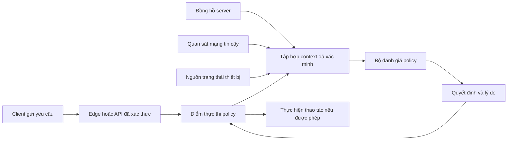

# Environment attributes — Thuộc tính môi trường trong ABAC

## 1. Cùng một người, cùng một tài nguyên, vì sao quyết định có thể khác?

Lan có quyền xuất báo cáo hóa đơn của tenant đang phụ trách. Lúc 09:00, Lan gửi yêu cầu từ thiết bị được quản lý qua đường truy cập mà tổ chức cho phép. Hệ thống chấp nhận.

Lúc 23:30, cùng tài khoản yêu cầu xuất báo cáo từ một kết nối khác, trong khi không có bằng chứng trạng thái thiết bị còn hiệu lực. Tùy chính sách đã thiết kế, hệ thống có thể từ chối hoặc yêu cầu hoàn tất một điều kiện bổ sung.

Danh tính và tên báo cáo không nhất thiết thay đổi. **Ngữ cảnh thực hiện thao tác** đã thay đổi.

Trong ABAC, quyết định truy cập được đánh giá từ thuộc tính của chủ thể, tài nguyên, thao tác và, khi phù hợp, điều kiện môi trường. NIST SP 800-162 trình bày các nhóm thông tin này như đầu vào của việc đánh giá policy. [NIST SP 800-162 — ABAC Definition and Considerations](https://csrc.nist.gov/pubs/sp/800/162/upd2/final).

**Environment attributes**, hay thuộc tính môi trường, mô tả điều kiện bao quanh một yêu cầu truy cập: thời điểm đánh giá, ngữ cảnh mạng, trạng thái vận hành hoặc các tín hiệu ngữ cảnh liên quan mà policy sử dụng.

Bài học tập trung vào cách xác định, thu thập và sử dụng những thuộc tính đó. Điểm cần nắm là một giá trị phù hợp trong request chưa đủ để trở thành bằng chứng đáng tin cậy cho authorization.

## 2. Phân biệt thuộc tính môi trường với các nhóm khác

Một yêu cầu truy cập có thể được mô hình hóa như sau:

| Nhóm | Câu hỏi | Ví dụ |
| --- | --- | --- |
| Subject | Ai hoặc workload nào đang yêu cầu? | subjectId, tenant membership, chức năng được cấp |
| Resource | Muốn truy cập đối tượng nào? | reportId, tenant sở hữu, độ nhạy dữ liệu |
| Action | Muốn thực hiện thao tác gì? | read-summary, export, refund |
| Environment | Yêu cầu đang diễn ra trong điều kiện nào? | Thời điểm, vùng mạng được quan sát, điều kiện vận hành |

Ví dụ:

```text
subject:
  user-lan, đang hoạt động, có chức năng xuất báo cáo

resource:
  report-731, thuộc tenant acme

action:
  export

environment:
  thời điểm đánh giá 09:00 theo múi giờ nghiệp vụ
  yêu cầu đi qua đường truy cập đã được xác minh
  có tín hiệu thiết bị đáp ứng chính sách và còn mới
```

### 2.1. Không phải mọi thuộc tính thay đổi đều là environment attribute

Phòng ban của người dùng có thể thay đổi nhưng vẫn thường được mô hình hóa là thuộc tính subject. Độ nhạy của tài liệu có thể được cập nhật nhưng vẫn là thuộc tính resource.

Môi trường triển khai `production` có thể là thuộc tính của tài nguyên hoặc dịch vụ đích. Trạng thái bảo mật của thiết bị có thể được mô hình hóa trong nhóm device, subject thiết bị hoặc context của phiên tùy hệ thống.

Không có lợi ích khi chỉ đổi tên nhóm mà làm mơ hồ ý nghĩa. Cần ghi rõ thuộc tính đang mô tả đối tượng nào, lấy từ đâu và được ràng buộc với yêu cầu nào.

Trong các ví dụ của bài, trạng thái thiết bị được đưa vào context để dễ trình bày. Điều này không có nghĩa mọi mô hình ABAC đều phải xếp nó vào một category môi trường giống nhau.

### 2.2. Ngữ cảnh phù hợp không tự cấp quyền nghiệp vụ

Một người ở mạng công ty trong giờ làm việc chưa chắc được xem báo cáo của mọi tenant.

Điều kiện môi trường thường bổ sung vào các điều kiện chủ thể, tài nguyên và thao tác:

```text
Có quyền export báo cáo
VÀ báo cáo thuộc phạm vi tenant được phép
VÀ thời điểm nằm trong khoảng được phép
VÀ ngữ cảnh mạng đáp ứng điều kiện
VÀ có bằng chứng thiết bị phù hợp
```

Nếu một điều kiện nghiệp vụ không được đáp ứng, việc các điều kiện môi trường đều tốt không tự bù lại được, trừ khi policy có một luồng ngoại lệ được định nghĩa rõ.

## 3. Các thuộc tính môi trường thường gặp

### 3.1. Thời điểm và lịch thực hiện

Ví dụ:

```text
evaluationTime
businessTimeZone
businessHours
maintenanceWindow
```

Có thể dùng để giới hạn thao tác theo một khoảng thời gian, lịch vận hành hoặc thời hạn được phê duyệt.

Cần phân biệt:

- Thời điểm server đánh giá policy.
- Thời điểm một hệ thống khác quan sát tín hiệu.
- Thời điểm người dùng đăng nhập.
- Thời điểm client tự khai báo.
- Thời điểm một job được lên lịch và thời điểm nó thực sự chạy.

Những thời điểm này có ý nghĩa khác nhau. Trường `clientTime` trong request không nên được dùng để người gọi tự chứng minh rằng thao tác đang nằm trong giờ được phép.

### 3.2. Ngữ cảnh mạng

Các tín hiệu có thể bao gồm địa chỉ nguồn đã được xác định qua hạ tầng tin cậy, điểm truy cập riêng, vùng mạng hoặc đường truy cập từ xa được quản lý.

Ví dụ:

```text
sourceNetworkZone = APPROVED_REMOTE_ACCESS
privateEndpointId = endpoint-billing-prod
```

Một địa chỉ IP có thể đại diện cho NAT, proxy hoặc cổng VPN dùng chung. Nó chưa xác nhận người ngồi sau thiết bị là ai, thiết bị có an toàn không hoặc yêu cầu có quyền nghiệp vụ hay không.

NIST SP 800-207 nêu rằng không nên mặc nhiên tin cậy tài sản hay tài khoản chỉ dựa trên vị trí mạng hoặc vị trí vật lý. Vì vậy, “đến từ mạng nội bộ” cần được hiểu là một điều kiện có phạm vi, không phải giấy phép truy cập mọi tài nguyên. [NIST SP 800-207 — Zero Trust Architecture](https://csrc.nist.gov/pubs/sp/800/207/final).

### 3.3. Tín hiệu thiết bị và phiên

Một policy có thể yêu cầu thiết bị được quản lý, đáp ứng chính sách bảo mật hoặc có trạng thái kiểm tra còn hiệu lực. Các bằng chứng này cần được gắn với đúng thiết bị và phiên hoặc yêu cầu đang xét.

Ví dụ:

```text
devicePosture = COMPLIANT
devicePostureObservedAt = thời điểm đã đo
devicePostureIssuer = dịch vụ quản lý thiết bị được phép
```

Một cookie `managedDevice=true` do client tự tạo không có cùng giá trị với kết quả từ nguồn quản lý thiết bị đã được xác minh. Tương tự, tên trình duyệt hoặc hệ điều hành trong User-Agent không đủ để chứng minh thiết bị được quản lý.

“Compliant” là kết quả theo bộ kiểm tra và phiên bản chính sách cụ thể. Nó không bảo đảm thiết bị hoàn toàn không có rủi ro.

### 3.4. Tín hiệu rủi ro và bất thường

Một hệ thống có thể sử dụng kết quả phát hiện bất thường của phiên, cảnh báo về thiết bị hoặc một mức rủi ro được tính từ nguồn đã quy định.

Trước khi dùng, cần biết:

| Nội dung | Câu hỏi |
| --- | --- |
| Ý nghĩa | Giá trị low/high được định nghĩa theo mô hình nào? |
| Chủ thể | Rủi ro thuộc người dùng, thiết bị, phiên hay yêu cầu? |
| Thời gian | Được tính lúc nào và còn giá trị đến khi nào? |
| Độ phủ | Nguồn dữ liệu đã quan sát những gì? |
| Xử lý lỗi | Không lấy được tín hiệu có bị hiểu nhầm thành low không? |

Không nên mặc định risk score bằng 0 khi API rủi ro timeout. Giá trị “không có thông tin” phải khác với kết quả được nguồn tin cậy xác nhận là mức thấp.

### 3.5. Điều kiện vận hành và workload

Đối với workload, context có thể liên quan đến môi trường chạy, cửa sổ triển khai, trạng thái một đợt xử lý được phê duyệt hoặc thông tin nền tảng đã xác minh.

Một job đối soát ban đêm không nên bị áp dụng lịch làm việc của nhân viên chỉ vì cùng gọi một dịch vụ. Cần có policy theo đúng loại chủ thể và nhiệm vụ, đồng thời bảo đảm người dùng không thể tự khai mình là workload để đi vào nhánh dễ hơn.

## 4. Một thuộc tính cần nhiều hơn tên và giá trị

Khi policy đọc `devicePosture = COMPLIANT`, hệ thống cần trả lời được ít nhất:

```text
Ai tạo ra giá trị?
Nguồn đó có thẩm quyền cung cấp thuộc tính này không?
Giá trị nói về chủ thể, thiết bị hoặc yêu cầu nào?
Được quan sát vào lúc nào?
Còn được sử dụng trong bao lâu?
Dữ liệu có bị sửa trong quá trình truyền không?
Có thay đổi hoặc thu hồi mới hơn không?
```

NIST SP 800-205 dành riêng cho các vấn đề triển khai và chuẩn hóa thuộc tính trong hệ thống kiểm soát truy cập. Tài liệu này giúp đặt trọng tâm vào hệ thống thuộc tính, thay vì xem policy chỉ là phép so sánh chuỗi. [NIST SP 800-205 — Attribute Considerations for Access Control Systems](https://csrc.nist.gov/pubs/sp/800/205/final).

Một mô hình bằng chứng minh họa:

```json
{
  "attribute": "devicePosture",
  "value": "COMPLIANT",
  "deviceId": "device-731",
  "subjectId": "user-lan",
  "issuer": "device-security-service",
  "observedAt": "2026-11-26T01:58:00Z",
  "validUntil": "2026-11-26T02:03:00Z",
  "evidenceVersion": "posture-184"
}
```

Đây là dữ liệu giả định để giải thích mô hình, không phải schema của một sản phẩm.

### 4.1. Có issuer không có nghĩa đã tin cậy

Người gọi có thể tự viết trường `issuer` bất kỳ trong JSON. Hệ thống cần xác minh nguồn bằng cơ chế phù hợp, chẳng hạn kênh được xác thực, danh tính dịch vụ hoặc bằng chứng có tính toàn vẹn được kiểm tra.

Nếu dùng bằng chứng có chữ ký, việc xác minh còn cần kiểm tra các điều kiện của cơ chế đó, như nguồn phát, đối tượng nhận và thời hạn. Chữ ký hợp lệ không tự chứng minh giá trị còn mới hoặc được gắn với đúng request hiện tại.

### 4.2. Ràng buộc bằng chứng với đúng đối tượng

Một bằng chứng trạng thái tốt của thiết bị A không nên được dùng để cấp quyền cho request từ thiết bị B. Một tín hiệu rủi ro của phiên cũ không thể tự động đại diện cho phiên mới.

Cần xác định khóa liên kết phù hợp: subject, device, session, request, workload hoặc tài nguyên. Cơ chế liên kết phải được phía tin cậy xác minh; so sánh hai chuỗi do cùng client gửi lên chưa tạo ra ràng buộc đáng tin cậy.

### 4.3. Giá trị chuẩn hóa phải giữ nguyên ý nghĩa

Các chuỗi `true`, `TRUE`, `1` và boolean `true` không nên bị chuyển đổi tùy tiện trong những lớp khác nhau. Tương tự, `internal`, `trusted` và `private` có thể đang được các đội dùng với ý nghĩa khác nhau.

Nên định nghĩa kiểu dữ liệu, tập giá trị hợp lệ và schema. Khi dữ liệu sai kiểu hoặc không nhận diện được, cần xử lý rõ thay vì tự coi nó là trường hợp an toàn.

## 5. Thu thập context tại ranh giới tin cậy

Một kiến trúc minh họa:



Các thuật ngữ thường gặp:

- **PEP — Policy Enforcement Point**: nơi chặn hoặc cho thực hiện thao tác.
- **PDP — Policy Decision Point**: nơi đánh giá policy từ các đầu vào.
- **PIP — Policy Information Point**: nguồn hoặc cơ chế cung cấp thông tin thuộc tính.

Một hệ thống nhỏ có thể đặt các thành phần này trong cùng process. Việc tách vai trò giúp xác định nơi nào chịu trách nhiệm về nguồn dữ liệu, đánh giá và thực thi.

### 5.1. Không đọc thẳng header do client tự khai thành context tin cậy

Ví dụ nguy hiểm:

```http
X-Device-Compliant: true
X-Network-Zone: corporate
X-Current-Time: 2026-11-26T09:00:00+07:00
```

Nếu backend trực tiếp sử dụng các header này mà không có cơ chế bảo vệ, người gọi có thể tự chọn dữ liệu thuận lợi cho policy.

Trong một kiến trúc có gateway, có thể dùng metadata do gateway bổ sung sau khi xác minh, nhưng phải bảo vệ cả đường truy cập và cách xử lý header. Backend cần nhận biết nguồn gọi tin cậy; những giá trị từ request bên ngoài không được chen vào cùng vùng tin cậy.

### 5.2. Cẩn thận với X-Forwarded-For

Sau reverse proxy, địa chỉ peer trực tiếp thường là proxy. Tuy nhiên, lấy phần tử đầu tiên của X-Forwarded-For cũng không tự động cho ra IP đáng tin cậy.

MDN lưu ý rằng các giá trị không được thêm bởi proxy tin cậy có thể bị giả mạo; sử dụng header này cho kiểm soát truy cập cần hiểu chuỗi proxy và các đường kết nối trực tiếp đến server. [MDN — X-Forwarded-For, Security and privacy concerns](https://developer.mozilla.org/en-US/docs/Web/HTTP/Reference/Headers/X-Forwarded-For#security_and_privacy_concerns).

Thiết kế cần xác định proxy nào được tin, proxy xử lý các header đầu vào ra sao, cách chọn địa chỉ nguồn và liệu backend có bị truy cập vòng qua proxy không.

### 5.3. Tín hiệu cloud có semantics riêng

AWS IAM cung cấp condition context keys như `aws:CurrentTime` và `aws:SourceIp`. Tài liệu AWS nêu rõ sự hiện diện và kiểu của từng key; chẳng hạn SourceIp có trường hợp không xuất hiện khi gọi qua VPC endpoint.

Cùng tài liệu cũng cảnh báo UserAgent do caller cung cấp nên không phù hợp làm bằng chứng ngăn người không được phép tự gửi request. [AWS IAM — Global condition context keys](https://docs.aws.amazon.com/IAM/latest/UserGuide/reference_policies_condition-keys.html).

Khi áp dụng một sản phẩm, cần đọc đúng semantics của key và operator. Không thể suy ra “không có trường này thì tự động deny” cho mọi ngôn ngữ policy hoặc mọi operator.

## 6. Thời gian phải có semantics rõ ràng

### 6.1. Dùng thời điểm đánh giá từ nguồn server

Một policy “chỉ export từ 08:00 đến trước 18:00” phải xác định thời điểm nào là đầu vào. Thông thường, có thể lấy một `Instant` từ đồng hồ server tại lúc đánh giá và dùng nhất quán trong toàn quyết định.

Nếu mỗi điều kiện tự đọc thời gian riêng, request ở gần ranh giới có thể được đánh giá bằng hai thời điểm khác nhau. Một snapshot thời gian giúp giải thích và tái hiện quyết định.

Đồng hồ server và các nguồn tín hiệu cũng cần được vận hành để có sai lệch trong giới hạn mà hệ thống chấp nhận.

### 6.2. Phân biệt Instant với giờ địa phương

Một `Instant` xác định một thời điểm trên dòng thời gian. Điều kiện “08:00” cần thêm múi giờ nghiệp vụ.

Ví dụ:

```text
evaluationTime = 2026-11-26T02:00:00Z
businessZone   = Asia/Ho_Chi_Minh
localTime      = 09:00
```

Không nên phụ thuộc múi giờ mặc định của máy chạy ứng dụng, vì môi trường phát triển và production có thể khác nhau. Múi giờ do client gửi cũng không nên tự thay đổi cửa sổ quyền của tổ chức.

Nếu nghiệp vụ sử dụng một vùng có chuyển giờ theo mùa, cần quy định cách xử lý giờ không tồn tại hoặc xuất hiện hai lần. Một offset cố định không phải lúc nào cũng tương đương một múi giờ có quy tắc lịch sử.

### 6.3. Quy định biên khoảng thời gian

Bài dùng khoảng nửa mở:

```text
[08:00, 18:00)
```

Nghĩa là đúng 08:00 được xét trong giờ, còn đúng 18:00 đã ra ngoài giờ.

Lịch từ thứ Hai đến thứ Sáu chưa mô tả ngày nghỉ hoặc ngoại lệ đặc biệt. Nếu policy yêu cầu lịch làm việc chính thức, cần có nguồn lịch và cơ chế cập nhật phù hợp.

Một cửa sổ qua nửa đêm, ví dụ 22:00–02:00, cần thêm quy tắc ngày áp dụng. Thời điểm 01:00 thứ Bảy thuộc ca bắt đầu thứ Sáu hay bị cấm theo lịch thứ Bảy phải được xác định trước khi viết điều kiện.

## 7. Độ mới, dữ liệu thiếu và lỗi nguồn thuộc tính

### 7.1. Thời điểm nhận không thay thế thời điểm quan sát

Một dịch vụ trả kết quả ngay lúc 09:00 nhưng dữ liệu posture được đo từ tuần trước. Trường `receivedAt = 09:00` không làm trạng thái đó trở thành dữ liệu mới.

Có thể cần xét:

```text
observedAt  → khi sự kiện hoặc trạng thái được quan sát
receivedAt  → khi hệ thống hiện tại nhận dữ liệu
validUntil  → thời điểm nguồn hoặc hợp đồng không cho dùng tiếp
policyTTL   → giới hạn tuổi dữ liệu mà policy chấp nhận
```

Độ mới tối đa do policy chấp nhận có thể nhỏ hơn thời hạn mà nguồn cung cấp. Bằng chứng còn hạn theo nguồn chưa chắc đáp ứng yêu cầu của một thao tác nhạy cảm.

### 7.2. Missing, unknown, false và error không giống nhau

| Trạng thái | Ý nghĩa minh họa |
| --- | --- |
| Known-compliant | Nguồn hợp lệ xác nhận thiết bị đáp ứng điều kiện |
| Known-noncompliant | Nguồn hợp lệ xác nhận thiết bị không đáp ứng |
| Missing | Không có thuộc tính cần thiết |
| Unknown | Nguồn chưa xác định được trạng thái |
| Stale | Có dữ liệu nhưng quá cũ theo chính sách |
| Error | Không lấy hoặc không đánh giá được dữ liệu |

Nếu policy yêu cầu bằng chứng thiết bị compliant, các trạng thái missing, unknown hoặc stale chưa đáp ứng yêu cầu đó. Không nên chuyển chúng thành compliant để tránh lỗi kỹ thuật.

Hệ thống có thể phân biệt quyết định **Deny** với **Indeterminate** để vận hành và giải thích nguyên nhân. Dù vậy, điểm thực thi của thao tác nhạy cảm chỉ nên tiếp tục khi đã có kết quả cho phép theo contract.

Các tên quyết định trong ví dụ là mô hình giải thích của bài; ngôn ngữ policy cụ thể có thể định nghĩa thêm kết quả và thuật toán kết hợp riêng.

### 7.3. Lỗi tín hiệu không nên tự làm điều kiện biến mất

Một policy yêu cầu trạng thái thiết bị, nhưng khi dịch vụ posture timeout lại bỏ hẳn điều kiện đó, sẽ mở một đường truy cập khác đúng lúc thiếu bằng chứng.

Có thể thiết kế tính khả dụng bằng cache còn hiệu lực, dự phòng nguồn hoặc luồng khác có điều kiện được phê duyệt. Những lựa chọn đó cần có semantics rõ, thay vì dùng một nhánh mặc định cho phép khi có exception.

## 8. Thiết kế một policy export có điều kiện môi trường

Xét một ứng dụng báo cáo hóa đơn. Policy minh họa yêu cầu:

1. Chủ thể đang hoạt động và có chức năng export.
2. Báo cáo thuộc tenant mà chủ thể đang được phép thao tác.
3. Action là export.
4. Thời điểm đánh giá nằm từ 08:00 đến trước 18:00, thứ Hai đến thứ Sáu, theo Asia/Ho_Chi_Minh.
5. Request đi qua vùng mạng được phê duyệt theo kết quả quan sát đã xác minh.
6. Thiết bị đáp ứng điều kiện theo bằng chứng đã xác minh và còn đủ mới.

Trong ví dụ, tín hiệu mạng có tuổi tối đa hai phút và tín hiệu posture có tuổi tối đa năm phút. Các con số phục vụ tình huống giảng dạy; chúng không phải mức chuẩn chung.

Một mô tả policy ở mức khái niệm:

```yaml
policyId: billing-report-export
version: 3
target:
  action: export
requirements:
  subjectActive: true
  exportEntitlement: required
  sameTenant: required
  businessTime:
    zone: Asia/Ho_Chi_Minh
    weekdays: [MONDAY, TUESDAY, WEDNESDAY, THURSDAY, FRIDAY]
    startInclusive: "08:00"
    endExclusive: "18:00"
  network:
    expected: APPROVED
    maximumAgeSeconds: 120
  device:
    expected: COMPLIANT
    maximumAgeSeconds: 300
onMissingRequiredEvidence: no-permit
```

Đây là YAML minh họa cách diễn đạt, không phải cấu hình chạy trực tiếp trong một policy engine. Cần chuyển nó thành semantics cụ thể của hệ thống được chọn, bao gồm cách kết hợp với policy khác.

## 9. Ví dụ Java: đánh giá trên một snapshot thời gian

Đoạn mã dùng Java 17 trở lên và không phụ thuộc framework.

Các giả định quan trọng:

- Subject và report được tạo từ dữ liệu phía server đã xác minh.
- `exportAllowed` là kết quả từ cơ chế quản lý quyền của ứng dụng, không phải boolean do client gửi.
- Context được một thành phần tin cậy tập hợp sau khi kiểm tra nguồn, tính toàn vẹn và ràng buộc thiết bị/phiên.
- Request ID là giá trị nội bộ được truyền nhất quán trong luồng xử lý.
- Đồng hồ đánh giá được tiêm qua `Clock`.
- Ví dụ không cache quyết định và không triển khai thu thập hoặc xác minh bằng chứng.

```java
import java.time.Clock;
import java.time.DayOfWeek;
import java.time.Duration;
import java.time.Instant;
import java.time.LocalTime;
import java.time.ZoneId;
import java.time.ZonedDateTime;
import java.util.Objects;

enum Action {
    READ,
    EXPORT
}

enum Effect {
    PERMIT,
    DENY,
    INDETERMINATE
}

enum NetworkZone {
    APPROVED,
    OTHER,
    UNKNOWN
}

enum DevicePosture {
    COMPLIANT,
    NON_COMPLIANT,
    UNKNOWN
}

record Subject(
        String id,
        String tenantId,
        boolean active,
        boolean exportAllowed
) {
    Subject {
        Objects.requireNonNull(id);
        Objects.requireNonNull(tenantId);
    }
}

record Report(String id, String tenantId) {
    Report {
        Objects.requireNonNull(id);
        Objects.requireNonNull(tenantId);
    }
}

record Evidence<T>(
        T value,
        Instant observedAt,
        Instant validUntil
) {
    Evidence {
        Objects.requireNonNull(value);
        Objects.requireNonNull(observedAt);
        Objects.requireNonNull(validUntil);

        if (!observedAt.isBefore(validUntil)) {
            throw new IllegalArgumentException("Invalid evidence interval");
        }
    }

    boolean usableAt(Instant now, Duration maximumAge) {
        return !now.isBefore(observedAt)
                && now.isBefore(validUntil)
                && now.isBefore(observedAt.plus(maximumAge));
    }
}

record EnvironmentContext(
        String requestId,
        String subjectId,
        String deviceId,
        Evidence<NetworkZone> network,
        Evidence<DevicePosture> posture
) {
    EnvironmentContext {
        Objects.requireNonNull(requestId);
        Objects.requireNonNull(subjectId);
        Objects.requireNonNull(deviceId);
    }
}

record Decision(
        Effect effect,
        String reason,
        Instant evaluatedAt
) {}

final class ReportExportPolicy {
    private static final ZoneId BUSINESS_ZONE =
            ZoneId.of("Asia/Ho_Chi_Minh");
    private static final LocalTime START = LocalTime.of(8, 0);
    private static final LocalTime END = LocalTime.of(18, 0);
    private static final Duration NETWORK_MAX_AGE =
            Duration.ofMinutes(2);
    private static final Duration POSTURE_MAX_AGE =
            Duration.ofMinutes(5);

    private final Clock clock;

    ReportExportPolicy(Clock clock) {
        this.clock = Objects.requireNonNull(clock);
    }

    Decision evaluate(
            Subject subject,
            Report report,
            Action action,
            String requestId,
            EnvironmentContext environment
    ) {
        Instant now = clock.instant();

        if (subject == null || report == null
                || action == null || requestId == null) {
            return new Decision(
                    Effect.INDETERMINATE, "MISSING_INPUT", now);
        }

        if (!subject.active()
                || !subject.tenantId().equals(report.tenantId())
                || action != Action.EXPORT
                || !subject.exportAllowed()) {
            return new Decision(
                    Effect.DENY, "BUSINESS_ACCESS_NOT_ALLOWED", now);
        }

        ZonedDateTime local = now.atZone(BUSINESS_ZONE);
        DayOfWeek day = local.getDayOfWeek();
        LocalTime time = local.toLocalTime();

        if (day == DayOfWeek.SATURDAY
                || day == DayOfWeek.SUNDAY
                || time.isBefore(START)
                || !time.isBefore(END)) {
            return new Decision(
                    Effect.DENY, "OUTSIDE_BUSINESS_WINDOW", now);
        }

        if (environment == null
                || environment.network() == null
                || environment.posture() == null) {
            return new Decision(
                    Effect.INDETERMINATE, "MISSING_CONTEXT", now);
        }

        if (!requestId.equals(environment.requestId())
                || !subject.id().equals(environment.subjectId())) {
            return new Decision(
                    Effect.DENY, "CONTEXT_BINDING_MISMATCH", now);
        }

        if (!environment.network().usableAt(now, NETWORK_MAX_AGE)
                || !environment.posture().usableAt(
                    now, POSTURE_MAX_AGE)) {
            return new Decision(
                    Effect.INDETERMINATE, "UNUSABLE_EVIDENCE", now);
        }

        NetworkZone network = environment.network().value();
        DevicePosture posture = environment.posture().value();

        if (network == NetworkZone.UNKNOWN
                || posture == DevicePosture.UNKNOWN) {
            return new Decision(
                    Effect.INDETERMINATE, "UNKNOWN_CONTEXT", now);
        }

        if (network != NetworkZone.APPROVED
                || posture != DevicePosture.COMPLIANT) {
            return new Decision(
                    Effect.DENY, "ENVIRONMENT_NOT_ALLOWED", now);
        }

        return new Decision(Effect.PERMIT, "POLICY_MATCHED", now);
    }
}
```

### 9.1. Điều được thể hiện trong đoạn mã

Mọi phép so sánh sử dụng cùng một `now`. Điều kiện thời gian không bị phụ thuộc timezone mặc định của máy chạy.

Tín hiệu được chấp nhận khi thời điểm quan sát không nằm sau lúc đánh giá, chưa hết `validUntil` và chưa chạm tuổi tối đa của policy. Tại đúng mốc hết hạn, điều kiện trả về false.

Trong ví dụ, tín hiệu có thời điểm quan sát ở tương lai bị coi là chưa dùng được. Một hệ thống cho phép sai lệch đồng hồ nhỏ có thể thiết kế tolerance riêng; tolerance phải có giới hạn rõ, thay vì bỏ kiểm tra thời gian.

Nếu input nghiệp vụ đã cho biết yêu cầu không được phép, policy trả Deny mà không cần gọi thêm nguồn tín hiệu. Vì vậy, khi cùng lúc có nhiều vấn đề, reason thể hiện nhánh kiểm tra đã quyết định kết quả, không phải danh sách đầy đủ mọi vấn đề.

### 9.2. Kiểu dữ liệu không tự tạo ra độ tin cậy

Việc đặt tên class là `EnvironmentContext` hoặc dùng enum không xác thực nguồn phát. Nếu controller nhận JSON của client rồi tạo thẳng các record này, những điều kiện trong giả định đầu vào chưa được đáp ứng.

Đoạn mã chỉ so binding theo request và subject đã có trong context. Việc posture thực sự thuộc `deviceId` nào và thiết bị đó thuộc request hiện tại phải được thành phần tập hợp context xác minh trước đó.

Tương tự, `Report.tenantId` phải đến từ bản ghi tài nguyên được server lấy đúng cách, không phải một tenantId client tự điền để khớp với subject.

### 9.3. Điểm thực thi chỉ tiếp tục khi có Permit

Luồng gọi cần kiểm tra effect cụ thể:

```java
Decision decision = policy.evaluate(
        subject,
        report,
        Action.EXPORT,
        requestId,
        environment
);

if (decision.effect() != Effect.PERMIT) {
    throw new SecurityException("Export is not permitted");
}

// Perform only the authorized export operation here.
```

Không nên viết “nếu effect khác DENY thì cho phép”, vì cách đó sẽ cho cả Indeterminate đi qua.

Ứng dụng cần ánh xạ lỗi và log theo contract của mình. Không nên trả toàn bộ reason nội bộ cho người không có quyền biết cấu hình hoặc trạng thái kiểm soát.

### 9.4. Phạm vi chưa triển khai

Ví dụ chưa hỗ trợ lịch nghỉ, cửa sổ qua nửa đêm, nguồn rủi ro, kiểm tra xác thực tăng cường, policy combining hoặc những điều kiện chi tiết hơn của từng báo cáo.

Nếu đưa vào một hệ thống có nhiều policy, cần xác định rõ kết quả từ policy này kết hợp với các policy còn lại thế nào. Một Deny có bị một Permit khác vượt qua hay không phụ thuộc semantics được chọn; không nên mặc định mọi engine có cùng quy tắc.

Một lỗi ngoài dự kiến khi đánh giá cũng phải được điểm thực thi xử lý theo contract. Bắt exception rồi chạy tiếp thao tác export sẽ phá vỡ giới hạn mà policy dự định tạo ra.

## 10. Cache và quyết định có thời hạn

### 10.1. Không cache chỉ theo userId

Giả sử Lan được Permit khi dùng thiết bị A qua đường truy cập hợp lệ. Nếu cache theo userId, một request từ thiết bị B hoặc cho tài nguyên khác có thể vô tình nhận lại quyết định đó.

Một khóa cache cần phản ánh mọi đầu vào có ảnh hưởng đến quyết định trong mô hình cụ thể, chẳng hạn chủ thể, tài nguyên, action, phạm vi tenant, phiên, thiết bị và phiên bản policy.

Với thuộc tính thay đổi theo từng request như quan sát đường mạng, không phải lúc nào một quyết định trước đó cũng có thể tái sử dụng. Có thể chọn chỉ cache bằng chứng trong giới hạn được cho phép, rồi đánh giá policy lại cho từng request.

### 10.2. Thời hạn cache cần tôn trọng ranh giới sớm nhất

Một Permit lúc 17:59:50 không nên được giữ mười phút nếu policy dừng cho phép lúc 18:00.

Một giới hạn khái niệm cho thời điểm hết hiệu lực:

```text
decisionExpiresAt không được muộn hơn các mốc liên quan:

  evaluatedAt + giới hạn tuổi quyết định
  observedAt + giới hạn tuổi từng tín hiệu
  validUntil của từng bằng chứng
  ranh giới thời gian tiếp theo của policy
  thời điểm hết hạn quyền hoặc phiên mà quyết định phụ thuộc
```

Chọn mốc sớm nhất chỉ giải quyết giới hạn thời gian đã biết. Một sự kiện mới như thu hồi quyền, thiết bị chuyển sang noncompliant hoặc policy đổi có thể yêu cầu vô hiệu cache sớm hơn.

Cần xác định độ trễ thu hồi chấp nhận được và cơ chế cập nhật. TTL không phải bằng chứng rằng mọi thay đổi có hiệu lực tức thì.

### 10.3. Snapshot nhất quán không đồng nghĩa còn đúng mãi

Một snapshot giúp giải thích trạng thái được dùng tại lúc đánh giá. Sau đó, người dùng có thể đổi mạng, thiết bị phát cảnh báo hoặc quyền nghiệp vụ bị thu hồi.

Với thao tác nhanh, policy có thể được định nghĩa để quyết định tại thời điểm thực hiện. Với phiên dài, stream hoặc tác vụ nền, cần xác định điểm nào phải đánh giá lại và điều gì xảy ra khi điều kiện không còn thỏa.

Không nên dùng một Permit từ đầu phiên như quyền thực hiện mọi thao tác về sau nếu contract không cho phép như vậy.

## 11. Tác vụ bất đồng bộ cần xác định ngữ cảnh đang nói về ai

Một yêu cầu export có thể đi qua hàng đợi:

```text
Người dùng yêu cầu export
        ↓
Hệ thống ghi job
        ↓
Worker chạy sau đó
        ↓
Tạo file báo cáo
        ↓
Người dùng tải file
```

Mỗi bước có ngữ cảnh khác nhau:

| Bước | Điều cần xác định |
| --- | --- |
| Nhận yêu cầu | Người dùng có được yêu cầu export lúc này không? |
| Chạy job | Workload được phép xử lý tài nguyên nào, thay ai, trong thời hạn nào? |
| Tạo kết quả | Nội dung báo cáo có nằm trong phạm vi được duyệt không? |
| Tải kết quả | Người tải hiện còn quyền nhận dữ liệu và đáp ứng điều kiện cần thiết không? |

IP của worker không phải IP của người đã yêu cầu export. Tín hiệu thiết bị của người dùng lúc gửi job cũng không tự đại diện cho lần tải file nhiều giờ sau.

Thiết kế có thể dùng một cơ chế ủy quyền tác vụ có phạm vi và thời hạn rõ. Phải quy định điều kiện nào được kiểm tra lúc gửi, lúc chạy và lúc nhận kết quả, thay vì sao chép context cũ vào job rồi coi nó là context hiện tại.

Một URL tải file có thời hạn cần được đánh giá theo khả năng mà nó thực sự trao. Nếu người giữ URL có thể tải mà không qua policy môi trường, ranh giới bảo vệ lúc export và lúc phân phối kết quả đã khác nhau.

## 12. Tình huống vận dụng và các ranh giới cần chứng minh

### 12.1. Request hợp lệ trong tình huống minh họa

Giả sử:

```text
Chủ thể: user-lan, hoạt động, có quyền export
Báo cáo: report-731, tenant acme
Tenant được phép của Lan: acme

Thời điểm đánh giá:
  2026-11-26T02:00:00Z
  tương ứng 09:00 ở Asia/Ho_Chi_Minh

Tín hiệu mạng:
  APPROVED
  được quan sát 30 giây trước

Tín hiệu thiết bị:
  COMPLIANT
  được quan sát 2 phút trước

Bằng chứng:
  nguồn và binding đã được xác minh
  validUntil chưa đến
```

Trong phạm vi policy ví dụ, request có thể nhận Permit. Điều đó không tạo quyền export báo cáo của tenant khác hoặc quyền gọi action hoàn tiền.

### 12.2. Thay đổi một điều kiện

| Thay đổi | Kết quả theo ví dụ |
| --- | --- |
| Đánh giá đúng 08:00 ngày làm việc, các điều kiện khác hợp lệ | Nằm trong cửa sổ |
| Đánh giá đúng 18:00 | Deny vì ngoài cửa sổ |
| Đánh giá vào cuối tuần | Deny theo lịch minh họa |
| Report thuộc tenant khác | Deny vì điều kiện nghiệp vụ không đáp ứng |
| Client tự gửi header compliant nhưng không có bằng chứng đã xác minh | Không đủ đầu vào để Permit |
| Tín hiệu mạng chạm tuổi tối đa hai phút | Indeterminate do bằng chứng không còn dùng được |
| Bằng chứng còn mới nhưng nguồn xác nhận NON_COMPLIANT | Deny |
| Nguồn posture trả UNKNOWN | Indeterminate |
| Dịch vụ posture timeout và không có bằng chứng còn hiệu lực | Không Permit |
| Context thuộc request hoặc subject khác | Deny do binding không khớp |
| Đồng hồ bằng chứng ở tương lai theo quy tắc của ví dụ | Indeterminate |
| Permit cũ được dùng lại sau ranh giới 18:00 | Cache không được vượt ranh giới policy |

Bảng mô tả các kết quả thiết kế cần chứng minh. Nó không phải báo cáo đã chạy kiểm thử một ứng dụng cụ thể.

### 12.3. GeoIP và thiết bị cần được đọc đúng mức

Nếu hệ thống thêm một tín hiệu vị trí suy ra từ IP, cần hiểu đó là kết quả suy luận của nguồn, có thể bị ảnh hưởng bởi proxy, VPN hoặc dữ liệu định vị chưa cập nhật.

Không nên đồng nhất “IP ở một vùng” với “người dùng đang có mặt tại vị trí vật lý đó”. Một policy phụ thuộc vị trí cần xác định loại bằng chứng và mức chắc chắn được yêu cầu.

Tương tự, một tín hiệu thiết bị compliant không thay thế kiểm tra quyền tài nguyên. Kết hợp nhiều điều kiện chỉ có ý nghĩa khi từng điều kiện được hiểu đúng và có nguồn phù hợp.

## 13. Vận hành hệ thống thuộc tính môi trường

### 13.1. Có chủ sở hữu cho từng thuộc tính

Một catalog thuộc tính có thể ghi nhận:

```text
Tên và mô tả
Kiểu dữ liệu, đơn vị và tập giá trị
Đối tượng được mô tả
Nguồn có thẩm quyền
Cách xác minh và ràng buộc
Ý nghĩa các timestamp
Tuổi dữ liệu tối đa
Hành vi khi missing, stale hoặc error
Phiên bản schema và owner
```

Khi thay cách tính network zone hoặc đổi chuẩn posture, cần biết policy nào phụ thuộc. Nếu ý nghĩa của một giá trị thay đổi nhưng tên vẫn giữ nguyên, quyết định có thể thay đổi mà người viết policy không nhận ra.

### 13.2. Log đủ giải thích nhưng giới hạn dữ liệu nhạy cảm

Một log quyết định minh họa:

```json
{
  "event": "authorization_decision",
  "requestId": "req-731",
  "subject": "user-lan",
  "resource": "report-731",
  "action": "export",
  "policyVersion": "billing-export-v3",
  "effect": "INDETERMINATE",
  "reason": "UNUSABLE_EVIDENCE",
  "evaluatedAt": "2026-11-26T02:00:00Z",
  "evidenceReference": "posture-184"
}
```

Có thể cần dữ liệu chi tiết hơn để điều tra, nhưng không nên ghi toàn bộ token, credential hoặc mọi thông tin thiết bị vào log quyết định.

Địa chỉ IP, vị trí và thông tin thiết bị có thể bộc lộ hoạt động của người dùng. Cần giới hạn người đọc, thời gian lưu và mức dữ liệu phù hợp với mục đích vận hành.

### 13.3. Theo dõi lỗi dữ liệu riêng với vi phạm policy

Các tín hiệu có ích gồm tỷ lệ thiếu thuộc tính bắt buộc, lỗi nguồn posture, độ trễ thu thập, số bằng chứng bị coi là stale và số request bị từ chối do điều kiện thực sự không phù hợp.

Nếu gộp tất cả vào một lý do “không có quyền”, đội vận hành khó phân biệt policy đang chặn đúng với nguồn dữ liệu đang hỏng.

Khi điều chỉnh TTL để giảm lỗi, cần đánh giá khoảng thời gian hệ thống chấp nhận trạng thái cũ. Tăng TTL chỉ thay đổi mức chịu dữ liệu cũ; nó không sửa nguyên nhân nguồn cung cấp bị chậm.

## 14. Những cách hiểu sai thường gặp

| Cách hiểu sai | Cách hiểu đúng |
| --- | --- |
| Environment attribute là mọi field không thuộc user | Cần mô hình hóa đúng đối tượng, ý nghĩa và nguồn dữ liệu |
| Ở mạng nội bộ thì được truy cập | Mạng chỉ là một điều kiện; còn quyền subject, resource và action |
| User-Agent chứng minh thiết bị được quản lý | Đây là giá trị caller có thể tự cung cấp |
| Có header IP thì đã biết nguồn đáng tin | Phải xét proxy, đường truy cập và cách chọn địa chỉ |
| Có chữ ký thì dữ liệu chắc chắn còn mới | Tính toàn vẹn, độ mới và binding là các yêu cầu khác nhau |
| Không có risk score thì coi là rủi ro thấp | Missing hoặc error chưa phải kết quả low |
| Token còn hạn nghĩa là posture còn hợp lệ | Thời hạn token và tuổi tín hiệu có semantics riêng |
| Permit được giữ đến hết phiên | Phải theo contract, ranh giới thời gian và thay đổi thuộc tính |
| Giờ của máy chủ luôn là giờ nghiệp vụ | Cần xác định rõ múi giờ trong policy |
| Worker chạy job có cùng context với người gửi | Đây là hai giai đoạn và có thể là hai chủ thể khác nhau |
| Indeterminate không phải Deny nên có thể cho qua | Điểm thực thi cần Permit rõ ràng để tiếp tục thao tác được bảo vệ |

## 15. Những điểm cần nắm vững

Thuộc tính môi trường giúp ABAC xét điều kiện quanh yêu cầu thay vì chỉ nhìn danh tính hoặc tên role. Giá trị của chúng phụ thuộc vào nguồn có thẩm quyền, cách ràng buộc, độ mới và semantics mà policy đã định nghĩa.

Khi thiết kế một điều kiện, hãy xác định thuộc tính nói về ai hoặc điều gì, được đo lúc nào, dùng được trong bao lâu và xử lý thế nào khi không có bằng chứng phù hợp. Với thời gian, cần nêu múi giờ và biên khoảng; với mạng và thiết bị, cần bảo vệ ranh giới thu thập dữ liệu.

Một quyết định cho phép cần gắn với đúng chủ thể, tài nguyên, action và context đã được đánh giá. Cache, phiên dài và tác vụ nền phải giữ được các giới hạn đó tại từng điểm thực thi liên quan.

## Tài liệu tham khảo

- [NIST SP 800-162 — Guide to Attribute Based Access Control Definition and Considerations](https://csrc.nist.gov/pubs/sp/800/162/upd2/final): mô hình ABAC và các nhóm thuộc tính đầu vào.
- [NIST SP 800-205 — Attribute Considerations for Access Control Systems](https://csrc.nist.gov/pubs/sp/800/205/final): các vấn đề về thiết kế và triển khai hệ thống thuộc tính.
- [NIST SP 800-207 — Zero Trust Architecture](https://csrc.nist.gov/pubs/sp/800/207/final): vai trò của danh tính, tài sản và ngữ cảnh trong kiểm soát truy cập.
- [MDN — X-Forwarded-For](https://developer.mozilla.org/en-US/docs/Web/HTTP/Reference/Headers/X-Forwarded-For): ý nghĩa header và rủi ro khi dùng cho quyết định bảo mật.
- [AWS IAM — Global condition context keys](https://docs.aws.amazon.com/IAM/latest/UserGuide/reference_policies_condition-keys.html): ví dụ context key có kiểu, điều kiện hiện diện và giới hạn sử dụng cụ thể.
