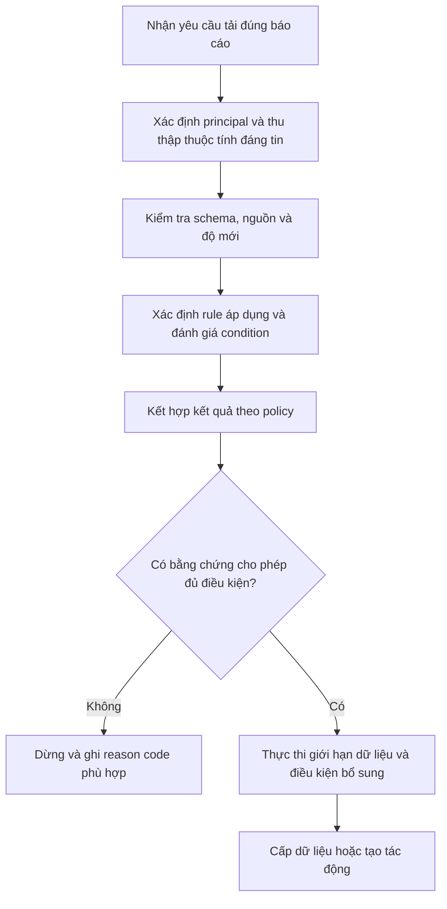

# Policy condition — Điều kiện trong chính sách ABAC

## 1. Policy condition trả lời câu hỏi gì?

Trong kiểm soát truy cập theo thuộc tính, Attribute-Based Access Control hay ABAC, quyết định quyền được hình thành từ thuộc tính của chủ thể, tài nguyên, thao tác và ngữ cảnh môi trường. NIST mô tả ABAC theo các nhóm dữ liệu đó và những chính sách, quy tắc hoặc quan hệ dùng để đánh giá chúng. Nguồn: [NIST SP 800-162 — Guide to ABAC Definition and Considerations](https://csrc.nist.gov/pubs/sp/800/162/upd2/final).

Policy condition là biểu thức điều kiện giúp xác định một rule có thỏa các yêu cầu để đóng góp hiệu lực của nó hay không.

Ví dụ, ứng dụng có chính sách tải báo cáo nội bộ:

> Cho phép tải báo cáo phòng ban khi người dùng và membership còn hoạt động, người dùng thuộc đúng tenant và phòng ban của báo cáo, báo cáo đã công bố và thời điểm tải nằm trong khoảng được công bố.

Trong câu trên:

- Thao tác cần bảo vệ là tải báo cáo.
- Tài nguyên là báo cáo phòng ban cụ thể.
- Hiệu lực mong muốn của rule là cho phép.
- Các yêu cầu về trạng thái, tenant, phòng ban và thời gian tạo thành condition.

Một condition có thể viết ngắn nhưng vẫn sai phạm vi, dùng dữ liệu không đáng tin hoặc có ngữ nghĩa khác điều người viết dự định. Vì vậy, cần làm rõ dữ liệu đầu vào, phép toán, cách xử lý lỗi và vị trí condition trong toàn bộ chính sách.

## 2. Phân biệt phạm vi rule, condition, effect và quyết định cuối

### 2.1. Một rule minh họa

Cấu trúc dưới đây là pseudocode dạng YAML để diễn đạt ý tưởng, không phải schema chạy trực tiếp của một policy engine:

```yaml
ruleId: department-report-download
effect: PERMIT

target:
  action: report:download
  resourceType: department-report

condition: |
  subject.active == true
  AND membership.active == true
  AND subject.tenantId == resource.tenantId
  AND subject.departmentId == resource.departmentId
  AND resource.published == true
  AND environment.now >= resource.availableFrom
  AND environment.now < resource.availableUntil
```

`target` mô tả nhóm request mà rule hướng tới. `condition` nêu các điều kiện bổ sung. `effect` cho biết rule mang ý định cho phép hay từ chối khi được thỏa mãn.

Kết quả của rule còn phải được kết hợp với các rule khác theo ngữ nghĩa mà hệ thống lựa chọn. Một condition đúng chưa đủ để kết luận request được phép nếu còn rule cấm hoặc điều kiện bắt buộc khác.

### 2.2. Condition sai không tự đảo effect

Xét hai rule:

```text
Rule P:
    effect = PERMIT
    condition = sameDepartment

Rule D:
    effect = DENY
    condition = documentIsBlocked
```

Nếu `documentIsBlocked=false`, Rule D không thỏa điều kiện để cấm. Điều đó không tự tạo ra quyền đọc. Request vẫn cần một nguồn cho phép phù hợp.

Tương tự, `sameDepartment=false` không có nghĩa Rule P tự biến thành một rule DENY. Nó chỉ không cung cấp hiệu lực cho phép theo điều kiện đó; quyết định cuối phụ thuộc chính sách tổng thể.

XACML 3.0 phân biệt rõ đánh giá target, condition và rule: khi target khớp, condition true cho ra Effect; condition false cho ra NotApplicable; lỗi condition có thể cho ra Indeterminate. Nguồn: [OASIS XACML 3.0, mục 7.9 và 7.11](https://docs.oasis-open.org/xacml/3.0/xacml-3.0-core-spec-os-en.html).

Các tên và kết quả cụ thể trên thuộc XACML. Không mặc định mọi thư viện hoặc ngôn ngữ policy khác đều có cùng bảng đánh giá.

### 2.3. Một điều kiện bắt buộc phải được đặt đúng cấu trúc

Giả sử rule đầu tiên cho phép tải khi cùng tenant và phòng ban. Sau đó một rule mới được thêm:

```text
PERMIT nếu subject.role == SUPPORT_ADMIN
```

Nếu cơ chế kết hợp chấp nhận một rule cho phép phù hợp và không có ràng buộc tenant bắt buộc ở nơi khác, rule mới có thể mở rộng quyền vượt điều người viết rule đầu tiên mong muốn.

Trong ví dụ bài học, điều kiện cùng tenant là ranh giới bắt buộc. Ngoại lệ về phòng ban không được tự bỏ ranh giới tenant. Cần thể hiện yêu cầu đó trong cấu trúc tổng thể, không chỉ trong một nhánh permit có thể bị nhánh khác thay thế.

## 3. Xác định hợp đồng thuộc tính trước khi viết biểu thức

### 3.1. Tên field chưa chứng minh ý nghĩa hoặc nguồn tin cậy

Một hợp đồng thuộc tính cho ví dụ:

| Thuộc tính | Kiểu dự kiến | Ý nghĩa và nguồn minh họa |
| --- | --- | --- |
| subject.active | Boolean | Trạng thái principal từ nguồn quản lý danh tính được chấp nhận |
| subject.tenantId | Định danh tenant | Tenant hoạt động đã được xác minh cho request |
| subject.departmentId | Định danh phòng ban | Phòng ban trong phạm vi tenant từ dữ liệu tổ chức có thẩm quyền |
| membership.active | Boolean | Membership của đúng chủ thể trong đúng tenant tài nguyên |
| resource.tenantId | Định danh tenant | Metadata của đúng báo cáo được yêu cầu |
| resource.departmentId | Định danh phòng ban | Phòng ban được gán cho báo cáo theo workflow quản lý |
| resource.published | Boolean | Trạng thái công bố đáng tin của báo cáo |
| resource.availableFrom | Thời điểm | Bắt đầu khoảng được tải |
| resource.availableUntil | Thời điểm | Kết thúc khoảng được tải, không bao gồm mốc này |
| environment.now | Thời điểm | Đồng hồ được hệ thống đánh giá kiểm soát |

Các tên field là thiết kế của ví dụ. Trước khi dùng, ứng dụng cần xác định thuộc tính nào bắt buộc, ai được sửa, quy tắc chuẩn hóa và yêu cầu về độ mới.

NIST có tài liệu riêng về việc triển khai thuộc tính trong hệ thống kiểm soát truy cập. Nguồn tham khảo: [NIST SP 800-205 — Attribute Considerations for Access Control Systems](https://csrc.nist.gov/pubs/sp/800/205/final).

### 3.2. Không lấy thuộc tính tự khai làm bằng chứng

Request có thể chứa:

```json
{
  "reportId": "report-204",
  "subject": {
    "departmentId": "finance",
    "active": true
  },
  "environment": {
    "now": "2026-11-26T09:00:00+07:00"
  }
}
```

Trong ví dụ này, client chỉ được yêu cầu thao tác và cung cấp định danh theo hợp đồng API. Backend không được tin phòng ban, trạng thái hoặc giờ do client tự khai để đánh giá quyền.

Chữ ký token bảo vệ tính toàn vẹn của claim trong phạm vi cơ chế đã xác minh. Nó không tự chứng minh claim còn đủ mới, có đúng tenant hoặc được issuer có thẩm quyền phát hành cho mục đích đang xét.

Metadata tài nguyên cũng cần được bảo vệ. Nếu một người không được đọc báo cáo có thể tự đổi nhãn phòng ban của báo cáo sang phòng ban mình, điều kiện so sánh đúng vẫn có thể dẫn đến quyết định không đáp ứng mục tiêu bảo mật.

### 3.3. Định danh cần đúng namespace

Hai tenant có thể cùng đặt tên phòng ban là “Finance”. Nếu policy so sánh tên hiển thị mà không kiểm tra tenant, hai phòng ban khác nhau có thể bị coi là một.

Trong ví dụ, so sánh tenant là điều kiện riêng, còn phòng ban được biểu diễn bằng ID ổn định trong namespace đã định. Không dùng cách viết hoa hay tên hiển thị như bằng chứng cùng một đơn vị.

## 4. Kết hợp điều kiện bằng AND, OR và NOT

### 4.1. AND làm giao các điều kiện

Rule báo cáo yêu cầu đồng thời:

```text
sameTenant
AND sameDepartment
AND activeMember
AND published
AND withinAvailabilityWindow
```

Một điều kiện không thỏa đủ làm rule permit này không cung cấp quyền. Chẳng hạn, cùng phòng ban không bù được việc membership đã bị thu hồi.

Không nên hiểu mỗi dòng là một gợi ý độc lập để engine tùy chọn. Trong pseudocode trên, mọi dòng đều là yêu cầu bắt buộc.

### 4.2. OR mở thêm một nhánh

Giả sử sản phẩm cho phép một người có trách nhiệm kiểm tra nội bộ xem báo cáo ngoài phòng ban, nhưng vẫn phải cùng tenant và đáp ứng các điều kiện còn lại.

Một cấu trúc đúng với yêu cầu đó là:

```text
sameTenant
AND activeMember
AND published
AND withinAvailabilityWindow
AND (
    sameDepartment
    OR hasApprovedAuditResponsibility
)
```

Nhánh audit chỉ thay điều kiện phòng ban. Nó không bỏ kiểm tra tenant, trạng thái thành viên hoặc thời gian.

So sánh hai biểu thức rút gọn:

```text
A: (sameTenant AND sameDepartment) OR auditResponsibility
B: sameTenant AND (sameDepartment OR auditResponsibility)
```

| sameTenant | sameDepartment | auditResponsibility | A | B |
| --- | --- | --- | --- | --- |
| true | true | false | true | true |
| true | false | true | true | true |
| false | false | true | true | false |
| false | true | false | false | false |

Hàng thứ ba thể hiện khác biệt quan trọng về phạm vi. Dùng dấu ngoặc để thể hiện ý định, thay vì yêu cầu người đọc nhớ thứ tự ưu tiên toán tử của ngôn ngữ cụ thể.

### 4.3. NOT cần phân biệt “không đúng” với “chưa biết”

Điều kiện sau dễ gây nhầm:

```text
NOT subject.suspended
```

Nếu thiếu thuộc tính `suspended`, hệ thống thực sự biết chủ thể không bị đình chỉ, hay chỉ không có dữ liệu? Không được tự coi hai tình trạng này giống nhau.

Với hợp đồng của ví dụ, dùng trạng thái tích cực đã xác minh như `subject.active == true` và từ chối tạo permit khi không có thuộc tính bắt buộc. Điều đó vẫn cần bảo đảm nguồn dữ liệu trạng thái có thẩm quyền.

Không áp dụng một bảng chân trị ba giá trị chung cho mọi engine. Thứ tự đánh giá, short-circuit và cách lan truyền lỗi là một phần của ngữ nghĩa engine cần được xác định.

## 5. Kiểu dữ liệu và phép so sánh

### 5.1. So sánh số không phải so sánh chuỗi

Một mở rộng policy có thể yêu cầu:

```text
subject.trainingLevel >= resource.requiredTrainingLevel
```

Nếu một vế là chuỗi `"10"`, còn vế kia là chuỗi `"2"`, phép so sánh theo thứ tự chuỗi có thể khác so sánh số. Một engine khác có thể báo lỗi kiểu thay vì so sánh.

Hợp đồng phải quy định kiểu số hoặc một quan hệ thứ bậc có ý nghĩa. Không tự dùng tên nhãn như `"CONFIDENTIAL"` và `"INTERNAL"` để so sánh lớn hơn nhỏ hơn.

Nếu có phân loại tài liệu, hệ thống cần định nghĩa quan hệ mức truy cập, cùng trường hợp không so sánh được. Vị trí enum hoặc thứ tự bảng chữ cái không tự tạo ra chính sách phân loại hợp lệ.

### 5.2. Boolean thật khác chuỗi giống Boolean

```json
{ "active": true }
```

khác với:

```json
{ "active": "true" }
```

Trong code ứng dụng, ép mọi giá trị không rỗng thành true có thể khiến `"false"` bị hiểu sai. Nên xác minh schema và chỉ chấp nhận dạng Boolean theo hợp đồng.

Không chữa lỗi kiểu bằng cách mặc định một giá trị mang lại quyền. Nếu dữ liệu là sai định dạng, đó cần là một trạng thái lỗi có thể quan sát và xử lý.

### 5.3. Equality cần có định danh hợp lệ

Trong Java:

```java
Objects.equals(null, null)
```

cho kết quả true. Nếu dùng trực tiếp biểu thức đó làm `sameTenant`, việc cả hai tenant ID đều thiếu có thể bị coi là cùng tenant.

Với policy ví dụ, các định danh bắt buộc phải có giá trị hợp lệ trước khi so sánh. Một cách triển khai rõ ràng là kiểm tra thiếu hoặc rỗng, sau đó mới thực hiện equality.

Không tự chuẩn hóa mọi định danh bằng lowercase hoặc trim nếu hợp đồng của nguồn chưa cho phép. Chuẩn hóa cần nhất quán với hệ thống cấp ID, không phải một phép biến đổi tùy tiện để tăng số lần match.

## 6. Điều kiện với thuộc tính nhiều giá trị

### 6.1. Membership và equality là hai phép toán khác nhau

Giả sử user tham gia nhiều dự án:

```text
subject.projectIds = { project-a, project-b }
resource.projectId = project-b
```

Điều kiện cần hỏi là tài nguyên có nằm trong tập project mà user được phép sử dụng hay không:

```text
resource.projectId IN subject.projectIds
```

So sánh toàn bộ tập với một chuỗi không có cùng ý nghĩa. Cũng không dùng tìm chuỗi con trên một danh sách ghép bằng dấu phẩy để thay membership theo ID.

### 6.2. “Có ít nhất một” và “mọi phần tử” khác nhau

Với tài nguyên cần nhiều chứng nhận:

```text
resource.requiredCertificates = { safety, privacy }
subject.certificates = { safety }
```

Hai yêu cầu có kết quả khác nhau:

- Có ít nhất một chứng nhận được yêu cầu: thỏa trong ví dụ.
- Có đầy đủ mọi chứng nhận được yêu cầu: không thỏa.

Cần chọn phép toán theo nghiệp vụ. Tên như `contains`, `containsAny` hoặc `containsAll` cần được đối chiếu với kiểu dữ liệu và thư viện thực sự dùng.

### 6.3. Tập rỗng không đồng nghĩa dữ liệu bị mất

Trong toán học và nhiều API lập trình, mệnh đề “mọi phần tử của tập rỗng đều thỏa P” có giá trị đúng. Vì vậy:

```text
ALL certificate IN requiredCertificates SATISFIES hasCertificate(certificate)
```

có thể đúng khi `requiredCertificates` là tập rỗng.

Nếu nghiệp vụ yêu cầu ít nhất một chứng nhận bắt buộc, cần thêm điều kiện tập không rỗng. Nếu tập rỗng hợp lệ nghĩa là tài nguyên không đòi chứng nhận, có thể chấp nhận kết quả đó.

Nhưng nếu không tải được danh sách yêu cầu mà code thay nó bằng `[]`, quyền có thể bị mở rộng ngoài ý định. Phải tách “nguồn trả về một tập rỗng hợp lệ” khỏi “nguồn lỗi hoặc thuộc tính thiếu”.

## 7. Điều kiện thời gian

### 7.1. Khoảng thời gian cần quy định hai đầu

Ví dụ sử dụng khoảng nửa mở:

```text
availableFrom <= now < availableUntil
```

Nếu báo cáo được mở từ 08:00 đến 17:00 theo múi giờ đã chọn:

| Thời điểm | Kết quả của điều kiện thời gian |
| --- | --- |
| Ngay trước 08:00 | Không thỏa |
| Đúng 08:00 | Thỏa |
| Trong khoảng | Thỏa |
| Đúng 17:00 | Không thỏa |

Quy ước này giúp xác định chính xác ranh giới. Sản phẩm có thể chọn quy ước khác, nhưng phải thống nhất giữa policy, lưu trữ và kiểm chứng.

### 7.2. Thời điểm tuyệt đối và giờ địa phương

Một thời điểm như `2026-11-26T09:00:00+07:00` có offset rõ ràng. Chuỗi `09:00` đơn lẻ không nói ngày hoặc múi giờ.

Với mốc công bố cố định, có thể chuyển thành thời điểm tuyệt đối để so sánh. Với lịch lặp như “ngày làm việc từ 08:00 đến 17:00”, cần thêm múi giờ, lịch ngày làm việc và quy tắc qua ngày. Nếu áp dụng ở vùng có thay đổi giờ theo mùa, phải xác định cách xử lý các thời điểm không tồn tại hoặc bị lặp.

Khoảng qua nửa đêm, chẳng hạn 22:00 đến 06:00, không thể được hiểu đúng bằng `hour >= 22 AND hour < 6`. Cần mô hình hóa lịch hoặc hai phần của khoảng phù hợp với ngày liên quan.

### 7.3. Đồng hồ và thời điểm đánh giá

`environment.now` nên đến từ đồng hồ được bên đánh giá kiểm soát. Nên dùng một thời điểm tham chiếu nhất quán cho một lần đánh giá thay vì gọi đồng hồ rời rạc khiến các điều kiện biên nhìn thấy những thời điểm khác nhau.

Nếu chấp nhận sai lệch đồng hồ, hãy nêu rõ giới hạn và ý nghĩa. Tự cộng thêm thời gian dung sai có thể kéo dài quyền sau hạn kết thúc.

Một permit tại thời điểm bắt đầu cũng không tự hứa hẹn tác vụ dài sẽ dừng đúng khi hết giờ. Với luồng tải hoặc job dài, cần xác định thời điểm điều kiện phải còn thỏa theo yêu cầu của sản phẩm.

## 8. Ví dụ Java: phân biệt true, false và không đánh giá được

Đoạn code sau chỉ đánh giá condition của rule tải báo cáo đã nêu. Caller phải xác định đúng target, gắn dữ liệu với đúng principal và báo cáo, xác minh nguồn cùng độ mới trước khi dùng.

```java
import java.time.Instant;

public final class ReportCondition {

    public enum Result {
        TRUE,
        FALSE,
        INDETERMINATE
    }

    public record Input(
            String subjectTenantId,
            String resourceTenantId,
            String subjectDepartmentId,
            String resourceDepartmentId,
            Boolean subjectActive,
            Boolean membershipActive,
            Boolean reportPublished,
            Instant now,
            Instant availableFrom,
            Instant availableUntil) {
    }

    public static Result evaluate(Input input) {
        if (input == null
                || missing(input.subjectTenantId())
                || missing(input.resourceTenantId())
                || missing(input.subjectDepartmentId())
                || missing(input.resourceDepartmentId())
                || input.subjectActive() == null
                || input.membershipActive() == null
                || input.reportPublished() == null
                || input.now() == null
                || input.availableFrom() == null
                || input.availableUntil() == null) {
            return Result.INDETERMINATE;
        }

        if (!input.availableFrom().isBefore(input.availableUntil())) {
            return Result.INDETERMINATE;
        }

        if (!Boolean.TRUE.equals(input.subjectActive())
                || !Boolean.TRUE.equals(input.membershipActive())
                || !Boolean.TRUE.equals(input.reportPublished())) {
            return Result.FALSE;
        }

        if (!input.subjectTenantId().equals(input.resourceTenantId())
                || !input.subjectDepartmentId()
                        .equals(input.resourceDepartmentId())) {
            return Result.FALSE;
        }

        boolean withinWindow =
                !input.now().isBefore(input.availableFrom())
                && input.now().isBefore(input.availableUntil());

        return withinWindow ? Result.TRUE : Result.FALSE;
    }

    private static boolean missing(String value) {
        return value == null || value.isBlank();
    }
}
```

Code sử dụng record của Java 17. Đây là evaluator nhỏ do ví dụ định nghĩa, không phải implementation của bảng ngữ nghĩa XACML, Cedar hoặc Rego.

### 8.1. Những lựa chọn ngữ nghĩa trong ví dụ

Evaluator kiểm tra toàn bộ field bắt buộc trước. Do đó, nếu membership là false nhưng department ID bị thiếu, kết quả vẫn là INDETERMINATE do bước xác minh đầu vào của ví dụ.

Một engine có short-circuit hoặc quy tắc lan truyền lỗi khác có thể cho kết quả khác trong trường hợp tổ hợp đó. Không dùng đoạn Java này để suy luận máy móc về engine khác.

Khoảng thời gian không hợp lệ, như đầu cuối bằng nhau hoặc đầu sau cuối, được coi là lỗi dữ liệu trong ví dụ. Hệ thống không tự sửa bằng cách đổi chỗ hai mốc.

### 8.2. Caller cần phân biệt chẩn đoán và enforcement

Với rule PERMIT của ví dụ:

```text
Nếu target không thuộc phạm vi:
    rule này không cung cấp quyền.

Nếu condition = TRUE:
    rule này cung cấp một kết quả permit để tiếp tục kết hợp.

Nếu condition = FALSE:
    rule này không cung cấp permit.

Nếu condition = INDETERMINATE:
    không dùng rule này làm bằng chứng đủ để cấp quyền;
    xử lý lỗi theo hợp đồng của hệ thống.
```

Quyết định cuối còn phải thỏa các ràng buộc bắt buộc và cách kết hợp của ứng dụng. Không viết `return condition != FALSE`, vì cách đó có thể biến INDETERMINATE thành allow.

Bên ngoài có thể cùng từ chối thao tác trong hai trường hợp false và thiếu dữ liệu, nhưng log nội bộ nên phân biệt nguyên nhân. Thiếu quyền đã được đánh giá khác với việc nguồn thuộc tính tạm thời không hoạt động.

## 9. Không chuyển ngữ nghĩa giữa các engine một cách máy móc

### 9.1. XACML

XACML có mô hình target, condition, effect và các kết quả rule như Permit, Deny, NotApplicable, Indeterminate. Kết quả được kết hợp bằng thuật toán phù hợp của policy hoặc policy set.

Vì vậy, đọc một condition riêng lẻ chưa đủ để suy ra quyết định cuối. Cần biết cả target, effect và cơ chế kết hợp đang dùng.

### 9.2. Cedar

Cedar dùng `when` và `unless` cho điều kiện bổ sung. Để policy được thỏa, mọi `when` phải true và mọi `unless` phải false. Nguồn: [Cedar — Basic Policy Construction](https://docs.cedarpolicy.com/policies/syntax-policy.html).

Cedar có ngữ nghĩa skip-on-error: policy bị lỗi đánh giá không đóng góp vào quyết định, và lỗi được ghi trong diagnostics. Một forbid bị lỗi không tự trở thành một forbid đã thỏa; một permit khác vẫn có thể quyết định allow theo thuật toán của Cedar. Nguồn: [Cedar — How Authorization Works](https://docs.cedarpolicy.com/auth/authorization.html).

Vì vậy, không khẳng định “cứ có bất kỳ lỗi condition nào là toàn bộ request tự bị engine từ chối”. Nếu thuộc tính là ràng buộc bắt buộc của sản phẩm, cần validation và cách tích hợp bảo đảm ràng buộc đó, cùng hành vi diagnostics được định nghĩa.

### 9.3. Rego trong OPA

Rego có giá trị undefined cho trường hợp một document hoặc biểu thức không được xác định. Việc tham chiếu giá trị undefined trong so sánh không giống phép so sánh Boolean thông thường; `default` có thể cung cấp giá trị mặc định cho một document quyết định khi các rule tương ứng đều undefined. Nguồn: [OPA — Policy Language](https://www.openpolicyagent.org/docs/policy-language).

Không coi undefined là false trong mọi biểu thức, rồi tự suy ra rằng phủ định của nó chắc chắn là true theo cách một ngôn ngữ khác xử lý null. Cần đọc đúng ngữ nghĩa toán tử và contract của đầu ra quyết định.

Các phần trên nhằm chỉ ra khác biệt cần lưu ý. Chúng không cung cấp cùng một bộ policy có thể sao chép nguyên cú pháp qua ba engine.

## 10. Điều kiện đúng vẫn cần dữ liệu và điểm thực thi đúng

### 10.1. Dữ liệu cũ có thể làm condition đúng trên thực tế đã thay đổi

Giả sử Lan thuộc phòng ban Finance lúc 09:00. Đến 10:00, Lan chuyển sang Operations. Một token hoặc cache vẫn chứa Finance có thể khiến `sameDepartment` tiếp tục true khi tải báo cáo Finance.

Phép equality không sai; dữ liệu đầu vào không phản ánh thay đổi theo yêu cầu hiệu lực.

Hệ thống cần xác định nguồn chuẩn của thuộc tính, độ mới tối đa được chấp nhận và cơ chế xử lý khi không đáp ứng được. OWASP phân biệt các cách lấy dữ liệu lúc đánh giá, đồng bộ bản sao và nhúng dữ liệu, cùng giới hạn độ trễ của chúng. Nguồn: [Authorization Policy and Data Distribution](https://cheatsheetseries.owasp.org/cheatsheets/Authorization_Policy_And_Data_Distribution_Cheat_Sheet.html).

Không chỉ cache permit theo user và report mà quên action, tenant, policy revision hoặc những điều kiện thời gian có liên quan. Một permit dùng lúc 16:59 không được tái sử dụng vượt mốc 17:00 nếu chính sách yêu cầu quyền chấm dứt ở mốc đó.

### 10.2. Quyết định phải được áp dụng trước tác động

Luồng khái niệm:



Một Policy Decision Point đánh giá quyền; điểm thực thi ở ứng dụng phải dùng kết quả đó để chặn hoặc cho thao tác đi tiếp. Không gửi file cho client rồi mới kiểm tra condition.

Nếu quyết định yêu cầu chỉ trả bản đã che dữ liệu hoặc ghi một bằng chứng bắt buộc trước khi phát hành, điểm thực thi phải xử lý được yêu cầu đó. Không bỏ qua phần việc bắt buộc rồi coi chữ permit là đủ.

### 10.3. Thay đổi giữa kiểm tra và sử dụng

Sau khi báo cáo được đánh giá là published, một giao dịch khác có thể thu hồi công bố. Khoảng cách giữa đánh giá và phát hành file cần được xem xét theo yêu cầu nhất quán.

Có thể cần version, kiểm tra lại tại điểm phát hành hoặc cơ chế thu hồi theo kiến trúc. Một transaction ở database không tự làm snapshot thuộc tính từ IdP hoặc policy service khác luôn mới.

Tương tự, một liên kết tải đã cấp có thể còn hiệu lực theo điều kiện của hệ thống lưu trữ. Thay đổi thuộc tính trong ứng dụng không tự sửa mọi bằng chứng quyền đã được cấp trước.

## 11. Đưa condition vào truy vấn và batch

### 11.1. Không bỏ ràng buộc bắt buộc khi dịch sang truy vấn

Giả sử policy cho phép tải báo cáo cùng tenant, cùng phòng ban và trong khoảng công bố. Khi xây danh sách báo cáo được thấy, bộ lọc cần bảo toàn các điều kiện tương ứng.

```text
tenantRestriction
AND policyRestriction
AND applicationSearchCriteria
```

Không thay bằng OR giữa tenant restriction và nhánh policy cho phép. Một bộ lọc policy “luôn đúng” cũng không tự loại các điều kiện cách ly tenant khác mà ứng dụng cần giữ.

Đặc biệt, SQL có ngữ nghĩa NULL riêng. Một phép dịch từ policy sang SQL cần bảo toàn ý nghĩa của missing, kiểu dữ liệu và membership; không suy rằng cùng tên toán tử là kết quả luôn giống nhau.

OWASP hướng dẫn giữ nguyên ngữ nghĩa bộ lọc, kết hợp các predicate phù hợp và không âm thầm bỏ phần không dịch được. Nguồn: [Authorization Decisions and Output Handling](https://cheatsheetseries.owasp.org/cheatsheets/Authorization_Decisions_And_Output_Handling_Cheat_Sheet.html).

### 11.2. Một batch không có chung mọi thuộc tính tài nguyên

Nếu request tải ba báo cáo thuộc ba phòng ban, điều kiện `sameDepartment` phải được áp dụng theo tài nguyên tương ứng. Không lấy metadata báo cáo đầu tiên để đại diện cho cả batch.

API cần quy định hành vi khi một phần batch không được phép: từ chối toàn bộ hoặc trả kết quả từng mục theo hợp đồng an toàn về dữ liệu. Cách chọn không thay thế việc kiểm tra quyền đúng trên từng phần tử.

Danh sách, count, export và đường tải trực tiếp phải có ngữ nghĩa nhất quán theo loại thao tác của chúng. Cho phép nhìn thấy một báo cáo trong danh sách không tự cấp mọi hành động lên báo cáo đó.

## 12. Viết condition sao cho có thể kiểm chứng và bảo trì

### 12.1. Đặt tên cho ý định

Thay vì một biểu thức rất dài, có thể dùng các predicate có tên rõ:

```text
sameTenant
sameDepartment
activeSubjectAndMembership
publishedReport
withinAvailabilityWindow
```

Mỗi predicate cần có hợp đồng dữ liệu và cách xử lý lỗi. Tách tên không được làm mất condition khỏi nơi thực thi hoặc biến một giá trị client gửi thành kết quả đã kiểm chứng.

Nên dùng biểu thức thuần cho phần quyết định khi có thể. Việc tải thuộc tính hoặc tạo tác động cần có ranh giới rõ; không để một hàm có vẻ chỉ kiểm tra condition âm thầm sửa dữ liệu hoặc gửi thông báo.

### 12.2. Phiên bản policy và giải thích quyết định

Một bản ghi chẩn đoán minh họa:

```text
event_type: POLICY_EVALUATION
policy_id: department-report-download
policy_revision: report-policy-v3
subject_reference: internal-subject-reference
resource_reference: report-204
action: report:download
condition_result: INDETERMINATE
reason_code: REQUIRED_DEPARTMENT_ATTRIBUTE_MISSING
decision: NOT_ALLOWED
correlation_id: request-reference
```

Đây là schema ứng dụng minh họa. Không cần ghi nguyên token, cookie hoặc toàn bộ hồ sơ nhân sự để giải thích thiếu thuộc tính nào. Reason code và các phiên bản dữ liệu thích hợp thường dễ quản lý hơn một dump toàn bộ context.

Thông báo bên ngoài không nên tiết lộ thông tin tài nguyên mà người gọi chưa được phép biết. Cần phân biệt dữ liệu hỗ trợ vận hành nội bộ với response gửi client.

### 12.3. Ma trận tình huống cho ví dụ

Bảng dưới đây là tiêu chí kiểm chứng implementation tương lai, không phải báo cáo đã chạy thử một ứng dụng:

| Tình huống | Kết quả cần xác định |
| --- | --- |
| Đúng tenant, phòng ban, trạng thái và thời gian | Condition TRUE |
| Khác tenant dù cùng tên phòng ban | Condition FALSE |
| Cùng tenant nhưng khác phòng ban | FALSE nếu không có ngoại lệ đã được thiết kế |
| User hoặc membership không hoạt động | FALSE khi các thuộc tính bắt buộc còn lại hợp lệ |
| Báo cáo chưa công bố | FALSE khi dữ liệu bắt buộc hợp lệ |
| Thiếu tenant ID ở một hoặc cả hai phía | Không coi là cùng tenant; ví dụ Java trả INDETERMINATE |
| Boolean được gửi dưới dạng chuỗi | Bị xử lý theo lỗi schema, không tự ép thành allow |
| Đúng mốc availableFrom | Thỏa phần điều kiện thời gian |
| Đúng mốc availableUntil | Không thỏa phần điều kiện thời gian |
| Khoảng công bố đảo hoặc bằng hai đầu | INDETERMINATE theo evaluator minh họa |
| Một predicate sai trong khi predicate khác thiếu dữ liệu | Đối chiếu đúng ngữ nghĩa evaluator thực tế |
| Nhánh OR cho audit nhưng khác tenant | Không vượt ranh giới tenant bắt buộc |
| Tập chứng nhận bắt buộc rỗng hợp lệ | Theo chính sách tập rỗng đã định |
| Nguồn chứng nhận lỗi rồi trả rỗng giả | Không biến lỗi thành thỏa đủ chứng nhận |
| Rule DENY có condition false | Không tự sinh permission |
| Policy engine báo lỗi một rule | Xử lý đúng ngữ nghĩa engine và hợp đồng tích hợp |
| Thuộc tính phòng ban đã đổi nhưng cache còn cũ | Đạt yêu cầu hiệu lực đã xác định |
| Batch có báo cáo của nhiều phòng ban | Không dùng quyết định của một báo cáo cho mọi mục |
| Bộ lọc không thể dịch đầy đủ sang database | Không âm thầm bỏ condition để trả thêm dữ liệu |
| Báo cáo bị thu hồi sau lần đánh giá | Hành vi đúng ranh giới nhất quán đã thiết kế |

Cần có trường hợp được phép, bị từ chối, thiếu dữ liệu, sai kiểu và biên thời gian. Chỉ thử một request hợp lệ không cho thấy policy giữ được những ranh giới quan trọng.

## 13. Bài tập thiết kế

Một ứng dụng có biểu thức:

```text
(subject.department == report.department AND report.published)
OR subject.isAdmin
```

Các thuộc tính lấy từ JSON client gửi. Nếu không có department, code mặc định cả hai phía thành chuỗi rỗng. Policy cache permit trong 30 phút mà không xét giờ kết thúc công bố.

Hãy xác định:

1. Nhánh admin đang bỏ qua những điều kiện nào?
2. Hai giá trị department rỗng có phải bằng chứng cùng phòng ban không?
3. Thuộc tính nào cần được lấy từ nguồn có thẩm quyền?
4. Tenant, trạng thái tài khoản và khoảng công bố nên được đưa vào cấu trúc nào?
5. Thiếu dữ liệu hoặc lỗi đánh giá phải được phân biệt với condition false ra sao?
6. Kết quả cache có thể tồn tại đến thời điểm nào theo yêu cầu của chính sách?
7. Làm thế nào chứng minh bộ lọc danh sách và đường tải trực tiếp giữ cùng ngữ nghĩa?

Một hướng giải phù hợp là mô tả trước hợp đồng thuộc tính và ranh giới bắt buộc, sau đó viết lại condition với dấu ngoặc rõ ràng, kiểu dữ liệu xác định và cơ chế xử lý missing/error của evaluator được chọn. Quyền chỉ được thực thi khi cả quyết định lẫn dữ liệu làm căn cứ đáp ứng yêu cầu của hệ thống.
