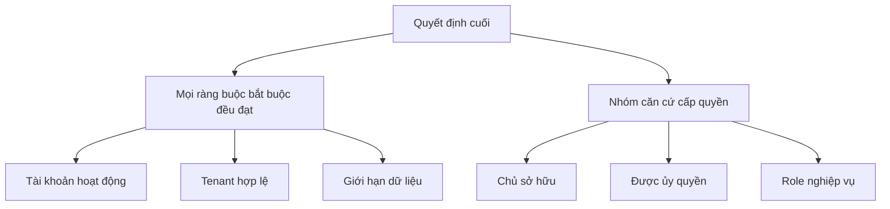

# Policy combination

## 1. Nhiều policy áp dụng thì ai quyết định kết quả cuối?

Một ứng dụng tài liệu có ba quy định:

- Chủ sở hữu được đọc tài liệu của mình.
- Thành viên dự án được đọc tài liệu thuộc dự án.
- Người dùng không được truy cập tài liệu của tenant khác, trừ một cơ chế xuyên tenant được thiết kế riêng.

An là chủ sở hữu một tài liệu nhưng tài liệu đã được chuyển sang tenant mà An không còn thuộc về. Policy chủ sở hữu có thể tạo ra một căn cứ cho phép, trong khi ràng buộc tenant không đạt. Nếu hệ thống chỉ hỏi “có policy nào cho phép không?”, nó có thể bỏ qua ranh giới tenant.

**Policy combination** là việc kết hợp các kết quả hoặc điều kiện của nhiều rule, policy hay nhóm policy thành một quyết định authorization cuối cùng. Việc này bao gồm xác định policy nào liên quan, cách xử lý xung đột, thứ tự nếu có, hành vi khi thiếu policy hoặc lỗi đánh giá, cùng các giới hạn phải thực thi.

Chỉ viết đúng từng policy chưa đủ. Cách ghép các policy có thể tạo ra một hệ thống quyền khác với điều người thiết kế mong muốn.

## 2. Trước khi kết hợp, phải hiểu kết quả của từng thành phần

Trong mô hình giảng dạy của bài này, một thành phần trả một trong bốn trạng thái:

| Kết quả | Ý nghĩa |
| --- | --- |
| `PERMIT` | Có căn cứ cho phép trong phạm vi mà thành phần đánh giá |
| `DENY` | Có quyết định từ chối rõ theo hợp đồng của thành phần |
| `NOT_APPLICABLE` | Thành phần không đưa ra quyết định cho yêu cầu này |
| `INDETERMINATE` | Không đánh giá được đáng tin cậy do thiếu dữ liệu hoặc lỗi |

Không nên gộp cả bốn thành một boolean ngay từ đầu. Nếu mọi kết quả khác `PERMIT` đều bị biến thành `false`, tầng tổng hợp sẽ không biết đâu là một lệnh cấm, đâu là policy không liên quan và đâu là lỗi.

### 2.1. Không cấp quyền khác với cấm rõ

Xét một rule cấp quyền:

```text
Cho phép đọc khi người gọi là chủ sở hữu tài liệu.
```

Nếu người gọi không phải chủ sở hữu, rule này có thể trả `NOT_APPLICABLE` theo hợp đồng của nhóm rule cấp quyền. Nó không nhất thiết tạo một lệnh cấm toàn cục, vì người đó vẫn có thể được cấp quyền qua một cơ chế ủy quyền khác.

Ngược lại:

```text
Cấm đọc tài liệu khi tài khoản đã bị đình chỉ.
```

Khi tài khoản bị đình chỉ, đây là căn cứ từ chối rõ. Nếu quy định đình chỉ là bắt buộc, một rule cho phép đọc của dự án không được làm nó mất tác dụng.

Việc một điều kiện sai được biểu diễn bằng `DENY` hay `NOT_APPLICABLE` phụ thuộc hợp đồng rule và engine. Phải định nghĩa trước khi chọn combiner. Không tự chuyển kết quả của một thư viện thành ngữ nghĩa khác chỉ vì tên enum trông giống nhau.

### 2.2. Không áp dụng khác với không biết có áp dụng không

Nếu policy chỉ dành cho `document:export`, một request `document:read` có thể không thuộc phạm vi của policy đó.

Nếu hệ thống không tải được tenant của tài liệu để xác định policy liên quan, nó chưa chứng minh policy không áp dụng. Bỏ qua policy trong trường hợp này có thể làm mất một ràng buộc bảo vệ.

Một lỗi ở bước chọn policy cũng cần được xử lý. Đánh giá chính xác một tập policy bị thiếu vẫn có thể cho ra kết quả quyền sai.

## 3. Phân biệt ràng buộc bắt buộc và các đường cấp quyền thay thế

Trong ứng dụng tài liệu, có thể tổ chức thành hai nhóm trách nhiệm:

```text
Ràng buộc bắt buộc:
    tài khoản hoạt động
    AND ranh giới tenant hợp lệ
    AND điều kiện dữ liệu bắt buộc được đáp ứng

Các căn cứ cấp quyền thay thế:
    là chủ sở hữu
    OR có quyền được ủy quyền
    OR có vai trò nghiệp vụ phù hợp
```

Quyết định cho phép được mô tả bằng:

```text
Mọi ràng buộc bắt buộc đều đạt
AND ít nhất một căn cứ cấp quyền hợp lệ tồn tại
```

Ví dụ:

```text
accountActive
AND tenantAllowed
AND (ownerGrant OR delegatedGrant OR projectRoleGrant)
```

Cách viết sau có ý nghĩa khác:

```text
(accountActive AND tenantAllowed AND ownerGrant)
OR delegatedGrant
OR projectRoleGrant
```

Hai nhánh cuối ở biểu thức thứ hai có thể bỏ qua cả trạng thái tài khoản lẫn tenant. Đây là lỗi cấu trúc kết hợp, ngay cả khi từng biến đều lấy từ nguồn đáng tin cậy.

Ngược lại, dùng `AND` cho tất cả căn cứ cấp quyền cũng có thể sai. Một người được ủy quyền đọc tài liệu không nhất thiết phải đồng thời là chủ sở hữu. Cần phân biệt “tất cả điều kiện phải đạt” với “chỉ cần một đường cấp quyền được chấp nhận”.

## 4. Các cách kết hợp thường gặp

Một số tên thường xuất hiện trong các engine hỗ trợ XACML:

| Cách kết hợp | Ý chính trong trường hợp không có lỗi đánh giá |
| --- | --- |
| Deny-overrides | Có `DENY` thì ưu tiên từ chối |
| Permit-overrides | Có `PERMIT` thì ưu tiên cho phép |
| First-applicable | Dùng kết quả áp dụng đầu tiên theo thứ tự |
| Ordered variants | Bảo đảm thứ tự đánh giá cho biến thể tương ứng |

WSO2 mô tả các lựa chọn này trong bộ tài liệu policy của Identity Server. Tên tương tự không bảo đảm hai sản phẩm có cùng hợp đồng lỗi và đầu ra. [WSO2 Identity Server 6.1 — Create a new policy](https://is.docs.wso2.com/en/6.1.0/guides/authorization/create-a-policy/).

Trong XACML 3.0, `only-one-applicable` chọn theo target của policy hoặc policy set: không target nào khớp thì `NotApplicable`, nhiều target khớp thì `Indeterminate`. Nó không đếm số kết quả `Permit`. Chuẩn còn có `deny-unless-permit`: có `Permit` thì cho phép, còn lại từ chối; và `permit-unless-deny`: có `Deny` thì từ chối, còn lại cho phép. Một số thuật toán phân biệt `Indeterminate{P}`, `{D}`, `{DP}` để giữ thông tin về tác dụng có thể có khi lỗi không xảy ra. [OASIS XACML 3.0 — Phụ lục C](https://docs.oasis-open.org/xacml/3.0/xacml-3.0-core-spec-os-en.html).

Bảng dưới dùng các quyết định đã xác định hoàn toàn, không có lỗi, không có obligation, để minh họa sự khác biệt giữa ba chiến lược đầu:

| Kết quả theo thứ tự | Deny-overrides | Permit-overrides | First-applicable |
| --- | --- | --- | --- |
| `PERMIT, DENY` | `DENY` | `PERMIT` | `PERMIT` |
| `DENY, PERMIT` | `DENY` | `PERMIT` | `DENY` |
| `NOT_APPLICABLE, PERMIT` | `PERMIT` | `PERMIT` | `PERMIT` |
| `NOT_APPLICABLE, DENY` | `DENY` | `DENY` | `DENY` |
| `NOT_APPLICABLE, NOT_APPLICABLE` | `NOT_APPLICABLE` | `NOT_APPLICABLE` | `NOT_APPLICABLE` |

Bảng không thay thế đặc tả đầy đủ của engine. Đặc biệt, không được thêm một hàng `INDETERMINATE` rồi tự đoán kết quả chỉ từ tên “deny” hoặc “permit”.

### 4.1. Chọn chiến lược theo ý nghĩa nghiệp vụ

Nếu quy định tenant là ranh giới bắt buộc, không nên đặt nó trong một nhóm mà một grant bất kỳ được phép ghi đè. Nếu các căn cứ chủ sở hữu và ủy quyền là hai lựa chọn thay thế, không nên bắt người dùng đồng thời đạt cả hai.

Một thuật toán không tự biết rule nào là ranh giới tenant và rule nào là ngoại lệ nghiệp vụ. Ý nghĩa đó phải được thể hiện bằng cấu trúc policy, phạm vi quản trị và hợp đồng tổng hợp.

### 4.2. Mặc định từ chối và ưu tiên deny là hai lựa chọn khác nhau

Với tập quyết định `PERMIT, DENY`, chiến lược “chỉ cần một permit, nếu không có permit thì từ chối” vẫn có thể cho phép. Tên gọi liên quan đến mặc định từ chối không tự chứng minh một lệnh cấm cụ thể sẽ luôn thắng.

Ngược lại, chiến lược ưu tiên deny vẫn cần hành vi rõ khi không có thành phần nào quyết định. Giữ `NOT_APPLICABLE` ở tầng nội bộ giúp phân biệt thiếu căn cứ cấp quyền; PEP sau đó chỉ cho thực thi khi kết quả cuối là `PERMIT` hợp lệ.

### 4.3. Trường hợp chỉ được có một miền policy phù hợp

Giả sử ứng dụng phân tài nguyên thành các miền được quản trị độc lập và yêu cầu mỗi request chỉ thuộc một miền. Khi hai miền cùng nhận mình chịu trách nhiệm cho một tài nguyên, vấn đề cần phát hiện là sự chồng lấn phạm vi quản trị, chứ không phải tìm xem bên nào trả permit sớm hơn.

Trong mô hình tự thiết kế, có thể kiểm tra tính duy nhất của miền trước khi đánh giá policy nghiệp vụ. Không thay việc kiểm tra miền bằng cách đếm số rule cho phép; một miền có thể chứa nhiều rule cấp quyền hợp lệ.

## 5. Thứ tự đánh giá có thể làm thay đổi quyền

Xét danh sách được xử lý theo cách dùng kết quả áp dụng đầu tiên:

```text
1. Nếu có role PROJECT_READER thì PERMIT.
2. Nếu tài khoản bị đình chỉ thì DENY.
```

Một người bị đình chỉ nhưng còn role `PROJECT_READER` có thể được cho phép trước khi quy định đình chỉ được xét. Đổi thứ tự hai mục sẽ thay đổi kết quả.

Nếu trạng thái tài khoản là điều kiện bắt buộc, cách thiết kế dễ kiểm tra hơn là đặt nó ở tầng ràng buộc riêng thay vì phụ thuộc vào vị trí của một rule trong danh sách grant.

Nếu hệ thống thật sự dùng thứ tự như một phần nghiệp vụ, thứ tự phải được quản lý như dữ liệu policy có phiên bản. Không lấy thứ tự từ `HashMap`, kết quả truy vấn thiếu `ORDER BY` hoặc thứ tự response của các lời gọi song song.

Một triển khai được phép dừng sớm chỉ khi việc dừng không đổi hợp đồng kết quả. Dừng vì một grant xuất hiện đầu tiên trong thời gian thực không tương đương ưu tiên theo danh sách policy được thiết kế.

## 6. Hợp, giao và cây policy

Có thể dùng phép toán tập hợp để trao đổi về quyền trong những trường hợp đã xác định rõ phạm vi:

```text
Hợp các nguồn grant:    G1 ∪ G2
Giao các giới hạn:      G ∩ B1 ∩ B2
Loại phần bị cấm:      G \ D
```

Đây là cách mô tả quyền hiệu lực cho mô hình đang xét, không phải cách thay thế mọi quyết định đa trạng thái bằng phép toán tập hợp đơn giản.

Một cây kết hợp có thể có cấu trúc:



Trong cây ví dụ, các ràng buộc được kết hợp theo giao; nhóm grant cần ít nhất một căn cứ được chấp nhận. Làm phẳng toàn bộ các nút rồi áp dụng một phép `OR` sẽ thay đổi ngữ nghĩa.

Một ví dụ sản phẩm là AWS IAM: tài liệu evaluation logic phân biệt việc kết hợp một số nguồn quyền bằng hợp với việc giới hạn quyền bằng permissions boundary hoặc các policy tổ chức trong những bối cảnh được mô tả. Explicit deny còn có vai trò riêng. Chi tiết phụ thuộc loại policy, principal và bối cảnh truy cập; không thể dùng công thức một dòng cho mọi request AWS. [AWS IAM — Policy evaluation logic](https://docs.aws.amazon.com/IAM/latest/UserGuide/reference_policies_evaluation-logic.html).

Không nên suy ra rằng policy ở tenant con tự động được ghi đè mọi policy cấp tổ chức, hoặc ngược lại. Quan hệ cấp quản trị và quan hệ ưu tiên phải được thiết kế hoặc đọc đúng từ nền tảng đang sử dụng.

## 7. Lỗi đánh giá phải có hợp đồng riêng

### 7.1. Không biến lỗi thành không liên quan

Giả sử một grant đọc tài liệu trả `PERMIT`, nhưng policy kiểm tra tài khoản đình chỉ không tải được dữ liệu. Nếu adapter chuyển lỗi thành `NOT_APPLICABLE`, nhóm tổng hợp có thể tiếp tục cho phép.

Khi một ràng buộc là bắt buộc, hệ thống phải chứng minh ràng buộc đó đã được kiểm tra và đạt. Không nhận được kết quả, thiếu dữ liệu và không có policy bảo vệ không phải ba cách khác nhau để nói “đã đạt”.

Trong mô hình thận trọng của bài này, lỗi ở một thành phần liên quan chưa được giải quyết sẽ không tạo ra `PERMIT`. Đây là lựa chọn thiết kế ứng dụng, không phải hành vi mặc định của mọi engine.

### 7.2. Một engine có thể xử lý lỗi khác mô hình ứng dụng

Cedar dùng mặc định từ chối và cho `forbid` thỏa điều kiện ưu tiên hơn `permit`. Đồng thời, policy gặp lỗi bị bỏ khỏi phép kết hợp, còn lỗi được đưa vào diagnostics. Ứng dụng có thể xem diagnostics và áp dụng quyết định thận trọng hơn nếu hợp đồng của mình yêu cầu. [Cedar — How authorization works](https://docs.cedarpolicy.com/auth/authorization.html).

Do đó, yêu cầu “lỗi của ràng buộc bắt buộc phải chặn truy cập” phải được triển khai phù hợp với engine thực tế. Không thể chỉ nhìn một nhãn thuật toán hoặc một kết quả allow cuối rồi cho rằng mọi kiểm tra bảo vệ đã thành công.

### 7.3. Phân biệt quyết định và lý do vận hành

Một tài khoản đã bị xác định là không có quyền và một request không được thực hiện do policy store lỗi đều bị chặn, nhưng cách xử lý vận hành khác nhau.

Hệ thống nên giữ thông tin về policy lỗi, loại dữ liệu thiếu, phiên bản và request liên quan. Không chữa lỗi hạ tầng bằng cách thêm grant rộng hoặc bỏ ràng buộc khỏi tập policy.

## 8. Ví dụ Java: kết hợp ràng buộc bắt buộc và nhóm grant

Ví dụ Java 17 dưới đây cố ý định nghĩa một hợp đồng riêng:

1. Có manifest các ID ràng buộc bắt buộc do cấu hình server quản lý.
2. Tập kết quả ràng buộc phải khớp manifest; thiếu hoặc thừa ID là lỗi cấu hình, dữ liệu.
3. Mọi ràng buộc phải trả `PERMIT`; `NOT_APPLICABLE` ở đây không đủ để đi tiếp.
4. Nhóm grant ưu tiên `DENY`, sau đó lỗi, rồi mới `PERMIT`; nếu không có căn cứ nào thì `NOT_APPLICABLE`.
5. PEP chỉ thực thi khi kết quả cuối chính xác là `PERMIT`.

Code chỉ tổng hợp các kết quả đã đánh giá trên cùng request và snapshot thích hợp. Nó không triển khai XACML, không tải policy, không xử lý obligation và không xác thực nguồn thuộc tính.

```java
import java.util.List;
import java.util.Map;
import java.util.Set;

public final class PolicyCombinationDemo {
    enum Decision {
        PERMIT, DENY, NOT_APPLICABLE, INDETERMINATE
    }

    static Decision combineRequiredGates(Set<String> requiredIds,
                                         Map<String, Decision> results) {
        if (requiredIds == null || requiredIds.isEmpty() || results == null) {
            return Decision.INDETERMINATE;
        }
        for (String id : requiredIds) {
            if (id == null || id.isBlank()) {
                return Decision.INDETERMINATE;
            }
        }
        if (!results.keySet().equals(requiredIds)) {
            return Decision.INDETERMINATE;
        }

        boolean incomplete = false;
        for (String id : requiredIds) {
            Decision decision = results.get(id);
            if (decision == Decision.DENY) {
                return Decision.DENY;
            }
            if (decision != Decision.PERMIT) {
                incomplete = true;
            }
        }
        return incomplete ? Decision.INDETERMINATE : Decision.PERMIT;
    }

    static Decision combineGrantPolicies(List<Decision> decisions) {
        if (decisions == null) {
            return Decision.INDETERMINATE;
        }

        boolean sawPermit = false;
        boolean sawError = false;
        for (Decision decision : decisions) {
            if (decision == Decision.DENY) {
                return Decision.DENY;
            }
            if (decision == null || decision == Decision.INDETERMINATE) {
                sawError = true;
            }
            if (decision == Decision.PERMIT) {
                sawPermit = true;
            }
        }

        if (sawError) {
            return Decision.INDETERMINATE;
        }
        return sawPermit ? Decision.PERMIT : Decision.NOT_APPLICABLE;
    }

    static Decision combine(Set<String> requiredIds,
                            Map<String, Decision> gateResults,
                            List<Decision> grantResults) {
        Decision gates = combineRequiredGates(requiredIds, gateResults);
        if (gates != Decision.PERMIT) {
            return gates;
        }
        return combineGrantPolicies(grantResults);
    }

    static boolean mayExecute(Decision decision) {
        return decision == Decision.PERMIT;
    }

    public static void main(String[] args) {
        Set<String> required = Set.of("account-active", "tenant-boundary");
        Map<String, Decision> passingGates = Map.of(
                "account-active", Decision.PERMIT,
                "tenant-boundary", Decision.PERMIT);

        System.out.println(combine(required, passingGates,
                List.of(Decision.PERMIT, Decision.NOT_APPLICABLE)));
        System.out.println(combine(required, Map.of(
                "account-active", Decision.PERMIT,
                "tenant-boundary", Decision.DENY),
                List.of(Decision.PERMIT)));
        System.out.println(combine(required, Map.of(
                "account-active", Decision.PERMIT),
                List.of(Decision.PERMIT)));
        System.out.println(combine(required, passingGates,
                List.of(Decision.PERMIT, Decision.INDETERMINATE)));
        System.out.println(combine(required, passingGates,
                List.of(Decision.NOT_APPLICABLE, Decision.NOT_APPLICABLE)));
    }
}
```

Đầu ra dự kiến:

```text
PERMIT
DENY
INDETERMINATE
INDETERMINATE
NOT_APPLICABLE
```

Trường hợp thứ ba thiếu kết quả `tenant-boundary`. Nếu code chỉ lặp qua các kết quả có sẵn và thấy tất cả đều permit, nó có thể cho qua một kiểm tra bị bỏ sót. Đối chiếu với manifest giúp phát hiện lỗi đó.

Manifest phải đến từ cấu hình có thẩm quyền, không phải danh sách do client chọn. Với ràng buộc có điều kiện, server phải tính đúng tập ID cần có cho action và tài nguyên hiện tại trước khi gọi combiner. Dữ liệu đánh giá cũng nên là snapshot bất biến để tránh thay đổi trong lúc tổng hợp.

Một grant không phù hợp phải trả `NOT_APPLICABLE` theo hợp đồng của ví dụ, thay vì trả `DENY` chỉ vì không cấp quyền. Một `DENY` thực sự trong nhóm grant sẽ chặn các grant khác. Đây là quyết định ngữ nghĩa cần được duy trì ở mọi adapter.

`INDETERMINATE` trong code không giữ các biến thể lỗi có tác dụng tiềm năng khác nhau. Vì vậy, không dùng hàm này như một bản thay thế cho thuật toán chuẩn của một engine XACML.

## 9. Cùng policy có thể bị kết hợp sai trong ngôn ngữ triển khai

Trong một ngôn ngữ khai báo, nhiều định nghĩa cùng tên có thể là các đường thay thế, còn nhiều điều kiện trong một thân rule là điều kiện đồng thời. Phải hiểu đúng ngữ nghĩa của ngôn ngữ, không chỉ đọc bố cục file.

Ví dụ Rego theo cú pháp dùng `if`:

```rego
package example.combination

default allow := false

allow if {
    input.guardrails_ok == true
    input.owner_grant == true
}

allow if {
    input.guardrails_ok == true
    input.delegated_grant == true
}
```

Trong ví dụ, cả hai đường cấp quyền đều yêu cầu `guardrails_ok`. Thêm một định nghĩa `allow` mới chỉ kiểm tra `delegated_grant` sẽ tạo một đường khác bỏ qua ràng buộc đó.

Các giá trị đầu vào ở đây phải do server tính và xác minh; không cho client tự khẳng định `guardrails_ok=true`. Đây là ví dụ biểu diễn logic, chưa phải tích hợp production hoặc mô hình lỗi nhiều trạng thái. [OPA — Policy Language](https://www.openpolicyagent.org/docs/policy-language).

Việc tách ràng buộc thành helper dùng chung có thể giúp giảm sao chép, nhưng vẫn cần kiểm tra mọi đường cấp quyền có đi qua helper đó hay không. Đổi tên file hoặc chuyển rule sang một module khác không tự làm tăng ưu tiên của nó.

## 10. Kết hợp quyết định còn phải giữ các giới hạn đi kèm

Một policy có thể cho phép đọc với yêu cầu che trường dữ liệu. Policy khác có thể giới hạn thời điểm hoặc tập bản ghi. Nếu chỉ lấy boolean `allow=true` và bỏ các giới hạn này, quyết định thực thi có thể rộng hơn quyết định đã đánh giá.

Một thiết kế cần xác định:

- Các yêu cầu bắt buộc toàn cục được áp dụng ở đâu?
- Những điều kiện nào gắn với một đường grant cụ thể?
- Khi có nhiều grant hợp lệ, hệ thống chọn đường nào hoặc kết hợp điều kiện theo cách nào?
- Nếu hai yêu cầu không tương thích, kết quả là gì?
- Nếu PEP không thực hiện được yêu cầu bắt buộc, thao tác có bị dừng không?

Không có quy tắc chung rằng cứ nối mọi obligation của mọi policy là đúng. Ví dụ, một grant cho chủ sở hữu xem đầy đủ và một grant ủy quyền chỉ xem bản đã che cần một hợp đồng rõ về đường quyền được sử dụng. Ngược lại, một hạn chế dữ liệu bắt buộc toàn tổ chức không được mất tác dụng vì chọn đường grant khác.

Trong mô hình ứng dụng tự thiết kế, có thể quy định mọi giới hạn bắt buộc phải được giữ lại và nếu không thực thi được thì chặn. Nếu dùng engine có cơ chế obligation riêng, cần tuân thủ cơ chế đó thay vì tự ghép đầu ra theo trực giác.

## 11. Ngoại lệ phải có phạm vi và thẩm quyền

Một rule đặc biệt như `if admin then PERMIT` đặt ở cấp cao có thể vô tình vượt mọi ràng buộc. Nếu quản trị viên chỉ được hỗ trợ trong một tenant, rule này đã mở rộng quyền ngoài nhiệm vụ.

Khi thực sự cần ngoại lệ, nên mô tả rõ:

```text
Ngoại lệ dành cho hành động nào?
Áp dụng với loại tài nguyên và scope nào?
Ai được yêu cầu và ai được phê duyệt?
Có thời hạn và điều kiện kích hoạt nào?
Ràng buộc nào vẫn bắt buộc?
Những điều kiện nào được phép thay thế một cách có chủ đích?
```

Ví dụ, cơ chế hỗ trợ xuyên tenant có thể là một đường ủy quyền riêng với tenant đích, mục đích và thời hạn cụ thể. Nó không nên xuất hiện ngẫu nhiên như nhánh `OR admin` trong mọi policy tài liệu.

Người có quyền tạo policy cấp ứng dụng hoặc tenant cũng không nên tự quyết định được thứ tự hoặc thuật toán tổng hợp ở tầng tổ chức nếu đó nằm ngoài thẩm quyền của họ. Quản lý combiner là một năng lực quản trị quyền.

## 12. Tính nhất quán, cache và dấu vết quyết định

### 12.1. Các kết quả phải nói về cùng một request

Không kết hợp một permit cho `document:read` với một kết quả kiểm tra tenant của tài liệu khác rồi dùng cho export. Các kết quả cần gắn với cùng chủ thể, action, tài nguyên và ngữ cảnh có liên quan.

Nếu policy và thuộc tính thay đổi trong lúc đánh giá, cần có hợp đồng về snapshot hoặc version để tránh trộn những trạng thái không nhất quán. Một policy chỉ cho phép tài liệu nháp không nên được kết hợp với metadata đã đổi sang trạng thái duyệt mà không được xử lý phù hợp.

### 12.2. Tập policy là một phần của khóa và hiệu lực cache

Cache kết quả cuối có thể trở nên sai khi thêm một deny mới, thay thuật toán, đổi thứ tự hoặc thay manifest ràng buộc, dù danh tính người dùng không đổi.

Cần tính tới phiên bản policy set, cấu trúc kết hợp, dữ liệu thuộc tính liên quan và yêu cầu thu hồi. Không chỉ dùng `subjectId` làm khóa cho mọi quyết định.

Việc dùng policy cũ khi không lấy được policy mới phải tuân thủ hợp đồng hiệu lực và độ mới đã thiết kế. Không âm thầm bỏ những policy không tải được rồi coi tập còn lại là đầy đủ.

### 12.3. Log phải giải thích được cách tổng hợp

Một sự kiện minh họa:

```json
{
  "requestId": "req-840",
  "subjectId": "user-an",
  "action": "document:read",
  "resourceId": "doc-42",
  "policySetVersion": "documents-v8",
  "combiner": "required-gates-and-conservative-grants-v1",
  "gateResults": {
    "account-active": "PERMIT",
    "tenant-boundary": "DENY"
  },
  "grantResults": {
    "owner-grant": "PERMIT",
    "delegated-grant": "NOT_APPLICABLE"
  },
  "finalDecision": "DENY",
  "reasonCode": "REQUIRED_GATE_FAILED"
}
```

Tên combiner trong ví dụ là hợp đồng tự thiết kế của ứng dụng. Giữ được kết quả thành phần giúp giải thích vì sao một grant tồn tại mà request vẫn bị chặn.

Không cần ghi toàn bộ token hoặc dữ liệu thuộc tính nhạy cảm vào log. Nơi tổng hợp có thể dừng sớm để quyết định, nhưng nếu yêu cầu kiểm toán cần diagnostics đầy đủ thì cơ chế thu thập phải được thiết kế tương ứng, không trông chờ các policy chưa chạy sẽ tự tạo log.

## 13. Kiểm thử thuật toán và cấu trúc policy

| Tình huống | Điều cần xác nhận |
| --- | --- |
| Có permit và deny trong cùng nhóm | Kết quả đúng chiến lược đã chọn |
| Mọi thành phần đều không áp dụng | Không có quyền mới xuất hiện ở PEP |
| Tất cả ràng buộc đạt nhưng không có grant | Không thực hiện thao tác |
| Có grant nhưng thiếu một ràng buộc bắt buộc | Không cho qua do tập kết quả bị thiếu |
| Có grant nhưng ràng buộc lỗi | Xử lý đúng hợp đồng lỗi |
| Một grant không phù hợp | Không bị diễn giải nhầm thành lệnh cấm toàn cục |
| Thêm đường grant mới | Không bỏ qua ràng buộc bắt buộc |
| Đổi thứ tự danh sách | Chỉ đổi kết quả khi thuật toán có ngữ nghĩa phụ thuộc thứ tự |
| Hai miền quản trị chồng target | Phát hiện theo quy tắc miền đã thiết kế |
| Đổi combiner nhưng giữ nguyên policy | Kiểm tra tác động tới các request trước đây |
| Policy hoặc kết quả thành phần bị thiếu | Không mặc nhiên coi tập còn lại là đầy đủ |
| Obligation bắt buộc không thực thi được | Không trả dữ liệu rộng hơn quyền đã đánh giá |
| Cache còn kết quả trước khi thêm hạn chế | Đáp ứng hợp đồng cập nhật, thu hồi |
| Các thành phần trả kết quả cho action hoặc tài nguyên khác nhau | Không kết hợp chúng thành một permit hợp lệ |

Với combiner tự thiết kế ở mục 8, có thể xác định các bất biến:

- Thêm một `DENY` vào nhóm grant không làm kết quả trở thành `PERMIT`.
- Một ràng buộc bắt buộc không trả `PERMIT` không thể được bù bằng thêm grant.
- Hoán vị kết quả trong nhóm grant không làm đổi quyết định cuối.
- Tập ràng buộc thiếu ID không được xem là đã kiểm tra đầy đủ.
- Tập grant rỗng không tự sinh quyền.

Đây là bất biến của hợp đồng ví dụ, không phải thuộc tính mặc định của mọi engine. Với một combiner dựa vào thứ tự, kiểm thử phải chứng minh thứ tự được bảo toàn và các rule ưu tiên thực sự được đặt đúng vị trí.

Ngoài kiểm thử combiner, cần kiểm thử nơi chọn policy và PEP. Một hàm tổng hợp đúng không bảo vệ được endpoint đã bỏ qua authorization hoặc chỉ chọn các policy cấp quyền mà bỏ policy hạn chế.

## 14. Bài tập tình huống

Một nhóm phát triển có hai policy độc lập:

```text
Policy A: chủ sở hữu được đọc tài liệu.
Policy B: tài khoản bị đình chỉ không được đọc tài liệu.
```

Đội ban đầu kiểm tra B trước A bằng một danh sách có thứ tự. Khi tối ưu hiệu năng, họ chạy hai policy song song và trả kết quả đầu tiên hoàn thành. Policy A thường nhanh hơn vì chỉ cần so sánh ID; policy B phải tra trạng thái tài khoản.

Hãy xác định vì sao thay đổi này có thể làm sai quyền và cần điều chỉnh ở đâu.

### Gợi ý phân tích

Kết quả hoàn thành đầu tiên là thứ tự thời gian của thực thi, không phải thứ tự ưu tiên của policy. Nếu A trả permit trước khi B xác định tài khoản bị đình chỉ, hệ thống có thể mở quyền mà chưa đánh giá xong một ràng buộc bắt buộc.

Cần xác định hợp đồng nghiệp vụ: trạng thái tài khoản là điều kiện phải đạt, còn chủ sở hữu là một căn cứ cấp quyền. Có thể đánh giá song song nếu tầng tổng hợp vẫn đợi đủ bằng chứng cần thiết và quyết định theo hợp đồng đó. Tối ưu thực thi không được đổi ngữ nghĩa kết hợp.

Nếu không lấy được trạng thái tài khoản, hệ thống phải xử lý theo hợp đồng lỗi đã chọn, giữ lý do vận hành và không tự coi B là không liên quan. Kiểm thử cần quan sát cả kết quả cuối lẫn việc dữ liệu có được trả ra trước khi quyết định hoàn tất hay không.

## 15. Tài liệu tham khảo

- [OASIS XACML 3.0 Core Specification](https://docs.oasis-open.org/xacml/3.0/xacml-3.0-core-spec-os-en.html): định nghĩa chuẩn về thuật toán kết hợp và trạng thái lỗi mở rộng.
- [WSO2 Identity Server 6.1 — Create a new policy](https://is.docs.wso2.com/en/6.1.0/guides/authorization/create-a-policy/): ví dụ các lựa chọn kết hợp trong một sản phẩm triển khai policy.
- [AWS IAM — Policy evaluation logic](https://docs.aws.amazon.com/IAM/latest/UserGuide/reference_policies_evaluation-logic.html): ví dụ phân biệt cách kết hợp nhiều loại policy trong nền tảng IAM.
- [Cedar — How authorization works](https://docs.cedarpolicy.com/auth/authorization.html): quy tắc kết hợp và cách xử lý lỗi của Cedar.
- [Open Policy Agent — Policy Language](https://www.openpolicyagent.org/docs/policy-language): ngữ nghĩa rule, giá trị mặc định và các biểu thức Rego.
