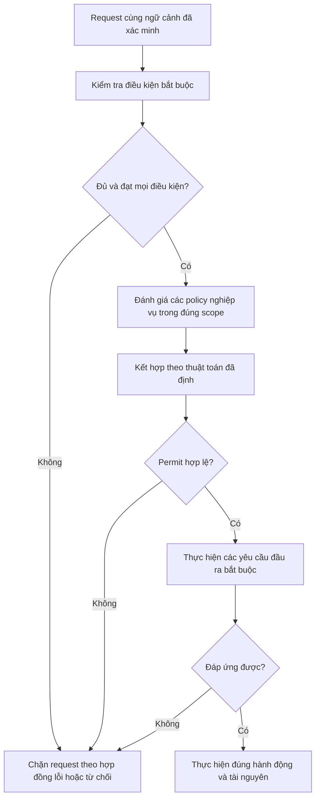

# Policy conflict — Xung đột chính sách truy cập trong ABAC

## 1. Policy conflict là gì?

Một hệ thống IAM thường có nhiều chính sách cùng tham gia quyết định truy cập: chính sách của nền tảng, tenant, phòng ban, tài nguyên, role và tình huống khẩn cấp. **Policy conflict** xuất hiện khi những chính sách có phạm vi giao nhau đưa ra yêu cầu hoặc kết quả không tương thích đối với cùng một yêu cầu truy cập.

Ví dụ, nền tảng học tập có hai quy tắc:

```text
P1: Cho phép người duyệt được phân công phát hành khóa học đã được duyệt.
P2: Cấm tài khoản đang bị đình chỉ thực hiện thao tác phát hành.
```

Lan là người duyệt được phân công nhưng tài khoản vừa bị đình chỉ. Với cùng request `course.publish`, P1 có thể tạo một kết quả Permit trong khi P2 tạo Deny. Hệ thống phải có semantics kết hợp xác định để đưa ra quyết định cuối; không được để kết quả phụ thuộc rule nào tình cờ được đọc trước.

Trong ABAC, policy đánh giá thuộc tính chủ thể, tài nguyên, hành động và có thể cả môi trường. Những tổ hợp thuộc tính khác nhau làm cùng hai policy có thể xung đột ở request này nhưng không giao nhau ở request khác. Nền tảng của mô hình được trình bày trong [NIST SP 800-162 — Guide to Attribute Based Access Control](https://csrc.nist.gov/pubs/sp/800/162/upd2/final).

Một cách mô tả request dùng cho phân tích là:

```text
q = (subject, resource, action, environment)
```

Để so sánh kết quả có ý nghĩa, các policy cần đánh giá đúng cùng subject, cùng tài nguyên, cùng hành động và một ngữ cảnh dữ liệu được xác định. Hai service nhìn thấy hai phiên bản account-state khác nhau có thể trả kết quả khác nhau mà không phải bản thân biểu thức policy mâu thuẫn.

## 2. Phân biệt xung đột với các hiện tượng gần nhau

| Hiện tượng | Ví dụ | Ý nghĩa cần phân tích |
| --- | --- | --- |
| Mâu thuẫn effect | Một policy Permit, policy khác Deny cùng thao tác | Cần quy tắc kết hợp và xác định ý định nghiệp vụ |
| Chồng lấn cùng effect | Hai policy đều Permit cùng phạm vi | Có thể dư thừa, không nhất thiết là mâu thuẫn |
| Shadowing | Rule rộng phía trước làm rule hẹp phía sau không được xét | Có thể làm ngoại lệ hoặc lệnh cấm mất tác dụng |
| Khoảng trống coverage | Không policy nào áp dụng cho một thao tác cần bảo vệ | Cần hành vi mặc định rõ ràng |
| Lỗi đánh giá | Không đọc được một thuộc tính bắt buộc | Là tình trạng không xác định, không tự coi như policy không áp dụng |
| Khác phiên bản | Gateway dùng bundle cũ, service dùng bundle mới | Cần xử lý phân phối và nhất quán policy |
| Yêu cầu đầu ra không tương thích | Một policy yêu cầu che field, policy khác đòi trả nguyên field | Cần giải quyết điều kiện thực thi, không chỉ effect |

Không phải mọi chồng lấn đều phải bị loại bỏ. Một policy tổ chức và một policy tài nguyên có thể cùng cho phép để thể hiện các đường cấp quyền độc lập. Điều quan trọng là biết chúng được kết hợp thế nào và việc thu hồi một đường cấp có ảnh hưởng gì.

Cũng không nên sửa biểu thức policy để che một lỗi đồng bộ dữ liệu. Nếu tài khoản bị đình chỉ nhưng một service còn cache trạng thái ACTIVE, ưu tiên Deny chỉ giúp khi service thực sự nhìn thấy dữ kiện tạo ra Deny.

## 3. Kết quả đánh giá cần được mô hình hóa rõ

Thay vì chỉ dùng boolean, một mô hình có thể giữ các kết quả sau:

| Kết quả | Ý nghĩa khái niệm trong bài |
| --- | --- |
| Permit | Policy tạo căn cứ cho phép đối với request |
| Deny | Policy tạo căn cứ từ chối đối với request |
| NotApplicable | Policy không tạo quyết định áp dụng cho request |
| Indeterminate | Không đánh giá được kết quả một cách xác định |

Ứng dụng hoặc policy engine cụ thể phải định nghĩa cách sinh và kết hợp kết quả. Không mặc định mọi điều kiện false đều tạo Deny. Ví dụ, rule chỉ dành cho `course.publish` có thể không áp dụng cho `course.read`, thay vì cấm mọi thao tác đọc.

Thiếu thuộc tính cũng không luôn có cùng semantics. Một thuộc tính tùy chọn không có giá trị có thể làm một điều kiện không thỏa; một thuộc tính bắt buộc không đọc được có thể làm đánh giá lỗi. Hợp đồng thuộc tính và ngôn ngữ policy quyết định điều này.

Ở điểm thực thi, cần phân biệt **kết quả policy** với **hành vi cuối cùng**. Trong thiết kế của bài, chỉ một kết quả Permit đủ điều kiện mới có thể cho request đi tiếp. Deny, NotApplicable và Indeterminate đều không tự cho phép truy cập, nhưng vẫn được giữ riêng để điều tra và vận hành.

Một policy không cấp quyền không nhất thiết đang đưa ra lệnh cấm. Trong RBAC dùng phép hợp, role A thiếu `course.publish` không tạo một Deny để ghi đè role B có permission ấy. Nếu tích hợp RBAC vào ABAC, phải ánh xạ kết quả đúng với semantics đã chọn.

## 4. Thuật toán kết hợp phải là một phần của policy

Một bộ policy chưa đầy đủ nếu chỉ có các điều kiện mà không xác định cách kết hợp. Những hướng thường gặp gồm ưu tiên Deny, ưu tiên Permit hoặc xét theo thứ tự đã quy định.

XACML định nghĩa các thuật toán như deny-overrides, permit-overrides và first-applicable. Đặc tả còn xử lý các dạng Indeterminate chi tiết; tên thuật toán không thay thế đầy đủ semantics của nó. Khi dùng XACML, cần theo thuật toán chuẩn thay vì suy diễn từ tên. Xem [OASIS XACML 3.0 — Combining algorithms](https://docs.oasis-open.org/xacml/3.0/xacml-3.0-core-spec-os-en.html).

Trong thiết kế ứng dụng, cần hiểu tác động của từng lựa chọn:

### 4.1. Ưu tiên kết quả cấm

Nếu một căn cứ cấm rõ ràng phải chặn mọi đường cấp cùng cấp, có thể chọn cơ chế ưu tiên Deny. Ví dụ, một giới hạn tài khoản đình chỉ được thiết kế là điều kiện bắt buộc sẽ không bị một role nghiệp vụ thông thường vượt qua.

Tuy nhiên, “Deny ưu tiên” chưa nói đủ về lỗi đánh giá. Nếu một policy Permit còn policy kiểm tra trạng thái tài khoản bị lỗi, hệ thống cần một quyết định riêng cho tổ hợp đó. Không được giả định đã an toàn chỉ vì trong mã có một câu `if (deny)`.

### 4.2. Ưu tiên đường cho phép

Một tập policy có thể được thiết kế để chấp nhận một trong nhiều đường ủy quyền hợp lệ. Nhưng nếu cho phép một Permit vượt một Deny vốn được coi là giới hạn bắt buộc, cấu trúc kết hợp đã không phản ánh đúng ý định.

Không đưa giới hạn tenant, khóa tài khoản hoặc cấm tự duyệt vào cùng một nhóm với các grant nghiệp vụ rồi để một grant rộng tùy ý vô hiệu hóa chúng. Có thể phải tách các điều kiện bắt buộc ra một tầng kiểm tra độc lập trước khi xét các đường cấp quyền.

### 4.3. Xét theo thứ tự

Khi thứ tự tham gia semantics, thứ tự phải ổn định, được lưu rõ và được review như một phần của thay đổi quyền. Thứ tự iteration của một map hoặc thứ tự trả về không được bảo đảm từ database không phải là policy nghiệp vụ.

Một rule cho phép mọi người có role `REVIEWER` đặt trước rule cấm tự phát hành nội dung có thể làm rule cấm không được đi tới, tùy cơ chế xét. Chỉ viết đúng rule cấm mà đặt nó trong một cấu trúc không bao giờ chạy vẫn không bảo vệ được hệ thống.

### 4.4. Số priority không tự mang ý nghĩa

Một field `priority=100` cần có hợp đồng: số lớn hay nhỏ ưu tiên, tie được xử lý thế nào, Indeterminate có dừng đánh giá không và ai được đặt priority. Nếu mỗi nhóm tự dùng một quy ước, priority chỉ chuyển xung đột sang một chỗ khó nhìn hơn.

“Policy cụ thể hơn thắng” cũng cần định nghĩa mức cụ thể. Một policy hẹp theo tài nguyên nhưng rộng theo chủ thể không nhất thiết cụ thể hơn một policy hẹp theo chủ thể nhưng rộng theo tài nguyên. Không nên so sánh độ dài chuỗi điều kiện để tự quyết định.

## 5. Thiết kế ranh giới bắt buộc và các grant nghiệp vụ

Một cấu trúc minh họa cho hành động phát hành khóa học có thể gồm hai tầng:

```text
Tầng điều kiện bắt buộc:
    subject hợp lệ và tài khoản được phép hoạt động
    tenant và tài nguyên đúng phạm vi
    trạng thái khóa học phù hợp
    các điều kiện tách nhiệm vụ hoặc hạn chế khác đã định

Tầng đường cấp quyền:
    grant qua role người duyệt được phân công
    hoặc một grant tác vụ có phạm vi đã được phê duyệt

Cho phép cuối cùng:
    mọi điều kiện bắt buộc đạt
    AND tập đường cấp quyền tạo kết quả cho phép hợp lệ
    AND các yêu cầu thực thi đi kèm được đáp ứng
```

Các điều kiện bắt buộc không được mặc định là đạt chỉ vì chưa có kết quả Deny. Nếu một kiểm tra bắt buộc không được tải hoặc không đánh giá được, tầng điều kiện chưa hoàn tất.

Đây là mô hình của ví dụ, không phải cú pháp bắt buộc của mọi policy engine. Có thể biểu diễn cùng ý định bằng một policy set hoặc những cấu trúc khác nếu semantics tương đương và được kiểm chứng.



Nếu sản phẩm có ngoại lệ khẩn cấp, phải xác định ngoại lệ được nới điều kiện nào và vẫn bị giới hạn bởi điều kiện nào. Không đặt một Permit khẩn cấp toàn cục rồi coi mọi giới hạn còn lại đương nhiên được giữ nguyên.

## 6. Một quy tắc kết hợp riêng cho ví dụ

Để minh họa mà không giả lập đầy đủ một chuẩn, phần tiếp theo dùng quy tắc ứng dụng sau:

1. Có bất kỳ Deny rõ ràng nào thì kết quả là Deny.
2. Nếu không có Deny nhưng có Indeterminate thì giữ Indeterminate.
3. Nếu không có hai tình trạng trên và có Permit thì kết quả là Permit.
4. Nếu mọi kết quả là NotApplicable hoặc danh sách rỗng thì kết quả là NotApplicable.

Quy tắc này là lựa chọn của ví dụ. Nó không phải bản cài đặt đầy đủ thuật toán deny-overrides của XACML. Đặc biệt, ví dụ cố ý giữ mọi lỗi cùng cấp thành Indeterminate khi chưa có Deny, kể cả nếu tồn tại một Permit khác.

| Kết quả con | Kết quả tổng hợp trong ví dụ | Có cho request đi tiếp chỉ dựa trên kết quả này không? |
| --- | --- | --- |
| Permit, Deny | Deny | Không |
| Permit, Indeterminate | Indeterminate | Không |
| Deny, Indeterminate | Deny | Không |
| Permit, NotApplicable | Permit | Chỉ khi các điều kiện bắt buộc và yêu cầu thực thi khác đều đạt |
| NotApplicable, NotApplicable | NotApplicable | Không |
| Không có kết quả | NotApplicable | Không |

Giữ kết quả lỗi riêng giúp nhận ra một nguồn thuộc tính không hoạt động, thay vì ghi nhận sai rằng policy chủ động cấm. Với người dùng bên ngoài, response vẫn có thể được chuẩn hóa để không tiết lộ dữ liệu nhạy cảm.

Quy tắc cũng cho thấy vì sao không nên viết `anyMatch(Permit)` rồi kết thúc: nó có thể bỏ qua Deny hoặc lỗi mà semantics của ví dụ yêu cầu xem xét. Tối ưu short-circuit chỉ hợp lệ khi không làm thay đổi kết quả và các trách nhiệm thực thi liên quan.
