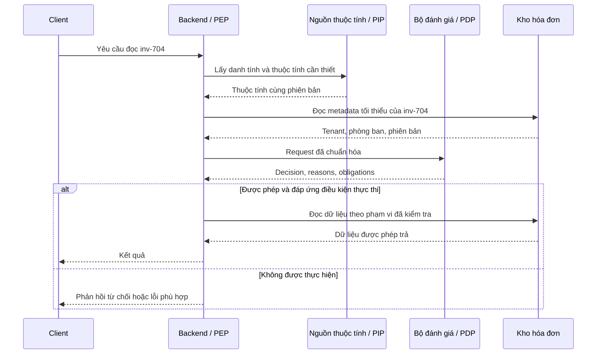

# Policy evaluation

## 1. Policy evaluation giải quyết câu hỏi gì?

Policy evaluation là quá trình áp dụng chính sách vào một yêu cầu truy cập cụ thể để đưa ra quyết định có căn cứ. Trong IAM, biết người gọi là ai mới chỉ giải quyết bước xác thực. Hệ thống còn phải xác định danh tính đó có được thực hiện hành động này, trên tài nguyên này, trong hoàn cảnh hiện tại hay không.

Ví dụ, Lan đã đăng nhập thành công vào hệ thống hóa đơn. Điều đó chưa chứng minh Lan được đọc mọi hóa đơn trong cơ sở dữ liệu. Hóa đơn thuộc tenant nào, Lan còn làm việc hay đã bị khóa, phòng ban nào quản lý hóa đơn và phiên hiện tại có đáp ứng yêu cầu MFA đều có thể ảnh hưởng đến quyết định.

Theo mô hình ABAC, đầu vào của quyết định gồm thuộc tính của chủ thể, đối tượng, thao tác và có thể có điều kiện môi trường. Đây là cách NIST mô tả nền tảng của ABAC trong [SP 800-162](https://csrc.nist.gov/pubs/sp/800/162/upd2/final). Bài này triển khai một ví dụ thiết kế dựa trên mô hình đó.

Có thể biểu diễn một lần đánh giá như sau:

```text
evaluate(policySnapshot, attributeSnapshot, request)
    -> decision + reason + obligations + evaluationMetadata
```

`policySnapshot` là phiên bản chính sách thực sự được dùng. `attributeSnapshot` là tập thuộc tính cùng nguồn và thời điểm quan sát. `request` xác định ai muốn làm gì với đối tượng nào. Quyết định vì thế gắn với một ngữ cảnh cụ thể; nó không phải quyền sử dụng tài nguyên vô thời hạn.

Sau bài học, người học cần đọc được một luồng quyết định, phân biệt không có quyền với lỗi đánh giá, giải thích kết quả khi nhiều rule cùng tham gia, và xác định nơi phải thực thi quyết định trong ứng dụng.

## 2. Xây dựng yêu cầu truy cập trước khi đánh giá

### 2.1. Bốn nhóm đầu vào

| Nhóm | Ví dụ trong hệ thống hóa đơn | Câu hỏi cần trả lời |
| --- | --- | --- |
| Subject | `userId`, `tenantId`, `departmentId`, trạng thái tài khoản | Ai đang yêu cầu và thuộc tính hiện tại của họ là gì? |
| Resource | `invoiceId`, tenant sở hữu, phòng ban quản lý, mức nhạy cảm | Đối tượng thật được truy cập là đối tượng nào? |
| Action | `invoice.read`, `invoice.approve`, `invoice.export` | Người gọi thực sự muốn thực hiện thao tác nào? |
| Environment | thời điểm phía server, mức bảo đảm phiên, tình trạng thiết bị | Bối cảnh hiện tại có đáp ứng điều kiện không? |

Các tên thuộc tính trong bài là quy ước của ví dụ, không phải schema bắt buộc của một sản phẩm IAM. Một hệ thống khác có thể biểu diễn MFA trong thông tin phiên hoặc thuộc tính chủ thể; điều quan trọng là thống nhất ý nghĩa và nguồn cung cấp.

Request minh họa dưới đây là dữ liệu đã được backend tập hợp sau xác thực và tra cứu tài nguyên:

```json
{
  "requestId": "req-2048",
  "subject": {
    "id": "user-lan",
    "tenantId": "tenant-a",
    "departmentId": "sales",
    "active": true
  },
  "resource": {
    "type": "invoice",
    "id": "inv-704",
    "tenantId": "tenant-a",
    "departmentId": "sales"
  },
  "action": "invoice.read",
  "environment": {
    "mfaVerified": true,
    "evaluatedAt": "2026-11-26T03:00:00Z"
  }
}
```

JSON này mô tả ngữ cảnh đánh giá nội bộ. Nó không có nghĩa trình duyệt được phép tự gửi `active: true`, `tenantId` hay `mfaVerified: true` để backend tin theo.

### 2.2. Giá trị đúng cần đi cùng nguồn đáng tin

Trong ví dụ, backend lấy `subject.id` từ phiên hoặc token đã được kiểm tra; trạng thái tài khoản và phòng ban đến từ nguồn danh tính được quản trị; tenant và phòng ban của hóa đơn đến từ bản ghi phía server. `mfaVerified` phải phản ánh bằng chứng xác thực đã được server kiểm chứng theo yêu cầu của thao tác.

Client có thể cung cấp mã hóa đơn muốn truy cập. Client không quyết định tenant thật sự sở hữu hóa đơn đó. Header `X-Tenant-Id` có thể là lựa chọn tenant cần xét, nhưng bản thân header không chứng minh membership hay quyền đối với tenant ấy.

Cũng cần phân biệt token hợp lệ với thuộc tính còn mới. Một token chưa hết hạn vẫn có thể chứa phòng ban cũ hoặc quyền đã bị thu hồi ở hệ thống nguồn. Thiết kế phải xác định thuộc tính nào có thể lấy từ token, thuộc tính nào cần kiểm tra lại, và độ trễ thay đổi quyền được chấp nhận là bao lâu.

### 2.3. Thuộc tính thiếu, sai kiểu và hết hạn

Ba tình huống sau có ý nghĩa khác nhau:

```text
active = false            -> biết tài khoản không hoạt động
active không có           -> chưa có thông tin cần thiết
active = "unknown"        -> dữ liệu sai schema Boolean
```

Trong thiết kế minh họa của bài, thuộc tính bắt buộc bị thiếu hoặc không hợp lệ dẫn đến lỗi đánh giá được biểu diễn bằng `Indeterminate`. Không tự thay `tenantId` thiếu bằng tenant mặc định, hoặc coi chuỗi rỗng của hai tenant là bằng chứng chúng cùng tenant.

Với thuộc tính không bắt buộc, phải quy định rõ ý nghĩa khi vắng mặt. Chẳng hạn, một danh sách nhãn tùy chọn có thể mặc định là tập rỗng nếu hợp đồng dữ liệu cho phép. Quy tắc đó không tự động áp dụng cho trạng thái tài khoản, tenant hay bằng chứng MFA.

## 3. Ai đánh giá và ai chặn truy cập?

Để tổ chức việc phân quyền, có thể chia trách nhiệm thành bốn vai trò logic:

| Vai trò | Trách nhiệm trong ví dụ |
| --- | --- |
| PAP — Policy Administration Point | Quản lý nội dung, phiên bản và việc phát hành chính sách |
| PIP — Policy Information Point | Cung cấp thuộc tính từ nguồn danh tính, tài nguyên hoặc môi trường |
| PDP — Policy Decision Point | Đánh giá request theo chính sách và trả về kết quả |
| PEP — Policy Enforcement Point | Chặn hoặc cho thực hiện thao tác theo kết quả và điều kiện thực thi |

Các vai trò có thể nằm trong cùng tiến trình, thư viện hoặc những dịch vụ riêng. Không bắt buộc phải triển khai bốn microservice. Tách vai trò giúp nhìn rõ ai được sửa policy, ai cung cấp dữ liệu, ai tính quyết định và ai bảo vệ tài nguyên.



Việc đọc metadata để xây dựng ngữ cảnh phải thực hiện trong backend được tin cậy và không làm lộ dữ liệu trước khi kiểm tra quyền. Nếu chỉ ẩn nút trên giao diện mà endpoint vẫn cho gọi trực tiếp, PEP chưa bảo vệ thao tác.

## 4. Một lần đánh giá đi qua những bước nào?

### Bước 1 — Xác định chủ thể, thao tác và tài nguyên

Backend chuẩn hóa thao tác nghiệp vụ, chẳng hạn `invoice.read`. Không suy ra mọi request HTTP GET đều có cùng quyền. Đọc một hóa đơn, tải tệp đính kèm và xuất toàn bộ hóa đơn có phạm vi và hậu quả khác nhau.

Định danh tài nguyên phải dẫn đến đúng đối tượng được dùng về sau. Nếu kiểm tra quyền cho `inv-704` rồi repository lại đọc mã hóa đơn khác từ một tham số chưa kiểm tra, quyết định đánh giá ban đầu không bảo vệ truy vấn thực tế.

### Bước 2 — Lấy snapshot chính sách và thuộc tính

Giả sử request được đánh giá bằng `invoice-policy@17`, trạng thái danh tính phiên bản `identity-42` và metadata hóa đơn phiên bản `resource-8`. Các giá trị này là dấu vết để giải thích quyết định.

Không nên vừa đánh giá một request vừa đọc từng rule từ những phiên bản policy khác nhau. Có thể nạp một gói chính sách hợp lệ rồi thay thế snapshot theo cách nguyên tử. Nguồn thuộc tính phân tán chưa chắc hỗ trợ snapshot giao dịch chung; khi đó phải mô tả mức nhất quán thực tế và cơ chế xử lý thay đổi.

### Bước 3 — Xác định rule nằm trong phạm vi xét

Mỗi rule cần biết nó hướng đến loại tài nguyên và thao tác nào. Rule đọc hóa đơn không tự áp dụng cho việc duyệt hóa đơn hoặc sửa danh tính workload.

Cần tách hai câu hỏi: rule có liên quan đến request hay không, và nếu liên quan thì điều kiện của rule có được đáp ứng hay không. Việc không liên quan và việc không đủ dữ liệu để xác định liên quan cũng phải phân biệt.

### Bước 4 — Tính kết quả của từng rule

Đối với mô hình rule minh họa, target xác định phạm vi, condition kiểm tra điều kiện và effect xác định kết quả khi điều kiện đúng. Trong một rule cho phép, điều kiện sai chỉ nói rule đó không cấp phép; một rule khác vẫn có thể cấp phép.

Ví dụ, rule cho phép nhân viên đọc hóa đơn cùng phòng ban không cấp phép cho nhân viên khác phòng. Điều đó chưa chứng minh request bị cấm tuyệt đối, vì có thể tồn tại một rule khác dành cho bộ phận kiểm toán.

### Bước 5 — Kết hợp các kết quả

Policy cần thuật toán kết hợp được định nghĩa rõ. Một danh sách rule chưa đủ mô tả chính sách nếu không biết chuyện gì xảy ra khi một rule cho phép, một rule từ chối và một rule gặp lỗi.

### Bước 6 — Thực thi và ghi nhận kết quả

PEP kiểm tra kết quả cuối cùng, xử lý nghĩa vụ bắt buộc nếu có, rồi mới cho thực hiện thao tác. Log cần phân biệt kết quả PDP và việc thực thi cuối cùng. PDP trả về `Permit` nhưng PEP không thực hiện được nghĩa vụ bắt buộc vẫn có thể khiến request bị chặn.

## 5. Bốn trạng thái hữu ích khi đọc kết quả

Bài sử dụng tên kết quả theo thuật ngữ của [XACML 3.0](https://docs.oasis-open.org/xacml/3.0/xacml-3.0-core-spec-os-en.html):

| Kết quả | Ý nghĩa |
| --- | --- |
| `Permit` | Cho phép theo kết quả đánh giá |
| `Deny` | Từ chối rõ ràng |
| `NotApplicable` | Không có kết quả áp dụng từ rule hoặc policy đang xét |
| `Indeterminate` | Không xác định được quyết định do lỗi đánh giá |

Một engine khác có thể trả Boolean, một đối tượng quyết định hoặc giá trị không xác định. Khi tích hợp phải đọc hợp đồng của engine đó, không mặc định mọi sản phẩm đều dùng bốn trạng thái này.

Trong ví dụ hóa đơn, ba tình huống đều có thể dẫn đến việc không trả dữ liệu nhưng cần được xử lý vận hành khác nhau:

- Lan khác tenant với hóa đơn: rule ranh giới tenant đưa ra `Deny`.
- Request yêu cầu `invoice.approve` nhưng gói policy đang xét chỉ xử lý `invoice.read`: gói này trả `NotApplicable`.
- Nguồn thuộc tính tài khoản không trả được dữ liệu cần thiết: kết quả có thể là `Indeterminate` theo hợp đồng của ví dụ.

Không nên gộp cả ba thành log `user_has_no_permission`. Trường hợp đầu phản ánh một quyết định nghiệp vụ; trường hợp cuối có thể là sự cố hạ tầng. Tuy nhiên, phân loại lỗi nội bộ không có nghĩa phải tiết lộ chi tiết policy hay thuộc tính nhạy cảm cho người gọi.

Ứng dụng minh họa chọn cách thực thi thiên về từ chối: chỉ tiếp tục khi nhận được `Permit` hợp lệ và đáp ứng điều kiện thực thi. Cách xử lý đó tương ứng với vai trò deny-biased PEP được mô tả trong [XACML, mục 7.2.2](https://docs.oasis-open.org/xacml/3.0/xacml-3.0-core-spec-os-en.html). Việc chọn mã HTTP cho lỗi hệ thống hay từ chối quyền là quyết định API riêng; không phải mọi trường hợp đều bắt buộc trả cùng một mã.

## 6. Target, condition và effect không đồng nghĩa

Giả sử có rule bằng ngôn ngữ giả sau:

```text
rule permit_same_department_read:
    target:
        resource.type == "invoice"
        action == "invoice.read"
    condition:
        subject.departmentId == resource.departmentId
        environment.mfaVerified == true
    effect:
        Permit
```

Trong hợp đồng minh họa của rule này:

```text
Target không khớp                -> NotApplicable
Target hoặc condition bị lỗi     -> Indeterminate
Target khớp, condition sai       -> NotApplicable
Target khớp, condition đúng      -> Permit
```

`mfaVerified = false` là thông tin đã biết và khiến condition sai. `mfaVerified` thiếu là dữ liệu không đủ cho rule này theo hợp đồng đã chọn. Hai trường hợp không được đánh đồng trong chẩn đoán.

Đây là quy ước minh họa để đọc luồng đánh giá; ngữ nghĩa chính xác của missing value, short-circuit và phép phủ định phải theo engine thực tế. Đặc biệt, không suy ra rằng một phép so sánh trả lỗi thì mọi biểu thức lớn hơn luôn trả lỗi, vì thuật toán của engine có thể xác định kết quả từ các nhánh còn lại.

Nếu nghiệp vụ yêu cầu tài khoản bị khóa phải bị chặn bất kể có rule cho phép nào khác, hãy mô hình hóa ràng buộc đó thành guard từ chối hoặc điều kiện bắt buộc ở tầng thích hợp. Đặt `active == true` vào một rule cho phép duy nhất sẽ không tự bảo đảm các rule cho phép khác đều kiểm tra trạng thái tài khoản.

## 7. Kết hợp nhiều rule: phải công bố cả cách xử lý lỗi

Các tên như deny-overrides, permit-overrides hay first-applicable mô tả những hướng kết hợp khác nhau. Không nên triển khai dựa vào tên gọi hoặc giả định thứ tự file. Một số thuật toán phụ thuộc thứ tự; một số cần xét khả năng ảnh hưởng của rule bị lỗi. XACML có các biến thể `Indeterminate` mở rộng, vì vậy thuật toán đầy đủ phức tạp hơn một phép OR của các Boolean. Xem [phụ lục C của XACML 3.0](https://docs.oasis-open.org/xacml/3.0/xacml-3.0-core-spec-os-en.html).

Để dễ theo dõi, toàn bộ ví dụ tiếp theo dùng thuật toán tự định nghĩa tên `strict-combine-v1`:

```text
1. Có ít nhất một Deny          -> Deny
2. Nếu không, có Indeterminate -> Indeterminate
3. Nếu không, có Permit        -> Permit
4. Còn lại                    -> NotApplicable
```

Đây không phải bản cài đặt thuật toán deny-overrides chuẩn XACML. Nó là một lựa chọn bảo thủ của ví dụ: một lỗi đánh giá chưa được giải quyết chặn kết quả cho phép, trừ khi đã có từ chối rõ ràng.

| Các kết quả con | Kết quả theo `strict-combine-v1` | Có thực hiện truy cập? |
| --- | --- | --- |
| `Permit`, `NotApplicable` | `Permit` | Có, nếu đáp ứng điều kiện thực thi |
| `Permit`, `Deny` | `Deny` | Không |
| `Permit`, `Indeterminate` | `Indeterminate` | Không |
| `Deny`, `Indeterminate` | `Deny` | Không |
| `NotApplicable`, `NotApplicable` | `NotApplicable` | Không |
| Không có rule nào | `NotApplicable` | Không |

Thuật toán này giúp nhìn thấy rủi ro của lỗi dữ liệu, nhưng cũng có đánh đổi về tính sẵn sàng. Một rule mới gặp lỗi có thể chặn request vốn được một rule khác cho phép. Vì thế target nên giới hạn đúng phạm vi, yêu cầu thuộc tính phải rõ ràng và mọi thay đổi policy cần kiểm thử hồi quy.

Không được tối ưu bằng cách trả `Permit` ngay khi gặp rule cho phép đầu tiên, vì phía sau có thể có `Deny` hoặc `Indeterminate`. Với thuật toán này, `Deny` cho phép kết thúc sớm về mặt giá trị quyết định; yêu cầu thu thập đầy đủ dấu vết hoặc nghĩa vụ có thể vẫn khiến hệ thống cần làm thêm việc.

## 8. Ví dụ xuyên suốt: đọc hóa đơn trong hệ thống nhiều tenant

### 8.1. Hợp đồng của policy

Gói `invoice-read@17` có target là tài nguyên `invoice` và action `invoice.read`. Nếu target không khớp, gói trả `NotApplicable`. Nếu không xác định được target vì dữ liệu bắt buộc lỗi, gói trả `Indeterminate` theo hợp đồng minh họa.

Trong phạm vi gói, các thuộc tính dùng chung sau phải hợp lệ trước khi đánh giá rule: định danh chủ thể và tài nguyên, tenant hai phía, phòng ban hai phía, trạng thái tài khoản và `mfaVerified`. Ví dụ này dùng kiểm tra schema bắt buộc trước các rule; lỗi kiểm tra ấy trả `Indeterminate` cho toàn gói.

Việc khai báo này tránh tình huống hai phòng ban cùng thiếu nhưng lại bị so sánh như bằng nhau. Một hệ thống lớn có thể chỉ tải thuộc tính theo rule thực sự cần, miễn vẫn giữ đúng ngữ nghĩa của policy và xử lý lỗi.

Bốn rule của gói là:

| Rule | Điều kiện sau khi target khớp và schema hợp lệ | Kết quả nếu đúng |
| --- | --- | --- |
| D1 | `subject.active == false` | `Deny` |
| D2 | `subject.tenantId != resource.tenantId` | `Deny` |
| D3 | `environment.mfaVerified == false` | `Deny` |
| P1 | Hai phòng ban bằng nhau | `Permit` |

Mỗi rule trả `NotApplicable` nếu điều kiện của chính nó sai. Kết quả được kết hợp bằng `strict-combine-v1`. Ví dụ chọn MFA bắt buộc cho mọi lần đọc hóa đơn; đây là quyết định nghiệp vụ của ví dụ, không phải yêu cầu phổ quát cho mọi hệ thống hóa đơn.

D2 là ranh giới tenant. D1 kiểm tra trạng thái tài khoản. D3 áp đặt điều kiện phiên. P1 biểu đạt trường hợp được cấp quyền. Nhờ phép kết hợp, P1 không vượt qua được bất kỳ guard từ chối nào trong ba guard.

### 8.2. Tính bằng tay một request hợp lệ

Với JSON của Lan ở đầu bài:

```text
Target: invoice + invoice.read                  -> khớp
Schema và thuộc tính bắt buộc                   -> hợp lệ
D1: active == false                            -> NotApplicable
D2: tenant-a != tenant-a                        -> NotApplicable
D3: mfaVerified == false                        -> NotApplicable
P1: sales == sales                             -> Permit
strict-combine-v1                              -> Permit
```

PEP vẫn phải gắn quyết định với `user-lan`, `inv-704` và `invoice.read`. Nếu request thay mã hóa đơn sau bước đánh giá, phải đánh giá đối tượng mới; không tái sử dụng kết quả cũ.

### 8.3. Đổi một thuộc tính để thấy quyết định thay đổi

| Thay đổi so với request gốc | Kết quả gói | Giải thích |
| --- | --- | --- |
| Không đổi | `Permit` | Không guard nào từ chối và P1 cấp quyền |
| Tenant hóa đơn thành `tenant-b` | `Deny` | D2 thắng dù hai phòng ban vẫn cùng tên |
| `active` thành `false` | `Deny` | D1 chặn tài khoản không hoạt động |
| `mfaVerified` thành `false` | `Deny` | D3 chặn phiên không đáp ứng yêu cầu |
| Phòng ban hóa đơn thành `finance` | `NotApplicable` | Không guard từ chối, nhưng P1 không cấp quyền |
| Xóa `departmentId` của chủ thể | `Indeterminate` | Không qua kiểm tra thuộc tính bắt buộc |
| Đổi `active` thành chuỗi `"true"` | `Indeterminate` | Dữ liệu sai kiểu theo schema |
| Action thành `invoice.approve` | `NotApplicable` | Nằm ngoài target của gói đọc hóa đơn |

Trong các hàng khác tenant hoặc MFA sai, giả định những thuộc tính còn lại đều hợp lệ. Nếu schema của request đã lỗi, ví dụ trả `Indeterminate` ở bước đầu và chưa đi vào các guard. Thứ tự này là một phần hợp đồng đánh giá, cần ghi rõ khi đọc log và viết test.

### 8.4. Thêm một rule cho kiểm toán

Giả sử doanh nghiệp bổ sung P2: chủ thể có quyền đã được xác minh `invoice.read.cross-department` được đọc hóa đơn khác phòng ban. Để không làm thay đổi ranh giới tenant, P2 phải được kết hợp trong cùng cấu trúc guard hoặc qua một cấu trúc tương đương đã kiểm thử.

P2 có thể thay kết quả của trường hợp khác phòng từ `NotApplicable` thành `Permit`. P2 không được phép làm trường hợp khác tenant chuyển thành `Permit`. Cũng cần cập nhật schema và nguồn dữ liệu cho quyền mới; không đọc trực tiếp một danh sách quyền do client tự gửi.

## 9. Java minh họa thuật toán kết hợp

Đoạn Java dưới đây chỉ minh họa `strict-combine-v1`, không triển khai toàn bộ PDP, xác thực, thu thập thuộc tính hoặc chuẩn XACML. Ví dụ dùng `record` và có thể đặt trong tệp `PolicyCombinationExample.java` với Java 17 trở lên.

```java
import java.util.List;
import java.util.Objects;

public class PolicyCombinationExample {
    enum Decision {
        PERMIT, DENY, NOT_APPLICABLE, INDETERMINATE
    }

    record RuleResult(String ruleId, Decision decision) {
        RuleResult {
            Objects.requireNonNull(ruleId, "ruleId");
            Objects.requireNonNull(decision, "decision");
        }
    }

    static Decision combineStrict(List<RuleResult> input) {
        List<RuleResult> results = List.copyOf(input);
        boolean sawPermit = false;
        boolean sawIndeterminate = false;

        for (RuleResult result : results) {
            switch (result.decision()) {
                case DENY -> {
                    return Decision.DENY;
                }
                case INDETERMINATE -> sawIndeterminate = true;
                case PERMIT -> sawPermit = true;
                case NOT_APPLICABLE -> {
                    // Rule nay khong cung cap quyet dinh ap dung.
                }
            }
        }

        if (sawIndeterminate) {
            return Decision.INDETERMINATE;
        }
        return sawPermit ? Decision.PERMIT : Decision.NOT_APPLICABLE;
    }

    public static void main(String[] args) {
        System.out.println(combineStrict(List.of(
                new RuleResult("P1", Decision.PERMIT),
                new RuleResult("D2", Decision.DENY))));

        System.out.println(combineStrict(List.of(
                new RuleResult("P1", Decision.PERMIT),
                new RuleResult("D3", Decision.INDETERMINATE))));

        System.out.println(combineStrict(List.of()));

        System.out.println(combineStrict(List.of(
                new RuleResult("P1", Decision.PERMIT),
                new RuleResult("D1", Decision.NOT_APPLICABLE))));
    }
}
```

Kết quả kỳ vọng theo thứ tự là:

```text
DENY
INDETERMINATE
NOT_APPLICABLE
PERMIT
```

`List.copyOf` tạo danh sách bất biến ở mức cấu trúc và từ chối phần tử null. Record ở đây chỉ chứa chuỗi và enum nên thuận tiện để minh họa snapshot kết quả. Điều đó không biến một đối tượng ngữ cảnh có các collection mutable thành snapshot sâu một cách tự động.

Trong tích hợp thực tế, đầu vào không hợp lệ hoặc ngoại lệ của engine phải được tầng gọi xử lý thành kết quả không cho thực hiện truy cập theo hợp đồng lỗi. Không bọc mọi ngoại lệ rồi trả `true`. Cũng không suy ra `PERMIT` từ việc danh sách kết quả rỗng.

Đoạn code không thu thập reasons hay obligations. Nếu bổ sung các trường ấy, phải định nghĩa cách chọn và kết hợp chúng; không gộp toàn bộ metadata của mọi rule rồi coi chúng đều thuộc quyết định cuối cùng.

## 10. Permit và việc thực thi nghĩa vụ

Trong một số thiết kế, quyết định đi kèm nghĩa vụ bắt buộc. Ví dụ gói đọc dữ liệu có thể yêu cầu che một trường nhạy cảm hoặc sử dụng một kênh ghi kiểm toán bảo đảm trước khi trả dữ liệu. Advice là thông tin hướng dẫn và cần phân biệt với nghĩa vụ bắt buộc. Với cách thực thi deny-biased trong [XACML 3.0, mục 7.2.2](https://docs.oasis-open.org/xacml/3.0/xacml-3.0-core-spec-os-en.html), PEP chỉ cho phép khi hiểu và có thể thực hiện nghĩa vụ đi kèm.

Response minh họa dưới đây là schema tự thiết kế, không phải response chuẩn của XACML hay sản phẩm cụ thể:

```json
{
  "decision": "Permit",
  "decisionId": "dec-2048",
  "policyVersion": "invoice-read@17",
  "obligations": [
    {
      "type": "mask-field",
      "field": "bankAccount"
    }
  ]
}
```

Nếu PEP không nhận diện `mask-field`, nó không được trả nguyên tài khoản ngân hàng rồi coi phần còn lại của quyết định là hợp lệ. Nếu cần bảo đảm ghi kiểm toán, phải xác định cụ thể thế nào là hoàn thành: ghi bền vững vào outbox, gửi thành công đến kho log hay một cơ chế khác đã được thiết kế.

Đừng trả dữ liệu trước rồi mới phát hiện không thể thực hiện nghĩa vụ. Với tác động xảy ra sau thao tác như ghi audit, thiết kế cần cách bảo đảm thực thi phù hợp; một callback không được theo dõi không tạo ra bảo đảm.

MFA có thể được mô hình hóa thành điều kiện trong request hiện tại hoặc một luồng yêu cầu xác thực tăng cường. Trong ví dụ bài này, MFA là điều kiện trước. Khi người dùng hoàn tất MFA, backend xây dựng request mới và đánh giá lại; không cho thao tác trước rồi chờ người dùng xác thực sau.

## 11. Khoảng cách giữa lúc kiểm tra và lúc sử dụng

Policy đúng vẫn có thể bảo vệ sai nếu dữ liệu thay đổi giữa thời điểm kiểm tra và thời điểm sử dụng, thường gọi là TOCTOU — time of check to time of use.

```text
T0: Hóa đơn inv-704 thuộc phòng sales, version 8.
T1: PDP cho Lan đọc theo metadata version 8.
T2: Quản trị viên chuyển hóa đơn sang finance, version 9.
T3: Backend đọc và trả dữ liệu mới theo quyết định ở T1.
```

Rủi ro nằm ở việc thao tác T3 không còn dùng trạng thái đã được đánh giá. Tùy kiến trúc, có thể đọc và kiểm tra trong giao dịch phù hợp, gắn thao tác với version đã kiểm tra, sử dụng truy vấn có điều kiện hoặc đánh giá lại khi phát hiện version thay đổi.

Ví dụ, một đường ghi có thể yêu cầu `WHERE id = :id AND version = :evaluatedVersion AND tenant_id = :tenantId`, rồi kiểm tra số hàng bị tác động. Đây là hàng rào nhất quán đối với bản ghi đó, không tự động bảo đảm trạng thái danh tính ở dịch vụ khác cũng chưa thay đổi.

Với thao tác đọc, có thể kiểm soát snapshot hoặc so sánh version của đối tượng thực sự được đọc trước khi trả ra. Không nên tiếp tục dựa vào kết quả cũ sau khi kiểm tra version thất bại. Với thay đổi quyền phân tán, cần quy định rõ mức nhất quán và thời gian thu hồi quyền mà hệ thống hỗ trợ.

## 12. Cache quyết định phải giữ đúng ý nghĩa của request

Cache có thể giảm độ trễ nhưng cũng có thể kéo dài quyền đã bị thu hồi. Khóa chỉ có `(userId, resourceId)` bỏ qua action, tenant, mức bảo đảm phiên và phiên bản dữ liệu.

Một cấu trúc khóa minh họa cho bài này là:

```text
subjectId + subjectAttributeVersion
+ tenantId + resourceId + resourceVersion
+ action + sessionAssuranceContext
+ policyVersion
```

Không phải mọi hệ thống đều có đủ version để dùng nguyên cấu trúc trên. Khi thiếu version hoặc tín hiệu vô hiệu hóa, TTL là giới hạn thời gian lưu, không phải bảo đảm thu hồi tức thì. Phải chứng minh rằng mọi đầu vào có thể làm thay đổi quyết định đều được phản ánh trong khóa hoặc điều kiện hiệu lực.

Thời gian hiện tại cần cách xử lý riêng. Nếu một quyền chỉ có hiệu lực trước 17:00 thì cache `Permit` tạo lúc 16:59 không được tồn tại đến 17:04 chỉ vì TTL cấu hình là năm phút. Thời điểm hết hiệu lực của kết quả phải bị chặn bởi ranh giới thời gian của policy.

Cũng cần tính đến phiên bị thu hồi, tài khoản bị khóa, thay đổi membership, resource đổi tenant và policy mới được phát hành. Cache từ chối quá lâu có thể khiến người mới được cấp quyền tiếp tục không truy cập được; cache cho phép quá lâu có thể duy trì quyền cũ.

Với nghĩa vụ có tác động như audit, có thể cache phần quyết định khi hợp đồng cho phép, nhưng mỗi lần truy cập vẫn phải thực thi nghĩa vụ tương ứng. Không cache một sự kiện audit rồi coi nó đã phục vụ cho mọi request sau.

## 13. Hiệu năng và tính sẵn sàng

Tổng thời gian phân quyền gồm tra cứu thuộc tính, truyền dữ liệu, xử lý policy và thực thi nghĩa vụ. Tối ưu vài phép so sánh trong PDP không giúp nhiều nếu mỗi request phải gọi tuần tự nhiều nguồn thuộc tính chậm.

Các hướng thiết kế cần cân nhắc gồm nạp policy theo snapshot, dùng target để chọn đúng phạm vi rule, tải thuộc tính độc lập song song khi phù hợp, giảm dữ liệu đưa vào PDP và đặt giới hạn thời gian cho nguồn bên ngoài. Mỗi tối ưu phải giữ nguyên ngữ nghĩa đánh giá.

Ví dụ, nếu xác định request không phải `invoice.read`, gói đọc hóa đơn không cần gọi nguồn MFA chỉ để rồi trả `NotApplicable`. Ngược lại, nếu gói thực sự cần trạng thái tài khoản mà nguồn ấy timeout, không được tự đổi trạng thái thành `active = true` để tránh lỗi.

Fail-closed chấp nhận việc một số sự cố làm thao tác bị chặn. Để vận hành tốt, cần phân biệt tỷ lệ từ chối quyền hợp lệ với tỷ lệ không đánh giá được, đo riêng độ trễ từng nguồn và xác định nơi có thể dùng snapshot còn hiệu lực theo chính sách đã công bố.

Nếu có cơ chế truy cập khẩn cấp, nó cần điều kiện, danh tính, thời hạn và kiểm toán riêng được phê duyệt trong thiết kế. Không biến lỗi PDP thành quyền quản trị tạm thời hoặc tự cấp quyền từ cache không còn được phép dùng.

## 14. Ghi dấu vết đủ để giải thích quyết định

Một bản ghi quyết định hữu ích trong ví dụ có thể gồm:

```json
{
  "decisionId": "dec-2049",
  "requestId": "req-2049",
  "subjectId": "user-lan",
  "resourceId": "inv-704",
  "action": "invoice.read",
  "decision": "Deny",
  "policyVersion": "invoice-read@17",
  "combiningAlgorithm": "strict-combine-v1",
  "reasonCodes": ["TENANT_BOUNDARY"],
  "matchedRuleIds": ["D2"],
  "subjectAttributeVersion": "identity-42",
  "resourceVersion": "resource-8",
  "enforcementOutcome": "BLOCKED"
}
```

`matchedRuleIds` ở đây là những rule đã tạo kết quả áp dụng được ghi nhận trong ví dụ. Nếu engine dừng sớm, log phải cho biết trace có đầy đủ hay chỉ là phần thực sự được đánh giá; không tự nhận đã chạy mọi rule.

Không ghi access token, mật khẩu, mã OTP hoặc toàn bộ hóa đơn vào log. Thuộc tính phân quyền cũng có thể là dữ liệu nhạy cảm. Nên giới hạn trường, phân quyền đọc log, che thông tin phù hợp và áp dụng thời hạn lưu theo nhu cầu thực tế.

Muốn tái hiện quyết định cũ cần nhiều hơn một timestamp. Policy có thể đã đổi và thuộc tính hiện tại có thể khác lúc quyết định. Phiên bản, dấu vết nguồn và snapshot được lưu theo cơ chế có kiểm soát giúp điều tra; dùng hash chỉ hỗ trợ đối chiếu nếu vẫn có cách truy xuất dữ liệu gốc hợp lệ.

## 15. Thiết kế kiểm thử cho policy evaluation

Kiểm thử phân quyền phải bao phủ trường hợp được phép, bị từ chối và lỗi đánh giá. OWASP khuyến nghị kiểm tra quyền ở mỗi request, mặc định từ chối và có kiểm thử cho logic phân quyền trong [Authorization Cheat Sheet](https://cheatsheetseries.owasp.org/cheatsheets/Authorization_Cheat_Sheet.html). Ma trận sau là đề xuất kiểm thử cho ví dụ của bài.

| Nhóm | Tình huống cần dựng | Điều cần khẳng định |
| --- | --- | --- |
| Cấp quyền | Cùng tenant, cùng phòng, active và MFA đúng | Nhận `Permit` theo policy đã chọn |
| Ranh giới tenant | Cùng phòng nhưng khác tenant | Không cấp quyền dù tên phòng ban trùng |
| Trạng thái danh tính | Tài khoản không hoạt động | Guard D1 chặn |
| Mức bảo đảm phiên | MFA false và MFA thiếu | False bị từ chối; thiếu báo lỗi dữ liệu theo hợp đồng |
| Phạm vi | Đổi `invoice.read` thành `invoice.approve` | Gói đọc không cấp quyền duyệt |
| Xung đột | `Permit` cùng `Deny` hoặc `Indeterminate` | Đúng thứ tự ưu tiên của `strict-combine-v1` |
| Schema | Tenant rỗng, Boolean sai kiểu, trường bắt buộc thiếu | Không tạo quyền từ giá trị mặc định |
| Hạ tầng | PDP hoặc nguồn thuộc tính timeout | Không thực hiện thao tác khi chưa có kết quả hợp lệ |
| Thực thi | Nghĩa vụ không được hỗ trợ hoặc thất bại | Không trả dữ liệu trái điều kiện quyết định |
| Nhất quán | Resource đổi version sau khi kiểm tra | Không dùng lại kết quả cho trạng thái khác |
| Cache | Khóa tài khoản hoặc phát hành policy mới | Quyền cũ hết hiệu lực theo cam kết của hệ thống |
| Tích hợp | Gọi endpoint trực tiếp, bỏ qua giao diện | Kiểm tra backend vẫn chặn được |

Ngoài test theo ví dụ, có thể viết các bất biến cho gói chính sách này:

```text
Với ngữ cảnh hợp lệ, khác tenant không được cho phép.
Với ngữ cảnh hợp lệ, inactive không được cho phép.
Danh sách kết quả rỗng không sinh Permit.
Thêm Deny vào một tập kết quả không tạo Permit.
Hoán vị kết quả không đổi giá trị quyết định của strict-combine-v1.
Đổi đối tượng hoặc action yêu cầu đánh giá đúng ngữ cảnh mới.
```

Bất biến hoán vị ở đây chỉ nói đến giá trị quyết định của thuật toán minh họa; không áp dụng tùy tiện cho thuật toán có thứ tự hoặc thứ tự nghĩa vụ. Với policy thực tế, cần dùng chính công cụ test và ngữ nghĩa của engine triển khai. Chẳng hạn OPA cung cấp hỗ trợ kiểm thử policy được trình bày trong [tài liệu Policy Testing](https://www.openpolicyagent.org/docs/policy-testing).

## 16. Những lỗi thiết kế dễ dẫn đến cấp quyền sai

| Lỗi | Hậu quả | Hướng sửa trong thiết kế |
| --- | --- | --- |
| Tin thuộc tính tenant hoặc MFA do client tự khai | Người gọi tự dựng ngữ cảnh cho phép | Lấy thuộc tính từ nguồn server kiểm chứng |
| Coi condition sai là từ chối tuyệt đối | Hiểu sai quyền khi có nhiều rule | Tách không cấp phép ở rule với kết quả kết hợp cuối cùng |
| Cho phép ngay khi gặp rule đầu tiên trả Permit | Bỏ qua guard từ chối hoặc lỗi phía sau | Triển khai đúng thuật toán kết hợp đã chọn |
| Biến lỗi thành giá trị mặc định thuận lợi | Sự cố nguồn dữ liệu trở thành đường vượt quyền | Kiểm tra schema và xử lý lỗi rõ ràng |
| Kiểm tra role nhưng bỏ qua tài nguyên cụ thể | Người dùng đọc đối tượng của tenant khác | Gắn chủ thể, action và đối tượng vào mỗi quyết định |
| Chỉ kiểm tra trên giao diện hoặc gateway | Đường gọi khác bỏ qua kiểm soát | Đặt PEP trên mọi đường thực hiện thao tác cần bảo vệ |
| Tái dùng Permit sau khi đổi resource hoặc session | Quyết định không còn đúng ngữ cảnh | Đánh giá lại hoặc xác minh điều kiện hiệu lực |
| Ghi log mọi kết quả không cho phép là thiếu quyền | Khó phát hiện sự cố PDP hoặc PIP | Phân biệt decision, lỗi và kết quả thực thi |

## 17. Bài tập tự kiểm tra

1. Lan cùng tenant và cùng phòng ban với hóa đơn nhưng `active = false`. Theo gói policy của bài, P1 có thể trả `Permit` không? Quyết định cuối cùng là gì?
2. Vì sao xóa `departmentId` và đặt `departmentId` khác phòng ban không phải cùng một trường hợp?
3. Nếu đổi thuật toán để trả `Permit` ngay khi gặp P1, thứ tự rule có thể làm ranh giới tenant bị phá vỡ như thế nào?
4. Một cache chỉ dùng `userId` và `invoiceId` có thể dùng nhầm kết quả giữa những request nào?
5. PDP trả `Permit` kèm yêu cầu che tài khoản ngân hàng, nhưng PEP không hỗ trợ thao tác che. PEP phải xử lý thế nào trước khi trả dữ liệu?
6. Nếu một tài khoản bị khóa sau khi token được phát hành, dữ liệu hoặc sự kiện nào giúp hệ thống phản ánh thay đổi đó khi đánh giá request tiếp theo?

Gợi ý đối chiếu: ở câu 1, P1 vẫn có thể cho phép theo điều kiện phòng ban riêng của nó, nhưng D1 khiến kết quả kết hợp là `Deny`. Ở câu 2, thiếu dữ liệu bắt buộc gây `Indeterminate`, còn khác phòng với dữ liệu hợp lệ khiến P1 trả `NotApplicable`. Các câu còn lại cần xét thuật toán kết hợp, mọi đầu vào có ảnh hưởng đến quyền, nghĩa vụ bắt buộc và độ mới của thuộc tính.

Điểm cần giữ khi đọc hoặc xây dựng một policy là mối liên hệ giữa dữ liệu đầu vào đáng tin, ngữ nghĩa từng rule, cách kết hợp và nơi thực thi. Chỉ khi cả chuỗi ấy được định nghĩa rõ, một kết quả cho phép mới có thể bảo vệ đúng thao tác mà người dùng đang yêu cầu.
