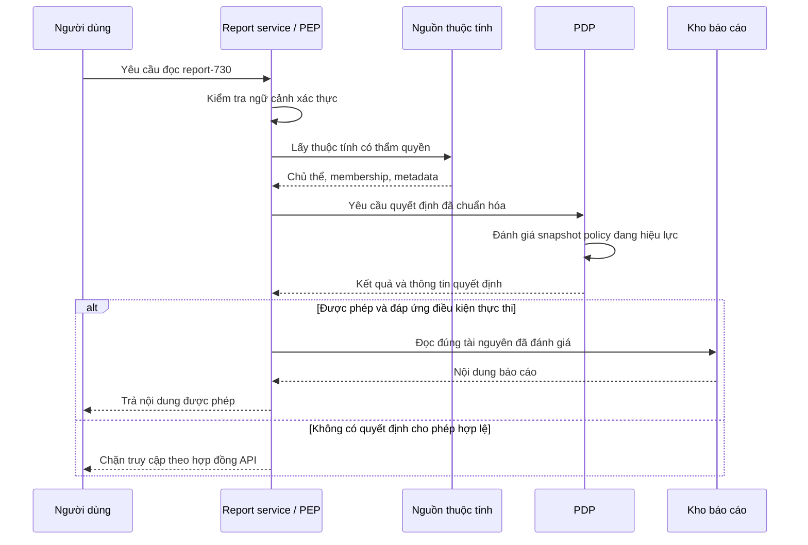

# Policy decision point

## 1. PDP trả lời câu hỏi phân quyền nào?

**Policy decision point (PDP)** là thành phần đánh giá chính sách áp dụng cho một yêu cầu truy cập và trả về quyết định phân quyền. Trong nền tảng IAM, câu hỏi của PDP có dạng: “Danh tính này có được thực hiện hành động này trên tài nguyên này, với ngữ cảnh hiện tại hay không?”.

Ví dụ, một người dùng đã đăng nhập vào cổng tài liệu không đương nhiên được đọc mọi báo cáo. Hệ thống còn phải xét người dùng thuộc tổ chức nào, tài liệu thuộc dự án nào, tài khoản còn hoạt động không và phiên đăng nhập có đáp ứng yêu cầu bảo đảm hay không. PDP là nơi tập hợp các điều kiện đó thành một quyết định có thể giải thích và kiểm tra.

ABAC đánh giá các thuộc tính của chủ thể, đối tượng, thao tác và có thể cả môi trường theo chính sách. Đây là cơ sở để một PDP đưa ra quyết định chi tiết hơn việc chỉ kiểm tra tên vai trò. [NIST SP 800-162](https://csrc.nist.gov/pubs/sp/800/162/upd2/final)

Một cách biểu diễn khái niệm:

```text
decision = evaluate(
    policy_snapshot,
    subject_attributes,
    resource_attributes,
    requested_action,
    environment_attributes
)
```

Ký hiệu này không quy định thư viện, giao thức hay sản phẩm. Một PDP có thể là hàm trong ứng dụng, thư viện nhúng, tiến trình bên cạnh dịch vụ hoặc dịch vụ từ xa. Điều cốt lõi là trách nhiệm đánh giá được xác định rõ.

Sau bài học, người học cần giải thích được luồng từ yêu cầu đến quyết định, phân biệt PDP với điểm thực thi, thiết kế đầu vào đáng tin cậy và nhận ra những trường hợp quyết định đúng vẫn có thể dẫn đến truy cập sai khi tích hợp.

## 2. Ví dụ xuyên suốt: đọc báo cáo của dự án

Giả sử một nền tảng SaaS lưu báo cáo nội bộ. Hệ thống có nhiều tenant; mỗi tenant có nhiều dự án. Chính sách minh họa cho hành động `report:read` yêu cầu:

- Tài khoản của chủ thể đang hoạt động.
- Tenant đang được chủ thể sử dụng trùng tenant của báo cáo.
- Chủ thể có tư cách thành viên đang hiệu lực trong dự án chứa báo cáo.
- Với báo cáo được gắn nhãn `restricted`, phiên phải có mức bảo đảm được hệ thống chấp nhận cho dữ liệu đó.

Các điều kiện này là quy tắc của ví dụ, không phải một chuẩn phân quyền chung cho mọi tổ chức. Đặc biệt, “mức bảo đảm đủ” phải được định nghĩa trong chính sách xác thực của hệ thống; không suy ra chỉ từ việc client gửi `mfa=true`.

Xét dữ liệu:

```text
Chủ thể:       user-42
Tenant chọn:   tenant-a
Tài khoản:     ACTIVE
Dự án hiện có: project-9
Mức phiên:     HIGH

Báo cáo:       report-730
Tenant:        tenant-a
Dự án:         project-9
Nhãn:          restricted
```

PDP có thể cho phép đọc báo cáo này. Nếu thay tài nguyên thành báo cáo thuộc `tenant-b`, kết quả phải thay đổi dù người dùng vẫn có cùng vai trò và cùng phiên đăng nhập.

Điều cần quan sát là **quyết định gắn với một yêu cầu cụ thể**. Quyền đọc `report-730` không tự động cho phép sửa báo cáo, đọc mọi báo cáo của dự án hoặc tải bản xuất dữ liệu tổng hợp.

Ngay cả khi hai endpoint cùng trả nội dung báo cáo, hệ thống phải quyết định chúng có cùng ý nghĩa bảo mật hay không. `report:read` và `report:export` có thể cần chính sách khác nhau vì bản xuất dễ sao chép và chứa nhiều dữ liệu hơn.

## 3. PDP nằm giữa những thành phần nào?

Bốn vai trò thường gặp trong kiến trúc dựa trên chính sách là:

| Thành phần | Câu hỏi chính | Ví dụ trong nền tảng báo cáo |
|---|---|---|
| PAP — Policy Administration Point | Chính sách được tạo và quản lý ở đâu? | Kho policy cùng quy trình phê duyệt và phát hành |
| PIP — Policy Information Point | Thuộc tính phục vụ đánh giá lấy từ đâu? | Nguồn trạng thái tài khoản, tư cách thành viên, metadata báo cáo |
| PDP — Policy Decision Point | Yêu cầu cụ thể có thỏa chính sách không? | Bộ đánh giá trả quyết định cho `report:read` |
| PEP — Policy Enforcement Point | Quyết định được áp dụng tại đâu? | Service chặn hoặc cho phép đọc nội dung báo cáo |

PDP đánh giá; PEP gửi yêu cầu quyết định và thực thi kết quả; PIP cung cấp thuộc tính; PAP tạo chính sách. Đây là cách phân chia vai trò trong kiến trúc XACML. [OASIS XACML 3.0, thuật ngữ](https://docs.oasis-open.org/xacml/3.0/xacml-3.0-core-spec-os-en.html)

Không nhất thiết mỗi vai trò tương ứng một máy chủ. Trong một ứng dụng nhỏ, PEP và PDP có thể là hai lớp trong cùng tiến trình; PIP có thể là adapter đến cơ sở dữ liệu hiện có. Tách trách nhiệm giúp kiểm thử và quản trị, ngay cả khi chưa tách triển khai.

### 3.1. Xác thực và quyết định truy cập

Bộ xác thực xác minh danh tính và tạo ngữ cảnh danh tính được chấp nhận. PDP dùng ngữ cảnh đó cùng các thuộc tính khác để đánh giá quyền trên tài nguyên.

Token có chữ ký hợp lệ vẫn chưa chứng minh người dùng được đọc báo cáo bất kỳ. Ngược lại, PDP cũng không nên tự tin tưởng một chuỗi `userId` do trình duyệt gửi rồi xem đó là danh tính đã xác thực.

Trong SSO hoặc OAuth/OIDC, claim từ token có thể trở thành một phần đầu vào. Việc dùng claim nào, tin cậy issuer nào, yêu cầu audience nào và chấp nhận độ cũ bao lâu cần được xác định trước khi sử dụng claim để phân quyền. PDP không tự biến token dành cho ứng dụng khác thành bằng chứng hợp lệ.

### 3.2. PDP không thay PEP bảo vệ đường truy cập

Giả sử PDP trả `DENY` nhưng controller vẫn đọc nội dung và trả về trước khi kiểm tra kết quả. Chính sách có thể hoàn toàn đúng, còn hệ thống vẫn rò rỉ dữ liệu.

Một ví dụ khác: API HTTP có PEP nhưng tác vụ nền đọc trực tiếp cùng dữ liệu không có kiểm tra tương đương. Kẻ gọi được tác vụ nền có thể đi vòng qua điểm thực thi của HTTP.

Vì vậy, phải xác định đường nào thực sự chạm tài nguyên: API, hàng đợi, xử lý nền, công cụ quản trị và giao tiếp giữa dịch vụ. Mỗi đường cần điểm kiểm soát phù hợp với danh tính và hành động của nó.

## 4. Chất lượng đầu vào quyết định chất lượng kết quả

Một PDP có thể tính toán chính xác trên dữ liệu sai. Để tránh điều đó, hợp đồng đầu vào cần chỉ rõ nguồn nào được phép khẳng định từng thuộc tính.

| Dữ liệu | Nguồn phù hợp trong ví dụ | Rủi ro nếu lấy trực tiếp từ người gọi |
|---|---|---|
| Danh tính chủ thể | Ngữ cảnh xác thực đã được backend kiểm tra | Giả mạo `userId` của người khác |
| Trạng thái tài khoản | Nguồn quản lý vòng đời danh tính | Tài khoản bị khóa vẫn tự khai `ACTIVE` |
| Tenant có thể sử dụng | Quan hệ tenant đã được backend xác minh | Chọn tenant không thuộc quyền sử dụng |
| Dự án của báo cáo | Metadata tài nguyên từ nguồn quản lý báo cáo | Khai báo dự án mà mình đang là thành viên |
| Tư cách thành viên | Nguồn quản lý thành viên dự án | Tự thêm membership vào request |
| Mức bảo đảm phiên | Ngữ cảnh xác thực và quy tắc ánh xạ của hệ thống | Tự gửi cờ MFA hoặc nhãn phiên mạnh |
| Thời điểm đánh giá | Đồng hồ và ngữ cảnh máy chủ được quản lý | Dời thời gian để lọt vào khoảng được phép |

Việc PEP đã xác thực với PDP không có nghĩa mọi thuộc tính PEP gửi đều đúng. Nếu PEP sao chép tenant, ownership hoặc vai trò từ body do người dùng điều khiển, quyết định vẫn có thể dựa trên dữ liệu không có thẩm quyền. [OWASP, Request-Time Data](https://cheatsheetseries.owasp.org/cheatsheets/Authorization_Policy_And_Data_Distribution_Cheat_Sheet.html#request-time-data)

Trong thiết kế minh họa, frontend chỉ cung cấp mã báo cáo cần truy cập. Backend định danh người dùng từ phiên đã kiểm tra, lấy metadata báo cáo từ kho nội bộ và lấy membership từ nguồn được chỉ định. Client không gửi một bộ thuộc tính đầy đủ rồi yêu cầu backend đánh giá nguyên trạng.

### 4.1. Chuẩn hóa trước khi đánh giá

Cần thống nhất định danh hành động và tài nguyên. Nếu PEP gửi `READ_REPORT`, policy chờ `report:read`, còn một PEP khác gửi `GET`, hệ thống có thể đánh giá sai phạm vi hoặc không tìm thấy policy.

Một hợp đồng có thể quy định:

```text
subject.id:       ID nội bộ ổn định
subject.issuer:   miền phát hành danh tính đã chấp nhận
resource.type:    report
resource.id:      ID chuẩn của báo cáo
action:           report:read
tenantId:         tenant nội bộ đã xác minh
schemaVersion:    phiên bản hợp đồng đầu vào
```

Nếu hệ thống có nhiều miền danh tính, không mặc định cùng chuỗi `sub` từ hai issuer là cùng một người. Có thể ánh xạ cặp issuer và subject vào một ID nội bộ, sau đó dùng ID nội bộ xuyên suốt quyết định.

Chuẩn hóa cũng bao gồm kiểu dữ liệu. Chuỗi `"false"` không phải boolean `false`; danh sách dự án rỗng khác với không tải được danh sách. Một schema được kiểm tra rõ giúp phát hiện lỗi thay vì âm thầm diễn giải theo giá trị mặc định.

### 4.2. Độ mới là một thuộc tính của bằng chứng

Tài khoản được tải từ nguồn tin cậy nhưng cách đây nhiều giờ có thể không còn phản ánh trạng thái hiện tại. Membership cũng có thể đã bị thu hồi sau khi phiên được cấp.

Trong ví dụ này, mỗi snapshot thuộc tính nên có thời điểm quan sát hoặc phiên bản phù hợp. Hệ thống đặt yêu cầu độ mới theo hành động: đọc tài liệu thông thường và phê duyệt cấp quyền đặc biệt có thể có ngân sách độ cũ khác nhau.

Các con số cụ thể phải đến từ yêu cầu sản phẩm. Không có TTL phổ quát làm mọi quyết định vừa nhanh, vừa luôn phản ánh thu hồi ngay lập tức.

## 5. Một lần đánh giá diễn ra như thế nào?

Luồng minh họa khi người dùng gọi API đọc báo cáo:



Ở sơ đồ này, PEP lấy thuộc tính rồi gửi cho PDP. Một thiết kế khác cho phép PDP tự truy vấn PIP hoặc dùng bản sao dữ liệu đã đồng bộ. Cần chọn rõ cách nào chịu trách nhiệm lấy và xác minh từng thuộc tính, tránh hai phía cùng nghĩ phía kia đã làm.

Bên trong PDP, một chu trình khái niệm gồm:

1. Kiểm tra hợp đồng request và các thuộc tính cần thiết.
2. Xác định bộ policy áp dụng cho loại tài nguyên và hành động.
3. Đánh giá điều kiện với snapshot policy và dữ liệu đã chọn.
4. Kết hợp kết quả theo thuật toán đã công bố.
5. Trả quyết định cùng thông tin đủ để PEP thực thi và vận hành truy vết.

Thứ tự kiểm tra nội bộ có thể thay đổi theo engine. Điều cần giữ là kết quả có ngữ nghĩa được định nghĩa, không phụ thuộc ngẫu nhiên vào thứ tự tải file hoặc thứ tự trả về từ cơ sở dữ liệu.

PDP không nên tạo tác dụng nghiệp vụ như thay đổi membership hay cập nhật báo cáo trong lúc đánh giá. Giữ bước đánh giá tách khỏi bước thay đổi dữ liệu giúp dễ thử lại, giải thích và kiểm tra hơn.

## 6. Kết quả PDP không phải lúc nào cũng là một boolean

XACML phân biệt bốn kết quả ở giao diện quyết định: `Permit`, `Deny`, `NotApplicable` và `Indeterminate`. Chúng lần lượt biểu đạt cho phép, từ chối, không có policy áp dụng và không thể đánh giá ra kết quả xác định. [OASIS XACML 3.0, mục 5.53](https://docs.oasis-open.org/xacml/3.0/xacml-3.0-core-spec-os-en.html)

Bảng sau dùng tên viết hoa cho hợp đồng minh họa của bài:

| Kết quả | Ý nghĩa trong hợp đồng minh họa | Xử lý tại PEP bảo vệ báo cáo |
|---|---|---|
| `PERMIT` | Policy cho phép đúng yêu cầu đã đánh giá | Chỉ tiếp tục nếu điều kiện thực thi cũng được đáp ứng |
| `DENY` | Policy xác định không cho phép | Chặn đọc nội dung |
| `NOT_APPLICABLE` | Không có policy áp dụng để cấp quyền cho yêu cầu | Chặn vì không có căn cứ cấp quyền |
| `INDETERMINATE` | Thiếu dữ liệu bắt buộc hoặc có lỗi đánh giá | Chặn và ghi nhận nguyên nhân kỹ thuật |

Đây là lựa chọn thực thi thiên về từ chối của ví dụ. Không phải mọi sản phẩm đều xuất bốn enum này; có sản phẩm trả boolean, một tài liệu JSON hoặc một cấu trúc khác. Adapter tích hợp phải ánh xạ theo hợp đồng thực tế.

Không đồng nhất “nhận HTTP 200 từ PDP” với `PERMIT`. HTTP 200 có thể chỉ chứng minh lời gọi đánh giá đã được xử lý. Nội dung trả về có thể là từ chối, không có kết quả hoặc có cấu trúc không như PEP kỳ vọng.

Trong ví dụ này, response thiếu field quyết định, giá trị không nhận diện được, sai schema hoặc không khớp request đều không tạo quyền truy cập. PEP không dùng phép kiểm tra kiểu “khác DENY là được phép”.

Cũng cần phân biệt một kết quả không xác định với lỗi vận chuyển. Khi PDP không phản hồi, PEP chưa nhận được `INDETERMINATE` từ PDP; PEP đang gặp lỗi gọi dịch vụ. Cả hai đều chặn hành động trong ví dụ, nhưng telemetry phải giữ được sự khác nhau để điều tra.

### 6.1. Điều kiện bắt buộc đi kèm quyết định

Một hệ thống có thể trả quyết định cho phép kèm yêu cầu thực thi, chẳng hạn chỉ trả các trường đã được lọc hoặc bắt buộc ghi sự kiện kiểm toán trước khi phát hành dữ liệu.

Nếu hợp đồng coi một yêu cầu đó là bắt buộc, PEP chỉ hoàn tất truy cập khi thực hiện được yêu cầu. Không hỗ trợ kiểu điều kiện bắt buộc không có nghĩa là được phép bỏ qua.

Cần phân biệt điều kiện bắt buộc với thông tin tư vấn. Trong bài, cấu trúc response minh họa không sử dụng cơ chế này; nếu mở rộng, hai phía phải thống nhất tên, kiểu dữ liệu, thời điểm thực hiện và cách xử lý lỗi trước khi bật policy tương ứng.

## 7. Thiết kế hợp đồng giữa PEP và PDP

Hợp đồng minh họa dưới đây là JSON tự định nghĩa, không phải request/response XACML và không được đưa nguyên trạng vào API của một engine bất kỳ.

### 7.1. Request đã được PEP xây dựng từ nguồn tin cậy

```json
{
  "schemaVersion": "reports.authz.request.v1",
  "requestId": "req-8c21",
  "subject": {
    "id": "user-42",
    "tenantId": "tenant-a",
    "accountStatus": "ACTIVE",
    "assurance": "HIGH",
    "projectIds": ["project-9"]
  },
  "resource": {
    "type": "report",
    "id": "report-730",
    "tenantId": "tenant-a",
    "projectId": "project-9",
    "classification": "restricted",
    "version": 12
  },
  "action": "report:read",
  "evidence": {
    "identityRevision": 41,
    "membershipRevision": 208,
    "observedAt": "2026-11-26T02:00:00Z"
  }
}
```

Các trường phiên bản ở đây được nguồn dữ liệu hoặc thành phần thu thập đáng tin cậy cung cấp. Người dùng không được chọn một `membershipRevision` cũ rồi yêu cầu hệ thống đánh giá quyền đã bị thu hồi.

Trường `observedAt` cho biết thời điểm snapshot minh họa được thu thập, không tự chứng minh tất cả nguồn có cùng độ mới. Nếu tài khoản, membership và metadata có cơ chế cập nhật riêng, thiết kế thực tế cần theo dõi độ mới riêng cho những nguồn ảnh hưởng đến quyền.

Chỉ gửi thuộc tính cần thiết. Ví dụ, PDP cần biết tài khoản đang hoạt động và mức bảo đảm phiên, nhưng không cần nhận mật khẩu, khóa MFA, toàn bộ access token hoặc toàn bộ hồ sơ nhân sự.

### 7.2. Response có đủ ngữ cảnh để sử dụng đúng

```json
{
  "schemaVersion": "reports.authz.response.v1",
  "requestId": "req-8c21",
  "decisionId": "dec-c045",
  "effect": "PERMIT",
  "reasonCode": "REPORT_READ_ALLOWED",
  "subjectId": "user-42",
  "resourceId": "report-730",
  "action": "report:read",
  "policyRevision": "reports-17",
  "dataVersions": {
    "identityRevision": 41,
    "membershipRevision": 208,
    "resourceVersion": 12
  }
}
```

PEP cần kiểm tra response thuộc đúng request đang chờ, đúng chủ thể, tài nguyên và hành động. Trong giao thức bất đồng bộ hoặc xử lý theo lô, việc ghép sai kết quả giữa hai request có thể biến một quyết định đúng thành hành động sai.

Việc lặp lại `resourceId` trong JSON không tạo bảo vệ mật mã. Nếu truyền qua mạng, kênh và danh tính của bên trả lời phải được bảo vệ phù hợp; nếu lưu quyết định để dùng về sau, cần một thiết kế riêng về toàn vẹn, thời hạn và chống tái sử dụng.

`decisionId` phục vụ liên kết log, không phải một vé cấp quyền độc lập. Không cung cấp API “đưa bất kỳ decisionId từng PERMIT nào để đọc tài nguyên tùy chọn”.

`reasonCode` nên là mã ổn định cho vận hành. Thông tin trả về người dùng có thể ít chi tiết hơn để không tiết lộ tenant khác, tên dự án bí mật hoặc điều kiện nội bộ. Quyết định truy cập và mức độ giải thích cho từng đối tượng là hai lựa chọn cần được quản lý riêng.

### 7.3. Danh tính dịch vụ gọi PDP

Trong hệ thống nhiều dịch vụ, cần phân biệt:

```text
caller service: report-service
subject:        user-42
resource:       report-730
action:         report:read
```

`report-service` là workload được phép gửi yêu cầu đánh giá trong phạm vi nhất định. `user-42` là người dùng mà thao tác đang được thực hiện thay mặt. Chúng có thể cùng xuất hiện trong một request nhưng không thay thế nhau.

Nếu service bất kỳ được phép khẳng định mọi subject hoặc mọi tenant, API quyết định có thể bị dùng để thăm dò dữ liệu hoặc khai thác quan hệ tin cậy quá rộng. Trong thiết kế minh họa, quyền gọi PDP của dịch vụ cần gắn với namespace tài nguyên và nguồn thuộc tính mà nó có thẩm quyền cung cấp.

Với tác vụ chạy thuần dưới danh tính workload, chủ thể có thể là workload. Policy khi đó đánh giá danh tính workload và quyền của tác vụ; không bịa một người dùng để khớp với hợp đồng chỉ hỗ trợ con người.

## 8. Từ yêu cầu nghiệp vụ đến logic đánh giá

Chính sách minh họa có thể được mô tả bằng mã giả:

```text
Nếu request hoặc thuộc tính bắt buộc không hợp lệ:
    INDETERMINATE

Nếu loại tài nguyên hoặc hành động nằm ngoài phạm vi policy:
    NOT_APPLICABLE

Nếu tài khoản không ACTIVE:
    DENY

Nếu tenant của chủ thể khác tenant của báo cáo:
    DENY

Nếu không có membership hiệu lực trong dự án của báo cáo:
    DENY

Nếu báo cáo restricted và mức phiên không HIGH:
    DENY

Còn lại:
    PERMIT
```

Thứ tự này là một phần thiết kế minh họa. Nó giúp kết quả có nguyên nhân xác định, nhưng không tự trở thành thuật toán kết hợp policy theo một chuẩn nào.

Khi hệ thống có nhiều policy, phải định nghĩa cách hợp nhất rõ ràng. Ví dụ: một policy nghiệp vụ cho phép thành viên dự án đọc báo cáo; một quy tắc tổ chức chặn mọi tài khoản bị đình chỉ. Nếu engine dừng ngay ở policy cho phép đầu tiên, quy tắc đình chỉ có thể không được xét như dự định.

Có thể thiết kế quy tắc chặn bắt buộc ở tầng ngoài rồi mới đánh giá policy nghiệp vụ. Cũng có thể dùng thuật toán kết hợp được engine hỗ trợ và kiểm thử theo đúng ngữ nghĩa của engine. Không tự suy ra rằng mọi thuật toán có chữ “deny” đều xử lý lỗi và policy không áp dụng giống nhau.

Trong ví dụ này, các điều kiện đều là điều kiện bắt buộc trong một policy duy nhất. Không có quy tắc “admin luôn được phép” nằm trước kiểm tra tenant. Nếu sản phẩm cần quyền hỗ trợ xuyên tenant, hãy mô hình hóa thành quyền riêng với phạm vi và điều kiện được phê duyệt, thay vì dùng một nhánh bỏ qua mọi ràng buộc.

## 9. Ví dụ bộ đánh giá thuần theo cú pháp Java

Đoạn Java sau minh họa phần lõi quyết định. Nó dùng `record`, không gọi mạng và không truy cập cơ sở dữ liệu. Các đối tượng đầu vào phải là snapshot nội bộ đã được kiểm tra nguồn và độ mới ở lớp thu thập thuộc tính.

Đây không phải lớp xác thực, một PDP server hoàn chỉnh hay bộ thực thi chuẩn XACML. Mã tập trung vào việc tách kết quả quyết định khỏi hành động đọc dữ liệu.

```java
import java.util.Set;

public final class ReportPolicyDecisionPoint {
    private static final String POLICY_REVISION = "reports-17";

    public enum Effect {
        PERMIT, DENY, NOT_APPLICABLE, INDETERMINATE
    }

    public enum AccountStatus {
        ACTIVE, SUSPENDED, CLOSED
    }

    public enum Assurance {
        STANDARD, HIGH
    }

    public enum Classification {
        INTERNAL, RESTRICTED
    }

    public record Subject(
            String id,
            String tenantId,
            AccountStatus status,
            Assurance assurance,
            Set<String> activeProjectIds) {
    }

    public record Resource(
            String type,
            String id,
            String tenantId,
            String projectId,
            Classification classification,
            long version) {
    }

    public record Request(
            Subject subject,
            Resource resource,
            String action) {
    }

    public record Decision(
            Effect effect,
            String reasonCode,
            String policyRevision) {
    }

    public Decision evaluate(Request request) {
        if (!valid(request)) {
            return result(Effect.INDETERMINATE, "INVALID_INPUT");
        }

        Subject subject = request.subject();
        Resource resource = request.resource();

        if (!"report".equals(resource.type())
                || !"report:read".equals(request.action())) {
            return result(Effect.NOT_APPLICABLE, "OUT_OF_SCOPE");
        }

        if (subject.status() != AccountStatus.ACTIVE) {
            return result(Effect.DENY, "ACCOUNT_NOT_ACTIVE");
        }

        if (!subject.tenantId().equals(resource.tenantId())) {
            return result(Effect.DENY, "TENANT_MISMATCH");
        }

        if (!subject.activeProjectIds().contains(resource.projectId())) {
            return result(Effect.DENY, "PROJECT_MEMBERSHIP_REQUIRED");
        }

        if (resource.classification() == Classification.RESTRICTED
                && subject.assurance() != Assurance.HIGH) {
            return result(Effect.DENY, "STRONG_SESSION_REQUIRED");
        }

        return result(Effect.PERMIT, "REPORT_READ_ALLOWED");
    }

    private static Decision result(Effect effect, String reason) {
        return new Decision(effect, reason, POLICY_REVISION);
    }

    private static boolean valid(Request request) {
        if (request == null || request.subject() == null
                || request.resource() == null || !text(request.action())) {
            return false;
        }

        Subject subject = request.subject();
        Resource resource = request.resource();

        return text(subject.id())
                && text(subject.tenantId())
                && subject.status() != null
                && subject.assurance() != null
                && subject.activeProjectIds() != null
                && subject.activeProjectIds().stream()
                        .allMatch(ReportPolicyDecisionPoint::text)
                && text(resource.type())
                && text(resource.id())
                && text(resource.tenantId())
                && text(resource.projectId())
                && resource.classification() != null
                && resource.version() >= 0;
    }

    private static boolean text(String value) {
        return value != null && !value.isBlank();
    }
}
```

Tập `activeProjectIds` phải được tạo từ membership đang hiệu lực của đúng tenant được chọn. Danh sách rỗng là một snapshot hợp lệ và dẫn tới từ chối khi cần membership; lỗi lấy membership phải được biểu diễn thành lỗi thu thập dữ liệu, không giả thành snapshot rỗng nếu cần phân biệt để vận hành.

Trước khi gọi evaluator, lớp tạo snapshot cần sao chép collection thành dữ liệu không đổi, chẳng hạn bằng `Set.copyOf` sau khi kiểm tra dữ liệu. `record` chỉ làm các tham chiếu thành phần không thể gán lại; nó không tự làm collection được tham chiếu trở thành bất biến.

Mã này cũng không tự xác minh ngữ nghĩa của `HIGH`. Lớp xác thực phải ánh xạ bằng chứng phiên sang mức bảo đảm đã được định nghĩa. Cho phép trình duyệt chọn enum `HIGH` sẽ phá vỡ giả định tin cậy của ví dụ.

### 9.1. PEP dùng quyết định ở thời điểm nào?

Mã giả tích hợp tại service:

```text
principal = xác_thực_và_lấy_chủ_thể()
metadata = lấy_metadata_báo_cáo(reportId)
snapshot = thu_thập_thuộc_tính_đáng_tin_cậy(principal, metadata)

decision = pdp.evaluate(snapshot, action = "report:read")

nếu decision không phải PERMIT hợp lệ cho request này:
    kết_thúc_mà_không_đọc_hoặc_trả_nội_dung()

content = đọc_nội_dung_khi_metadata_vẫn_khớp(metadata.version)
nếu metadata đã thay đổi:
    tải_lại_và_đánh_giá_lại_trong_giới_hạn_được_định_nghĩa()

trả_về_nội_dung()
```

Việc lấy metadata tối thiểu có thể cần xảy ra trước khi biết quyền truy cập. Hoạt động này là thao tác nội bộ của backend, không có nghĩa metadata được công bố cho người gọi. Điểm thực thi vẫn phải chặn việc trả nội dung, metadata nhạy cảm và tác dụng phụ trước khi được phép.

## 10. Quyết định có thể hết phù hợp trước khi được dùng

Xét chuỗi sự kiện:

```text
T1: PEP lấy report-730, project-9, version=12.
T2: PDP cho phép user-42 đọc theo version=12.
T3: Báo cáo được chuyển sang project-18, version=13.
T4: PEP đọc nội dung mới nhưng vẫn sử dụng quyết định ở T2.
```

Quyết định tại T2 có thể đúng với snapshot của nó. Vấn đề nằm ở việc thao tác T4 không còn khớp tài nguyên đã được đánh giá. Đây là một dạng khoảng cách giữa lúc kiểm tra và lúc sử dụng, thường gọi là TOCTOU.

Trong ví dụ báo cáo, có thể dùng đọc có điều kiện theo version, snapshot giao dịch phù hợp hoặc cơ chế kiểm tra lại trạng thái trước khi phát hành nội dung. Cách chọn phụ thuộc nơi metadata và nội dung được lưu, cũng như tính nhất quán mà kho dữ liệu bảo đảm.

Một câu lệnh kiểm tra version ở database không tự khóa trạng thái membership nằm ở hệ thống khác. Nếu yêu cầu bao gồm thu hồi quyền gần tức thì, phải tính cả độ mới và sự phối hợp của những nguồn đó.

Với hành động ghi, điểm kiểm tra còn phải gắn với thao tác commit. Ví dụ, quyền phê duyệt báo cáo có thể chỉ hợp lệ khi báo cáo vẫn ở trạng thái `PENDING`. Sau khi PDP cho phép, câu lệnh cập nhật vẫn cần ràng buộc trạng thái và version dự kiến, hoặc một cơ chế tương đương.

Đánh giá lại vô hạn khi có xung đột cũng không phải giải pháp. Hệ thống nên có giới hạn thử lại và trả kết quả có thể xử lý khi trạng thái liên tục thay đổi.

## 11. Cache quyết định và thu hồi quyền

Cache giúp giảm số lần đánh giá, nhưng biến một quyết định tại một thời điểm thành kết quả được dùng lại. Muốn dùng lại an toàn trong phạm vi thiết kế, phải biết điều gì có thể làm kết quả thay đổi.

Ví dụ, khóa cache chỉ gồm `userId + reportId` là thiếu. Cùng người dùng và báo cáo nhưng hành động khác nhau có thể có quyền khác nhau. Phiên mới, tenant khác, membership bị thu hồi hoặc policy vừa được thay cũng có thể thay đổi kết quả.

Trong hệ thống minh họa, tập phụ thuộc cần xem xét gồm:

```text
Danh tính và tenant đã chọn
Hành động và định danh tài nguyên
Trạng thái và phiên bản tài nguyên
Trạng thái tài khoản và membership
Ngữ cảnh phiên liên quan đến policy
Phiên bản policy thực sự được đánh giá
Độ mới của các thuộc tính bắt buộc
```

Không nhất thiết nhét toàn bộ những trường này thành một chuỗi khóa dài. Có thể dùng revision, cơ chế invalidation hoặc một giới hạn sử dụng lại phù hợp. Nhưng mọi yếu tố ảnh hưởng quyền phải được xử lý bằng một cơ chế rõ ràng; bỏ qua yếu tố đó không làm nó ngừng ảnh hưởng đến quyết định.

### 11.1. TTL không đồng nghĩa thời gian thu hồi

Giả sử, chỉ để minh họa:

```text
00 giây: Membership bị thu hồi ở nguồn chính.
29 giây: Bản sao membership vẫn cũ; PDP tạo một PERMIT mới.
30 giây: Bản sao mới nhận được việc thu hồi.
89 giây: PERMIT được cache ở giây 29 hết TTL 60 giây.
```

Dù cache quyết định có TTL 60 giây, quyền có thể được sử dụng gần 89 giây sau lúc thu hồi trong tình huống này, nếu không có invalidation hoặc kiểm tra bổ sung.

Khi phân tích yêu cầu thu hồi, phải tính độ trễ cập nhật thuộc tính, độ cũ của snapshot, thời gian giữ quyết định và thời điểm PEP thực thi. Các giá trị trên chỉ là dữ liệu của ví dụ, không phải cấu hình đề xuất.

Cache `DENY` cũng cần quản lý. Sau khi cấp membership, một kết quả từ chối cũ có thể tiếp tục chặn người dùng hợp lệ. Đây là lỗi về tính sẵn sàng và trải nghiệm, dù không cấp thêm quyền.

### 11.2. Cache không phù hợp với mọi hành động

Một quyết định đọc ít nhạy cảm có thể cho phép dùng lại trong giới hạn đã định nghĩa. Hành động cấp đặc quyền, thu hồi quyền hoặc xuất dữ liệu lớn có thể cần đánh giá sát thời điểm thực thi hơn.

Không nên lấy một TTL dùng cho endpoint đọc rồi áp dụng mặc định cho mọi API. Tài nguyên có nhiều bản ghi và hành động chạy lâu còn cần xác định quyền tại lúc bắt đầu, trong quá trình xử lý và tại lúc phát hành kết quả.

Một quyết định cho phép tạo công việc xuất báo cáo cũng không tự động cho phép mọi người tải file kết quả. Đường tải file là một đường truy cập cần danh tính, phạm vi và kiểm soát riêng.

## 12. Chọn vị trí triển khai PDP

Có thể tách việc quản lý policy tập trung khỏi nơi đánh giá request. OPA, chẳng hạn, hỗ trợ mô hình sidecar hoặc node agent và mô hình dịch vụ tập trung, với khác biệt về độ trễ, tài nguyên và phụ thuộc mạng. [OPA, How to Deploy OPA](https://www.openpolicyagent.org/docs/deploy)

Các lựa chọn cho hệ thống báo cáo có thể được phân tích như sau:

| Lựa chọn | Lợi ích có thể đạt | Vấn đề phải giải quyết |
|---|---|---|
| Thư viện nhúng trong service | Gọi trực tiếp, ít chi phí giao tiếp | Đồng bộ phiên bản thư viện, policy và dữ liệu giữa các instance |
| PDP bên cạnh ứng dụng | Tách tiến trình, đánh giá gần PEP | Vòng đời sidecar, readiness và độ mới dữ liệu cục bộ |
| Dịch vụ PDP dùng chung | Tập trung vận hành điểm đánh giá | Độ trễ mạng, phân vùng sự cố và năng lực phục vụ |
| Policy quản lý tập trung, đánh giá phân tán | Quản trị thống nhất với quyết định gần ứng dụng | Phát hiện instance chậm cập nhật và kiểm soát phiên bản |

Đây là các hướng thiết kế, không phải xếp hạng chất lượng. Một hệ thống nhỏ có thể bắt đầu bằng lớp evaluator thuần và một quy trình phát hành policy rõ ràng. Việc thêm dịch vụ từ xa chỉ có ích khi giải quyết được nhu cầu cụ thể.

Đặt PDP gần PEP không loại bỏ phụ thuộc vào dữ liệu từ xa. Nếu evaluator vẫn phải truy vấn membership qua mạng cho mọi request, thời gian lấy thuộc tính có thể chiếm phần lớn độ trễ dù bước tính policy rất nhanh.

Với luồng tuần tự, có thể phân tích gần đúng:

```text
Thời gian phân quyền =
    lấy thuộc tính
    + giao tiếp với PDP
    + đánh giá
    + kiểm tra và thực thi điều kiện
```

Đây là mô hình phân tích cho một request, không phải công thức cam kết hiệu năng. Cần đo theo phân vị, tỉ lệ lỗi, loại hành động và trạng thái cache; giá trị trung bình có thể che các lần đánh giá chậm gây ảnh hưởng người dùng.

## 13. Lỗi vận hành phải có hành vi xác định

Trong thiết kế bảo vệ báo cáo, chỉ một quyết định cho phép hợp lệ mới mở đường đọc nội dung. Bảng dưới mô tả hành vi dự kiến của ví dụ:

| Tình huống | Hành vi dự kiến | Dấu vết cần phân biệt |
|---|---|---|
| PDP trả `DENY` | Chặn truy cập | Từ chối theo policy |
| PDP trả `NOT_APPLICABLE` | Chặn truy cập | Thiếu policy áp dụng hoặc hành động ngoài phạm vi |
| Thuộc tính bắt buộc không có | Không cấp quyền | Thiếu bằng chứng đầu vào |
| PDP timeout hoặc mất kết nối | Không cấp quyền cho request đó | Lỗi gọi dịch vụ |
| Response sai schema hoặc không khớp request | Không sử dụng response | Lỗi hợp đồng hoặc tương quan |
| Snapshot vượt độ cũ được phép | Không dùng snapshot để cấp quyền | Vi phạm yêu cầu độ mới |
| PEP không làm được điều kiện bắt buộc | Không phát hành nội dung được bảo vệ | Lỗi thực thi điều kiện |

Cách báo lỗi HTTP cho client là hợp đồng API riêng. Một lần từ chối quyền và một sự cố phụ thuộc có thể cần mã phản hồi khác nhau. Không để nhu cầu trả một mã HTTP “đẹp” làm thay đổi hành vi bảo vệ tài nguyên.

### 13.1. Phân biệt lỗi phát hành policy và lỗi đánh giá

Nếu hệ thống quản lý policy tạm gián đoạn nhưng PDP vẫn có snapshot đã xác minh và còn đáp ứng yêu cầu hiệu lực, evaluator có thể tiếp tục hoạt động theo thiết kế. Đây là tình huống khác với PDP không có policy hợp lệ hoặc thiếu dữ liệu bắt buộc.

Trong hệ thống minh họa, việc khởi động phải kiểm tra policy cần thiết đã được tải và dữ liệu đã đạt mức sẵn sàng. Một tiến trình còn sống chưa đủ để nhận request bảo vệ dữ liệu.

Nếu bản cập nhật policy lỗi, có thể giữ bản cũ trong giới hạn được cho phép. Nhưng cần theo dõi revision thực sự đang hoạt động và quy định khi nào bản cũ không còn được chấp nhận. “Có một bản policy trong bộ nhớ” không chứng minh bản đó phù hợp với yêu cầu hiện tại.

### 13.2. Retry và circuit breaker

Retry lời gọi đánh giá cần có giới hạn thời gian và số lần. Khi PDP đang quá tải, retry vô hạn có thể nhân tải lên cả PEP, PDP và nguồn thuộc tính.

Nếu sử dụng circuit breaker, trạng thái mở mạch phải có hành vi rõ cho từng nhóm hành động. Không được để thư viện dự phòng trả mặc định `true` chỉ để giữ API thành công.

Đánh giá policy thuần có thể được gọi lại mà không tạo tác dụng nghiệp vụ. Tuy vậy, log đánh giá có thể có nhiều bản ghi cho một request. Nên dùng correlation ID và phân biệt số lần thử với một lần thực thi nghiệp vụ thực sự.

## 14. Phát hành policy và truy vết quyết định

Một lỗi trong policy dùng chung có thể ảnh hưởng nhiều dịch vụ. Trong thiết kế minh họa, mỗi lần phát hành cần có revision nhận diện được, hợp đồng thuộc tính tương ứng và bằng chứng kiểm tra trước khi kích hoạt.

Việc phê duyệt có thể được tổ chức giống thay đổi mã nguồn: xem diff, kiểm tra cú pháp, chạy các tình huống cho phép và từ chối, rồi quan sát khi triển khai. Nội dung kiểm tra phải phản ánh yêu cầu nghiệp vụ, không chỉ xác nhận engine chạy được.

Ở môi trường có nhiều PDP instance, cần biết instance nào đang dùng revision nào. Hai instance cùng báo khỏe nhưng dùng hai revision có thể cho kết quả khác nhau. Rollout có chủ ý có thể chấp nhận sự khác biệt đó trong phạm vi đã định; hệ thống phải quan sát được nó.

Quay lại revision policy trước cũng không tự quay lại dữ liệu thành viên trước. Khi điều tra hoặc tái hiện, cần xem policy, schema và snapshot thuộc tính đã thực sự dùng cùng nhau.

### 14.1. Phân biệt log đánh giá và log thực thi

Một log quyết định hữu ích cho ví dụ có thể chứa:

```text
requestId
decisionId
callerService
subjectId hoặc định danh được bảo vệ phù hợp
tenantId
resourceType và resourceId
action
effect và reasonCode
policyRevision
phiên bản hoặc mốc quan sát dữ liệu cần thiết
thời gian đánh giá và trạng thái cache
```

PEP cần ghi nhận kết quả thực thi tương ứng. `PERMIT` ở PDP chưa chứng minh báo cáo đã được đọc thành công. Request có thể bị hủy, kho dữ liệu có thể lỗi hoặc version tài nguyên có thể thay đổi trước khi đọc.

Ngược lại, thấy một sự kiện đọc dữ liệu mà không có dấu vết đánh giá tương ứng có thể gợi ý đường truy cập chưa được bảo vệ hoặc cơ chế quan sát chưa đầy đủ. Điều tra cần phân biệt hai khả năng này thay vì kết luận ngay.

Không đưa mật khẩu, token nguyên vẹn hoặc nội dung báo cáo vào log quyết định chỉ để “đủ ngữ cảnh”. Nếu cần tái hiện, phải thiết kế cách lưu bằng chứng tối thiểu, bảo vệ truy cập và thời hạn lưu phù hợp. Một tập revision chỉ hỗ trợ tái hiện khi hệ thống còn khả năng truy xuất những snapshot tương ứng.

## 15. Những tình huống cần dùng để kiểm tra thiết kế

Bảng này là tập tình huống học tập cho policy báo cáo, không phải kết quả chạy kiểm thử của một hệ thống thực tế:

| Tình huống | Kết quả kỳ vọng của ví dụ | Điều cần quan sát tại PEP |
|---|---|---|
| Tài khoản hoạt động, cùng tenant, có membership, phiên HIGH | `PERMIT` | Chỉ đọc báo cáo đã được đánh giá |
| Chủ thể thuộc tenant-a, báo cáo thuộc tenant-b | `DENY` | Không trả metadata hoặc nội dung nhạy cảm |
| Cùng tenant nhưng không có membership dự án | `DENY` | Không lấy vai trò tổng quát để bỏ qua membership |
| Membership đã bị thu hồi và snapshot đã cập nhật | `DENY` | Cache không tiếp tục cho phép ngoài giới hạn |
| Báo cáo restricted, phiên STANDARD | `DENY` | Luồng tăng cường xác thực phải tạo ngữ cảnh mới rồi đánh giá lại |
| Tài khoản SUSPENDED dù có membership | `DENY` | Không cho phép vì một điều kiện khác đúng |
| Hành động `report:delete` gửi đến policy chỉ hỗ trợ đọc | `NOT_APPLICABLE` | Không xem “không áp dụng” là được phép |
| Thiếu classification bắt buộc | `INDETERMINATE` | Không mặc định thành nhãn ít nhạy cảm |
| PDP không phản hồi | Lỗi gọi dịch vụ, không có quyết định hợp lệ | Không đọc hoặc phát hành dữ liệu |
| Response thuộc request của người dùng khác | Không sử dụng kết quả | Không ghép nhầm quyết định |
| Báo cáo đổi project sau khi được cho phép | Cần xử lý xung đột và đánh giá lại | Không dùng quyền theo metadata cũ cho trạng thái mới |
| Đã được phép đọc một báo cáo, sau đó gọi API liệt kê | Cần đánh giá quyền của thao tác liệt kê | Không suy rộng quyền trên một đối tượng thành quyền toàn bộ tập |

Một ca kiểm tra đầy đủ cần quan sát cả kết quả engine lẫn tác dụng tại điểm thực thi. Chỉ xác nhận `effect=DENY` mà không kiểm tra dữ liệu có được trả về hay không sẽ bỏ sót lỗi tích hợp quan trọng.

Với API danh sách, cần có thiết kế riêng cho lọc dữ liệu và phân trang theo quyền. Lấy toàn bộ báo cáo, tính tổng toàn bộ rồi chỉ lọc nội dung trả về có thể vẫn tiết lộ số lượng hoặc metadata của tài nguyên không được phép xem.

## 16. Các nhầm lẫn cần nhận ra khi đọc một thiết kế PDP

**“PDP là máy chủ trung tâm duy nhất.”** PDP là một vai trò quyết định. Việc quản lý policy và việc đánh giá request có thể nằm ở các vị trí khác nhau.

**“Đã có role trong token thì không cần đánh giá tài nguyên.”** Role chỉ là một phần dữ liệu phân quyền. Tenant, quan hệ với tài nguyên, hành động và trạng thái hiện tại vẫn có thể quyết định kết quả.

**“Hàm đánh giá đúng thì hệ thống đã an toàn.”** Còn phải kiểm tra nguồn thuộc tính, phạm vi policy, hợp đồng response, đường thực thi và khoảng thời gian từ quyết định đến thao tác.

**“Đặt PDP ở gateway là đủ.”** Gateway có thể kiểm tra quyền thô theo endpoint, nhưng service quản lý tài nguyên thường có dữ liệu cần thiết để kiểm tra quyền trên đối tượng. Đường gọi nội bộ cũng cần được xem xét.

**“Một PERMIT dùng được cho mọi thao tác tiếp theo.”** Quyết định có phạm vi và giả định cụ thể. Muốn tái sử dụng phải có thiết kế cache hoặc cơ chế cấp quyền tách biệt với các giới hạn được xác định.

**“Khi có lỗi cứ cho đi qua để bảo đảm sẵn sàng.”** Trong hệ thống báo cáo của bài, lỗi không tạo ra căn cứ cấp quyền. Khả năng phục vụ cần được cải thiện bằng triển khai, dữ liệu và ngân sách thời gian phù hợp với yêu cầu sản phẩm.

Khi đọc hoặc thiết kế một luồng IAM, hãy lần theo một thao tác cụ thể từ danh tính đã xác thực, qua bằng chứng thuộc tính và phiên bản policy, đến quyết định rồi tới tài nguyên thực sự được đọc hoặc thay đổi. Cách lần theo đó giúp xác định chính xác PDP đang bảo đảm điều gì và PEP còn phải thực hiện điều gì để hoàn tất quyền truy cập.
