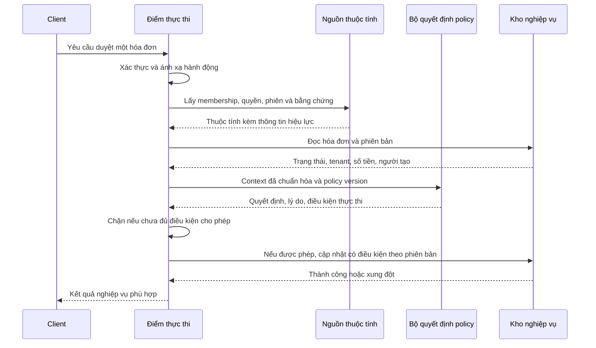

# ABAC và context

## 1. Vì sao quyền truy cập cần gắn với hoàn cảnh?

Một nhân viên kế toán có quyền duyệt hóa đơn chưa chắc được duyệt mọi hóa đơn ở mọi thời điểm. Quyết định còn có thể phụ thuộc vào công ty sở hữu hóa đơn, hạn mức được giao, người tạo chứng từ, trạng thái thiết bị và lần xác thực mạnh gần nhất.

Xét một ứng dụng tài chính phục vụ nhiều doanh nghiệp. Lan được cấp quyền `invoice.approve` cho doanh nghiệp A. Lúc 10 giờ, Lan dùng máy công ty đáp ứng yêu cầu bảo mật và vừa hoàn thành MFA. Một giờ sau, tài khoản vẫn là Lan nhưng phiên đã bị thu hồi. Hệ thống phải phân biệt hai lần yêu cầu này. Quyền được gán trước đó chỉ là một phần đầu vào của quyết định.

Trong ABAC, context là dữ liệu mô tả yêu cầu và hoàn cảnh mà hệ thống dùng khi đánh giá policy. Context đáng tin cậy giúp trả lời câu hỏi: **chủ thể này có được thực hiện hành động này trên tài nguyên này, với những điều kiện hiện tại hay không?**

NIST mô tả ABAC là cách quyết định quyền dựa trên thuộc tính của chủ thể, đối tượng, thao tác và có thể cả điều kiện môi trường, được đối chiếu với chính sách. Context là cách ứng dụng tập hợp các dữ liệu cần thiết cho lần đánh giá cụ thể. Xem [NIST SP 800-162](https://csrc.nist.gov/pubs/sp/800/162/upd2/final).

Sau bài học, người học có thể:

- Phân biệt context của một yêu cầu với thuộc tính môi trường và dữ liệu đăng nhập.
- Xác định nguồn, phạm vi tin cậy và thời hạn sử dụng của dữ liệu cấp quyền.
- Diễn đạt một policy kết hợp quyền nền với điều kiện theo hoàn cảnh.
- Xử lý dữ liệu thiếu, quá hạn, mâu thuẫn hoặc thay đổi trước lúc thao tác được thực hiện.
- Thiết kế kiểm thử và dấu vết quyết định để phát hiện cấp quyền sai.

## 2. Context rộng hơn một nhóm thuộc tính môi trường

### 2.1. Bốn nhóm đầu vào thường gặp

Một authorization request có thể tập hợp dữ liệu theo bốn nhóm sau:

| Nhóm | Câu hỏi | Ví dụ trong duyệt hóa đơn |
| --- | --- | --- |
| Subject | Ai đang yêu cầu? | Mã nhân viên, trạng thái tài khoản, quan hệ với tenant, hạn mức |
| Resource | Đang tác động lên cái gì? | Mã hóa đơn, tenant sở hữu, người lập, số tiền, phiên bản |
| Action | Muốn thực hiện thao tác nào? | `invoice.read`, `invoice.approve`, `invoice.export` |
| Environment | Yêu cầu diễn ra trong điều kiện nào? | Thời gian phía máy chủ, vùng mạng, tình trạng thiết bị, tín hiệu rủi ro |

Trong bài này, **request context** là tập dữ liệu được chuẩn hóa cho một lần đánh giá, bao gồm các nhóm trên và thông tin cần thiết về phiên. **Environment context** là phần mô tả hoàn cảnh môi trường. Không nên dùng hai thuật ngữ này như thể chúng luôn đồng nghĩa.

Việc đặt thông tin phiên hay thiết bị vào nhóm subject, environment hoặc một nhóm riêng phụ thuộc mô hình dữ liệu của hệ thống. Điều cần thống nhất là tên, ý nghĩa và nguồn của từng thuộc tính. Một policy không được lúc hiểu `tenantId` là tenant của người dùng, lúc lại hiểu là tenant của tài nguyên.

XACML cũng có khái niệm context biểu diễn đầu vào và đầu ra của bộ quyết định, với các nhóm thuộc tính thường gặp là subject, resource, action và environment. Ứng dụng có thể xây dựng context có kiểu dữ liệu rõ ràng mà không bắt buộc triển khai XACML. Xem [XACML 3.0, mục 3.2](https://docs.oasis-open.org/xacml/3.0/xacml-3.0-core-spec-os-en.html).

### 2.2. Thuộc tính ít thay đổi và thuộc tính theo từng yêu cầu

Phòng ban có thể ổn định trong nhiều ngày; địa chỉ mạng có thể đổi giữa hai lần gọi API. Tuy vậy, thuộc tính ít thay đổi vẫn có thể trở nên sai sau khi nhân viên chuyển bộ phận. Không nên đồng nhất “ít thay đổi” với “được tin mãi mãi”.

Ngược lại, không phải dữ liệu nào thay đổi nhanh cũng có giá trị cấp quyền. Một tham số ngẫu nhiên do client gửi là dữ liệu động, nhưng chưa chứng minh điều gì về quyền truy cập.

Mỗi thuộc tính cần được đánh giá trên ít nhất bốn phương diện độc lập:

1. Giá trị có nghĩa gì trong nghiệp vụ?
2. Nguồn nào có thẩm quyền xác nhận giá trị đó?
3. Giá trị được xác nhận khi nào và còn dùng được đến khi nào?
4. Giá trị có thực sự gắn với chủ thể, phiên, thiết bị hoặc tài nguyên đang xét không?

Ví dụ, kết quả `device.compliant = true` của thiết bị D1 không thể dùng cho một yêu cầu đến từ thiết bị D2, dù kết quả mới được tạo vài giây trước.

## 3. Context không tự sinh ra quyền

Một điều kiện môi trường thuận lợi thường chỉ giới hạn cách sử dụng quyền đã được thiết lập. Máy tính ở mạng nội bộ không làm cho người dùng trở thành người duyệt hóa đơn; MFA thành công không tạo ra quan hệ với mọi tenant.

Có thể hình dung một policy duyệt hóa đơn như sau:

```text
Cho phép nếu tất cả điều kiện đều đúng:
  tài khoản và phiên đang hoạt động
  AND chủ thể có quan hệ còn hiệu lực với tenant đang chọn
  AND tenant đang chọn trùng tenant của hóa đơn
  AND chủ thể có quyền invoice.approve trong chính tenant đó
  AND số tiền không vượt hạn mức được giao
  AND chủ thể không phải người tạo hóa đơn
  AND hóa đơn đang chờ duyệt
  AND thời điểm yêu cầu nằm trong khung được phép
  AND bằng chứng thiết bị hợp lệ, còn mới và đạt yêu cầu
  AND có sự kiện MFA được chấp nhận trong khoảng thời gian quy định
```

Đây là thiết kế minh họa của một ứng dụng tài chính, không phải tập điều kiện bắt buộc cho mọi hệ thống IAM. Từng điều kiện phải xuất phát từ nghiệp vụ và mức độ nhạy cảm của hành động.

Đặc biệt cần chú ý dấu `AND`. Biểu thức dưới đây làm thay đổi hoàn toàn ý nghĩa policy:

```text
có quyền invoice.approve OR đang ở mạng công ty
```

Với biểu thức này, một người không có quyền vẫn có thể được duyệt hóa đơn chỉ vì điều kiện mạng đúng. Trước khi bổ sung context, cần xác định rõ nó là điều kiện bắt buộc, một nhánh cấp quyền riêng hay chỉ là tín hiệu hỗ trợ đánh giá rủi ro.

## 4. Xây dựng context từ nguồn có thẩm quyền

### 4.1. Dữ liệu client gửi và dữ liệu hệ thống xác minh

Giả sử client gửi yêu cầu:

```http
POST /invoices/INV-204/approve
Authorization: Bearer <access-token>
X-Tenant-Id: tenant-a
X-Device-Compliant: true
X-MFA-Completed: true
```

`INV-204` và `tenant-a` có thể giúp định vị đối tượng, nhưng bản thân các chuỗi đó không chứng minh quyền. Hai header còn lại cũng không trở thành bằng chứng bảo mật chỉ vì có tên rõ ràng.

Backend phải xây dựng đầu vào dựa trên dữ liệu đã được xác thực và kiểm tra. Chẳng hạn:

| Thuộc tính | Nguồn có thể có thẩm quyền trong thiết kế này | Kiểm tra cần làm |
| --- | --- | --- |
| Danh tính chủ thể | Middleware xác thực của dịch vụ | Token hoặc phiên hợp lệ và dành cho đúng dịch vụ |
| Tenant đang chọn | Yêu cầu kết hợp dữ liệu membership phía server | Chủ thể thực sự còn quyền hoạt động trong tenant đó |
| Tenant của hóa đơn | Kho dữ liệu nghiệp vụ | Đúng hóa đơn đang được xử lý |
| Quyền và hạn mức | Kho entitlement theo tenant | Đúng chủ thể, tenant và hiệu lực hiện tại |
| Hành động | Route và thao tác nghiệp vụ phía server | Endpoint approve phải kiểm tra `invoice.approve` |
| Thời gian đánh giá | Đồng hồ máy chủ được quản lý | Không lấy thời gian quyết định từ thiết bị client |
| Trạng thái MFA | Dữ liệu sự kiện xác thực được hệ thống chấp nhận | Đúng chủ thể, phiên, mức bảo đảm và thời điểm |
| Trạng thái thiết bị | Dịch vụ quản lý hoặc chứng thực thiết bị | Nguồn hợp lệ, đúng thiết bị của yêu cầu, bằng chứng còn hiệu lực |

Nếu một gateway đáng tin cậy truyền context qua header, kiến trúc phải xác thực gateway, chặn đường đi vòng và xử lý header do bên ngoài tự chèn. Header chỉ là phương tiện truyền dữ liệu; tính tin cậy đến từ chuỗi kiểm chứng và ranh giới triển khai.

### 4.2. Địa chỉ IP không đồng nghĩa danh tính hoặc vị trí chính xác

Địa chỉ mạng có thể là tín hiệu hữu ích, nhưng người dùng có thể đi qua VPN, proxy hoặc mạng dùng chung. Không nên suy ra rằng mọi yêu cầu từ một dải IP đều đến từ một nhân viên hợp lệ hoặc một thiết bị đạt chuẩn.

Nếu hệ thống đứng sau reverse proxy, giá trị IP dùng cho policy phải được rút ra theo cấu hình proxy tin cậy. Đọc tùy ý một phần tử trong `X-Forwarded-For` có thể khiến người gọi tự chọn vùng mạng mà policy nhìn thấy.

Tương tự, quốc gia ước lượng từ IP không phải bằng chứng chắc chắn về vị trí vật lý. Khi cần giới hạn địa lý, phải định nghĩa rõ độ chính xác, nguồn dữ liệu và cách xử lý trường hợp không xác định được vị trí.

### 4.3. Token đã xác thực vẫn có thể chứa thông tin cũ

Kiểm tra chữ ký và hiệu lực token giúp xác nhận dữ liệu được một issuer tin cậy phát hành trong phạm vi mà dịch vụ chấp nhận. Nó không tự chứng minh rằng phòng ban, membership hoặc tình trạng thiết bị vẫn giữ nguyên kể từ thời điểm phát hành.

Một access token có thể còn hiệu lực sau khi nhân viên bị gỡ quyền. Thiết kế phải xác định thuộc tính nào được dùng từ token đến khi hết hạn, thuộc tính nào cần kiểm tra lại và khoảng trễ thu hồi nào chấp nhận được.

Không nên đồng nhất `iat` của một token mới với thời điểm người dùng vừa thực hiện MFA. Quá trình refresh có thể tạo token mới mà không có một lần xác thực tương tác mới. Policy cần dùng thông tin xác thực có ý nghĩa được hệ thống định danh cam kết, thay vì suy luận từ tuổi token.

## 5. Độ mới, thời hạn và ràng buộc của bằng chứng

### 5.1. Một giá trị Boolean thường không đủ

Đối với một tín hiệu động, nên quản lý cả thông tin đi kèm. Ví dụ dưới đây là cấu trúc minh họa, không phải một định dạng chứng thực tiêu chuẩn:

```json
{
  "value": "compliant",
  "source": "device-management",
  "subjectId": "employee-42",
  "sessionId": "session-731",
  "deviceId": "device-18",
  "observedAt": "2026-11-26T03:00:00Z",
  "validUntil": "2026-11-26T03:02:00Z",
  "evidenceVersion": "snapshot-812"
}
```

Giả sử policy của ứng dụng yêu cầu quan sát thiết bị không quá 60 giây. Dù `validUntil` cho phép sử dụng đến 03:02, tại 03:01:30 dữ liệu vẫn quá cũ đối với policy này. Thời hạn do nguồn cấp và yêu cầu độ mới của bên sử dụng là hai điều kiện khác nhau.

Một phép kiểm tra có thể được mô tả bằng:

```text
observedAt <= evaluatedAt
AND evaluatedAt < validUntil
AND evaluatedAt - observedAt <= maxAge
AND bằng chứng được xác minh từ nguồn chấp nhận được
AND bằng chứng ràng buộc đúng đối tượng của yêu cầu
```

Các mốc 60 giây hay hai phút chỉ phục vụ ví dụ. Không có một giá trị TTL duy nhất phù hợp với mọi hành động.

### 5.2. Tín hiệu còn mới có thể vẫn bị vô hiệu hóa

Một bằng chứng chưa hết hạn có thể bị thu hồi vì thiết bị bị mất, phiên bị đánh cắp hoặc khóa xác thực bị lộ. Nếu dịch vụ chỉ kiểm tra thời gian, nó vẫn có thể chấp nhận bằng chứng đã bị vô hiệu hóa.

Vì vậy, hợp đồng sử dụng thuộc tính phải nói rõ cơ chế thu hồi: kiểm tra trực tiếp, sự kiện invalidation, phiên bản trạng thái, token ngắn hạn hay sự kết hợp các cách này. Mỗi phương án có độ trễ; phải hiểu độ trễ đó trước khi dùng kết quả cho hành động có tác động lớn.

### 5.3. Thời gian phải có cách diễn giải thống nhất

Một policy “cho phép trong giờ làm việc” chưa đủ rõ. Cần xác định múi giờ nghiệp vụ, ngày trong tuần, ngày nghỉ nếu có, cách hiểu điểm bắt đầu và điểm kết thúc.

Ví dụ quy ước của doanh nghiệp A là từ 08:00 đến trước 18:00 các ngày thứ Hai đến thứ Sáu theo `Asia/Ho_Chi_Minh`. Theo quy ước đó, 08:00 được phép còn 18:00 bị từ chối. Lưu thời điểm dưới dạng UTC rồi chuyển sang múi giờ được cấu hình khi đánh giá giúp tránh phụ thuộc múi giờ mặc định của máy chạy ứng dụng.

Trong một lần đánh giá, nên chụp `evaluatedAt` một lần để các điều kiện dùng cùng thời điểm. Nếu hệ thống cho phép sai lệch đồng hồ, khoảng dung sai phải được chỉ định; không tự chấp nhận mọi timestamp nằm trong tương lai.

## 6. Luồng thu thập, đánh giá và thực thi

Một thiết kế có thể tách bộ thu thập thuộc tính, bộ quyết định policy và điểm thực thi. Những thành phần này có thể cùng nằm trong một dịch vụ; không nhất thiết phải triển khai thành nhiều hệ thống mạng.



Bộ thu thập phải kiểm tra kiểu dữ liệu và tính nhất quán trước khi chuyển sang policy. Ví dụ số tiền cần có đơn vị xác định; không so sánh một giá trị tính bằng đồng với hạn mức tính bằng xu. Mã tenant phải được chuẩn hóa theo cùng một hợp đồng.

Bộ quyết định cần biết phiên bản policy đang chạy. Điểm thực thi phải thực hiện đúng kết quả, bao gồm những yêu cầu bổ sung nếu có. Nếu policy yêu cầu che trường dữ liệu hoặc ghi audit bắt buộc mà endpoint bỏ qua, kết quả thực tế vẫn sai dù bộ quyết định trả về đúng.

Việc kiểm tra quyền phải bao phủ từng yêu cầu liên quan; không chỉ kiểm tra ở màn hình giao diện rồi để endpoint thao tác bỏ qua. Đây cũng là một khuyến nghị của [OWASP Authorization Cheat Sheet](https://cheatsheetseries.owasp.org/cheatsheets/Authorization_Cheat_Sheet.html#validate-the-permissions-on-every-request).

## 7. Ví dụ context và policy cho duyệt hóa đơn

### 7.1. Dữ liệu chuẩn hóa

Ví dụ sau là context nội bộ được backend tạo sau khi xác minh các nguồn. Nó không phải JSON mà client được quyền tự gửi để yêu cầu cấp quyền:

```json
{
  "subject": {
    "id": "employee-42",
    "active": true,
    "selectedTenantId": "tenant-a",
    "membershipActive": true,
    "permissions": ["invoice.approve"],
    "approvalLimitVnd": 50000000
  },
  "resource": {
    "id": "INV-204",
    "tenantId": "tenant-a",
    "createdBy": "employee-15",
    "amountVnd": 12000000,
    "state": "PENDING_APPROVAL",
    "version": 7
  },
  "action": "invoice.approve",
  "session": {
    "id": "session-731",
    "active": true,
    "acceptedMfaAt": "2026-11-26T02:58:00Z"
  },
  "environment": {
    "evaluatedAt": "2026-11-26T03:00:30Z",
    "businessZone": "Asia/Ho_Chi_Minh",
    "deviceEvidenceRef": "snapshot-812"
  }
}
```

Danh sách `permissions` ở đây chỉ gồm quyền có hiệu lực trong tenant đang chọn. Quyền duyệt của tenant B không được trộn vào để xử lý hóa đơn của tenant A. Trường `acceptedMfaAt` thể hiện một sự kiện đã đáp ứng yêu cầu MFA của ứng dụng; chỉ có timestamp do client khai báo thì chưa đủ.

Tại thời điểm ví dụ, giờ địa phương là 10:00:30. Bằng chứng thiết bị ở mục trước có tuổi 30 giây, MFA cách thời điểm đánh giá hai phút 30 giây và hóa đơn nằm trong hạn mức. Nếu các kiểm tra nguồn, ràng buộc phiên và trạng thái thu hồi đều đạt, những điều kiện này có thể cùng thỏa policy đã nêu.

### 7.2. Pseudocode kết hợp các điều kiện

```text
evaluateApprove(context, policy):
    nếu thiếu hoặc sai kiểu thuộc tính bắt buộc:
        trả kết quả không thể đánh giá hợp lệ

    nếu tài khoản hoặc phiên không hoạt động:
        từ chối

    nếu membership không còn hiệu lực:
        từ chối

    nếu tenant đang chọn khác tenant tài nguyên:
        từ chối

    nếu thiếu invoice.approve trong tenant đang chọn:
        từ chối

    nếu số tiền không hợp lệ hoặc vượt hạn mức:
        từ chối

    nếu người yêu cầu cũng là người tạo hóa đơn:
        từ chối

    nếu trạng thái khác PENDING_APPROVAL:
        từ chối

    nếu kiểm tra context thời gian, thiết bị hoặc MFA không đạt:
        chưa cho phép thao tác

    trả cho phép, gắn với resource.version và policy.version
```

Hệ thống cần quy định riêng cách kết hợp nhiều policy. Ví dụ, một policy về hạn mức cho phép không được vô tình bỏ qua policy cấm duyệt hóa đơn của chính mình. Không nên suy luận rằng hễ có một kết quả cho phép ở bất kỳ đâu thì toàn bộ yêu cầu được chấp nhận.

## 8. Ví dụ Java: kiểm tra phần context động

Đoạn mã dưới đây minh họa một phần của policy: giờ nghiệp vụ, độ mới của MFA và bằng chứng thiết bị. Các ngưỡng 5 phút và 60 giây là cấu hình giả định của ví dụ. Mã không thay thế các kiểm tra danh tính, tenant, quyền, hạn mức và trạng thái hóa đơn.

`Signals` chỉ được tạo từ các nguồn đã được backend xác minh. Bộ thu thập chịu trách nhiệm kiểm tra bằng chứng thuộc đúng người, phiên, thiết bị và yêu cầu hiện tại, cũng như trạng thái thu hồi. Việc đặt tên kiểu dữ liệu không tự tạo ra tính tin cậy đó.

```java
import java.time.DayOfWeek;
import java.time.Duration;
import java.time.Instant;
import java.time.LocalTime;
import java.time.ZoneId;
import java.time.ZonedDateTime;

public final class DynamicContextPolicy {
    private static final ZoneId BUSINESS_ZONE =
            ZoneId.of("Asia/Ho_Chi_Minh");
    private static final Duration MFA_MAX_AGE = Duration.ofMinutes(5);
    private static final Duration DEVICE_MAX_AGE = Duration.ofSeconds(60);

    public enum Result {
        SATISFIED, DENIED, INDETERMINATE
    }

    public record Signals(
            Instant acceptedMfaAt,
            boolean deviceCompliant,
            Instant deviceObservedAt,
            Instant deviceValidUntil) {
    }

    public static Result evaluate(Instant evaluatedAt, Signals signals) {
        if (evaluatedAt == null || signals == null
                || signals.acceptedMfaAt() == null
                || signals.deviceObservedAt() == null
                || signals.deviceValidUntil() == null) {
            return Result.INDETERMINATE;
        }

        if (signals.acceptedMfaAt().isAfter(evaluatedAt)
                || signals.deviceObservedAt().isAfter(evaluatedAt)
                || !signals.deviceValidUntil()
                           .isAfter(signals.deviceObservedAt())) {
            return Result.INDETERMINATE;
        }

        ZonedDateTime businessNow = evaluatedAt.atZone(BUSINESS_ZONE);
        DayOfWeek day = businessNow.getDayOfWeek();
        LocalTime time = businessNow.toLocalTime();

        boolean workingDay = day != DayOfWeek.SATURDAY
                && day != DayOfWeek.SUNDAY;
        boolean workingTime = !time.isBefore(LocalTime.of(8, 0))
                && time.isBefore(LocalTime.of(18, 0));
        boolean recentMfa = Duration.between(
                signals.acceptedMfaAt(), evaluatedAt)
                .compareTo(MFA_MAX_AGE) <= 0;
        boolean freshDevice = Duration.between(
                signals.deviceObservedAt(), evaluatedAt)
                .compareTo(DEVICE_MAX_AGE) <= 0;
        boolean deviceEvidenceValid = evaluatedAt
                .isBefore(signals.deviceValidUntil());

        if (!workingDay || !workingTime || !recentMfa
                || !signals.deviceCompliant()
                || !freshDevice || !deviceEvidenceValid) {
            return Result.DENIED;
        }

        return Result.SATISFIED;
    }
}
```

`SATISFIED` chỉ có nghĩa là phần điều kiện động đã đạt. Điểm thực thi vẫn phải yêu cầu toàn bộ policy duyệt hóa đơn cho phép. `INDETERMINATE` biểu thị không thể đánh giá hợp lệ; không được coi như một kết quả cho phép.

Trong mã này, MFA đúng năm phút tuổi và quan sát thiết bị đúng 60 giây tuổi vẫn đạt điều kiện độ mới. Riêng `deviceValidUntil` là cận trên loại trừ: tại đúng thời điểm hết hạn thì bằng chứng không còn được dùng. Khác biệt này được viết rõ để có thể kiểm thử điểm biên.

Khung giờ chỉ xét ngày trong tuần và chưa xét ngày lễ. Một hệ thống cần lịch nghỉ phải bổ sung nguồn lịch nghiệp vụ có thẩm quyền. Cũng không nên sử dụng múi giờ cố định này cho mọi tenant nếu mỗi doanh nghiệp có lịch làm việc riêng.

## 9. Dữ liệu thiếu, lỗi và yêu cầu xác thực bổ sung

Không lấy được trạng thái thiết bị khác với biết chắc thiết bị không đạt. Cả hai có thể dẫn đến chặn hành động nhạy cảm, nhưng nguyên nhân và cách khắc phục khác nhau.

| Trạng thái đầu vào | Ý nghĩa | Cách xử lý trong ví dụ |
| --- | --- | --- |
| Thiết bị đạt chuẩn, bằng chứng hợp lệ | Có dữ liệu đủ dùng | Tiếp tục đánh giá các điều kiện khác |
| Thiết bị không đạt chuẩn | Điều kiện policy không thỏa | Từ chối duyệt |
| Bằng chứng quá cũ | Không đáp ứng độ mới | Lấy bằng chứng mới rồi đánh giá lại |
| Dịch vụ cung cấp thuộc tính bị timeout | Chưa xác định được điều kiện | Chặn thao tác cần thuộc tính đó, ghi nhận lỗi phụ thuộc |
| Timestamp sai kiểu hoặc không nhất quán | Context không hợp lệ | Không cấp quyền dựa trên dữ liệu này |
| MFA quá cũ, các điều kiện nền có thể đạt | Cần thêm bằng chứng xác thực | Có thể yêu cầu xác thực bổ sung theo luồng ứng dụng |

Không phải mọi lỗi context đều nên trả cùng một mã HTTP. Ứng dụng có thể phân biệt từ chối quyền với sự cố phụ thuộc, nhưng phản hồi bên ngoài không nên làm lộ dữ liệu nhạy cảm như sự tồn tại của tài nguyên thuộc tenant khác.

XACML phân biệt các kết quả như `Permit`, `Deny`, `NotApplicable` và `Indeterminate`. Đây là ví dụ về việc không ép mọi tình huống vào Boolean. Cách ánh xạ kết quả sang hành vi endpoint phải được quy định rõ. Xem [XACML 3.0](https://docs.oasis-open.org/xacml/3.0/xacml-3.0-core-spec-os-en.html).

Yêu cầu xác thực bổ sung, thường gọi là step-up authentication, là một luồng của ứng dụng. Sau khi người dùng hoàn tất, backend phải thu thập context mới và đánh giá lại toàn bộ điều kiện liên quan. Không dùng việc vừa hoàn thành MFA để bỏ qua membership đã bị gỡ hoặc hóa đơn đã đổi trạng thái trong thời gian chờ.

Một thao tác không yêu cầu tín hiệu thiết bị có thể tiếp tục bằng policy riêng nếu đã được thiết kế như vậy. Điều này khác với tự bỏ điều kiện của một policy đang áp dụng chỉ vì nguồn dữ liệu bị lỗi.

## 10. Context thay đổi giữa kiểm tra và sử dụng

### 10.1. Snapshot không đồng nghĩa với trạng thái hiện tại mãi mãi

Giả sử lúc 10:00:00 hệ thống đọc hóa đơn phiên bản 7, số tiền 12 triệu và trạng thái chờ duyệt. Trong khi bộ quyết định đang đánh giá, một thao tác khác sửa số tiền lên 120 triệu và tăng phiên bản lên 8.

Nếu backend dùng kết quả cho phép của phiên bản 7 để cập nhật phiên bản 8, quyết định không còn gắn với dữ liệu thực sự bị tác động. Đây là tình huống dữ liệu thay đổi giữa lúc kiểm tra và lúc sử dụng, thường được gọi là TOCTOU.

Có thể ràng buộc thao tác với phiên bản đã đánh giá:

```sql
UPDATE invoice
SET state = 'APPROVED',
    approved_by = :subject_id,
    version = version + 1
WHERE id = :invoice_id
  AND tenant_id = :authorized_tenant_id
  AND state = 'PENDING_APPROVAL'
  AND version = :authorized_resource_version;
```

Nếu số dòng cập nhật bằng 0, không được báo duyệt thành công. Backend cần xử lý xung đột, đọc lại và đánh giá lại khi phù hợp. Mệnh đề phiên bản chỉ có tác dụng nếu các cập nhật liên quan đều tuân thủ cơ chế tăng phiên bản.

Kiểm tra phiên bản hóa đơn không tự giải quyết thay đổi membership, session hoặc policy ở hệ thống khác. Các trạng thái đó cần cơ chế nhất quán riêng, chẳng hạn kiểm tra lại sát thời điểm commit, hợp đồng về độ trễ thu hồi hoặc khóa/phiên bản trong cùng miền dữ liệu nếu khả thi.

### 10.2. Phiên dài, streaming và tác vụ bất đồng bộ

Một quyết định tại lúc mở WebSocket không tự cho phép mọi thông điệp gửi sau đó. Các hành động tiếp theo cần có điểm đánh giá phù hợp; kết nối cũng cần phản ứng với sự kiện hết hiệu lực hoặc thu hồi theo thiết kế.

Với tác vụ export chạy nền, cần xác định hai thời điểm: lúc nhận yêu cầu và lúc thực thi hoặc giao kết quả. Nếu quyền bị thu hồi trong lúc công việc nằm trong hàng đợi, worker nền không nên mặc nhiên dựa vào một cờ `allowed=true` cũ.

Có thể kiểm tra lại quyền khi chạy, hoặc dùng một ủy quyền ngắn hạn bị giới hạn chặt về chủ thể, tenant, tài nguyên và hành động. Nếu dùng ủy quyền đó, phải quyết định rõ hiệu lực của nó khi quyền gốc bị thu hồi. Không truyền toàn bộ token phiên người dùng qua hàng đợi chỉ để tránh thiết kế luồng ủy quyền.

Việc kiểm tra lại cũng không thu hồi được dữ liệu mà người dùng đã tải xuống trước đó. Context giúp kiểm soát các lần truy cập và thao tác còn nằm trong phạm vi hệ thống, không tạo khả năng xóa thông tin đã được người nhận biết.

## 11. Cache và hiệu năng mà vẫn giữ đúng ý nghĩa

Cache thuộc tính và cache quyết định là hai việc khác nhau. Cache thuộc tính giữ dữ liệu như membership hoặc trạng thái thiết bị; cache quyết định giữ kết luận cho một tập đầu vào và policy cụ thể.

Một cache quyết định chỉ dùng khóa `(subjectId, resourceId)` là không đủ nếu quyền còn phụ thuộc action, tenant, phiên hoặc thời gian. Kết quả đọc một hóa đơn không thể tái sử dụng cho hành động duyệt chính hóa đơn đó.

Khóa và điều kiện tái sử dụng cần phản ánh các dữ liệu có ảnh hưởng đến kết quả, ví dụ:

```text
subject + tenant + action + resourceVersion
+ entitlementVersion + sessionStateVersion
+ deviceEvidenceVersion + policyVersion
```

Đây là gợi ý thiết kế, không phải khóa bắt buộc. Việc đưa mọi trường vào khóa cũng không tự giải quyết hết hạn theo thời gian hoặc việc thu hồi chưa đến được cache.

Với một quyết định cho phép, thời điểm tái đánh giá không nên muộn hơn điều kiện hết hiệu lực sớm nhất mà quyết định dựa vào. Chẳng hạn:

```text
recheckBefore = min(
    thời hạn của bằng chứng thiết bị,
    thời điểm quan sát thiết bị + maxAge,
    thời điểm MFA + maxAge,
    thời điểm kết thúc khung giờ,
    hạn sử dụng các thuộc tính khác,
    TTL tối đa mà ứng dụng cho phép
)
```

Để đơn giản, cache có thể hết hạn ngay tại mốc này dù policy cho phép một điểm biên bằng nhau. Hết hạn sớm hơn làm tăng đánh giá lại nhưng tránh kéo dài quyền quá mức.

Một entitlement có thể bị thu hồi trước mọi mốc thời gian trên. Cần kết hợp invalidation hoặc cơ chế kiểm tra trạng thái phù hợp. Khi không bảo đảm được giới hạn trễ thu hồi cho thao tác nhạy cảm, lựa chọn hợp lý có thể là không cache kết quả cho phép của thao tác đó.

Cache kết quả từ chối cũng cần thời hạn và khả năng cập nhật, nếu không người dùng có thể vẫn bị chặn sau khi vừa được cấp quyền hợp lệ. Lỗi nguồn dữ liệu nên được phân biệt với một từ chối nghiệp vụ để không biến sự cố ngắn thành trạng thái bị chặn kéo dài.

## 12. Kiểm toán và bảo vệ chính dữ liệu context

Một bản ghi hữu ích cần cho biết vì sao quyết định được đưa ra mà không ghi tràn lan dữ liệu nhạy cảm. Có thể lưu các thông tin sau, tùy mức cần thiết:

- Mã yêu cầu và mã quyết định để liên kết các dịch vụ.
- Chủ thể, tenant, tài nguyên và hành động theo định danh nội bộ.
- Kết quả, mã lý do và phiên bản policy.
- Thời điểm đánh giá, phiên bản tài nguyên và tham chiếu bằng chứng.
- Nguồn thuộc tính, tuổi dữ liệu và lỗi phụ thuộc nếu có.
- Kết quả thực thi sau quyết định: thành công, xung đột hoặc bị chặn bởi điều kiện khác.

Ví dụ bản ghi tối giản của ứng dụng minh họa:

```json
{
  "requestId": "req-4091",
  "subjectId": "employee-42",
  "tenantId": "tenant-a",
  "resourceId": "INV-204",
  "resourceVersion": 7,
  "action": "invoice.approve",
  "decision": "DENY",
  "reasonCode": "DEVICE_EVIDENCE_STALE",
  "policyVersion": "invoice-approval-v4",
  "evaluatedAt": "2026-11-26T03:01:30Z",
  "deviceEvidenceRef": "snapshot-812"
}
```

Không đưa access token, session secret hoặc bằng chứng xác thực đầy đủ vào log. Các thuộc tính như vị trí, lịch sử hoạt động và trạng thái thiết bị cũng có thể nhạy cảm; cần giới hạn người được xem, thời hạn lưu và mục đích sử dụng.

Nếu chỉ lưu một tham chiếu bằng chứng nhưng xóa ngay toàn bộ lịch sử thuộc tính, việc giải thích quyết định về sau có thể không còn khả thi. Nên xác định bộ dữ liệu hoặc phiên bản tối thiểu cần giữ để truy vết, thay vì mặc định lưu toàn bộ context của mọi yêu cầu.

Điểm quản trị policy và nguồn thuộc tính cũng là đối tượng cần kiểm soát truy cập. Nếu một người có thể tự thay đổi hạn mức của mình hoặc sửa nguồn membership, policy đúng về cú pháp vẫn đưa ra quyết định sai.

## 13. Những lỗi thiết kế thường gặp

| Lỗi | Vì sao dễ cấp quyền sai | Hướng sửa |
| --- | --- | --- |
| Tin `isMfa=true` do client gửi | Người gọi có thể tự khai báo điều kiện | Lấy sự kiện xác thực từ nguồn được chấp nhận |
| Dùng thời gian client | Người gọi có thể chọn khung giờ thuận lợi | Dùng thời điểm máy chủ cho quyết định |
| Coi mạng nội bộ là quyền duyệt | Tín hiệu môi trường thay thế entitlement | Kết hợp đúng quan hệ tenant, quyền nền và điều kiện |
| Dùng quyền của một tenant cho tenant khác | Quyền mất phạm vi | Gắn membership và entitlement với tenant cụ thể |
| Chỉ cache theo user và resource | Bỏ qua action và các điều kiện thay đổi | Thiết kế khóa, thời hạn và invalidation theo policy |
| Thiếu thuộc tính thì bỏ qua điều kiện | Lỗi nguồn dữ liệu trở thành đường cấp quyền | Quy định rõ cách xử lý không xác định và chặn khi cần |
| MFA mới thì duyệt ngay | Các điều kiện khác có thể không còn đúng | Thu thập lại và đánh giá đủ sau step-up |
| Kiểm tra một phiên bản nhưng cập nhật bản khác | Quyết định không gắn với thao tác thực tế | Ràng buộc phiên bản hoặc dùng giao dịch phù hợp |
| Từ chối ở UI nhưng API vẫn chạy | Người gọi có thể bỏ qua giao diện | Đặt điểm thực thi ở backend cho hành động được bảo vệ |
| Ghi toàn bộ context vào log | Tạo kho dữ liệu nhạy cảm không cần thiết | Chỉ lưu thông tin có mục đích và kiểm soát quyền xem |

Một bẫy khác là gắn quá nhiều tín hiệu vào cùng policy mà không biết tín hiệu nào thực sự cần thiết. Điều đó tăng độ trễ và số phụ thuộc, đồng thời khiến nguyên nhân từ chối khó hiểu. Mỗi thuộc tính nên có vai trò nghiệp vụ cụ thể và một hợp đồng dữ liệu rõ ràng.

## 14. Tình huống kiểm thử và tự thực hành

### 14.1. Ma trận kiểm thử tối thiểu cho ví dụ

Lấy một yêu cầu đạt toàn bộ điều kiện làm trường hợp cơ sở, rồi thay đổi từng yếu tố:

| Tình huống | Kết quả mong đợi |
| --- | --- |
| Đúng tenant, quyền, hạn mức, phiên và context | Có thể cho phép sau khi hoàn tất mọi kiểm tra |
| Quyền chỉ tồn tại ở tenant B, hóa đơn thuộc tenant A | Không cho phép |
| Bằng chứng đạt chuẩn nhưng thuộc thiết bị khác | Không dùng bằng chứng đó để cho phép |
| Thiếu bằng chứng thiết bị mà action bắt buộc cần | Không cho phép action đó |
| Quan sát thiết bị có tuổi 60 giây trong policy ví dụ | Đạt điều kiện độ mới, vẫn phải kiểm tra thời hạn riêng |
| Quan sát thiết bị quá 60 giây | Không đạt điều kiện độ mới |
| Đúng thời điểm `validUntil` | Bằng chứng hết hiệu lực |
| Timestamp quan sát nằm trong tương lai, không có dung sai cấu hình | Context không hợp lệ |
| MFA quá năm phút nhưng access token vừa được refresh | Yêu cầu MFA mới nếu luồng nghiệp vụ cho phép |
| Đúng 08:00 ngày làm việc | Đạt điều kiện khung giờ của ví dụ |
| Đúng 18:00 ngày làm việc | Không đạt điều kiện khung giờ |
| Hoàn tất MFA nhưng membership vừa bị thu hồi | Không cho phép |
| Hóa đơn đổi phiên bản trước cập nhật | Không áp dụng kết quả cũ cho phiên bản mới |
| Nguồn thuộc tính timeout | Không tự bỏ điều kiện bắt buộc để cấp quyền |
| Policy thay đổi sau khi cache kết quả cho phép | Không dùng cache trái với cơ chế hiệu lực đã quy định |

Kiểm thử không chỉ gọi trực tiếp hàm policy với dữ liệu lý tưởng. Cần kiểm tra luồng xây context: header giả mạo, tenant do client chọn, token thiếu claim cần thiết, nguồn dữ liệu lỗi và endpoint có thể bị gọi trực tiếp.

Đối với thời gian, sử dụng một thời điểm được kiểm soát trong kiểm thử thay vì phụ thuộc đồng hồ thực. Nhờ đó có thể kiểm tra điểm biên, cuối tuần và thời điểm hết hạn mà không phải chờ.

### 14.2. Bài tập thiết kế

Thiết kế policy cho hành động tải một báo cáo lương. Người dùng chỉ được tải báo cáo thuộc tenant mà họ có quyền `payroll.export`. Báo cáo nhạy cảm yêu cầu thiết bị đạt chuẩn và MFA gần đây. Công việc tạo báo cáo có thể chạy nền trong vài phút.

Hãy xác định nguồn của từng thuộc tính, cách ràng buộc bằng chứng thiết bị, thời hạn dùng context và thời điểm kiểm tra lại. Sau đó trả lời:

1. Nếu người dùng bị gỡ quyền sau khi tạo yêu cầu nhưng trước lúc báo cáo hoàn thành, hệ thống xử lý thế nào?
2. Nếu một URL tải xuống đã được phát hành, thời hạn và khả năng thu hồi của URL có khớp policy không?
3. Nếu dịch vụ quản lý thiết bị ngừng đáp ứng, chức năng nào bị chặn và chức năng nào vẫn có policy độc lập để hoạt động?
4. Bản ghi nào giúp giải thích quyết định mà không lưu token hay toàn bộ dữ liệu lương?

Một phương án nhất quán là kiểm tra tại lúc nhận yêu cầu, kiểm tra lại trước thao tác nền cần bảo vệ và kiểm soát quyền khi phát hành hoặc sử dụng kết quả. Nếu thay bằng cơ chế ủy quyền có thời hạn, phải mô tả rõ phạm vi và quy tắc thu hồi của cơ chế đó.

ABAC phát huy tác dụng khi dữ liệu đầu vào có ý nghĩa và được kiểm chứng. Muốn đánh giá một điều kiện theo context, cần biết giá trị đến từ đâu, thuộc về yêu cầu nào, còn dùng được bao lâu và sẽ được thực thi trên trạng thái nào của tài nguyên.
