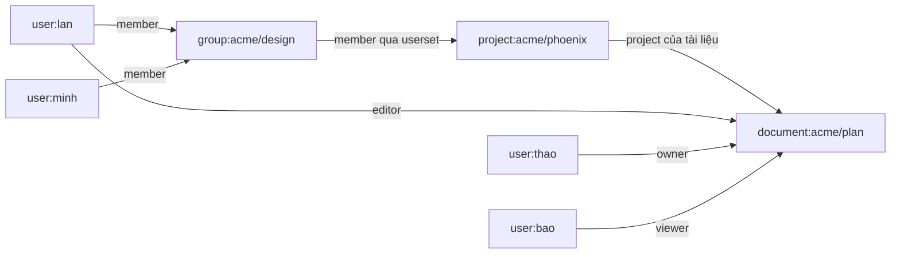

# Relationship-Based Access Control

## 1. ReBAC giải quyết bài toán gì?

Trong một ứng dụng cộng tác, câu hỏi phân quyền thường gắn với một tài nguyên cụ thể: “Lan có được sửa tài liệu kế hoạch này không?”, “Thành viên nhóm thiết kế có được xem tài liệu của dự án Phoenix không?”, hoặc “Ai được thay đổi người sở hữu tài liệu?”. Một vai trò chung như `EMPLOYEE` chưa đủ để trả lời những câu hỏi đó.

Relationship-Based Access Control, viết tắt là **ReBAC**, là cách mô hình hóa phân quyền dựa trên quan hệ giữa chủ thể, tài nguyên và các đối tượng liên quan. Quyền của một người có thể đến trực tiếp từ quan hệ với tài liệu, hoặc gián tiếp qua nhóm, dự án và những đường suy diễn được chính sách cho phép. OpenFGA mô tả bài toán kiểm tra theo dạng người dùng có quan hệ phù hợp với một đối tượng hay không; mô hình quyết định quan hệ nào thể hiện quyền thực hiện hành động. [Nguồn: OpenFGA — Get Started with Modeling](https://openfga.dev/docs/modeling/getting-started).

Ví dụ, nghiệp vụ của một hệ thống quản lý tài liệu có thể quy định:

- Người sở hữu tài liệu được xem, sửa, chia sẻ và xóa tài liệu.
- Người được giao quan hệ editor được xem và sửa tài liệu.
- Thành viên dự án được xem tài liệu thuộc dự án.
- Người chỉ được chia sẻ quyền viewer được xem tài liệu đó.

Một người có thể là editor ở tài liệu A, viewer ở tài liệu B và hoàn toàn không có quyền ở tài liệu C. ReBAC biểu diễn những phạm vi này bằng quan hệ trên từng đối tượng thay vì đòi hỏi một vai trò toàn hệ thống cho mỗi tổ hợp người và tài nguyên.

Trong IAM, ReBAC thuộc phần **authorization**. Nó sử dụng danh tính đã được xác thực để quyết định truy cập. Nó không thay thế đăng nhập, MFA, quản lý phiên hay quy trình cấp phát và thu hồi tài khoản.

## 2. Những thành phần của một mô hình ReBAC

### 2.1. Chủ thể, tài nguyên, quan hệ và hành động

| Thành phần | Ý nghĩa | Ví dụ |
| --- | --- | --- |
| Subject hoặc principal | Danh tính đang yêu cầu thực hiện hành động | `user:lan`, một danh tính workload |
| Object hoặc resource | Đối tượng được bảo vệ | `document:acme/plan` |
| Relation | Quan hệ được khai báo trong mô hình | `owner`, `editor`, `member`, `project` |
| Action hoặc permission | Hành động nghiệp vụ cần được cho phép | `can_view`, `can_edit`, `can_share` |
| Authorization model | Các kiểu đối tượng và quy tắc suy quyền | Editor có quyền sửa và xem |
| Relationship data | Những quan hệ cụ thể đang tồn tại | Lan là editor của tài liệu kế hoạch |

Không phải quan hệ nào cũng nối trực tiếp một người với tài nguyên. Quan hệ `project` có thể nối tài liệu với dự án; quan hệ `member` nối người với nhóm. Mô hình kết hợp chúng để suy ra quyền truy cập cuối cùng.

Một đồ thị nghiệp vụ có thể chứa nhiều loại cạnh như “đã bình luận”, “đã xem” hoặc “được gắn thẻ”. Chúng chỉ ảnh hưởng đến phân quyền nếu chính sách quy định như vậy. Việc hai đối tượng có liên hệ trong cơ sở dữ liệu không tự tạo ra quyền truy cập.

### 2.2. Relationship tuple

Một quan hệ thường được biểu diễn bằng tuple có ba thành phần. Bài này dùng ký hiệu:

```text
object#relation@subject
```

Ví dụ:

```text
document:acme/plan#owner@user:thao
document:acme/plan#editor@user:lan
group:acme/design#member@user:minh
```

Dòng đầu có nghĩa là Thảo có quan hệ owner với tài liệu kế hoạch. Dòng thứ ba có nghĩa là Minh thuộc nhóm thiết kế.

Đây là ký hiệu trình bày, không phải định dạng API dùng chung cho mọi sản phẩm. Với API nhận ba trường riêng, cùng quan hệ editor có thể được biểu diễn như sau:

```json
{
  "user": "user:lan",
  "relation": "editor",
  "object": "document:acme/plan"
}
```

Thứ tự các trường JSON không quan trọng; ý nghĩa của từng trường phải đúng với hệ thống đang sử dụng. Một số sản phẩm gọi trường chủ thể là `subject`, sản phẩm khác dùng `user`.

### 2.3. Kiểu đối tượng là một phần của ý nghĩa

`user:42`, `group:42` và `document:42` là những đối tượng khác nhau. Chỉ dùng số `42` mà không có kiểu hoặc namespace sẽ dễ gây nhầm lẫn giữa các miền dữ liệu.

Mô hình cũng cần giới hạn loại chủ thể được gán cho mỗi quan hệ. Chẳng hạn:

- `document.owner` chấp nhận một user.
- `document.project` chấp nhận một project.
- `group.member` chấp nhận một user trong ví dụ đơn giản này.

Giới hạn kiểu giúp phát hiện tuple không hợp lệ, nhưng chưa đảm bảo mọi bất biến nghiệp vụ. “Mỗi tài liệu chỉ có một owner” hay “tài liệu chỉ thuộc một dự án” vẫn có thể cần ràng buộc bổ sung ở quy trình ghi dữ liệu.

## 3. Phân biệt quan hệ được lưu và quyền được suy ra

Giả sử có tuple:

```text
document:acme/plan#editor@user:lan
```

Tuple này mô tả một sự kiện trong dữ liệu phân quyền: Lan là editor của tài liệu. Để biết Lan có được xem hay không, cần đọc mô hình:

```text
can_view = viewer OR editor OR owner
can_edit = editor OR owner
can_share = owner
```

Theo mô hình đó, Lan được xem và sửa, nhưng chưa được chia sẻ. Tên `editor` không tự động mang ý nghĩa cố định giữa mọi ứng dụng; chính sách mới quyết định editor làm được gì.

Có thể nhìn quyết định dưới dạng:

```text
decision = evaluate(model, relationship_data, subject, permission, object)
```

Công thức khái niệm này nhấn mạnh rằng **mô hình và dữ liệu quan hệ phải đi cùng nhau**. Cùng một tập tuple nhưng mô hình khác có thể tạo ra quyền khác. Cùng một mô hình nhưng thành viên nhóm thay đổi cũng có thể làm quyết định thay đổi.

Trong các hệ thống dùng relation để biểu diễn cả quyền, `can_view` có thể là một relation được tính toán. Cách đặt tên khác nhau giữa sản phẩm không làm mất sự phân biệt quan trọng: đâu là dữ liệu được cấp trực tiếp và đâu là kết quả được suy ra.

Tách hai lớp này còn giúp hạn chế đường cấp quyền ngoài ý muốn. Nếu `can_share` chỉ được suy ra từ owner, API ghi tuple không nên cho phép người gọi tùy tiện thêm một tuple `can_share` trực tiếp để bỏ qua quy trình quản lý owner.

## 4. Userset: cấp quyền cho một tập người thông qua quan hệ

Nếu cần cho toàn bộ thành viên nhóm thiết kế tham gia dự án, việc sao chép từng người thành một grant riêng sẽ tạo thêm dữ liệu phải duy trì. ReBAC có thể tham chiếu đến tập người đang có một quan hệ với đối tượng nhóm.

Trong ký hiệu của OpenFGA:

```text
group:acme/design#member
```

là userset gồm những người có quan hệ member với nhóm đó. Userset được biểu diễn bằng `object#relation`; nó cho phép một quan hệ trên tài nguyên tham chiếu đến một tập người. [Nguồn: OpenFGA — Usersets](https://openfga.dev/docs/modeling/building-blocks/usersets).

Ví dụ:

```text
group:acme/design#member@user:minh
project:acme/phoenix#member@group:acme/design#member
```

Minh là thành viên nhóm thiết kế, và tập thành viên nhóm thiết kế được gán làm thành viên dự án Phoenix. Theo chính sách cho phép đường suy diễn này, Minh là thành viên dự án.

Ở đây, `group:acme/design` và `group:acme/design#member` không đồng nghĩa. Giá trị thứ nhất chỉ đối tượng nhóm; giá trị thứ hai chỉ tập thành viên của nhóm. Viết nhầm có thể làm tuple bị từ chối hoặc mang nghĩa khác với dự định.

Khi Minh rời nhóm, ứng dụng không nhất thiết phải tìm và xóa một grant thành viên dự án riêng của Minh nếu quyền đó chỉ đến qua userset. Tuy nhiên, nếu Minh còn một grant trực tiếp hoặc một đường đi khác, các quyền qua đường đó vẫn có thể tồn tại.

## 5. Ví dụ xuyên suốt: nhóm, dự án và tài liệu

### 5.1. Chính sách nghiệp vụ của ví dụ

Hệ thống giả định có ba loại đối tượng nghiệp vụ là group, project và document, cùng kiểu user. Ta chọn các quy tắc sau:

1. Thành viên một nhóm có thể trở thành thành viên dự án thông qua nhóm đó.
2. Thành viên dự án được xem các tài liệu liên kết với dự án.
3. Editor của tài liệu được xem và sửa tài liệu.
4. Owner của tài liệu được xem, sửa, chia sẻ và xóa tài liệu.
5. Thành viên dự án không tự động có quyền sửa, chia sẻ hoặc xóa tài liệu.

Quy tắc thứ năm là một quyết định nghiệp vụ có chủ ý. Dự án khác có thể muốn chính sách khác; cần sửa mô hình và kiểm tra ảnh hưởng thay vì suy diễn từ tên quan hệ.

### 5.2. Dữ liệu quan hệ

Ta có dữ liệu giả định:

```text
group:acme/design#member@user:lan
group:acme/design#member@user:minh

project:acme/phoenix#member@group:acme/design#member

document:acme/plan#project@project:acme/phoenix
document:acme/plan#owner@user:thao
document:acme/plan#editor@user:lan
document:acme/plan#viewer@user:bao
```

Các tiền tố `acme/` giúp người đọc nhìn thấy phạm vi tổ chức trong ID. Chúng chưa tự thực thi cách ly tenant; phần kiểm tra tenant vẫn phải được thiết kế và thực hiện.

### 5.3. Nhìn bằng đồ thị



Các mũi tên trong sơ đồ được vẽ theo hướng diễn giải từ người đến tài nguyên để dễ đọc. Tuple `document#project@project` vẫn lưu quan hệ project trên đối tượng document như đã trình bày ở trên.

Sơ đồ giúp thấy các đường liên hệ, nhưng một đường nối bất kỳ chưa đủ để trả lời allow. Với yêu cầu sửa tài liệu, chính sách phải cho phép đúng loại đường suy diễn đó.

### 5.4. Mô hình minh họa bằng OpenFGA DSL

Ví dụ sau dùng ngôn ngữ mô hình của OpenFGA để thể hiện chính sách vừa chọn. Đây là ví dụ học thuật; bài không triển khai server hay SDK.

```text
model
  schema 1.1

type user

type group
  relations
    define member: [user]

type project
  relations
    define member: [user, group#member]

type document
  relations
    define project: [project]
    define owner: [user]
    define editor: [user, group#member]
    define viewer: [user, group#member]

    define can_view: viewer or editor or owner or member from project
    define can_edit: editor or owner
    define can_share: owner
    define can_delete: owner
```

Ý nghĩa của những thành phần chính:

- `[user, group#member]` cho phép gán một người trực tiếp hoặc tham chiếu đến tập member của một nhóm.
- `member from project` lấy các đối tượng project liên quan đến tài liệu rồi xét quan hệ member trên các project đó.
- `can_view` có nhiều đường cho phép, được kết hợp bằng `or`.
- `can_share` được suy ra từ owner, không có khai báo cho phép gán trực tiếp.

Quan hệ giữa đối tượng cha và con chỉ tạo kế thừa quyền khi mô hình có quy tắc tương ứng. Tài liệu OpenFGA về parent-child cũng phân biệt liên kết giữa đối tượng với chính sách cho phép quan hệ ở đối tượng cha ảnh hưởng đến đối tượng con. [Nguồn: OpenFGA — Parent-Child Objects](https://openfga.dev/docs/modeling/parent-child).

### 5.5. Suy ra một quyết định cụ thể

Yêu cầu:

```text
subject    = user:minh
permission = can_view
object     = document:acme/plan
```

Quá trình giải thích theo dữ liệu trên:

1. Minh không có grant viewer, editor hoặc owner trực tiếp trên tài liệu.
2. Tài liệu có quan hệ project với dự án Phoenix.
3. Dự án nhận tập member của nhóm thiết kế làm member.
4. Minh thuộc nhóm thiết kế.
5. Nhánh `member from project` thỏa mãn, nên Minh được xem.

Với `can_edit`, mô hình chỉ xét editor hoặc owner của tài liệu. Minh không có một trong hai quan hệ đó nên không được sửa, mặc dù vẫn là thành viên dự án.

### 5.6. Các kết quả mong đợi

| Người dùng | Xem | Sửa | Chia sẻ | Xóa | Cơ sở |
| --- | --- | --- | --- | --- | --- |
| Thảo | Có | Có | Có | Có | Owner trực tiếp |
| Lan | Có | Có | Không | Không | Editor trực tiếp; đồng thời thuộc dự án |
| Minh | Có | Không | Không | Không | Member dự án qua nhóm |
| Bảo | Có | Không | Không | Không | Viewer trực tiếp |
| Vy, không có quan hệ liên quan | Không | Không | Không | Không | Không có nhánh cho phép |

Bảng mô tả quyền trên đúng `document:acme/plan`. Không thể dùng kết quả này để kết luận Lan được sửa mọi tài liệu trong Acme.

## 6. Phép hợp, phép giao và điều kiện loại trừ

### 6.1. Hợp: có ít nhất một đường cho phép

Trong ví dụ:

```text
can_edit = editor OR owner
```

Người dùng chỉ cần thuộc một trong hai tập. Nếu một người vừa là editor vừa là owner, quyền sửa vẫn là một kết quả allow; không cần cộng hay nhân “số quyền”.

Hệ quả quan trọng khi thu hồi: xóa một đường cấp quyền chưa chắc làm kết quả chuyển thành deny.

### 6.2. Giao: phải thỏa mãn nhiều tập

Một quy tắc khác có thể yêu cầu:

```text
can_download = can_view AND active_employee
```

Đây là biểu thức khái niệm về giao tập hợp. Cách viết cụ thể phụ thuộc hệ thống và nơi lưu quan hệ `active_employee`.

Một người được chia sẻ tài liệu nhưng không còn là nhân viên hoạt động sẽ không thỏa mãn quy tắc tải xuống này. Ngược lại, chỉ là nhân viên hoạt động cũng chưa đủ nếu người đó không có quyền xem.

Cần xác định rõ quy tắc có áp dụng cho khách ngoài tổ chức không. Một điều kiện giao quá rộng có thể vô tình chặn toàn bộ người dùng khách hợp lệ.

### 6.3. Loại trừ và deny

Một số engine hỗ trợ phép trừ tập hợp hoặc blocklist, chẳng hạn về mặt khái niệm:

```text
can_view = potential_viewers EXCEPT blocked_users
```

Không nên suy rằng mọi ReBAC engine đều có cùng cú pháp, thứ tự ưu tiên hoặc ngữ nghĩa deny. Nếu dùng loại trừ, cần xác định nó áp dụng lên toàn bộ tập được phép hay chỉ một nhánh của biểu thức.

Ví dụ, loại blocked khỏi nhánh viewer nhưng vẫn cho phép qua nhánh editor có thể khác hoàn toàn với yêu cầu nghiệp vụ “người bị block không được xem bằng bất kỳ đường nào”.

Với mô hình ở phần 5, ta chỉ dùng các nhánh cho phép. Không có quy tắc allow phù hợp thì kết quả kiểm tra là không được cấp quyền; chưa có một blocklist riêng trong mô hình đó.

## 7. ReBAC liên hệ thế nào với RBAC, ABAC và ACL?

| Cách tiếp cận | Điểm thường được dùng để diễn đạt chính sách | Ví dụ |
| --- | --- | --- |
| RBAC | Vai trò và các quyền gắn với vai trò, trong một phạm vi xác định | Maintainer của repository được merge |
| ABAC | Thuộc tính của chủ thể, tài nguyên và ngữ cảnh | Nhân viên đúng phòng ban, thiết bị đạt yêu cầu |
| ReBAC | Quan hệ và các quy tắc suy diễn qua đối tượng liên quan | Thành viên dự án được xem tài liệu thuộc dự án |
| ACL | Các mục cấp quyền gắn với tài nguyên | Tài liệu này cấp read cho Lan, write cho Minh |

Các cách tiếp cận này có thể kết hợp. Một ACL đơn giản có thể được biểu diễn bằng quan hệ trực tiếp; một vai trò theo dự án có thể là quan hệ `project.maintainer`; một điều kiện về thời gian có thể bổ sung vào quyết định dựa trên quan hệ.

Sự khác biệt hữu ích nằm ở cách mô hình hóa bài toán, không nằm ở việc sản phẩm dùng nhãn nào. Một hệ thống gọi là RBAC vẫn có thể hỗ trợ vai trò theo tài nguyên và kế thừa. Một hệ thống gọi là ReBAC vẫn phải có chính sách rõ ràng để biến quan hệ thành quyền.

Ví dụ kết hợp:

```text
Được xuất báo cáo nếu:
  có quan hệ cho phép đọc báo cáo
  AND tài khoản còn hoạt động
  AND phiên đáp ứng yêu cầu xác thực tăng cường
```

Quan hệ giải thích vì sao người dùng liên quan đến báo cáo. Các điều kiện về tài khoản và phiên kiểm soát những yêu cầu bổ sung. Việc người dùng đã hoàn thành MFA không tự chứng minh họ có quyền đối với một tài nguyên cụ thể.

## 8. Ownership là một quan hệ cần chính sách riêng

Trong ví dụ, owner có nhiều quyền nhất đối với tài liệu. Điều đó xuất phát từ các định nghĩa `can_view`, `can_edit`, `can_share` và `can_delete`.

Owner không nhất thiết đồng nghĩa với:

- Người tạo bản ghi.
- Người thanh toán.
- Người chịu trách nhiệm nghiệp vụ.
- Quản trị viên toàn hệ thống.
- Chủ sở hữu của mọi tài nguyên nằm bên dưới.

Một nhân viên có thể tạo tài liệu thay mặt dự án nhưng tài liệu thuộc tổ chức. Một account bị vô hiệu hóa cũng có thể vẫn xuất hiện trong lịch sử tạo tài liệu. Vì vậy, trường `created_by` và quan hệ owner cần được phân biệt nếu nghiệp vụ của chúng khác nhau.

Quá trình chuyển ownership cần trả lời ai được khởi tạo, người nhận có hợp lệ không, có cần chấp thuận không và tại thời điểm nào quyền cũ bị thu hồi. Nếu yêu cầu chỉ có một owner, cần giữ bất biến đó khi có hai yêu cầu chuyển đồng thời.

Ví dụ DSL ở phần 5 chỉ hạn chế owner về kiểu user. Nó chưa tự đảm bảo đúng một owner, chưa triển khai quy trình chuyển quyền và chưa quy định cách xử lý owner bị khóa tài khoản.

## 9. Tích hợp với luồng xử lý của ứng dụng

### 9.1. Danh tính phải đến từ nguồn đã xác thực

Backend không lấy `userId` do trình duyệt gửi rồi coi đó là danh tính đã chứng minh. Principal cần được lấy từ cơ chế xác thực đáng tin cậy, ví dụ phiên được backend xác minh hoặc token đã được kiểm tra đầy đủ.

Tương tự, client không được tự gửi một tuple “tôi là owner” để làm dữ kiện tin cậy cho yêu cầu hiện tại. Mọi quan hệ ảnh hưởng đến quyền phải có nguồn và quy trình ghi được kiểm soát.

### 9.2. Kiểm tra đúng permission trên đúng tài nguyên

Mã giả sau diễn tả thứ tự xử lý cho một yêu cầu đọc tài liệu:

```text
principal = authentication.requirePrincipal()

document = repository.findMetadata(documentId)
requireDocumentExists(document)

tenantPolicy.requireAccessToTenant(principal, document.tenantId)

decision = authorization.check(
    subject = principal.canonicalSubject,
    permission = "can_view",
    object = document.canonicalObject
)

if decision is not ALLOW:
    stopRequestWithoutReturningDocumentContent()

return repository.readContent(document.id)
```

Đây là mã giả độc lập sản phẩm. Phần metadata nội bộ được dùng để xác định tài nguyên và tenant; ứng dụng chưa trả nội dung tài liệu cho người gọi trước khi quyết định quyền.

Với yêu cầu cập nhật, kiểm tra `can_edit` thay vì tái sử dụng `can_view`. Với thay đổi chia sẻ, kiểm tra quyền quản lý chia sẻ. Quyền đọc không mặc nhiên bao hàm mọi thao tác khác.

### 9.3. Kiểm tra ở điểm thực thi nghiệp vụ

Ẩn nút “Xóa” trên giao diện giúp trải nghiệm rõ ràng, nhưng API xóa vẫn phải kiểm tra quyền. Các đường gọi khác như job nền, API nội bộ, xuất dữ liệu và tải file cũng cần áp dụng chính sách tương ứng.

Nếu một job nền thực hiện thay người dùng, cần xác định rõ nó dùng quyền của người dùng, quyền workload hay một cơ chế ủy quyền có giới hạn. Không nên mặc định một service account có quyền rộng được phép làm mọi yêu cầu mà client gửi đến.

### 9.4. Phân biệt deny với không xác định được quyết định

Engine có thể trả deny, lỗi mạng, timeout hoặc lỗi mô hình. Với tài nguyên được bảo vệ trong ví dụ này, chỉ kết quả allow rõ ràng mới cho phép trả dữ liệu.

Về vận hành, deny nghiệp vụ và lỗi hạ tầng cần được ghi nhận khác nhau để điều tra. Ứng dụng có thể trả lỗi dịch vụ phù hợp khi engine không sẵn sàng, thay vì gắn nhãn người dùng “không có quyền” cho mọi trường hợp.

Chính sách về việc trả 403 hay che giấu sự tồn tại tài nguyên bằng phản hồi khác còn tùy API. Dù chọn cách nào, không trả nội dung hoặc metadata nhạy cảm trước khi hoàn tất kiểm soát truy cập.

## 10. Ai được phép thay đổi đồ thị quan hệ?

Một mô hình đọc quyền có thể đúng nhưng hệ thống vẫn bị vượt quyền nếu API ghi quan hệ không được bảo vệ.

Giả sử Lan là editor. Theo chính sách ở phần 5, Lan được sửa nội dung nhưng không được chia sẻ. Nếu backend cho Lan gọi một API ghi tuple bất kỳ, Lan có thể tự thêm:

```text
document:acme/plan#owner@user:lan
```

Sau đó engine sẽ tính toán đúng theo dữ liệu mới và cho Lan quyền owner. Sai sót nằm ở quy trình cho phép sửa dữ liệu phân quyền.

Một yêu cầu ghi tuple cần kiểm soát ít nhất những vấn đề nghiệp vụ sau:

- Người gọi có quyền thực hiện loại thay đổi quan hệ này không?
- Đối tượng và chủ thể có tồn tại, còn hoạt động và thuộc phạm vi được phép không?
- Quan hệ có đúng kiểu và đúng giới hạn của mô hình không?
- Thay đổi có vi phạm bất biến như một owner hay một project không?
- Những quyền gián tiếp nào sẽ được cấp hoặc thu hồi?

Quan hệ tưởng như cấu trúc cũng có thể thay đổi quyền. Chuyển tài liệu sang dự án khác có thể cấp quyền xem cho toàn bộ thành viên dự án mới. Sửa membership của nhóm có thể ảnh hưởng đến nhiều tài nguyên đang tham chiếu nhóm đó.

Vì vậy, API “di chuyển tài liệu”, “thêm thành viên nhóm” và “chuyển chủ sở hữu” đều cần được xem như thao tác có ảnh hưởng đến phân quyền.

## 11. Thu hồi quyền: phải xét tất cả các đường cấp quyền

Quay lại Lan trong ví dụ. Lan xem được tài liệu qua hai đường:

```text
Đường A: Lan → editor của tài liệu → can_view
Đường B: Lan → member nhóm → member dự án → can_view
```

Nếu chỉ xóa tuple editor:

```text
document:acme/plan#editor@user:lan
```

thì Lan mất quyền sửa nhưng vẫn được xem qua membership dự án.

Nếu chỉ xóa Lan khỏi nhóm, Lan vẫn được xem và sửa nhờ editor trực tiếp. Muốn loại bỏ toàn bộ quyền trên tài liệu phải xét các đường cấp quyền còn tồn tại và chính sách của từng đường.

Điều này cũng áp dụng khi người dùng rời công ty. Quy trình offboarding có thể cần khóa danh tính, kết thúc phiên, thu hồi token và xử lý các quan hệ liên quan. Chỉ xóa một membership không đảm bảo rằng mọi grant trực tiếp đã biến mất.

Không nên lưu toàn bộ quyền chi tiết vào một token sống lâu rồi coi chúng là đúng đến khi token hết hạn. Những thay đổi trong đồ thị quan hệ có thể khiến ảnh chụp quyền trong token trở nên cũ. Nếu dùng cơ chế đó, phải xác định rõ thời gian quyền cũ còn hiệu lực và cách đáp ứng yêu cầu thu hồi.

## 12. Tính nhất quán và khoảng thời gian giữa kiểm tra với sử dụng

### 12.1. Cache có thể giữ quyết định cũ

Giả sử hệ thống vừa thu hồi quyền của Bảo, nhưng một cache còn giữ kết quả allow trước đó. Trong thời gian cache chưa cập nhật, Bảo có thể vẫn được chấp nhận nếu luồng kiểm tra tiếp tục dùng kết quả cũ.

Một khóa cache quyết định thường cần phân biệt ít nhất principal, permission, object và phạm vi mô hình/tenant. Các điều kiện ngữ cảnh có ảnh hưởng đến quyết định cũng phải được xét; chỉ dùng `documentId` làm khóa là không đủ.

Trong OpenFGA, tài liệu hiện hành mô tả chế độ `MINIMIZE_LATENCY` có thể dùng cache, còn `HIGHER_CONSISTENCY` bỏ qua cache để truy vấn cơ sở dữ liệu. Đây là bảo đảm của một lựa chọn truy vấn cụ thể, không nên diễn dịch thành bảo đảm giao dịch toàn cục cho mọi hệ thống liên quan. [Nguồn: OpenFGA — Query Consistency Modes](https://openfga.dev/docs/interacting/consistency).

Khi thiết kế thu hồi, cần xác định thời gian chậm tối đa chấp nhận được, cách vô hiệu hóa cache và hành động nào phải yêu cầu dữ liệu mới hơn. Việc tăng TTL để cải thiện hiệu năng luôn cần được đánh giá cùng yêu cầu thu hồi.

### 12.2. Dữ liệu nghiệp vụ và quan hệ có thể lệch nhau

Một lần tạo tài liệu thường cần ghi bản ghi nghiệp vụ và thiết lập owner. Nếu hai thao tác thuộc hai kho dữ liệu khác nhau, một thao tác có thể thành công còn thao tác kia thất bại.

Hệ thống có thể chọn trạng thái tài liệu chưa sẵn sàng cho đến khi quan hệ được tạo xong, hoặc dùng cơ chế đồng bộ có retry và đối soát. Khi dùng outbox, cần nhớ nó hỗ trợ chuyển sự kiện đáng tin cậy nhưng không tự biến hai hệ thống thành một giao dịch đồng bộ.

Chỉ ghi log “đã gửi sự kiện cấp quyền” chưa chứng minh engine đã nhận và áp dụng quan hệ. Với thu hồi quyền, cần xác định mốc nào mới được xem là hoàn tất và cách xử lý trong thời gian đồng bộ.

### 12.3. TOCTOU

Time-of-check to time-of-use xuất hiện khi trạng thái đổi giữa lúc kiểm tra quyền và lúc thực hiện hành động.

Ví dụ:

```text
t1: kiểm tra thấy Thảo được chuyển owner
t2: một yêu cầu khác chuyển owner khỏi Thảo
t3: yêu cầu ban đầu tiếp tục ghi thay đổi dựa trên quyết định ở t1
```

Tùy mức độ quan trọng, ứng dụng có thể cần kiểm soát phiên bản tài nguyên, kiểm tra lại gần điểm ghi, khóa hoặc cơ chế giao dịch phù hợp. Một lần gọi engine trước đó không tự bảo vệ bất biến trước mọi thay đổi đồng thời.

Zanzibar là một công trình quan trọng về hệ thống phân quyền bằng quan hệ, trong đó tính nhất quán giữa thay đổi ACL và nội dung đối tượng là một mục tiêu thiết kế rõ ràng. Các bảo đảm này đến từ kiến trúc của hệ thống, không phải chỉ từ việc chọn tên mô hình ReBAC. [Nguồn: Pang và cộng sự — Zanzibar, USENIX ATC 2019](https://www.usenix.org/conference/atc19/presentation/pang).

## 13. Cách ly tenant và giới hạn kế thừa

### 13.1. Namespace chưa thay thế kiểm soát tenant

Các ID như `document:acme/plan` giúp tránh va chạm và thuận tiện tra cứu. Nhưng nếu một API vẫn cho phép ghi:

```text
project:acme/phoenix#member@group:other-company/design#member
```

thì nhóm thuộc tổ chức khác có thể nhận quyền theo mô hình. Chuỗi `acme/` không tự ngăn tuple này.

Cần kiểm tra tenant trong quy trình tạo quan hệ, xác thực phạm vi tài nguyên trong yêu cầu và giới hạn quyền truy cập kho phân quyền. Nếu nghiệp vụ cho phép cộng tác liên tổ chức, phải biểu diễn ngoại lệ đó rõ ràng thay vì vô tình cho mọi quan hệ xuyên tenant.

Danh tính cũng cần được ánh xạ về ID chuẩn. Nếu hai nhà cung cấp danh tính có cùng giá trị subject cục bộ, ứng dụng không được gộp họ chỉ vì cùng chuỗi đó. Việc ánh xạ phải tính đến nguồn phát hành danh tính.

### 13.2. Quan hệ cấu trúc không tự quyết định kế thừa

Với mô hình phần 5, mọi member dự án được xem tài liệu có liên kết project. Nếu nghiệp vụ muốn một tài liệu riêng tư nằm trong dự án nhưng không kế thừa quyền xem, mô hình hiện tại chưa đáp ứng.

Có thể phải tách quan hệ phục vụ tổ chức dữ liệu khỏi quan hệ dùng để kế thừa quyền, hoặc bổ sung một cách biểu diễn tài liệu riêng tư phù hợp. Chỉ thêm cột `private=true` vào database sẽ không làm engine đổi kết quả nếu cột đó không tham gia quyết định.

Khi có cây thư mục, cần xác định:

- Quyền nào được kế thừa xuống con?
- Có được ngắt kế thừa không?
- Di chuyển thư mục làm thay đổi quyền vào thời điểm nào?
- Quyền chia sẻ trên con có thể rộng hơn cha không?

Đối với nghiệp vụ yêu cầu cấu trúc cây, quy trình ghi cũng cần ngăn chu trình. Cơ chế chống lặp của engine không thay thế bất biến nghiệp vụ về cây thư mục.

## 14. Truy vấn danh sách, giải thích và kiểm toán

### 14.1. Kiểm tra một đối tượng và tìm các đối tượng được phép xem

Kiểm tra:

```text
Minh có được xem tài liệu X không?
```

khác với:

```text
Minh được xem những tài liệu nào?
```

Yêu cầu thứ hai ảnh hưởng đến tìm kiếm, phân trang và bộ lọc danh sách. Một hệ thống có thể dùng truy vấn tài nguyên được phép truy cập, lọc truy vấn dữ liệu theo tập kết quả, hoặc kiểm tra theo lô với chiến lược phù hợp.

Không nên trả danh sách tên tài liệu, tổng số kết quả hoặc đoạn trích nhạy cảm cho client rồi mới ẩn những mục không có quyền ở giao diện. Những dữ liệu phụ đó cũng có thể làm lộ thông tin.

Nếu lọc quyền sau khi lấy từng trang, cần xử lý trường hợp trang thưa, thiếu kết quả và tổng số không đúng theo quyền. Khi trả nội dung chi tiết, vẫn cần bảo đảm quyền phù hợp tại thời điểm thực thi vì kết quả danh sách trước đó có thể đã cũ.

### 14.2. Giải thích một kết quả

Một lời giải thích có ích cho quản trị viên có thể là:

```text
Minh được xem tài liệu kế hoạch
vì Minh thuộc nhóm thiết kế,
nhóm thiết kế là thành viên dự án Phoenix,
và tài liệu kế hoạch kế thừa quyền xem từ thành viên dự án.
```

Không phải engine nào cũng trả về đầy đủ đường giải thích. Nếu sản phẩm hỗ trợ chức năng này, cần giới hạn ai được xem vì membership nhóm và cấu trúc tài nguyên có thể là dữ liệu nhạy cảm.

Ngoài ra, một đường giải thích không chứng minh đó là đường cấp quyền duy nhất. Điều này đặc biệt quan trọng khi dùng kết quả giải thích để xử lý yêu cầu thu hồi.

### 14.3. Kiểm toán thay đổi và quyết định

Log thay đổi quan hệ nên giúp xác định ai thay đổi, thay đổi gì, trên tài nguyên nào, trong tenant nào và thông qua quy trình nào. Log quyết định có thể ghi principal, hành động, tài nguyên, kết quả, mã tương quan và phiên bản mô hình nếu có.

Không đưa token, session secret hoặc toàn bộ dữ liệu nhạy cảm vào log. Độ chi tiết và thời gian lưu cần phù hợp nhu cầu điều tra và quy định bảo vệ dữ liệu của hệ thống.

Việc thêm một người vào nhóm lớn có thể cấp quyền đến nhiều tài nguyên mà không có tuple trực tiếp nào trên từng tài liệu thay đổi. Vì vậy, kiểm toán chỉ theo grant trực tiếp trên tài liệu sẽ bỏ sót một phần thay đổi quyền thực tế.

## 15. Hiệu năng và vòng đời mô hình

Số lượng tuple chỉ là một yếu tố. Độ sâu kế thừa, số nhánh phải xét, nhóm lồng nhau và loại truy vấn cũng ảnh hưởng đến chi phí đánh giá.

Một mô hình có nhiều nhánh `or` có thể cần tìm nhiều đường trước khi kết luận deny. Một truy vấn liệt kê tất cả tài nguyên có thể tốn kém hơn một phép kiểm tra trên đúng một tài nguyên. Vì vậy, cần đo theo các yêu cầu nghiệp vụ thực tế, bao gồm cả trường hợp bị từ chối.

Những hướng thiết kế thường hữu ích gồm đặt giới hạn có ý nghĩa cho cấu trúc nghiệp vụ, tránh quan hệ không cần thiết, dùng truy vấn theo lô khi phù hợp và theo dõi độ trễ ở các mức phân vị. Không nên tự nới quyền khi truy vấn vượt giới hạn hoặc timeout để “giữ hệ thống chạy”.

Thay đổi mô hình cũng là thay đổi hành vi phân quyền. Ví dụ:

```text
Trước: can_edit = editor OR owner
Sau:   can_edit = editor OR owner OR member from project
```

Sau thay đổi này, Minh có thể được sửa tài liệu dù dữ liệu tuple chưa đổi. Một quy trình triển khai mô hình cần đánh giá những quyền được mở rộng hoặc thu hẹp, sử dụng phiên bản xác định và có cách xử lý quay lui phù hợp.

Quay lui mô hình không nhất thiết xử lý được mọi hậu quả của các thay đổi quan hệ đã ghi trong thời gian phiên bản mới hoạt động. Cần xét tương thích giữa phiên bản mô hình và dữ liệu hiện có.

## 16. Tự kiểm tra bằng các tình huống nghiệp vụ

Những tình huống dưới đây giúp người học tự suy luận trên mô hình phần 5. Chúng không phải báo cáo đã chạy thử một hệ thống.

| Tình huống | Kết quả dự kiến | Điều cần giải thích |
| --- | --- | --- |
| Minh xem tài liệu kế hoạch | Cho phép | Đường qua nhóm và dự án |
| Minh sửa tài liệu kế hoạch | Từ chối | Member dự án không nằm trong can_edit |
| Lan sửa tài liệu sau khi rời nhóm thiết kế | Vẫn cho phép | Editor trực tiếp còn tồn tại |
| Xóa editor của Lan nhưng Lan vẫn thuộc nhóm | Lan vẫn xem được, không sửa được | Quyền xem còn đường qua dự án |
| Bảo chia sẻ tài liệu cho người khác | Từ chối | Viewer không có can_share |
| Vy đoán đúng ID tài liệu | Từ chối | Biết ID không tạo quan hệ |
| Đổi project của tài liệu | Phải tính lại người được xem | Tập member dự án thay đổi |
| Engine timeout khi yêu cầu đọc | Không trả tài liệu từ luồng kiểm tra này | Chưa có quyết định allow |
| API cố thêm nhóm tenant khác vào dự án | Bị chặn nếu nghiệp vụ cấm cộng tác xuyên tenant | Ràng buộc tenant ở quy trình ghi |
| Cùng lúc có hai yêu cầu chuyển owner | Phải giữ bất biến ownership | Mô hình kiểu dữ liệu chưa giải quyết đồng thời |

Một bài tập tiếp theo là thêm yêu cầu “người được xem chưa chắc được tải xuống”. Hãy xác định có cần một permission riêng không, các quan hệ nào được đưa vào permission đó và các kênh trả dữ liệu nào phải kiểm tra nó.

Khi đọc hoặc thiết kế một mô hình ReBAC, hãy luôn chỉ ra được ba phần: dữ liệu quan hệ đang tồn tại, quy tắc suy quyền được áp dụng và điểm backend thực thi quyết định. Ba phần đó giúp giải thích vì sao một yêu cầu được chấp nhận, cũng như xác định cần thay đổi ở đâu khi quyền truy cập không đúng với nghiệp vụ.
