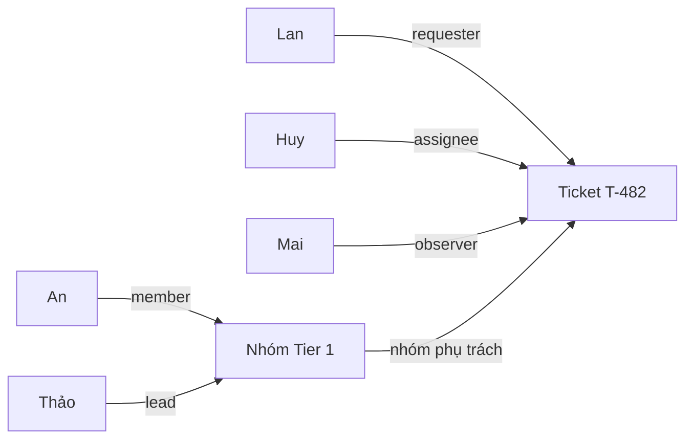

# Relationship giữa subject và resource

## 1. Quan hệ là câu trả lời cho “người này liên quan thế nào đến tài nguyên này?”

Trong hệ thống quản lý yêu cầu hỗ trợ, Lan có thể là người gửi ticket T-482, Huy là nhân viên được phân công xử lý, còn An thuộc nhóm hỗ trợ phụ trách ticket. Cả ba đều có liên quan đến cùng một tài nguyên, nhưng không nhất thiết được thực hiện cùng hành động.

Lan có thể xem phản hồi công khai và bổ sung thông tin. Huy có thể đọc ghi chú nội bộ. An có thể tiếp nhận xử lý theo quyền của nhóm. Một người đăng nhập thành công nhưng không có quan hệ phù hợp với ticket vẫn không được xem nội dung.

Trong Relationship-Based Access Control, gọi tắt là ReBAC, một **relationship** là sự tồn tại của một quan hệ cụ thể giữa các đối tượng trong hệ thống. Khi kiểm tra phân quyền, mô hình dùng những quan hệ đó để xác định một subject có được thực hiện hành động trên một resource hay không.

Ba câu hỏi cần được tách rõ:

1. Subject là danh tính nào đã được hệ thống xác thực?
2. Resource là chính xác đối tượng nào đang được truy cập?
3. Quan hệ nào, theo chính sách nào, làm cơ sở cho hành động được yêu cầu?

Một quan hệ có ý nghĩa phân quyền chỉ khi mô hình định nghĩa ý nghĩa đó. “Từng bình luận trên ticket”, “được nhắc tên trong nội dung” hoặc “biết mã ticket” không tự tạo ra quyền đọc ticket.

## 2. Subject, resource, relation và permission

| Khái niệm | Vai trò trong quyết định | Ví dụ |
| --- | --- | --- |
| Subject | Chủ thể mà quyền đang được kiểm tra | `user:u-lan` |
| Resource | Đối tượng được bảo vệ | `ticket:acme/T-482` |
| Relation | Loại liên hệ được khai báo | `requester`, `assignee`, `observer` |
| Relationship | Một liên hệ cụ thể thuộc loại relation | Lan là requester của T-482 |
| Permission | Hành động được phép thực hiện | `view_public`, `view_internal`, `reassign` |
| Policy hoặc model | Quy tắc biến quan hệ thành quyền | Assignee được đọc ghi chú nội bộ |

Có thể viết một quan hệ bằng ký hiệu toán học đơn giản:

```text
requester(user:u-lan, ticket:acme/T-482) = true
```

Ký hiệu này nói Lan là requester của ticket. Nó chưa tự trả lời Lan có được đọc ghi chú nội bộ hay không.

Muốn trả lời một hành động, ta cần xét thêm mô hình:

```text
allow(subject, action, resource)
    = evaluate(model, relationships, subject, action, resource)
```

Đây là biểu thức khái niệm, không phải API của một engine. Nếu quyết định còn phụ thuộc vào trạng thái tài khoản, thời gian hoặc trạng thái ticket, những điều kiện đó cũng phải tham gia vào quá trình đánh giá ở vị trí đã thiết kế.

OpenFGA phân biệt relation được định nghĩa trong mô hình với relationship thể hiện quan hệ thực tế; mô hình cùng dữ liệu tuple quyết định quan hệ trực tiếp hoặc suy ra có tồn tại hay không. [Nguồn: OpenFGA — Concepts](https://openfga.dev/docs/concepts).

## 3. Subject cần có danh tính ổn định và nguồn đáng tin cậy

### 3.1. Subject trong yêu cầu phải đến từ lớp xác thực

Backend cần lấy subject từ phiên hoặc thông tin xác thực đã được kiểm tra. Không được tin một trường `subjectId` tùy ý do trình duyệt gửi rồi kiểm tra quyền dưới danh tính đó.

Ví dụ yêu cầu sau không chứng minh người gọi là Huy:

```json
{
  "ticketId": "T-482",
  "subjectId": "u-huy",
  "action": "view_internal"
}
```

Client có thể lựa chọn ticket muốn truy cập, nhưng không được tự lựa chọn danh tính có quyền để backend hành động thay.

Trong một API thông thường, subject phải được backend suy ra từ principal đã xác thực. Nếu sản phẩm có chức năng “thực hiện thay người khác”, đó phải là một nghiệp vụ ủy quyền riêng, có điều kiện và ghi nhận người thực sự khởi tạo.

### 3.2. Không dùng tên hiển thị làm khóa quan hệ

Tên “Lan Nguyễn” có thể trùng và có thể thay đổi. Email cũng có thể thay đổi hoặc được cấp lại. Các tuple gắn với khóa không ổn định dễ bị mất liên kết hoặc chuyển quyền sang người khác.

Một cách tổ chức hợp lý là dùng ID nội bộ bền vững:

```text
user:u-7f31
```

và duy trì ánh xạ từ danh tính bên ngoài sang ID đó.

Với OpenID Connect, đặc tả quy định `sub` là định danh ổn định trong phạm vi issuer; cặp `iss` và `sub` được dùng để nhận diện người dùng trong ngữ cảnh của RP. Không nên gộp hai người từ hai issuer khác nhau chỉ vì họ có cùng chuỗi `sub`. [Nguồn: OpenID Connect Core 1.0 — Claim Stability and Uniqueness](https://openid.net/specs/openid-connect-core-1_0.html#ClaimStability).

Ví dụ ánh xạ:

```text
(issuer A, subject 123) → user:u-7f31
(issuer B, subject 123) → user:u-9b02
```

Nếu một người đăng nhập qua nhiều nhà cung cấp và cần dùng chung tài khoản nội bộ, quy trình liên kết danh tính phải xác minh quyền sở hữu phù hợp. Trùng email không tự đủ để chuyển các relationship của tài khoản này sang tài khoản khác.

### 3.3. Subject không chỉ là con người

Một workload cũng có thể cần quan hệ với tài nguyên:

```text
service_account:report-worker
    có quan hệ exporter với
report:acme/monthly-2026-10
```

Cần phân biệt danh tính service đang gọi với người dùng mà service có thể đang đại diện. Một service có quyền kỹ thuật rộng không có nghĩa mọi yêu cầu của người dùng gửi qua service đều được phép.

Loại subject nào được chấp nhận cho từng relation phải là một phần của mô hình. Không mặc nhiên dùng chung toàn bộ quyền của user cho service account chỉ vì cả hai đều có ID.

## 4. Resource phải được xác định chính xác

### 4.1. Resource là đối tượng cụ thể, không chỉ là loại dữ liệu

`ticket` là một loại tài nguyên. `ticket:acme/T-482` là một tài nguyên cụ thể. Quyền trên T-482 không tự áp dụng cho T-483.

Tương tự, “được gọi endpoint GET ticket” chưa đủ nếu endpoint đó có thể đọc ticket của mọi khách hàng. Quyết định cần gắn với đúng đối tượng mà request sẽ đọc hoặc thay đổi.

Khóa resource thường cần thể hiện hoặc ánh xạ được những yếu tố như:

- Loại đối tượng.
- ID ổn định.
- Phạm vi tenant khi ID chỉ duy nhất trong tenant.
- Phiên bản hoặc phân vùng dữ liệu nếu nghiệp vụ thực sự cần phân biệt.

Không nhất thiết phải ghép tất cả vào một chuỗi hiển thị. Điều quan trọng là không để hai tài nguyên khác nhau bị ánh xạ thành cùng một đối tượng phân quyền.

### 4.2. Đường dẫn URL chưa chứng minh quan hệ

Yêu cầu:

```text
GET /tenants/acme/tickets/T-482
```

cho biết client đang yêu cầu một tài nguyên trong phạm vi Acme. Nó không chứng minh người gọi là thành viên Acme, cũng không chứng minh T-482 thực sự thuộc Acme.

Backend cần đối chiếu với dữ liệu tài nguyên đáng tin cậy. Với URL lồng nhau như:

```text
/projects/P-10/tickets/T-482
```

nếu kiểm tra quyền theo P-10 nhưng lấy T-482 bằng một truy vấn không ràng buộc project, kẻ gọi có thể thay ticket ID sang một ticket thuộc project khác.

ID khó đoán chỉ làm việc dò tìm khó hơn, không thay thế kiểm tra quyền trên từng đối tượng. OWASP mô tả IDOR là tình huống tham chiếu đối tượng bị lợi dụng khi ứng dụng thiếu kiểm tra quyền tương ứng. [Nguồn: OWASP — Insecure Direct Object Reference Prevention](https://cheatsheetseries.owasp.org/cheatsheets/Insecure_Direct_Object_Reference_Prevention_Cheat_Sheet.html).

### 4.3. Một resource có thể có nhiều phần được bảo vệ khác nhau

Một ticket có thể gồm thông tin công khai, ghi chú nội bộ, file đính kèm và lịch sử quản trị. Có quan hệ requester với ticket không nhất thiết cho phép xem tất cả các phần này.

Ứng dụng có thể dùng nhiều permission trên cùng resource:

```text
view_public(ticket)
view_internal(ticket)
download_attachment(ticket)
manage_access(ticket)
```

Hoặc dùng tài nguyên con như `attachment:A-17` nếu mỗi file có chính sách riêng. Cần chọn mức hạt phù hợp với nghiệp vụ và bảo đảm mọi kênh trả dữ liệu đều tuân theo lựa chọn đó.

## 5. Quan hệ có hướng, có kiểu và có phạm vi

### 5.1. Quan hệ không mặc nhiên đối xứng

Nếu Lan là requester của ticket, không có nghĩa ticket là requester của Lan.

Nếu nhóm hỗ trợ là đơn vị phụ trách ticket, không có nghĩa ticket là thành viên nhóm theo cùng một relation.

Tên quan hệ cần được đọc theo một quy ước rõ ràng, ví dụ:

```text
Lan là requester của ticket T-482.
Ticket T-482 có support_team là nhóm Tier 1.
An là member của nhóm Tier 1.
```

Một hệ thống có thể lưu cạnh theo hướng object → subject, trong khi sơ đồ học thuật vẽ subject → resource. Cần phân biệt hướng lưu với hướng diễn giải để không đảo nghĩa khi tạo tuple.

### 5.2. Quan hệ không mặc nhiên bắc cầu

Từ hai dữ kiện:

```text
Lan là bạn của Minh.
Minh là requester của ticket T-482.
```

không thể kết luận Lan được xem ticket.

Ngay cả với những quan hệ nghiệp vụ hợp lý hơn:

```text
An là member của nhóm hỗ trợ.
Nhóm hỗ trợ phụ trách ticket.
```

quyền đọc chỉ được suy ra nếu mô hình định nghĩa thành viên nhóm phụ trách có quyền đọc. Không được thay mọi quy tắc bằng “có đường nối trong đồ thị thì allow”.

### 5.3. Cùng tên relation nhưng phạm vi khác nhau

`member` trên một organization, một project và một team có thể mang ý nghĩa khác nhau.

Một người là member của tổ chức chưa chắc là member của nhóm tài chính. Một người là member dự án chưa chắc được quản lý quyền của mọi tài nguyên thuộc dự án.

Do đó, hợp đồng của relation cần đi cùng loại resource. Chỉ ghi “member có quyền đọc” mà không nói member của đối tượng nào sẽ gây mơ hồ.

## 6. Biểu diễn relationship bằng tuple

Bài này dùng ký hiệu:

```text
resource#relation@subject
```

Ví dụ:

```text
ticket:acme/T-482#requester@user:u-lan
ticket:acme/T-482#assignee@user:u-huy
team:acme/tier1#member@user:u-an
```

Ở API nhận trường riêng, cùng một quan hệ assignee có thể biểu diễn như sau:

```json
{
  "object": "ticket:acme/T-482",
  "relation": "assignee",
  "user": "user:u-huy"
}
```

Tên trường `user` ở đây theo cách gọi của OpenFGA. Khi sử dụng sản phẩm khác, cần tuân theo schema tương ứng; ký hiệu trình bày trong bài không phải chuẩn API chung.

### 6.1. Phân biệt đối tượng nhóm với tập thành viên nhóm

Hai giá trị sau mang nghĩa khác nhau:

```text
team:acme/tier1
team:acme/tier1#member
```

Giá trị đầu chỉ đối tượng nhóm. Giá trị sau chỉ userset gồm các chủ thể có quan hệ member với nhóm.

Ví dụ:

```text
ticket:acme/T-482#support_team@team:acme/tier1
```

biểu diễn nhóm phụ trách ticket.

Trong khi:

```text
ticket:acme/T-482#observer@team:acme/qa#member
```

biểu diễn việc tập thành viên nhóm QA được nhận quan hệ observer với ticket, nếu mô hình cho phép kiểu gán này.

Userset là cách tham chiếu một tập người theo quan hệ của họ với đối tượng khác; trong OpenFGA, nó có dạng `object#relation`. Không nên bỏ phần `#member` rồi giả định engine vẫn hiểu là toàn bộ thành viên nhóm. [Nguồn: OpenFGA — Usersets](https://openfga.dev/docs/modeling/building-blocks/usersets).

### 6.2. Chấp nhận một kiểu tuple là quyết định của mô hình

Một relation requester có thể chỉ chấp nhận user, còn observer có thể chấp nhận cả user và userset của team. Không phải cứ biểu diễn được thành một chuỗi là tuple hợp lệ.

Ví dụ một khai báo kiểu minh họa:

```text
ticket.requester    accepts user
ticket.assignee     accepts user
ticket.observer     accepts user, team#member
ticket.support_team accepts team
team.member         accepts user
team.lead           accepts user
```

Đây là ký hiệu mô tả hợp đồng, không phải cú pháp cấu hình để đưa trực tiếp vào engine.

## 7. Ví dụ đầy đủ: các quan hệ trên một ticket hỗ trợ

### 7.1. Bối cảnh và dữ liệu

Ticket T-482 thuộc tenant Acme. Ta giả định những dữ kiện sau:

| Object | Relation | Subject | Cách đọc |
| --- | --- | --- | --- |
| `ticket:acme/T-482` | requester | `user:u-lan` | Lan là người gửi ticket |
| `ticket:acme/T-482` | assignee | `user:u-huy` | Huy được phân công trực tiếp |
| `ticket:acme/T-482` | observer | `user:u-mai` | Mai được theo dõi phần công khai |
| `ticket:acme/T-482` | support_team | `team:acme/tier1` | Tier 1 phụ trách ticket |
| `team:acme/tier1` | member | `user:u-an` | An thuộc nhóm Tier 1 |
| `team:acme/tier1` | lead | `user:u-thao` | Thảo là trưởng nhóm Tier 1 |

Để dễ hiểu, ví dụ coi tài khoản của những người này đang hoạt động và họ thỏa điều kiện tenant tương ứng. Các giới hạn đó vẫn cần được thực thi trong một ứng dụng thật.

### 7.2. Chính sách được chọn

Ta định nghĩa chính sách nghiệp vụ:

```text
team_participant(team)
    = member(team) OR lead(team)

view_public(ticket)
    = requester(ticket)
      OR observer(ticket)
      OR assignee(ticket)
      OR team_participant(support_team(ticket))

reply_public(ticket)
    = requester(ticket)
      OR assignee(ticket)
      OR team_participant(support_team(ticket))

view_internal(ticket)
    = assignee(ticket)
      OR team_participant(support_team(ticket))

write_internal(ticket)
    = assignee(ticket)
      OR team_participant(support_team(ticket))

reassign(ticket)
    = lead(support_team(ticket))

manage_access(ticket)
    = lead(support_team(ticket))
```

Các biểu thức trên mô tả tập chủ thể được phép thực hiện từng hành động. Chúng là ký hiệu khái niệm của ví dụ, không phải DSL của một sản phẩm.

Trong chính sách này, lead cũng được xem là người tham gia nhóm. Đây là quy tắc được viết rõ bằng phép hợp; tên `lead` không tự khiến engine suy ra mọi quyền của member.

Người có observer chỉ được xem phần công khai. Họ không được phản hồi, đọc ghi chú nội bộ hoặc phân công lại ticket.

### 7.3. Các đường giải thích quyền



Sơ đồ vẽ theo hướng diễn giải từ chủ thể đến ticket. Quyết định cụ thể vẫn phải áp dụng biểu thức của từng permission.

An được đọc ghi chú nội bộ vì An là member của nhóm phụ trách. Lan không được đọc phần đó vì requester không nằm trong tập `view_internal`. Thảo được phân công lại ticket vì Thảo là lead của nhóm phụ trách.

### 7.4. Ma trận kết quả

| Subject | Xem công khai | Phản hồi công khai | Xem/ghi nội bộ | Phân công lại | Quản lý truy cập |
| --- | --- | --- | --- | --- | --- |
| Lan | Có | Có | Không | Không | Không |
| Huy | Có | Có | Có | Không | Không |
| Mai | Có | Không | Không | Không | Không |
| An | Có | Có | Có | Không | Không |
| Thảo | Có | Có | Có | Có | Có |
| Bình, không có quan hệ phù hợp | Không | Không | Không | Không | Không |

Một kết quả chỉ áp dụng cho T-482 và chính sách đã nêu. An là member nhóm Tier 1 không có nghĩa An được đọc ticket của nhóm Tier 2.

## 8. Relationship khác với role, thuộc tính và sự kiện lịch sử

### 8.1. Quan hệ và vai trò

`assignee` có thể được hiểu như một vai trò theo ticket. Điều quan trọng là phạm vi của nó:

```text
Huy là assignee của T-482.
```

khác với:

```text
Huy có vai trò SUPPORT_AGENT toàn hệ thống.
```

Vai trò chung có thể cho phép Huy sử dụng chức năng hỗ trợ, còn relation theo ticket xác định Huy được làm gì trên ticket cụ thể. Hai lớp có thể kết hợp nếu nghiệp vụ yêu cầu.

### 8.2. Quan hệ và thuộc tính

Một trường `assigned_user_id` trong database có thể là nguồn dữ liệu cho quan hệ assignee. Bản thân việc nó nằm trong một cột không làm nó mất bản chất quan hệ.

Ngược lại, `priority=HIGH` mô tả thuộc tính của ticket. Nó không chỉ ra người dùng nào liên quan đến ticket. Nếu chỉ ticket ưu tiên cao mới cần trưởng nhóm duyệt một hành động, đó là điều kiện bổ sung trong chính sách.

Nên chọn cách biểu diễn phù hợp với ý nghĩa nghiệp vụ và yêu cầu truy vấn. Không cần biến mọi giá trị trạng thái thành một node chỉ để có đồ thị.

### 8.3. Quan hệ hiện hành và lịch sử

“Người từng được phân công” và “người đang được phân công” là hai khái niệm khác nhau.

Khi chuyển T-482 từ Huy sang An, lịch sử vẫn có thể ghi Huy từng xử lý. Nếu hệ thống không muốn Huy giữ quyền qua assignee, dữ liệu phân quyền hiện hành phải được cập nhật tương ứng.

Không nên dùng truy vấn lịch sử như “bất kỳ ai từng xử lý ticket đều được đọc” nếu nghiệp vụ chưa chủ ý cấp quyền đó. Lưu vết kiểm toán và duy trì grant hiện hành phục vụ hai mục đích khác nhau.

## 9. Hợp đồng của một relation cần rõ đến mức nào?

Một định nghĩa tốt không chỉ có tên relation. Nó cần mô tả được nguồn dữ liệu, loại chủ thể, phạm vi và tác động đến quyền.

Ví dụ hợp đồng cho `ticket.assignee`:

```text
Ý nghĩa:
  Người đang chịu trách nhiệm xử lý trực tiếp ticket.

Kiểu subject:
  User nội bộ được phép tham gia xử lý trong tenant tương ứng.

Số lượng:
  Tối đa một assignee hiện hành cho mỗi ticket trong nghiệp vụ này.

Ai được thay đổi:
  Lead của support_team hiện hành, qua API phân công.

Quyền được suy ra:
  Xem và phản hồi công khai; xem và ghi nội bộ.

Không tự suy ra:
  Quản lý truy cập, thay đổi nhóm phụ trách, quản trị tenant.
```

Việc mô hình chấp nhận kiểu user không tự bảo đảm chỉ có một assignee. Nếu kho tuple cho phép nhiều giá trị cùng relation, tầng nghiệp vụ vẫn phải giữ giới hạn số lượng khi cần.

Cũng cần quy định điều gì xảy ra khi user bị khóa, rời nhóm, rời tenant hoặc bị xóa. Một tuple có thể còn trong kho nhưng chủ thể không còn đủ điều kiện để dùng quyền.

Với `support_team`, cần xác định ticket thuộc đúng một nhóm hay nhiều nhóm. Nếu nhiều nhóm được liên kết và chính sách dùng phép hợp, tập người đọc có thể mở rộng hơn dự kiến.

## 10. Nguồn dữ liệu và quyền thay đổi relationship

### 10.1. Chọn nguồn chuẩn cho từng loại quan hệ

Một thiết kế có thể chọn:

| Relation | Nguồn chuẩn giả định |
| --- | --- |
| team.member | Hệ thống quản lý nhân sự hoặc quản trị nhóm |
| team.lead | Quy trình bổ nhiệm trưởng nhóm |
| ticket.requester | Luồng tạo ticket đã xác thực |
| ticket.assignee | Dịch vụ điều phối ticket |
| ticket.support_team | Quy trình phân tuyến hỗ trợ |
| ticket.observer | API quản lý truy cập ticket |

Bảng này là một phương án cho ví dụ. Dự án thực tế có thể chọn nguồn khác, nhưng không nên để hai nguồn độc lập cùng ghi một relation mà không có quy tắc giải quyết xung đột.

Nếu database nghiệp vụ là nguồn chuẩn còn engine giữ bản sao quan hệ, cần quy định cách đồng bộ và đối soát. Nếu engine là nguồn chuẩn cho một loại grant, giao diện quản trị phải đọc đúng nguồn để tránh hiển thị trạng thái sai.

### 10.2. Kiểm tra quyền ghi quan hệ quan trọng như kiểm tra quyền đọc

Huy có quyền ghi nội dung ticket nhưng không có `manage_access`. Nếu API cập nhật ticket cho phép Huy gửi thêm:

```json
{
  "content": "Đang xử lý",
  "observerIds": ["u-binh"],
  "supportTeamId": "acme/tier2"
}
```

và backend áp dụng tất cả các trường mà không kiểm tra riêng, Huy đã thay đổi phạm vi truy cập thông qua một API sửa nội dung.

Cần tách hoặc kiểm soát rõ các trường có ảnh hưởng đến quan hệ. Thay đổi nhóm phụ trách không chỉ là sửa metadata; nó có thể mở quyền nội bộ cho toàn bộ thành viên nhóm mới.

Chính sách `manage_access` cũng chỉ cho biết ai có thể bắt đầu một thao tác. Nghiệp vụ vẫn cần kiểm tra người được thêm có hợp lệ không, phạm vi nào được cấp và có quy định nào cấm chia sẻ hay không.

### 10.3. Ghi nhận nguyên nhân và người thực hiện

Hai tuple có cùng object, relation và subject có thể đến từ những quy trình quản trị khác nhau. Một hệ thống có nhu cầu kiểm toán cần theo dõi nguồn và lý do của grant, kể cả khi dữ liệu audit được lưu ngoài bộ ba tuple.

Nếu quyền đến từ nhiều nguồn độc lập, xóa grant của một nguồn không nên vô tình xóa quyền hợp lệ của nguồn khác. Cần thiết kế mô hình hoặc sổ theo dõi grant đủ để xử lý vòng đời từng nguồn.

## 11. Vòng đời quan hệ và thu hồi quyền

### 11.1. Tạo mới

Khi Lan tạo ticket, backend xác thực Lan, xác định tenant và tạo quan hệ requester theo chính sách. Client không được tự khai người khác làm requester nếu chưa có một chức năng tạo thay được kiểm soát.

Trường hợp hệ thống cần ghi cả ticket và tuple ở hai nơi khác nhau, phải xử lý trạng thái một bên thành công còn bên kia thất bại. Ticket chưa hoàn tất khởi tạo không nên vô tình xuất hiện ở một luồng bỏ qua kiểm soát quyền.

### 11.2. Thay đổi

Khi phân công từ Huy sang An, hệ thống cần xét:

- Quan hệ assignee cũ được thay khi nào?
- Người cũ còn đường quyền nào khác không?
- Người mới có đủ điều kiện trong tenant không?
- Hai yêu cầu phân công đồng thời được xử lý thế nào?
- Khi nào giao diện được báo thao tác đã hoàn tất?

Một thao tác “xóa cũ, thêm mới” trong hai request riêng có thể tạo khoảng trống hoặc trạng thái hai assignee. Nếu nghiệp vụ yêu cầu tính nguyên tử, cần dùng khả năng giao dịch phù hợp hoặc quy trình giữ bất biến tương đương.

### 11.3. Thu hồi một đường chưa chắc thu hồi mọi quyền

Giả sử Huy đồng thời là member của Tier 1. Khi xóa relation assignee của Huy, Huy vẫn đọc được ghi chú nội bộ qua nhóm.

Ngược lại, nếu Huy rời nhóm nhưng vẫn là assignee, Huy có thể giữ quyền qua phân công trực tiếp theo mô hình đang xét.

Muốn trả lời “Huy còn được xem không?”, phải tính các đường hiện hành:

```text
Huy → assignee của ticket
Huy → member nhóm phụ trách → quyền trên ticket
Huy → một grant khác được chính sách cho phép
```

Thu hồi quyền là thay đổi kết quả của cả chính sách, không chỉ xóa một hàng dữ liệu được tìm thấy đầu tiên.

### 11.4. Chủ thể hoặc tài nguyên bị vô hiệu hóa

Khi khóa account, ứng dụng cần ngăn account đó tiếp tục sử dụng quyền, đồng thời xử lý phiên hoặc thông tin xác thực liên quan. Tuple còn tồn tại không được xem là bằng chứng rằng tài khoản vẫn hoạt động.

Khi xóa resource, cần quy định dọn quan hệ hoặc bảo đảm ID không bị tái sử dụng làm tài nguyên mới thừa hưởng grant cũ. Tên hiển thị giống nhau không có nghĩa hai tài nguyên là một.

Dữ liệu lịch sử có thể được giữ để kiểm toán theo chính sách lưu trữ, nhưng phải tách khỏi tập quan hệ đang cấp quyền.

## 12. Ranh giới tenant trong relationship

Giả sử có hai ticket cùng mã nghiệp vụ:

```text
ticket:acme/T-482
ticket:beta/T-482
```

Nếu mô hình chỉ dùng `ticket:T-482`, quyền có thể bị gắn nhầm sang tài nguyên của tenant khác.

Ngay cả khi ID đã chứa tenant, hệ thống vẫn cần ngăn tuple sai phạm vi:

```text
ticket:acme/T-482#support_team@team:beta/tier1
```

Nếu chính sách cho phép team member đọc ticket và không có ràng buộc bổ sung, tuple này có thể mở quyền cho nhóm của Beta. Chuỗi `acme/` không tự tạo một hàng rào kiểm soát.

Với hệ thống cấm chia sẻ xuyên tenant, quy trình ghi phải từ chối liên kết đó. Với hệ thống có cộng tác xuyên tenant, cần một chính sách khách mời hoặc chia sẻ được định nghĩa rõ, có phạm vi và vòng đời phù hợp.

Cũng không nên kết luận “cùng tenant là đủ quyền”. Tenant là một ranh giới lớn; bên trong tenant vẫn có ticket riêng tư, nhóm phụ trách khác nhau và phần dữ liệu nội bộ cần hạn chế.

## 13. Kiểm tra relationship trong luồng backend

Mã giả sau minh họa việc đọc ghi chú nội bộ:

```text
principal = authentication.requireVerifiedPrincipal()

ticket = ticketRepository.findMetadata(ticketId)
requireTicketExists(ticket)

subject = identityMapping.resolveCanonicalSubject(principal)
resource = resourceMapping.canonicalTicket(ticket)

tenantPolicy.requireEligibleSubject(subject, ticket.tenantId)

decision = authorization.check(
    subject = subject,
    permission = "view_internal",
    resource = resource
)

if decision is not ALLOW:
    stopWithoutReturningInternalNotes()

return ticketRepository.readInternalNotes(ticket.id)
```

Đây là mô tả luồng xử lý, không phải mã SDK có thể chạy ngay.

Những điểm cần giữ đúng khi hiện thực:

- Subject lấy từ principal đã xác thực.
- Resource lấy từ đối tượng thực tế mà backend sẽ đọc.
- Permission là hành động cụ thể, không do client tùy ý đổi thành quyền dễ hơn.
- Chỉ trả ghi chú nội bộ sau khi nhận allow phù hợp.
- Timeout hoặc lỗi engine không được dùng làm căn cứ trả dữ liệu được bảo vệ.

Endpoint đọc phần công khai cần một permission khác. Endpoint tải file hoặc xuất ticket cũng cần kiểm tra quyền phù hợp thay vì chỉ dựa vào việc người dùng đã mở trang trước đó.

Nếu dùng cache, khóa và cơ chế cập nhật phải phản ánh đúng subject, resource, permission cùng những yếu tố ảnh hưởng đến quyết định. Kết quả allow cho Lan trên phần công khai không được tái sử dụng cho Huy hoặc cho phần nội bộ.

Một quyết định cũng có thời điểm. Nếu quan hệ thay đổi giữa lúc check và lúc cập nhật dữ liệu quan trọng, ứng dụng cần cơ chế phiên bản, giao dịch hoặc kiểm tra lại phù hợp với bất biến nghiệp vụ; check trước đó không bảo đảm trạng thái sẽ đứng yên.

## 14. Quan hệ lưu trực tiếp, quan hệ suy ra và dữ kiện theo request

### 14.1. Quan hệ lưu trực tiếp

```text
ticket:acme/T-482#assignee@user:u-huy
```

là dữ liệu phân công trực tiếp. Có thể cần giữ nó bền vững vì nó là một phần của trạng thái hiện hành.

### 14.2. Quyền suy ra

```text
Huy có view_internal vì Huy là assignee.
```

là kết quả đánh giá mô hình. Không nhất thiết phải lưu thêm một tuple `view_internal` riêng cho Huy.

Nếu tự vật chất hóa mọi quyền suy ra mà không có cơ chế cập nhật tương ứng, quyền có thể tồn tại sau khi relation nguồn đã bị xóa. Cách tối ưu hóa này cần thiết kế riêng về đồng bộ và thu hồi.

Một số engine cho phép quy định relation nào nhận gán trực tiếp và relation nào chỉ được suy ra. Đây là cách hữu ích để ngăn việc cấp trực tiếp một permission mà nghiệp vụ muốn kiểm soát qua quan hệ nguồn. [Nguồn: OpenFGA — Direct Relationships](https://openfga.dev/docs/modeling/building-blocks/direct-relationships).

### 14.3. Dữ kiện theo request

Một số hệ thống cho phép đưa quan hệ tạm thời vào yêu cầu kiểm tra. Khi dùng khả năng đó, nguồn dữ kiện phải được kiểm soát giống dữ liệu đã lưu.

Không được chuyển nguyên một danh sách group do client gửi thành các relationship tin cậy. Nếu backend dùng group claim từ token, cần xác minh token đúng mục đích và đánh giá liệu claim có đủ mới để đáp ứng yêu cầu thu hồi hay không.

Dữ kiện tạm thời chỉ tồn tại trong một request không có nghĩa tác động của nó nhỏ. Trong chính request đó, nó vẫn có thể làm kết quả chuyển từ deny sang allow.

## 15. Những sai lầm thường gặp khi mô hình hóa subject–resource

| Sai lầm | Hệ quả có thể xảy ra | Cách suy nghĩ đúng |
| --- | --- | --- |
| Subject lấy từ body request | Người gọi giả danh người có quyền | Dùng principal đã xác thực |
| Dùng email hoặc tên làm ID bền vững | Quyền gắn sai người sau thay đổi | Dùng ánh xạ danh tính ổn định |
| Cùng tenant thì cho xem mọi ticket | Mở quyền quá rộng trong tổ chức | Kiểm tra relation theo tài nguyên |
| Có đường nối bất kỳ thì allow | Suy quyền qua liên hệ không liên quan | Chỉ chấp nhận đường được mô hình cho phép |
| Observer được đọc toàn bộ payload | Lộ ghi chú nội bộ | Tách permission và kiểm soát dữ liệu trả về |
| Quyền sửa nội dung bao gồm sửa grant | Người dùng tự mở rộng truy cập | Kiểm tra riêng thao tác đổi quan hệ |
| Xóa assignee là đã mất mọi quyền | Còn quyền qua nhóm hoặc grant khác | Đánh giá tất cả đường cấp quyền |
| Đổi nhóm phụ trách như sửa nhãn | Mở quyền cho tập người mới | Đánh giá tác động phân quyền của quan hệ cấu trúc |
| Kho tuple tự bảo đảm mọi bất biến | Có nhiều assignee hoặc liên kết sai tenant | Giữ ràng buộc nghiệp vụ ở quy trình ghi |
| Kết quả allow được lưu vô thời hạn | Quyền thu hồi không có hiệu lực kịp thời | Thiết kế độ mới và cập nhật quyết định |

Những lỗi này thường đến từ việc đánh đồng quan hệ nghiệp vụ, grant trực tiếp và quyền hiệu lực. Khi điều tra, cần hỏi rõ đang nói về lớp nào.

## 16. Bài tập suy luận và kết quả mong đợi

Các tình huống sau dùng đúng dữ liệu và chính sách ticket ở phần 7. Đây là bài tập học thuật, không phải kết quả đã chạy một hệ thống thực tế.

### Tình huống A: Mai muốn đọc ghi chú nội bộ

Mai là observer. Permission `view_internal` chỉ gồm assignee và người tham gia nhóm phụ trách. Với dữ liệu đã cho, Mai không thỏa nhánh nào nên không được đọc.

Việc Mai nhìn thấy phần công khai hoặc biết đúng ticket ID không làm thay đổi kết luận.

### Tình huống B: Huy mất assignee nhưng được thêm làm member Tier 1

Huy vẫn đọc và ghi nội bộ qua nhóm. Tuy nhiên, Huy chưa được phân công lại ticket vì permission `reassign` chỉ dành cho lead của nhóm phụ trách.

Muốn kết luận quyền hiệu lực phải xem cả dữ liệu mới, không chỉ sự kiện “đã xóa assignee”.

### Tình huống C: Ticket chuyển từ Tier 1 sang Tier 2

Nếu An chỉ có quyền thông qua membership Tier 1, An sẽ mất đường quyền đó khi thay đổi có hiệu lực. Thành viên Tier 2 có thể nhận quyền theo mô hình.

Nhưng Huy vẫn có thể giữ quyền nếu assignee trực tiếp chưa đổi. Đây là lý do chuyển nhóm và chuyển người xử lý cần được quy định rõ trong nghiệp vụ.

### Tình huống D: Lan vừa là requester vừa trở thành nhân viên Tier 1

Lan có thể nhận thêm quyền nội bộ qua membership nhóm, nếu hệ thống chủ ý áp dụng chính sách đó. Nếu nghiệp vụ yêu cầu người gửi ticket không được xử lý chính ticket của mình, mô hình hiện tại chưa biểu diễn yêu cầu tách nhiệm vụ này.

Cần bổ sung quy tắc phù hợp và đánh giá ảnh hưởng, thay vì giả định quan hệ requester tự có tính chất deny.

### Tình huống E: Một group trong token đã bị thu hồi ở nguồn

Nếu quyết định vẫn dùng membership cũ từ token, người dùng có thể giữ quyền trong thời gian dữ kiện còn được chấp nhận. Cần xác định nguồn hiện hành, thời hạn sử dụng và cơ chế thu hồi theo yêu cầu hệ thống.

Câu hỏi đúng không chỉ là “token hợp lệ không?”, mà còn là “dữ kiện quan hệ này có đủ tin cậy và đủ mới cho quyết định hiện tại không?”.

Khi thiết kế một relationship, hãy diễn đạt nó thành câu đầy đủ: **chủ thể nào có quan hệ gì với tài nguyên nào, quan hệ đến từ đâu, ai được thay đổi nó và những hành động nào được suy ra**. Nếu trả lời rõ các phần đó, mô hình sẽ dễ giải thích và dễ duy trì hơn khi người dùng, nhóm và tài nguyên thay đổi.
