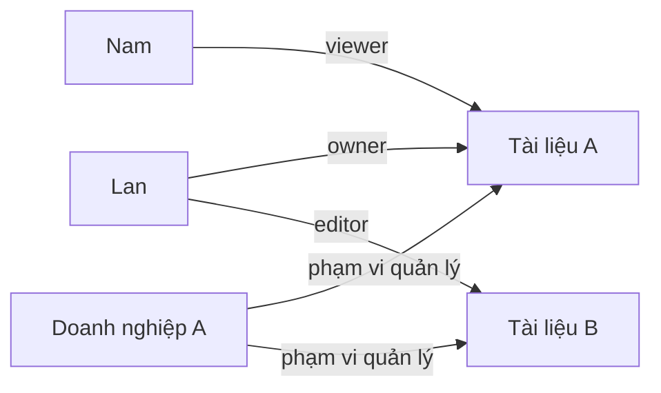

# Resource owner

## 1. Resource owner là ai trong một hệ thống IAM?

**Resource owner** là chủ thể được hệ thống xác lập quan hệ sở hữu đối với một tài nguyên cụ thể. Trong kiểm soát truy cập dựa trên quan hệ, hay ReBAC, quan hệ này là một đầu vào để quyết định chủ thể được thực hiện những hành động nào trên tài nguyên đó.

Ví dụ, Lan là owner của tài liệu `DOC-105`. Policy có thể cho phép Lan sửa nội dung, quản lý chia sẻ và chuyển quyền sở hữu tài liệu. Điều đó không làm Lan trở thành owner của `DOC-106`, cũng không trao cho Lan quyền quản trị toàn bộ hệ thống.

Có thể mô tả quan hệ bằng một bộ ba:

```text
(subject = user:lan, relation = owner, object = document:DOC-105)
```

Tên quan hệ chỉ biểu đạt ý nghĩa mà ứng dụng định nghĩa. Bản thân từ `owner` không tự mang theo một danh sách quyền phổ quát. Một sản phẩm có thể cho owner xóa tài nguyên; sản phẩm khác yêu cầu phê duyệt hoặc cấm xóa khi tài nguyên đang bị giữ lại để kiểm toán.

Trong một nền tảng IAM, ownership cần được quản lý cùng với danh tính, quan hệ tổ chức, vòng đời tài khoản và quyền truy cập. Câu hỏi đầy đủ không chỉ là “ai đứng tên owner?”, mà còn là “danh tính đó có còn hợp lệ, quan hệ có còn hiệu lực và hành động đang yêu cầu có được policy cho phép không?”.

Sau bài học, người học có thể:

- Phân biệt owner với người tạo tài nguyên, người quản trị và người được chia sẻ.
- Mô hình hóa quan hệ sở hữu cùng các quyền được suy ra từ quan hệ đó.
- Bảo vệ thao tác tạo, cập nhật và chuyển owner trước việc giả mạo hoặc vượt phạm vi tenant.
- Giải thích vì sao gỡ quan hệ owner chưa chắc đã gỡ mọi đường truy cập.
- Thiết kế xử lý khi owner nghỉ việc, tài nguyên đổi phạm vi hoặc dữ liệu quyền chưa đồng bộ.

## 2. Phân biệt những khái niệm dễ bị gọi chung là owner

### 2.1. Người tạo tài nguyên không nhất thiết là owner hiện tại

Giả sử Nam tạo một tài liệu rồi chuyển quyền sở hữu cho Lan:

```text
createdBy = user:nam
owner = user:lan
```

`createdBy` ghi nhận ai đã thực hiện sự kiện tạo. `owner` thể hiện quan hệ sở hữu hiện tại theo mô hình của ứng dụng. Sau khi chuyển giao, dùng điều kiện `createdBy == currentUser` để cho phép quản lý tài liệu có thể giữ lại quyền mà Nam đáng lẽ đã mất.

Một dịch vụ nhập dữ liệu cũng có thể tạo tài liệu thay cho phòng nhân sự. Khi đó, danh tính workload thực hiện thao tác là actor kỹ thuật; owner nghiệp vụ có thể là một người hoặc một nhóm khác. Cần tách rõ các trường thay vì mặc định actor tạo bản ghi luôn là owner lâu dài.

| Khái niệm | Ý nghĩa | Có tự chứng minh quyền sở hữu hiện tại không? |
| --- | --- | --- |
| Creator | Chủ thể tạo tài nguyên | Không; ownership có thể đã được chuyển |
| Resource owner | Chủ thể được gán quan hệ sở hữu hiện tại | Có ý nghĩa theo policy và hiệu lực của quan hệ |
| Editor hoặc viewer | Chủ thể được cấp một tập quyền sử dụng | Không; được sửa hoặc đọc không tự cho phép đổi owner |
| Tenant administrator | Người quản trị trong một phạm vi tổ chức | Không tự là owner của từng tài nguyên |
| Người thanh toán | Chủ thể chịu chi phí | Không tự có quyền đọc hoặc quản lý dữ liệu |
| Data steward | Người chịu trách nhiệm quản trị dữ liệu theo nghiệp vụ | Chỉ có quyền kỹ thuật nếu policy ánh xạ trách nhiệm đó |

Quyền sở hữu trong mô hình cấp quyền cũng không tự xác lập quyền sở hữu pháp lý đối với nội dung. Tên một cột trong cơ sở dữ liệu không thay thế quy định nghiệp vụ, hợp đồng hoặc pháp luật liên quan.

### 2.2. Resource owner trong OAuth có phạm vi thuật ngữ riêng

Trong OAuth 2.0, resource owner được định nghĩa là thực thể có khả năng cho phép truy cập một tài nguyên được bảo vệ; khi thực thể đó là người thì được gọi là end-user. Đây là một vai trò của giao thức ủy quyền. Xem [RFC 6749, mục 1.1](https://www.rfc-editor.org/rfc/rfc6749#section-1.1).

Một ứng dụng có thể ánh xạ vai trò đó với người sở hữu dữ liệu của mình, nhưng không nên suy ra rằng mọi `resource owner` trong OAuth đều tương ứng với cột `owner_id` của mọi bản ghi nghiệp vụ. Token và phạm vi ủy quyền vẫn cần được đối chiếu với chính sách của resource server cho tài nguyên cụ thể.

Tương tự, việc một tài khoản hệ điều hành sở hữu file không tự biến tài khoản đó thành owner của đối tượng ứng dụng được lưu bên trong file. Các lớp kiểm soát có mô hình và ranh giới khác nhau.

## 3. Mô hình hóa ownership thành quan hệ và quyền

### 3.1. Quan hệ trực tiếp và quyền suy ra

Một ứng dụng quản lý tài liệu có thể lưu ba loại quan hệ:

```text
(user:lan, owner,  document:DOC-105)
(user:nam, editor, document:DOC-105)
(user:mai, viewer, document:DOC-105)
```

Ứng dụng định nghĩa các quyền như sau:

```text
can_read(user, document)
    = owner(user, document)
      OR editor(user, document)
      OR viewer(user, document)

can_edit_content(user, document)
    = owner(user, document)
      OR editor(user, document)

can_manage_sharing(user, document)
    = owner(user, document)

can_transfer_ownership(user, document)
    = owner(user, document)
```

Đây là quy ước minh họa, không phải cú pháp bắt buộc của một engine ReBAC. Các điều kiện về trạng thái tài khoản, tenant và vòng đời tài nguyên sẽ được kết hợp ở lớp policy đầy đủ.

Việc tách quan hệ khỏi permission giúp endpoint hỏi đúng câu hỏi nghiệp vụ. Endpoint sửa nội dung nên kiểm tra `can_edit_content`, thay vì rải điều kiện “phải là owner” ở mọi nơi. Sau này nếu sản phẩm cho phép một nhóm chuyên viên được sửa, có thể mở rộng policy mà vẫn giữ tên quyền của hành động.

Tài liệu [OpenFGA về roles và permissions](https://openfga.dev/docs/modeling/roles-and-permissions) minh họa cách gán quan hệ trực tiếp rồi suy ra permission từ những quan hệ đó. Đây là một cách tổ chức mô hình hữu ích; ví dụ trong bài không yêu cầu dùng SDK hay sản phẩm cụ thể.

### 3.2. Owner không phải một role toàn cục

Nếu hệ thống chỉ lưu một role `OWNER` trên tài khoản Lan, câu hỏi “owner của tài nguyên nào?” vẫn chưa được trả lời. Một người có thể đồng thời là:

- Owner của tài liệu A.
- Editor của tài liệu B.
- Viewer của tài liệu C.
- Không có quan hệ nào với tài liệu D.

Quan hệ cần gắn với định danh tài nguyên. Nếu quyền quản trị áp dụng ở cấp workspace hay tenant, phải mô hình hóa phạm vi đó và đường suy ra quyền xuống tài nguyên một cách rõ ràng.

Một cấu trúc quan hệ đơn giản có thể được biểu diễn như sau:



Việc Lan sở hữu tài liệu A không tạo ra một cạnh quan hệ từ Lan sang mọi tài liệu thuộc doanh nghiệp A.

### 3.3. Một hay nhiều owner là lựa chọn của ứng dụng

Một mô hình quan hệ thường biểu diễn được nhiều cạnh `owner` cho cùng tài nguyên. Nếu nghiệp vụ yêu cầu đúng một owner, cần cưỡng chế ràng buộc đó trong luồng ghi và kho dữ liệu phù hợp; không mặc định engine tự hiểu từ `owner` là duy nhất.

Có thể chọn một trong những quy ước sau:

| Quy ước | Vấn đề cần giải quyết |
| --- | --- |
| Đúng một người là owner | Chuyển giao nguyên tử, owner nghỉ việc, khôi phục khi mất tài khoản |
| Nhiều người đồng sở hữu | Ai được thêm hoặc gỡ owner khác, có được gỡ owner cuối cùng không |
| Một nhóm hoặc tổ chức là owner | Thành viên nào được đại diện thực hiện từng hành động |
| Không có owner cá nhân | Quyền được suy ra từ tổ chức, dự án hoặc vai trò nghiệp vụ khác |

Phần triển khai chính của bài dùng quy ước **mỗi tài liệu đang hoạt động có đúng một owner là người dùng, owner phải có membership còn hiệu lực trong tenant của tài liệu**. Các hệ thống khác có thể chọn quy ước khác, miễn là policy và dữ liệu thống nhất.

## 4. Những ràng buộc cần giữ quanh quan hệ owner

### 4.1. Định danh và tenant phải rõ ràng

Không nên dùng tên hiển thị hay email có thể thay đổi làm căn cứ duy nhất để xác định owner. Ứng dụng cần định danh ổn định của chủ thể, có thể ánh xạ từ danh tính đã được xác thực bởi nhà cung cấp danh tính.

Nếu nhiều issuer có thể phát hành cùng một giá trị `sub`, cần phân biệt namespace hoặc ánh xạ cặp issuer và subject sang một principal nội bộ. Hai tài khoản cùng tên không vì thế trở thành cùng một owner.

Trong hệ thống nhiều tenant, cần xác định đồng thời:

```text
chủ thể đã xác thực
tenant đang thao tác
tài nguyên trong tenant đó
quan hệ owner đối với đúng tài nguyên
membership có hiệu lực của chủ thể trong tenant
```

Một `tenantId` trong URL chỉ giúp định vị phạm vi được yêu cầu. Backend vẫn phải kiểm tra người gọi có quan hệ hợp lệ với phạm vi đó. Cùng một người có thể có quyền khác nhau trong hai tenant.

### 4.2. Owner chịu các điều kiện bắt buộc của hệ thống

Trong ví dụ, quyền chuyển ownership được quyết định theo công thức:

```text
allow_transfer =
    danh tính đã được xác thực
    AND tài khoản, phiên và membership đang hoạt động
    AND tenant đang chọn trùng tenant của tài liệu
    AND người gọi là owner hiện tại
    AND tài liệu cho phép chuyển giao ở trạng thái hiện tại
    AND người nhận đáp ứng điều kiện nhận ownership
    AND các yêu cầu bổ sung của thao tác đã đạt
```

Yêu cầu bổ sung có thể là xác thực mạnh gần đây hoặc phê duyệt, nếu nghiệp vụ đặt ra. Quan hệ owner không được dùng để tự bỏ qua những điều kiện bắt buộc đó.

Một owner đã bị khóa tài khoản vẫn có thể còn xuất hiện trong dữ liệu lịch sử. Hệ thống không nên cấp quyền chỉ bằng cách tìm thấy cạnh owner rồi bỏ qua trạng thái danh tính.

### 4.3. Nguồn nào được phép thay đổi owner?

Việc sửa quan hệ owner là một thao tác cấp quyền. Nếu người dùng được tùy ý sửa `ownerId`, họ có thể thay đổi người quản lý tài nguyên hoặc chiếm tài nguyên của người khác.

Chỉ những luồng đã được ủy quyền mới được ghi dữ liệu ownership, chẳng hạn:

- Tạo tài nguyên theo policy đã xác định.
- Chuyển quyền sở hữu bởi owner hiện tại.
- Khôi phục hoặc chuyển giao bởi người có quyền quản trị chuyên biệt.
- Tác vụ tự động có danh tính workload và phạm vi được cấp rõ ràng.

Một endpoint ghi relationship tuple trực tiếp cũng phải được bảo vệ như các endpoint nghiệp vụ. Không nên cho người dùng phổ thông ghi tùy ý vào kho quan hệ rồi hy vọng các API đọc dữ liệu sẽ tự phát hiện.

## 5. Thiết lập owner khi tạo tài nguyên

### 5.1. Trường hợp tự tạo cho mình

Trong luồng thông thường, backend có thể gán owner từ danh tính đã được xác thực sau khi kiểm tra quyền tạo tài liệu trong tenant:

```text
POST /tenants/tenant-a/documents

body:
  title = "Kế hoạch tuyển dụng"

server:
  actor = danh tính từ lớp xác thực
  xác minh actor được tạo tài liệu trong tenant-a
  owner = actor
  lưu tài liệu và dữ liệu quyền theo cơ chế nhất quán đã chọn
```

`owner` không được lấy từ một trường `currentUserId` do client tự khai báo. Nếu DTO tạo tài liệu không có chức năng chọn owner, backend cần từ chối hoặc bỏ qua trường ngoài hợp đồng một cách nhất quán, đồng thời không ánh xạ tự động nó sang entity.

### 5.2. Tạo thay cho người khác

Một hệ thống có thể cho phép trợ lý hoặc dịch vụ nhập tài liệu thay cho người khác. Khi đó, việc chọn owner là tính năng có quyền riêng, không phải một biến thể không cần kiểm tra của API tạo tài liệu.

Backend phải xác minh người gọi được tạo thay, người nhận thuộc phạm vi cho phép và tài nguyên được đưa vào đúng tenant. Bản ghi audit nên tách:

```text
createdBy = service:document-importer
ownerId = user:lan
tenantId = tenant-a
reason = approved-import-job
```

Một service account có quyền tạo thay không nhất thiết được đọc lại toàn bộ nội dung hay tự chuyển owner của các tài liệu cũ. Các permission đó cần được cấp riêng theo nguyên tắc ít quyền nhất.

### 5.3. Tránh tài nguyên xuất hiện trước khi quyền được thiết lập

Nếu tài liệu và owner cùng được lưu trong một cơ sở dữ liệu, có thể thiết lập cả hai trong giao dịch phù hợp. Nếu tài nguyên nằm ở database còn quan hệ nằm ở dịch vụ khác, cần thiết kế trạng thái khởi tạo và xử lý thất bại.

Ví dụ, chỉ công bố tài liệu sau khi dữ liệu quyền sẵn sàng; hoặc để backend kiểm tra owner từ nguồn chuẩn trong giai đoạn đồng bộ. Không nên mặc định cho mọi người truy cập tài liệu chỉ vì quan hệ owner chưa được ghi thành công.

## 6. Kiểm tra ownership ở backend

### 6.1. Định danh tài nguyên không phải bằng chứng quyền

Với API sau, người gọi có thể thay `DOC-105` bằng một ID khác:

```http
PATCH /tenants/tenant-a/documents/DOC-105
Authorization: Bearer <token>
Content-Type: application/json

{"title": "Tiêu đề đã cập nhật"}
```

Backend phải tải hoặc truy vấn tài liệu trong phạm vi tenant thích hợp rồi kiểm tra permission của hành động trên chính tài liệu đó. Biết ID, có đường dẫn được chia sẻ hay dùng UUID khó đoán không thay thế kiểm tra quyền ở cấp đối tượng.

OWASP mô tả IDOR là trường hợp người gọi có thể truy cập hoặc sửa đối tượng bằng cách thao túng định danh khi thiếu kiểm tra quyền phù hợp. Xem [OWASP IDOR Prevention Cheat Sheet](https://cheatsheetseries.owasp.org/cheatsheets/Insecure_Direct_Object_Reference_Prevention_Cheat_Sheet.html).

### 6.2. Ví dụ Java cho một policy owner đơn giản

Đoạn mã dưới đây chỉ minh họa các quyền của owner trong mô hình một owner. Dữ liệu `Caller` phải được backend tạo từ danh tính, phiên và membership đã kiểm tra; dữ liệu `Document` phải được lấy từ nguồn có thẩm quyền. Không nhận các Boolean này trực tiếp từ request body.

```java
import java.util.Objects;

public final class DocumentOwnerPolicy {
    public enum Action {
        READ, EDIT_CONTENT, MANAGE_SHARING, TRANSFER_OWNERSHIP, DELETE
    }

    public record Caller(
            String subjectId,
            String selectedTenantId,
            boolean authenticated,
            boolean accountActive,
            boolean sessionActive,
            boolean membershipActive) {
    }

    public record Document(
            String id,
            String tenantId,
            String ownerId,
            long ownershipVersion,
            boolean active,
            boolean retentionHold) {
    }

    public static boolean ownerAllows(
            Caller caller, Document document, Action action) {
        if (caller == null || document == null || action == null
                || blank(caller.subjectId())
                || blank(caller.selectedTenantId())
                || blank(document.id())
                || blank(document.tenantId())
                || blank(document.ownerId())) {
            return false;
        }

        if (!caller.authenticated() || !caller.accountActive()
                || !caller.sessionActive() || !caller.membershipActive()
                || !document.active()) {
            return false;
        }

        if (!Objects.equals(caller.selectedTenantId(), document.tenantId())
                || !Objects.equals(caller.subjectId(), document.ownerId())) {
            return false;
        }

        return switch (action) {
            case READ, EDIT_CONTENT, MANAGE_SHARING,
                    TRANSFER_OWNERSHIP -> true;
            case DELETE -> !document.retentionHold();
        };
    }

    private static boolean blank(String value) {
        return value == null || value.isBlank();
    }
}
```

Kết quả `true` ở đây chỉ thể hiện phần policy được mô tả trong mã. Endpoint chuyển owner vẫn phải kiểm tra người nhận và thực hiện cập nhật an toàn; endpoint xóa phải áp dụng thêm các điều kiện nghiệp vụ nếu có. `ownershipVersion` sẽ được dùng để ràng buộc thao tác ghi, không tự bảo vệ được gì chỉ bằng việc tồn tại trong record.

Policy minh họa cho owner quyền đọc và sửa nhưng vẫn chặn xóa khi `retentionHold` bật. Điều này cho thấy sở hữu tài nguyên và được thực hiện mọi thao tác là hai khái niệm khác nhau.

Editor và viewer cần được xử lý bởi policy tổng hợp nếu ứng dụng hỗ trợ các quan hệ đó. Không dùng một kết quả `false` của hàm owner này để kết luận rằng mọi đường truy cập khác đều không tồn tại; cũng không dùng một nhánh editor để bỏ qua điều kiện bắt buộc của toàn policy.

## 7. Chuyển quyền sở hữu là một thao tác cấp quyền đặc biệt

### 7.1. Không đổi owner qua API cập nhật nội dung thông thường

Giả sử API sửa tiêu đề tự động ánh xạ mọi trường JSON vào entity:

```json
{
  "title": "Tài liệu đã cập nhật",
  "ownerId": "user:attacker"
}
```

Nếu backend ghi cả `ownerId` dù endpoint chỉ kiểm tra quyền editor, người có quyền sửa nội dung có thể tự nâng mình thành owner. Đây là lý do nên tách DTO nội dung khỏi lệnh thay đổi quyền và giới hạn các trường được phép cập nhật.

Một API chuyển giao riêng có thể nhận:

```http
POST /tenants/tenant-a/documents/DOC-105/ownership-transfer
Content-Type: application/json

{
  "newOwnerId": "user:mai",
  "expectedOwnershipVersion": 7
}
```

`newOwnerId` chỉ là người nhận được yêu cầu, chưa phải một kết quả đã được cho phép. `expectedOwnershipVersion` giúp phát hiện client đang thao tác trên trạng thái cũ; nó cũng không chứng minh quyền của người gọi.

### 7.2. Luồng chuyển giao tối thiểu

Với mô hình một owner của bài, một lần chuyển giao cần giải quyết các bước sau:

1. Xác thực người gọi và lấy danh tính từ ngữ cảnh phía server.
2. Đọc tài liệu theo đúng tenant, xác minh người gọi là owner hiện tại và được chuyển ở trạng thái đó.
3. Kiểm tra người nhận tồn tại, được phép nhận ownership và có membership hoạt động trong tenant của tài liệu.
4. Áp dụng xác nhận, MFA hoặc phê duyệt bổ sung nếu policy của sản phẩm yêu cầu.
5. Kiểm tra lại trạng thái cần thiết và cập nhật ownership theo cơ chế ngăn xung đột.
6. Ghi audit, cập nhật các dữ liệu quyền liên quan và xử lý đồng bộ theo hợp đồng nhất quán.
7. Trả kết quả sau khi đã xác định rõ giao dịch thành công hay thất bại.

Chuyển owner trong cùng tenant không đồng nghĩa chuyển tài nguyên sang tenant của người nhận. Nếu muốn di chuyển tài liệu giữa tổ chức, đó là một nghiệp vụ khác, thường kéo theo chia sẻ, kế thừa quyền, dữ liệu liên quan và kiểm soát xuất dữ liệu.

### 7.3. Tránh hai lần chuyển giao cùng dựa trên owner cũ

Lan mở hai cửa sổ. Cửa sổ thứ nhất chuyển owner cho Nam, cửa sổ thứ hai chuyển cho Mai. Cả hai cùng đọc phiên bản ownership là 7.

Nếu backend chỉ kiểm tra Lan là owner rồi cập nhật mà không ràng buộc trạng thái, thao tác thứ hai có thể ghi đè kết quả thứ nhất. Khi đó, Lan đã mất ownership nhưng vẫn hoàn thành được một lệnh dựa trên quyền cũ.

Có thể dùng cập nhật có điều kiện:

```sql
UPDATE document
SET owner_id = :new_owner_id,
    ownership_version = ownership_version + 1,
    updated_at = CURRENT_TIMESTAMP
WHERE tenant_id = :authorized_tenant_id
  AND id = :document_id
  AND owner_id = :authenticated_subject_id
  AND ownership_version = :expected_ownership_version
  AND state = 'ACTIVE';
```

Chỉ khi cập nhật đúng một dòng mới coi bước thay owner là thành công. Kết quả bằng 0 có thể do xung đột hoặc điều kiện không còn đúng; không được tiếp tục thông báo đã chuyển thành công.

Đoạn SQL chỉ ràng buộc trạng thái của tài liệu. Việc kiểm tra người nhận, membership, trạng thái phiên và điều kiện xác thực vẫn phải được thực hiện. Nếu cần bảo đảm membership không thay đổi trong giao dịch, phải dùng cơ chế khóa hoặc mức cô lập thích hợp, và các luồng sửa membership cũng phải tuân thủ giao thức đó.

Nếu danh tính hoặc membership được quản lý ở hệ thống ngoài, một giao dịch trên bảng `document` không tự tạo ra tính nguyên tử với hệ thống kia. Cần nêu rõ giới hạn độ trễ thu hồi và cách kiểm tra sát thời điểm thao tác theo mức nhạy cảm của nghiệp vụ.

Một trường `owner_id NOT NULL` giúp ngăn tài liệu thiếu owner trong mô hình một người sở hữu. Khóa ngoại có thể giúp bảo đảm principal tồn tại, nhưng việc principal còn hoạt động hay đủ điều kiện nhận ownership thường cần kiểm tra bổ sung.

### 7.4. Chấp nhận chuyển giao và retry

Một số sản phẩm yêu cầu người nhận chấp nhận. Khi đó, lời mời đang chờ chưa được xem là ownership mới. Lời mời cần gắn với tài nguyên, người nhận, owner hoặc phiên bản xuất phát và thời hạn sử dụng.

Tại lúc người nhận chấp nhận, backend phải kiểm tra lại: người gửi còn quyền chuyển không, tài nguyên đã đổi owner chưa, người nhận còn đủ điều kiện không và lời mời đã hết hạn hoặc bị hủy chưa. Không áp dụng lời mời cũ sau một lần chuyển giao khác chỉ vì người nhận vẫn giữ được đường dẫn.

Client có thể gửi lại yêu cầu sau timeout dù server đã commit. Có thể dùng khóa idempotency bị giới hạn theo chủ thể, tenant và thao tác để nhận diện lần thử lại. Retry của một lệnh cũ không được trở thành một lần chuyển mới hoặc ghi đè owner hiện tại.

## 8. Gỡ owner chưa chắc đã gỡ mọi quyền truy cập

Giả sử trước khi chuyển cho Mai, Lan có hai đường truy cập:

```text
(user:lan, owner, document:DOC-105)
(user:lan, editor, document:DOC-105)
```

Sau khi chuyển giao, cạnh owner của Lan bị thay bằng cạnh owner của Mai, nhưng cạnh editor của Lan có thể vẫn còn. Với policy ở mục 3, Lan mất quyền chuyển ownership nhưng vẫn được sửa nội dung.

Tương tự, quyền có thể đến từ nhóm, thư mục cha, workspace, link chia sẻ hoặc một vai trò quản trị được cấp riêng. Việc xóa một đường trong đồ thị không chứng minh rằng các đường còn lại đã biến mất.

| Quan hệ hoặc nguồn quyền sau chuyển giao | Lan có thể còn quyền không? |
| --- | --- |
| Chỉ có cạnh owner đã bị gỡ | Không còn quyền suy ra từ cạnh đó |
| Còn editor được cấp trực tiếp | Có thể còn sửa theo policy editor |
| Thuộc nhóm được chia sẻ tài liệu | Có thể còn quyền qua nhóm |
| Có quyền từ thư mục cha | Có thể còn quyền theo quy tắc kế thừa |
| Giữ link tải đã phát hành | Có thể còn truy cập trong thời hạn và cơ chế của link |
| Đã tải dữ liệu về trước đó | Đổi owner không thu hồi được bản sao đã nhận |

Vì vậy, sản phẩm cần định nghĩa rõ ý nghĩa của “chuyển quyền sở hữu”:

- Chỉ đổi quan hệ owner, giữ các quyền chia sẻ độc lập.
- Đổi owner và gỡ một số quyền của owner cũ theo policy.
- Đổi owner và tiến hành thu hồi toàn bộ truy cập của người cũ trong phạm vi được kiểm soát.

Phương án cuối đòi hỏi xem xét tất cả đường cấp quyền liên quan. Nếu Lan vẫn là thành viên một nhóm được phép truy cập, việc xóa cạnh editor trực tiếp là chưa đủ. Một số hệ thống dùng quy tắc chặn rõ ràng, nhưng cách kết hợp chặn với các nhánh cho phép phải được mô hình hóa và kiểm thử.

Ngược lại, không nên tự xóa mọi chia sẻ khi đổi owner nếu nghiệp vụ không yêu cầu. Ownership và các grant độc lập là các dữ liệu khác nhau; thay đổi một quan hệ cần có phạm vi tác động xác định.

## 9. Owner là nhóm, tổ chức hoặc tài nguyên cha

### 9.1. Chủ thể sở hữu và người được đại diện

Một tài liệu có thể thuộc sở hữu của nhóm nhân sự:

```text
(team:hr, owner, document:DOC-105)
(user:lan, member, team:hr)
(user:mai, manager, team:hr)
```

Ứng dụng cần định nghĩa người nào được hành động thay nhóm. Chẳng hạn, thành viên được đọc và sửa, còn manager mới được chuyển ownership. Không nên tự suy ra rằng mọi thành viên nhóm đều được thực hiện mọi quyền của owner.

Nếu quyền được suy ra từ membership, việc thêm thành viên vào nhóm có thể cấp quyền trên nhiều tài liệu cùng lúc. Quản trị thành viên của nhóm vì vậy là thao tác có ảnh hưởng đến quyền truy cập, không chỉ là cập nhật danh bạ.

Tài nguyên thuộc một tổ chức cũng không có nghĩa rằng mọi nhân viên đều là owner. Cần mô hình các quan hệ đại diện, vai trò và phạm vi hành động thay tổ chức.

### 9.2. Quan hệ với thư mục cha cần được định nghĩa riêng

Trong một cây thư mục, có thể tồn tại đồng thời:

```text
Lan là owner của thư mục F
Tài liệu D nằm trong thư mục F
Mai là owner trực tiếp của tài liệu D
```

Lan có quyền gì trên D là câu hỏi của policy. Quan hệ parent không tự biến Lan thành owner trực tiếp của D. Sản phẩm có thể cho Lan quản lý chia sẻ của tài liệu con, chỉ cho phép đọc hoặc không kế thừa quyền owner xuống dưới.

Nếu di chuyển D sang thư mục khác, quyền suy ra từ parent có thể thay đổi dù owner trực tiếp vẫn là Mai. API di chuyển tài nguyên cần kiểm tra quyền ở cả nguồn và đích, đồng thời đánh giá việc xuất hiện hoặc mất đi các đường truy cập.

Trong mô hình nhiều tenant của bài, việc gán một tài liệu của tenant A vào thư mục tenant B bị chặn trừ khi có nghiệp vụ di chuyển phạm vi được thiết kế riêng. Không dùng phép đổi `parent_id` để đi vòng kiểm soát tenant.

## 10. Ownership trong hệ thống phân tán

### 10.1. Chọn nguồn chuẩn cho quan hệ sở hữu

Nếu database lưu `owner_id` và một engine ReBAC cũng lưu cạnh owner, phải xác định nguồn nào là chuẩn và nguồn nào là bản sao phục vụ truy vấn. Nếu cả hai cùng có thể bị sửa độc lập, hệ thống có thể xuất hiện hai owner khác nhau tùy endpoint đang hỏi nguồn nào.

Một thiết kế minh họa có thể chọn database nghiệp vụ là nguồn chuẩn, còn đồ thị quan hệ được cập nhật từ sự kiện. Thiết kế khác có thể chọn kho quan hệ là nguồn chuẩn rồi đồng bộ metadata. Không có lựa chọn mặc định đúng cho mọi kiến trúc; cần xác định nơi thực thi ràng buộc và cách xử lý lỗi của lựa chọn đó.

Trong thời gian đồng bộ, không được tự động chọn nguồn nào trả về quyền rộng hơn. Mỗi endpoint cần tuân thủ hợp đồng đọc đã định nghĩa.

### 10.2. Outbox giúp phát sự kiện đáng tin cậy, không tự xóa cửa sổ quyền cũ

Nếu chọn database là nguồn chuẩn, có thể lưu thay đổi owner và một outbox event trong cùng giao dịch. Một tác vụ nền sau đó cập nhật đồ thị, cache và chỉ mục liên quan.

```text
Giao dịch database:
  thay owner Lan -> Mai, tăng ownershipVersion
  ghi audit của chuyển giao
  ghi outbox event OwnershipTransferred
  commit

Sau commit:
  cập nhật bản sao quan hệ
  vô hiệu hóa cache liên quan
  ghi nhận tiến độ đồng bộ và retry khi cần
```

Outbox giúp tránh mất sự kiện khi tiến trình lỗi sau commit. Nó không làm bản sao quan hệ và database trở thành một giao dịch chung. Trong cửa sổ trễ, engine hoặc cache vẫn có thể cho thấy Lan là owner.

Với thao tác nhạy cảm như chuyển ownership lần nữa, có thể kiểm tra trực tiếp nguồn chuẩn và dùng cập nhật theo owner cùng phiên bản hiện tại. Với các thao tác khác, cần cơ chế nhất quán, ràng buộc phiên bản hoặc cách chặn tạm phù hợp với yêu cầu thu hồi của sản phẩm.

Một lần đọc thấy owner mới ở một bản sao chưa chứng minh rằng mọi cache trên toàn hệ thống đều đã hết trạng thái cũ. Nếu sản phẩm cam kết owner cũ mất quyền ngay khi chuyển giao thành công, mọi đường thực thi liên quan phải đáp ứng cam kết đó.

### 10.3. Sự kiện đến trễ và cache

Sự kiện chuyển owner nên có định danh để chống xử lý lặp và có phiên bản để phát hiện dữ liệu đến sai thứ tự. Nếu chuyển Lan sang Mai ở phiên bản 8 rồi Mai sang Nam ở phiên bản 9, một sự kiện phiên bản 8 đến muộn không được ghi đè Nam trở lại Mai.

Nếu consumer chỉ áp dụng sự kiện có phiên bản mới hơn, bản thân sự kiện phải chứa đủ trạng thái để dựng bản sao, hoặc consumer cần đọc lại nguồn chuẩn. Không bỏ qua các sự kiện tăng dần một cách tùy tiện nếu chúng chỉ chứa các delta phụ thuộc nhau.

Cache quyền cũng phải xét tài nguyên, hành động, chủ thể, policy và các phiên bản liên quan. Chỉ cache một cờ `isOwner=true` theo user sẽ làm mất phạm vi tài nguyên; cache vô thời hạn theo user và tài nguyên lại có thể giữ quyền sau chuyển giao.

Danh sách tài liệu, kết quả tìm kiếm, file tải xuống và tác vụ export cũng là các đường truy cập cần xét. Việc trang chi tiết đã kiểm tra đúng không tự bảo đảm rằng endpoint download hay bản export nền đang dùng ownership mới.

## 11. Vòng đời owner và tài nguyên không còn người quản lý

### 11.1. Owner nghỉ việc hoặc bị vô hiệu hóa

Tài khoản ngừng hoạt động không nên tiếp tục sử dụng quyền owner. Tuy nhiên, hệ thống vẫn cần bảo tồn tài nguyên và lịch sử sở hữu theo quy định nghiệp vụ.

Một quy trình offboarding có thể:

1. Vô hiệu hóa tài khoản, phiên và các đường xác thực theo cơ chế quản lý danh tính.
2. Xác định tài nguyên mà tài khoản đang sở hữu.
3. Chuyển cho người hoặc nhóm đủ điều kiện, hoặc đưa vào trạng thái chờ xử lý có kiểm soát.
4. Kiểm tra các chia sẻ và quyền độc lập còn tồn tại.
5. Ghi lại người thực hiện, lý do và kết quả chuyển giao.

Không nên mặc định xóa tài nguyên khi xóa tài khoản owner. Điều đó có thể làm mất dữ liệu của tổ chức hoặc phá vỡ yêu cầu lưu giữ. Ngược lại, giữ tài nguyên nhưng không có quy trình khôi phục quản lý sẽ tạo ra tài nguyên bị bỏ quên.

### 11.2. Recovery là một permission riêng

Nếu owner duy nhất mất quyền truy cập, có thể cần người quản trị được phép chuyển giao khẩn cấp. Đây là một quyền chuyên biệt, chẳng hạn `recover_ownership`, có phạm vi và audit rõ ràng.

Luồng recovery không nên giả mạo rằng owner cũ đã tự đồng ý. Audit phải ghi đúng actor quản trị hoặc workload đã thực hiện. Nếu yêu cầu phê duyệt hai người hay xác thực mạnh, phải kiểm tra tại chính luồng này.

Một người được quản trị cấu hình tenant chưa chắc cần quyền đọc mọi tài liệu. Có thể tách quyền khôi phục ownership khỏi quyền đọc nội dung, tùy nghiệp vụ. Nếu quyền recovery có thể được dùng để tự cấp quyền đọc gián tiếp, điều đó vẫn cần được coi là một khả năng nhạy cảm và giám sát tương ứng.

### 11.3. Không tái sử dụng danh tính gây thừa kế quyền ngoài ý muốn

Nếu xóa tài khoản rồi tạo tài khoản khác cùng email, tài khoản mới không được tự nhận ownership của tài khoản cũ chỉ vì trùng email. Việc nối lại danh tính cần có quy trình và bằng chứng phù hợp.

Danh tính workload cũng có vòng đời. Khi thay service account hoặc xoay môi trường triển khai, cần xem xét các tài nguyên mà workload đang đứng tên và tránh để credential mới vô tình kế thừa toàn bộ quyền chỉ do dùng lại một nhãn hiển thị.

## 12. Dấu vết thay đổi ownership

Một bản ghi chuyển giao hữu ích cần tách actor, owner cũ và owner mới. Ví dụ dưới đây là dữ liệu minh họa của ứng dụng:

```json
{
  "eventId": "evt-ownership-814",
  "action": "document.transfer_ownership",
  "actorId": "user:lan",
  "tenantId": "tenant-a",
  "resourceId": "DOC-105",
  "previousOwnerId": "user:lan",
  "newOwnerId": "user:mai",
  "previousOwnershipVersion": 7,
  "newOwnershipVersion": 8,
  "result": "COMMITTED",
  "reason": "team-handover",
  "policyVersion": "document-policy-v3",
  "requestId": "req-603"
}
```

Nên bổ sung thời điểm và dữ liệu phục vụ truy vết theo nhu cầu thực tế. Một yêu cầu được cho phép nhưng giao dịch rollback cần được phân biệt với lần chuyển đã commit. Không ghi sự kiện thành công trước khi biết kết quả cuối cùng của thao tác.

Log không cần chứa token, bí mật phiên hoặc toàn bộ nội dung tài liệu. Chính lịch sử owner và quan hệ chia sẻ cũng có thể nhạy cảm, nên cần kiểm soát quyền xem và sửa. Người được chuyển owner của tài liệu không vì thế được sửa lại audit để che giấu quá trình chuyển giao.

Các tín hiệu đáng điều tra có thể gồm chuyển nhiều tài nguyên trong thời gian ngắn, chuyển ngay sau một lần cấp quyền quản trị hoặc nhiều lần thử chuyển sang chủ thể ngoài tenant. Chúng là đầu vào cho giám sát; việc chặn tự động cần policy riêng với ý nghĩa rõ ràng.

## 13. Kiểm thử và bài tập vận dụng

### 13.1. Ma trận kiểm thử ownership

Với mô hình một owner của bài, cần có cả trường hợp được phép và trường hợp bị từ chối:

| Tình huống | Hành vi mong đợi |
| --- | --- |
| Owner hoạt động, đúng tenant, sửa tài liệu hoạt động | Được sửa khi các điều kiện khác đạt |
| Người tạo cũ nhưng đã chuyển ownership, không còn grant khác | Không giữ quyền chỉ vì `createdBy` |
| Editor sửa nội dung | Theo policy editor, không tự trở thành owner |
| Editor chèn `ownerId` vào API sửa tiêu đề | Không được đổi ownership |
| Owner của tài liệu A gọi API tài liệu B | Phải đánh giá quan hệ với B |
| Đúng owner nhưng tài khoản hoặc phiên đã bị vô hiệu hóa | Không cho phép dựa riêng vào cạnh owner |
| Owner yêu cầu xóa tài liệu đang có retention hold | Chặn xóa theo policy ví dụ |
| Người nhận không có membership hợp lệ trong tenant | Chặn chuyển giao trong mô hình của bài |
| Client đổi tenant trên URL | Không thay thế kiểm tra membership và phạm vi tài nguyên |
| Hai lệnh chuyển cùng owner và phiên bản xuất phát | Chỉ lệnh còn khớp trạng thái được cập nhật |
| Retry lệnh đã commit | Không thực hiện thêm một lần chuyển ngoài ý định |
| Lời mời được chấp nhận sau khi owner đã đổi | Kiểm tra lại, không áp dụng lời mời cũ trái policy |
| Owner cũ vẫn là editor độc lập | Chỉ mất quyền owner, quyền editor theo policy vẫn còn |
| Cache còn quan hệ owner cũ | Không được phá cam kết thu hồi của hệ thống |
| Sự kiện phiên bản cũ đến sau phiên bản mới | Không ghi đè ownership hiện tại bằng dữ liệu cũ |
| Tài khoản mới trùng email owner đã xóa | Không tự thừa kế ownership |
| Sửa quan hệ owner trực tiếp qua API nội bộ | Vẫn cần permission ghi quan hệ phù hợp |

Ngoài kiểm thử hàm policy, cần kiểm thử các đường gọi thực tế: xem chi tiết, tải file, sửa nội dung, quản lý chia sẻ, export và chuyển owner. Một endpoint bị bỏ sót có thể làm vô hiệu hóa kiểm soát đúng ở các endpoint khác.

Kiểm thử chuyển giao đồng thời nên buộc hai yêu cầu cùng quan sát phiên bản cũ rồi kiểm tra kết quả commit, audit và bản sao quan hệ. Chỉ chạy tuần tự hai lệnh thành công không chứng minh đã xử lý được xung đột.

### 13.2. Bài tập: chuyển tài liệu khi nhân viên rời nhóm

Lan là owner của tài liệu D. Nam là editor trực tiếp của D. Mai là manager của nhóm đang được chia sẻ quyền đọc D. Lan sắp nghỉ việc và cần bàn giao tài liệu cho Mai.

Hãy thiết kế luồng bàn giao, trả lời các câu hỏi:

1. Ai được thực hiện chuyển giao khi Lan còn hoạt động, và ai được recovery nếu Lan đã bị khóa?
2. Mai phải đáp ứng điều kiện gì để nhận ownership trong tenant của tài liệu?
3. Nam giữ quyền editor sau chuyển giao hay bị gỡ? Quy tắc này được thể hiện ở đâu?
4. Nếu Lan vẫn thuộc nhóm được chia sẻ D, cần làm gì để đáp ứng yêu cầu “Lan không còn truy cập”?
5. Nếu database đã đổi owner nhưng engine quan hệ chưa cập nhật, endpoint nào kiểm tra nguồn chuẩn và các endpoint còn lại xử lý thế nào?
6. Audit nào phân biệt bàn giao tự nguyện với recovery do người quản trị thực hiện?

Một phương án nhất quán cần mô tả quyền hiệu lực sau chuyển giao, thay vì chỉ nêu giá trị mới của `ownerId`. Quan hệ owner là một phần của đồ thị quyền; tính an toàn phụ thuộc cả cách tạo quan hệ, quyền được suy ra, các đường truy cập khác và việc thực thi thay đổi đó trong toàn bộ vòng đời tài nguyên.
