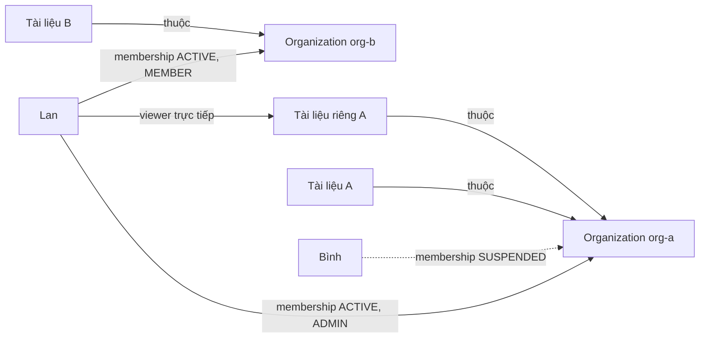
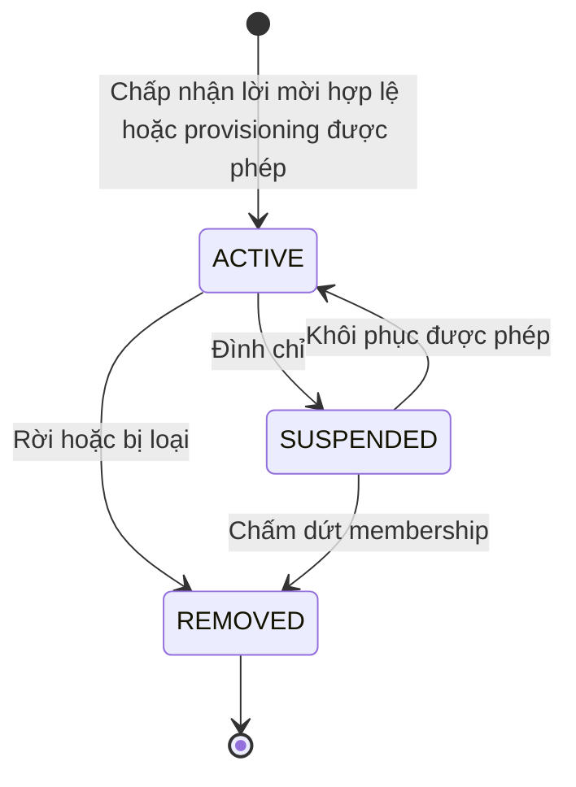

# Organization membership

## 1. Organization membership trong IAM là gì?

Organization membership là quan hệ xác định một chủ thể thuộc về một tổ chức trong ứng dụng. Quan hệ này trả lời câu hỏi: “Người dùng này có tư cách gì trong tổ chức đang được xét, và tư cách đó còn hiệu lực không?”.

Trong hệ thống SaaS phục vụ nhiều khách hàng, một tài khoản có thể tham gia nhiều tổ chức. Lan có thể là quản trị viên của tổ chức An Phát, đồng thời là thành viên thông thường của tổ chức Bình Minh. Hai tư cách đó cùng gắn với một danh tính đăng nhập, nhưng tạo ra các phạm vi quyền khác nhau.

Đăng nhập thành công chứng minh một danh tính theo cơ chế xác thực đã triển khai. Membership bổ sung một quan hệ nghiệp vụ. Quyền đọc tài liệu, mời thành viên hoặc chuyển quyền sở hữu còn phải được xác định từ membership, vai trò và quan hệ với đối tượng cụ thể.

Trong ReBAC — Relationship-Based Access Control, membership thường là một cạnh trong đồ thị quan hệ. Quyền có thể được suy ra từ cạnh ấy khi mô hình phân quyền định nghĩa đường suy luận tương ứng. Tài liệu [User Groups của OpenFGA](https://openfga.dev/docs/modeling/user-groups) minh họa việc gán quyền cho một tập thành viên và kiểm tra quyền của từng người trong tập đó.

Bài học sử dụng một ứng dụng tài liệu B2B tự thiết kế để giải thích membership. Tên trạng thái, trường dữ liệu, chính sách và code trong ví dụ không phải schema bắt buộc của một nhà cung cấp IAM.

## 2. Phân biệt organization, tenant, team và ownership

| Khái niệm | Ý nghĩa trong ví dụ | Không tự suy ra điều gì? |
| --- | --- | --- |
| Organization | Đơn vị hợp tác và quản trị thành viên, chẳng hạn một công ty khách hàng | Không tự tạo quyền trên mọi đối tượng của công ty |
| Tenant | Phạm vi cô lập dữ liệu và hoạt động của ứng dụng | Không nhất thiết luôn trùng một pháp nhân hay một organization |
| Team | Nhóm làm việc bên trong organization | Không tự cấp vai trò quản trị organization |
| Membership | Quan hệ giữa chủ thể và organization, có trạng thái và phạm vi | Không phải thuộc tính toàn cục chỉ có một giá trị |
| Organization role | Vai trò gắn với membership, như `MEMBER`, `ADMIN`, `OWNER` | Không có hiệu lực ở organization khác |
| Resource ownership | Quan hệ sở hữu một tài nguyên, như chủ tài liệu | Không tự cho phép quản lý membership của organization |

Để dễ theo dõi, ví dụ của bài chọn một organization tương ứng một tenant dữ liệu. Đây là quyết định thiết kế của ví dụ. Nếu một sản phẩm có nhiều organization trong cùng tenant hoặc mô hình nhiều cấp, phải mô tả mapping và ranh giới quyền riêng.

Trong cùng một nhà cung cấp danh tính, từ “tenant” còn có thể chỉ vùng cấu hình của nhà cung cấp. Người có quyền quản trị vùng cấu hình đó không đồng nghĩa là quản trị viên của mọi organization khách hàng trong ứng dụng.

Tương tự, organization owner là một vai trò quản trị do sản phẩm định nghĩa. Nó không tự động đồng nghĩa với chủ sở hữu mọi tài liệu. Quyền quản lý thanh toán, thay đổi thành viên, xuất dữ liệu và đọc tài liệu mật có thể cần các capability khác nhau.

## 3. Đặt membership ở đúng nơi trong mô hình dữ liệu

### 3.1. Một người dùng, nhiều membership

Một mô hình khó mở rộng là đặt duy nhất `organizationId` và `role` trên bảng người dùng:

```text
User:
    id = lan
    organizationId = org-a
    role = ADMIN
```

Khi Lan tham gia `org-b`, hệ thống không còn biết role nào áp dụng cho organization nào. Nếu sửa `organizationId`, tư cách cũ có thể mất; nếu giữ một role toàn cục, quyền quản trị có thể bị dùng nhầm ở tổ chức khác.

Mô hình quan hệ tách biệt sẽ diễn đạt rõ hơn:

```text
Principal:
    id
    accountStatus

Organization:
    id
    status

Membership:
    id
    organizationId
    principalId
    state
    roles
    membershipKind
    validUntil
    version
```

Trong ví dụ, `membershipKind` phân biệt nhân viên và khách cộng tác. Nó không tự cấp quyền; policy phải quy định ý nghĩa của từng loại. `validUntil` cho phép membership có thời hạn. `version` hỗ trợ phát hiện thay đổi và kiểm soát dữ liệu cũ.

### 3.2. Ràng buộc danh tính và tính duy nhất

Nên gắn membership với định danh nội bộ ổn định của principal. Nếu liên kết nhiều nhà cung cấp danh tính, backend có thể ánh xạ cặp `(issuer, subject)` đã được kiểm chứng đến principal nội bộ. Không coi chuỗi subject của hai issuer khác nhau là cùng một người.

Email có thể phục vụ liên hệ và gửi lời mời, nhưng có thể thay đổi hoặc được tái cấp. Không dùng email làm bằng chứng duy nhất để tự động ghép tài khoản vào mọi membership lịch sử. Quy trình liên kết tài khoản cần xác minh quyền kiểm soát và chính sách phù hợp.

Một thiết kế giữ một bản ghi membership hiện tại cho mỗi cặp `(organizationId, principalId)` có thể áp dụng unique constraint trên cặp đó. Lịch sử thay đổi được lưu riêng. Nếu thiết kế cho phép nhiều giai đoạn membership, cần định danh giai đoạn và ngăn các trạng thái hiệu lực chồng lấn ngoài ý muốn.

### 3.3. Invitation nên được phân biệt với membership hiệu lực

Ví dụ tách lời mời khỏi membership:

```text
Invitation:
    id
    organizationId
    recipientBinding
    requestedRole
    expiresAt
    status
    tokenVerifier
    version
```

Một invitation ở trạng thái `PENDING` chưa tạo quyền truy cập. Sau khi người nhận xác thực và chấp nhận theo đúng điều kiện, backend mới tạo hoặc chuyển membership thành `ACTIVE`.

Thiết kế khác có thể lưu membership với trạng thái `INVITED`. Điều cốt yếu là logic phân quyền không coi bản ghi được mời là membership đang hoạt động.

## 4. Ví dụ: một danh tính trong hai tổ chức

Giả sử ứng dụng có những bản ghi sau:

| Principal | Organization | Trạng thái membership | Vai trò |
| --- | --- | --- | --- |
| Lan | `org-a` — An Phát | `ACTIVE` | `ADMIN` |
| Lan | `org-b` — Bình Minh | `ACTIVE` | `MEMBER` |
| Bình | `org-a` — An Phát | `SUSPENDED` | `MEMBER` |
| Chi | `org-a` — An Phát | `ACTIVE` | `MEMBER`, loại khách cộng tác |

Một số tài nguyên thuộc hai organization:

| Tài nguyên | Organization sở hữu | Chia sẻ trong ví dụ |
| --- | --- | --- |
| `doc-public-a` | `org-a` | Chia sẻ cho thành viên của `org-a` |
| `doc-private-a` | `org-a` | Chỉ Lan được gán quyền xem trực tiếp |
| `doc-public-b` | `org-b` | Chia sẻ cho thành viên của `org-b` |

Từ dữ liệu này, Lan có thể có quyền quản lý thành viên ở `org-a` nhưng không có quyền tương tự ở `org-b`. Bình không được hưởng quyền của thành viên đang hoạt động ở `org-a`. Chi cần được đánh giá theo chính sách áp dụng cho membership loại khách; nhãn “khách” tự nó chưa quyết định đọc được tài liệu nào.

Đối với các công thức tiếp theo, ví dụ chỉ dùng điều kiện membership đang hoạt động và quyền tài liệu. Nếu sản phẩm cần hạn chế khách cộng tác hơn nhân viên, phải bổ sung điều kiện đó một cách rõ ràng.

## 5. Membership là một cạnh, quyền là một đường suy luận

### 5.1. Biểu diễn đồ thị

Có thể viết quan hệ dưới dạng ký hiệu minh họa:

```text
organization:org-a#member@user:lan
organization:org-b#member@user:lan
document:doc-public-a#organization@organization:org-a
document:doc-private-a#viewer@user:lan
```

Đọc dòng đầu là “Lan có quan hệ member với org-a”. Ký hiệu này chỉ giúp trình bày cạnh; không phải một lệnh API để chép nguyên vào mọi relationship engine.



Cạnh bị đình chỉ vẫn có thể được giữ trong kho nghiệp vụ để phục vụ lịch sử, nhưng không được sử dụng như bằng chứng membership hiệu lực. Nếu relationship store chỉ biểu diễn cạnh đang hiệu lực, bản chiếu sang store đó phải phản ánh trạng thái này.

### 5.2. Công thức truy cập minh họa

Ví dụ chọn chính sách: mọi lần đọc tài liệu nội bộ đều cần membership còn hiệu lực trong organization sở hữu tài liệu, cùng một đường cấp quyền trên tài liệu.

```text
CanRead(user, document, contextOrg) =
    AccountActive(user)
    AND OrganizationActive(contextOrg)
    AND OrganizationOf(document) == contextOrg
    AND ActiveMembership(user, contextOrg)
    AND (
        DirectViewer(user, document)
        OR SharedWithMembers(document, contextOrg)
    )
```

Trong đó:

```text
ActiveMembership(user, org) =
    Membership(user, org).state == ACTIVE
    AND (validUntil không có OR now < validUntil)
```

`SharedWithMembers(document, org)` là một grant rõ ràng cho tập thành viên của organization đó. Việc `document` thuộc `org` không tự tạo ra grant này. Tài liệu riêng tư vẫn có thể thuộc organization mà chỉ một số thành viên được xem.

Với công thức trên, quan hệ viewer trực tiếp không vượt qua điều kiện membership. Khi Lan rời organization, một cạnh viewer còn sót lại không đủ để tiếp tục đọc tài liệu nội bộ. Đây là chính sách được chọn cho bài, không phải quy luật mặc định của mọi hệ thống ReBAC.

Nếu sản phẩm hỗ trợ chia sẻ cho người ngoài organization, cần thiết kế một nhánh cấp quyền bên ngoài riêng, có phạm vi, thời hạn và khả năng thu hồi. Không âm thầm bỏ điều kiện membership của toàn bộ ứng dụng để hỗ trợ một trường hợp ngoại lệ.

### 5.3. Organization context của request

Lan thuộc cả `org-a` và `org-b`, nhưng một request cần biết đang hành động trong phạm vi nào. Không nên lấy hợp của mọi quyền ở mọi organization rồi dùng kết quả đó cho bất kỳ đối tượng nào.

Ví dụ, khi Lan ở context `org-b`, request quản lý thành viên `org-a` cần bị chặn hoặc phải chuyển sang một luồng context được xác minh phù hợp. Role `ADMIN` của `org-a` không được trở thành role `ADMIN` của phiên `org-b`.

OpenFGA có hướng dẫn về việc kết hợp quyền với ngữ cảnh organization trong [Authorization Through Organization Context](https://openfga.dev/docs/modeling/organization-context-authorization). Trong ứng dụng của bài, context là dữ liệu của từng request sau khi backend kiểm tra, không phải một trường `currentOrganization` toàn cục được sửa trên tài khoản.

Hai tab trình duyệt có thể làm việc với hai organization khác nhau. Ghi “organization hiện tại” vào một biến toàn cục hoặc bản ghi dùng chung có thể khiến tab này thay đổi phạm vi của tab kia. Cần ràng buộc context vào request, phiên hoặc token đúng theo thiết kế và kiểm tra lại ở backend.

## 6. Tách membership khỏi vai trò và quyền quản trị

Membership thể hiện sự tham gia; role mô tả một tập khả năng trong phạm vi organization. Có thể biểu diễn role bằng trường trên membership hoặc bằng các quan hệ như `organization#admin`. Trong cả hai cách, phải xác định điều kiện hiệu lực.

Ví dụ chọn quy tắc:

```text
CanManageMembers(actor, targetOrg, contextOrg) =
    AccountActive(actor)
    AND OrganizationActive(targetOrg)
    AND targetOrg == contextOrg
    AND ActiveMembership(actor, targetOrg)
    AND HasRole(actor, targetOrg, ADMIN or OWNER)
```

Điều này chưa nói ADMIN được cấp mọi role. Thao tác tạo thành viên thường và chuyển quyền OWNER có mức ảnh hưởng khác nhau. Ví dụ có thể cho ADMIN mời MEMBER, còn cấp ADMIN hoặc chuyển OWNER yêu cầu capability riêng, xác thực tăng cường và một quy trình cụ thể.

| Thao tác | Điều kiện cần được định nghĩa riêng |
| --- | --- |
| Mời MEMBER | Quyền mời, phạm vi organization, điều kiện người nhận |
| Cấp ADMIN | Ai được cấp vai trò quản trị và có cần phê duyệt không? |
| Đình chỉ thành viên | Ai được đình chỉ ai, có ngoại lệ với owner không? |
| Xóa owner cuối cùng | Cách giữ organization còn người quản trị hợp lệ |
| Chuyển ownership | Xác nhận người nhận, kiểm tra quyền và chuyển đổi nhất quán |
| Tự thay đổi role | Có bị chặn để tránh tự nâng quyền không? |

Owner cuối cùng là một bất biến của thiết kế, không chỉ là kiểm tra trên giao diện. Nếu hai owner đồng thời tự rời organization, hai request cùng đếm thấy còn người khác rồi cùng rời đi có thể để lại organization không owner. Cần bảo vệ bất biến trong giao dịch hoặc cơ chế đồng bộ thích hợp.

Quyền quản trị membership cũng không tự tạo quyền đọc mọi tài liệu bí mật. Nếu sản phẩm cho phép quản trị viên truy cập đặc biệt, đường truy cập đó cần chính sách và dấu vết riêng.

## 7. Vòng đời membership

Ví dụ sử dụng các trạng thái hiệu lực sau:

| Trạng thái | Ý nghĩa | Tạo quyền theo membership trong ví dụ? |
| --- | --- | --- |
| `ACTIVE` | Đã tham gia và chưa bị vô hiệu hóa | Có thể, nếu chưa hết hạn và đáp ứng policy |
| `SUSPENDED` | Tạm đình chỉ tư cách truy cập | Không |
| `REMOVED` | Membership đã kết thúc | Không |

Invitation có vòng đời riêng: `PENDING`, `ACCEPTED`, `EXPIRED`, `REVOKED`. Đây là các tên được tự định nghĩa để giải thích quy trình.



Membership có `validUntil` cũng mất hiệu lực khi tới thời điểm hết hạn, dù một tác vụ nền chưa cập nhật nhãn trạng thái. Không nên đợi cron chạy xong mới ngừng cấp quyền cho membership đã hết thời gian cho phép.

Trong ví dụ, tái gia nhập sau `REMOVED` là một giai đoạn cấp quyền mới. Backend tăng version hoặc tạo membership mới có định danh mới và xét lại role, grant theo team cùng quyền trực tiếp. Không tự khôi phục mọi đặc quyền trước đây chỉ vì cặp user và organization giống nhau.

## 8. Luồng mời và chấp nhận thành viên

### 8.1. Tạo lời mời

Backend xác thực actor, kiểm tra membership của actor trong organization đích và kiểm tra capability cho role được mời. Actor gửi `organizationId` không có nghĩa actor được quản lý organization ấy.

Lời mời cần ràng buộc với organization, người nhận theo cơ chế đã chọn, role được yêu cầu và thời hạn. Nếu dùng token bí mật, cần bảo vệ token khi lưu trữ, truyền tải và ghi log; có thể lưu giá trị kiểm chứng một chiều thay vì lưu nguyên token.

Không nhận payload `{ "role": "OWNER" }` rồi ghi thẳng vào membership chỉ vì actor có quyền mời người dùng thông thường. Backend phải giới hạn role actor được cấp và các điều kiện tương ứng.

### 8.2. Chấp nhận lời mời

Một quy trình minh họa:

```text
1. Xác thực người đang chấp nhận.
2. Kiểm tra token hoặc bằng chứng của invitation.
3. Kiểm tra organization đích còn hoạt động.
4. Kiểm tra lời mời chưa hết hạn, chưa thu hồi, chưa sử dụng.
5. Xác minh danh tính hiện tại khớp điều kiện người nhận.
6. Kiểm tra lại quyền cấp theo chính sách đang áp dụng.
7. Tạo hoặc kích hoạt membership và đánh dấu lời mời đã dùng.
8. Ghi audit và đồng bộ dữ liệu phân quyền theo cơ chế được thiết kế.
```

Điều kiện ở bước 6 cần được công bố. Ví dụ có thể yêu cầu người mời vẫn còn capability cấp role tương ứng, hoặc yêu cầu phê duyệt mới nếu chính sách đã thay đổi. Không mặc định lời mời cũ hợp lệ vô hạn sau khi actor mất quyền.

Thao tác đánh dấu đã dùng và kích hoạt membership cần bảo vệ trước hai lần chấp nhận đồng thời. Có thể dùng giao dịch và cập nhật có điều kiện trên trạng thái cùng version. Nếu membership đã tồn tại, quy trình phải có kết quả idempotent hoặc từ chối rõ ràng, không âm thầm nâng role.

### 8.3. Tự động tham gia qua domain hoặc SSO

Email cùng đuôi tên miền chưa đủ để kết luận người dùng được tham gia organization. Tên miền có thể gắn với nhiều đối tác, tài khoản có thể là khách hoặc doanh nghiệp có quy tắc onboarding riêng.

Tự động tham gia chỉ nên xảy ra theo chính sách provisioning được cấu hình: domain đã được xác minh theo cơ chế của hệ thống, nhà cung cấp danh tính được tin cậy, mapping organization đúng và role mặc định phù hợp. Trạng thái membership cần tiếp tục phản ánh thay đổi từ nguồn có thẩm quyền.

SSO thành công giải quyết một phần xác thực. Nó không tự quyết định mọi quyền trong ứng dụng. Nếu ứng dụng tin một claim để tạo membership, phải xác định issuer, audience, mapping và điều kiện tạo hoặc thu hồi quan hệ đó.

## 9. Kiểm tra một request truy cập tài liệu

Giả sử Lan gọi:

```http
GET /organizations/org-a/documents/doc-private-a
Authorization: Bearer <access-token>
```

Đường dẫn cung cấp organization được chọn. Backend vẫn phải xác thực token, xác định principal và kiểm tra tư cách hiện tại của principal trong organization ấy. Đây cũng là nguyên tắc context tenant được xác minh ở server được nêu trong [OWASP Multi-Tenant Security Cheat Sheet](https://cheatsheetseries.owasp.org/cheatsheets/Multi_Tenant_Security_Cheat_Sheet.html).

Luồng minh họa:

```text
AuthenticatedPrincipal = xác minh token hoặc phiên
SelectedOrg = org-a từ route, được xem là lựa chọn cần kiểm tra
Membership = tìm theo (SelectedOrg, AuthenticatedPrincipal.id)
Organization = lấy trạng thái org-a từ nguồn có thẩm quyền
Document = tìm theo (SelectedOrg, doc-private-a)
Decision = đánh giá membership và quyền tài liệu
Chỉ trả dữ liệu khi Decision cho phép
```

Không cần để client gửi role hoặc trạng thái membership. Nếu client có gửi các trường đó, backend không dùng chúng làm bằng chứng cấp quyền.

Truy vấn tài liệu cần bị ràng buộc với organization đã được xác minh. Cách biểu diễn dữ liệu có thể khác nhau, nhưng một truy vấn SQL minh họa là:

```sql
SELECT id, organization_id, shared_with_members
FROM documents
WHERE organization_id = :verified_organization_id
  AND id = :document_id;
```

Đây là truy vấn lấy metadata cần thiết để đánh giá, không phải một lớp phân quyền hoàn chỉnh. Sau khi xác định organization của tài liệu, vẫn phải kiểm tra quyền tài liệu cụ thể. Parameterized query ngăn một nhóm lỗi chèn lệnh, nhưng không tự chứng minh quyền đối với giá trị organization được truyền vào.

Giữa lúc kiểm tra và lúc lấy nội dung, tài liệu có thể đổi organization hoặc grant. Đường thực thi cần dùng snapshot, version hoặc giao dịch phù hợp với mức nhất quán được yêu cầu. Không kiểm tra một tài liệu rồi dùng mã tài liệu khác ở bước trả dữ liệu.

## 10. Java minh họa điều kiện membership có phạm vi

Ví dụ Java 17 dưới đây minh họa công thức đọc tài liệu đã nêu. Mọi đối tượng đầu vào phải do backend dựng từ danh tính đã xác thực và dữ liệu được tin cậy. Đoạn code không triển khai xác thực token, repository, cache, relationship engine hay quản lý giao dịch.

```java
import java.time.Instant;
import java.util.Objects;
import java.util.Set;

public class OrganizationMembershipExample {
    enum MembershipState { ACTIVE, SUSPENDED, REMOVED }

    record Principal(String id, boolean active) {
        Principal {
            Objects.requireNonNull(id, "id");
        }
    }

    record Organization(String id, boolean active) {
        Organization {
            Objects.requireNonNull(id, "id");
        }
    }

    record Membership(
            String organizationId,
            String principalId,
            MembershipState state,
            Instant validUntil) {
        Membership {
            Objects.requireNonNull(organizationId, "organizationId");
            Objects.requireNonNull(principalId, "principalId");
            Objects.requireNonNull(state, "state");
        }

        boolean activeAt(Instant now) {
            return state == MembershipState.ACTIVE
                    && (validUntil == null || now.isBefore(validUntil));
        }
    }

    record Document(
            String id,
            String organizationId,
            boolean sharedWithMembers,
            Set<String> directViewers) {
        Document {
            Objects.requireNonNull(id, "id");
            Objects.requireNonNull(organizationId, "organizationId");
            directViewers = Set.copyOf(directViewers);
        }
    }

    static boolean canRead(
            Principal principal,
            Organization contextOrganization,
            Membership membership,
            Document document,
            Instant now) {
        Objects.requireNonNull(now, "now");

        if (principal == null || contextOrganization == null
                || membership == null || document == null) {
            return false;
        }

        return principal.active()
                && contextOrganization.active()
                && contextOrganization.id().equals(document.organizationId())
                && contextOrganization.id().equals(membership.organizationId())
                && principal.id().equals(membership.principalId())
                && membership.activeAt(now)
                && (document.sharedWithMembers()
                    || document.directViewers().contains(principal.id()));
    }

    public static void main(String[] args) {
        Instant now = Instant.parse("2026-11-26T03:00:00Z");
        Principal lan = new Principal("user-lan", true);
        Organization orgA = new Organization("org-a", true);
        Organization orgB = new Organization("org-b", true);

        Membership lanA = new Membership(
                "org-a", "user-lan", MembershipState.ACTIVE, null);
        Membership lanB = new Membership(
                "org-b", "user-lan", MembershipState.ACTIVE, null);
        Membership suspendedA = new Membership(
                "org-a", "user-lan", MembershipState.SUSPENDED, null);

        Document privateA = new Document(
                "doc-private-a", "org-a", false, Set.of("user-lan"));

        System.out.println(canRead(lan, orgA, lanA, privateA, now));
        System.out.println(canRead(lan, orgB, lanB, privateA, now));
        System.out.println(canRead(lan, orgA, suspendedA, privateA, now));
        System.out.println(canRead(lan, orgA, lanB, privateA, now));
    }
}
```

Kết quả kỳ vọng:

```text
true
false
false
false
```

Lần gọi thứ nhất đáp ứng membership cùng organization và có grant viewer. Lần hai dùng context khác organization của tài liệu. Lần ba membership bị đình chỉ. Lần bốn cố dùng membership của `org-b` cho tài liệu và context `org-a`.

Điểm quan trọng là kiểm tra cả `membership.principalId` và `membership.organizationId`, không chỉ `state == ACTIVE`. Một bản ghi membership hợp lệ của người khác hoặc của tổ chức khác không phải bằng chứng cho request hiện tại.

Ví dụ dùng Boolean cho ngắn gọn. Trong một dịch vụ thực tế, không tìm thấy membership, membership hết hiệu lực và nguồn dữ liệu timeout cần được phân biệt để ghi log và vận hành. Khi không có đủ bằng chứng cấp quyền, tầng thực thi không được tiếp tục truy cập chỉ vì không có kết quả từ chối rõ ràng.

Thời gian `now` phải đến từ nguồn server được kiểm soát. Cho client gửi thời điểm quá khứ để vượt qua `validUntil` sẽ làm mất ý nghĩa của kiểm tra hạn membership.

## 11. Team membership và kế thừa trong organization

Một organization có thể có nhiều team, mỗi team được chia sẻ một số tài liệu. Khi thêm nhánh quyền theo team, cần giữ ranh giới organization:

```text
TeamGrant(user, document, org) =
    có team T sao cho:
        TeamOrganization(T) == org
        AND MemberOfTeam(user, T)
        AND SharedWithTeam(document, T)

CanRead = các điều kiện chung về tài khoản, organization và membership
          AND (DirectViewer OR SharedWithMembers OR TeamGrant)
```

Team membership cần là quan hệ được quản lý, không phải danh sách team do client tự khai. Nếu cho team lồng nhau, phải quy định quan hệ nào được suy luận, giới hạn độ sâu, cách ngăn chu trình và tác động khi một team đổi organization.

Một quan hệ “organization mẹ–organization con” cũng không mặc định có tính kế thừa quyền. Người dùng là thành viên organization mẹ không tự động trở thành thành viên mọi organization con. Nếu sản phẩm cần khả năng này, mô hình phải định nghĩa đường suy luận và những loại quyền có thể đi qua đường đó.

Tài liệu [Parent-Child Objects của OpenFGA](https://openfga.dev/docs/modeling/parent-child) trình bày cách một quan hệ trên đối tượng cha ảnh hưởng đến quyền trên đối tượng con theo authorization model. Trong ví dụ của bài, việc chọn kế thừa hay không vẫn là quyết định nghiệp vụ cần được viết thành policy.

Không dùng cùng một nhãn `owner` cho team owner, organization owner và document owner rồi mặc định chúng trao quyền thay thế cho nhau. Mỗi quan hệ cần gắn với loại đối tượng và thao tác mà nó quản lý.

## 12. Nguồn dữ liệu có thẩm quyền và bản chiếu ReBAC

Membership có thể được quản lý ở ứng dụng, hệ thống cấp phát danh tính hoặc kho quan hệ chuyên dụng. Điều cần xác định trước là nơi nào quyết định sự thật khi hai nguồn khác nhau.

Ví dụ chọn bảng membership nghiệp vụ làm nguồn có thẩm quyền. Relationship store chỉ giữ bản chiếu các quan hệ đang hiệu lực để kiểm tra đồ thị nhanh hơn. Việc phân định nơi lưu dữ liệu nghiệp vụ và dữ liệu phân quyền cũng được bàn trong [OpenFGA: Source of Truth](https://openfga.dev/docs/best-practices/source-of-truth).

Một quy trình đồng bộ minh họa:

```text
Giao dịch nghiệp vụ:
    cập nhật membership + tăng version
    ghi sự kiện vào outbox

Consumer:
    nhận sự kiện
    kiểm tra organization, membershipId, generation và version
    cập nhật hoặc xóa cạnh tương ứng trong relationship store
    ghi nhận việc áp dụng theo cơ chế idempotent
```

Outbox giúp lưu thay đổi nghiệp vụ cùng sự kiện cần gửi trong một giao dịch của kho nguồn. Nó không làm hai kho dữ liệu trở thành một giao dịch nguyên tử. Vẫn cần retry, xử lý trùng, kiểm soát thứ tự và đối soát.

Ví dụ membership ở version 12 bị loại, nhưng consumer sau đó nhận lại sự kiện version 11 tạo membership. Nếu consumer không phát hiện dữ liệu cũ, người dùng có thể bị thêm lại ngoài ý muốn. Có thể dùng thứ tự sự kiện theo membership, version fencing ở lớp điều phối hoặc cơ chế tương đương đã được thiết kế; không giả định mọi relationship engine đều tự cung cấp compare-and-set cho version ứng dụng.

Nếu tạo một giai đoạn membership mới, cần generation hoặc định danh mới để phân biệt với giai đoạn đã bị loại. Một consumer chỉ thấy version bắt đầu lại từ 1 có thể hiểu sai thứ tự nếu không có định danh giai đoạn.

Quan trọng hơn, phải xác định chính sách đọc trong lúc hai kho chưa đồng bộ. Với ví dụ yêu cầu đình chỉ có hiệu lực tại nguồn trước khi cập nhật đồ thị, backend có thể kiểm tra membership hiện tại ở nguồn có thẩm quyền như một guard bắt buộc, sau đó mới xét grant trong đồ thị.

Cách này có chi phí và không tự bảo đảm nhất quán tuyệt đối giữa nhiều dịch vụ. Nếu guard cũng dùng cache, độ trễ của cache phải được tính vào cam kết thu hồi. Không tuyên bố thu hồi tức thì chỉ vì một sự kiện đã được đưa vào hàng đợi.

## 13. Thu hồi membership và quyền còn sót lại

Giả sử Lan bị loại khỏi `org-a`, nhưng các dữ liệu sau vẫn tồn tại:

```text
Access token cũ chưa hết hạn.
Cạnh document:doc-private-a#viewer@user:lan chưa bị xóa.
Cache quyết định đọc tài liệu còn Permit.
Job xuất tài liệu đang chờ trong hàng đợi.
WebSocket vẫn đang mở.
```

Xóa một hàng membership không bảo đảm các đường truy cập trên cùng ngừng ngay. Cần xét nơi nào tái kiểm tra membership, nơi nào dùng quyết định cũ và giới hạn thời gian hiệu lực của từng cơ chế.

Trong mô hình bài này, điều kiện `ActiveMembership` bắt buộc giúp chặn grant trực tiếp còn sót khi dữ liệu kiểm tra membership đủ mới. Tuy nhiên, nếu Lan tái gia nhập, các grant cũ ấy có thể lại tạo quyền. Vì vậy cần dọn grant hoặc gắn chúng với membership generation theo chính sách được chọn.

| Kênh | Câu hỏi cần giải quyết khi thu hồi |
| --- | --- |
| Request HTTP mới | Có kiểm tra membership hiện tại hay chỉ tin token cũ? |
| Refresh token hoặc phiên | Có ngừng cấp phiên hoặc context organization mới không? |
| Cache quyền | Cách vô hiệu hóa và độ trễ tối đa là bao nhiêu? |
| Relationship store | Consumer đã xóa cạnh chưa, có thể bị event cũ thêm lại không? |
| WebSocket và luồng dữ liệu | Khi nào kiểm tra lại, ngắt hoặc giảm quyền của kết nối? |
| Job nền | Kiểm tra quyền lúc tạo job, lúc thực thi hay cả hai? |
| API key và workload identity | Credential đó thuộc chủ thể nào và có phạm vi organization gì? |

Không tự động xóa service account của tổ chức chỉ vì người tạo tài khoản ấy rời tổ chức. Danh tính workload cần ownership và vòng đời được định nghĩa riêng. Ngược lại, credential thực sự đại diện cho người dùng phải được xét theo chính sách thu hồi quyền của người dùng đó.

Đối với job chạy thay người dùng, ví dụ có thể yêu cầu kiểm tra lại membership ở thời điểm thực thi. Một job vận hành bằng danh tính dịch vụ được ủy quyền độc lập cần được đánh giá theo đúng mô hình ủy quyền của nó, không giả dạng người dùng bằng một membership đã hết hiệu lực.

## 14. Cache, token và mức nhất quán

### 14.1. Cache membership theo đủ phạm vi

Khóa chỉ có `userId` không thể phân biệt Lan là ADMIN ở `org-a` và MEMBER ở `org-b`. Cache membership ít nhất cần biểu diễn phạm vi organization cùng principal, và cần cơ chế hạn hiệu lực phù hợp.

```text
membership-cache-key = organizationId + principalId

authorization-cache-key có thể cần thêm:
    action + resourceId + membershipVersion
    + resourceVersion + policyVersion + sessionContext
```

Nếu version không thể được tra cứu mà vẫn bảo đảm hiệu năng, phải nêu rõ giới hạn của cache thay vì giả định version tự cập nhật. Membership có thời hạn thì cache không được giữ hiệu lực vượt `validUntil`. Độ trễ phát tán vô hiệu hóa và đồng bộ giữa instance đều ảnh hưởng đến thời gian thu hồi thực tế.

### 14.2. Token mang thông tin tổ chức

Một token có claim organization đã được ký có thể giúp ràng buộc context theo thiết kế. Backend vẫn phải kiểm tra các điều kiện xác thực token cần thiết và hiểu claim đó bảo đảm điều gì. Chữ ký hợp lệ không chứng minh membership chưa thay đổi sau lúc token được phát hành.

Không đưa toàn bộ role của mọi organization vào một mảng `roles` chung rồi dùng `contains("ADMIN")` để quản lý organization hiện tại. Cần giữ cặp phạm vi và role, hoặc phát hành context phù hợp với cách ứng dụng kiểm tra quyền.

Chuyển organization trên giao diện có thể cần đổi token hoặc chỉ cần tạo request có context mới được backend xác minh; điều đó phụ thuộc mô hình phiên. Dù dùng cách nào, giá trị lựa chọn từ client phải đi qua kiểm tra tư cách tương ứng.

### 14.3. Đọc dữ liệu quan hệ mới đến mức nào?

Một số engine có tùy chọn đánh đổi độ trễ và độ mới. Chẳng hạn [Query Consistency Modes của OpenFGA](https://openfga.dev/docs/interacting/consistency) phân biệt chế độ ưu tiên cache với chế độ truy vấn trực tiếp cơ sở dữ liệu của engine.

Chọn chế độ đọc mới hơn ở relationship store không sửa được sự kiện membership chưa được chuyển từ kho nghiệp vụ sang store. Độ mới cần được xét trên cả chuỗi: cập nhật nguồn, phát sự kiện, consumer, kho quan hệ, cache phía ứng dụng và quyết định đang được sử dụng.

## 15. Quản trị, kiểm toán và xử lý yêu cầu đồng thời

Thay đổi membership là một thao tác thay đổi quyền. Backend cần ghi actor thực hiện, organization, principal bị tác động, hành động, trạng thái trước–sau, role trước–sau, version và kết quả.

```json
{
  "eventType": "membership.suspended",
  "organizationId": "org-a",
  "membershipId": "membership-72",
  "targetPrincipalId": "user-binh",
  "actorPrincipalId": "user-lan",
  "before": { "state": "ACTIVE", "version": 6 },
  "after": { "state": "SUSPENDED", "version": 7 },
  "requestId": "req-301",
  "outcome": "APPLIED"
}
```

Không ghi token mời, access token hoặc bí mật xác thực vào audit. Người quản trị `org-a` cũng không được đọc log membership của `org-b` chỉ vì có role ADMIN ở một nơi.

Một API cập nhật có thể nhận expected version và chỉ áp dụng nếu bản ghi chưa thay đổi. Khi version khác, backend trả kết quả xung đột phù hợp và yêu cầu đọc lại thay vì ghi đè thay đổi mới hơn. Version check chỉ bảo vệ bất biến đã được gắn với bản ghi hoặc giao dịch; bất biến owner cuối cùng cần cơ chế kiểm soát trên tập owner của organization.

Cũng phải xử lý trường hợp actor bị thu hồi quyền trong lúc đang thay đổi membership của người khác. Kiểm tra ở đầu request và ghi rất lâu sau đó có thể tạo khoảng trống. Có thể kiểm tra lại hoặc dùng giao dịch và ràng buộc phù hợp với cách lưu quyền; hệ thống phân tán cần công bố giới hạn nhất quán thực tế.

Trong thiết kế chống tự nâng quyền, trường actor phải lấy từ danh tính đã xác thực, không lấy `actorId` do client gửi. Tách API sửa thông tin hồ sơ với API thay đổi role giúp tránh việc một payload cập nhật thông thường vô tình ghi vào trường quyền.

## 16. Ma trận kiểm thử cho organization membership

Đây là các tình huống đề xuất để kiểm thử thiết kế, không phải báo cáo rằng code và hạ tầng trong bài đã được chạy.

| Tình huống | Kết quả mong đợi theo mô hình bài |
| --- | --- |
| Lan active ở `org-a`, tài liệu chia sẻ cho member `org-a` | Cho đọc khi các điều kiện chung hợp lệ |
| Lan là member nhưng tài liệu riêng không có grant cho Lan | Từ chối |
| Lan có viewer trực tiếp nhưng membership bị đình chỉ | Từ chối |
| Lan ở context `org-b`, đọc tài liệu của `org-a` | Từ chối |
| Dùng membership active của người khác | Từ chối |
| Dùng membership active của organization khác | Từ chối |
| Lan ADMIN ở `org-a` nhưng MEMBER ở `org-b`, mời người vào `org-b` | Từ chối nếu MEMBER không có capability mời |
| Chấp nhận lời mời hết hạn hoặc bị thu hồi | Không kích hoạt membership |
| Hai request đồng thời dùng một invitation | Không tạo hai membership hoặc nâng role ngoài ý muốn |
| `validUntil` đúng bằng thời điểm hiện tại | Hết hiệu lực theo khoảng thời gian đã chọn |
| Loại thành viên rồi nhận event cũ thêm lại | Không khôi phục quyền từ event cũ |
| Rời rồi tái gia nhập | Không tự phục hồi grant lịch sử ngoài chính sách |
| Hai owner đồng thời rời organization | Bất biến có owner hợp lệ được bảo vệ |
| Hai tab dùng hai organization | Context không trộn lẫn giữa request |
| Cache còn dữ liệu cũ sau đình chỉ | Hành vi đáp ứng đúng cam kết độ trễ thu hồi |
| Nguồn membership timeout | Không cấp quyền chỉ vì thiếu kết quả kiểm tra |

Cần kiểm tra đường gọi backend trực tiếp, API thay đổi role, tải tệp, xuất dữ liệu và các tác vụ chạy nền có liên quan. Một màn hình hiển thị đúng danh sách organization chưa chứng minh mọi endpoint đã giữ đúng ranh giới.

Đối với các truy vấn danh sách, kiểm tra cả phạm vi organization và điều kiện chia sẻ. Nếu lấy mọi tài liệu trong organization rồi trả cả số lượng, preview hoặc đường dẫn tải trước khi lọc quyền, thông tin của tài liệu riêng có thể đã bị lộ.

## 17. Những sai lầm thường gặp

| Sai lầm | Vấn đề | Cách biểu đạt đúng hơn |
| --- | --- | --- |
| Đặt một role ADMIN toàn cục cho người dùng B2B | Quyền quản trị bị dùng nhầm ở organization khác | Role gắn với membership và organization cụ thể |
| Mặc định member xem được mọi tài nguyên | Tài liệu riêng trở thành tài liệu chung | Membership là điều kiện nền, grant tài nguyên được xét riêng |
| Chỉ kiểm tra `state == ACTIVE` | Dùng nhầm membership của người khác hoặc organization khác | Kiểm tra principal, organization, trạng thái và thời hạn |
| Coi email domain là membership đã được phê duyệt | Người chưa được phép có thể được thêm tự động | Có chính sách provisioning và xác minh nguồn rõ ràng |
| Tạo cạnh member ngay khi gửi lời mời | Người chưa chấp nhận đã hưởng quyền | Chỉ đưa membership hiệu lực vào đường cấp quyền |
| Xóa membership nhưng bỏ qua cache và token | Quyền cũ tiếp tục tồn tại qua đường khác | Thiết kế thu hồi trên từng kênh và đo độ trễ |
| Bỏ qua grant trực tiếp còn sót khi tái gia nhập | Đặc quyền cũ tự xuất hiện lại | Dọn grant hoặc ràng buộc theo giai đoạn membership |
| Để consumer áp dụng event không theo version | Event cũ có thể phục hồi cạnh bị xóa | Kiểm soát generation, thứ tự và tính idempotent |

## 18. Bài tập tự kiểm tra

1. Lan là ADMIN ở tổ chức A và MEMBER ở tổ chức B. Vì sao `roles.contains("ADMIN")` không đủ để cho Lan mời thành viên vào B?
2. Một tài liệu thuộc A nhưng chỉ chia sẻ trực tiếp cho Bình. Chi là member active của A. Theo công thức của bài, Chi có được đọc không?
3. Bình bị đình chỉ membership nhưng cạnh viewer chưa bị xóa. Điều kiện nào trong công thức chặn Bình, và điều gì xảy ra nếu nguồn membership còn bị cache cũ?
4. Lời mời được gửi trước lúc người mời mất quyền quản trị. Hệ thống cần công bố những điều kiện nào khi người nhận chấp nhận lời mời?
5. Tại sao đọc trực tiếp cơ sở dữ liệu của relationship engine chưa bảo đảm thấy membership vừa bị xóa ở kho nghiệp vụ?
6. Khi một người rời rồi quay lại organization, những grant và credential nào cần được xét lại trước khi khôi phục quyền?

Gợi ý đối chiếu: quyền quản trị phải gắn với organization của thao tác; membership không tự cấp quyền tài liệu riêng; guard membership chỉ hữu ích khi dữ liệu có độ mới đáp ứng yêu cầu. Đồng bộ hai kho và tái gia nhập đều cần chính sách rõ về version, hiệu lực và quyền lịch sử.

Một membership đáng tin cần có đúng chủ thể, đúng organization, trạng thái còn hiệu lực và nguồn quản trị rõ ràng. Trong ReBAC, những thông tin ấy phải được đặt vào đường suy luận cấp quyền có phạm vi, rồi tiếp tục được tôn trọng trong thực thi, cache và thu hồi.
