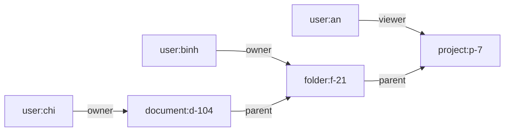

# Parent-child resource

## 1. Quan hệ cha–con trong phân quyền tài nguyên

**Parent-child resource** là cách mô hình hóa một tài nguyên nằm trong phạm vi quản lý của tài nguyên khác. Trong ReBAC, quan hệ giữa hai đối tượng có thể trở thành một đường suy ra quyền truy cập: người dùng có quyền trên tài nguyên cha có thể được hưởng một số quyền trên tài nguyên con nếu policy định nghĩa như vậy.

Ví dụ, hệ thống cộng tác có cấu trúc:

```text
project:p-7
└── folder:f-21
    ├── document:d-104
    └── document:d-105
```

Người dùng được cấp quyền xem dự án có thể được phép xem tài liệu bên trong. Tuy nhiên, điều đó không tự động cho họ quyền sửa tài liệu, xóa thư mục hoặc chuyển tài liệu sang dự án khác.

Điểm quan trọng là tách hai ý:

- **Quan hệ cấu trúc:** tài liệu có thư mục cha; thư mục có dự án cha.
- **Quy tắc phân quyền:** quyền nào trên cha được dùng để suy ra quyền nào trên con.

Một cạnh có tên `parent` chỉ biểu diễn dữ kiện quan hệ. Nó không mang sẵn ngữ nghĩa “kế thừa mọi quyền”. Hệ thống phải định nghĩa phép suy ra trong authorization model. OpenFGA mô tả parent-child như một dạng quan hệ giữa đối tượng, kết hợp với model để làm quyền trên một đối tượng ảnh hưởng đến đối tượng khác. [OpenFGA, Parent-Child Objects](https://openfga.dev/docs/modeling/parent-child)

Bài học này đặt quan hệ cha–con trong nền tảng IAM: danh tính đã được xác thực, quyền trên từng tài nguyên, ownership, ít quyền nhất và vòng đời cấp hoặc thu hồi quyền. Các ví dụ là quy tắc thiết kế minh họa, không phải hành vi mặc định của mọi sản phẩm ReBAC.

## 2. Một quan hệ cấu trúc, nhiều lựa chọn chính sách

Giả sử An là người xem dự án `p-7`; Bình là chủ sở hữu thư mục `f-21`; Chi là chủ sở hữu tài liệu `d-104`.

```text
An   --viewer--> project:p-7
Bình --owner---> folder:f-21
Chi  --owner---> document:d-104

document:d-104 --parent--> folder:f-21
folder:f-21    --parent--> project:p-7
```

Trong biểu diễn trên, mũi tên `parent` đi từ con đến cha: từ tài liệu tìm thư mục cha, rồi từ thư mục tìm dự án cha. Trong giao diện người dùng, cây thường được vẽ từ cha xuống con. Hai cách vẽ không mâu thuẫn; chúng phục vụ hai cách đọc khác nhau.

Cần công bố quy ước hướng cạnh trước khi viết tuple hoặc giải thích kết quả. Nếu đảo nhầm đối tượng và chủ thể của một tuple, dữ liệu có thể không tạo đường cấp quyền mong muốn, hoặc tạo một đường hoàn toàn khác.

### 2.1. Chính sách xuyên suốt của bài

Ta chọn các quy tắc sau để phân tích:

| Tài nguyên | Quyền xem | Quyền sửa nội dung | Quyền tạo tài nguyên con |
|---|---|---|---|
| Project | Owner hoặc viewer trực tiếp | Ngoài phạm vi ví dụ | Owner được tạo folder |
| Folder | Owner, viewer trực tiếp hoặc người được xem project cha | Ngoài phạm vi ví dụ | Owner được tạo document |
| Document | Owner, editor, viewer trực tiếp hoặc người được xem folder cha | Owner hoặc editor trực tiếp | Không có tài nguyên con trong ví dụ |

Ngoài ra, owner trực tiếp của document được yêu cầu di chuyển document. Thao tác di chuyển còn cần quyền ở thư mục nguồn và thư mục đích; phần sau sẽ phân tích điều kiện này.

Với lựa chọn đó, An có thể xem `d-104` nhờ quyền xem project. An không được sửa `d-104` vì đường kế thừa của quyền sửa chưa được định nghĩa.

Bình được xem `d-104` vì là owner của folder cha. Bình không tự động trở thành owner của tài liệu. Chi vẫn là owner trực tiếp của tài liệu và có quyền sửa tài liệu theo policy.

### 2.2. Ownership và containment là hai quan hệ khác nhau

`document --parent--> folder` nói tài liệu thuộc container nào. `document --owner--> user` nói ai giữ vai trò owner trực tiếp theo mô hình của ứng dụng.

Hai quan hệ này trả lời hai câu hỏi khác nhau. Di chuyển tài liệu sang folder khác không nhất thiết đổi owner; đổi owner cũng không nhất thiết thay folder cha.

Nếu sản phẩm muốn owner của project quản trị mọi tài nguyên con, cần định nghĩa quyền quản trị được suy ra rõ ràng. Không nên đổi nghĩa của mọi quan hệ owner thành “owner trực tiếp hoặc bất kỳ người nào quản trị tổ tiên” mà vẫn dùng tên đó cho giao diện chuyển quyền sở hữu.

Một cách giữ nghĩa rõ là tách `owner` trực tiếp khỏi quyền tính toán như `can_manage`, `can_view` hoặc `can_edit`. Khi điều tra ai có thể truy cập, hệ thống có thể giải thích cả đường trực tiếp lẫn đường qua cha mà không đánh đồng chúng.

## 3. Quyền kế thừa đi theo hành động cụ thể

Một mô tả trừu tượng cho quyền xem document trong ví dụ:

```text
View(document)
    = DirectOwner(document)
      ∪ DirectEditor(document)
      ∪ DirectViewer(document)
      ∪ View(ParentFolder(document))

View(folder)
    = DirectOwner(folder)
      ∪ DirectViewer(folder)
      ∪ View(ParentProject(folder))
```

Ký hiệu `∪` là hợp các tập chủ thể. Nếu người dùng xuất hiện trong ít nhất một tập được phép, họ thuộc tập có quyền xem theo công thức này.

Quyền sửa được định nghĩa riêng:

```text
Edit(document)
    = DirectOwner(document)
      ∪ DirectEditor(document)
```

Không có `Edit(parent)` trong biểu thức, nên quyền sửa không lan từ cha xuống con. Đây là một lựa chọn có chủ ý để quyền xem trên phạm vi rộng không biến thành khả năng thay đổi toàn bộ nội dung.

Các engine ReBAC có cách diễn đạt phép đi qua quan hệ và phép kết hợp tập riêng. Chẳng hạn, SpiceDB có toán tử mũi tên để đi từ quan hệ trên đối tượng đến permission của đối tượng liên quan. Không nên sao chép cú pháp giữa các engine rồi giả định ngữ nghĩa giống nhau. [SpiceDB, Schema Language Reference](https://authzed.com/docs/spicedb/concepts/schema)

### 3.1. Có quyền trên con không suy ra quyền trên cha

Nếu Dũng được cấp viewer trực tiếp trên `document:d-104`, công thức trên cho phép Dũng xem tài liệu đó. Nó không cho phép Dũng xem `folder:f-21`, `project:p-7` hoặc tài liệu `d-105`.

Một sản phẩm có thể cho người dùng mở một tài liệu được chia sẻ qua liên kết mà không được liệt kê thư mục chứa tài liệu. Khi đó, breadcrumb phải được thiết kế để không tự tiết lộ tên thư mục hoặc dự án bị hạn chế.

Nếu cần quyền điều hướng tối thiểu trên cha, hãy mô hình hóa hành động riêng như `can_discover` hoặc `can_traverse`. Không dùng quyền xem một tài liệu để suy ra quyền liệt kê toàn bộ tài nguyên cùng cấp.

### 3.2. Sửa con không có nghĩa được thay đổi đường cấp quyền

Editor của document được sửa nội dung theo ví dụ. Nếu editor được tự thay `parent`, họ có thể chuyển tài liệu nhạy cảm vào một folder có tập viewer rộng hơn.

Do đó, thay parent là một thao tác quản trị có ảnh hưởng phân quyền. Quyền sửa nội dung, quyền chia sẻ, quyền chuyển owner và quyền di chuyển cần được phân biệt khi yêu cầu sản phẩm khác nhau.

Ví dụ này chỉ cho owner document yêu cầu di chuyển, đồng thời yêu cầu quyền điều khiển container nguồn và đích. Một sản phẩm khác có thể dùng vai trò quản trị riêng, nhưng không nên để quyền thay cấu trúc phát sinh ngầm từ một endpoint cập nhật nội dung.

## 4. Cây tài nguyên không đồng nhất với đồ thị cấp quyền

Cấu trúc project–folder–document trong ví dụ là một cây: mỗi tài nguyên con có đúng một cha cấu trúc đang hoạt động. Nhưng đồ thị phân quyền còn chứa quan hệ với user và có thể chứa group, tổ chức hoặc các quan hệ chia sẻ khác.



Khi kiểm tra An có thể xem document không, hệ thống không chỉ xem owner trực tiếp của document. Nó giải biểu thức quyền xem và đi qua các quan hệ cha đã được khai báo.

### 4.1. Phân cấp lưu trữ, hiển thị và phân quyền có thể khác nhau

Một tài liệu có thể được gắn nhiều nhãn, xuất hiện trong nhiều collection hoặc có shortcut ở nhiều folder. Không phải mọi quan hệ hiển thị đó đều nên trở thành cạnh `parent` cấp quyền.

Nếu đưa tài liệu vào một collection công khai cũng làm tài liệu nhận quyền xem từ collection, thao tác tổ chức giao diện đã trở thành thao tác chia sẻ dữ liệu. Điều này chỉ đúng khi sản phẩm chủ ý chọn ngữ nghĩa đó.

Có thể tách các quan hệ:

```text
parent          Container cấu trúc có ảnh hưởng phân quyền
tagged_with     Nhãn phân loại, không tự cấp quyền
shortcut_to     Liên kết điều hướng, không tự cấp quyền đích
related_to      Liên hệ nghiệp vụ, không tự cấp quyền
```

Tên quan hệ chỉ là tên. Điều quyết định vẫn là permission nào tham chiếu đến quan hệ đó trong policy.

### 4.2. Một hay nhiều cha?

Nếu document có hai cha và quyền xem được lấy theo phép hợp, chỉ cần một trong hai cha cho phép là người dùng có thể xem document.

```text
document:d-104 --parent--> folder:restricted
document:d-104 --parent--> folder:general

View(d-104)
    chứa View(restricted) ∪ View(general)
```

Thêm cạnh đến `folder:general` có thể làm rộng quyền dù cạnh đến folder hạn chế vẫn còn. Việc người dùng không có quyền ở một cha không tự đóng vai trò phủ quyết quyền nhận từ cha khác.

Nếu nghiệp vụ yêu cầu “thỏa tất cả phạm vi”, phải thiết kế điều kiện giao hoặc ràng buộc tương ứng theo ngữ nghĩa engine. Đó là một chính sách khác, không phải hệ quả tự nhiên của việc đặt nhiều cha.

Trong bài, ứng dụng chọn đúng một parent cho mỗi document và một project cha cho mỗi folder. Ràng buộc này giúp thao tác di chuyển và giải thích quyền đơn giản hơn, nhưng phải được thực thi ở đường ghi dữ liệu.

## 5. Các bất biến cần giữ cho cấu trúc cha–con

Authorization model thường mô tả loại đối tượng được tham gia một quan hệ và cách tính quyền. Những yêu cầu dữ liệu như “đúng một cha”, “cha còn tồn tại” hoặc “cùng tenant” cần được xác định và kiểm soát bổ sung theo khả năng của hệ thống.

Với ví dụ này, các bất biến là:

| Bất biến | Ý nghĩa |
|---|---|
| Đúng loại cha | Document chỉ có folder cha; folder chỉ có project cha |
| Một cha cấu trúc đang hoạt động | Không tồn tại đồng thời hai đường chứa ngoài ý định |
| Cha tồn tại và hoạt động | Không cấp quyền qua container bị xóa hoặc chưa hoàn tất tạo |
| Cùng ranh giới tenant | Không nối tài nguyên của hai tenant bằng đường cấp quyền |
| Không có chu trình cấu trúc | Nếu mở rộng folder lồng nhau, không cho một folder trở thành tổ tiên của chính nó |
| Ghi quan hệ có thẩm quyền | Chỉ service và người dùng có quyền quản trị tương ứng được thay cạnh |
| Định danh không bị tái dùng sai | Quan hệ cũ không vô tình gắn vào đối tượng mới mang lại cùng ID |

Một khóa ngoại trong cơ sở dữ liệu nghiệp vụ có thể giúp kiểm tra tồn tại ở cơ sở dữ liệu đó. Nó không tự bảo đảm đồ thị quan hệ ở một dịch vụ khác đã được cập nhật đồng bộ.

Tương tự, khai báo `parent: [folder]` trong model chỉ giới hạn kiểu chủ thể có thể được gán vào quan hệ; không nên suy ra nó bảo đảm đúng một tuple parent hoặc folder cùng tenant. Cần đọc hợp đồng của engine và thực thi phần bất biến còn lại ở service quản lý tài nguyên.

## 6. Model minh họa với OpenFGA

Model sau dùng DSL của OpenFGA, khai báo schema 1.1 và ba tầng tài nguyên. Nó mô tả các đường cấp quyền của ví dụ; không bao gồm kiểm tra trạng thái tài khoản, tenant hay tính sẵn sàng của đối tượng.

```text
model
  schema 1.1

type user

type project
  relations
    define owner: [user]
    define viewer: [user]
    define can_view: owner or viewer
    define can_create_folder: owner

type folder
  relations
    define parent: [project]
    define owner: [user]
    define viewer: [user]
    define can_view: owner or viewer or can_view from parent
    define can_create_document: owner
    define can_attach_document: owner
    define can_detach_document: owner

type document
  relations
    define parent: [folder]
    define owner: [user]
    define editor: [user]
    define viewer: [user]
    define can_view: owner or editor or viewer or can_view from parent
    define can_edit: owner or editor
    define can_delete: owner
    define can_move: owner
```

Ở đây, `can_view from parent` trên document nghĩa là tìm các folder được gán trực tiếp vào quan hệ parent, rồi dùng `can_view` của những folder đó. `can_view` của folder lại có thể được suy ra từ project cha. Đây là cơ chế tham chiếu quan hệ trên đối tượng liên quan, không phải sao chép các viewer của cha vào từng con. [OpenFGA, Parent-Child Objects](https://openfga.dev/docs/modeling/parent-child)

### 6.1. Dữ kiện quan hệ cụ thể

Bảng dưới dùng tên trường `user`, `relation`, `object` của relationship tuple. Trong một quan hệ giữa hai tài nguyên, trường `user` có thể chứa định danh một đối tượng khác; không có nghĩa đối tượng đó là một con người.

| user | relation | object |
|---|---|---|
| `user:an` | `viewer` | `project:p-7` |
| `project:p-7` | `parent` | `folder:f-21` |
| `user:binh` | `owner` | `folder:f-21` |
| `folder:f-21` | `parent` | `document:d-104` |
| `user:chi` | `owner` | `document:d-104` |
| `user:dung` | `viewer` | `document:d-104` |
| `folder:f-21` | `parent` | `document:d-105` |
| `user:lan` | `owner` | `document:d-105` |

Đọc dòng thứ tư: folder `f-21` là parent của document `d-104`. Nếu đổi vị trí user và object, đó không còn là cùng dữ kiện.

Các tuple ở đây gán vai trò trực tiếp như `owner` hoặc `viewer`, hoặc gán quan hệ cấu trúc `parent`. Ứng dụng kiểm tra permission tính toán như `can_view`; không cần ghi một tuple `can_view` riêng cho từng người dùng trên từng tài liệu.

### 6.2. Lần theo một quyết định

Để biết An có được xem `document:d-104` không:

```text
can_view(user:an, document:d-104)
  → không có owner/editor/viewer trực tiếp phù hợp
  → document:d-104 có parent là folder:f-21
  → xét can_view(user:an, folder:f-21)
      → không có owner/viewer trực tiếp phù hợp
      → folder:f-21 có parent là project:p-7
      → xét can_view(user:an, project:p-7)
          → user:an là viewer trực tiếp
  → có một đường cấp quyền hợp lệ
```

Để biết An có được sửa `d-104` không, hệ thống dùng `can_edit`. Biểu thức đó chỉ xét owner hoặc editor trực tiếp. Đường qua folder và project không được tham chiếu, nên không tạo quyền sửa.

Từ cùng bộ dữ kiện, kết quả kỳ vọng ở tầng model là:

| Chủ thể | Kiểm tra | Kết quả kỳ vọng | Căn cứ |
|---|---|---|---|
| An | Xem `d-104` | Cho phép | Viewer của project tổ tiên |
| An | Sửa `d-104` | Từ chối | Không có owner/editor trực tiếp |
| Bình | Xem `d-104` | Cho phép | Owner của folder cha |
| Bình | Sửa `d-104` | Từ chối | Owner folder không nằm trong biểu thức sửa document |
| Chi | Sửa `d-104` | Cho phép | Owner trực tiếp |
| Dũng | Xem `d-104` | Cho phép | Viewer trực tiếp |
| Dũng | Xem `f-21` | Từ chối | Quyền trên con không đi ngược lên cha |
| Dũng | Xem `d-105` | Từ chối | Không có đường cấp quyền đến tài liệu cùng cấp |

Các kết quả này giả định không có tuple nào khác ngoài dữ kiện minh họa. Chúng là dự kiến học tập của model, không phải báo cáo chạy thử một authorization server.

### 6.3. Model chưa phải toàn bộ quyết định của ứng dụng

Trong nền tảng nhiều tenant của bài, quyết định cuối cùng có thể được tổ chức như sau:

```text
allow =
    danh tính đã được xác thực
    AND tài khoản đang hoạt động
    AND chủ thể đủ điều kiện sử dụng tenant của request
    AND tài nguyên tồn tại và đang hoạt động
    AND đường cha-con nằm trong ranh giới tenant hợp lệ
    AND kiểm tra can_<action> trên tài nguyên được phép
```

Đây là các điều kiện của ví dụ. Có thể đưa một phần vào model ReBAC hoặc đánh giá ở lớp policy khác, miễn mọi đường truy cập đều thực thi đầy đủ và dựa trên dữ liệu có thẩm quyền.

OpenFGA có hướng dẫn dùng phép giao để yêu cầu đồng thời nhiều đường cấp quyền, chẳng hạn vừa là thành viên tổ chức vừa có quyền trên tài liệu. Việc một người có đường quyền trực tiếp không bắt buộc phải vượt qua mọi ràng buộc tổ chức nếu model được định nghĩa bằng phép giao phù hợp. [OpenFGA, Multiple Restrictions](https://openfga.dev/docs/modeling/multiple-restrictions)

Nếu sản phẩm hỗ trợ người dùng khách ngoài tenant, phải xác định quyền khách và phạm vi của họ riêng. Không sửa tạm điều kiện tenant thành “ai có một tuple thì được vào mọi tenant”.

## 7. Tạo tài nguyên con: kiểm tra ở container trước

Trước khi document tồn tại, chưa có một đối tượng document hoàn chỉnh để dựa vào đó kiểm tra quyền tạo. Quyền tạo thường được gắn với container đích và loại tài nguyên cần tạo.

Trong ví dụ:

```text
Yêu cầu: tạo document mới trong folder:f-21

Kiểm tra:
    actor đủ điều kiện sử dụng tenant
    folder:f-21 tồn tại và hoạt động
    actor có can_create_document trên folder:f-21

Sau đó:
    tạo định danh document
    gán parent do backend xác định
    gán owner ban đầu theo quy tắc sản phẩm
    đưa document vào trạng thái có thể phục vụ khi dữ liệu và quyền đã sẵn sàng
```

Quyền xem folder không bao gồm quyền tạo document trong model. Vì vậy, An xem được folder qua project nhưng không được tự tạo tài liệu trong folder.

Một API nguy hiểm là nhận nguyên bộ tuple từ client:

```json
{
  "documentId": "d-new",
  "parent": "folder:anywhere",
  "owner": "user:whoever",
  "viewer": ["user:someone"]
}
```

Những trường này có ảnh hưởng phân quyền. Backend cần kiểm tra quyền cho từng thay đổi được phép, tự xây dựng tập dữ kiện quan hệ và giới hạn giá trị theo ngữ cảnh đã xác minh. Quyền tạo tài liệu không mặc nhiên là quyền chỉ định bất kỳ owner hoặc chia sẻ cho bất kỳ chủ thể nào.

Khi dữ liệu nghiệp vụ và đồ thị quyền nằm ở hai kho khác nhau, tạo bản ghi dữ liệu xong rồi công bố ngay trước khi ghi quyền có thể tạo trạng thái thiếu nhất quán. Một cách thiết kế là giữ tài nguyên ở trạng thái chưa công bố, ghi và xác nhận quan hệ, rồi mới cho phép phục vụ theo một quy trình có thể thử lại.

Đây là một lựa chọn triển khai, không phải bảo đảm tự động của ReBAC. Hệ thống vẫn cần xử lý lỗi từng bước, chống ghi lặp và dọn tài nguyên tạo chưa hoàn tất.

## 8. Di chuyển tài nguyên là thay đổi quyền truy cập

Giả sử tài liệu `d-104` được chuyển từ `folder:f-21` sang `folder:f-90`. Folder mới thuộc một project khác nhưng cùng tenant.

Trước khi chuyển:

```text
project:p-7
└── folder:f-21
    └── document:d-104

project:p-9
└── folder:f-90
```

Sau khi chuyển:

```text
project:p-7
└── folder:f-21

project:p-9
└── folder:f-90
    └── document:d-104
```

Nếu An chỉ có viewer ở `p-7`, đường cấp quyền qua parent cũ không còn tồn tại sau khi thay đổi đã có hiệu lực. Người có quyền xem `p-9` có thể nhận quyền xem `d-104` qua parent mới.

Đây là thay đổi phạm vi người được tiếp cận nội dung. Di chuyển không chỉ là cập nhật vị trí hiển thị trên giao diện.

### 8.1. Kiểm tra cả tài nguyên, nguồn và đích

Theo policy minh họa:

```text
can_move_document =
    can_move(actor, document)
    AND can_detach_document(actor, source_folder)
    AND can_attach_document(actor, destination_folder)
    AND cùng tenant và loại tài nguyên hợp lệ
    AND tài nguyên không bị khóa bởi quy trình nghiệp vụ
```

Nếu Chi chỉ là owner document, điều kiện `can_move` của document đúng nhưng chưa chắc có quyền detach ở folder nguồn hoặc attach ở folder đích. Kết quả toàn thao tác vẫn có thể là từ chối.

Điều này giúp ngăn hai tình huống: lấy nội dung ra khỏi phạm vi quản lý nguồn mà người dùng không được phép thay đổi, hoặc đưa nội dung vào container đích để khai thác tập người xem ở đó.

Một sản phẩm khác có thể dùng quyền quản trị project thay cho các permission trên folder. Điều quan trọng là công bố quyền nào cho phép thay đổi phạm vi truy cập và kiểm tra nó trước khi ghi parent.

### 8.2. Quyền trực tiếp không tự mất khi đổi cha

Dũng có viewer trực tiếp trên `d-104`. Nếu thao tác di chuyển chỉ thay tuple parent và giữ nguyên các tuple trực tiếp, Dũng vẫn có đường xem tài liệu.

Tương tự, Chi vẫn là owner trực tiếp nếu quy trình không đổi owner. Việc An mất quyền qua project nguồn không kéo theo việc mọi người từng xem tài liệu đều mất quyền.

Vì vậy, sản phẩm phải chọn quy tắc di chuyển:

| Lựa chọn | Ảnh hưởng đến chia sẻ trực tiếp |
|---|---|
| Giữ chia sẻ trực tiếp | Các grant trực tiếp còn hiệu lực nếu những điều kiện khác vẫn thỏa |
| Xóa hoặc hạn chế chia sẻ khi chuyển | Cần quy trình thu hồi grant rõ ràng và có thẩm quyền |
| Chặn di chuyển khi có chia sẻ không tương thích | Người dùng phải xử lý chia sẻ trước khi chuyển |

Không nên diễn giải “di chuyển vào folder riêng tư” thành “tài liệu chắc chắn riêng tư” nếu model vẫn cho phép những đường cấp quyền trực tiếp.

### 8.3. Khoảng chuyển tiếp phải được kiểm soát

Nếu ghi parent mới trước rồi xóa parent cũ, document tạm có hai cha. Với phép hợp, người xem của cả hai phía có thể nhận quyền.

Nếu xóa parent cũ trước rồi ghi parent mới, document có thể tạm không có cha. Người có quyền trực tiếp vẫn có thể xem nếu không có một điều kiện chặn ở tầng ứng dụng.

Khi engine hỗ trợ thay đổi tập tuple trong một giao dịch, cần dùng đúng hợp đồng đó cho phần dữ liệu quan hệ. Tuy nhiên, giao dịch trong kho quyền không tự bao phủ cập nhật parent trong cơ sở dữ liệu nghiệp vụ.

Một quy trình có thể đánh dấu tài nguyên đang di chuyển, chặn các thao tác bị ảnh hưởng, ghi trạng thái dự kiến và chỉ mở lại khi hai phía đạt điều kiện nhất quán. Quy trình đó cần version hoặc cơ chế kiểm soát cạnh tranh để hai yêu cầu di chuyển đồng thời không ghi đè nhau.

## 9. Xóa cha, tài nguyên mồ côi và khôi phục

Xóa folder chứa document cần một quy tắc nghiệp vụ rõ ràng. Ba lựa chọn thường dùng trong thiết kế tài nguyên là từ chối xóa khi còn con, xóa cả cây con hoặc chuyển các con sang một container được xác định.

Đối với phân quyền, mỗi lựa chọn có tác động khác nhau:

| Cách xử lý | Câu hỏi cần giải quyết |
|---|---|
| Không xóa cha khi còn con | Kiểm tra con và thao tác xóa có bị đua với việc tạo con mới không? |
| Xóa cả cây con | Actor có quyền thực hiện tác động lên toàn bộ phạm vi đó không? |
| Chuyển con sang container khác | Tập người được xem ở đích có phù hợp với dữ liệu không? |
| Xóa mềm cha | Các đường kế thừa qua cha đã xóa mềm có tiếp tục được đánh giá không? |

Nếu chỉ xóa bản ghi folder trong kho nghiệp vụ nhưng giữ các tuple quan hệ, một engine chỉ biết tuple có thể vẫn tìm thấy đường cấp quyền đến document. Nó không tự biết trạng thái xóa ở hệ thống khác.

Ngược lại, nếu chỉ xóa tuple parent, quyền trực tiếp trên document vẫn có thể còn. “Không còn cha” không phải một cơ chế thu hồi toàn bộ quyền nếu biểu thức quyền vẫn có owner hoặc viewer trực tiếp.

Trong thiết kế của bài, tài nguyên đang xóa hoặc cấu trúc không còn hợp lệ bị chặn ở tầng phục vụ. Tiến trình cleanup có thể xử lý quan hệ sau đó, nhưng điều kiện chặn phải được thực thi trên mọi đường đọc và ghi liên quan.

### 9.1. Không gắn đối tượng mới vào quan hệ cũ

Giả sử folder `f-21` bị xóa nhưng tuple liên quan chưa được dọn. Nếu hệ thống tạo một folder mới, không liên quan, lại dùng ID `f-21`, các quan hệ cũ có thể vô tình gắn vào đối tượng mới.

Cần có chiến lược định danh và vòng đời phù hợp, chẳng hạn dùng ID không tái sử dụng cho một đời tài nguyên hoặc dùng cơ chế phân biệt thế hệ được thực thi nhất quán. Chỉ thay tên hiển thị không thay định danh trong đồ thị quyền.

Khôi phục từ thùng rác cũng cần được xem như một chuyển trạng thái có ảnh hưởng quyền. Parent cũ có thể không còn tồn tại, owner cũ có thể bị vô hiệu hóa hoặc tập người xem của project đã thay đổi. Không mặc định khôi phục dữ liệu là khôi phục đúng mọi điều kiện truy cập trước đó.

## 10. Tenant là ranh giới phải được bảo vệ riêng

Quan hệ cha–con không tự bảo đảm cách ly tenant. Nếu service ghi sai cạnh từ document của tenant A đến folder của tenant B, quyền của B có thể được truyền sang document nếu model chỉ nhìn đường parent.

Trong hệ thống minh họa:

```text
tenant(document) = tenant(parent_folder)
tenant(folder)   = tenant(parent_project)
```

Các giá trị tenant phải được lấy từ metadata có thẩm quyền của từng đối tượng. Client không được tự khai chúng để vượt qua so sánh.

Ràng buộc cùng tenant cần được kiểm tra khi tạo cạnh, thay cạnh và xử lý các lối nhập dữ liệu như tác vụ nền hoặc công cụ quản trị. Một endpoint chính đã kiểm tra không bảo vệ các lối ghi bỏ qua endpoint đó.

Ngoài ra, đường truy cập cần xác định tenant mà chủ thể đang được phép sử dụng. Dùng tiền tố như `tenant-a:d-104` giúp tổ chức ID, nhưng không tự là một phép kiểm tra quyền hay một cơ chế cách ly.

### 10.1. Chia sẻ xuyên tenant cần quan hệ riêng

Nếu sản phẩm cho phép một tài liệu được chia sẻ với đối tác bên ngoài, nên mô hình hóa lời mời, tư cách khách hoặc grant xuyên tổ chức với phạm vi rõ ràng.

Không nên tạo một parent giả ở tenant đối tác chỉ để có đường cấp quyền. Cạnh parent lúc đó vừa mang nghĩa chứa tài nguyên, vừa mang nghĩa chia sẻ, khiến kiểm tra vòng đời, di chuyển và xóa trở nên khó kiểm soát.

Quan hệ chia sẻ và quan hệ cấu trúc có thể cùng tham gia quyết định, nhưng nên giữ nghĩa riêng để việc thu hồi một lời mời không làm biến đổi cây tài nguyên.

## 11. API phải kiểm tra đúng tài nguyên và đúng cấu trúc

Một endpoint lồng nhau có thể là:

```text
GET /projects/p-7/folders/f-21/documents/d-104
```

Không thể chỉ kiểm tra người dùng xem được `project:p-7`, rồi tải document bằng bất kỳ `documentId` nào. Kẻ gọi có thể giữ project được phép và thay document ID thành tài liệu thuộc project khác.

Đối với một API mà đường dẫn biểu diễn đúng cấu trúc chứa, backend cần xác minh:

```text
document:d-104 thực sự có folder cha là f-21
folder:f-21 thực sự có project cha là p-7
các đối tượng thuộc tenant hợp lệ
actor có quyền thực hiện hành động trên document:d-104
```

Kiểm tra cấu trúc và kiểm tra quyền là hai việc cần thiết trong hợp đồng endpoint này. Biết tài liệu ở đúng folder chưa chứng minh người gọi được đọc; biết người gọi xem được một project chưa chứng minh tài liệu thuộc project đó.

Mã giả cho đường đọc:

```text
principal = lấy_danh_tính_đã_xác_thực()

snapshot = tải_document_và_đường_cha_đã_đối_chiếu(
    projectId,
    folderId,
    documentId,
    tenant_đã_xác_minh
)

nếu snapshot không tồn tại, không hoạt động hoặc cấu trúc sai:
    kết_thúc_theo_hợp_đồng_API()

decision = kiểm_tra_quyền(
    principal,
    "can_view",
    documentId,
    model_và_độ_nhất_quán_được_chọn
)

nếu không có quyết định cho phép hợp lệ:
    chặn_trả_nội_dung()

nội_dung = đọc_khi_snapshot_cấu_trúc_vẫn_phù_hợp()
trả_về_nội_dung_được_phép()
```

Đây là mã giả, không phải tên hàm của SDK cụ thể. Nó nhấn mạnh rằng dữ liệu dùng để xác định parent phải đến từ backend, và nội dung được trả phải thuộc tài nguyên đã được đánh giá.

### 11.1. Tài nguyên di chuyển trong khi request đang chạy

Giả sử ở thời điểm kiểm tra, `d-104` còn ở folder `f-21`. Trước khi trả nội dung, tài liệu được chuyển sang folder `f-90`, nơi actor không có quyền.

Nếu PEP vẫn dùng quyết định dựa trên cấu trúc cũ để đọc trạng thái mới, nó đã dùng kết quả ngoài giả định ban đầu. Có thể dùng version cấu trúc, đọc có điều kiện, snapshot hoặc cơ chế phối hợp phù hợp để phát hiện thay đổi.

Chỉ kiểm tra version nội dung chưa chắc đủ nếu parent thay đổi mà version nội dung không tăng. Cần xác định version nào bao phủ các thay đổi ảnh hưởng quyền.

Một token nhất quán của kho quan hệ, nếu engine có hỗ trợ, cũng không tự chứng minh snapshot dữ liệu nghiệp vụ đang cùng trạng thái. Hệ thống phải thiết kế cách phối hợp hai nguồn đó thay vì coi một mốc thời gian là giao dịch chung.

### 11.2. Liệt kê và tìm kiếm là những đường truy cập riêng

Trong model của bài, người xem folder được suy ra quyền xem document con. Tuy vậy, API liệt kê vẫn cần hợp đồng về phạm vi, tài nguyên đang hoạt động, phân trang và những trường metadata được công bố.

Với Dũng chỉ có viewer trực tiếp ở `d-104`, quyền mở tài liệu đó không tự cấp quyền liệt kê folder. Nếu sản phẩm có màn hình “được chia sẻ với tôi”, màn hình đó có thể truy vấn các tài nguyên Dũng được phép xem theo một đường khác.

Không nên trả tổng số, tên file, đoạn trích tìm kiếm hoặc breadcrumb của tài nguyên bị hạn chế trước khi lọc quyền. Kiểm tra quyền ở endpoint mở file không đủ nếu kết quả tìm kiếm đã chứa nội dung nhạy cảm.

## 12. Nhất quán và cache khi quyền đi qua tổ tiên

Một grant trên project có thể ảnh hưởng nhiều document qua folder. Khi thu hồi viewer của project, phạm vi quyết định bị ảnh hưởng có thể là toàn bộ tài nguyên con trong cây đó.

Nếu cache chỉ biết `user + document + action` và không có cách phản ánh thay đổi quan hệ tổ tiên, kết quả cũ có thể tiếp tục cấp quyền sau khi grant ở project đã bị thu hồi.

Các nguồn thay đổi cần xem xét gồm:

```text
Grant trực tiếp trên document
Grant trên folder hoặc project tổ tiên
Parent của document
Parent của folder
Model phân quyền đang dùng
Trạng thái tenant, tài khoản và tài nguyên ở tầng ứng dụng
```

Một hệ thống có thể dùng revision của đồ thị, invalidation theo thay đổi, giới hạn độ cũ hoặc phối hợp nhiều cơ chế. Không nhất thiết materialize danh sách viewer cho mọi con, nhưng phải biết quyết định phụ thuộc vào những dữ kiện nào.

OpenFGA phân biệt lựa chọn ưu tiên độ trễ và lựa chọn bỏ qua cache truy vấn để đọc dữ liệu trực tiếp hơn. Tài liệu cũng nêu rằng một Check ngay sau khi ghi tuple có thể chưa phản ánh thay đổi nếu sử dụng kết quả cache. [OpenFGA, Query Consistency Modes](https://openfga.dev/docs/interacting/consistency)

Việc chọn mức nhất quán của engine giải quyết một phần câu hỏi đọc quan hệ. Nó không thay cho giao thức cập nhật giữa cơ sở dữ liệu nghiệp vụ, kho quan hệ, cache của PEP và các chỉ mục tìm kiếm.

### 12.1. Thu hồi một đường không bảo đảm mất mọi quyền

Nếu An có viewer của project và đồng thời viewer trực tiếp của document, xóa viewer ở project chỉ loại một đường. Đường trực tiếp còn lại vẫn có thể cho phép xem document.

Để điều tra “vì sao thu hồi rồi vẫn truy cập được”, cần phân biệt:

- Dữ liệu hoặc cache chưa phản ánh việc thu hồi.
- Dữ liệu đã cập nhật nhưng còn đường cấp quyền khác.
- Endpoint dùng sai hành động hoặc sai đối tượng để kiểm tra.
- Có đường thực thi không kiểm tra quyền.

Một cách giải thích hữu ích nêu được đường quyền đang làm kết quả đúng, chẳng hạn “viewer trực tiếp của document”, thay vì chỉ báo một boolean.

### 12.2. Bản sao quyền tính sẵn cần theo vòng đời cây

Sao chép viewer của project xuống từng document có thể giảm chi phí truy vấn, nhưng tạo nghĩa vụ đồng bộ. Khi thêm viewer, xóa viewer hoặc chuyển một subtree, tất cả bản sao liên quan phải được cập nhật đúng.

Nếu sản phẩm dùng dữ liệu tính sẵn cho tìm kiếm, cần xác định nó là nguồn quyết định cuối hay chỉ là bộ lọc ứng viên. Bộ lọc ứng viên có thể cho phép kiểm tra quyền lại trước khi trả kết quả, trong khi vẫn phải tránh tiết lộ dữ liệu bị hạn chế ở các bước trung gian.

Một chỉ mục cũ không được xem là chính xác chỉ vì engine kiểm tra quyền hiện tại đã được cập nhật. Mỗi bản sao có độ mới và cách phục hồi riêng.

## 13. Khi mở rộng thành thư mục lồng nhau

Model chính của bài chỉ cho folder có project cha. Nếu thêm folder con của folder, cả schema và bất biến cấu trúc cần được cập nhật rõ ràng.

Ví dụ mong muốn:

```text
project:p-7
└── folder:f-21
    └── folder:f-22
        └── document:d-104
```

Permission xem có thể được định nghĩa đệ quy để đi qua nhiều mức folder. Khi đó, độ sâu và số nhánh ảnh hưởng đến chi phí truy vấn. Một đồ thị có nhiều đường trùng có thể đòi hỏi nhiều công việc hơn một cây nông.

Không nên hiểu ReBAC là “tìm bất kỳ đường nối nào từ user đến tài nguyên”. Engine chỉ đi theo các quan hệ và biểu thức permission được model cho phép. Một cạnh `related_to` không được tham chiếu sẽ không tự cấp quyền chỉ vì nó nối hai đối tượng.

### 13.1. Chặn chu trình tại đường ghi

Cần ngăn các tình huống:

```text
folder:f-21 --parent--> folder:f-21

folder:f-21 --parent--> folder:f-22
folder:f-22 --parent--> folder:f-21
```

Trước khi chuyển folder vào một folder khác, kiểm tra đích không nằm trong subtree của chính nó. Nếu nhiều thao tác thay parent chạy đồng thời, kiểm tra trước rồi ghi riêng rẽ có thể vẫn tạo chu trình; cần kiểm soát cạnh tranh phù hợp.

Đừng dựa vào việc engine có giới hạn độ sâu hoặc timeout để thay cho bất biến cấu trúc. Khi không thể hoàn tất đánh giá, hệ thống cần xử lý như lỗi hoặc kết quả chưa xác định theo hợp đồng, không đổi thành cho phép.

Trong model ba tầng ban đầu, hạn chế kiểu đã ngăn một số loại chu trình giữa folder. Nhưng khi mở rộng kiểu parent, giả định đó phải được xem lại.

## 14. Tình huống dùng để kiểm tra thiết kế

Bảng này là các ca học tập để đánh giá một thiết kế parent-child; nó không tuyên bố đã chạy kiểm thử ứng dụng:

| Tình huống | Kỳ vọng với thiết kế của bài |
|---|---|
| An là viewer project tổ tiên của document | Được xem document qua đường kế thừa |
| An thử sửa document chỉ nhờ viewer project | Bị từ chối |
| Dũng chỉ là viewer trực tiếp của một document | Được xem document đó; không tự xem folder hoặc tài liệu cùng cấp |
| Client khai folder được phép nhưng document thực sự thuộc folder khác | Endpoint lồng nhau không chấp nhận cấu trúc giả |
| Editor document thử đổi parent | Bị từ chối nếu thiếu các quyền di chuyển cần thiết |
| Actor được move document nhưng không được attach vào đích | Toàn thao tác di chuyển bị từ chối |
| Chuyển document sang project khác cùng tenant | Quyền kế thừa được tính theo parent mới khi thay đổi có hiệu lực |
| Document vẫn có viewer trực tiếp sau khi di chuyển | Viewer trực tiếp vẫn là một đường quyền nếu policy giữ grant |
| Ghi parent từ document tenant A sang folder tenant B | Bị chặn ở đường ghi và không được dùng để cấp quyền |
| Thu hồi viewer project nhưng user còn viewer document | User vẫn có đường quyền trực tiếp |
| Xóa mềm folder nhưng chưa cleanup tuple | Tầng phục vụ chặn theo trạng thái; tuple cũ không đủ để mở dữ liệu |
| Hai yêu cầu di chuyển cạnh tranh | Không xuất hiện hai parent ngoài ý định hoặc ghi đè im lặng |
| Khôi phục tài nguyên có parent cũ không còn hợp lệ | Đi qua quy trình xác minh cấu trúc và quyền trước khi phục vụ |
| Đánh giá vượt giới hạn hoặc timeout | Không dùng lỗi làm căn cứ cho phép |
| Thêm parent thứ hai trái bất biến của ứng dụng | Thay đổi bị từ chối thay vì mở rộng quyền theo phép hợp |

Một ca kiểm tra nên quan sát cả kết quả phân quyền lẫn tác dụng thực tế: nội dung có được trả về không, parent có bị đổi không, quyền trực tiếp có bị giữ hoặc xóa đúng lựa chọn không và trạng thái trung gian có bị phục vụ không.

Không chỉ kiểm tra các trường hợp được phép. Các tình huống giữa hai tenant, hai nhánh cùng cấp, quyền trực tiếp và quyền kế thừa là nơi dễ phát hiện một model đang cấp quyền rộng hơn ý định.

## 15. Những câu hỏi giúp đọc một mô hình cha–con

Khi gặp một quan hệ parent trong thiết kế IAM, hãy xác định nó biểu diễn chứa tài nguyên, ranh giới quản lý hay chỉ liên kết điều hướng. Sau đó, đọc từng permission để biết chính xác nó tham chiếu quyền nào trên cha.

Tiếp theo, lần theo các thao tác thay đổi cấu trúc. Ai được tạo con, ai được nối hoặc tháo cạnh, ai được chuyển subtree và điều gì xảy ra với grant trực tiếp khi chuyển? Các câu trả lời đó quyết định vòng đời quyền, chứ không chỉ bố cục cây trên màn hình.

Cuối cùng, kiểm tra ranh giới giữa model và hệ thống thực thi: tenant lấy từ đâu, dữ liệu cấu trúc nào có thẩm quyền, trạng thái xóa được kiểm tra ở đâu và khi hai kho chưa nhất quán thì request được xử lý thế nào. Một quan hệ cha–con chỉ trở thành cơ chế phân quyền đáng tin cậy khi cả đường suy ra quyền và đường thay đổi quan hệ đều được kiểm soát.
