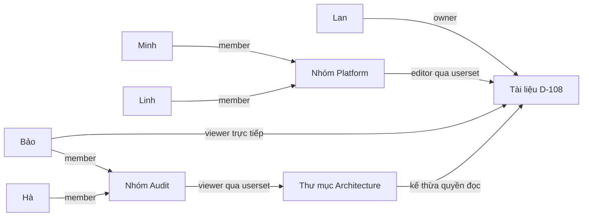

# Shared resource

## 1. Shared resource trong quản lý danh tính và quyền truy cập

**Shared resource** là tài nguyên được nhiều chủ thể sử dụng theo những quyền được xác định. Đó có thể là tài liệu, thư mục, bảng điều khiển, repository, báo cáo hoặc một tập dữ liệu. Các chủ thể cùng truy cập một đối tượng nhưng có thể được phép thực hiện những hành động khác nhau.

Ví dụ, tài liệu kiến trúc D-108 có thể được chia sẻ như sau:

- Lan quản lý tài liệu và các quyền chia sẻ.
- Thành viên nhóm Platform được sửa nội dung.
- Bảo được xem để góp ý trong một đợt đánh giá.
- Thành viên nhóm Audit được xem thông qua thư mục chứa tài liệu.

Trong IAM, vấn đề không chỉ là bật một cờ `shared=true`. Hệ thống cần trả lời: chia sẻ cho ai, trên tài nguyên nào, được làm gì, từ khi nào đến khi nào, có được chia sẻ lại không và thu hồi bằng cách nào.

Tài nguyên dùng chung cũng không có nghĩa mọi người dùng chung một tài khoản. Mỗi người vẫn cần một danh tính riêng để hệ thống xác thực, kiểm tra quyền và truy vết hành động. Chia sẻ mật khẩu owner cho cả nhóm làm mất khả năng phân biệt ai đã thực hiện thao tác và khiến việc thu hồi quyền của một người trở nên khó kiểm soát.

## 2. Chia sẻ quyền truy cập khác với sao chép và chuyển sở hữu

### 2.1. Chia sẻ cùng một tài nguyên

Khi chia sẻ D-108, những người được cấp quyền vẫn truy cập cùng một resource có ID ổn định. Các thay đổi nội dung được thực hiện trên đối tượng đó theo cơ chế cộng tác của ứng dụng.

```text
Lan ── owner ──┐
              │
Nhóm Platform ┼── document:acme/D-108
              │
Bảo ── viewer ┘
```

Việc mỗi người có một URL hiển thị khác nhau không nhất thiết tạo ra tài nguyên khác nhau. Ngược lại, cùng một đường dẫn giao diện cũng không chứng minh mọi người có cùng quyền.

### 2.2. Sao chép tạo một đối tượng mới

Nếu Bảo tạo một bản sao D-209, bản sao là một tài nguyên khác. Quyền của D-108 không tự động quyết định quyền của D-209 trừ khi sản phẩm có chính sách rõ ràng.

Thu hồi quyền đọc D-108 không tự thu hồi dữ liệu Bảo đã tải xuống hoặc một bản sao đã được phép tạo trước đó. Kiểm soát truy cập của ứng dụng chủ yếu điều khiển các lần truy cập tiếp theo qua những kênh mà nó quản lý.

Vì vậy, “được xem”, “được tải xuống”, “được xuất” và “được tạo bản sao” có thể cần các permission khác nhau. Hạn chế nút tải xuống trên giao diện cũng không phải bảo đảm tuyệt đối rằng người đã xem không thể lưu lại thông tin.

### 2.3. Chuyển sở hữu là thay đổi quyền quản trị

Chia sẻ quyền editor cho Minh không đồng nghĩa chuyển owner từ Lan sang Minh. Owner có thể có quyền quản lý truy cập, chuyển quyền sở hữu hoặc xóa tài nguyên mà editor không có.

Ai thực sự sở hữu tài nguyên còn phụ thuộc nghiệp vụ: một người, một nhóm hay tổ chức. Người tạo tài liệu, người sửa gần nhất và người chịu trách nhiệm nghiệp vụ không nhất thiết là owner theo mô hình phân quyền.

Quy trình chuyển ownership cần được thiết kế riêng nếu nó ảnh hưởng đến trách nhiệm quản trị và khả năng thu hồi quyền của chủ sở hữu cũ.

## 3. Một grant chia sẻ cần mô tả những gì?

Một **sharing grant** là một lần cấp quyền theo chính sách của ứng dụng. Bộ ba subject–relation–resource có thể biểu diễn lõi quan hệ, nhưng quy trình chia sẻ thường cần thêm thông tin quản trị.

| Thành phần | Câu hỏi cần trả lời | Ví dụ |
| --- | --- | --- |
| Resource | Đối tượng nào được chia sẻ? | `document:acme/D-108` |
| Grantee | Ai hoặc tập chủ thể nào được nhận? | `user:u-bao`, member của nhóm Platform |
| Role hoặc relation | Gán quan hệ nào? | viewer, editor |
| Permission hiệu lực | Quan hệ đó cho phép làm gì? | Đọc hoặc sửa nội dung |
| Grantor | Ai khởi tạo việc chia sẻ? | `user:u-lan` |
| Phạm vi | Chỉ một đối tượng hay gồm cả con? | Chỉ D-108 |
| Điều kiện | Khi nào grant được dùng? | Còn hạn, tài khoản hoạt động |
| Nguồn | Quyền đến trực tiếp hay gián tiếp? | Chia sẻ trực tiếp, nhóm, thư mục cha |
| Vòng đời | Ai đổi, gia hạn hoặc thu hồi? | Owner quản lý grant |
| Chia sẻ tiếp | Người nhận có được cấp quyền cho người khác? | Không với viewer và editor trong ví dụ |

Không phải tất cả thông tin này phải được lưu trong cùng một tuple. Một engine có thể lưu quan hệ và điều kiện, trong khi dịch vụ nghiệp vụ giữ grant ID, người phê duyệt và lịch sử thay đổi.

Điểm cần giữ là không đánh đồng một hàng grant với toàn bộ quyền hiệu lực của người nhận. Một người có thể được cấp cùng hành động qua nhiều grant hoặc qua quan hệ kế thừa.

## 4. Các cách chia sẻ tài nguyên

### 4.1. Chia sẻ trực tiếp cho một danh tính

Owner cấp viewer cho Bảo trên D-108. Đây là cách dễ giải thích vì grant gắn với đúng một người và một tài nguyên.

Nhược điểm là số grant có thể tăng khi chia sẻ cho nhiều người. Khi người dùng đổi vai trò hoặc rời tổ chức, các grant trực tiếp cũng cần được xem xét trong vòng đời quyền.

Danh tính người nhận cần được ánh xạ về ID ổn định. Không nên coi một tên hiển thị hoặc email chưa xác minh là đủ để gán quyền cho tài khoản hiện hữu.

### 4.2. Chia sẻ cho thành viên một nhóm

D-108 được cấp editor cho tập member của nhóm Platform. Khi Minh được thêm vào nhóm, Minh có thể nhận quyền thông qua nhóm mà không cần tạo một grant trực tiếp trên từng tài liệu.

Một biểu diễn userset có thể là:

```text
group:acme/platform#member
```

OpenFGA dùng quan hệ trên nhóm để mô hình hóa việc cấp quyền cho tập thành viên của nhóm trên một tài nguyên. Đây là mô hình hữu ích cho chia sẻ theo team. [Nguồn: OpenFGA — User Groups](https://openfga.dev/docs/modeling/user-groups).

Quản trị nhóm vì thế trở thành một phần của quản trị quyền truy cập. Thêm người vào một nhóm có thể đồng thời mở quyền trên nhiều tài nguyên đã chia sẻ cho nhóm đó.

### 4.3. Kế thừa qua tài nguyên chứa

Một tài liệu nằm trong thư mục có thể được phép kế thừa quyền xem từ thư mục. Cách này giảm số grant phải tạo trên từng tài liệu, nhưng làm phạm vi ảnh hưởng của quyền trên thư mục lớn hơn.

Quan hệ “nằm trong thư mục” chỉ dẫn đến kế thừa khi chính sách quy định như vậy. Một hệ thống cũng có thể phân biệt thư mục phục vụ tổ chức dữ liệu với container dùng để kế thừa quyền.

Khi có kế thừa, giao diện cần cho biết quyền đến từ đâu. Người quản lý có thể không được xóa quyền ngay trên tài liệu con nếu quyền thực sự bắt nguồn ở thư mục cha.

### 4.4. Chia sẻ trong tổ chức hoặc ra ngoài tổ chức

“Nhân viên Acme” là một tập chủ thể khác với “tất cả người đăng nhập”. Chia sẻ trong tổ chức phải dựa trên membership hoặc cơ chế nhận diện tổ chức đáng tin cậy.

Chia sẻ cho khách bên ngoài thường cần một danh tính guest, một quy trình mời hoặc một cơ chế liên kết được kiểm soát. Quan hệ khách với tài liệu không nhất thiết làm khách trở thành member của toàn bộ tenant.

### 4.5. Chia sẻ công khai và chia sẻ bằng liên kết

Chia sẻ công khai cho phép một tập rất rộng truy cập theo chính sách. Chia sẻ bằng liên kết có thể chỉ là gửi địa chỉ tài nguyên, hoặc có thể phát hành một liên kết chứa khả năng truy cập. Hai cách này có ranh giới tin cậy khác nhau và sẽ được phân tích ở phần sau.

## 5. Ví dụ ReBAC: một tài liệu được chia sẻ qua nhiều đường

### 5.1. Bối cảnh của ví dụ

Tài liệu D-108 thuộc Acme và nằm trong thư mục Architecture. Ta chọn dữ liệu sau:

```text
document:acme/D-108#owner@user:u-lan
document:acme/D-108#viewer@user:u-bao
document:acme/D-108#editor@group:acme/platform#member
document:acme/D-108#parent@folder:acme/architecture

group:acme/platform#member@user:u-minh
group:acme/platform#member@user:u-linh

folder:acme/architecture#viewer@group:acme/audit#member
group:acme/audit#member@user:u-ha
group:acme/audit#member@user:u-bao
```

Bài dùng ký hiệu `object#relation@subject` để trình bày tuple. Đây không phải một định dạng API chung cho mọi sản phẩm.

Bảo có viewer trực tiếp và đồng thời là member nhóm Audit. Hà chỉ có đường qua nhóm Audit. Minh và Linh có đường editor qua nhóm Platform.

### 5.2. Chính sách được chọn

Ta định nghĩa:

```text
can_read(document)
    = viewer(document)
      OR editor(document)
      OR owner(document)
      OR viewer(parent(document))

can_edit(document)
    = editor(document)
      OR owner(document)

can_manage_sharing(document)
    = owner(document)

can_delete(document)
    = owner(document)
```

Đây là biểu thức khái niệm. Những quan hệ nhận userset phải được giải quyết theo tập thành viên tương ứng. Ví dụ `viewer(parent(document))` có thể bao gồm những người nhận viewer trên thư mục thông qua một nhóm.

Mô hình này chỉ kế thừa quyền đọc từ thư mục. Nó không kế thừa quyền sửa, quản lý chia sẻ hoặc xóa. Tên “thư mục cha” không tự làm mọi permission trên cha áp dụng xuống con.

Giả định bổ sung cho ví dụ là những người đang xét thỏa điều kiện tài khoản và phạm vi tenant. Bài chưa thêm cơ chế public link hoặc grant hết hạn vào các biểu thức này.

### 5.3. Nhìn các đường cấp quyền



Sơ đồ diễn giải theo hướng người dùng nhận quyền trên tài nguyên. Khi lưu tuple, relation parent vẫn nằm trên đối tượng document như dữ liệu đã nêu.

### 5.4. Quyền hiệu lực

| Người dùng | Đọc | Sửa | Quản lý chia sẻ | Xóa | Nguồn quyền |
| --- | --- | --- | --- | --- | --- |
| Lan | Có | Có | Có | Có | Owner trực tiếp |
| Minh | Có | Có | Không | Không | Editor qua Platform |
| Linh | Có | Có | Không | Không | Editor qua Platform |
| Hà | Có | Không | Không | Không | Kế thừa từ thư mục qua Audit |
| Bảo | Có | Không | Không | Không | Viewer trực tiếp và đường qua Audit |
| Vy, không có quan hệ phù hợp | Không | Không | Không | Không | Không có đường cho phép |

Bảng chỉ mô tả D-108 và chính sách của ví dụ. Minh được sửa D-108 không có nghĩa Minh được sửa mọi tài liệu thuộc Acme.

## 6. Quyền sử dụng và quyền chia sẻ lại cần được phân biệt

Một editor có thể cần sửa nội dung nhưng không được đưa thêm người vào tài liệu. Nếu ứng dụng mặc định “ai sửa được thì chia sẻ được”, phạm vi truy cập có thể mở rộng ngoài dự kiến của owner.

Trong mô hình phần 5:

```text
can_edit ≠ can_manage_sharing
```

Minh không được tự thêm Vy làm viewer, dù Minh đang có editor. Lan có thể quản lý chia sẻ vì Lan là owner theo chính sách này.

Ứng dụng khác có thể cho editor chia sẻ. Khi đó, cần quy định thêm:

- Editor được cấp những role nào?
- Có được cấp quyền ngang mình hoặc cao hơn không?
- Có được tạo public link không?
- Có được chia sẻ cho khách ngoài tổ chức không?
- Khi quyền của người cấp bị thu hồi, grant họ đã tạo còn tồn tại không?

Câu hỏi cuối không có một đáp án chung cho mọi sản phẩm. Một grant có thể tồn tại độc lập sau khi được tạo, hoặc phụ thuộc vào một chuỗi ủy quyền. Hệ thống cần chọn ngữ nghĩa và lưu thông tin đủ để thực thi.

Không nên suy ra quyền chia sẻ từ một phép so sánh số nguyên như `roleLevel >= 2` nếu quyền quản lý chia sẻ không thực sự nằm trên cùng một thứ bậc. Vai trò editor và người quản lý truy cập có thể có các tập quyền không bao hàm nhau.

Khả năng chuyển ownership cũng cần permission và quy trình riêng. Việc có thể thêm viewer không tự cho phép thêm owner mới hoặc tự thay mình thành owner.

## 7. Luồng cấp quyền chia sẻ tại backend

### 7.1. Kiểm tra người cấp và người nhận

Một luồng chia sẻ trực tiếp có thể được mô tả như sau:

```text
actor = authentication.requireVerifiedPrincipal()
resource = documentRepository.findMetadata(documentId)

requireResourceExists(resource)
requireAllowedTenantContext(actor, resource)

authorization.require(
    subject = actor.canonicalSubject,
    permission = "can_manage_sharing",
    resource = resource.canonicalObject
)

recipient = identityDirectory.resolveRecipient(recipientReference)

sharingPolicy.validate(
    actor = actor,
    resource = resource,
    recipient = recipient,
    requestedRole = requestedRole,
    expiresAt = expiresAt
)

grant = sharingService.createOrUpdateGrant(...)
recordAuditEvent(grant, actor)
returnConfirmedGrantState(grant)
```

Đây là mã giả mô tả trách nhiệm, không phải lời gọi SDK. Trong hiện thực cần giữ bất biến trước thay đổi đồng thời và xử lý lỗi giữa các bước ghi.

Việc người cấp có `can_manage_sharing` là một điều kiện cần trong ví dụ, nhưng chưa thay thế các giới hạn nghiệp vụ. Chẳng hạn, tài liệu được phân loại cấm chia sẻ ngoài tổ chức vẫn phải từ chối khách ngoài dù người thao tác là owner.

### 7.2. Không cho client ghi quan hệ tùy ý

Client có thể yêu cầu chia sẻ cho một người bằng viewer. Backend cần ánh xạ yêu cầu đó sang những relation được phép, thay vì chấp nhận mọi trường `object`, `relation`, `subject` do client gửi rồi ghi thẳng vào engine.

Nếu không kiểm soát, người có quyền sửa tài liệu có thể gửi một tuple owner, hoặc đổi resource ID sang tài liệu mà họ không quản lý.

API cũng cần kiểm soát những trường ảnh hưởng đến kế thừa, như parent folder. Thay đổi parent có thể mở quyền cho cả một nhóm mà không tạo một grant viewer mới trên tài liệu.

### 7.3. Thông báo mời khác với xác nhận quyền

Gửi email mời thành công chưa chứng minh grant đã được ghi. Ngược lại, email gửi thất bại không nhất thiết có nghĩa người nhận chưa có quyền nếu grant đã được tạo trước đó.

Cần phân biệt trạng thái lời mời, trạng thái grant và quyết định quyền hiệu lực. Nếu quy trình yêu cầu người nhận chấp nhận lời mời trước khi truy cập, điều kiện đó phải được thực thi chứ không chỉ hiển thị trên giao diện.

## 8. Kế thừa và phạm vi chia sẻ phải được giải thích rõ

### 8.1. Chia sẻ một thư mục có thể ảnh hưởng tài nguyên hiện tại và tương lai

Khi folder được chia sẻ và mô hình cho con kế thừa, các tài liệu được thêm sau này có thể tự nhận phạm vi người đọc rộng hơn. Người cấp cần hiểu “chia sẻ folder” có thể không chỉ là chia sẻ những file đang thấy ở thời điểm bấm nút.

Tương tự, di chuyển D-108 vào một thư mục được chia sẻ có thể thay đổi tập người đọc dù không sửa grant trực tiếp của D-108.

Một chính sách di chuyển cần xét cả quyền thao tác và tác động truy cập: có được đưa tài liệu vào container đó không, quyền nào sẽ được mở và có cần phê duyệt không.

### 8.2. Không giả định xóa quyền trên con sẽ chặn quyền từ cha

Nếu Hà chỉ có quyền đọc D-108 từ thư mục Architecture, xóa một grant viewer trực tiếp không tồn tại trên D-108 sẽ không thay đổi quyền của Hà.

Ứng dụng có thể yêu cầu sửa grant ở cha hoặc dùng cơ chế hạn chế kế thừa được thiết kế riêng. Nếu engine hỗ trợ phép loại trừ, cần xác định loại trừ áp dụng lên toàn bộ tập cho phép hay chỉ một nhánh.

Không được tự giả định mọi sản phẩm có cùng ngữ nghĩa. Chẳng hạn, tài liệu Drive API mô tả quyền truyền xuống các đối tượng con và những ràng buộc riêng khi giảm quyền kế thừa; đây là hành vi sản phẩm cụ thể, không phải thuộc tính tự động của mọi hệ thống ReBAC. [Nguồn: Google Drive API — Share files, folders, and drives](https://developers.google.com/workspace/drive/api/guides/manage-sharing).

### 8.3. Thư mục riêng tư cần một cơ chế có hiệu lực

Thêm trường `private=true` vào database không tự thay đổi kết quả của engine nếu trường đó không tham gia chính sách.

Nếu một tài liệu cần ngắt quyền đọc kế thừa nhưng vẫn nằm trong cấu trúc thư mục phục vụ điều hướng, mô hình phải thể hiện được yêu cầu đó. Có thể cần tách quan hệ cấu trúc khỏi quan hệ kế thừa, hoặc dùng một cơ chế hạn chế rõ ràng.

Người dùng cần thấy được quyền trực tiếp, quyền qua nhóm và quyền từ container để hiểu vì sao tài nguyên vẫn đang được chia sẻ.

## 9. Chia sẻ bằng liên kết: cần biết liên kết đang mang ý nghĩa gì

### 9.1. Liên kết chỉ định vị tài nguyên

Một URL như:

```text
https://app.example.test/documents/D-108
```

có thể chỉ giúp người dùng tìm đúng tài liệu. Backend vẫn yêu cầu đăng nhập và kiểm tra quyền trên D-108. Gửi URL này cho Vy không tự cấp quyền nếu Vy không thuộc tập được phép.

Trong thiết kế này, thu hồi grant của Bảo không nhất thiết cần đổi URL. Điều cần thay đổi là dữ liệu và quyết định truy cập.

### 9.2. Liên kết có yêu cầu danh tính phù hợp

Một liên kết mời có thể yêu cầu đăng nhập đúng người nhận trước khi được dùng. Mã mời chỉ dẫn đến quy trình chấp nhận, còn backend vẫn phải xác minh danh tính và điều kiện của lời mời.

Không nên biến mọi người cầm một email chuyển tiếp thành người nhận đã xác minh nếu nghiệp vụ yêu cầu chia sẻ theo danh tính.

### 9.3. Liên kết mang khả năng truy cập

Một liên kết chứa token có thể cho phép người cầm nó thực hiện một hành động trên tài nguyên. Trong trường hợp này, việc sở hữu token trở thành một căn cứ truy cập, có thể không chứng minh được người sử dụng cuối cùng là ai.

Ví dụ thực tế là S3 presigned URL. AWS mô tả loại URL này như bearer token và giới hạn quyền của nó theo người ký, thao tác, đối tượng cùng các điều kiện liên quan. Người nhận cần bảo vệ URL như một giá trị có khả năng cấp quyền. [Nguồn: Amazon S3 — Download and upload objects with presigned URLs](https://docs.aws.amazon.com/AmazonS3/latest/userguide/using-presigned-url.html).

Với liên kết kiểu này, thiết kế cần xác định:

- Token cho phép đúng tài nguyên và hành động nào?
- Có thời hạn và cơ chế vô hiệu hóa nào?
- Có được dùng nhiều lần hay không?
- Có ràng buộc danh tính người nhận không?
- URL có thể xuất hiện ở log, lịch sử trình duyệt hoặc nơi nào khác?
- Nếu URL bị chuyển tiếp, hệ thống có chấp nhận người nhận mới không?

Token phải được tạo và xác minh bằng cơ chế phù hợp, có khả năng chống đoán. Không ghi token đầy đủ vào log hoặc dùng một ID tuần tự làm bí mật cấp quyền.

### 9.4. Public access không đồng nghĩa có một URL bí mật

Nếu tài nguyên đã được cho phép truy cập công khai, một người biết ID có thể được phép xem theo chính sách public. Nếu chỉ người có token mới được xem, việc token bị lộ mang ý nghĩa khác với việc ID tài nguyên bị biết.

Một wildcard trong engine cũng cần được đọc đúng phạm vi. OpenFGA có cú pháp type-bound public access như `user:*`, đại diện cho mọi đối tượng thuộc type user. Ứng dụng vẫn phải xác định cách xử lý người chưa đăng nhập; wildcard không tự mô tả toàn bộ cơ chế truy cập HTTP ẩn danh. [Nguồn: OpenFGA — Public Access](https://openfga.dev/docs/modeling/public-access).

| Kiểu liên kết | Căn cứ truy cập chính | Điều cần hiểu khi chuyển tiếp |
| --- | --- | --- |
| URL định vị | Danh tính và quyền hiện hành | Người nhận URL chưa chắc có quyền |
| Lời mời ràng buộc danh tính | Danh tính phù hợp và lời mời hợp lệ | Người nhận chuyển tiếp không tự là người được mời |
| URL mang token truy cập | Token hợp lệ và các điều kiện của nó | Người khác cầm token có thể dùng được |
| URL của tài nguyên công khai | Chính sách public | Phạm vi người dùng được phép đã rất rộng |

## 10. Grant có thời hạn và điều kiện

Một grant cho đợt đánh giá có thể chỉ có hiệu lực trong một khoảng thời gian:

```text
grant có hiệu lực nếu:
    trạng thái cho phép sử dụng
    AND now >= valid_from
    AND now < expires_at
```

Đây là quy ước thời gian minh họa. Hệ thống cần dùng mốc thời gian đáng tin cậy, thống nhất múi giờ khi lưu và xác định rõ biên hết hạn.

Việc có một cột `expires_at` chưa đủ. Quyết định truy cập phải kiểm tra điều kiện này, hoặc dữ liệu cấp quyền phải được cập nhật bằng một cơ chế đáp ứng yêu cầu thời hạn.

Nếu chỉ có một job chạy mỗi đêm để xóa grant hết hạn, người dùng có thể tiếp tục truy cập sau giờ hết hạn cho đến khi job chạy. Cần đánh giá thời gian đó có được nghiệp vụ chấp nhận hay không.

OpenFGA hỗ trợ conditional relationship tuples để kết hợp quan hệ với các điều kiện như một cửa sổ thời gian. Cơ chế đó vẫn yêu cầu mô hình khai báo điều kiện và dữ kiện đánh giá phù hợp. [Nguồn: OpenFGA — Conditions](https://openfga.dev/docs/modeling/conditions).

Thời hạn của một grant không nhất thiết là thời hạn của mọi quyền người đó đang có. Nếu viewer trực tiếp của Bảo hết hạn nhưng membership Audit vẫn còn, Bảo vẫn có thể đọc D-108 qua thư mục.

Cache cũng phải tôn trọng thời hạn. Một quyết định allow được lưu lâu hơn cửa sổ grant có thể tiếp tục cho phép truy cập sau khi điều kiện đã hết hiệu lực nếu không có cơ chế xử lý.

Nếu người dùng đang tải file hoặc giữ một kết nối cộng tác khi grant hết hạn, cần quy định thời điểm kiểm tra lại. Việc kết thúc grant không tự bảo đảm hủy mọi luồng dữ liệu đã được cấp trước đó.

## 11. Chia sẻ với khách ngoài tổ chức

### 11.1. Quyền tài nguyên và membership tenant là hai lớp khác nhau

Acme có thể mời một chuyên gia bên ngoài xem D-108 mà không cho người đó truy cập toàn bộ workspace.

Một thiết kế có thể tạo danh tính guest và grant viewer trên đúng tài liệu. Những quyền như liệt kê người dùng, xem mọi dự án hoặc duyệt thư mục gốc vẫn cần chính sách riêng.

Không nên thêm khách vào một nhóm nhân viên rộng chỉ để làm cho quyền xem một tài liệu hoạt động.

### 11.2. Không dùng email domain như một bằng chứng đầy đủ

Một chuỗi email có đuôi công ty không tự chứng minh tài khoản thuộc tổ chức theo nghĩa mà ứng dụng cần. Nguồn danh tính, trạng thái xác minh và mapping tenant phải được kiểm soát.

Nếu người nhận đổi email, grant cần tiếp tục gắn với đúng danh tính ổn định hoặc được xử lý theo quy trình chuyển đổi đã định nghĩa. Không nên tự chuyển quyền cho người khác chỉ vì một địa chỉ được tái sử dụng.

Lời mời đang chờ cũng cần được phân biệt với quyền đã kích hoạt. Cần xác định ai có thể chấp nhận và liệu việc tạo tài khoản mới có làm lời mời tự nhận đúng người hay không.

### 11.3. Chặn hoặc cho phép xuyên tenant phải là chính sách rõ ràng

Một tuple nối resource Acme với nhóm Beta có thể mở quyền nếu engine cho phép kiểu quan hệ đó. Tên resource chứa `acme/` không tự ngăn liên kết xuyên tenant.

Với tài nguyên cấm chia sẻ ngoài tổ chức, kiểm tra phải được thực thi ở backend tại quy trình cấp quyền và những luồng có thể tạo đường cấp quyền tương đương. Tắt nút “mời người ngoài” chưa đủ nếu API ghi grant vẫn nhận người ngoài.

Nếu hệ thống cho phép cộng tác xuyên tenant, cần giới hạn tài nguyên, permission, thời hạn và người được quản lý grant. Owner của một tài liệu cũng không mặc nhiên có quyền bỏ qua mọi chính sách tổ chức áp dụng lên tài liệu đó.

## 12. Mỗi lần dùng tài nguyên vẫn cần quyết định quyền phù hợp

Chia sẻ là thao tác tạo hoặc thay đổi căn cứ truy cập. Khi tài nguyên được dùng, backend vẫn phải thực thi quyết định tương ứng.

```text
principal = authentication.requirePrincipal()
resource = documentRepository.resolveDocument(documentId)

decision = authorization.check(
    subject = principal.canonicalSubject,
    permission = "can_read",
    object = resource.canonicalObject
)

if decision is not ALLOW:
    stopWithoutReturningProtectedContent()

return documentRepository.readContent(resource.id)
```

Đây là mã giả cho luồng đọc tài liệu có yêu cầu đăng nhập. Luồng public hoặc token link sẽ có cách xác lập căn cứ truy cập khác nhưng vẫn cần giới hạn đúng tài nguyên và hành động.

Các điểm thực thi cần bao gồm cả:

- Xem nội dung, preview và thumbnail.
- Tải file đính kèm và bản xuất.
- Sửa, bình luận, xóa hoặc tạo bản sao.
- API tìm kiếm và danh sách tài liệu.
- Job nền thực hiện theo yêu cầu người dùng.
- Kênh cộng tác hoặc kết nối dài nếu ứng dụng có.

Không trả tên, đoạn trích hoặc tổng số tài liệu nhạy cảm cho người dùng rồi mới ẩn ở giao diện. Quyền với nội dung chính và các dữ liệu phụ phải được thiết kế nhất quán.

OWASP khuyến nghị kiểm tra quyền trong mọi yêu cầu liên quan, áp dụng nguyên tắc ít quyền và từ chối khi chưa có căn cứ cho phép phù hợp. Trong hệ thống chia sẻ, các nguyên tắc này cần được áp dụng ở nơi backend thực sự trả dữ liệu hoặc thực hiện hành động. [Nguồn: OWASP — Authorization Cheat Sheet](https://cheatsheetseries.owasp.org/cheatsheets/Authorization_Cheat_Sheet.html).

Quyết định deny và lỗi hạ tầng nên được ghi nhận khác nhau để vận hành. Với luồng đọc được bảo vệ trong ví dụ, timeout không được dùng làm lý do bỏ qua kiểm tra và trả tài liệu.

## 13. Thu hồi chia sẻ: kiểm tra quyền hiệu lực sau thay đổi

### 13.1. Trường hợp Bảo có hai đường đọc

Trong ví dụ phần 5, Bảo đọc D-108 qua:

```text
Đường A:
Bảo → viewer trực tiếp của D-108

Đường B:
Bảo → member Audit → viewer thư mục Architecture
    → kế thừa quyền đọc D-108
```

Lan xóa grant viewer trực tiếp của Bảo. Đường A biến mất, nhưng đường B vẫn tồn tại. Backend tiếp tục cho Bảo đọc là kết quả đúng với mô hình hiện tại.

Do đó, giao diện không nên báo “Bảo đã mất quyền truy cập” chỉ vì đã xóa một grant. Có thể báo chính xác rằng grant trực tiếp đã được thu hồi và quyền qua Audit vẫn còn.

### 13.2. Thu hồi toàn bộ quyền cần biết phạm vi tác động

Muốn Bảo không đọc được D-108, người quản trị cần xác định cách xử lý đường B:

- Bỏ Bảo khỏi Audit có thể ảnh hưởng mọi tài nguyên đã chia sẻ cho Audit.
- Thu hồi viewer của Audit ở thư mục có thể ảnh hưởng mọi thành viên Audit.
- Di chuyển hoặc thay mô hình kế thừa có thể ảnh hưởng nhiều người trên tài liệu.
- Một cơ chế hạn chế riêng, nếu được thiết kế, cần có ngữ nghĩa rõ ràng.

Không nên thay membership toàn tổ chức chỉ để xử lý một tài liệu nếu phạm vi tác động đó không đúng với ý định.

Trong một mô hình có nhiều đường allow, việc thêm một deny hoặc loại trừ cũng phải xét đúng vị trí. Loại trừ một người khỏi nhánh viewer trực tiếp không chắc chặn được nhánh editor hoặc kế thừa.

### 13.3. Phân biệt đã ghi thay đổi với đã có hiệu lực

Một quy trình thu hồi có thể đi qua các mốc:

```text
Yêu cầu thu hồi được chấp nhận
    → grant nguồn được cập nhật
    → dữ liệu phân quyền được đồng bộ
    → cache hoặc bản sao liên quan được cập nhật
    → lần truy cập mới nhận quyết định tương ứng
```

Thứ tự và số bước cụ thể phụ thuộc kiến trúc. Hệ thống cần định nghĩa mốc nào mới được xem là thu hồi hoàn tất.

Nếu yêu cầu bảo mật cần hiệu lực nhanh, cần một thiết kế đáp ứng độ trễ đó. Chỉ thêm nút “Revoke” hoặc một cờ trạng thái trong database chưa bảo đảm mọi điểm truy cập đã dùng dữ liệu mới.

### 13.4. Những gì không thể thu hồi chỉ bằng xóa grant

Thu hồi grant không tự xóa bản tải xuống, ảnh chụp hoặc bản sao người dùng đã lấy được. Nó cũng không tự vô hiệu hóa một capability đã phát hành ở một hệ thống lưu trữ khác.

Nếu ứng dụng phát hành URL tải file có chữ ký, cần hiểu thời hạn và cơ chế thu hồi của URL đó. Không nên giả định việc xóa quan hệ trong ReBAC sẽ được hệ thống lưu trữ tự biết ngay.

Với cache nội dung hoặc CDN, cần bảo đảm dữ liệu được bảo vệ không bị phục vụ như nội dung công khai sau khi thay đổi quyền. Kiểm soát quyền của API và cấu hình phân phối nội dung phải khớp với nhau.

## 14. Đồng thời, đồng bộ và nguồn grant

### 14.1. Tránh ghi đè thay đổi của người quản trị khác

Lan và một người quản trị hợp lệ khác có thể cùng mở hộp thoại chia sẻ. Nếu cả hai gửi lại toàn bộ danh sách grant theo bản chụp cũ, cập nhật sau có thể làm mất cập nhật trước.

Có thể dùng thao tác trên từng grant, kiểm soát phiên bản hoặc cơ chế xung đột phù hợp. Một giao diện hiển thị danh sách mới sau khi lưu cũng cần đọc đúng trạng thái đã được hệ thống xác nhận.

Ở các thao tác quan trọng, cần xử lý trường hợp quyền của người cấp đã bị thu hồi giữa lúc kiểm tra và lúc ghi. Cách bảo vệ phụ thuộc nơi lưu dữ liệu và những bất biến hệ thống cần giữ.

### 14.2. Hai kho dữ liệu không tự trở thành một giao dịch

Ứng dụng có thể lưu sharing grant trong database, còn engine giữ tuple. Khi một bên cập nhật thành công còn bên kia thất bại, giao diện và quyết định quyền có thể không khớp.

Một cơ chế đồng bộ có retry, idempotency và đối soát giúp xử lý lỗi. Nếu dùng outbox, cần hiểu nó hỗ trợ chuyển thay đổi đáng tin cậy nhưng không làm quyết định ở hai hệ thống cùng đổi tức thời.

Với cấp quyền, hệ thống có thể giữ trạng thái chưa hiệu lực cho đến khi đồng bộ thành công. Với thu hồi, cần chọn cách đáp ứng yêu cầu bảo vệ trong khoảng dữ liệu chưa hội tụ.

### 14.3. Nhiều nguồn có thể cùng tạo một quyền

Bảo có thể được cấp viewer bởi một quy trình dự án và bởi một quy trình kiểm toán. Nếu cả hai chỉ được gom thành một tuple giống hệt mà không lưu nguồn, xóa grant của một quy trình có thể xóa luôn căn cứ của quy trình còn lại.

Hệ thống cần chọn cách biểu diễn đủ để duy trì vòng đời từng nguồn, chẳng hạn sổ theo dõi grant hoặc các quan hệ trung gian phù hợp. Không nhất thiết phải đưa toàn bộ audit metadata vào engine, nhưng không được làm mất ý nghĩa quản trị của nó.

Ngược lại, khi một nguồn grant đã bị thu hồi, dữ liệu suy ra từ nguồn đó không nên được giữ như một grant trực tiếp vĩnh viễn.

## 15. Hiển thị quyền và kiểm toán chia sẻ

Một hộp thoại chia sẻ hữu ích cần giúp người dùng phân biệt ít nhất:

```text
Bảo
  Viewer trực tiếp: do Lan cấp
  Viewer kế thừa: qua nhóm Audit và thư mục Architecture

Minh
  Editor: qua nhóm Platform
```

Không nên hiển thị “viewer” như thể đó là đường cấp quyền duy nhất khi người dùng còn editor qua nhóm. Việc hạ một grant trực tiếp xuống viewer cũng không làm giảm quyền sửa nếu nhánh editor vẫn tồn tại.

Danh sách người được chia sẻ cũng có thể là dữ liệu nhạy cảm. Người được đọc tài liệu chưa chắc được xem toàn bộ membership của các nhóm liên quan hoặc danh tính khách khác.

Log quản trị nên giúp trả lời:

- Ai yêu cầu cấp, đổi hoặc thu hồi quyền?
- Tài nguyên và người nhận là ai?
- Grant, nguồn hoặc phạm vi nào đã thay đổi?
- Quyền hoặc thời hạn trước và sau là gì?
- Thay đổi đã hoàn tất hay còn chờ đồng bộ?
- Sự kiện có mã tương quan nào để điều tra?

Không ghi token liên kết, credential hoặc toàn bộ nội dung tài liệu vào log quản trị. Nếu cần theo dõi một link, dùng định danh link phù hợp thay cho việc lưu bí mật của link.

Với một nhóm lớn, thêm member có thể mở quyền trên nhiều tài nguyên mà không có grant tài liệu nào thay đổi. Kiểm toán vì thế cần bao gồm cả membership và quan hệ container, không chỉ những thao tác bấm nút Share trên từng tài liệu.

## 16. Duy trì chia sẻ trong vòng đời tài nguyên và danh tính

### 16.1. Người dùng rời dự án hoặc tổ chức

Cần xem xét cả membership, grant trực tiếp, guest access, phiên và token có liên quan. Chỉ xóa một group membership có thể không loại bỏ mọi đường truy cập.

Nếu tài liệu thuộc sở hữu của một cá nhân rời tổ chức, cần một quy trình chuyển trách nhiệm quản trị phù hợp. Không nên để tài nguyên quan trọng mất người quản lý vì người tạo account bị xóa.

### 16.2. Tài nguyên được lưu trữ, di chuyển hoặc xóa

Trạng thái archived chưa tự có nghĩa quyền đọc hoặc sửa bị thay đổi. Nếu tài liệu lưu trữ phải chỉ đọc, điều kiện đó cần tham gia quyết định hành động.

Khi di chuyển, cần đánh giá lại quyền từ container cũ và mới theo mô hình. Khi xóa, cần bảo đảm ID không bị tái sử dụng làm một tài nguyên mới vô tình nhận grant cũ.

Bản sao và bản xuất có thể có vòng đời riêng. Một chính sách “xóa tài liệu gốc” không tự bảo đảm mọi bản phát sinh đã bị xóa nếu sản phẩm chưa có cơ chế quản lý chúng.

### 16.3. Rà soát định kỳ

Một grant phù hợp khi bắt đầu dự án có thể không còn cần thiết sau khi dự án kết thúc. Rà soát nên dựa vào mục đích và quyền còn cần, không chỉ việc người dùng gần đây có mở tài liệu hay không.

Những điểm thường cần xem lại gồm khách ngoài, link còn hiệu lực, quyền sửa cấp rộng và nhóm có membership đã thay đổi. Việc người dùng chưa truy cập không tự chứng minh grant không hợp lệ; nó chỉ là một dữ kiện hỗ trợ đánh giá.

## 17. Các tình huống tự kiểm tra

Những tình huống sau dùng chính sách D-108 ở phần 5; chúng là bài tập suy luận, không phải báo cáo đã chạy kiểm thử trên một dịch vụ.

| Tình huống | Kết quả dự kiến hoặc điều cần xác minh |
| --- | --- |
| Minh sửa D-108 | Cho phép qua editor của Platform |
| Minh thêm Vy làm viewer | Từ chối vì Minh không có can_manage_sharing |
| Hà mở D-108 | Cho phép đọc qua thư mục và Audit |
| Lan xóa viewer trực tiếp của Bảo | Bảo vẫn đọc qua Audit |
| Grant trực tiếp của Bảo hết hạn | Vẫn phải xét những đường còn hiệu lực |
| Vy nhận URL định vị thông thường | Chưa có quyền nếu không có quan hệ phù hợp |
| Vy nhận một bearer link hợp lệ | Có thể dùng trong phạm vi link nếu chính sách cho phép |
| Tài liệu chuyển vào thư mục chia sẻ rộng | Cần xét tập người nhận quyền kế thừa mới |
| Editor gửi thêm trường owner trong API sửa nội dung | Backend phải từ chối thay đổi quyền ngoài thẩm quyền |
| Guest được mời đọc một tài liệu | Không tự nhận quyền trên toàn bộ tenant |
| Engine timeout khi đọc tài liệu được bảo vệ | Không trả nội dung từ luồng chưa có quyết định allow |
| Người dùng đã tải bản sao trước khi bị thu hồi | Xóa grant gốc không tự xóa bản sao đó |

Một bài tập mở rộng là cho phép editor mời viewer nhưng không được mời editor. Khi đó, hãy xác định permission quản lý chia sẻ cần nhận thêm tham số hoặc kiểm tra nghiệp vụ nào, grant do editor tạo có sống tiếp khi editor mất quyền không và ai được thu hồi grant đó.

Thiết kế shared resource tốt cần giải thích được **quyền hiệu lực đến từ đâu và thay đổi nào thực sự làm quyền đó mất đi**. Giữ rõ danh tính, tài nguyên, permission, nguồn grant và vòng đời giúp hoạt động cộng tác đáp ứng nhu cầu nghiệp vụ mà vẫn duy trì nguyên tắc ít quyền nhất.
