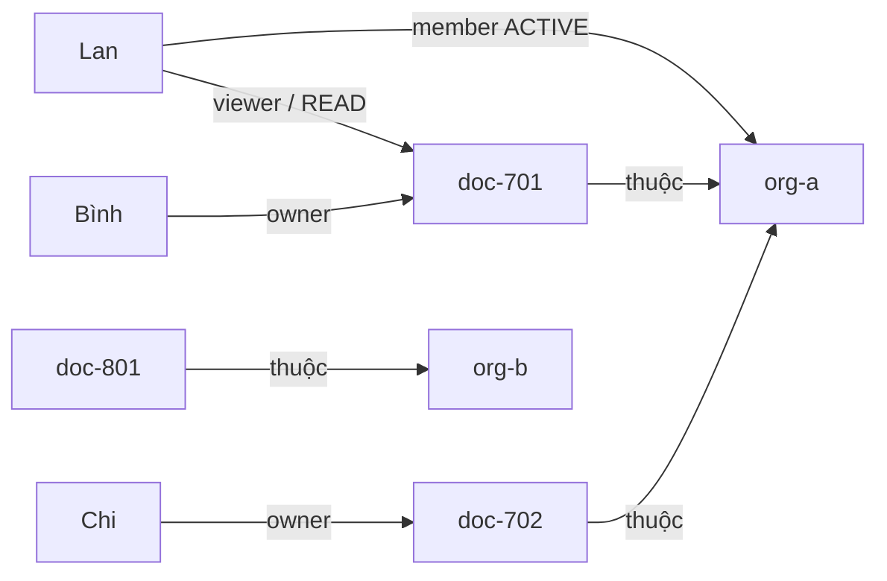

# Direct object authorization

## 1. Kiểm tra quyền trên một đối tượng cụ thể

Direct object authorization trong bài này được hiểu là kiểm tra chủ thể có được thực hiện hành động đang yêu cầu trên đúng đối tượng cụ thể hay không. Đầu vào tối thiểu phải làm rõ ai đang gọi, muốn làm gì và đối tượng thật sự bị tác động là đối tượng nào.

Ví dụ, Lan được dùng chức năng quản lý tài liệu. Khi Lan gọi `GET /documents/doc-701`, backend vẫn phải xác định Lan có quyền đọc `doc-701`. Việc đăng nhập thành công hoặc được truy cập endpoint `/documents` chưa chứng minh quyền đối với mọi tài liệu trong hệ thống.

Trong ReBAC, quyền có thể đến từ quan hệ owner, viewer, editor, thành viên nhóm hoặc quan hệ kế thừa đã được mô hình hóa. Dù quyền đến từ đâu, thao tác cuối cùng vẫn phải được ràng buộc với đối tượng đang được kiểm tra.

```text
authorize(subject, action, object, context)
    -> quyết định cho đúng bộ đầu vào này
```

Cần phân biệt hai cách dùng từ “direct”:

- Kiểm tra quyền trực tiếp cho đối tượng đang được yêu cầu: đây là trách nhiệm của đường thực thi truy cập.
- Direct grant: một quan hệ cấp quyền được lưu trực tiếp giữa chủ thể và đối tượng, chẳng hạn Lan là viewer của tài liệu.

Một lần kiểm tra quyền đối tượng có thể chấp nhận quyền kế thừa nếu policy cho phép. Không nên chỉ tìm direct grant rồi kết luận người dùng không có quyền, cũng không suy ra chỉ cần có một quan hệ bất kỳ là được làm mọi thao tác.

Tài liệu [Direct Access của OpenFGA](https://openfga.dev/docs/modeling/direct-access) mô tả việc biểu diễn quyền truy cập bằng relationship tuple và kiểm tra quan hệ theo authorization model. Các ví dụ còn lại của bài là mô hình tự thiết kế để giải thích nguyên tắc, không phải API hay schema mặc định của một sản phẩm.

## 2. Có quyền vào chức năng chưa đủ để có quyền trên dữ liệu

| Lớp kiểm tra | Câu hỏi | Ví dụ |
| --- | --- | --- |
| Authentication | Danh tính nào đang gửi request? | Phiên hoặc token được xác minh thuộc Lan |
| Function authorization | Danh tính có được dùng chức năng này không? | Được gọi chức năng chỉnh sửa tài liệu |
| Organization hoặc tenant scope | Request có thuộc phạm vi tổ chức được phép không? | Lan còn membership hiệu lực trong `org-a` |
| Object authorization | Danh tính có được làm hành động này trên đối tượng này không? | Lan có quyền sửa `doc-701` |
| Property authorization | Trường dữ liệu nào được đọc hoặc thay đổi? | Lan sửa tiêu đề nhưng không tự đổi owner |

Các lớp này bổ sung cho nhau. Kiểm tra membership trong organization có thể chặn người ngoài tổ chức, nhưng chưa bảo vệ tài liệu riêng giữa hai thành viên cùng tổ chức. Kiểm tra quyền sửa tài liệu cũng chưa đồng nghĩa người gọi được sửa trường owner hoặc danh sách grant.

OWASP gọi việc thiếu kiểm soát trên đối tượng là Broken Object Level Authorization — BOLA. Trong [API1:2023](https://api-security.owasp.org/editions/2023/en/0xa1-broken-object-level-authorization/), OWASP nhấn mạnh rằng endpoint thực hiện thao tác trên đối tượng nhận qua ID phải kiểm tra quyền cho hành động và đối tượng được yêu cầu.

Không nên biến mọi quyết định thành `hasRole("USER")`. Role là một dữ kiện; object authorization cần chính sách diễn đạt mối liên hệ giữa role hoặc quan hệ của người dùng với đối tượng thực tế.

## 3. Direct object reference và lỗi IDOR

Ứng dụng thường đưa định danh đối tượng vào URL, query string hoặc body:

```http
GET /documents/doc-701
GET /attachments/download?attachmentId=file-22
POST /reports/export
Content-Type: application/json

{ "documentIds": ["doc-701", "doc-702"] }
```

Đây là các tham chiếu trực tiếp đến đối tượng. Bản thân việc dùng tham chiếu như vậy không phải lỗ hổng. Lỗi xuất hiện khi backend sử dụng tham chiếu mà thiếu kiểm tra quyền cần thiết.

Ví dụ thiết kế sai:

```text
1. Backend xác thực người dùng đã đăng nhập.
2. Lấy documentId từ request.
3. Truy vấn tài liệu theo documentId.
4. Trả nội dung tài liệu.
```

Nếu thiếu bước kiểm tra quan hệ giữa người gọi và tài liệu, Lan có thể gửi ID của tài liệu mà Lan không được phép đọc. ID có thể bị biết qua một đường hợp lệ khác, log, liên kết được chuyển tiếp hoặc dữ liệu hiển thị ở nơi khác; không cần giả định mọi ID đều dễ đoán.

UUID, mã ngẫu nhiên hoặc ID được che giấu có thể giảm khả năng dò tìm. Chúng không chứng minh quyền truy cập. [OWASP IDOR Prevention Cheat Sheet](https://cheatsheetseries.owasp.org/cheatsheets/Insecure_Direct_Object_Reference_Prevention_Cheat_Sheet.html) phân biệt việc tăng độ khó đoán của định danh với kiểm soát quyền đối tượng.

Mã hóa ID cũng không tự tạo authorization. Nếu một người có được mã định danh đã mã hóa của tài nguyên khác, backend vẫn phải xác định người đó được phép làm gì với tài nguyên ấy.

## 4. Mô hình ReBAC minh họa cho tài liệu

### 4.1. Dữ liệu và quan hệ

Ví dụ có hai organization, trong bài được dùng như hai tenant dữ liệu:

| Đối tượng | Organization | Owner | Quan hệ bổ sung |
| --- | --- | --- | --- |
| `doc-701` | `org-a` | Bình | Lan có grant `READ` |
| `doc-702` | `org-a` | Chi | Lan không có grant |
| `doc-801` | `org-b` | Dũng | Lan không có grant |

Lan là thành viên đang hoạt động của `org-a`. Điều đó không tự cấp quyền đọc `doc-702`, dù nó cùng organization với `doc-701`.

Các cạnh có thể được trình bày bằng ký hiệu minh họa:

```text
organization:org-a#member@user:lan
document:doc-701#owner@user:binh
document:doc-701#viewer@user:lan
document:doc-702#owner@user:chi
```



Đồ thị chưa tự quyết định ý nghĩa của mọi cạnh. Policy phải nêu rõ owner được thực hiện thao tác nào, editor có được đọc hay không và member có được hưởng quyền tài liệu chung hay không.

### 4.2. Chính sách được chọn cho bài

Ví dụ chọn bốn action riêng: `READ`, `UPDATE`, `SHARE`, `DELETE`.

```text
CommonGate(subject, object, context):
    tài khoản subject còn hoạt động
    organization của context khớp organization của object
    subject có membership hiệu lực trong organization đó

READ hoặc UPDATE:
    CommonGate AND (subject là owner OR có grant đúng action)

SHARE hoặc DELETE:
    CommonGate AND subject là owner
```

Trong mô hình này, grant được cấp trực tiếp chỉ dành cho READ hoặc UPDATE và có thể có thời hạn. UPDATE không tự bao hàm READ. Nếu sản phẩm muốn editor có cả hai quyền, phải cấp hai action hoặc định nghĩa quan hệ suy luận rõ ràng.

Owner cũng không vượt qua CommonGate. Nếu owner đã bị đình chỉ membership, backend cần luồng quản trị để chuyển ownership hoặc xử lý tài nguyên theo chính sách; không tự bỏ ranh giới organization.

Đây là lựa chọn minh họa. Một hệ thống khác có thể hỗ trợ chia sẻ cho người ngoài hoặc cho phép nhóm quản trị xóa tài liệu. Những đường cấp quyền đó phải được bổ sung có chủ đích, không suy ra từ tên role hoặc một biểu thức `OR admin` không có phạm vi.

### 4.3. Quyền hiệu lực và grant trực tiếp

Nếu có thêm nhánh team hoặc thư mục cha, công thức quyền có thể mở rộng:

```text
CanRead = CommonGate AND (
    Owner
    OR DirectReadGrant
    OR ReadThroughTeam
    OR ReadThroughParent
)
```

Backend vẫn phải kiểm tra quyền READ trên chính đối tượng được yêu cầu. Việc quyền được suy ra qua thư mục cha không cho phép backend kiểm tra một thư mục bất kỳ rồi đọc tài liệu không thuộc thư mục đó.

## 5. Luồng kiểm tra phía server

Một luồng thực thi rõ ràng gồm:

```text
1. Xác minh danh tính và thiết lập context từ nguồn được tin cậy.
2. Chuẩn hóa action từ thao tác nghiệp vụ của endpoint.
3. Lấy đúng định danh tài nguyên được yêu cầu.
4. Nạp metadata tối thiểu và xác nhận phạm vi tài nguyên.
5. Đánh giá quyền cho subject + action + tài nguyên thực tế.
6. Thực hiện thao tác trên chính tài nguyên đã kiểm tra.
7. Chỉ trả dữ liệu được phép và ghi dấu vết cần thiết.
```

OWASP khuyến nghị kiểm tra quyền trên mỗi request và đặt kiểm soát ở nơi thực sự bảo vệ tài nguyên trong [Authorization Cheat Sheet](https://cheatsheetseries.owasp.org/cheatsheets/Authorization_Cheat_Sheet.html). Một nút bị ẩn trên giao diện không thay thế được kiểm tra ở backend.

### 5.1. Không tin owner hoặc membership do client tự khai

Payload sau không phải bằng chứng Lan là owner:

```json
{
  "documentId": "doc-701",
  "ownerId": "user-lan",
  "organizationId": "org-a",
  "isMember": true
}
```

Backend phải lấy owner và organization của tài liệu từ dữ liệu tài nguyên được quản trị. Principal lấy từ danh tính đã xác thực. Membership và grant lấy từ nguồn phân quyền có thẩm quyền hoặc bản sao đáp ứng độ mới đã cam kết.

Client có thể chỉ ra organization muốn làm việc. Giá trị đó là lựa chọn cần được xác minh, không phải quyền để tự đổi phạm vi truy vấn.

### 5.2. Không làm lộ nội dung trước khi kiểm tra

Backend có thể cần nạp owner, organization và version để đánh giá. Việc nạp metadata nội bộ không có nghĩa được trả metadata đó cho người gọi. Tên tệp, preview, số lượng bình luận và đường dẫn tải cũng có thể là dữ liệu cần bảo vệ.

Không bắt đầu stream tệp rồi mới kiểm tra quyền. Khi đã gửi một phần nội dung, việc trả lỗi sau đó không thu hồi được phần đã lộ.

### 5.3. Đặt kiểm soát trên mọi đường truy cập

REST, GraphQL resolver, công việc nền, WebSocket, endpoint preview và tải attachment đều có thể truy cập cùng đối tượng. Đặt kiểm tra chỉ ở một controller chưa chắc bao phủ đường gọi nội bộ hoặc một giao diện khác.

Có thể tổ chức một service nghiệp vụ hoặc một tầng truy cập tài nguyên làm điểm kiểm tra chung, kết hợp các ràng buộc ở repository theo kiến trúc. Cần biết điểm nào không thể bị bỏ qua khi thao tác thực sự xảy ra, thay vì chỉ thêm nhiều annotation mà chưa kiểm tra hiệu lực.

## 6. Định danh tài nguyên và đường dẫn lồng nhau

### 6.1. Đúng loại, đúng phạm vi, đúng ID

Một định danh quyền nên có đủ loại đối tượng và namespace phù hợp. `document:42` và `invoice:42` không phải cùng đối tượng chỉ vì cùng số 42.

Nếu ID chỉ duy nhất trong tenant, khóa logic của đối tượng phải gồm tenant cùng ID. Nếu ID duy nhất toàn cục, tenant vẫn có thể là điều kiện truy cập cần kiểm tra; tính duy nhất không làm mất ranh giới quyền.

```text
Request:   subject=Lan, action=READ, object=document:org-a/doc-701
Decision:  chỉ có giá trị cho đúng subject, action và object đó
```

### 6.2. Không tin quan hệ cha–con từ URL

Xét đường dẫn:

```http
GET /projects/project-a/documents/doc-701
```

Backend phải xác nhận tài liệu thực sự thuộc `project-a`, rồi kiểm tra quyền theo policy. Không được kiểm tra Lan có quyền ở `project-a` nhưng lại lấy `doc-701` chỉ bằng ID trong kho toàn cục.

Một truy vấn metadata minh họa:

```sql
SELECT id, project_id, organization_id, owner_id, version
FROM documents
WHERE organization_id = :verified_organization_id
  AND project_id = :project_id
  AND id = :document_id;
```

Truy vấn có phạm vi làm giảm nguy cơ ghép nhầm đối tượng. Nó chưa tự kiểm tra mọi grant trên tài liệu. Nếu policy cho phép đọc qua project, đường suy luận phải dùng chính project mà tài liệu thuộc về.

### 6.3. Không đổi đối tượng sau khi đã kiểm tra

Một lỗi dễ bỏ sót là kiểm tra `documentId` trong route nhưng khi cập nhật lại dùng `id` từ body. Cần chọn một định danh chính thức hoặc buộc chúng khớp trước khi thực hiện. Nếu chúng không khớp, từ chối request thay vì áp dụng quyền của đối tượng này cho đối tượng khác.

## 7. Java minh họa kiểm tra quyền đúng đối tượng

Ví dụ Java 17 sau cài đặt phần policy đơn giản của bài: owner có bốn action, grant trực tiếp chỉ cho READ hoặc UPDATE và luôn cần các điều kiện chung. Code này chỉ minh họa quyết định trong bộ nhớ; không triển khai xác thực, truy vấn dữ liệu hay tính nhất quán giữa các nguồn.

```java
import java.time.Instant;
import java.util.List;

public class DirectObjectAuthorizationExample {
    enum Action { READ, UPDATE, SHARE, DELETE }

    record Actor(
            String principalId,
            String organizationId,
            boolean accountActive,
            boolean membershipActive) {}

    record Document(
            String id,
            String organizationId,
            String ownerId) {}

    record DirectGrant(
            String principalId,
            String organizationId,
            String documentId,
            Action action,
            Instant expiresAt) {}

    static boolean hasText(String value) {
        return value != null && !value.isBlank();
    }

    static boolean allowed(
            Actor actor,
            Action action,
            String requestedDocumentId,
            Document document,
            List<DirectGrant> grants,
            Instant now) {
        if (actor == null || action == null || document == null || now == null
                || !hasText(actor.principalId())
                || !hasText(actor.organizationId())
                || !hasText(document.id())
                || !hasText(document.organizationId())) {
            return false;
        }

        if (!actor.accountActive() || !actor.membershipActive()
                || !actor.organizationId().equals(document.organizationId())
                || !document.id().equals(requestedDocumentId)) {
            return false;
        }

        if (actor.principalId().equals(document.ownerId())) {
            return true;
        }

        if ((action != Action.READ && action != Action.UPDATE)
                || grants == null) {
            return false;
        }

        return grants.stream().anyMatch(grant -> grant != null
                && actor.principalId().equals(grant.principalId())
                && document.organizationId().equals(grant.organizationId())
                && document.id().equals(grant.documentId())
                && action == grant.action()
                && (grant.expiresAt() == null
                    || now.isBefore(grant.expiresAt())));
    }

    public static void main(String[] args) {
        Instant now = Instant.parse("2026-11-26T03:00:00Z");
        Actor lan = new Actor("user-lan", "org-a", true, true);
        Actor binh = new Actor("user-binh", "org-a", true, true);
        Actor suspendedLan = new Actor("user-lan", "org-a", true, false);

        Document document = new Document("doc-701", "org-a", "user-binh");
        List<DirectGrant> grants = List.of(new DirectGrant(
                "user-lan", "org-a", "doc-701", Action.READ,
                Instant.parse("2026-11-27T03:00:00Z")));

        System.out.println(allowed(
                lan, Action.READ, "doc-701", document, grants, now));
        System.out.println(allowed(
                lan, Action.UPDATE, "doc-701", document, grants, now));
        System.out.println(allowed(
                lan, Action.READ, "doc-702", document, grants, now));
        System.out.println(allowed(
                binh, Action.DELETE, "doc-701", document, grants, now));
        System.out.println(allowed(
                suspendedLan, Action.READ, "doc-701", document, grants, now));
    }
}
```

Kết quả kỳ vọng:

```text
true
false
false
true
false
```

Lần thứ ba cố sử dụng metadata và grant của `doc-701` cho request yêu cầu `doc-702`; phép kiểm tra định danh ngăn việc dùng nhầm quyết định. Lần cuối có grant READ nhưng không qua điều kiện membership.

Trường `membershipActive` trong Actor chỉ là kết quả đã được backend kiểm chứng cho đúng cặp `(principalId, organizationId)` ở thời điểm phù hợp. Không bind trực tiếp JSON từ client vào record Actor. Bài dùng một Boolean để làm gọn ví dụ, không coi Boolean tự khai là bằng chứng membership.

Đoạn code bỏ qua grant null; dữ liệu từ kho thực tế cần được kiểm tra schema và giám sát lỗi. Không được biến lỗi truy vấn grant hoặc lỗi engine thành một grant mặc định. Khi thêm một action mới, phải xét lại policy: nhánh owner trả true hiện mang ý nghĩa owner được thực hiện mọi action trong enum đã định nghĩa.

Ví dụ không có đường kế thừa team hoặc folder. Nếu hệ thống có các đường ấy, kiểm tra quyền hiệu lực phải bổ sung chúng theo policy, đồng thời giữ ràng buộc chủ thể, action, đối tượng và organization.

## 8. Quyền trên đối tượng khác quyền sửa mọi trường

Một người có quyền UPDATE tiêu đề không nhất thiết có quyền thay owner, organization hay danh sách người được chia sẻ.

Payload cập nhật cần được giới hạn theo nghiệp vụ:

```json
{
  "title": "Kế hoạch quý mới",
  "description": "Nội dung đã cập nhật"
}
```

Nếu endpoint thông thường nhận toàn bộ entity rồi sao chép mọi field vào cơ sở dữ liệu, người gọi có thể đưa thêm `ownerId`, `organizationId` hoặc `grants`. Khi đó kiểm tra UPDATE trên đối tượng cũ không chứng minh được quyền tạo trạng thái đặc quyền mới.

Có thể tách lệnh thay đổi nội dung, thay owner và chia sẻ tài liệu. Mỗi lệnh có action, kiểm tra và dữ liệu được phép thay đổi riêng. Không lấy việc entity có setter làm căn cứ rằng mọi người có quyền UPDATE đều được gọi setter đó.

Tạo tài nguyên cũng cần kiểm tra phạm vi đích. Trước khi tài liệu tồn tại chưa có tài liệu để kiểm tra ownership, nhưng vẫn có organization, project hoặc folder nơi nó sẽ được tạo. Backend phải xác định người gọi có quyền tạo ở đó và chủ sở hữu ban đầu được gán theo chính sách nào.

Nếu client được chọn owner khi tạo, phải có capability tương ứng. Nếu không, backend tự thiết lập owner từ principal đã xác thực hoặc quy tắc nghiệp vụ, không tin trường owner trong payload.

## 9. Thao tác liên quan đến nhiều đối tượng

### 9.1. Di chuyển và sao chép

Di chuyển tài liệu từ thư mục A sang B không chỉ là UPDATE tài liệu:

```text
CanMove(user, document, source, destination):
    document thực sự thuộc source
    AND user được chuyển document ra khỏi source
    AND user được tạo hoặc đặt document vào destination
    AND phạm vi organization phù hợp
    AND quy tắc kế thừa, chia sẻ và ownership sau di chuyển hợp lệ
```

Nếu quyền đọc được kế thừa từ thư mục cha, thay parent có thể khiến một tập người khác nhìn thấy tài liệu. Vì vậy kiểm tra quyền đổi parent phải xét tác động chia sẻ, không chỉ giá trị khóa ngoại mới có tồn tại hay không.

Với sao chép, cần quyền đọc hoặc xuất nội dung nguồn, quyền tạo ở đích và chính sách đối với metadata cùng grant được sao chép. Không tự sao chép ACL cũ sang organization mới.

### 9.2. Gắn tài nguyên liên quan

Xét request tạo bình luận có `documentId` và `attachmentId`. Người gọi có quyền bình luận trên tài liệu chưa chứng minh được quyền dùng attachment đó. Backend phải kiểm tra attachment được phép liên kết, thuộc phạm vi phù hợp và không làm lộ dữ liệu của đối tượng khác.

Nguyên tắc tương tự áp dụng cho gắn hóa đơn vào đơn hàng, đổi project của ticket hoặc chọn tài khoản nhận dữ liệu xuất. Mọi tham chiếu bảo mật có ý nghĩa trong lệnh cần được xác minh, thay vì chỉ kiểm tra đối tượng đầu tiên của request.

### 9.3. Chia sẻ và chuyển ownership

Quyền đọc không đồng nghĩa quyền cấp lại quyền đọc cho người khác. Trong policy của bài, chỉ owner qua CommonGate được SHARE. Sau đó luồng chia sẻ vẫn phải kiểm tra người nhận, loại grant, thời hạn và phạm vi có được phép hay không.

Chuyển ownership cần xác định người nhận có thể nhận ownership trong organization hay không, trạng thái tài nguyên sau chuyển đổi và quyền của owner cũ. Việc cập nhật một cột `owner_id` không thay thế toàn bộ quy trình cấp và thu hồi quyền liên quan.

## 10. Kiểm tra và sử dụng phải gắn với cùng trạng thái

Giữa lúc kiểm tra quyền và lúc ghi dữ liệu, owner, parent, membership hoặc grant có thể thay đổi. Đây là rủi ro TOCTOU — time of check to time of use.

```text
T0: Lan có grant UPDATE trên doc-701.
T1: Backend đánh giá và cho phép Lan cập nhật.
T2: Bình thu hồi grant UPDATE.
T3: Backend ghi thay đổi dựa trên quyết định ở T1.
```

Hệ thống cần xác định thao tác T3 có hợp lệ theo mô hình nhất quán đã chọn hay không. Không thể chỉ nói “đã kiểm tra ở T1” mà không công bố quyết định còn hiệu lực trong điều kiện nào.

Trong một cơ sở dữ liệu, có thể tổ chức kiểm tra cùng giao dịch, khóa dữ liệu cần thiết hoặc dùng điều kiện cập nhật phù hợp. Ví dụ sau chỉ bảo vệ version và phạm vi của bản ghi tài liệu:

```sql
UPDATE documents
SET title = :new_title,
    version = version + 1
WHERE organization_id = :verified_organization_id
  AND id = :authorized_document_id
  AND version = :evaluated_document_version;
```

Backend phải kiểm tra số hàng bị tác động. Nếu không cập nhật được vì version đã đổi, không tự bỏ điều kiện version rồi thử lại bằng quyết định cũ. Cần đọc lại và đánh giá phù hợp.

Điều kiện version của tài liệu không tự phát hiện grant bị xóa ở bảng khác hoặc membership bị đình chỉ trong dịch vụ khác. Muốn bảo vệ cả các thay đổi đó, phải phối hợp version, giao dịch, ràng buộc hoặc cơ chế nhất quán trên những dữ liệu thực sự ảnh hưởng đến quyền.

Trong kiến trúc tách PDP hoặc relationship store, quyết định có thể gắn với revision và policy version nếu engine hỗ trợ. Đường ghi phải biết cách sử dụng hoặc giới hạn hiệu lực của thông tin đó. Một decision ID chỉ phục vụ ghi dấu vết không tự trở thành cơ chế khóa hay token cấp quyền.

## 11. Batch, danh sách và xuất dữ liệu

### 11.1. Không kiểm tra một ID rồi xử lý cả mảng

Request có nhiều ID cần kiểm tra theo từng đối tượng hoặc sử dụng một truy vấn quyền tương đương đã được chứng minh giữ đúng policy:

```json
{
  "documentIds": ["doc-701", "doc-702", "doc-801"],
  "operation": "export"
}
```

Trong dữ liệu minh họa, Lan được đọc `doc-701`, không được đọc `doc-702` và không có phạm vi `org-b` của `doc-801`. Cho phép xuất cả ba vì phần tử đầu hợp lệ là sai.

API phải công bố semantics của batch. Ví dụ có thể chọn một trong hai hợp đồng:

- Toàn bộ hoặc không thao tác nào: xác minh quyền và điều kiện cho mọi đối tượng trước khi tạo tác động, rồi thực thi theo cơ chế bảo đảm tính nguyên tử đã chọn.
- Kết quả riêng từng đối tượng: chỉ thực hiện những thao tác được phép và trả trạng thái từng phần theo hợp đồng không tiết lộ thông tin trái quyền.

Việc đánh giá mọi quyền trước khi ghi không tự làm một batch phân tán trở thành giao dịch nguyên tử. Nếu cần bảo đảm toàn bộ hoặc không có gì, còn phải giải quyết rollback, thay đổi đồng thời và thất bại giữa các bước thực thi.

### 11.2. Danh sách cũng là truy cập đối tượng

Endpoint chi tiết bị chặn nhưng endpoint tìm kiếm trả tiêu đề, snippet hoặc download URL của tài liệu riêng vẫn làm lộ dữ liệu. Phân quyền cần áp dụng cho kết quả danh sách và các trường liên quan.

Lọc quyền sau khi phân trang có thể làm trang thiếu dữ liệu hoặc cursor khó nhất quán. Trả tổng số bản ghi trước khi lọc còn có thể lộ sự tồn tại của đối tượng. Cần thiết kế truy vấn có quyền, chỉ mục quyền hoặc quy trình lọc phù hợp với policy và mức nhất quán thực tế.

Chỉ mục tìm kiếm chứa bản sao ACL cũng cần cập nhật khi quyền đổi. Nếu chỉ mục chậm hơn nguồn có thẩm quyền, có thể cần kiểm tra lại trước khi trả nội dung nhạy cảm hoặc trước thao tác tải và xuất.

### 11.3. Xuất dữ liệu là một thao tác riêng

Quyền đọc một bản ghi không luôn đồng nghĩa quyền tải toàn bộ dữ liệu hoặc xuất dữ liệu hàng loạt. Nếu nghiệp vụ phân biệt READ và EXPORT, cần action riêng với điều kiện tương ứng.

Job xuất chạy sau khi nhận request phải biết nó chạy thay người dùng hay theo danh tính dịch vụ được ủy quyền độc lập. Việc người dùng từng được phép tạo job không tự chứng minh mọi đối tượng còn được phép truy cập tại thời điểm thực thi.

## 12. Tệp đính kèm, object storage và liên kết tải

### 12.1. Kiểm tra attachment như một tài nguyên

Đường tải tệp cần xác định attachment thuộc tài liệu nào và policy có cho kế thừa quyền đọc từ tài liệu hay không. Không chỉ kiểm tra `documentId` rồi dùng `storageKey` bất kỳ do client gửi.

```text
attachmentId
    -> metadata attachment phía server
    -> tài liệu và organization thực tế
    -> kiểm tra quyền tải
    -> storage object hoặc version đúng
```

Nếu client được tự chỉ định bucket, object key hoặc đường dẫn tệp, backend có thể dùng đặc quyền của dịch vụ để đọc nhầm đối tượng. Nên ánh xạ từ định danh nghiệp vụ đã được phân quyền sang vị trí lưu trữ được backend quản lý.

### 12.2. Cấp URL tải cũng là cấp khả năng truy cập

Đối với URL có chữ ký, phải kiểm tra quyền trước khi phát hành URL cho đúng object và action. Trong Amazon S3, presigned URL được mô tả là một dạng bearer token: người có URL có thể sử dụng khả năng truy cập được cấp trong điều kiện hiệu lực. Xem [tài liệu presigned URL của Amazon S3](https://docs.aws.amazon.com/AmazonS3/latest/userguide/using-presigned-url.html).

Từ đó, thiết kế ứng dụng phải cân nhắc ai có thể chuyển tiếp URL, thời hạn, phạm vi đọc hoặc ghi và cách bảo vệ URL khỏi log hay kênh chia sẻ ngoài ý muốn.

Thu hồi grant trong cơ sở dữ liệu ứng dụng không nhất thiết khiến một URL đã cấp ngừng hoạt động ngay. Cần kiểm tra cơ chế hết hạn hoặc thu hồi thực tế của nền tảng lưu trữ. Nếu yêu cầu mọi lượt tải đều phản ánh quyền hiện tại, có thể cần đưa lượt tải qua một điểm kiểm soát tái đánh giá thay vì chỉ phát hành capability dùng độc lập.

Một lượt tải đã được cho phép cũng có thể tiếp tục trong khi quyền thay đổi, tùy cách phục vụ dữ liệu. Cần mô tả mức thu hồi mà sản phẩm bảo đảm; không hứa thu hồi nội dung đã được người dùng tải về.

## 13. Cache không được bỏ qua object authorization

### 13.1. Cache nội dung và cache quyết định là hai việc khác nhau

Cache nội dung có thể giữ một bản tài liệu để tránh đọc kho lưu trữ nhiều lần. Điều đó không cho phép mọi người nhận bản tài liệu ấy. Backend vẫn cần kiểm tra quyền trước khi phục vụ nội dung được bảo vệ từ cache.

Cache quyết định lưu kết quả authorization cho một bộ đầu vào. Khóa tối thiểu về mặt ngữ nghĩa cần phản ánh chủ thể, action, đối tượng và context có ảnh hưởng đến quyền:

```text
decisionKey = principalId + action + objectType + objectId
              + organizationContext + phiên bản hoặc điều kiện hiệu lực
```

Nếu kết quả phụ thuộc membership, grant, parent, policy hoặc mức bảo đảm phiên, cache phải có cách phản ánh thay đổi của những đầu vào ấy. Chỉ gắn `objectVersion` không đủ khi grant đổi mà object không tăng version.

Một quyền có thời hạn không được tiếp tục hiệu lực vượt thời điểm hết hạn chỉ vì TTL cache còn dài. Không tái dùng READ Permit cho UPDATE, hoặc quyết định của `doc-701` cho một tài liệu khác chỉ vì chúng cùng thư mục.

### 13.2. Cache phản hồi ở tầng HTTP

CDN, reverse proxy hoặc cache của ứng dụng cũng có thể phục vụ nhầm nội dung nếu phân loại dữ liệu và cấu hình cache không đúng. Một URL tài liệu giống nhau cho nhiều người không có nghĩa nội dung được phép chia sẻ công khai.

Cần xác định phản hồi nào có thể lưu, cache nào được dùng và khóa nào phân biệt các biến thể theo quyền. Không mặc định chỉ cần thêm header nào đó là mọi tầng đều an toàn; phải kiểm tra hành vi của kiến trúc đã triển khai.

Với public resource có chủ đích, policy cần định nghĩa public nghĩa là đọc được gì và trong trạng thái nào. Khi chuyển tài liệu từ public sang private, bản cache hoặc URL cũ cũng cần được xét trong quy trình thu hồi.

## 14. Từ chối an toàn và ghi dấu vết

### 14.1. Không tiết lộ nhiều hơn hợp đồng API

API có thể chọn trả 403 khi người gọi không có quyền, hoặc dùng phản hồi không tìm thấy để giảm tiết lộ sự tồn tại của đối tượng trong một số luồng. Cách chọn cần nhất quán với hợp đồng sản phẩm và khả năng quan sát nội bộ.

Dù chọn phản hồi nào, thông báo cho client không nên chứa owner, tên tài liệu, đường dẫn storage hoặc danh sách grant chỉ để giải thích lý do từ chối.

Không tìm thấy đối tượng, bị từ chối bởi policy và không đánh giá được do lỗi nguồn quyền là những nguyên nhân khác nhau. Nội bộ cần phân biệt chúng để điều tra và cảnh báo; bên ngoài không nhất thiết trả mọi chi tiết.

Nếu nguồn phân quyền timeout, một kết quả cache cũ chỉ được dùng khi chính sách hiệu lực cho phép rõ ràng. Không tự chuyển sang cho phép vì dịch vụ quyền đang lỗi.

### 14.2. Log gắn với đúng bộ kiểm tra

Bản ghi minh họa:

```json
{
  "requestId": "req-4401",
  "principalId": "user-lan",
  "organizationContext": "org-a",
  "action": "UPDATE",
  "objectType": "document",
  "objectId": "doc-701",
  "decision": "DENY",
  "reasonCode": "NO_UPDATE_RELATION",
  "policyVersion": "document-policy-3",
  "enforcementOutcome": "NOT_EXECUTED"
}
```

Không ghi access token, URL tải có chữ ký, bí mật hoặc toàn bộ tài liệu vào log. Quyền đọc audit cũng phải có phạm vi; vai trò quản trị một organization không tự cho xem dấu vết của tổ chức khác.

Log quyết định và log thực thi nên liên kết được với nhau. Một kết quả Permit chưa chứng minh thao tác đã thực hiện thành công; một lỗi giao dịch sau khi được cho phép có thể dẫn đến kết quả cuối cùng khác.

## 15. Ma trận kiểm thử đề xuất

Các trường hợp sau là đề xuất để kiểm thử thiết kế và triển khai, không phải báo cáo rằng code hay endpoint của bài đã được chạy.

| Tình huống | Điều cần khẳng định theo policy minh họa |
| --- | --- |
| Owner đọc hoặc xóa tài liệu đúng organization | Cho phép khi điều kiện chung hợp lệ |
| Viewer đọc đúng tài liệu có grant READ | Cho phép |
| Viewer UPDATE hoặc SHARE chỉ với grant READ | Từ chối |
| Member cùng organization nhưng không có grant hoặc ownership | Từ chối tài liệu riêng |
| Grant đúng user nhưng sai action | Không dùng grant đó để cấp quyền |
| Grant đúng user nhưng sai object ID | Không dùng grant đó để cấp quyền |
| Metadata object khác ID trong request | Từ chối, không thao tác nhầm đối tượng |
| Grant hết hạn đúng tại `expiresAt` | Không còn hiệu lực theo khoảng thời gian đã chọn |
| Owner hoặc viewer có membership bị đình chỉ | Từ chối theo CommonGate |
| Route parent không khớp parent thật của tài liệu | Không kế thừa quyền từ parent giả |
| Route ID và body ID mâu thuẫn | Không kiểm tra một đối tượng rồi sửa đối tượng khác |
| Client tự gửi `ownerId` hoặc `isMember` | Không dùng làm bằng chứng quyền |
| Di chuyển có quyền nguồn nhưng thiếu quyền đích | Không di chuyển |
| Batch có một đối tượng không được phép | Đúng hợp đồng toàn bộ hoặc từng phần đã công bố |
| Kết quả tìm kiếm gồm tài liệu riêng | Không lộ snippet, tên, số lượng hoặc URL ngoài quyền |
| Quyền bị thu hồi trước lúc ghi hoặc lúc chạy job | Đáp ứng mô hình nhất quán và thu hồi đã chọn |
| Nội dung có trong cache hoặc storage | Đường phục vụ vẫn giữ điều kiện quyền cần thiết |
| PDP hoặc nguồn grant lỗi | Không tạo Permit mặc định |

Kiểm thử nên dùng ít nhất hai người cùng organization và một người ở organization khác. Nếu chỉ kiểm tra trường hợp khác tenant, có thể bỏ sót việc hai người cùng tenant đọc nhầm tài liệu riêng của nhau.

Nên kiểm tra lại các đường preview, attachment, export, API quản trị và giao diện khác cùng truy cập một đối tượng. Một endpoint chi tiết đúng không chứng minh mọi đường vào đều đúng.

Với code minh họa, có thể kiểm tra các bất biến:

```text
READ grant không tự sinh UPDATE grant.
Grant cho doc-701 không áp dụng cho doc-702.
Context khác organization tài liệu không tạo Permit.
Membership không hiệu lực làm CommonGate thất bại.
Không có owner hoặc đường grant hợp lệ thì từ chối.
Thay đổi action hoặc đối tượng đòi hỏi xét lại đúng bộ đầu vào.
```

## 16. Những lỗi thiết kế thường gặp

| Lỗi | Vì sao nguy hiểm? | Hướng thiết kế phù hợp |
| --- | --- | --- |
| Chỉ kiểm tra người dùng đã đăng nhập | Không ràng buộc danh tính với đối tượng | Kiểm tra subject, action và object cụ thể |
| Chỉ dùng role USER hoặc EDITOR toàn cục | Role không nói tài liệu nào được truy cập | Role có phạm vi và quan hệ đối tượng rõ ràng |
| Chỉ dựa vào ID khó đoán | ID có thể bị biết qua đường khác | Luôn thực thi quyền đối tượng |
| Chỉ kiểm tra cùng tenant | Không bảo vệ tài liệu riêng trong cùng tenant | Kiểm tra grant hoặc quan hệ hiệu lực trên đối tượng |
| Chỉ tìm direct grant khi policy có kế thừa | Từ chối nhầm quyền hợp lệ qua team hoặc parent | Đánh giá đầy đủ policy quyền hiệu lực |
| Cho UPDATE sửa cả owner và ACL | Biến sửa nội dung thành tự nâng quyền | Tách action và dữ liệu được phép cập nhật |
| Kiểm tra đối tượng đầu tiên của batch | Các đối tượng còn lại không được bảo vệ | Kiểm tra từng đối tượng hoặc cơ chế tương đương |
| Cấp URL tải trước khi kiểm tra | Capability truy cập đã được trao ra ngoài | Kiểm tra trước khi phát hành đúng URL |
| Dùng lại Permit khi grant hoặc context đã đổi | Quyền cũ tiếp tục tác động | Giới hạn hiệu lực và thiết kế thu hồi phù hợp |

## 17. Bài tập tự kiểm tra

1. Lan là member của organization A và có grant READ trên một tài liệu của A. Những điều kiện nào còn thiếu nếu Lan muốn UPDATE hoặc SHARE tài liệu đó?
2. Vì sao thay ID tăng dần bằng UUID không đủ để sửa lỗi thiếu object authorization?
3. Một endpoint kiểm tra quyền trên project từ route rồi đọc tài liệu chỉ theo ID toàn cục. Cần xác minh mối quan hệ nào để tránh áp dụng nhầm quyền?
4. Một grant READ bị xóa nhưng cache quyết định và URL tải đã cấp vẫn còn hiệu lực. Hai cơ chế đó cần được xử lý khác nhau như thế nào?
5. Tại sao version check của bảng tài liệu chưa đủ bảo vệ trước việc membership bị thu hồi trong một dịch vụ khác?
6. Khi quyền READ có thể suy ra từ team hoặc folder cha, vì sao chỉ truy vấn danh sách direct viewer là chưa đủ?

Gợi ý đối chiếu: action, đối tượng và context đều là thành phần của quyết định; quyền hiệu lực phải theo đúng đường suy luận được policy cho phép. Cache, URL tải và giao dịch ghi có các điều kiện hiệu lực riêng, nên một kiểm tra đúng ở đầu request vẫn cần được gắn với cách thực thi thực tế.

Direct object authorization bảo vệ đúng người thực hiện đúng hành động trên đúng đối tượng. Ownership, membership và các quan hệ ReBAC cung cấp bằng chứng cấp quyền; backend phải xác minh và áp dụng bằng chứng ấy ở mọi đường thực sự đọc, sửa, chia sẻ hoặc xóa tài nguyên.
