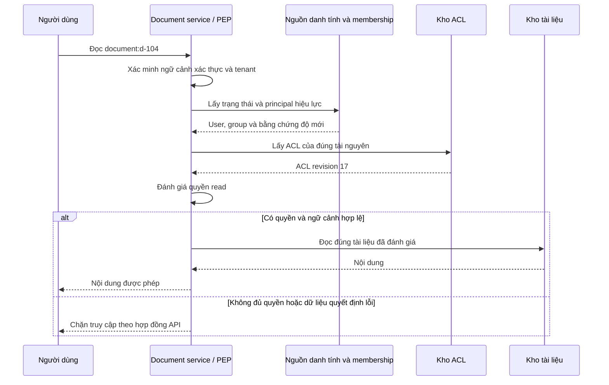

# ACL

## 1. ACL biểu diễn quyền theo từng tài nguyên

**ACL — Access Control List**, hay danh sách kiểm soát truy cập, là cơ chế gắn với một tài nguyên để mô tả những chủ thể nào được thực hiện những quyền truy cập nào trên tài nguyên đó. NIST định nghĩa ACL theo hướng liệt kê các thực thể hệ thống được phép truy cập tài nguyên cùng những chế độ truy cập được cấp. [NIST, access control list](https://csrc.nist.gov/glossary/term/access_control_list)

Ví dụ, một tài liệu có thể cho An đọc, cho nhóm Kế toán cập nhật nội dung và cho Chi quản lý chia sẻ. Danh sách đó thuộc về tài liệu cụ thể, không phải một quyền tổng quát trên mọi tài liệu trong ứng dụng.

```text
Tài nguyên: document:d-104

user:an          → read
group:accounting → read, update_content
user:chi         → read, update_content, manage_acl, delete
```

ACL thường xuất hiện trong hệ điều hành, hệ thống tệp, kho lưu trữ và ứng dụng cộng tác. Tuy nhiên, cùng gọi là ACL không có nghĩa chúng dùng chung thuật toán đánh giá, cùng quy tắc kế thừa hoặc cùng cách kết hợp allow và deny.

Trong nền tảng IAM, ACL trả lời một phần của câu hỏi phân quyền: “Danh tính này có quyền thực hiện hành động này trên tài nguyên này hay không?”. Nó cần kết hợp với danh tính đã được xác thực, trạng thái tài khoản, phạm vi tenant và những ràng buộc tổ chức của hệ thống.

Đăng nhập thành công chỉ xác lập ngữ cảnh danh tính được chấp nhận. Nó không tự thêm người dùng vào ACL của mọi tài nguyên.

## 2. Một ACL gồm những gì?

Một mục trong ACL thường được gọi là **ACE — Access Control Entry**. Hình thức cụ thể tùy nền tảng, nhưng khi đọc một ACE cần xác định ít nhất chủ thể, tập quyền và tài nguyên mà mục đó áp dụng.

| Thành phần | Câu hỏi cần trả lời | Ví dụ |
|---|---|---|
| Resource | Đang bảo vệ đối tượng nào? | `document:d-104` |
| Principal hoặc trustee | Quyền áp dụng cho danh tính hay tập danh tính nào? | `user:an`, `group:accounting` |
| Permission hoặc access right | Chủ thể được thực hiện hành động gì? | `read`, `update_content` |
| Effect, nếu hệ thống hỗ trợ | Mục này cho phép hay từ chối? | `ALLOW`, `DENY` |
| Scope, nếu có | Áp dụng cho chính đối tượng hay các đối tượng con nào? | Chỉ tài liệu hiện tại |
| Nguồn và metadata quản trị | Mục này đến từ đâu, ai thay đổi, phiên bản nào? | Grant trực tiếp, revision 17 |

Không phải mọi ACL đều có field effect riêng. Một ACL chỉ ghi các quyền được cấp có thể từ chối ngầm khi không tìm thấy quyền phù hợp. Không nên thêm một field `deny` vào cấu trúc dữ liệu rồi xem như đã có đầy đủ ngữ nghĩa xử lý xung đột.

### 2.1. Principal cần có định danh ổn định

Principal có thể là người dùng, nhóm hoặc workload, tùy khả năng của hệ thống. Với ứng dụng có nhiều loại principal, nên phân biệt kiểu và ID:

```text
USER:user-42
GROUP:accounting-7
WORKLOAD:report-exporter
```

Chỉ lưu một chuỗi `42` mà không có namespace có thể khiến user và group cùng ID bị nhầm. Tương tự, dùng tên hiển thị hoặc email làm định danh quyền có thể gây lỗi khi đổi tên hoặc tái cấp email cho người khác.

Nếu IAM nhận danh tính từ nhiều nhà phát hành, cần ánh xạ danh tính bên ngoài vào principal nội bộ theo quy tắc rõ ràng. Hai token từ hai issuer có cùng chuỗi subject không nhất thiết đại diện cùng một người.

ACL không tự xác thực danh tính. Backend phải xác định principal từ ngữ cảnh xác thực đã kiểm tra, không lấy `userId` trong body do client điều khiển để thực hiện kiểm tra quyền.

### 2.2. Permission cần bám hành động nghiệp vụ

Với một tài liệu, các hành động có thể được tách như sau:

```text
read_metadata      Xem metadata được phép công bố
read               Đọc nội dung
update_content     Thay đổi nội dung
delete             Xóa tài liệu
manage_acl         Quản lý grant trong giới hạn được phép
transfer_owner     Chuyển ownership
export             Tạo hoặc tải bản xuất theo hợp đồng sản phẩm
```

Đây là tập quyền minh họa. Một hệ thống có thể gộp hoặc tách khác đi, nhưng phải công bố ý nghĩa cụ thể.

Không có quy luật phổ quát rằng `write` luôn bao gồm `read`, hoặc `read` luôn bao gồm quyền xuất hàng loạt. Nếu sản phẩm dùng vai trò “Editor” để bao gồm đọc và sửa, cần định nghĩa phép ánh xạ vai trò đó sang tập quyền.

Quyền quản lý ACL cũng không nên được gộp ngầm vào cập nhật nội dung. Người sửa một bảng tính không nhất thiết được phép chia sẻ bảng tính cho toàn tổ chức.

### 2.3. Owner không phải một kết luận tự động

Owner của tài nguyên có thể được cấp quyền quản lý ACL theo quy tắc sản phẩm hoặc được nền tảng cấp một số quyền đặc biệt. Không được suy ra từ tên owner rằng người đó luôn vượt qua mọi kiểm soát.

Trong ví dụ của bài, các quyền truy cập dữ liệu và quản lý ACL được ghi rõ. Những ràng buộc như tài khoản đang hoạt động và tenant hợp lệ vẫn được kiểm tra. Việc một người từng tạo tài liệu không cho phép họ bỏ qua trạng thái tài khoản bị đình chỉ.

## 3. ACL là cách nhìn theo đối tượng của ma trận quyền

Có thể hình dung quyền truy cập như một ma trận, trong đó hàng là tài nguyên và cột là chủ thể:

| Tài nguyên | An | Nhóm Kế toán | Chi |
|---|---|---|---|
| `document:d-104` | read | read, update_content | read, update_content, manage_acl, delete |
| `document:d-105` | Không có grant | read | read |
| `document:d-106` | read | Không có grant | Không có grant |

ACL của `d-104` tương ứng cách nhìn một hàng: tài nguyên đó cấp quyền gì cho những principal nào.

Câu hỏi “Chi có quyền trên những tài nguyên nào?” lại đi theo hướng của một cột. Một hệ thống ACL có thể xây chỉ mục để trả lời, nhưng việc đọc ACL của một tài nguyên không tự cung cấp bức tranh đầy đủ về mọi quyền của Chi.

Cũng không đồng nhất chỉ mục quyền theo chủ thể với một capability token. Một token cấp quyền có những yêu cầu riêng về cấp phát, chuyển giao, thời hạn và thu hồi; đổi cách trình bày dữ liệu không tự tạo ra các đặc tính đó.

### 3.1. ACL và nhóm người dùng

Khi cấp quyền cho group, ACL không nhất thiết ghi từng thành viên group. Nó ghi principal của group; lúc đánh giá, hệ thống xác định người gọi có thuộc group đó theo nguồn membership được chấp nhận hay không.

```text
ACL(document:d-104):
    group:accounting → read, update_content

Membership:
    user:binh ∈ group:accounting

Kết quả:
    Bình có đường nhận read và update_content trên d-104.
```

Vì vậy, thay đổi membership có thể làm thay đổi quyền hiệu lực mà bản thân ACL của tài liệu không đổi.

Nếu hỗ trợ group lồng nhau, phải định nghĩa cách giải membership hiệu lực, giới hạn độ sâu hoặc chu trình và độ mới của dữ liệu. Không tự tin tưởng danh sách group được người dùng gửi trong request.

## 4. Mô hình minh họa: ACL chỉ cấp quyền

Để không trộn ngữ nghĩa của nhiều nền tảng, phần ví dụ ứng dụng trong bài chọn một hợp đồng đơn giản:

- ACL chỉ chứa grant cho phép; không có ACE deny.
- Không có wildcard public và không có kế thừa từ tài nguyên cha.
- Người dùng nhận quyền từ principal của chính mình và các group hiệu lực đã được xác minh.
- Các quyền từ những ACE phù hợp được hợp lại.
- Một hành động chỉ được thực hiện khi quyền cần thiết được cấp và các ràng buộc ngoài ACL đều thỏa.
- Không có grant phù hợp hoặc không lấy được dữ liệu quyết định đáng tin cậy thì không cấp quyền.

Các quy tắc này chỉ áp dụng cho ví dụ. Không dùng thuật toán của ví dụ để thay thế thuật toán ACL của hệ điều hành.

### 4.1. Dữ liệu của ví dụ

```text
Tenant của tài liệu: tenant-a
Tài liệu:           document:d-104
Trạng thái:         ACTIVE
ACL revision:       17

An:                 user:an, không thuộc group:accounting
Bình:               user:binh, thuộc group:accounting
Chi:                user:chi, không thuộc group:accounting
Dũng:               user:dung, không có grant phù hợp
```

ACL của tài liệu:

| Principal | Các quyền được cấp |
|---|---|
| `user:an` | `read` |
| `group:accounting` | `read`, `update_content` |
| `user:chi` | `read`, `update_content`, `manage_acl`, `delete` |

Các người dùng trong ví dụ đã được xác thực, đang hoạt động và đủ điều kiện sử dụng tenant-a. Khi một giả định đó thay đổi, không được chỉ dựa vào ACL để giữ kết quả cho phép.

### 4.2. Công thức quyền hiệu lực

Gọi `Subjects(u)` là tập principal phù hợp với người dùng u, gồm user của chính họ và các group hiệu lực. Với ACL chỉ cấp quyền:

```text
Granted(u, resource)
    = hợp các tập permission của ACE
      có principal thuộc Subjects(u)

Permit(u, action, resource)
    = ContextValid(u, resource)
      AND RequiredPermissions(action) ⊆ Granted(u, resource)
```

Ký hiệu `⊆` yêu cầu toàn bộ các quyền cần thiết đều có trong tập được cấp. Nếu thao tác cần cả `read` và `export`, có mỗi `read` chưa đủ.

Đồng thời, nếu một thao tác có nhiều cách được phép theo nghiệp vụ, policy phải mô tả phép lựa chọn đó riêng. Không thay tùy tiện phép “cần tất cả” thành “có ít nhất một quyền”.

### 4.3. Từ chối mặc định

Với hợp đồng trên, Dũng không có ACE phù hợp nên không được đọc tài liệu. Không cần một ACE deny riêng cho Dũng.

Khi ứng dụng thêm hành động mới, ví dụ `transfer_owner`, không ai được hưởng quyền đó chỉ vì họ đã có một hành động khác. Việc cấp quyền mới cần một lựa chọn được thể hiện trong policy hoặc dữ liệu.

OWASP khuyến nghị từ chối mặc định và kiểm tra quyền trên mọi request. Những nguyên tắc này giúp tránh việc một đường API mới hoặc một request không khớp quy tắc vô tình được phép. [OWASP, Authorization Cheat Sheet](https://cheatsheetseries.owasp.org/cheatsheets/Authorization_Cheat_Sheet.html)

## 5. Một request được kiểm tra như thế nào?

Luồng khái niệm khi đọc tài liệu:



Việc lấy metadata tối thiểu để định danh tài nguyên có thể xảy ra trước khi hoàn tất quyết định. Metadata đó là dữ liệu nội bộ phục vụ kiểm tra; không có nghĩa được trả ngay cho người gọi.

Một luồng đánh giá cần giữ riêng hai trường hợp: từ chối vì không có grant và không thể đánh giá do lỗi dữ liệu hoặc phụ thuộc. Cả hai đều không mở đường đọc trong ví dụ, nhưng cần dấu vết khác nhau để vận hành.

Lỗi đọc ACL không được đổi thành danh sách public mặc định. Membership chưa tải được không được xem là bằng chứng rằng người dùng đang có một group đặc quyền nào đó.

### 5.1. Truy vết vài kết quả

| Request | Kết quả của ví dụ | Căn cứ |
|---|---|---|
| An đọc `d-104` | Cho phép | Grant read trực tiếp |
| An sửa nội dung `d-104` | Từ chối | Không có update_content |
| Bình sửa nội dung `d-104` | Cho phép | Membership group:accounting và grant của group |
| Bình sửa ACL `d-104` | Từ chối | Grant của group không có manage_acl |
| Chi xóa `d-104` | Có quyền delete ở tầng ACL | Vẫn cần kiểm tra điều kiện nghiệp vụ và trạng thái |
| Dũng đọc `d-104` | Từ chối | Không có grant phù hợp |

Những kết quả này giả định chỉ có dữ kiện đã nêu, không có đường cấp quyền khác. Có quyền delete không tự bỏ qua quy tắc tài liệu đang bị giữ lại hoặc một quy trình phê duyệt bắt buộc.

## 6. Ví dụ lõi đánh giá ACL chỉ cấp quyền bằng Java

Đoạn mã sau minh họa phép hợp quyền từ các ACE phù hợp. Nó chỉ là phần lõi của mô hình ứng dụng đã chọn, không phải thuật toán Windows DACL hay Linux ACL.

Trước khi gọi hàm, service phải kiểm tra danh tính, trạng thái tài khoản, tenant và tài nguyên. ACL phải thuộc đúng đối tượng đang được bảo vệ; tập principal phải đến từ nguồn đã được xác minh. Không đưa collection nhận trực tiếp từ request của người dùng vào hàm rồi coi kết quả là quyết định hoàn chỉnh.

```java
import java.util.EnumSet;
import java.util.List;
import java.util.Set;

public final class AllowOnlyAcl {
    public enum PrincipalKind {
        USER, GROUP, WORKLOAD
    }

    public enum Permission {
        READ, UPDATE_CONTENT, MANAGE_ACL, DELETE, EXPORT, TRANSFER_OWNER
    }

    public enum Decision {
        PERMIT, DENY, INDETERMINATE
    }

    public record Principal(PrincipalKind kind, String id) {
    }

    public record Entry(Principal principal, Set<Permission> permissions) {
    }

    public static Decision evaluate(
            Set<Principal> verifiedSubjects,
            List<Entry> entries,
            Set<Permission> required) {

        if (verifiedSubjects == null || verifiedSubjects.isEmpty()
                || entries == null || required == null || required.isEmpty()) {
            return Decision.INDETERMINATE;
        }

        if (verifiedSubjects.stream().anyMatch(p -> !valid(p))
                || required.stream().anyMatch(p -> p == null)) {
            return Decision.INDETERMINATE;
        }

        EnumSet<Permission> granted = EnumSet.noneOf(Permission.class);

        for (Entry entry : entries) {
            if (entry == null || !valid(entry.principal())
                    || entry.permissions() == null
                    || entry.permissions().stream().anyMatch(p -> p == null)) {
                return Decision.INDETERMINATE;
            }

            if (verifiedSubjects.contains(entry.principal())) {
                granted.addAll(entry.permissions());
            }
        }

        return granted.containsAll(required)
                ? Decision.PERMIT
                : Decision.DENY;
    }

    private static boolean valid(Principal principal) {
        return principal != null
                && principal.kind() != null
                && principal.id() != null
                && !principal.id().isBlank();
    }
}
```

Những điểm cần đọc đúng trong mã:

- ACL rỗng là một danh sách hợp lệ và không cấp quyền.
- `required` rỗng bị xem là đầu vào không hợp lệ, tránh một lỗi ánh xạ hành động làm phép kiểm tra tập rỗng tự cho phép.
- Tất cả quyền cần thiết phải có trong tập được cấp.
- Dữ liệu không hợp lệ tạo `INDETERMINATE`, không tạo quyền truy cập.
- Kiểu principal tham gia so sánh; user và group cùng chuỗi ID không trùng nhau.

`record` không tự làm các collection bên trong bất biến. Lớp thu thập nên tạo snapshot không đổi sau khi kiểm tra dữ liệu, để collection không bị thay đổi giữa lúc đánh giá.

Hàm cũng không xác minh `verifiedSubjects` có đúng là principal của người gọi hay không. Tên tham số mô tả một điều kiện đầu vào bắt buộc; nó không phải bằng chứng rằng điều kiện đã được thực hiện.

### 6.1. Nhiều quyền có thể đến từ nhiều ACE

Giả sử một hành động cần cả READ và EXPORT. Người dùng được READ trực tiếp, còn group họ thuộc có EXPORT trên cùng tài nguyên.

Trong mô hình chỉ cấp quyền của bài, phép hợp tạo đủ cả hai quyền nên tầng ACL cho phép. Nếu nghiệp vụ yêu cầu hai quyền phải đến từ cùng một grant hoặc một cơ chế phê duyệt riêng, hàm trên không thể hiện yêu cầu đó.

Do đó, phải xác định ý nghĩa phép kết hợp trước khi dùng một evaluator chung. Không chọn thuật toán chỉ vì nó cho kết quả mong muốn trên một vài ví dụ đơn giản.

## 7. Lưu dữ liệu ACL và gắn với đúng tài nguyên

Một cấu trúc lưu trữ minh họa có thể tách metadata ACL khỏi các grant:

```text
resource_security
    tenant_id
    resource_type
    resource_id
    acl_revision

acl_grant
    tenant_id
    resource_type
    resource_id
    principal_kind
    principal_id
    permission
    granted_by
    granted_at
```

Đây là mô tả khái niệm, không phải migration hay schema dùng chung cho mọi cơ sở dữ liệu.

Tổ hợp tenant, loại tài nguyên và ID giúp định danh phạm vi cần kiểm tra. Một grant trên `document:d-104` không được áp dụng cho một `folder:d-104` chỉ vì phần ID trùng nhau.

Một dòng `acl_grant` ở đây biểu diễn một permission. Có thể lưu tập quyền trong một ACE thay vì một dòng cho mỗi quyền, nhưng phải giữ ngữ nghĩa cập nhật và đọc snapshot nhất quán.

`acl_revision` đại diện một phiên bản ACL của tài nguyên. Khi thay đổi tập grant, revision cần thay đổi cùng giao dịch phù hợp, để reader và writer có cách nhận biết dữ liệu đã đổi.

### 7.1. Không dùng dữ liệu ACL làm nguồn xác thực

Bản ghi ACL nói principal nào được cấp quyền. Nó không chứng minh principal đó còn là tài khoản hoạt động hoặc group còn tồn tại.

Service cần phối hợp với quản lý vòng đời danh tính. Một grant trỏ đến user đã bị vô hiệu hóa không nên mở lại quyền chỉ vì dòng grant chưa được cleanup.

Khi xóa một tài nguyên, cần xác định cách xử lý ACL của nó. Nếu còn dữ liệu cũ rồi tái sử dụng ID cho một đối tượng mới, grant của đối tượng cũ có thể vô tình áp dụng cho đối tượng mới.

### 7.2. Đọc một snapshot có ý nghĩa

Nếu reader lấy một nửa grant trước lúc cập nhật và một nửa sau lúc cập nhật, nó có thể đánh giá một tập quyền chưa từng được phê duyệt như một trạng thái hoàn chỉnh.

Cần sử dụng cơ chế snapshot hoặc giao dịch phù hợp với kho dữ liệu. Nếu ACL nằm ở dịch vụ khác, hợp đồng trả về nên xác định tài nguyên và revision thực sự đã được đọc.

Không chỉ kiểm tra revision của ACL nếu trạng thái tài nguyên hoặc membership cũng có thể đổi kết quả. Mỗi nguồn dữ liệu ảnh hưởng quyết định cần một cách xử lý độ mới và cạnh tranh riêng.

## 8. Quyền sửa ACL là một quyền quản trị

Một người có `manage_acl` đang được phép thay đổi ai có thể tiếp cận tài nguyên. Đây là thao tác nhạy cảm hơn việc đổi một trường văn bản thông thường.

Chỉ kiểm tra “actor có manage_acl” rồi chấp nhận mọi danh sách quyền client gửi là chưa đủ. Hệ thống cần giới hạn quyền mà actor có thể cấp, đối tượng nhận quyền và tài nguyên áp dụng.

Trong thiết kế minh họa, một yêu cầu cấp quyền có thể phải thỏa:

```text
actor đang có quyền quản lý ACL của đúng tài nguyên
principal nhận quyền hợp lệ trong phạm vi cho phép
permission được cấp nằm trong tập actor có thể ủy quyền
grant không vượt ràng buộc tenant hoặc chính sách tổ chức
phiên bản ACL chưa bị thay đổi bởi một thao tác cạnh tranh
thay đổi được ghi cùng thông tin kiểm toán cần thiết
```

Tập quyền actor được sử dụng và tập quyền actor được ủy quyền là hai khái niệm khác nhau. Có DELETE không nhất thiết được cấp DELETE cho người khác; có MANAGE_ACL cũng có thể chỉ được cấp READ hoặc UPDATE_CONTENT trong phạm vi được giao.

### 8.1. Tránh tự mở rộng quyền qua payload

Xét một API cho editor sửa nội dung tài liệu. Nếu backend nhận một đối tượng document rồi ghi toàn bộ field, client có thể gửi thêm:

```json
{
  "title": "Báo cáo quý",
  "content": "...",
  "acl": [
    {
      "principal": "user:attacker",
      "permissions": ["read", "manage_acl"]
    }
  ]
}
```

Nếu cùng luồng đó cập nhật ACL mà không kiểm tra quyền quản trị riêng, quyền sửa nội dung đã trở thành quyền chia sẻ và nâng quyền.

Một thiết kế có thể tách endpoint cập nhật nội dung khỏi endpoint quản lý quyền, hoặc giữ chung endpoint nhưng kiểm tra từng thay đổi theo hành động tương ứng. Điều cốt lõi là trường ACL không được đi qua nhánh cập nhật dữ liệu thông thường.

### 8.2. Cập nhật cạnh tranh và quyền của actor

Giả sử hai quản trị viên cùng đọc revision 17. Người thứ nhất thu hồi một grant và tạo revision 18; người thứ hai ghi thay toàn bộ ACL dựa trên bản 17, vô tình đưa grant đã thu hồi trở lại.

Cập nhật có điều kiện theo revision có thể phát hiện việc ghi đè này. Khi có xung đột, cần tải lại, đánh giá lại quyền của actor và xây dựng thay đổi trên trạng thái phù hợp.

Kiểm tra manage_acl trước rồi chờ lâu mới ghi cũng tạo khoảng cách thời gian. Actor có thể đã bị thu hồi quyền quản trị trong khoảng đó. Với yêu cầu nghiêm ngặt, việc xác nhận thẩm quyền và cập nhật ACL phải được phối hợp để không dựa vào quyền đã hết hiệu lực.

Khi membership nằm ở hệ thống khác, một giao dịch trong cơ sở dữ liệu ACL không tự khóa membership. Thiết kế cần xác định mức nhất quán chấp nhận được thay vì giả định mọi nguồn đã nằm trong cùng giao dịch.

### 8.3. Chuyển ownership và mất người quản trị cuối cùng

Xóa grant quản trị cuối cùng có thể khiến tài nguyên không còn người quản lý hợp lệ. Một sản phẩm có thể chặn việc đó, chuyển ownership theo quy trình hoặc có cơ chế khôi phục được kiểm soát.

Cơ chế khôi phục không nên là một điều kiện “admin luôn được phép” ẩn trong mã mà không có phạm vi và dấu vết. Nếu có quyền quản trị đặc biệt hoặc break-glass, cần mô hình hóa và quản lý như quyền đặc biệt của hệ thống.

## 9. Kế thừa ACL cần một hợp đồng riêng

Ví dụ chính của bài không có kế thừa. Nếu thêm folder cha và document con, phải chọn cách quyền từ cha ảnh hưởng đến con.

Hai cách thiết kế khác nhau là:

| Cách thiết kế | Điều xảy ra khi ACL cha thay đổi |
|---|---|
| Sao chép quyền khi tạo con | Bản sao ở con không tự đổi nếu không có quy trình đồng bộ |
| Đánh giá quyền kế thừa từ cha | Quyền con phụ thuộc vào ACL cha theo cơ chế đánh giá và độ nhất quán đã định |

Một bản sao ACL ban đầu không phải một liên kết kế thừa động. Nếu muốn đồng bộ, phải quản lý nguồn của từng entry và cách giải quyết khi entry trực tiếp trên con trùng với entry có nguồn từ cha.

Ví dụ, user được cấp READ trực tiếp trên document và cũng nhận READ từ folder. Khi xóa grant ở folder, quyền trực tiếp có thể vẫn còn. Nếu chỉ giữ một dòng tổng hợp rồi xóa dòng đó khi cha đổi, hệ thống có thể thu hồi nhầm quyền trực tiếp.

### 9.1. Dừng kế thừa, di chuyển và quyền ngoại lệ

Nếu cho phép document dừng kế thừa, cần xác định thao tác đó xóa entry kế thừa hay chuyển chúng thành entry trực tiếp. Hai lựa chọn dẫn đến hành vi thu hồi khác nhau.

Khi chuyển document giữa hai folder, ACL hiệu lực có thể thay đổi ngay cả khi ACL trực tiếp của document không đổi. Đây là một thao tác ảnh hưởng quyền truy cập và cần kiểm tra nguồn, đích, quyền di chuyển cùng trạng thái chuyển tiếp.

Không có một quy tắc ACL phổ quát rằng quyền con luôn thắng quyền cha hoặc deny luôn thắng allow. Kết quả phụ thuộc nền tảng, nguồn entry, thứ tự và thuật toán kết hợp được định nghĩa.

Đối với một model ứng dụng tự thiết kế, nên công bố các quy tắc này bằng những ví dụ có xung đột cụ thể trước khi cho phép người dùng cấu hình deny hoặc inheritance.

## 10. Thu hồi quyền gắn với vòng đời danh tính

Trong IAM, quyền không chỉ được cấp một lần rồi giữ mãi. Người dùng đổi nhóm, chuyển bộ phận, nghỉ việc hoặc bị đình chỉ; workload có thể bị thay thế hoặc thu hồi thông tin xác thực.

Với ACL của ví dụ:

```text
Bình có READ và UPDATE_CONTENT
    vì Bình thuộc group:accounting
    và group đó có grant trên d-104.
```

Khi Bình rời group, quyền qua group cần mất theo hợp đồng độ mới của hệ thống. Không cần sửa từng ACL nếu evaluator sử dụng membership đã cập nhật.

Tuy nhiên, nếu Bình còn một grant trực tiếp READ, xóa membership chỉ thu hồi đường qua group. Bình vẫn có thể đọc theo grant trực tiếp nếu các ràng buộc khác còn thỏa.

### 10.1. Thu hồi một ACE và thu hồi toàn bộ quyền

“Xóa grant X” là một thay đổi dữ liệu cụ thể. “Người dùng không còn bất kỳ quyền nào trên tài nguyên” là một kết luận về tất cả đường cấp quyền.

Để xác nhận kết luận thứ hai, có thể cần xem grant trực tiếp, membership group, kế thừa nếu hệ thống có hỗ trợ và các cơ chế truy cập khác. Một bảng ACL trực tiếp chưa chắc mô tả toàn bộ quyền hiệu lực.

Ngay cả khi chặn được truy cập mới, không thể thu lại những dữ liệu người dùng đã tải hoặc sao chép trước đó chỉ bằng cách sửa ACL. Việc quản lý dữ liệu đã phát hành là một yêu cầu khác của sản phẩm.

### 10.2. Token và phiên có thể giữ bằng chứng cũ

Nếu danh sách group được đóng trong token ở lúc đăng nhập, việc xóa user khỏi group không tự thay đổi token đã cấp. Hệ thống cần chọn cách xử lý: thời hạn token, kiểm tra lại membership, quản lý phiên hoặc cơ chế thu hồi phù hợp.

Không có một TTL chung bảo đảm thu hồi tức thì cho mọi trường hợp. Phải tính thời gian lan truyền từ nguồn danh tính, độ cũ của token, cache membership, cache ACL và cache quyết định.

Với workload, principal bị ngừng sử dụng cần được quản lý tương tự. Không tái dùng một ID workload cũ cho một dịch vụ khác rồi mặc định rằng mọi ACL còn trỏ đến ID đó vẫn phù hợp.

## 11. Cache và thời điểm thực thi

Cache có thể nằm ở nhiều tầng:

```text
Cache danh tính và trạng thái tài khoản
Cache membership group
Cache ACL của tài nguyên
Cache quyết định theo user, action và resource
Cache dữ liệu hoặc bản xuất đã được tạo
```

Mỗi cache giữ một loại dữ liệu khác nhau. Làm mới ACL không tự làm mới membership, và làm mới quyết định không thu hồi được một đường tải dữ liệu đã phát hành nếu đường đó có cơ chế truy cập riêng.

### 11.1. Độ cũ có thể nối tiếp nhau

Giả sử một người bị xóa khỏi group ở giây 0. Một bản sao membership chỉ nhận thay đổi ở giây 30. Ở giây 29, evaluator vẫn thấy membership cũ và tạo một quyết định cho phép được cache thêm 60 giây.

Nếu không có invalidation hoặc kiểm tra bổ sung, quyết định đó có thể được dùng đến gần giây 89. Các con số chỉ minh họa sự nối tiếp độ trễ, không phải cấu hình đề xuất.

Một khóa cache chỉ có resource ID cũng không đủ cho quyết định theo user. Cần xử lý danh tính, hành động, tenant, phiên bản ACL và những yếu tố đầu vào khác có thể làm thay đổi kết quả.

Cách xử lý không nhất thiết là đưa mọi trường vào một chuỗi khóa. Có thể dùng revision, invalidation, giới hạn độ cũ hoặc phối hợp chúng, nhưng không được bỏ qua một yếu tố chỉ vì nó khó cập nhật.

### 11.2. Khoảng cách từ kiểm tra đến sử dụng

Ở thời điểm kiểm tra, Chi có quyền cập nhật nội dung. Trước khi lệnh ghi chạy, một quản trị viên thu hồi grant đó hoặc tài liệu chuyển sang trạng thái bị khóa.

Nếu thao tác vẫn chạy dựa trên snapshot cũ, hệ thống cần xác định việc đó có nằm trong mức nhất quán chấp nhận được hay không. Với hành động có yêu cầu chặt, cần gắn kiểm tra và cập nhật bằng giao dịch, version hoặc cơ chế phối hợp phù hợp.

Một điều kiện theo revision ACL có thể phát hiện ACL đã đổi; nó không tự phát hiện membership bị thay đổi ở một dịch vụ khác. Tương tự, version nội dung có thể không phản ánh việc quyền đã bị thu hồi.

### 11.3. Dữ liệu đã cache vẫn cần được bảo vệ

Một API trả nội dung từ cache vẫn là đường truy cập dữ liệu. Không nên chỉ kiểm tra ACL khi đọc từ database rồi bỏ kiểm tra khi trả bản cache.

Đối với tài nguyên có người xem khác nhau, cache chia sẻ phải được thiết kế sao cho nội dung của một người không bị trả cho người khác. Nếu dùng URL tải có thời hạn, cần xác định nó có tiếp tục hoạt động sau khi ACL đổi hay không và thời hạn đó có đáp ứng yêu cầu sản phẩm không.

## 12. Windows DACL và Linux ACL có ngữ nghĩa riêng

Các ví dụ sau giúp nhận diện khác biệt khi chuyển từ kiến thức ACL tổng quát sang nền tảng cụ thể. Chúng không phải hướng dẫn thay đổi quyền trên máy đang chạy.

### 12.1. Windows DACL: thứ tự ACE có ý nghĩa

Windows dùng DACL để chứa các ACE cho phép hoặc từ chối quyền với trustee. AccessCheck xét ACE theo thứ tự và có thể dừng khi quyền yêu cầu đã được cấp đủ hoặc gặp điều kiện từ chối phù hợp. Vì vậy, không thể coi DACL là một tập allow/deny không có thứ tự. [Microsoft, How AccessCheck Works](https://learn.microsoft.com/en-us/windows/win32/secauthz/how-dacls-control-access-to-an-object)

Đặc biệt, “deny luôn thắng mọi allow ở bất kỳ vị trí nào” không mô tả đầy đủ cách xử lý DACL. Khi tạo hoặc phân tích DACL, cần tuân theo quy tắc sắp xếp và đánh giá của Windows.

Một phân biệt khác là null DACL và empty DACL: null DACL không cung cấp bảo vệ theo DACL và cho phép truy cập; empty DACL tồn tại nhưng không có ACE cấp quyền. Không được dùng hai trạng thái đó thay thế nhau, hoặc suy diễn chúng thành quy tắc cho ACL ứng dụng. Các quyền ngầm và đặc quyền hệ thống cũng cần được xem xét khi phân tích toàn bộ kết quả truy cập. [Microsoft, Null DACLs and Empty DACLs](https://learn.microsoft.com/en-us/windows/win32/secauthz/null-dacls-and-empty-dacls)

### 12.2. Linux ACL: mask có thể giới hạn quyền hiệu lực

ACL tệp trên Linux có các mục cho owner, named user, owning group, named group, mask và other. Mask giới hạn quyền của named user và các mục group; không giới hạn mục owner theo cùng cách.

Ví dụ dạng văn bản:

```text
user::rw-
user:an:rw-
group::r--
mask::r--
other::---
```

Ở đây, named user An được ghi `rw-` nhưng quyền hiệu lực của mục đó bị mask giới hạn còn `r--`. Không nên chỉ nhìn chuỗi permission của riêng entry để kết luận.

Linux cũng phân biệt access ACL với default ACL của directory dùng trong việc thiết lập ACL ban đầu cho đối tượng mới. Default ACL không phải một liên kết động tự cập nhật mọi con cũ khi cha đổi. [Linux manual, acl(5)](https://man7.org/linux/man-pages/man5/acl.5.html)

### 12.3. Không áp dụng nhầm evaluator giữa các hệ thống

Hàm Java ở phần trước chỉ thực hiện phép hợp grant của mô hình minh họa. Nó không xử lý thứ tự ACE Windows, mask Linux hoặc quy tắc access check đầy đủ của các nền tảng đó.

Nếu ứng dụng cần hỏi hệ điều hành một principal có quyền truy cập tệp hay không, phải dùng API và ngữ cảnh bảo mật phù hợp. Đọc một danh sách entry rồi tự chạy phép hợp đơn giản có thể cho kết quả khác hệ điều hành.

Tương tự, một ACL mạng có thể dùng những thuộc tính và cách ghép quy tắc khác ACL tài nguyên ứng dụng. Trước khi phân tích, cần xác định ACL đang thuộc loại hệ thống nào và hợp đồng đánh giá của nó là gì.

## 13. ACL liên hệ thế nào với các mô hình khác?

ACL mô tả quyền theo tài nguyên. Nó có thể là một phần của hệ thống sử dụng vai trò, thuộc tính hoặc quan hệ; các cách biểu diễn này không nhất thiết loại trừ nhau.

| Cách tiếp cận | Trọng tâm mô tả | Ví dụ trong hệ thống tài liệu |
|---|---|---|
| ACL | Principal nào có quyền gì trên tài nguyên cụ thể | An được READ trên d-104 |
| RBAC | Quyền được tổ chức qua vai trò và gán vai trò | Vai trò Editor cung cấp một tập quyền được định nghĩa |
| ABAC | Chính sách đánh giá thuộc tính và ngữ cảnh | Chỉ cho đọc tài liệu nhạy cảm khi phiên đạt mức bảo đảm yêu cầu |
| ReBAC | Quyền được suy ra qua quan hệ giữa các đối tượng | Thành viên dự án được xem tài liệu thuộc dự án theo policy |
| DAC | Thẩm quyền quyết định hoặc chuyển giao quyền mang tính tùy nghi | Chủ thể được trao quyền chia sẻ tài nguyên trong phạm vi cho phép |

ACL không đồng nghĩa với DAC. ACL là một cách biểu diễn hoặc thực thi quyền; DAC nói về cách thẩm quyền cấp và thay đổi quyền được tổ chức. Một nền tảng có ACL vẫn có thể đặt giới hạn bắt buộc mà owner tài nguyên không được vượt qua.

Tương tự, việc một ACE nhắm vào group không tự mô tả toàn bộ RBAC. Cần biết group đó được quản trị ra sao, vai trò nào được gán, quyền có phạm vi nào và các điều kiện tổ chức được áp dụng ở đâu.

Một hệ thống có thể kết hợp:

```text
ACL xác nhận user hoặc group có READ trên tài liệu
AND chính sách tổ chức cho phép sử dụng tenant đó
AND policy phiên đáp ứng yêu cầu bảo đảm của dữ liệu
AND tài nguyên còn ở trạng thái được phục vụ
```

Khi kết hợp, cần định nghĩa điều kiện nào là bắt buộc và đường nào là lựa chọn thay thế. Nếu viết tất cả bằng phép OR, một grant ACL có thể vô tình vượt qua ràng buộc tổ chức.

## 14. Điểm thực thi phải bảo vệ mọi đường dữ liệu

Giả sử có các endpoint:

```text
GET    /documents/d-104
PATCH  /documents/d-104/content
PUT    /documents/d-104/acl
DELETE /documents/d-104
GET    /documents/search
POST   /documents/export
```

Mỗi đường thực hiện một hành động khác nhau. Kiểm tra READ ở endpoint đầu không bảo vệ endpoint sửa ACL, tìm kiếm hoặc xuất dữ liệu.

Ánh xạ minh họa:

| Đường nghiệp vụ | Quyền hoặc kiểm tra cần thiết |
|---|---|
| Đọc một tài liệu | READ trên đúng tài liệu |
| Sửa nội dung | UPDATE_CONTENT cùng điều kiện trạng thái |
| Quản lý chia sẻ | MANAGE_ACL và giới hạn ủy quyền |
| Xóa tài liệu | DELETE cùng điều kiện nghiệp vụ |
| Tìm kiếm | Lọc quyền trên tài nguyên và trường được trả |
| Xuất nhiều tài liệu | Quyền của thao tác xuất cùng phạm vi các tài nguyên tham gia |

### 14.1. Resource ID không phải bằng chứng quyền

Nếu An có quyền đọc `d-104`, việc thay URL thành `d-105` phải dẫn đến một lần kiểm tra quyền trên tài nguyên mới.

UUID khó đoán có thể giảm khả năng đoán định danh, nhưng không thay thế kiểm tra ACL. ID có thể xuất hiện trong log, liên kết chia sẻ hoặc kết quả tìm kiếm.

Với hệ thống nhiều tenant, tài nguyên và ACL phải được lấy theo tenant đã xác minh cùng loại và ID tài nguyên. Không kiểm tra một ACL ở tenant A rồi tải một tài nguyên cùng ID ở tenant B.

### 14.2. Giao diện và token không thay thế điểm thực thi

Ẩn nút “Xóa” hoặc “Chia sẻ” giúp giao diện rõ ràng, nhưng client có thể gửi request trực tiếp. Quyết định cuối cùng cần được thực hiện ở phía bảo vệ dữ liệu.

Token OAuth có scope phù hợp cũng không tự chứng minh quyền trên mọi document. Scope có thể giới hạn loại hành động mà token được dùng; ACL vẫn có thể quyết định những đối tượng cụ thể mà chủ thể được tiếp cận.

Khi service gọi service khác, cần xác định đang thực hiện dưới danh tính workload hay thay mặt người dùng. Dùng tài khoản service có quyền rộng rồi bỏ kiểm tra người dùng có thể làm mọi request thừa hưởng quyền của service.

### 14.3. Danh sách, metadata và tác vụ nền

Một request tìm kiếm có thể tiết lộ tên tài liệu hoặc đoạn trích dù endpoint mở tài liệu đã được bảo vệ. Quyền cần áp dụng cho dữ liệu được công bố, không chỉ file hoàn chỉnh.

Phân trang và tổng số kết quả cũng cần hợp đồng phù hợp. Lấy toàn bộ tập dữ liệu, tính tổng rồi lọc vài mục trả về có thể tiết lộ thông tin của tài nguyên người gọi không được xem.

Tác vụ nền xuất dữ liệu cần có phạm vi và chủ thể rõ ràng. Quyền ở lúc tạo job, lúc đọc dữ liệu và lúc tải file kết quả có thể cần kiểm tra riêng tùy yêu cầu sản phẩm.

## 15. Kiểm toán và giải thích quyền hiệu lực

Một thông báo “access denied” có thể đủ cho giao diện nhưng chưa đủ cho vận hành. Khi có tranh chấp hoặc lỗi phân quyền, cần biết hệ thống đã đánh giá principal nào, hành động nào và trạng thái dữ liệu nào.

Với ví dụ ACL chỉ cấp quyền, log quyết định có thể chứa:

```text
requestId
actorPrincipal
tenantId
resourceType và resourceId
action hoặc requiredPermissions
decision
aclRevision
membershipRevision hoặc mốc quan sát phù hợp
matchingGrantIds, nếu được phép lưu và truy xuất
thời điểm đánh giá
```

Không phải hệ thống nào cũng có một membershipRevision toàn cục. Nếu không có, cần ghi bằng chứng độ mới phù hợp với nguồn dữ liệu thực tế, không tự tạo một con số làm người đọc hiểu nhầm có snapshot thống nhất.

Log thay đổi ACL cần mô tả actor, tài nguyên, phần grant thay đổi, revision trước/sau và căn cứ quản trị cần thiết. Nhờ đó có thể phân biệt ai cấp quyền với ai sử dụng quyền.

Một kết quả PERMIT không chứng minh hành động nghiệp vụ đã thành công. PEP cần dấu vết thực thi tương ứng để biết tài liệu có được trả, có bị xóa hoặc ACL có được thay đổi hay không.

Dữ liệu ACL cũng có thể nhạy cảm vì tiết lộ tên nhóm và quan hệ chia sẻ. Không công bố toàn bộ ACL cho mọi người có READ nếu sản phẩm chưa cấp quyền xem thông tin quản trị đó. Log cần kiểm soát truy cập và tránh chứa mật khẩu, token nguyên vẹn hoặc nội dung tài liệu không cần thiết.

## 16. Các tình huống dùng để kiểm tra thiết kế ACL

Bảng này mô tả kỳ vọng học tập cho hợp đồng minh họa, không phải kết quả chạy kiểm thử một ứng dụng thực tế:

| Tình huống | Kỳ vọng |
|---|---|
| Có READ trực tiếp trên tài nguyên | Được đọc khi ngữ cảnh hợp lệ |
| Chỉ có UPDATE_CONTENT, không có READ, và policy không định nghĩa bao hàm | Không tự phát sinh READ |
| Có quyền qua group hiệu lực | Nhận các quyền được cấp cho group trên tài nguyên |
| Không có grant phù hợp | Bị từ chối |
| ACL hợp lệ nhưng rỗng | Không cấp quyền |
| Không tải được ACL | Không cấp quyền; ghi nhận lỗi phụ thuộc |
| Client tự gửi group đặc quyền | Không dùng dữ liệu đó làm bằng chứng membership |
| User và group trùng chuỗi ID | Không bị đồng nhất principal |
| Thao tác yêu cầu READ và EXPORT, chỉ có READ | Bị từ chối |
| Thêm hành động mới nhưng quên ánh xạ requiredPermissions | Không cho phép bằng tập quyền rỗng |
| Thu hồi group nhưng còn grant trực tiếp | Quyền trực tiếp vẫn được đánh giá riêng |
| Editor nội dung gửi thêm field ACL | Không thay đổi ACL nếu thiếu quyền quản trị tương ứng |
| Hai cập nhật ACL dùng cùng revision cũ | Phát hiện xung đột, tránh đưa grant đã thu hồi trở lại |
| Tài khoản bị đình chỉ nhưng ACL vẫn có grant | Không được phép chỉ vì grant còn tồn tại |
| Truy cập cùng ID tài nguyên ở tenant khác | Không áp dụng nhầm ACL |
| Đường tải từ cache hoặc bản xuất bỏ qua kiểm tra quyền | Cần được phát hiện là lỗi tích hợp |
| Cần xử lý DACL Windows hoặc mask Linux | Không dùng evaluator allow-only của ví dụ thay thế |

Một ca kiểm tra phải quan sát cả quyết định và tác dụng thực tế. Nếu evaluator trả DENY nhưng controller đã gửi nội dung trước đó, hệ thống vẫn sai.

Khi đánh giá một thiết kế ACL, hãy bắt đầu từ tài nguyên và hành động cụ thể, xác định principal cùng nguồn membership, đọc đúng thuật toán kết hợp entry, rồi lần theo nơi quyết định được thực thi. Tiếp tục kiểm tra ai có thể sửa danh sách quyền và cách hệ thống thu hồi quyền khi danh tính, ACL hoặc ngữ cảnh thay đổi. Những câu hỏi đó giúp biến một bảng grant thành cơ chế kiểm soát truy cập có thể vận hành và kiểm toán.
