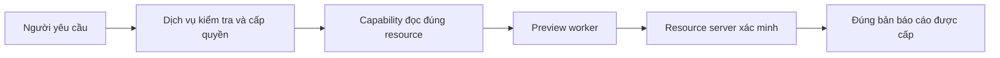

# Capability

## 1. Capability là gì trong mô hình kiểm soát truy cập?

**Capability** là một tham chiếu hoặc chứng nhận quyền khó giả mạo, vừa chỉ định một đối tượng vừa cho phép thực hiện một tập thao tác trên đối tượng đó. Trong một hệ thống dựa trên capability, chủ thể sử dụng quyền thông qua capability mà cơ chế thực thi công nhận.

Ví dụ, một dịch vụ tải xuống có thể chấp nhận capability cho phép:

```text
Tải đúng bản báo cáo report:acme/R-824/version/7
qua download-service
trong khoảng thời gian được cấp.
```

Người dùng không chỉ gửi ID báo cáo rồi yêu cầu dịch vụ tự tìm một quyền rộng để xử lý. Họ trình căn cứ cấp quyền giới hạn cho thao tác đó.

Có thể hình dung capability như một chìa khóa có phạm vi: chìa mở được cửa nào và cho phép làm gì phải được xác định. Tuy nhiên, phép so sánh này có giới hạn. Một token số có thể bị sao chép, một tham chiếu do kernel quản lý có thể không thể xuất thành chuỗi, và một capability có thể cần thêm bằng chứng về khóa của bên sử dụng.

Tài liệu seL4 mô tả capability như một token khó giả mạo để truy cập đối tượng, có thể hình dung là con trỏ đi kèm quyền truy cập. Trong seL4, kernel bảo vệ và kiểm soát cách những capability này được sử dụng. [Nguồn: seL4 — Capabilities](https://docs.sel4.systems/Tutorials/capabilities.html).

Bài này dùng capability theo nghĩa mô hình cấp quyền. Nó không coi mọi trường API có tên “capability”, mọi token đăng nhập hoặc mọi ID đối tượng là một capability theo nghĩa bảo vệ tài nguyên.

## 2. Những thuộc tính cốt lõi cần hiểu

### 2.1. Chỉ định đối tượng và mang thẩm quyền

Một ID như:

```text
report:acme/R-824/version/7
```

chỉ định đối tượng. Biết ID này chưa chứng minh quyền tải báo cáo.

Một capability có thể gắn đối tượng đó với quyền:

```text
object = report:acme/R-824/version/7
operations = { download }
```

Cơ chế thực thi phải đảm bảo người dùng không thể đổi object sang báo cáo khác hoặc thêm thao tác delete mà vẫn được chấp nhận.

Trong mô hình object-capability, một tham chiếu có thể vừa dùng để tìm đến đối tượng vừa là căn cứ cho phép gọi những thao tác được cung cấp. Với token qua mạng, resource server cần xác minh token và đối chiếu nó với request thực tế.

### 2.2. Khó giả mạo không có nghĩa chỉ cần một chuỗi trông ngẫu nhiên

Một capability cần được bảo vệ bởi cơ chế mà bên không có quyền không thể tự tạo hoặc sửa để mở rộng quyền.

Tùy cách hiện thực, cơ chế đó có thể là:

- Tham chiếu được runtime hoặc kernel quản lý.
- Handle bí mật được tạo đủ khó đoán và tra cứu trong kho trạng thái của server.
- Chứng nhận có chữ ký hoặc mã xác thực mà resource server kiểm tra.
- Một cơ chế ủy quyền có chứng cứ dẫn xuất được xác minh theo quy tắc xác định.

Một JSON có trường `allow=true` hoặc một chuỗi Base64 không tự có đặc tính này. Base64 chỉ là cách mã hóa biểu diễn, không tạo tính toàn vẹn hay tính bí mật.

### 2.3. Quyền được giới hạn theo giao diện hoặc điều kiện

Capability có thể chỉ cho đọc một đối tượng, ghi một vùng dữ liệu, gửi thông điệp đến một endpoint hoặc thực hiện một hành động nghiệp vụ cụ thể.

Những giới hạn khác có thể gồm thời gian, audience, phiên bản resource, người nhận hoặc khóa được phép sử dụng. Không phải capability nào cũng có mọi loại giới hạn; chúng phải thực sự được cơ chế bảo vệ hỗ trợ và kiểm tra.

Một capability cho download không tự cho phép edit, list toàn bộ báo cáo hay tạo capability mới. Các hành động đó cần được cấp riêng nếu nghiệp vụ yêu cầu.

### 2.4. Việc thực thi là một phần của mô hình

Nếu token ghi đúng “chỉ đọc R-824” nhưng backend vẫn cho dùng token để đọc mọi báo cáo, hệ thống chưa thực thi giới hạn của capability.

Tương tự, việc một service nhận một tham chiếu hẹp không giúp ích nếu nó bỏ tham chiếu đó và dùng credential quản trị để thao tác tùy ý theo ID do client gửi.

Đặc tính bảo vệ không chỉ nằm trong định dạng token. Nó phụ thuộc vào toàn bộ đường sử dụng quyền.

## 3. Các dạng capability thường gặp

### 3.1. Tham chiếu đối tượng được bảo vệ

Một thành phần chỉ được trao giao diện đọc của một đối tượng:

```text
ReadableReport
    download()
```

Thành phần nhận tham chiếu không tự có các thao tác `delete()` hoặc `grantAccess()` nếu những thẩm quyền đó không được trao qua một đường khác.

Đây là cách diễn giải ý tưởng object-capability ở mức giao diện. Chỉ khai báo một interface Java chưa tự tạo ra sandbox. Nếu thành phần vẫn có thể lấy credential rộng, truy cập global repository hoặc dùng một đường khác để gọi đối tượng đầy đủ, giới hạn giao diện không còn đủ để bảo đảm cô lập.

### 3.2. Opaque handle

Server phát hành một giá trị khó đoán:

```text
capability_handle = <opaque-secret-value>
```

Server lưu ánh xạ từ handle sang object, thao tác, thời hạn và trạng thái. Khi dùng handle, server tra cứu quyền tương ứng.

Ưu điểm là server có thể kiểm tra và thu hồi theo từng handle. Đổi lại, hệ thống cần truy cập trạng thái đáng tin cậy và quản lý độ mới của cache hoặc bản sao.

Opaque không có nghĩa vô hại. Nếu đây là bearer handle thì người lấy được giá trị có thể sử dụng nó theo các điều kiện được cấp.

### 3.3. Chứng nhận có thể xác minh

Server có thể phát hành một token chứa các quyền và điều kiện đã được bảo vệ bằng chữ ký hoặc MAC. Bên nhận xác minh trước khi dùng.

Thiết kế này có thể giảm việc tra cứu từng token tại kho cấp quyền. Tuy nhiên, nếu yêu cầu thu hồi nhanh, chống dùng lại hoặc giới hạn số lần sử dụng, hệ thống thường vẫn cần trạng thái hoặc một cơ chế phối hợp bổ sung.

Có chữ ký không đồng nghĩa nội dung đã được mã hóa. Với một token có phần payload đọc được, không đưa dữ liệu nhạy cảm vào chỉ vì cho rằng người dùng không nhìn thấy.

### 3.4. Liên kết chứa khả năng truy cập

Một URL có chữ ký có thể cho phép thao tác trên một đối tượng với thời hạn giới hạn. Ví dụ, AWS mô tả S3 presigned URL như bearer token, có khả năng cho truy cập theo quyền của bên ký và các tham số của URL. [Nguồn: Amazon S3 — Download and upload objects with presigned URLs](https://docs.aws.amazon.com/AmazonS3/latest/userguide/using-presigned-url.html).

Đây là ví dụ cụ thể về cơ chế có tính chất capability. Không được suy rằng mọi URL là capability, hoặc mọi URL có chữ ký đều có cùng cơ chế thu hồi và phạm vi quyền.

## 4. Capability khác gì với ACL, RBAC và ReBAC?

| Cách tiếp cận | Căn cứ thường dùng khi ra quyết định | Ví dụ |
| --- | --- | --- |
| ACL | Mục cấp quyền gắn với tài nguyên và danh tính | Lan có read trên báo cáo R-824 |
| RBAC | Vai trò cùng quyền trong phạm vi tương ứng | Người có role Auditor được đọc báo cáo kiểm toán |
| ReBAC | Quan hệ và các đường suy quyền được cho phép | Member nhóm Audit được xem báo cáo của dự án |
| Capability | Thẩm quyền được biểu diễn qua capability hợp lệ | Bên trình capability được tải đúng bản báo cáo đã cấp |

Đây là sự khác biệt về cách diễn đạt và thực thi quyền, không phải yêu cầu mọi hệ thống chỉ được chọn một mô hình.

Một kiến trúc IAM có thể dùng ReBAC để kiểm tra Lan được yêu cầu xuất báo cáo hay không. Sau khi được phép, hệ thống phát hành capability giới hạn cho worker tải một bản báo cáo. Dịch vụ tải xuống xác minh capability thay vì cấp cho worker quyền đọc mọi báo cáo của Lan.

```text
Quan hệ hoặc vai trò
    → xác định ai được yêu cầu cấp quyền giới hạn
    → phát hành capability
    → thực thi thao tác theo capability
```

Capability cũng không loại bỏ nhu cầu xác thực danh tính. Hệ thống có thể cần biết ai được cấp, ai sử dụng, hoặc yêu cầu token được ràng buộc với người nhận. Điểm khác biệt là thẩm quyền đối với thao tác được biểu diễn và truyền qua capability theo thiết kế đó.

Không nên đồng nhất capability với một access token bất kỳ. Một token có thể chỉ mang danh tính hoặc vai trò để server tiếp tục kiểm tra chính sách. Cần xem token thực sự chỉ định quyền nào và resource server dùng nó như thế nào.

## 5. Bearer capability và quyền ràng buộc với khóa

### 5.1. Bearer: ai nắm giữ có thể sử dụng

Với bearer token, bên có token có thể trình token để dùng quyền mà không phải chứng minh đang giữ một khóa mật mã riêng tương ứng. RFC 6750 định nghĩa đặc tính này cho bearer token và yêu cầu bảo vệ token khỏi lộ trong lưu trữ cũng như truyền tải. [Nguồn: RFC 6750 — Bearer Token Usage](https://www.rfc-editor.org/rfc/rfc6750).

Ví dụ, một bearer capability chỉ cho tải R-824 trong năm phút. Nếu Linh lấy được token của worker, Linh có thể tải trong cùng phạm vi còn hiệu lực, trừ khi có điều kiện bổ sung chặn việc đó.

Thêm trường `recipient=user:worker` vào payload không tự tạo ra ràng buộc. Server phải xác minh căn cứ tin cậy để biết bên trình token là đúng recipient.

### 5.2. Proof of possession: cần chứng minh giữ khóa

Một token có thể được ràng buộc với khóa công khai. Bên trình phải cung cấp bằng chứng hợp lệ về việc giữ khóa riêng tương ứng.

Trong OAuth, DPoP là một cơ chế sender-constraining ở tầng ứng dụng. Nó ràng buộc token với khóa và yêu cầu bằng chứng theo giao thức, giúp giảm khả năng dùng một token bị lấy cắp mà không có khóa tương ứng. [Nguồn: RFC 9449 — OAuth 2.0 Demonstrating Proof of Possession](https://www.rfc-editor.org/rfc/rfc9449).

Không nên rút gọn cơ chế này thành “gửi thêm public key”. Server cần kiểm tra binding và proof theo giao thức, bao gồm những ràng buộc request và chống replay tương ứng.

Proof of possession cũng không tự biến workload độc hại thành workload an toàn. Nếu kẻ tấn công điều khiển được thành phần có quyền sử dụng khóa, họ có thể yêu cầu nó tạo bằng chứng hoặc thực hiện hành động trong phạm vi đó.

### 5.3. Chặn cấp quyền tiếp khác với chặn chuyển tiếp token

Một cờ nghiệp vụ “không được delegate” có thể ngăn API phát hành capability con. Nó không nhất thiết ngăn người cầm bearer token sao chép token cho người khác.

Muốn hạn chế chuyển tiếp phải có cơ chế phù hợp như ràng buộc người sử dụng, giữ capability trong một môi trường kiểm soát hoặc giới hạn hình thức truyền tham chiếu. Cần nói rõ hệ thống đang cấm một thao tác cấp quyền mới hay đang bảo vệ khỏi việc dùng lại cùng một bí mật.

## 6. Ví dụ xuyên suốt: tải một bản báo cáo đã xuất

### 6.1. Bài toán nghiệp vụ

Lan được phép tạo bản xuất báo cáo R-824 của Acme. Một worker cần tải bản xuất phiên bản 7 để đưa vào quy trình xử lý.

Nếu trao cho worker credential có quyền đọc mọi báo cáo trong tenant, worker có nhiều quyền hơn công việc hiện tại cần. Khi worker bị lỗi hoặc bị chiếm quyền, phạm vi ảnh hưởng có thể lớn.

Ta chọn thiết kế minh họa:

1. Dịch vụ cấp quyền xác minh Lan được yêu cầu xuất R-824.
2. Hệ thống tạo hoặc xác định bản xuất có ID phiên bản ổn định.
3. Dịch vụ phát hành capability chỉ cho download đúng phiên bản đó.
4. Worker trình capability đến download-service.
5. Download-service kiểm tra capability và chỉ trả nội dung phù hợp.

Ở đây, quyền đọc nguồn báo cáo để tạo bản xuất và quyền tải file đã xuất là hai hành động riêng. Capability tải file không tự cho phép worker yêu cầu tạo bản xuất mới hoặc đọc dữ liệu nguồn.

### 6.2. Payload minh họa

Dữ liệu bên trong một capability token có thể được trình bày như sau:

```json
{
  "capability_id": "cap-r824-v7-01",
  "issuer": "export-authority",
  "audience": "download-service",
  "resource": "report:acme/R-824/version/7",
  "operations": ["download"],
  "not_before": "2026-11-26T02:00:00Z",
  "expires_at": "2026-11-26T02:05:00Z"
}
```

Các tên trường là schema minh họa, không phải một chuẩn token được định nghĩa trong bài. JSON này cũng chưa phải chứng nhận có thể tin cậy: nó cần được bảo vệ và xác minh bằng cơ chế phát hành đã chọn.

Những giới hạn có ý nghĩa:

- Chỉ issuer được tin cậy mới được cấp thẩm quyền cho download-service.
- Token dùng tại đúng audience.
- Resource bao gồm tenant, báo cáo và phiên bản.
- Chỉ có thao tác download.
- Quyền chỉ có hiệu lực trong cửa sổ thời gian đã cấp.

Việc chọn phiên bản bất biến tránh nhập nhằng giữa “nội dung đã được cấp quyền tại thời điểm phát hành” và “mọi nội dung tương lai dưới cùng một report ID”. Nếu ứng dụng muốn cấp quyền trên bản hiện hành thay vì một phiên bản cố định, đó là chính sách khác và cần được giải thích.

### 6.3. Các yêu cầu được chấp nhận hoặc từ chối

| Request | Kết quả theo thiết kế minh họa | Lý do |
| --- | --- | --- |
| Download R-824 phiên bản 7 tại đúng dịch vụ, còn hạn | Có thể cho phép sau khi mọi kiểm tra đạt | Đúng đối tượng, hành động và điều kiện |
| Download R-824 phiên bản 8 | Từ chối | Khác phiên bản resource |
| Download R-825 | Từ chối | Khác báo cáo |
| Delete R-824 phiên bản 7 | Từ chối | Không có operation delete |
| Trình token tại billing-service | Từ chối | Sai audience |
| Sửa expires_at để kéo dài hạn | Từ chối | Chứng cứ toàn vẹn không còn hợp lệ |
| Dùng sau thời điểm hết hạn | Từ chối | Ngoài cửa sổ được cấp |
| Dùng trước not_before | Từ chối | Chưa đến thời điểm có hiệu lực |

Dòng đầu chỉ là kết quả có điều kiện. Một token vẫn có thể bị từ chối nếu đã thu hồi hoặc không đáp ứng một ràng buộc khác được hệ thống thực sự triển khai.

## 7. Cấp capability: nơi thẩm quyền ban đầu được xác lập

Capability không xuất hiện từ việc người dùng tự điền resource ID. Một issuer cần có thẩm quyền cấp và phải kiểm tra ai được yêu cầu cấp theo chính sách.

Mã giả của luồng phát hành:

```text
principal = authentication.requireVerifiedPrincipal()
request = parseExportDownloadRequest()

report = reports.resolveCanonicalResource(request.reportId)
authorization.require(principal, "request_export_download", report)

artifact = exports.resolveAuthorizedVersion(report, request.version)

rights = issuancePolicy.limitTo(
    resource = artifact.canonicalResource,
    operations = { "download" },
    audience = "download-service",
    lifetime = allowedLifetime
)

capability = trustedIssuer.issue(rights)
audit.recordIssuance(principal, capability.id, rights)

return capability
```

Đây là mô tả trách nhiệm, không phải mã triển khai mật mã.

Issuer không nên cho client tự chọn mọi operation, audience hoặc thời hạn mà không giới hạn. Nếu client gửi resource khác tenant, backend phải đối chiếu với đối tượng thật và chính sách tương ứng.

Thẩm quyền của issuer cũng cần được giới hạn. Một issuer chuyên cấp quyền download báo cáo không nên tự được resource server công nhận là có thể cấp quyền quản trị tài khoản chỉ vì dùng cùng một định dạng token.

Nếu có nhiều issuer, cần cấu hình rõ issuer nào được tin cho miền tài nguyên, operation và token type nào. “Chữ ký đúng với một khóa bất kỳ” không phải một tiêu chí cấp quyền đầy đủ.

## 8. Xác minh capability tại điểm sử dụng

Một bộ xác minh cần kết nối chứng nhận với request thực tế:

```text
request = parseAndCanonicalizeRequest()
capability = verifier.verifyTrustedCredential(request.presentedCapability)

requireExpectedIssuer(capability)
requireExpectedCredentialType(capability)
requireAudience(capability, thisService)
requireWithinValidityWindow(capability, trustedClock.now())

requireExactResourceMatch(capability.resource, request.resource)
requireOperationAllowed(capability.operations, request.operation)

verifyAdditionalCaveats(capability, request)
verifyHolderBindingIfRequired(capability, request)
verifyRevocationOrUsageStateIfRequired(capability)

performOperationOnTheVerifiedResource()
```

Các hàm trên là mã giả. Bộ kiểm tra cụ thể phụ thuộc loại capability, nhưng không được bỏ ràng buộc đã tuyên bố.

### 8.1. Giữ resource đã kiểm tra và resource được dùng là một

Nếu server kiểm tra quyền trên R-824 rồi lấy một file path khác do client cung cấp, request có thể vượt khỏi phạm vi capability.

Cần chuẩn hóa định danh và ánh xạ đối tượng nhất quán. Với object storage, database hoặc file system, thao tác cuối phải sử dụng đối tượng đã được xác minh, không phải một giá trị chưa tin cậy được thay vào sau đó.

### 8.2. Chữ ký hợp lệ chưa đủ

Với token có chữ ký, còn cần kiểm tra loại token, issuer, audience, thời hạn và quyền phù hợp. Một token dùng đăng nhập không nên được chấp nhận như capability tải báo cáo chỉ vì cùng xác minh được bằng một khóa.

Nếu dùng JWT, áp dụng thư viện và cấu hình xác minh phù hợp, bao gồm giới hạn thuật toán và kiểm tra claim theo mục đích sử dụng. RFC 8725 thảo luận các yêu cầu này, cũng như việc tránh nhầm token giữa các ngữ cảnh. [Nguồn: RFC 8725 — JSON Web Token Best Current Practices](https://www.rfc-editor.org/rfc/rfc8725).

Không tự cài đặt chữ ký hoặc xây một thuật toán token riêng chỉ từ ví dụ JSON trong bài.

### 8.3. Điều kiện thiếu hoặc lỗi xác minh phải được xử lý rõ

Không thể xác minh quyền, thiếu một điều kiện bắt buộc hoặc không truy cập được trạng thái thu hồi không nên được tự diễn dịch thành allow.

Nếu hệ thống chủ ý chấp nhận token trong một khoảng mất kết nối, đó là một lựa chọn về tính sẵn sàng và cửa sổ quyền cũ cần được thiết kế trước. Không nên để nó phát sinh ngẫu nhiên từ một nhánh catch exception.

## 9. Delegation và attenuation: truyền quyền nhưng không mở rộng quyền

### 9.1. Delegation là ủy quyền tiếp

Một thành phần có thể cần chuyển một phần công việc cho thành phần khác. Ví dụ, worker xử lý báo cáo muốn trao cho một tiến trình phụ quyền tải đúng một file.

Không nên trao nguyên credential quản trị hoặc toàn bộ quyền của người dùng chỉ để hoàn thành thao tác nhỏ này. Nếu cơ chế capability hỗ trợ delegation, có thể tạo hoặc chuyển một capability phù hợp với phần việc được giao.

Khả năng delegation không phải đặc tính bắt buộc của mọi token. Một hệ thống có thể chỉ cho issuer phát hành quyền mới, còn người nhận không có quyền tự tạo capability con.

### 9.2. Attenuation là làm hẹp thẩm quyền

Giả sử capability cha cho phép:

```text
Resource: report:acme/R-824/version/7
Operations: download, read_metadata
Lifetime: tối đa 10 phút
Audience: download-service
```

Capability con có thể được giới hạn thành:

```text
Resource: cùng phiên bản báo cáo
Operations: download
Lifetime: tối đa 2 phút và không vượt hạn cha
Audience: download-service
```

Một cách diễn đạt yêu cầu an toàn:

```text
Tập request hợp lệ theo capability con
    phải là tập con của
Tập request hợp lệ theo thẩm quyền cha được dùng để ủy quyền.
```

Bỏ một điều kiện tenant, mở thêm operation, kéo dài thời hạn hoặc đổi sang một dịch vụ không nằm trong thẩm quyền ban đầu không phải attenuation hợp lệ.

### 9.3. Tính toàn vẹn của chuỗi ủy quyền

Người nhận không được tự xóa điều kiện của capability con để biến nó thành quyền cha. Hệ thống có thể thực thi bằng việc issuer phát hành lại sau kiểm tra, xác minh một chuỗi ủy quyền, hoặc dùng một cơ chế mật mã được thiết kế cho giới hạn bổ sung.

Chỉ thêm trường `parent_id` vào JSON không chứng minh capability con hợp lệ. Resource server cần có chứng cứ mà nó tin cậy để kiểm tra thẩm quyền gốc và mọi ràng buộc trên đường dẫn xuất.

Macaroons là một công trình về credential hỗ trợ delegation và những caveat làm hẹp phạm vi sử dụng. Các caveat có thể giới hạn ngữ cảnh, thời gian hoặc mục đích; cách cấu trúc và xác minh chúng là một phần của cơ chế, không phải một danh sách ghi chú tùy ý. [Nguồn: Birgisson và cộng sự — Macaroons, NDSS 2014](https://research.google/pubs/macaroons-cookies-with-contextual-caveats-for-decentralized-authorization-in-the-cloud/).

### 9.4. Người đang giữ quyền cha vẫn có thể lạm dụng quyền cha

Trao một capability con hẹp không làm mất quyền của người đang giữ capability cha. Nếu chủ thể đó vẫn có bản cha và được phép sử dụng, họ có thể thực hiện những hành động thuộc phạm vi cha.

Nếu nghiệp vụ yêu cầu chuyển quyền độc quyền hoặc làm quyền cũ mất hiệu lực, cần một cơ chế chuyển giao và thu hồi riêng. Việc tạo một bản giới hạn hơn không tự có nghĩa mọi bản rộng hơn đã biến mất.

## 10. Thu hồi capability

### 10.1. Tại sao thu hồi cần được thiết kế riêng?

Một capability đã phát hành có thể tiếp tục được sử dụng trong thời gian hiệu lực. Nếu resource server chỉ kiểm tra chứng cứ mật mã và thời hạn mà không xem trạng thái hiện hành, việc xóa một role trong IAM chưa chắc làm token đó mất hiệu lực ngay.

Ví dụ:

```text
t1: Lan có quyền và hệ thống phát hành capability tải báo cáo.
t2: Lan bị thu hồi quyền trong hệ thống nghiệp vụ.
t3: Worker trình capability còn hạn.
```

Kết quả ở t3 phụ thuộc hợp đồng: token là quyền đã cấp độc lập đến hết hạn, hay bắt buộc phải kiểm tra một điều kiện động gắn với grant hoặc danh tính hiện hành?

Không có một đáp án chung chỉ từ việc gọi token là capability.

### 10.2. Những cách xử lý thường gặp

| Cách xử lý | Ý nghĩa | Giới hạn cần tính |
| --- | --- | --- |
| Thời hạn ngắn | Giới hạn thời gian có thể sử dụng quyền cũ | Chưa tạo thu hồi tức thời trước hạn |
| Opaque handle có trạng thái | Server đánh dấu handle không còn hợp lệ | Cần dữ liệu trạng thái đủ mới |
| Kiểm tra revocation ID hoặc grant version | Token chỉ hợp lệ nếu trạng thái tương ứng còn hiệu lực | Phải đồng bộ và xử lý cache |
| Tham chiếu qua một đối tượng trung gian có thể vô hiệu hóa | Mọi lần dùng đi qua điểm kiểm soát đó | Phải bảo đảm không còn đường bỏ qua |
| Kiểm tra một điều kiện hiện hành | Ví dụ grant nguồn còn hoạt động | Làm quyết định phụ thuộc trạng thái tại thời điểm dùng |
| Thay khóa hoặc ngừng tin issuer/key | Làm một tập credential không còn được chấp nhận | Phạm vi ảnh hưởng có thể rất rộng |

Các cách này có thể kết hợp. Đổi khóa ký không nên được xem như thao tác thu hồi riêng một token nếu cùng khóa còn bảo vệ nhiều token hợp lệ khác.

Một token tự chứa cũng có thể có cơ chế thu hồi online. “Tự chứa” chỉ nói token mang dữ liệu đủ cho một số kiểm tra; không cấm resource server kiểm tra thêm trạng thái theo thiết kế.

### 10.3. Thu hồi cả capability con

Nếu một capability cha bị thu hồi, cần xác định capability con có bị thu hồi theo không. Nếu có, resource server phải kiểm tra được điều kiện hoặc quan hệ thu hồi đó.

Không nên mặc định việc xóa bản cha trong một kho local sẽ làm tất cả bản con ở các máy khác tự biến mất.

Tương tự, nếu cùng một báo cáo có nhiều capability độc lập, thu hồi một ID chưa chắc thu hồi mọi đường truy cập. Cần xác định mục tiêu là thu hồi một phiên chia sẻ, một người nhận, một chuỗi delegation hay toàn bộ quyền tải tài nguyên.

### 10.4. Giới hạn của thu hồi

Thu hồi capability không tự lấy lại dữ liệu đã được tải. Nó cũng không nhất thiết dừng ngay một thao tác đã bắt đầu, tùy cách dịch vụ thực thi.

Với kết nối dài hoặc tác vụ đang chạy, cần quy định thời điểm kiểm tra lại và hành động nào được hoàn tất sau khi quyền bị thu hồi. Không nên hứa “thu hồi ngay lập tức” nếu kiến trúc chỉ chặn các request bắt đầu sau một mốc đồng bộ.

## 11. Replay và capability dùng một lần

### 11.1. Chữ ký không tự ngăn dùng lại

Một token có chữ ký hợp lệ có thể được trình nhiều lần nếu chính sách cho phép. Chữ ký bảo vệ tính toàn vẹn và nguồn phát hành trong phạm vi cơ chế xác minh; nó không tự ghi nhớ token đã được dùng.

Trong ví dụ download, hệ thống có thể chủ ý cho tải lại nhiều lần trong năm phút để hỗ trợ retry. Khi đó, dùng lại chưa hẳn là vi phạm hợp đồng.

Với capability cho một hành động như phê duyệt thanh toán, việc dùng lại có thể tạo tác động ngoài dự định. Cần phân biệt operation có tác dụng phụ với thao tác đọc và xác định ngữ nghĩa mong muốn.

### 11.2. Một trường max_uses chưa đủ

Payload sau chỉ mô tả ý định:

```json
{
  "capability_id": "cap-action-01",
  "max_uses": 1
}
```

Nếu server không có cơ chế kiểm soát số lần, kẻ gọi có thể gửi hai request đồng thời và cả hai vẫn được chấp nhận.

Một thiết kế dùng một lần có thể cần thao tác nguyên tử:

```text
Nếu capability còn hợp lệ và chưa được dùng:
    đánh dấu đã nhận sử dụng
    gắn với operation ID
    thực hiện hoặc điều phối operation theo cơ chế nhất quán
Ngược lại:
    từ chối hoặc trả kết quả của operation đã được xác định
```

Đây là yêu cầu về trạng thái và tính đồng thời, không chỉ về định dạng token.

### 11.3. Phân biệt dùng một lần và xử lý đúng một lần

Nếu đánh dấu token đã dùng rồi thao tác nghiệp vụ thất bại, người dùng có thể không retry được. Nếu đánh dấu sau thao tác, một request khác có thể chạy xen vào.

Cần thiết kế giao dịch, idempotency hoặc trạng thái tác vụ phù hợp. Một nonce không tự giải quyết mọi lỗi mạng và một capability không tự bảo đảm nghiệp vụ được thực hiện đúng một lần.

Với download, cũng cần chọn “một lần” là một lần phát hành URL, một lần bắt đầu truyền hay một lần tải hoàn chỉnh. Những định nghĩa này có tác động khác nhau khi kết nối bị gián đoạn.

## 12. Capability và bài toán confused deputy

### 12.1. Dịch vụ có quyền rộng bị dùng thay cho người gọi

Giả sử dịch vụ Preview có credential đọc mọi báo cáo của Acme. API nhận:

```json
{
  "reportId": "R-824"
}
```

Nếu Preview không kiểm tra quyền của người yêu cầu mà dùng credential của mình để đọc bất kỳ reportId nào, nó có thể trở thành bên thực hiện quyền rộng thay cho một người không có quyền.

Vấn đề không nằm ở việc Preview có danh tính hợp lệ hay kết nối nội bộ đã được mã hóa. Nó nằm ở cách dịch vụ dùng thẩm quyền của mình cho một request không đủ căn cứ.

### 12.2. Truyền một quyền hẹp theo công việc

Một hướng thiết kế là yêu cầu Preview nhận capability chỉ cho đọc đúng báo cáo được phê duyệt. Preview sử dụng thẩm quyền được trao cho công việc đó, thay vì tự chọn đối tượng trong kho dữ liệu bằng một quyền môi trường rất rộng.



Thiết kế chỉ có hiệu quả nếu resource server thực thi đúng phạm vi và worker không có một đường khác bỏ qua giới hạn đó.

Nếu Preview vẫn nhận capability R-824 nhưng lấy thêm R-825 bằng credential quản trị, vấn đề chưa được giải quyết. Cần thiết kế ranh giới thẩm quyền thực tế của thành phần, không chỉ thêm một tham số token vào API.

### 12.3. Ambient authority

Có thể gọi một quyền là ambient khi thành phần sử dụng được nó nhờ môi trường thực thi chung, không cần được trao rõ cho thao tác hiện tại. Ví dụ là credential rộng trong biến môi trường hoặc một client quản trị dùng chung.

Capability giúp diễn đạt việc trao đúng quyền cần thiết cho một thành phần. Tuy nhiên, chỉ thêm capability vào một hệ thống còn nhiều quyền rộng không tự loại bỏ ambient authority.

Mục tiêu thực tế là biết mỗi thành phần có thể làm gì, căn cứ nào cho phép và có thể lấy thêm quyền qua những đường nào.

## 13. Bảo vệ capability trong truyền tải và lưu trữ

### 13.1. Capability dạng bearer là một bí mật cấp quyền

Không ghi nguyên token vào log ứng dụng, trace, thông báo lỗi hoặc hệ thống phân tích. Một hệ thống debug có quyền đọc log không nên vô tình nhận khả năng tải mọi báo cáo đã ghi nhận.

Dùng TLS cho đường truyền và giữ token ở nơi phù hợp với loại client. Việc chọn header, cookie hoặc URL còn phụ thuộc giao thức; mỗi cách có những điểm cần bảo vệ riêng.

Nếu capability nằm trong URL, cần đánh giá log proxy, lịch sử trình duyệt, referrer, nội dung được nhúng và việc chuyển tiếp link. Không nên cho rằng URL chỉ được nhìn thấy bởi ứng dụng và người nhận ban đầu.

### 13.2. Không phát hành quyền rộng để bù cho việc thiếu mô hình

Một token có resource `*`, operation `*` và thời hạn dài có thể trở thành credential quản trị dưới một tên khác.

Phạm vi nên phản ánh công việc thực tế: đúng resource hoặc miền được cấp, đúng hành động, đúng audience và thời gian cần thiết. Không tự tạo quyền cho hành động mới chỉ vì phiên bản dịch vụ sau này có thêm endpoint.

Ví dụ, một token cũ với nghĩa “mọi operation” có thể vô tình cho phép delete khi dịch vụ được mở rộng. Dùng danh sách thao tác rõ ràng và quy tắc tương thích giúp giảm loại mở rộng ngoài dự định này.

### 13.3. Ràng buộc với tài nguyên thật

Nếu capability cho phép tải một object key, cần hiểu key đó có thể trỏ tới nội dung nào trong thời gian token còn hạn. Một key được ghi đè có thể khiến người nhận đọc nội dung khác với nội dung dự kiến khi cấp.

Có thể chọn object version hoặc một tài nguyên xuất bất biến khi nghiệp vụ cần đóng băng phạm vi nội dung. Đối với tài nguyên thay đổi liên tục, chính sách cần nói rõ capability có cho phép đọc các cập nhật sau này hay không.

### 13.4. Kiểm soát ảnh hưởng của cache

Cache quyết định phải phân biệt capability hoặc thẩm quyền hiệu lực, resource, operation và những điều kiện có liên quan. Không dùng lại một allow cho resource khác hoặc cho thời điểm đã vượt hạn.

Nếu cache dữ liệu, cần bảo đảm nội dung không bị phục vụ công khai chỉ vì một request có capability đã truy cập trước đó. Bảo vệ quyết định và bảo vệ đường phân phối nội dung cần được thiết kế cùng nhau.

## 14. Capability trong vòng đời IAM

### 14.1. Danh tính khởi tạo và bên sử dụng có thể khác nhau

Lan có thể yêu cầu cấp quyền cho một worker. Audit cần phân biệt Lan là người khởi tạo, issuer là bên phát hành và worker là bên sử dụng nếu hệ thống xác định được danh tính đó.

Với bearer capability, việc token được cấp cho một người không tự chứng minh mọi lần sử dụng về sau đều do người đó thực hiện. Log cần phản ánh giới hạn bằng chứng, tránh gán chắc chắn người dùng cuối khi không có xác minh tương ứng.

### 14.2. Thay đổi quyền nguồn cần có hợp đồng hiệu lực

Nếu quyền của Lan thay đổi, hệ thống cần biết những capability đã cấp bị ảnh hưởng thế nào. Có thể giữ hiệu lực đến hết hạn hoặc yêu cầu kiểm tra grant nguồn còn hoạt động.

Lựa chọn này phải nhất quán với yêu cầu thu hồi của tổ chức. Không thể vừa chỉ xác minh offline một token sống lâu vừa mặc định mọi thay đổi quyền nguồn được áp dụng ngay.

Nếu workload bị vô hiệu hóa, capability ràng buộc với khóa hoặc danh tính workload cũng cần một quy trình xử lý tương ứng. Chỉ xóa account nhưng vẫn để mọi verifier chấp nhận chứng nhận cũ có thể không đáp ứng mục tiêu offboarding.

### 14.3. Kiểm toán mà không làm lộ quyền

Một bản ghi phát hành có thể gồm:

```text
capability_id
issuer
người hoặc workload yêu cầu
resource và operation được cấp
audience
thời điểm cấp và hết hạn
grant nguồn hoặc capability cha nếu có
trạng thái thu hồi
mã tương quan tác vụ
```

Đây là metadata minh họa, không phải yêu cầu phải log toàn bộ payload. Tránh lưu secret hoặc token dùng được trực tiếp.

Khi sử dụng, log có thể ghi kết quả, resource và operation đã xác minh, lý do từ chối ở mức phù hợp và ID tác vụ. Các dữ liệu này giúp phân biệt sai audience, hết hạn, bị thu hồi và lỗi hạ tầng.

## 15. Khi nào cách tiếp cận capability có ích?

Capability thường hữu ích khi cần trao quyền hẹp cho một công việc hoặc chuyển thẩm quyền giữa các thành phần có ranh giới rõ ràng:

- Một worker chỉ được đọc đúng đầu vào và ghi đúng đầu ra của tác vụ.
- Một khách được tải một bản xuất trong thời gian giới hạn.
- Một thành phần chỉ được gọi giao diện cần thiết của một đối tượng.
- Một dịch vụ phụ cần nhận quyền hẹp hơn quyền của bên điều phối.

Cách tiếp cận này đòi hỏi thiết kế thêm về phát hành, truyền quyền, xác minh, thu hồi và theo dõi các bản quyền đã cấp.

Nếu yêu cầu chủ yếu là quản lý membership, vai trò nghiệp vụ và truy vấn “ai có quyền trên mọi tài nguyên”, một mô hình tập trung về quan hệ hoặc vai trò vẫn có thể đóng vai trò quan trọng. Hệ thống có thể kết hợp các mô hình thay vì buộc mọi quyền thành một token dài hạn.

Việc lựa chọn không nên chỉ dựa vào tốc độ xác minh chữ ký. Cần xét yêu cầu thu hồi, độ tin cậy giữa dịch vụ, khả năng delegation, rủi ro lộ token và độ phức tạp vận hành.

## 16. Những nhầm lẫn cần tránh

| Nhầm lẫn | Cách hiểu đúng |
| --- | --- |
| Biết resource ID là có capability | ID chỉ định đối tượng chưa tự cấp quyền |
| JWT nào cũng là capability an toàn | Cần xét quyền được biểu diễn và cách verifier thực thi |
| Có chữ ký thì không bị dùng lại | Replay còn phụ thuộc giao thức và trạng thái |
| Token ghi recipient thì đã ràng buộc người dùng | Server phải xác minh binding thực tế |
| Cấm delegate thì bearer token không chuyển tiếp được | Cấm cấp quyền con khác với ngăn sao chép token |
| Capability luôn không cần danh tính | Có thể kết hợp với danh tính hoặc proof of possession |
| Token tự chứa thì không thể có thu hồi online | Có thể kiểm tra thêm trạng thái theo thiết kế |
| Thu hồi role nguồn lập tức vô hiệu mọi token | Chỉ đúng nếu luồng xác minh thực thi điều kiện đó |
| Cấp token con làm token cha mất quyền | Cần cơ chế thu hồi hoặc chuyển giao riêng |
| Một interface hẹp tạo đủ sandbox | Còn phải kiểm soát mọi đường nhận thẩm quyền khác |
| Capability con chỉ cần ghi parent ID | Phải có chứng cứ ủy quyền được verifier công nhận |
| max_uses=1 bảo đảm dùng một lần | Cần cơ chế nguyên tử và xử lý retry tương ứng |

Câu hỏi hữu ích khi xem một thiết kế là: **bên nhận có thể tự tạo thêm quyền, dùng quyền vào resource khác hoặc đi vòng qua giới hạn này bằng một quyền khác không?**

## 17. Các tình huống tự kiểm tra

Những tình huống dưới đây dùng ví dụ capability tải báo cáo ở phần 6. Đây là bài tập suy luận, không phải kết quả chạy kiểm thử một hệ thống thực tế.

### Tình huống A: đổi operation download thành delete

Nếu payload được bảo vệ đúng, việc sửa operation làm chứng cứ toàn vẹn không còn hợp lệ. Nếu không sửa token nhưng gọi endpoint delete, verifier phải từ chối vì delete không thuộc tập operation đã cấp.

Chấp nhận request chỉ vì chữ ký token vẫn hợp lệ là bỏ sót ràng buộc hành động.

### Tình huống B: dùng token R-824 để lấy R-825

Resource server phải đối chiếu resource thực sự được truy cập với capability. Nếu kiểm tra R-824 nhưng thao tác cuối dùng path của R-825 từ request, giới hạn đối tượng đã bị phá vỡ.

### Tình huống C: Lan mất quyền một phút sau khi phát hành

Nếu token chỉ được xác minh theo chữ ký và thời hạn năm phút, nó có thể còn dùng được. Muốn chặn ngay cần một cơ chế thu hồi hoặc điều kiện động đã được triển khai.

Không nên kết luận token tự mất hiệu lực chỉ vì nguồn cấp quyền ban đầu đã thay đổi.

### Tình huống D: token bearer bị chuyển tiếp

Người nhận mới có thể sử dụng trong cùng phạm vi nếu không có ràng buộc bổ sung. Capability giới hạn phạm vi ảnh hưởng nhưng không tự xác định danh tính người đang cầm bí mật.

Nếu token được ràng buộc khóa đúng cách, chỉ lấy token mà không có khả năng tạo proof tương ứng sẽ chưa đủ.

### Tình huống E: hai request dùng capability một lần cùng đến

Server cần bảo đảm kiểm tra và chiếm quyền sử dụng diễn ra nguyên tử theo thiết kế. Hai thao tác kiểm tra độc lập “chưa dùng” rồi cùng cập nhật sau đó có thể đều thành công.

Ngoài ra, cần quyết định request retry sẽ bị từ chối hay nhận kết quả của tác vụ trước.

### Tình huống F: capability con có thời hạn dài hơn cha

Đó không phải một dẫn xuất làm hẹp theo các điều kiện đã nêu. Verifier hoặc issuer phát hành lại phải từ chối nếu không có một thẩm quyền độc lập khác cho phép cấp quyền mới.

Một capability được cấp bằng thẩm quyền mới cần được xem là một lần cấp quyền khác, không che giấu dưới nhãn attenuation.

Để đánh giá một capability, hãy chỉ ra được **đối tượng, thao tác, căn cứ khó giả mạo, điều kiện sử dụng và cách quyền mất hiệu lực**. Những phần đó mới xác định thẩm quyền thực tế mà một thành phần đang được trao.
