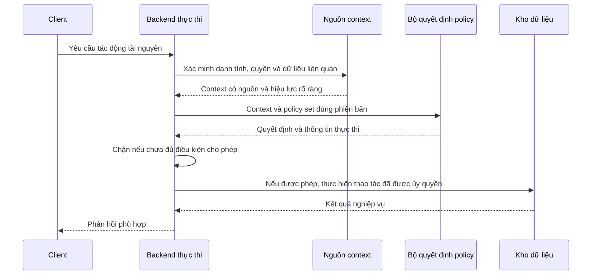

# Policy list

## 1. Policy list giải quyết vấn đề gì?

Trong bài này, **policy list** được dùng theo nghĩa danh sách các chính sách hoặc quy tắc kiểm soát truy cập mà hệ thống quản lý và đưa vào quá trình quyết định quyền. Đây là cách tổ chức chính sách; tên gọi này không tự xác định một mô hình quyền hay một thuật toán đánh giá duy nhất.

Một ứng dụng quản lý tài liệu có thể cần đồng thời các quy tắc:

- Tài khoản hoặc phiên đã bị vô hiệu hóa không được thao tác.
- Người dùng không được truy cập tài liệu ngoài tenant đang được phép hoạt động.
- Người có permission đọc được xem tài liệu trong phạm vi được cấp.
- Owner được sửa tài liệu của mình theo policy của sản phẩm.
- Tài liệu đang có yêu cầu lưu giữ bắt buộc không được xóa.

Nếu các quy tắc được rải trong nhiều controller, service và giao diện, việc trả lời “vì sao yêu cầu này được phép?” sẽ khó hơn. Tập hợp chúng thành một danh sách có cấu trúc giúp xác định phạm vi, điều kiện, hiệu lực và cách kiểm thử.

Tuy nhiên, **có danh sách policy chưa đủ để có quyết định đúng**. Hệ thống còn phải biết policy nào thuộc phạm vi yêu cầu, cách đánh giá từng policy, cách xử lý xung đột và cách áp dụng kết quả ở backend.

Sau bài học, người học có thể:

- Phân biệt policy list với ACL, role và quan hệ cấp quyền.
- Thiết kế cấu trúc một rule có target, condition và effect rõ ràng.
- Phân biệt không áp dụng, từ chối và không đánh giá được.
- Lựa chọn quy tắc kết hợp phù hợp thay vì dựa tùy ý vào thứ tự danh sách.
- Quản lý phiên bản, triển khai và kiểm toán thay đổi policy.

## 2. Policy list, ACL và mô hình quyền có quan hệ gì?

### 2.1. ACL thường tổ chức quyền quanh tài nguyên

Một ACL đơn giản của tài liệu có thể chứa:

```text
document:DOC-105
  user:lan -> read, edit
  user:nam -> read
```

Danh sách này tập trung vào việc chủ thể nào có permission gì trên một đối tượng. Một hệ thống ACL có thể hỗ trợ thêm group, kế thừa hoặc deny, tùy thiết kế; không nên suy ra các tính năng ấy chỉ từ tên ACL.

Policy list có thể diễn đạt rộng hơn, chẳng hạn “chặn xóa mọi tài liệu đang bị giữ lại” hoặc “cho owner sửa tài liệu nếu cùng tenant và tài khoản đang hoạt động”. Một ACL có thể là một nguồn dữ liệu để policy đánh giá, thay vì hai khái niệm luôn loại trừ nhau.

### 2.2. Cách tổ chức policy không thay thế mô hình cấp quyền

Một rule có thể kiểm tra role, thuộc tính hoặc quan hệ:

| Dữ liệu mà rule sử dụng | Ví dụ |
| --- | --- |
| Role hoặc permission gắn với vai trò | Người có permission `document.read` trong tenant được đọc tài liệu thuộc phạm vi tương ứng |
| Thuộc tính | Tài liệu mức nhạy cảm cao yêu cầu mức xác thực phù hợp |
| Quan hệ | Người dùng là owner hoặc editor của tài liệu |
| Điều kiện môi trường | Thao tác đặc biệt chỉ thực hiện trong khung thời gian được cấu hình |

Do đó, RBAC, ABAC và ReBAC có thể đóng góp dữ liệu hoặc cách suy ra quyền cho cùng một hệ thống policy. Đặt các rule vào một danh sách không làm chúng trở thành một mô hình mới với ngữ nghĩa tự có.

### 2.3. Rule, policy và policy set

Một thiết kế có thể phân chia:

```text
Policy set: quyền truy cập dịch vụ tài liệu của tenant A
  Policy: điều kiện bắt buộc về danh tính và tenant
    Rule: từ chối khi phiên không còn hoạt động
    Rule: từ chối khi tenant không khớp
  Policy: quyền thao tác tài liệu
    Rule: cho đọc theo permission hoặc ownership
    Rule: cho sửa theo permission hoặc ownership
  Policy: lưu giữ tài liệu
    Rule: từ chối xóa khi đang có retention hold
```

Thuật ngữ có thể khác nhau giữa các sản phẩm. Trong các ví dụ triển khai của bài, mỗi phần tử danh sách là một rule có một effect; toàn bộ danh sách được gọi là một policy set.

XACML có cấu trúc rule, policy, policy set và các thuật toán kết hợp. Đây là một nguồn tham khảo để thấy vì sao tập rule cần ngữ nghĩa đánh giá rõ ràng, không chỉ là một mảng dữ liệu. Xem [XACML 3.0](https://docs.oasis-open.org/xacml/3.0/xacml-3.0-core-spec-os-en.html).

## 3. Một phần tử trong danh sách cần chứa gì?

### 3.1. Target, condition và effect

Có thể tách một rule thành ba phần:

```text
Target: yêu cầu nào thuộc phạm vi rule này?
Condition: trong phạm vi đó, điều kiện nào làm rule có hiệu lực?
Effect: khi target và condition đạt, rule cho phép hay từ chối?
```

Ví dụ:

```text
ID: deny-delete-retained-document
Target:
  resource.type = document
  action = delete
Condition:
  resource.retentionHold = true
Effect:
  deny
```

Một yêu cầu đọc tài liệu không thuộc target của rule này. Một yêu cầu xóa tài liệu không có retention hold thuộc target nhưng condition không đạt. Trong cả hai trường hợp, rule không đưa ra một deny có hiệu lực.

Rule deny không có nghĩa rằng mọi yêu cầu không thỏa condition của nó đều được phép. Muốn cho phép vẫn cần nguồn permit theo model và các điều kiện bắt buộc khác.

### 3.2. Metadata để quản lý policy

Ngoài nội dung quyết định, một policy registry có thể quản lý:

| Field | Mục đích |
| --- | --- |
| `id` | Định danh ổn định, duy nhất trong phạm vi được chọn |
| `version` | Xác định nội dung đã được triển khai |
| `scope` | Tenant, dịch vụ, loại tài nguyên hoặc nhóm hành động |
| `effect` | Permit hoặc deny khi rule có hiệu lực |
| `target` | Phạm vi yêu cầu mà rule đánh giá |
| `condition` | Điều kiện cần kiểm tra |
| `enabled` hoặc trạng thái phát hành | Phân biệt bản nháp và bản đang dùng |
| Thời điểm hiệu lực | Hỗ trợ kích hoạt và hết hạn nếu nghiệp vụ cần |
| Người quản lý và lý do | Trách nhiệm quản trị, phê duyệt và truy vết |

Không phải hệ thống nào cũng phải có mọi field. Nhưng mỗi field có ảnh hưởng đến hành vi cần một ý nghĩa xác định. Ví dụ, `priority = 1` là ưu tiên cao nhất hay thấp nhất phải được quy định, và chỉ có tác dụng nếu thuật toán kết hợp thực sự dùng priority.

Tắt một deny bắt buộc có thể mở rộng quyền. Vì vậy, field `enabled` không chỉ là một công tắc giao diện vô hại. Việc thay đổi nó cần được quản lý như thay đổi policy.

### 3.3. Ví dụ cấu hình có cấu trúc

Đoạn YAML sau là schema minh họa của một ứng dụng, không phải cấu hình chuẩn cho một engine có sẵn:

```yaml
policySetId: document-access
version: "7"
scope:
  service: document-service
combining: conservative-deny-overrides
defaultDecision: deny
rules:
  - id: deny-delete-retained-document
    effect: deny
    target:
      resourceType: document
      actions: [delete]
    condition:
      resourceRetentionHoldEquals: true
  - id: permit-document-read
    effect: permit
    target:
      resourceType: document
      actions: [read]
    condition:
      permissionInSelectedTenant: document.read
```

Các điều kiện phải được parser và evaluator hiểu theo schema. Một chuỗi bất kỳ trong YAML không tự trở thành biểu thức an toàn hay có thể thực thi. Tránh dùng cơ chế cho người sửa policy thực thi tùy ý mã của ứng dụng chỉ để diễn đạt điều kiện.

## 4. Chọn policy áp dụng cho yêu cầu

### 4.1. Context là đầu vào đã được xác minh

Trước khi đánh giá danh sách, hệ thống cần biết ít nhất chủ thể, tài nguyên và hành động. Các điều kiện có thể cần thêm tenant, trạng thái phiên, ownership, quyền hiện tại hoặc mức nhạy cảm.

Nguồn dữ liệu phải phù hợp với ý nghĩa từng trường:

```text
subjectId       <- lớp xác thực phía server
selectedTenant  <- yêu cầu kết hợp kiểm tra membership
resourceTenant  <- dữ liệu nghiệp vụ của đúng tài nguyên
action          <- ánh xạ endpoint và thao tác phía server
permissions     <- quyền có hiệu lực trong tenant đang chọn
resourceOwner   <- nguồn quan hệ hoặc metadata có thẩm quyền
retentionHold   <- trạng thái lưu giữ của tài nguyên
```

Client được gửi định danh tài nguyên muốn truy cập nhưng không được tự xác nhận mình là owner hoặc tự gán permission bằng header. Policy đúng nhưng dựa trên context giả vẫn có thể cấp quyền sai.

### 4.2. Selection phải đầy đủ

Một bước chọn policy có thể lấy các rule ở phạm vi toàn dịch vụ, tenant và loại tài nguyên. Điều cần bảo đảm là không bỏ sót rule bắt buộc chỉ vì danh sách được phân trang, index bị trễ hoặc truy vấn chỉ lấy các rule permit.

Ví dụ, chọn các rule `tenantId = tenant-a` có thể bỏ mất một deny cấp toàn hệ thống nếu các rule đó dùng scope khác. Cần định nghĩa cách kết hợp scope toàn cục và scope cục bộ trước khi tối ưu truy vấn.

Một danh sách rỗng được xác nhận hợp lệ có thể dẫn đến default deny. Nhưng không tải được danh sách, tải thiếu trang hoặc không biết phiên bản đang dùng là tình huống lỗi; không nên coi như một policy set đầy đủ rồi tiếp tục cấp quyền từ vài phần tử đã nhận.

### 4.3. Danh sách xem được không phải danh sách thực thi

API quản trị có thể chỉ trả những policy mà người xem được phép biết hoặc chỉnh sửa. Danh sách này không nhất thiết đầy đủ cho engine quyết định quyền.

Không dùng kết quả “list policies visible to current user” làm đầu vào duy nhất để kiểm soát chính người dùng đó. Engine cần tập policy được chọn theo hợp đồng thực thi, còn giao diện quản trị cần tập dữ liệu theo quyền quản trị riêng.

## 5. Kết quả của từng rule

Một Boolean thường không đủ để giải thích các trường hợp quan trọng. Có thể phân biệt bốn kết quả:

| Kết quả | Ý nghĩa |
| --- | --- |
| `PERMIT` | Rule thuộc phạm vi, điều kiện đạt và effect cho phép |
| `DENY` | Rule thuộc phạm vi, điều kiện đạt và effect từ chối |
| `NOT_APPLICABLE` | Rule không áp dụng hoặc điều kiện không tạo effect theo model này |
| `INDETERMINATE` | Không đánh giá được hợp lệ do dữ liệu thiếu, lỗi kiểu, lỗi phụ thuộc hoặc lỗi xử lý |

Ví dụ, rule deny-delete-retained-document có thể trả:

```text
Đọc tài liệu                         -> NOT_APPLICABLE
Xóa tài liệu, retentionHold = false  -> NOT_APPLICABLE
Xóa tài liệu, retentionHold = true   -> DENY
Xóa tài liệu, không đọc được trạng thái bắt buộc -> INDETERMINATE
```

Không được biến `INDETERMINATE` thành `NOT_APPLICABLE` chỉ để các permit khác tiếp tục cho phép, trừ khi model đã định nghĩa và chứng minh được cách xử lý đó an toàn. Một lỗi ở rule chặn có thể che giấu một deny đáng lẽ có hiệu lực.

XACML cũng phân biệt kết quả áp dụng và lỗi đánh giá; các thuật toán chuẩn có xử lý chi tiết hơn, bao gồm thông tin về effect có thể xảy ra khi lỗi. Ví dụ đơn giản trong bài không triển khai đầy đủ ngữ nghĩa XACML. Xem [XACML 3.0, mục 7 và phụ lục C](https://docs.oasis-open.org/xacml/3.0/xacml-3.0-core-spec-os-en.html).

## 6. Kết hợp nhiều rule: danh sách không tự nói ai thắng

### 6.1. First applicable: thứ tự có ý nghĩa

Một thuật toán có thể đánh giá theo thứ tự và dùng kết quả có hiệu lực đầu tiên. Khi đó, việc sắp xếp lại danh sách có thể thay đổi quyền.

Ví dụ, nếu permit đọc được xét trước deny chặn người bị vô hiệu hóa, một triển khai dừng ở permit đầu tiên có thể bỏ qua deny phía sau. Nếu chọn thuật toán theo thứ tự, phải thiết kế scope, ưu tiên và hành vi lỗi phù hợp; không coi thứ tự hiển thị trên UI là thứ tự quyết định quyền nếu hợp đồng không nói vậy.

### 6.2. Ưu tiên deny và ưu tiên permit

Các model khác có thể ưu tiên một deny có hiệu lực, hoặc ưu tiên một permit có hiệu lực. Tuy nhiên, chỉ nói “deny thắng” hay “permit thắng” vẫn chưa mô tả cách xử lý lỗi hoặc tất cả rule đều không áp dụng.

| Câu hỏi | Cần được quy định |
| --- | --- |
| Có cả permit và deny | Kết quả nào có ưu tiên? |
| Có permit nhưng một rule liên quan bị lỗi | Có được tiếp tục cho phép không? |
| Không có rule nào áp dụng | Default decision là gì? |
| Hai rule có cùng priority | Giải quyết thế nào nếu thứ tự có ý nghĩa? |
| Có nhiều policy set hoặc nhiều tầng | Kết hợp giữa các tầng ra sao? |

Không mặc định mọi sản phẩm IAM dùng cùng thuật toán. Chẳng hạn, tài liệu [AWS IAM về policy evaluation logic](https://docs.aws.amazon.com/IAM/latest/UserGuide/reference_policies_evaluation-logic.html) mô tả cả phép hợp và phép giao giữa các loại policy trong các trường hợp được chỉ rõ, cùng vai trò của explicit deny. Không thể lấy một danh sách allow rồi bỏ qua các giới hạn từ tầng policy khác.

### 6.3. Thuật toán thận trọng dùng trong ví dụ

Phần triển khai của bài chọn quy tắc:

```text
Nếu có bất kỳ DENY có hiệu lực:
    kết quả = DENY
Ngược lại, nếu có INDETERMINATE:
    kết quả = INDETERMINATE
Ngược lại, nếu có ít nhất một PERMIT:
    kết quả = PERMIT
Ngược lại:
    kết quả = DENY theo mặc định
```

Đây là thuật toán minh họa ưu tiên deny và chặn khi có lỗi chưa giải quyết, không phải bản cài đặt thuật toán deny-overrides đầy đủ của XACML. Nó chủ động từ chối cho phép trong một số trường hợp mà model khác có thể phân tích lỗi chi tiết hơn.

Điểm thực thi chỉ tiến hành hành động khi kết quả là `PERMIT`. Hai kết quả còn lại của bước kết hợp đều không cho phép thao tác, nhưng cần được phân biệt để vận hành và giải thích nguyên nhân.

### 6.4. Default deny không phải một rule deny vô điều kiện trong mọi model

Trong thuật toán trên, nếu thêm rule “deny mọi yêu cầu” ở cuối danh sách, rule đó vẫn có hiệu lực và mọi permit sẽ bị deny ghi đè. Đặt nó ở cuối không làm nó trở thành fallback vì thuật toán không ưu tiên vị trí cuối.

Default deny ở đây được thực hiện tại bước kết hợp khi không có permit hợp lệ, không phải bằng một deny vô điều kiện cạnh tranh với các rule khác. Một engine theo thứ tự có thể dùng fallback rule theo thiết kế riêng, nhưng không được trộn hai ngữ nghĩa mà không điều chỉnh model.

## 7. Ví dụ: policy list của dịch vụ tài liệu

### 7.1. Tập rule minh họa

Giả sử mỗi yêu cầu của dịch vụ đã được ánh xạ tới một tài liệu cụ thể. Permission trong context có hiệu lực trong tenant đang chọn, không phải danh sách quyền được trộn từ mọi tenant mà người dùng tham gia.

| ID | Target | Condition tạo effect | Effect |
| --- | --- | --- | --- |
| P001 | Mọi hành động trong dịch vụ | Chưa xác thực, tài khoản/phiên không hoạt động hoặc membership không hợp lệ | Deny |
| P002 | Mọi hành động trong dịch vụ | Tenant đang chọn khác tenant của tài liệu | Deny |
| P003 | Xóa tài liệu | Tài liệu đang có retention hold | Deny |
| P101 | Đọc tài liệu | Có `document.read` hoặc là owner hiện tại | Permit |
| P102 | Sửa tài liệu | Có `document.edit` hoặc là owner hiện tại | Permit |
| P103 | Xóa tài liệu | Có `document.delete` | Permit |

Theo lựa chọn này, owner có thể đọc và sửa, nhưng không tự có quyền xóa. Muốn xóa vẫn cần permission riêng và không bị retention hold chặn. Đây là policy của ví dụ, không phải bộ quyền mặc định cho mọi resource owner.

Xét một số yêu cầu:

```text
Lan là owner, cùng tenant, phiên hoạt động, yêu cầu sửa:
  P001 = NOT_APPLICABLE
  P002 = NOT_APPLICABLE
  P102 = PERMIT
  kết quả = PERMIT

Lan có document.delete, tài liệu đang bị giữ lại:
  P003 = DENY
  P103 = PERMIT
  kết quả = DENY

Lan có document.read nhưng tài liệu thuộc tenant khác:
  P002 = DENY
  P101 = PERMIT
  kết quả = DENY
```

P101 trong trường hợp cuối không tự tạo một đường vượt tenant vì kết quả tổng hợp vẫn bị P002 chặn. Điều này cũng cho thấy phải bảo đảm P002 thực sự được nạp. Default deny không cứu được việc bỏ sót một deny nếu vẫn có permit khác có hiệu lực.

### 7.2. Ví dụ Java đánh giá từng rule và kết hợp

Đoạn mã sau dùng các predicate được lập trình sẵn để minh họa ngữ nghĩa. Nó không đọc hoặc thực thi mã tùy ý từ YAML, không phải engine policy tổng quát và không triển khai đầy đủ XACML.

Context phải được backend xây dựng từ nguồn có thẩm quyền. Các giá trị về danh tính, quyền, ownership và retention không được tin chỉ vì client gửi đúng tên field. Danh sách ví dụ do ứng dụng tạo, không phải danh sách do người gọi tự cung cấp.

```java
import java.util.HashSet;
import java.util.List;
import java.util.Objects;
import java.util.Set;
import java.util.function.Predicate;

public final class DocumentPolicyList {
    public enum Action { READ, EDIT, DELETE }
    public enum Effect { PERMIT, DENY }
    public enum Outcome { PERMIT, DENY, NOT_APPLICABLE, INDETERMINATE }

    public record Request(
            String subjectId,
            String selectedTenantId,
            String resourceId,
            String resourceTenantId,
            String resourceOwnerId,
            Action action,
            boolean authenticated,
            boolean accountActive,
            boolean sessionActive,
            boolean membershipActive,
            boolean retentionHold,
            Set<String> permissions) {
        public Request {
            permissions = Set.copyOf(permissions);
        }
    }

    public record Rule(
            String id,
            Effect effect,
            Predicate<Request> target,
            Predicate<Request> condition) {
        public Rule {
            if (blank(id)) {
                throw new IllegalArgumentException("Missing rule id");
            }
            Objects.requireNonNull(effect);
            Objects.requireNonNull(target);
            Objects.requireNonNull(condition);
        }

        public Outcome evaluate(Request request) {
            try {
                if (!target.test(request) || !condition.test(request)) {
                    return Outcome.NOT_APPLICABLE;
                }
                return effect == Effect.PERMIT ? Outcome.PERMIT : Outcome.DENY;
            } catch (RuntimeException evaluationError) {
                return Outcome.INDETERMINATE;
            }
        }
    }

    public record PolicySet(String version, List<Rule> rules) {
        public PolicySet {
            if (blank(version)) {
                throw new IllegalArgumentException("Missing policy version");
            }
            rules = List.copyOf(rules);
            Set<String> ids = new HashSet<>();
            for (Rule rule : rules) {
                if (!ids.add(rule.id())) {
                    throw new IllegalArgumentException("Duplicate rule id");
                }
            }
        }
    }

    public static Outcome decide(Request request, PolicySet policySet) {
        if (request == null || policySet == null || request.action() == null
                || blank(request.subjectId())
                || blank(request.selectedTenantId())
                || blank(request.resourceId())
                || blank(request.resourceTenantId())
                || blank(request.resourceOwnerId())) {
            return Outcome.INDETERMINATE;
        }

        boolean hasPermit = false;
        boolean hasError = false;

        for (Rule rule : policySet.rules()) {
            Outcome result = rule.evaluate(request);
            if (result == Outcome.DENY) {
                return Outcome.DENY;
            }
            hasPermit |= result == Outcome.PERMIT;
            hasError |= result == Outcome.INDETERMINATE;
        }

        if (hasError) {
            return Outcome.INDETERMINATE;
        }
        return hasPermit ? Outcome.PERMIT : Outcome.DENY;
    }

    public static PolicySet examplePolicySet() {
        return new PolicySet("document-policy-v7", List.of(
            new Rule("P001", Effect.DENY, r -> true,
                r -> !r.authenticated() || !r.accountActive()
                    || !r.sessionActive() || !r.membershipActive()),
            new Rule("P002", Effect.DENY, r -> true,
                r -> !r.selectedTenantId().equals(r.resourceTenantId())),
            new Rule("P003", Effect.DENY,
                r -> r.action() == Action.DELETE, Request::retentionHold),
            new Rule("P101", Effect.PERMIT,
                r -> r.action() == Action.READ,
                r -> r.permissions().contains("document.read")
                    || r.subjectId().equals(r.resourceOwnerId())),
            new Rule("P102", Effect.PERMIT,
                r -> r.action() == Action.EDIT,
                r -> r.permissions().contains("document.edit")
                    || r.subjectId().equals(r.resourceOwnerId())),
            new Rule("P103", Effect.PERMIT,
                r -> r.action() == Action.DELETE,
                r -> r.permissions().contains("document.delete"))
        ));
    }

    private static boolean blank(String value) {
        return value == null || value.isBlank();
    }
}
```

Rule không áp dụng sẽ không tạo permit hay deny. Nếu target trả false, condition không bị gọi nhờ cách kết hợp `||` trong biểu thức kiểm tra. Nếu target hoặc condition phát sinh lỗi runtime, kết quả của rule là `INDETERMINATE`.

Hàm kết hợp có thể dừng khi thấy deny vì deny luôn quyết định kết quả trong thuật toán đã chọn. Nếu gặp lỗi trước một deny ở phía sau, nó vẫn duyệt tiếp để có thể đưa ra deny xác định. Việc thay thứ tự các rule không thay đổi kết quả quyết định của thuật toán này khi đầu vào và predicate ổn định.

Trong triển khai thật, lỗi đánh giá cần có dấu vết nội bộ gắn với rule và phiên bản, thay vì bị che khuất chỉ bằng enum. Không trả chi tiết exception hoặc thuộc tính nhạy cảm cho người gọi.

### 7.3. Những điều mã minh họa chưa bảo đảm

`PolicySet` kiểm tra ID trùng và tạo bản sao danh sách, nhưng không tự chứng minh danh sách đã đầy đủ. Bộ nạp production cần xác minh schema, scope, phiên bản và sự hiện diện của các chính sách bắt buộc. Trong ví dụ, `examplePolicySet()` tạo rõ P001 và P002; không được cho người gọi thay bằng tập permit tùy chọn.

Việc dựng `Request` với collection không hợp lệ có thể phát sinh lỗi trước bước đánh giá. Lớp gọi phải chặn thao tác phụ thuộc quyết định đó và xử lý lỗi, không bắt lỗi rồi tự gán quyền mặc định.

`List.copyOf` giữ danh sách không bị thêm hoặc bớt sau khi dựng, nhưng predicate Java vẫn có thể tham chiếu trạng thái ngoài. Ví dụ chỉ dùng predicate đọc context đã chụp. Nếu một predicate tự gọi mạng hoặc đọc dữ liệu thay đổi giữa chừng, cần thiết kế nhất quán, timeout và hành vi lỗi tương ứng.

Mã cũng chưa áp dụng các điều kiện như trạng thái tài liệu đã xóa, giới hạn trường dữ liệu hay quy trình phê duyệt. Chúng phải được bổ sung nếu nghiệp vụ yêu cầu. Kết quả permit của ví dụ chỉ đúng trong phạm vi model đã mô tả.

## 8. Đánh giá policy và thực thi quyết định

### 8.1. Policy decision không tự chặn được endpoint

Một luồng có thể được tổ chức như sau:



Nếu endpoint gọi evaluator nhưng vẫn tiếp tục ghi dữ liệu sau deny, danh sách policy không có tác dụng bảo vệ. Cần đặt điểm thực thi ở backend cho các đường đọc, ghi, tải xuống, export và tác vụ nền liên quan.

Kiểm tra trên UI giúp trải nghiệm sử dụng, nhưng người gọi có thể gửi request trực tiếp. OWASP khuyến nghị kiểm tra quyền trên mỗi request liên quan và xử lý an toàn khi kiểm tra thất bại. Xem [OWASP Authorization Cheat Sheet](https://cheatsheetseries.owasp.org/cheatsheets/Authorization_Cheat_Sheet.html).

### 8.2. Permit có thể đi cùng yêu cầu thực thi

Một policy có thể cho xem dữ liệu với điều kiện che một số trường hoặc ghi audit bắt buộc. Nếu hệ thống hỗ trợ kết quả có điều kiện như vậy, điểm thực thi phải đáp ứng trước khi hoàn thành thao tác tương ứng.

Không nên gói yêu cầu bắt buộc vào một chuỗi ghi chú mà endpoint có thể bỏ qua. Schema phản hồi và hợp đồng thực thi cần phân biệt điều kiện phải làm với thông tin chỉ phục vụ giải thích.

Ví dụ Java ở trên chỉ trả quyết định và chưa triển khai yêu cầu bổ sung. Nếu cần masking, giới hạn phạm vi dòng hay nghĩa vụ audit, phải mở rộng giao diện và kiểm thử đường thực thi, không chỉ thêm một field mô tả vào danh sách.

### 8.3. Ràng buộc với trạng thái thực sự bị tác động

Một permit sửa tài liệu có thể dựa trên ownership hoặc tenant của phiên bản đang đọc. Nếu ownership, parent hoặc trạng thái lưu giữ đổi trước khi ghi, quyết định cũ có thể không còn phù hợp.

Tùy nghiệp vụ, có thể dùng kiểm tra lại, phiên bản, giao dịch hoặc cơ chế nhất quán phù hợp để gắn quyết định với thao tác. Chỉ chụp phiên bản policy không đủ nếu context nghiệp vụ đã thay đổi.

## 9. Quản lý vòng đời danh sách policy

### 9.1. Policy là cấu hình có khả năng cấp quyền

Người có quyền sửa policy có thể gián tiếp cấp quyền cho mình hoặc người khác. Vì vậy, API quản trị policy, kho cấu hình và cơ chế phát hành cần có permission riêng, giới hạn scope và audit.

Không mặc định owner của một tài liệu được sửa policy toàn dịch vụ. Người được quản trị user trong tenant cũng không nhất thiết được tắt các deny bắt buộc ở cấp hệ thống.

Nếu tenant được phép tùy biến policy, cần xác định rõ tenant được thêm grant, giới hạn quyền hay sửa cả hai. Một rule tùy biến không được thoát khỏi phạm vi được ủy quyền bằng wildcard quá rộng hoặc bằng cách thay thuật toán kết hợp.

### 9.2. Từ bản nháp đến phiên bản đang dùng

Một quy trình phát hành có thể gồm:

1. Soạn bản nháp với ID, scope và lý do thay đổi.
2. Kiểm tra schema, kiểu thuộc tính và thuật toán kết hợp.
3. Xác minh các rule bắt buộc không bị mất, vô hiệu hóa hoặc đổi phạm vi ngoài ý định.
4. Chạy bộ tình huống cho phép, từ chối, lỗi và xung đột.
5. So sánh quyết định cũ/mới trên những yêu cầu đại diện.
6. Phát hành một phiên bản hoàn chỉnh và theo dõi tác động.

Đây là quy trình thiết kế minh họa; mức phê duyệt cần phù hợp với quyền mà thay đổi có thể mở rộng. Đổi mô tả để giải thích rõ hơn khác về tác động với đổi effect từ deny sang permit.

### 9.3. Nạp một snapshot hoàn chỉnh

Nếu cập nhật từng rule trực tiếp vào bộ nhớ đang được phục vụ, một request có thể thấy nửa danh sách cũ và nửa danh sách mới. Một lựa chọn là kiểm tra cả phiên bản mới trước rồi hoán đổi tham chiếu sang snapshot bất biến theo cách nguyên tử trong tiến trình.

Mỗi lần đánh giá dùng một snapshot policy xác định. Nếu các instance cập nhật không đồng thời, cần hiểu khoảng thời gian nhiều phiên bản cùng phục vụ và yêu cầu nào phải chờ hoặc kiểm tra phiên bản mới.

Một manifest hoặc cơ chế quản lý bản phát hành có thể giúp xác minh danh sách đầy đủ. Chữ ký, nếu được dùng, chỉ xác minh nguồn và tính toàn vẹn theo khóa được tin cậy; nó không tự chứng minh nội dung policy đúng nghiệp vụ hoặc còn là bản được phép dùng hiện tại.

### 9.4. Rollback cũng có thể thay đổi quyền

Quay về bản cũ có thể phục hồi một grant hoặc xóa một deny vừa được bổ sung để xử lý sự cố. Vì vậy, rollback cần xét quyết định quyền mà phiên bản cũ tạo ra, không chỉ việc ứng dụng có tải được file hay không.

Nếu bộ nạp gặp lỗi, hệ thống cần hành vi được xác định trước: tiếp tục dùng snapshot cũ đã được chấp nhận trong thời hạn cho phép, hoặc chặn các thao tác cần bản mới. Không mặc định “dùng bản cũ mãi mãi” khi đang có yêu cầu thu hồi khẩn cấp.

## 10. Cache, hiệu năng và thông tin kiểm toán

### 10.1. Tối ưu không được làm đổi ngữ nghĩa

Với nhiều rule, có thể index theo loại tài nguyên hoặc action để giảm số phần tử phải xét. Nhưng index phải giữ đầy đủ các rule toàn cục và các rule có phạm vi bao phủ yêu cầu.

Không tối ưu bằng cách chỉ kiểm tra permit đầu tiên nếu thuật toán yêu cầu xét deny hoặc lỗi khác. Một rule bị che bởi first applicable có thể là hành vi đúng của model theo thứ tự, nhưng là lỗi nếu người thiết kế đang tưởng hệ thống dùng ưu tiên deny.

Đối với timeout, cần phân biệt “không có rule áp dụng” với “chưa đánh giá xong”. Hết ngân sách đánh giá không phải bằng chứng cho phép truy cập.

### 10.2. Cache quyết định phụ thuộc cả policy lẫn context

Một khóa cache chỉ có user và tài nguyên có thể bỏ qua action, tenant, policy version hoặc thay đổi ownership. Permission đọc không thể được tái sử dụng cho xóa cùng tài liệu.

Thiết kế cache cần xét những dữ liệu thật sự ảnh hưởng quyết định, cơ chế hết hạn và thu hồi. Tăng policy version có thể vô hiệu hóa kết quả theo policy cũ nhưng không tự phản ánh membership vừa bị gỡ nếu phiên bản đó không đổi.

Nếu một thao tác dùng dữ liệu thời gian hoặc trạng thái động, thời hạn cache phải phù hợp với các điều kiện đó. Việc danh sách policy chưa đổi không làm cho mọi kết quả trước đây còn đúng.

### 10.3. Những gì cần để giải thích một quyết định

Một bản ghi quyết định có thể gồm:

```json
{
  "requestId": "req-710",
  "subjectId": "user:lan",
  "tenantId": "tenant-a",
  "resourceId": "DOC-105",
  "action": "delete",
  "policySetVersion": "document-policy-v7",
  "decision": "DENY",
  "decisiveRuleIds": ["P003"],
  "reasonCode": "RETENTION_HOLD"
}
```

Nếu evaluator dừng khi gặp deny, audit không được nói rằng nó đã đánh giá đầy đủ mọi rule nếu thực tế chưa làm. Có thể ghi các rule đã xét, rule quyết định hoặc chế độ giải thích phù hợp.

Không nên lưu token, bí mật phiên hoặc toàn bộ thuộc tính nhạy cảm chỉ để debug. Dấu vết có thể dùng định danh, phiên bản và lý do được kiểm soát để hỗ trợ truy vết.

Audit thay đổi policy và audit quyết định truy cập là hai dữ liệu khác nhau. Cần biết cả ai đã đổi P003 lẫn request nào bị P003 chặn nếu muốn điều tra ảnh hưởng.

## 11. Kiểm thử danh sách và thuật toán kết hợp

### 11.1. Kiểm thử kết quả kết hợp

Với thuật toán minh họa, bảng sau phải được giữ nhất quán:

| Kết quả của các rule đã đánh giá | Kết quả tổng hợp |
| --- | --- |
| Chỉ có `NOT_APPLICABLE` hoặc danh sách hợp lệ rỗng | `DENY` mặc định |
| Có `PERMIT`, không có deny hay lỗi | `PERMIT` |
| Có `PERMIT` và `DENY` | `DENY` |
| Có `PERMIT` và `INDETERMINATE`, không có deny | `INDETERMINATE` |
| Có `DENY` và `INDETERMINATE` | `DENY` |
| Chỉ có lỗi và các rule không áp dụng | `INDETERMINATE` |

`NOT_APPLICABLE` là kết quả của từng rule; hàm `decide` minh họa chuyển trường hợp tất cả không áp dụng thành deny mặc định. Không đánh đồng điều đó với một deny rõ ràng đến từ một rule cụ thể khi ghi lý do.

### 11.2. Kiểm thử theo nghiệp vụ và lỗi dữ liệu

| Tình huống | Hành vi mong đợi trong ví dụ |
| --- | --- |
| Owner sửa đúng tài liệu, đúng tenant và phiên hoạt động | Có thể permit theo P102 |
| Owner muốn xóa nhưng thiếu `document.delete` | Không có permit xóa |
| Có quyền xóa nhưng retention hold đang bật | Deny theo P003 |
| Có quyền đọc nhưng tenant tài liệu không khớp | Deny theo P002 |
| Tài khoản bị khóa nhưng còn quyền | Deny theo P001 |
| Client khai báo mình là owner | Không dùng khai báo đó thay nguồn có thẩm quyền |
| Rule chặn cần dữ liệu nhưng nguồn đọc bị lỗi | Không cấp quyền từ một permit khác trong thuật toán đã chọn |
| ID rule trùng trong policy set | Bị phát hiện trước khi dùng tập đó |
| Bộ nạp chỉ nhận một phần danh sách | Không coi là snapshot đầy đủ đã được kiểm tra |
| P002 bị bỏ khỏi bản phát hành | Kiểm tra tính đầy đủ phải chặn, không trông chờ default deny |
| Thêm deny vô điều kiện vào tập ưu tiên deny | Nhận diện việc mọi yêu cầu sẽ bị chặn |
| Gọi endpoint trực tiếp dù UI ẩn nút | Backend vẫn áp dụng policy |
| Policy đổi trong khi request đang đánh giá | Request dùng snapshot xác định theo hợp đồng |
| Context quyền thay đổi sau quyết định nhưng trước ghi | Áp dụng cơ chế nhất quán phù hợp với thao tác |

### 11.3. Kiểm tra các thuộc tính của thuật toán

Với predicate ổn định và cùng context, thuật toán của ví dụ có các thuộc tính hữu ích:

- Hoán đổi thứ tự rule không đổi kết quả quyết định.
- Thêm rule trả `NOT_APPLICABLE` không đổi kết quả.
- Thêm một deny có hiệu lực không thể biến kết quả thành permit.
- Thêm một permit không thể vượt một deny có hiệu lực.
- Không có permit hợp lệ thì không được thực hiện thao tác.

Các thuộc tính đó không áp dụng nguyên xi cho first applicable hoặc model có ngữ nghĩa khác. Kiểm thử phải bám đúng thuật toán đã chọn, không dùng một bộ kỳ vọng cho mọi policy engine.

## 12. Bài tập thiết kế

Một ứng dụng cho nhân viên đọc báo cáo theo tenant. Nhóm tài chính được đọc báo cáo tài chính; owner được sửa báo cáo mình quản lý; báo cáo đang có retention hold không được xóa. Tài khoản bị khóa phải bị chặn dù vẫn còn permission từ trước.

Hãy thiết kế policy list và trả lời:

1. Target, condition và effect của từng rule là gì?
2. Rule nào bắt buộc ở cấp dịch vụ, rule nào được tùy biến theo tenant?
3. Khi một permit và một deny cùng có hiệu lực, kết quả nào được chọn?
4. Nếu không đọc được retention hold, thao tác xóa bị xử lý thế nào?
5. Làm sao phát hiện một trang dữ liệu policy bị tải thiếu mà các permit vẫn còn trong danh sách?
6. Quyết định nào phải được đánh giá lại sau khi đổi ownership, membership hoặc policy version?
7. Audit nào giúp phân biệt từ chối nghiệp vụ với lỗi bộ nạp hoặc lỗi thuộc tính?

Một câu trả lời đầy đủ cần mô tả cả nội dung rule, tính đầy đủ của tập áp dụng và cách thực thi kết quả. Policy list phát huy tác dụng khi mỗi phần tử có ý nghĩa rõ ràng và toàn bộ danh sách có một hợp đồng đánh giá có thể kiểm chứng.
