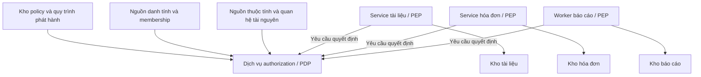
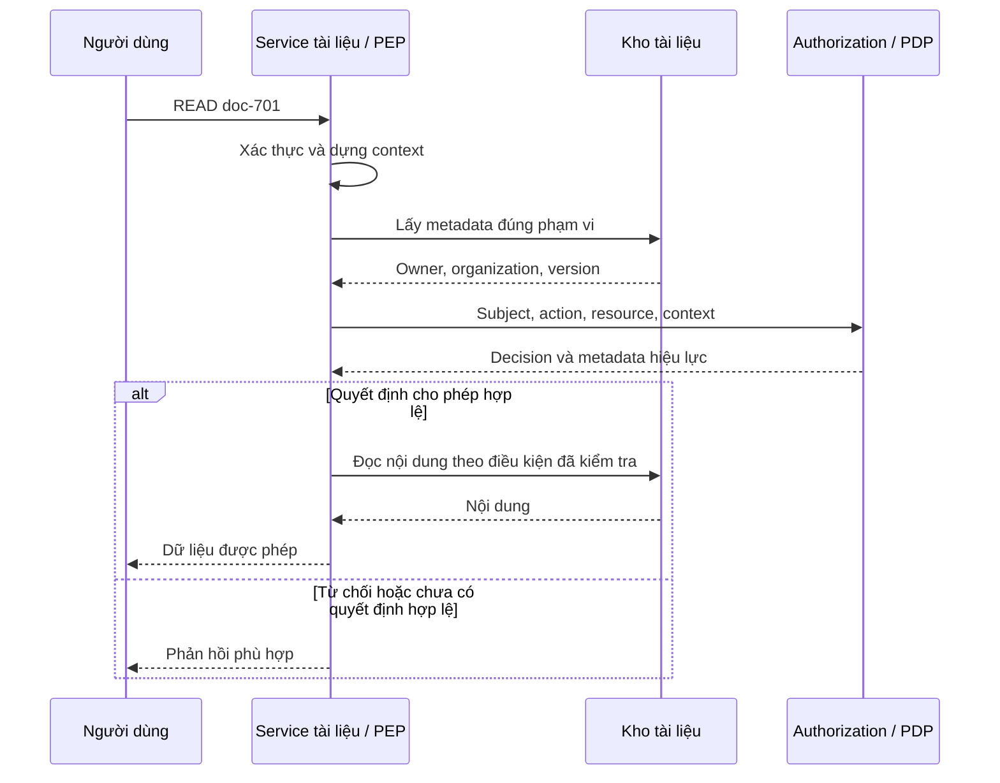

# Centralized authorization

## 1. Phân quyền tập trung giải quyết vấn đề gì?

Centralized authorization là cách tổ chức để các ứng dụng sử dụng một nguồn chính sách hoặc một cơ chế quyết định quyền được quản lý thống nhất. Mục tiêu là tránh mỗi service tự diễn giải một quy tắc nghiệp vụ theo một cách khác nhau, đồng thời tạo khả năng thay đổi, kiểm tra và giải thích quyền truy cập có kiểm soát.

Giả sử một nền tảng có service tài liệu, service hóa đơn và service xuất báo cáo. Người dùng đã bị đình chỉ trong organization, nhưng service tài liệu kiểm tra trạng thái membership mới, service hóa đơn chỉ tin role trong token cũ, còn service báo cáo có một danh sách ngoại lệ viết cứng. Hệ thống không có một câu trả lời nhất quán cho việc người đó còn được truy cập dữ liệu hay không.

Phân quyền tập trung giúp thống nhất cách mô tả và đánh giá những điều kiện như membership đang hiệu lực, ranh giới tenant, quyền trên tài nguyên và yêu cầu MFA. Tuy nhiên, đưa policy vào một nơi không tự bảo đảm mọi đường truy cập đều bị kiểm soát.

Ứng dụng vẫn phải xác định đúng người gọi, hành động và đối tượng thực tế, cung cấp dữ liệu đầu vào đáng tin và thực thi kết quả trước khi cho thao tác xảy ra.

```text
Người gọi + hành động + tài nguyên + ngữ cảnh đáng tin
    -> chính sách được quản lý thống nhất
    -> quyết định quyền
    -> thực thi tại nơi bảo vệ tài nguyên
```

Trong bài, nền tảng tài liệu B2B là ví dụ tự thiết kế. Tên API, schema JSON và code minh họa không phải hợp đồng mặc định của OPA, Cedar, XACML hoặc một dịch vụ IAM cụ thể.

## 2. “Tập trung” có nhiều nghĩa

### 2.1. Tập trung quản trị chính sách

Nhóm phụ trách quản lý policy ở một quy trình chung: có người sở hữu, version, kiểm thử, phê duyệt theo nhu cầu và cách phát hành. Nhiều service có thể nhận cùng một bộ policy hoặc những phần policy thuộc phạm vi của mình.

Quyết định vẫn có thể được tính ngay trong tiến trình ứng dụng hoặc một agent gần ứng dụng. Vì vậy, quản trị tập trung không đồng nghĩa mọi request đều phải gọi qua mạng đến một server trung tâm.

### 2.2. Tập trung tính quyết định

Các service gửi yêu cầu đến một dịch vụ authorization dùng chung. Dịch vụ đó đánh giá policy và trả về quyết định. Đây là mô hình remote PDP — Policy Decision Point từ xa.

Một dịch vụ logic có thể có nhiều replica, nhiều vùng triển khai hoặc phân vùng theo tenant. “Tập trung” về trách nhiệm quyết định không bắt buộc chỉ có một process hay một máy chủ.

### 2.3. Thực thi tại nhiều điểm

Tài liệu được trả ở service tài liệu; hóa đơn được cập nhật ở service hóa đơn; dữ liệu xuất được tạo ở worker báo cáo. Mỗi nơi thực hiện thao tác cần bảo vệ đường truy cập của chính mình.

```text
Policy được quản trị thống nhất
    không có nghĩa là
chỉ một gateway được phép kiểm tra và mọi service phía sau đều được tin.
```

OPA mô tả khả năng quản trị policy tập trung về mặt logic trong khi đặt engine gần các ứng dụng để quyết định và thực thi phân tán trong [Management APIs and Architecture](https://www.openpolicyagent.org/docs/management-introduction). Phân biệt này quan trọng khi đánh giá kiến trúc, thay vì chỉ nhìn số lượng server authorization.

### 2.4. Khác với xác thực tập trung

SSO hoặc identity provider tập trung giúp các ứng dụng xác thực danh tính theo một cơ chế thống nhất. Điều đó chưa quyết định người dùng được đọc tài liệu nào, duyệt hóa đơn nào hoặc cấp quyền cho ai.

Token hợp lệ có thể là đầu vào của authorization. Nó không phải kết luận rằng mọi thao tác của người giữ token đều được phép. Role, group hoặc membership chứa trong token cũng cần được hiểu đúng phạm vi và độ mới.

## 3. Những vai trò logic cần phân biệt

| Vai trò | Trách nhiệm trong ví dụ |
| --- | --- |
| Quản trị policy | Soạn, kiểm thử, quản lý version và phát hành chính sách |
| PDP — Policy Decision Point | Đánh giá request theo policy cùng dữ liệu liên quan |
| PIP — Policy Information Point | Cung cấp thuộc tính danh tính, membership, tài nguyên hoặc môi trường |
| PEP — Policy Enforcement Point | Cho thực hiện hoặc chặn thao tác theo quyết định và điều kiện thực thi |
| Nguồn danh tính | Xác thực chủ thể và cung cấp dữ kiện danh tính theo hợp đồng |

Các vai trò trên là cách chia trách nhiệm. Một service có thể đảm nhiệm nhiều vai trò; một vai trò cũng có thể được triển khai bằng nhiều thành phần. Không cần tạo thêm microservice chỉ để mỗi tên viết tắt có một process.

Trong mô hình Zero Trust của [NIST SP 800-207](https://nvlpubs.nist.gov/nistpubs/specialpublications/NIST.SP.800-207.pdf), thành phần quyết định và thành phần thực thi cũng được phân biệt. Chi tiết cấu trúc trong mô hình Zero Trust không có nghĩa mọi ứng dụng phải sao chép nguyên các thành phần đó.

Quyết định và thực thi là hai trách nhiệm khác nhau:

```text
PDP: Lan được READ document:doc-701 theo ngữ cảnh được cung cấp.
PEP: Chỉ trả nội dung doc-701 cho Lan khi quyết định đó còn áp dụng.
```

PDP không tự chặn một repository bị gọi qua đường khác. PEP cũng không được tự đổi Deny thành Permit vì cho rằng người dùng “có vẻ là admin”.

## 4. Ba cách triển khai thường gặp

| Cách triển khai | Nơi tính quyết định | Điểm cần thiết kế |
| --- | --- | --- |
| Remote authorization service | Dịch vụ được nhiều ứng dụng gọi qua mạng | Độ trễ, khả năng phục vụ, bảo vệ API và phạm vi từng bên gọi |
| Agent hoặc sidecar gần ứng dụng | Tiến trình cùng host hoặc cùng cụm triển khai với ứng dụng | Phân phối policy, dữ liệu cục bộ và độ lệch version |
| Engine hoặc thư viện nhúng | Trong tiến trình ứng dụng | Tương thích runtime, vòng đời thư viện và cập nhật policy |

Tất cả đều có thể sử dụng policy được quản trị tập trung. Khác biệt nằm ở nơi đánh giá, cách phân phối dữ liệu và các dạng lỗi vận hành.

Trong [hướng dẫn triển khai OPA](https://www.openpolicyagent.org/docs/deploy), OPA trình bày cả mô hình local agent và centralized service, cùng đánh đổi về độ trễ và khả năng phục vụ. Không có một cách triển khai phù hợp cho mọi ứng dụng.

Một remote PDP thuận tiện khi cần dùng chung lượng dữ liệu lớn hoặc nhiều loại runtime. Một engine gần ứng dụng giảm phụ thuộc vào một lượt gọi mạng cho mỗi quyết định, nhưng việc phát policy và dữ liệu mới đến nhiều instance cần được quản lý.

Không nên đồng nhất policy tập trung với dữ liệu tập trung tuyệt đối. Owner tài liệu có thể nằm trong cơ sở dữ liệu tài liệu, trạng thái người dùng nằm ở hệ thống danh tính, còn quan hệ chia sẻ nằm trong kho ReBAC. PDP cần có cách sử dụng dữ liệu ấy mà vẫn giữ đúng nguồn có thẩm quyền.

## 5. Kiến trúc minh họa với remote PDP

Ví dụ có ba thành phần nghiệp vụ: service tài liệu, service hóa đơn và worker xuất báo cáo. Chúng gọi một dịch vụ authorization logic dùng chung, nhưng thực thi quyết định tại từng đường nghiệp vụ.



Sơ đồ chỉ biểu diễn trách nhiệm. Dữ liệu thuộc tính không nhất thiết được kéo trực tiếp từ nguồn trong mọi lần đánh giá; có thể được gửi kèm hoặc đồng bộ theo hợp đồng được mô tả sau.

AWS cũng minh họa kiến trúc PDP tập trung kết hợp PEP ở các API trong [Design models for Amazon Verified Permissions](https://docs.aws.amazon.com/prescriptive-guidance/latest/saas-multitenant-api-access-authorization/using-avp.html). Ví dụ của bài chỉ sử dụng ý tưởng chia trách nhiệm, không giả định mọi chi tiết vận hành giống dịch vụ đó.

### 5.1. Request đọc tài liệu đi qua đâu?



PEP không gửi nội dung tài liệu nhạy cảm nếu policy chỉ cần owner, organization và classification. PDP chỉ cần nhận những dữ kiện phục vụ quyết định theo schema đã định nghĩa.

### 5.2. Gateway không có đủ mọi ngữ cảnh

Gateway có thể kiểm tra token, quota và quyền gọi chức năng ở mức thô. Tuy nhiên, owner hiện tại, trạng thái tài liệu, ACL và version có thể chỉ được biết tại service tài liệu.

Vì vậy, có thể có nhiều lớp kiểm tra với phạm vi rõ ràng. Gateway cho request đi tiếp không đồng nghĩa service được bỏ kiểm tra object authorization. Ngược lại, không cần lặp lại một phép đánh giá giống hệt ở nhiều nơi nếu đã có một ranh giới thực thi bảo đảm và được chứng minh.

## 6. Hợp đồng authorization cần có gì?

### 6.1. Đặt tên subject, action và resource

Action nên diễn đạt thao tác nghiệp vụ như `document.read`, `invoice.approve` hoặc `membership.invite`. Chỉ dùng HTTP method và tên route có thể không đủ để phân biệt mức ảnh hưởng.

Resource cần có loại và định danh ổn định. `document:701` không phải `invoice:701`. Nếu ID chỉ duy nhất trong tenant, hợp đồng phải đưa tenant vào định danh hoặc trường phạm vi phù hợp.

Request JSON minh họa do backend dựng:

```json
{
  "requestId": "req-5101",
  "schemaVersion": "1",
  "callerService": "document-service",
  "subject": {
    "id": "user-lan"
  },
  "action": "document.read",
  "resource": {
    "type": "document",
    "id": "doc-701",
    "organizationId": "org-a",
    "ownerId": "user-binh",
    "version": "18"
  },
  "context": {
    "organizationId": "org-a",
    "sessionAssurance": "mfa",
    "requestTime": "2026-11-26T03:00:00Z"
  }
}
```

`callerService` trong JSON chỉ là thông tin mô tả. PDP phải xác thực service qua cơ chế được triển khai, không tin một chuỗi tên do bên gọi tự đặt.

### 6.2. Response phải đủ rõ cho PEP

```json
{
  "requestId": "req-5101",
  "decisionId": "dec-8901",
  "decision": "Permit",
  "policyVersion": "document-policy-23",
  "resourceVersion": "18",
  "reasonCodes": ["EXPLICIT_READ_RELATION"],
  "obligations": [],
  "validUntil": "2026-11-26T03:00:02Z"
}
```

Ví dụ này chọn một thời hạn rất ngắn để minh họa hợp đồng hiệu lực; đó không phải khuyến nghị TTL chung. Có hệ thống chỉ dùng quyết định cho một thao tác hiện tại và không cung cấp quyền tái sử dụng theo thời gian.

Response cần được nhận từ đúng PDP được xác thực và qua kênh được bảo vệ. `requestId` hỗ trợ ghép request–response, không phải chữ ký hoặc bằng chứng cấp quyền độc lập. Không chấp nhận một response JSON do client gửi để bỏ qua cuộc kiểm tra phía server.

Không suy ra Permit chỉ từ HTTP 200. Body có thể chứa Deny, không có decision, sai schema hoặc kết quả không đúng kiểu. PEP phải kiểm tra hợp đồng response trước khi thực hiện thao tác.

## 7. Dữ liệu đầu vào quyết định chất lượng của policy

### 7.1. PDP không tự biết dữ kiện nào là sự thật

Policy có thể đúng nhưng vẫn cấp quyền sai nếu caller được phép tự khai `ownerId`, `organizationId`, membership hoặc mức bảo đảm phiên.

Trong ví dụ, service tài liệu lấy owner từ dữ liệu tài nguyên được quản trị. Danh tính lấy từ phiên đã xác thực. Membership lấy từ nguồn danh tính hoặc kho quan hệ có thẩm quyền. Bằng chứng MFA phải phản ánh cơ chế xác thực đã được kiểm chứng.

Không gửi nguyên body client sang PDP rồi mặc định mọi trường đều đáng tin. Nên có một bước xây dựng authorization input bằng các dữ kiện được server xác minh.

### 7.2. Gửi kèm, tra cứu trực tiếp hay đồng bộ?

| Cách cung cấp dữ liệu | Lợi ích trong thiết kế | Điểm cần giải quyết |
| --- | --- | --- |
| PEP gửi thuộc tính đã xác minh | Service nghiệp vụ biết rõ tài nguyên, giảm lookup từ PDP | Caller được tin cậy đến mức nào, có làm giả thuộc tính không? |
| PDP tra cứu từ nguồn có thẩm quyền | Tập trung việc lấy một số thuộc tính | Độ trễ, lỗi nguồn, quyền truy vấn và tải chéo giữa service |
| Đồng bộ dữ liệu sang PDP hoặc agent | Giảm tra cứu trong lúc đánh giá | Độ trễ đồng bộ, thứ tự sự kiện, version và thu hồi |

Không cần chọn một cách cho mọi trường. Owner có thể được gửi kèm từ service tài liệu, membership được tra cứu hoặc đồng bộ, còn thời điểm đánh giá lấy ở server.

Điều cần công bố là mỗi thuộc tính do ai quản lý, ai được trình bày nó và độ mới nào được chấp nhận. Khi membership vừa bị đình chỉ, policy mới nhất vẫn có thể cấp quyền theo bản membership cũ nếu đường đồng bộ chưa cập nhật.

### 7.3. Danh tính service và danh tính người dùng

Khi service tài liệu gọi PDP thay Lan, có hai chủ thể cần phân biệt:

```text
Caller: document-service, được xác thực ở kênh gọi PDP.
Subject: user-lan, người mà request nghiệp vụ đang đại diện.
```

PDP cần biết service đó có được yêu cầu đánh giá cho subject, namespace tài nguyên và action tương ứng hay không. Một service nội bộ không nên có quyền tùy ý tự nhận mình đang hành động thay bất kỳ người dùng nào trong mọi tenant.

Nếu có ủy quyền qua nhiều service, phải giữ được thông tin actor và subject theo thiết kế. Không dùng một tài khoản dịch vụ đặc quyền để biến mọi yêu cầu của người dùng thành yêu cầu quản trị.

Token của người dùng cũng không được chuyển tiếp đến mọi service bất kể audience. Cần dùng cơ chế xác thực và ủy quyền phù hợp với từng đường gọi thay vì coi mạng nội bộ là bằng chứng quyền.

## 8. Java minh họa một PEP kiểm tra kết quả

Đoạn Java 17 dưới đây minh họa một cổng thực thi dùng client trừu tượng. Client chịu trách nhiệm xác thực PDP, bảo vệ kênh truyền, timeout, giải mã response và kiểm tra schema cơ bản. Code không cài đặt HTTP hoặc một SDK sản phẩm cụ thể.

Ví dụ chỉ hỗ trợ Permit không kèm obligation. Response có nghĩa vụ mà cổng này chưa hỗ trợ sẽ không được dùng để cho thao tác chạy.

```java
import java.time.Clock;
import java.time.Instant;
import java.util.List;
import java.util.Objects;

public final class CentralizedAuthorizationGate {
    enum Decision { PERMIT, DENY, INDETERMINATE }

    record Request(
            String requestId,
            String subjectId,
            String organizationId,
            String action,
            String resourceType,
            String resourceId,
            String resourceVersion) {}

    record Response(
            Request evaluatedRequest,
            Decision decision,
            String policyVersion,
            Instant validUntil,
            List<String> obligations) {}

    interface PolicyClient {
        Response decide(Request request) throws Unavailable;
    }

    static final class Denied extends RuntimeException {}

    static final class Unavailable extends RuntimeException {
        Unavailable(String message) {
            super(message);
        }
    }

    private final PolicyClient client;
    private final Clock clock;

    CentralizedAuthorizationGate(PolicyClient client, Clock clock) {
        this.client = Objects.requireNonNull(client);
        this.clock = Objects.requireNonNull(clock);
    }

    void requirePermit(Request request) {
        Objects.requireNonNull(request, "request");
        Response response = client.decide(request);

        if (response == null
                || !request.equals(response.evaluatedRequest())
                || response.policyVersion() == null
                || response.policyVersion().isBlank()) {
            throw new Unavailable("Invalid authorization response");
        }

        if (response.decision() == Decision.DENY) {
            throw new Denied();
        }

        Instant receivedAt = clock.instant();
        if (response.decision() != Decision.PERMIT
                || response.validUntil() == null
                || !receivedAt.isBefore(response.validUntil())
                || response.obligations() == null
                || !response.obligations().isEmpty()) {
            throw new Unavailable("No usable permit");
        }
    }
}
```

PEP chỉ đi qua cổng khi nhận được Permit phù hợp. Response null, sai request, hết hạn hoặc có nghĩa vụ chưa được hỗ trợ không tạo quyền. Client báo timeout qua `Unavailable`; không có nhánh nào biến ngoại lệ đó thành cho phép.

`Request` ở đây phải là snapshot bất biến được dựng từ input hợp lệ trước khi gọi. Việc response lặp lại request giúp phát hiện ghép sai dữ liệu, không thay thế xác thực service hay bảo vệ tính toàn vẹn của kênh truyền.

Cổng kiểm tra thời điểm sau khi nhận response, không dùng thời điểm trước cuộc gọi mạng để nhận một quyết định đã hết hạn trong lúc chờ. Hệ thống phân tán vẫn cần chính sách sai lệch đồng hồ và thời hạn phù hợp; timestamp đơn lẻ không bảo đảm dữ liệu quyền chưa thay đổi.

Service nghiệp vụ còn phải thực hiện thao tác trên đúng `resourceId`, đúng phạm vi và trạng thái được đánh giá. Đoạn code không giải quyết TOCTOU, không thực thi nghĩa vụ và chưa thể hiện bước bảo vệ giao dịch ghi.

Nếu PEP cần hỗ trợ obligation như che trường dữ liệu, phải triển khai và kiểm thử rõ từng loại trước khi cho phép response tương ứng. Không tự bỏ qua obligation vì decision đã là Permit.

## 9. Khi authorization service gặp lỗi

### 9.1. Phân biệt từ chối quyền với không có quyết định hợp lệ

| Tình huống | Ý nghĩa | Hành vi thực thi của ví dụ |
| --- | --- | --- |
| PDP trả Deny hợp lệ | Policy quyết định không cho phép | Chặn thao tác |
| PDP trả Permit hợp lệ, đủ điều kiện | Có quyết định có thể sử dụng | Tiếp tục theo đúng phạm vi |
| Timeout, lỗi kết nối hoặc không xác thực được PDP | Chưa có quyết định đáng tin | Chặn thao tác, ghi nhận lỗi vận hành |
| Response sai schema hoặc thiếu decision | Không có kết quả dùng được | Chặn thao tác, điều tra hợp đồng tích hợp |
| Permit có obligation chưa hỗ trợ | PEP chưa đáp ứng điều kiện thực thi | Không thực hiện truy cập |

Fail-closed trong bài nghĩa là không thực hiện thao tác được bảo vệ khi chưa có Permit hợp lệ. Điều đó không bắt buộc mọi lỗi đều trả cùng mã HTTP hoặc cùng thông báo. Từ chối quyền và sự cố hệ thống cần được phân biệt trong quan sát vận hành.

Không nên tăng tỷ lệ thành công bằng `catch (...) { return true; }`. Cách đó khiến sự cố hạ tầng trở thành đường vượt quyền.

### 9.2. Timeout và retry phải có ngân sách

Cuộc gọi PDP cần giới hạn thời gian theo ngân sách request nghiệp vụ. Retry không giới hạn có thể làm nhiều service cùng giữ kết nối, thread hoặc coroutine để chờ một dependency đang quá tải.

Một authorization check thuần tính toán có thể được retry theo hợp đồng, nhưng vẫn tốn tải và có thể tạo nhiều decision log. Nếu việc đánh giá kích hoạt tác động như ghi audit bắt buộc, phải hiểu semantics của retry và tính idempotent.

Circuit breaker có thể dừng gửi thêm request đến dependency đang lỗi. Nó không tự cấp quyền để thay thế PDP. Khi breaker mở, đường xử lý vẫn phải theo chính sách đã chọn: chặn, hoặc dùng một cơ chế quyết định cục bộ còn hợp lệ được thiết kế từ trước.

### 9.3. Cơ chế dự phòng phải là một chính sách có hiệu lực

Có thể dùng engine cục bộ hoặc policy snapshot đã được phân phối để tiếp tục đánh giá trong một số kiến trúc. Tuy nhiên, phải biết snapshot còn được phép dùng đến khi nào, dữ liệu thuộc tính có đủ mới không và tập action nào được hỗ trợ.

Không tự tạo fallback `admin được làm mọi thứ` khi remote PDP không trả lời. Một đường truy cập khẩn cấp, nếu sản phẩm cần, phải có danh tính, phạm vi, thời hạn, kiểm toán và điều kiện kích hoạt riêng.

## 10. Hiệu năng và khả năng phục vụ

### 10.1. Độ trễ không chỉ nằm ở engine

Tổng thời gian authorization có thể gồm chuẩn bị input, lấy thuộc tính, kết nối mạng, xếp hàng, đánh giá policy và xử lý response. Engine tính vài phép so sánh rất nhanh nhưng một chuỗi lookup chậm vẫn làm request chậm.

```text
Thời gian nghiệp vụ
    gồm đường truy cập dữ liệu và các dependency cần thiết,
    trong đó authorization có ngân sách thời gian riêng.
```

Nên đo latency đầu cuối và từng dependency, đặc biệt các phân vị cao và thời gian chờ hàng đợi. Không cộng tùy tiện p99 của mọi thành phần để coi đó là p99 chính xác của toàn request; cần đo đường thực thi thực tế.

Các tối ưu có thể gồm dùng kết nối lại, đặt PDP gần vùng phục vụ, giảm dữ liệu gửi, batch những check độc lập hoặc dùng agent gần PEP. Mỗi tối ưu cần giữ nguyên phạm vi quyết định.

### 10.2. Một request nghiệp vụ có thể tạo nhiều check

Một trang hiển thị 100 tài liệu có thể gây nhiều lần đánh giá nếu mỗi dòng, nút và tệp đính kèm đều kiểm tra riêng. Nếu một request đi qua nhiều service và mỗi service gọi PDP nhiều lần, lượng check có thể lớn hơn nhiều so với lượng request bên ngoài.

Batch check giảm số lượt truyền mạng nhưng không mặc định tạo snapshot nhất quán cho cả batch. List API cần cách lọc quyền phù hợp; không kiểm tra một tài liệu rồi cho rằng mọi phần tử trong danh sách đều có quyền giống nhau.

### 10.3. Tập trung logic không có nghĩa chấp nhận một điểm lỗi vật lý

Remote PDP cần kế hoạch replica, cân bằng tải, dung lượng, giới hạn lưu lượng và khôi phục. Một tenant gửi nhiều check không nên làm mọi tenant khác mất khả năng quyết định quyền.

Replica cũng có thể khác policy version hoặc dữ liệu thuộc tính. High availability không tự bảo đảm các quyết định dùng cùng snapshot. Cần theo dõi cả sức khỏe dịch vụ lẫn version đang được phục vụ.

Không nên kiểm tra health chỉ bằng việc process còn chạy. Readiness cần phản ánh những điều kiện cần thiết để đưa ra quyết định, chẳng hạn đã nạp policy hợp lệ và dữ liệu bắt buộc đủ dùng theo thiết kế.

## 11. Tính nhất quán, cache và thu hồi quyền

### 11.1. Ba loại thay đổi khác nhau

Khi người dùng mất quyền, cần biết thay đổi nằm ở đâu:

```text
Policy thay đổi: MEMBER không còn được thực hiện một action.
Thuộc tính thay đổi: membership của Lan bị đình chỉ.
Quan hệ thay đổi: grant READ của Lan trên doc-701 bị xóa.
```

Phát policy mới không tự cập nhật membership hoặc ACL. Ngược lại, dữ liệu quan hệ mới không giúp nếu một agent vẫn dùng policy cũ vốn cho phép quá rộng.

Trong một request còn có thể xảy ra việc tài nguyên đổi owner hoặc organization sau lúc đánh giá. PEP phải gắn việc đọc hoặc ghi với tài nguyên và điều kiện đã kiểm tra, dùng version, giao dịch hoặc cơ chế tương đương phù hợp.

### 11.2. Cache quyết định cần phản ánh đầu vào

Khóa cache chỉ có `subjectId` là quá rộng. Lan có thể được đọc một tài liệu nhưng không được cập nhật nó, hoặc có vai trò khác nhau trong hai organization.

```text
decisionKey có thể cần:
    subject + action + resourceType + resourceId
    + organizationContext + sessionAssurance
    + policyVersion + các revision dữ liệu liên quan
```

Không phải hệ thống nào cũng có sẵn mọi revision. Nếu phải đọc nguồn mới để biết revision đã đổi, lợi ích của cache cần được tính lại. Nếu chỉ dựa vào TTL hoặc sự kiện vô hiệu hóa, hãy công bố giới hạn độ mới thực tế.

Không dùng Permit đã cache vượt thời điểm hết hạn grant, hết hạn phiên hoặc ranh giới thời gian của policy. Một cache còn TTL không phải bằng chứng quyền còn hiệu lực.

Cache nội dung cũng không thay thế authorization. Có sẵn tài liệu trong bộ nhớ không có nghĩa được trả cho mọi subject; vẫn cần quyền cho đúng người gọi và đối tượng.

### 11.3. Tập trung quyết định không tạo thu hồi tức thì

Ví dụ một membership bị đình chỉ ở kho nguồn nhưng sự kiện cần vài giây mới đến PDP. Trong khoảng đó, remote PDP vẫn có thể tính quyết định dựa trên dữ liệu cũ.

Độ trễ thu hồi bao gồm cập nhật nguồn, truyền sự kiện hoặc đồng bộ, refresh dữ liệu ở PDP, cache ở PEP và quyết định đang được sử dụng. Kết nối hoặc URL tải đã cấp còn có vòng đời riêng cần được xét.

Một thao tác đọc mới trực tiếp từ kho của PDP chỉ thấy dữ liệu mà kho ấy đã nhận. Nó không làm sự kiện chưa được xử lý tự xuất hiện.

Cần xác định mức thu hồi theo từng action. Một thao tác rủi ro cao có thể cần dữ liệu mới hơn hoặc kiểm tra trực tiếp một số điều kiện; một màn hình ít nhạy cảm có thể chấp nhận snapshot theo hợp đồng được đặt ra. Đây là lựa chọn thiết kế cần có căn cứ, không phải TTL chung áp dụng cho mọi quyền.

## 12. Quản trị policy như một phần của sản phẩm

### 12.1. Policy cần chủ sở hữu nghiệp vụ

Tập trung policy không có nghĩa một nhóm hạ tầng phải tự quyết định mọi quy tắc nghiệp vụ. Nhóm tài liệu cần xác định ai được chia sẻ tài liệu; nhóm tài chính cần xác định ai được duyệt hóa đơn; nhóm nền tảng có thể sở hữu engine, schema chung và đường phát hành.

Quyền sửa policy, quyền cấp dữ liệu thuộc tính và quyền triển khai PEP đều có thể làm thay đổi quyền hiệu lực. Cần biết ai được thay đổi phần nào và cách kiểm tra thay đổi ấy.

### 12.2. Vòng đời phát hành minh họa

```text
Yêu cầu nghiệp vụ
    -> mô tả hành vi và phạm vi
    -> thay đổi policy cùng schema nếu cần
    -> kiểm thử các trường hợp cho phép, từ chối và lỗi
    -> phát hành có version
    -> quan sát decision và enforcement
    -> mở rộng hoặc khôi phục phiên bản theo điều kiện đã định
```

Policy version cần được nhận diện trong log và quan sát deployment. Việc đặt tên version không đủ nếu nội dung cùng version có thể bị thay đổi âm thầm; nên có cách nhận diện artifact thực tế theo quy trình phát hành.

### 12.3. Schema và policy phải tương thích với PEP

Ví dụ policy mới yêu cầu `resource.classification`, nhưng một service cũ chưa gửi trường này. Nếu policy dùng giá trị thiếu như điều kiện thuận lợi, có thể cấp quyền sai. Nếu luôn từ chối khi thiếu, rollout có thể làm gián đoạn cả service cũ.

Cần một kế hoạch chuyển đổi cụ thể: cập nhật caller để gửi trường mới, xác nhận dữ liệu có mặt và hợp lệ, sau đó bật policy bắt buộc trường ấy. Có thể dùng schema version hoặc các đường policy tương thích trong giai đoạn chuyển tiếp.

Không thêm một giá trị mặc định như `classification = public` chỉ để tránh lỗi rollout, trừ khi đó thực sự là ý nghĩa nghiệp vụ hợp lệ của dữ liệu thiếu.

### 12.4. Triển khai từng phần và rollback

Với remote PDP có nhiều replica hoặc agent phân tán, trong một khoảng thời gian có thể tồn tại nhiều version. Phải biết service nào đang dùng policy nào và những hành vi nào được chấp nhận trong giai đoạn đó.

Rollback policy không tự khôi phục mọi dữ liệu thuộc tính hoặc quan hệ đã thay đổi. Nếu schema và dữ liệu đã migrate, phiên bản cũ có thể không còn tương thích. Kế hoạch khôi phục cần xét cả policy, input và đường thực thi.

Một policy thay đổi có thể ảnh hưởng nhiều service cùng lúc. Lợi ích cập nhật thống nhất đi kèm phạm vi ảnh hưởng rộng; kiểm thử và phát hành cần phản ánh tác động đó.

## 13. Cô lập tenant và bảo vệ dịch vụ authorization

### 13.1. Không để caller tùy chọn phạm vi policy

Nếu có nhiều policy namespace hoặc policy store theo tenant, backend phải ánh xạ tenant đã được xác minh sang đúng phạm vi đánh giá. Không cho client gửi một policy store bất kỳ rồi dùng trực tiếp.

Trong một mô hình shared store, rule phải giữ ranh giới tenant. Trong mô hình store riêng, vẫn cần kiểm tra caller được dùng store nào và dữ liệu resource có thuộc phạm vi ấy không.

Amazon Verified Permissions mô tả policy store là container chính sách và yêu cầu chỉ định store khi gửi authorization request trong [tài liệu policy stores](https://docs.aws.amazon.com/verifiedpermissions/latest/userguide/policy-stores.html). Cách chia store là một lựa chọn triển khai; bản thân store riêng không thay thế việc ánh xạ đúng tenant ở ứng dụng.

### 13.2. Tách API quyết định khỏi API quản trị

Ứng dụng cần gọi check không nhất thiết được sửa hoặc xóa policy. Tương tự, người quản trị tenant chỉ nên quản lý những quy tắc mà sản phẩm cho phép trong tenant của họ.

```text
Decision API: yêu cầu đánh giá trong phạm vi được cấp.
Management API: thay đổi policy, schema hoặc cấu hình.
Data update path: thay đổi thuộc tính và quan hệ có ảnh hưởng đến quyền.
```

Nếu cùng credential được dùng cho cả ba đường mà không giới hạn, một service bị xâm nhập có thể vừa gọi check vừa sửa điều kiện để tự được cho phép. Cần phân quyền theo trách nhiệm và bảo vệ đường phát hành policy.

### 13.3. Tập trung dữ liệu cần giới hạn dữ liệu

PDP có thể nhìn thấy dữ kiện của nhiều ứng dụng và tenant. Chỉ gửi thuộc tính cần thiết cho quyết định; không gom mật khẩu, token nguyên vẹn hoặc toàn bộ nội dung nghiệp vụ khi không cần.

Log, trace, dữ liệu chẩn đoán và bản sao policy cũng cần quyền truy cập phù hợp. Những reason code tưởng như vô hại có thể tiết lộ quan hệ tổ chức hoặc sự tồn tại của tài nguyên nếu trả quá chi tiết cho client.

## 14. Quan sát được cả quyết định lẫn thực thi

Một hệ thống tập trung tạo điều kiện gom log, nhưng một dòng Permit chưa chứng minh dữ liệu được phục vụ đúng. Cần liên kết kết quả PDP với thao tác thực tế tại PEP.

Log minh họa:

```json
{
  "requestId": "req-5101",
  "decisionId": "dec-8901",
  "callerService": "document-service",
  "subjectId": "user-lan",
  "action": "document.read",
  "resourceId": "doc-701",
  "organizationId": "org-a",
  "policyVersion": "document-policy-23",
  "decision": "Permit",
  "enforcementOutcome": "SERVED",
  "decisionSource": "remote-pdp"
}
```

Những chỉ số hữu ích gồm latency đầu cuối, tỷ lệ timeout, tỷ lệ response không hợp lệ, version đang chạy, độ trễ đồng bộ và số lần PEP từ chối vì điều kiện thực thi không đáp ứng.

Tỷ lệ Deny cao có thể là policy mới chặn đúng những yêu cầu trước đây được phép quá rộng, hoặc có thể là input bị thiếu. Chỉ nhìn một biểu đồ số lượng từ chối không đủ để kết luận.

Nên phân biệt policy Deny với lỗi dependency và lỗi tích hợp. Nếu tất cả cùng ghi `access_denied`, nhóm vận hành khó biết cần sửa quyền, sửa schema hay khôi phục nguồn dữ liệu.

Decision log không nên chứa access token, mã OTP, bí mật hoặc toàn bộ dữ liệu tài nguyên. Khi cần điều tra, dùng định danh và version để liên kết các nguồn thông tin có kiểm soát thay vì ghi mọi dữ liệu đầu vào vào một kho log chung.

## 15. Kiểm thử và chuyển đổi từ logic đang phân tán

### 15.1. Kiểm kê trước khi thay cơ chế

Cần biết những đường truy cập nào tồn tại: API chi tiết, danh sách, tải tệp, export, tác vụ nền, WebSocket, công cụ quản trị và các service gọi lẫn nhau.

Cũng cần thống kê nguồn quyền hiện tại: role trong token, ACL trong cơ sở dữ liệu, quan hệ team, ngoại lệ hard-code hoặc quyền quản trị đặc biệt. Không nên chuyển nguyên mọi ngoại lệ thành policy mới mà chưa hiểu ý nghĩa và phạm vi.

### 15.2. So sánh quyết định trong chế độ quan sát

Có thể gửi cùng ngữ cảnh đến policy mới để so sánh với cơ chế hiện tại, trong khi cơ chế thực thi chính vẫn được xác định rõ. Cần bảo đảm việc quan sát không tự tạo tác động ngoài ý muốn hoặc làm lộ thêm dữ liệu.

Chênh lệch giữa hai kết quả không tự chứng minh policy mới sai. Cơ chế cũ có thể đang cấp quyền quá rộng; policy mới cũng có thể thiếu một đường cấp quyền hợp lệ. Mỗi nhóm chênh lệch cần được giải thích theo yêu cầu nghiệp vụ.

Không dùng phép OR giữa hai engine để tránh ảnh hưởng: `oldPermit OR newPermit` có thể giữ lại quyền mà policy mới cố thu hồi. Một giai đoạn chạy song song cần quy tắc thực thi cụ thể và thời hạn chuyển đổi.

### 15.3. Ma trận kiểm thử đề xuất

Các trường hợp sau là đề xuất cho thiết kế minh họa, không phải báo cáo rằng đã chạy hệ thống hay SDK nào.

| Nhóm | Tình huống | Điều cần khẳng định |
| --- | --- | --- |
| Phạm vi | Đổi resource, action hoặc organization | Không tái sử dụng quyết định của bộ đầu vào khác |
| Dữ liệu tin cậy | Client tự gửi owner, role hoặc MFA | Không dùng các giá trị tự khai làm bằng chứng |
| Caller | Service dùng namespace hoặc subject ngoài quyền | Bị chặn theo hợp đồng service-to-service |
| Quyết định | Permit và Deny hợp lệ | PEP thực thi đúng và gắn với tài nguyên thực tế |
| Hợp đồng | HTTP 200 nhưng decision thiếu hoặc sai kiểu | Không cho phép mặc định |
| Lỗi hệ thống | Timeout, lỗi xác thực PDP hoặc breaker mở | Không tạo đường vượt quyền |
| Nghĩa vụ | Permit có nghĩa vụ PEP chưa hỗ trợ | Không thực hiện truy cập trái điều kiện |
| Thời hạn | Response hết hạn trong lúc chờ | Không dùng Permit hết hiệu lực |
| Rollout | Caller cũ thiếu trường policy mới yêu cầu | Hành vi đúng kế hoạch tương thích, không mở quyền ngầm |
| Đồng bộ | Membership bị đình chỉ nhưng dữ liệu replica chậm | Đáp ứng giới hạn thu hồi đã công bố |
| Cache | Grant hoặc policy đổi khi còn Permit cache | Vô hiệu hóa hoặc hết hiệu lực theo hợp đồng |
| Sức tải | Một tenant tăng mạnh số check | Hạn chế ảnh hưởng đến tenant khác |
| Tính đầy đủ | Đường tải tệp, export hoặc job gọi repository | Không bỏ qua PEP được thiết kế |
| Quan sát | PDP Permit nhưng thao tác ghi thất bại | Log phân biệt quyết định và kết quả thực thi |

### 15.4. Chuyển quyền thực thi có kiểm soát

Sau khi đã hiểu khác biệt, có thể chuyển từng phạm vi nghiệp vụ sang policy mới và theo dõi kết quả. Cần xác định cách khôi phục nếu rollout lỗi và điều kiện nào cho phép dùng cơ chế cũ.

Khi một phạm vi đã chuyển hoàn toàn, những nhánh kiểm tra cũ còn sót có thể gây mâu thuẫn hoặc tạo lối đi tắt. Việc dọn chúng cần đi kèm xác nhận mọi đường truy cập đã dùng cơ chế chính thức.

## 16. Những ngộ nhận thường gặp

| Ngộ nhận | Điều cần hiểu đúng |
| --- | --- |
| Có SSO là đã phân quyền tập trung | SSO xác thực danh tính; quyền thao tác và quyền đối tượng vẫn cần policy |
| Policy tập trung bắt buộc một server duy nhất | Có thể tập trung logic và quản trị nhưng triển khai nhiều replica hoặc agent |
| Gateway đã cho qua thì service không cần xét dữ liệu | Gateway có thể chưa biết owner, trạng thái và ACL thực tế |
| PDP đúng thì toàn hệ thống đúng | Input và PEP vẫn có thể sai hoặc bị bỏ qua |
| HTTP 200 từ PDP nghĩa là Permit | Phải kiểm tra decision và hợp đồng response |
| Fail-closed là mọi lỗi đều trả 403 | Chặn thao tác và phân loại lỗi API là hai quyết định khác nhau |
| Cache ngắn thì thu hồi luôn tức thì | Còn độ trễ đồng bộ, invalidation và thao tác đang chạy |
| Version policy đủ tái hiện mọi quyết định | Cần biết cả dữ liệu và context đã dùng lúc đánh giá |
| Đọc PDP mới nhất bảo đảm mọi nguồn đều mới | Dữ liệu chưa đồng bộ từ nguồn vẫn có thể cũ |
| Tập trung policy nghĩa là bỏ quyền sở hữu nghiệp vụ | Mỗi domain vẫn cần người xác định và chịu trách nhiệm về ý nghĩa quyền |

## 17. Bài tập tự kiểm tra

1. Một hệ thống dùng chung kho policy nhưng mỗi service chạy engine cục bộ. Nó tập trung ở khía cạnh nào, và những dữ liệu nào vẫn có thể khác nhau giữa các instance?
2. Vì sao một access token hợp lệ và một lần kiểm tra tại gateway chưa đủ để đọc mọi tài liệu trong service phía sau?
3. PDP trả HTTP 200 với body thiếu trường decision. PEP của ví dụ có được tiếp tục không?
4. Membership bị đình chỉ ở kho danh tính nhưng PDP đang giữ bản sao cũ. Cần đo những thành phần nào để xác định độ trễ thu hồi?
5. Policy mới yêu cầu classification trong khi caller cũ chưa gửi trường này. Một kế hoạch rollout có thể tránh cả mở quyền mặc định lẫn gián đoạn ngoài dự kiến như thế nào?
6. Khi chạy cơ chế cũ và mới song song, vì sao kết hợp hai Permit bằng phép OR có thể làm mất ý nghĩa của thay đổi policy?

Gợi ý đối chiếu: quản trị, tính quyết định và thực thi là các trách nhiệm riêng. Tính đúng của hệ thống phụ thuộc cả nguồn dữ liệu, phạm vi request, hợp đồng response và điều kiện sử dụng kết quả, chứ không chỉ nơi đặt engine.

Centralized authorization có giá trị khi tạo được một cách mô tả, thay đổi và giải thích quyền thống nhất. Để giá trị đó đi vào hành vi thực tế, mọi PEP phải dùng đúng ngữ cảnh đáng tin, tuân thủ quyết định và giữ ràng buộc quyền trong lúc tài nguyên được truy cập.
