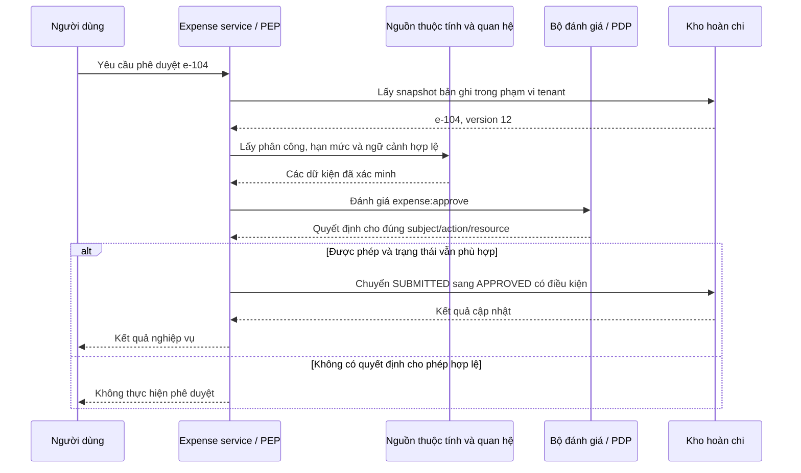

# Fine-grained access

## 1. Fine-grained access là gì?

**Fine-grained access**, hay kiểm soát truy cập chi tiết, là cách quyết định quyền ở mức đủ nhỏ để phản ánh đúng phạm vi được phép: không chỉ người dùng có được vào một chức năng, mà còn được làm hành động nào, trên tài nguyên cụ thể nào, với những trường dữ liệu nào và trong ngữ cảnh nào.

Ví dụ, hai người cùng có vai trò Reviewer nhưng được giao hai nhóm khác nhau. Việc cả hai được mở màn hình duyệt chi phí không có nghĩa họ được duyệt mọi yêu cầu hoàn chi của tổ chức.

Một quyết định có thể cần trả lời:

```text
Bình có được phê duyệt yêu cầu hoàn chi e-104
của tenant-a, thuộc team-7,
với số tiền hiện tại và trạng thái hiện tại,
trong phiên đang sử dụng hay không?
```

Tính “chi tiết” không nằm ở số lượng tên role hoặc số bảng dữ liệu. Nó nằm ở việc những khác biệt ảnh hưởng đến quyền thực sự được mô hình hóa và thực thi.

| Mức kiểm soát | Câu hỏi minh họa |
|---|---|
| Chức năng | Người dùng có được sử dụng chức năng quản lý chi phí không? |
| Hành động | Người dùng được đọc, sửa, gửi hay phê duyệt? |
| Đối tượng hoặc bản ghi | Người dùng được thao tác trên yêu cầu hoàn chi nào? |
| Thuộc tính hoặc trường | Người dùng được xem hoặc sửa những field nào? |
| Ngữ cảnh và trạng thái | Phiên, hạn mức, quan hệ nhóm và trạng thái nghiệp vụ có đáp ứng không? |

Một cổng kiểm tra tổng quát vẫn có ích để chặn người hoàn toàn không được sử dụng chức năng. Tuy nhiên, các giới hạn trên từng đối tượng và dữ liệu phải được kiểm tra tiếp ở nơi có đủ ngữ cảnh.

## 2. Phân quyền theo đối tượng và theo thuộc tính

Hai phạm vi dễ bị bỏ sót là quyền trên từng đối tượng và quyền trên các thuộc tính của đối tượng đó.

**Object-level authorization** xác nhận chủ thể có được thực hiện hành động yêu cầu trên đúng đối tượng hay không. Một người được đọc yêu cầu hoàn chi của mình không tự được đọc yêu cầu của người khác bằng cách đổi ID trong URL. OWASP mô tả đây là trọng tâm của rủi ro Broken Object Level Authorization. [OWASP API1:2023](https://owasp.org/API-Security/editions/2023/en/0xa1-broken-object-level-authorization/)

**Property-level authorization** xác nhận chủ thể được đọc hoặc thay đổi những thuộc tính cụ thể nào. Được xem một yêu cầu hoàn chi không đồng nghĩa được xem số tài khoản thanh toán; được sửa mô tả không đồng nghĩa được sửa người tạo hoặc trạng thái phê duyệt. OWASP phân biệt cả việc lộ thuộc tính nhạy cảm và việc cho sửa thuộc tính không được phép trong Broken Object Property Level Authorization. [OWASP API3:2023](https://owasp.org/API-Security/editions/2023/en/0xa3-broken-object-property-level-authorization/)

Hai lớp kiểm tra này bổ sung nhau. Một API lọc đúng bản ghi nhưng serialize toàn bộ entity vẫn có thể lộ field nhạy cảm. Một API lọc field rất kỹ nhưng tải bản ghi không thuộc quyền người dùng vẫn sai.

### 2.1. Fine-grained access không đồng nghĩa với một mô hình duy nhất

Có thể dùng nhiều cách để thể hiện quyền chi tiết:

| Cách mô tả | Vai trò trong một quyết định |
|---|---|
| RBAC | Xác định loại chức năng hoặc tập hành động mà một vai trò có thể sử dụng |
| ACL | Ghi grant trên từng tài nguyên cho user, group hoặc workload |
| ABAC | Xét thuộc tính của chủ thể, tài nguyên và ngữ cảnh |
| ReBAC | Xét quan hệ như thành viên nhóm, người được giao hoặc chủ sở hữu |
| Policy nghiệp vụ | Ràng buộc trạng thái, hạn mức, phân tách nhiệm vụ và chuyển trạng thái |

Ví dụ, role Reviewer cho phép tham gia quy trình duyệt; quan hệ được giao team xác định phạm vi; hạn mức và tiền tệ xác định yêu cầu nào được duyệt; chính sách phiên yêu cầu mức bảo đảm phù hợp.

Không cần tạo một role mới cho mọi tổ hợp team, số tiền và trạng thái. Những chiều dữ liệu thay đổi thường xuyên có thể được biểu diễn bằng quan hệ hoặc thuộc tính thay vì nhân bản vai trò.

### 2.2. Cấp quyền chi tiết phải có ý nghĩa sản phẩm

Tách thành quá nhiều permission mà không có khác biệt nghiệp vụ làm cấu hình khó hiểu. Ngược lại, gộp đọc, sửa, chia sẻ và phê duyệt thành một quyền “manage” có thể làm quyền rộng hơn nhu cầu.

Một ranh giới permission hữu ích thường gắn với khác biệt về tác dụng, độ nhạy dữ liệu, người được phép thực hiện hoặc điều kiện kiểm soát. Cần giải thích được vì sao hai hành động phải có quyền khác nhau.

## 3. Ví dụ xuyên suốt: nền tảng hoàn chi nhiều tenant

Giả sử một ứng dụng xử lý yêu cầu hoàn chi cho nhiều tổ chức. Một bản ghi có các trường:

```text
expenseId
tenantId
teamId
submitterId
amountMinor
currency
description
status
bankAccountNumber
internalRiskNote
version
```

`amountMinor` là số nguyên biểu diễn số tiền theo đơn vị nhỏ nhất mà ứng dụng quy định cho loại tiền tương ứng. So sánh hạn mức phải dùng cùng loại tiền và quy ước đơn vị; không so trực tiếp hai con số thuộc hai currency khác nhau.

Trạng thái ví dụ gồm `DRAFT`, `SUBMITTED`, `APPROVED` và `REJECTED`. Các giá trị là một phần hợp đồng sản phẩm, không phải chuẩn chung cho mọi quy trình hoàn chi.

### 3.1. Các quy tắc của ví dụ

Tất cả thao tác yêu cầu danh tính hợp lệ, tài khoản hoạt động và phạm vi tenant được xác minh. Trên nền đó, ta chọn các quy tắc:

| Hành động | Điều kiện chính |
|---|---|
| Đọc thông tin cơ bản | Người tạo đọc yêu cầu của mình; reviewer được giao team đọc yêu cầu của team khi ở SUBMITTED, APPROVED hoặc REJECTED |
| Sửa nội dung nháp | Người tạo sửa yêu cầu của mình khi còn DRAFT, trong tập field được cho phép |
| Gửi yêu cầu | Người tạo chuyển DRAFT sang SUBMITTED sau khi dữ liệu được kiểm tra |
| Phê duyệt | Reviewer được giao đúng team, không tự duyệt, yêu cầu còn SUBMITTED, số tiền không vượt hạn mức cùng currency, phiên đạt mức bảo đảm quy định |
| Xem số tài khoản đầy đủ | Không được cấp qua hành động đọc thông tin cơ bản; cần một hành động và chủ thể thanh toán riêng |
| Xem ghi chú rủi ro nội bộ | Không được cấp cho người tạo hoặc reviewer chỉ nhờ quyền đọc cơ bản |

Đây là policy minh họa. Một hệ thống thực tế có thể có nhiều cấp duyệt, quyền kế toán riêng hoặc quy trình ngoại lệ; những trường hợp đó cần được bổ sung rõ ràng.

### 3.2. Dữ liệu cụ thể để lần theo quyết định

```text
Expense:            e-104
Tenant:             tenant-a
Team:               team-7
Người tạo:          user:an
Số tiền:            2_000_000 đơn vị
Currency:           VND
Trạng thái:         SUBMITTED
Version:            12

Reviewer:           user:binh
Phạm vi được giao:  tenant-a / team-7
Hạn mức:            5_000_000 đơn vị VND
Mức phiên:          HIGH
```

Theo quy tắc trên, Bình có thể phê duyệt e-104 nếu các dữ kiện đều còn hiệu lực tại thời điểm thực thi.

Nếu e-104 thuộc team-9, Bình không được duyệt chỉ vì vẫn có cùng role. Nếu Bình chính là người tạo, điều kiện không tự duyệt chặn thao tác. Nếu currency của yêu cầu khác currency của hạn mức, không được bỏ qua sự khác biệt đó rồi so số nguyên.

### 3.3. Vai trò không thay thế phạm vi

Một kiểu kiểm tra quá rộng là:

```text
nếu actor có role REVIEWER:
    cho phép phê duyệt expenseId bất kỳ
```

Nó chưa xét tenant, team, người tạo, số tiền, trạng thái hay phiên. Fine-grained access bổ sung đúng những khác biệt có ảnh hưởng đến quyết định, thay vì coi một tên role là câu trả lời đầy đủ.

## 4. Đầu vào phải đến từ nguồn có thẩm quyền

Một biểu thức policy chính xác vẫn cho kết quả sai nếu dữ liệu đầu vào bị người gọi kiểm soát.

| Dữ kiện | Nguồn có thẩm quyền trong ví dụ |
|---|---|
| Danh tính user và mức phiên | Ngữ cảnh xác thực đã được backend kiểm tra |
| Trạng thái tài khoản | Nguồn quản lý vòng đời danh tính |
| Tenant được sử dụng | Quan hệ hoặc grant tenant đã được xác minh |
| Team, người tạo, số tiền, trạng thái yêu cầu | Bản ghi nghiệp vụ từ kho hoàn chi |
| Team được giao cho reviewer | Nguồn phân công hoặc quan hệ quyền được quản trị |
| Hạn mức, currency của hạn mức | Cấu hình quyền phê duyệt có kiểm soát |
| Field client muốn thay đổi | Payload không đáng tin cậy, cần đối chiếu chính sách |

Client có thể gửi ID tài nguyên và các thay đổi mà họ đề nghị. Client không được tự xác nhận “tôi là reviewer của team này”, “tài nguyên thuộc tenant tôi” hoặc “phiên của tôi là HIGH”.

Chính backend cũng cần phân biệt dữ liệu đã xác minh với dữ liệu chỉ được chuyển tiếp. Một service có danh tính workload hợp lệ nhưng sao chép nguyên các claim do frontend tự khai vẫn có thể cung cấp đầu vào sai cho evaluator.

### 4.1. Scope và định danh cần rõ nghĩa

Một yêu cầu quyết định có thể được biểu diễn:

```text
subject:   user:binh
action:    expense:approve
resource:  expense:e-104
tenant:    tenant-a
context:   phiên, phân công team, hạn mức và snapshot dữ liệu
```

Không đồng nhất HTTP method với toàn bộ ý nghĩa hành động. Cả gửi yêu cầu, phê duyệt và từ chối đều có thể dùng POST nhưng cần policy khác nhau.

Tương tự, một OAuth scope cho phép gọi nhóm API hoàn chi chưa đủ để chọn mọi bản ghi được truy cập. Scope và quyền trên từng đối tượng cần được kết hợp theo hợp đồng của ứng dụng.

### 4.2. Dữ liệu thiếu không phải bằng chứng cho phép

Nếu không lấy được phân công team hoặc hạn mức, hệ thống chưa có đủ căn cứ để phê duyệt. Không mặc định hạn mức thành vô hạn hoặc team thành toàn bộ tenant.

Có thể phân biệt lỗi đầu vào, lỗi phụ thuộc và từ chối theo policy để vận hành, nhưng chỉ một quyết định cho phép hợp lệ mới mở đường thực thi. Trạng thái không có kết quả không được dùng như PERMIT.

## 5. Tách quyết định khỏi thực thi

Trong kiến trúc dựa trên policy, PDP đánh giá quyền; PEP nằm trên đường thao tác tài nguyên và áp dụng kết quả. Hai vai trò có thể cùng ở một tiến trình hoặc tách qua dịch vụ.



Một PDP trả PERMIT không tự thay đổi bản ghi. PEP vẫn phải áp dụng đúng hành động, đúng đối tượng và những điều kiện thực thi được yêu cầu.

Ngược lại, một API trả DENY sau khi đã cập nhật dữ liệu không bảo vệ được thao tác. Kiểm tra phải hoàn tất trước tác dụng được bảo vệ, đồng thời được phối hợp với trạng thái dữ liệu tại lúc thực thi.

## 6. Truy cập một bản ghi và truy vấn nhiều bản ghi

Kiểm tra một expense cụ thể trả lời câu hỏi: “Bình có được đọc e-104 không?”. Endpoint danh sách lại cần trả lời: “Những expense nào Bình được đọc?”.

Đây là hai dạng bài toán liên quan nhưng không giống nhau. OPA phân biệt đánh giá một yêu cầu đã biết đối tượng với tìm kiếm các giá trị hoặc tài nguyên thỏa policy; dạng thứ hai có thể tạo ra dữ liệu đã lọc hoặc điều kiện lọc. [OPA, Data Filtering](https://www.openpolicyagent.org/docs/filtering)

### 6.1. Lọc theo quyền trước khi công bố kết quả

Với nhánh nhân viên chỉ đọc yêu cầu của mình, truy vấn minh họa có thể là:

```sql
SELECT expense_id, amount_minor, currency, description, status
FROM expenses
WHERE tenant_id = :verified_tenant_id
  AND submitter_id = :verified_subject_id
ORDER BY expense_id
LIMIT :page_size;
```

Các tham số có tên là ký hiệu cho giá trị được bind qua lớp truy cập dữ liệu, không phải nối chuỗi SQL từ request.

Truy vấn này chỉ minh họa nhánh người tạo đọc dữ liệu của mình. Nó chưa thể hiện quyền của reviewer, điều kiện trạng thái của reviewer hoặc những đường cấp quyền khác. Muốn hỗ trợ các nhánh đó cần biểu thức tương ứng với policy, không chỉ bỏ điều kiện submitter.

Điều kiện tenant và subject phải đến từ ngữ cảnh backend đã xác minh. Nếu lấy `verified_subject_id` bằng cách đổi tên biến `userId` do client tự gửi, truy vấn vẫn không có căn cứ đáng tin cậy.

### 6.2. Phân trang và số lượng phải cùng phạm vi

Nếu lấy 100 bản ghi bất kỳ rồi bỏ những bản ghi không có quyền, một trang có thể rỗng dù phía sau vẫn còn dữ liệu hợp lệ. Nếu trả tổng số của toàn tenant nhưng nội dung chỉ được lọc theo user, con số đó cũng có thể tiết lộ thông tin ngoài phạm vi.

Có thể chọn lọc quyền tại nguồn truy vấn, dùng một cơ chế tìm tài nguyên được phép hoặc xử lý theo lô với hợp đồng phân trang phù hợp. Điều quan trọng là tập dữ liệu, count, cursor và thứ tự trả về không làm lộ dữ liệu ngoài quyền.

Không được mặc định mọi policy đều chuyển chính xác thành một mệnh đề SQL. Nếu dùng bộ chuyển hoặc partial evaluation, cần giới hạn các cấu trúc được hỗ trợ và kiểm tra rằng biểu thức lọc có cùng ý nghĩa với policy quyết định.

Một lỗi chuyển policy thành filter không nên khiến hệ thống bỏ điều kiện quyền để tiếp tục trả danh sách.

### 6.3. Tìm kiếm và tổng hợp cũng là dữ liệu được bảo vệ

Tên người tạo, đoạn trích hóa đơn, gợi ý tìm kiếm, số lượng và tổng tiền đều có thể nhạy cảm. Bảo vệ endpoint đọc chi tiết chưa đủ nếu endpoint thống kê đã công bố dữ liệu của các team khác.

Ngay cả khi từng dòng bị ẩn, một tập truy vấn tổng hợp có thể cho phép suy ra giá trị của một bản ghi. Nếu sản phẩm cần hạn chế khả năng suy luận đó, phải thiết kế chính sách tổng hợp phù hợp; quyền đọc từng bản ghi không tự giải quyết toàn bộ bài toán.

## 7. Quyền đọc bản ghi không đồng nghĩa đọc mọi field

Giả sử Bình được đọc thông tin cơ bản của e-104. Response có thể gồm:

```json
{
  "expenseId": "e-104",
  "amountMinor": 2000000,
  "currency": "VND",
  "description": "Chi phí công tác",
  "status": "SUBMITTED"
}
```

Response không tự động có `bankAccountNumber` hoặc `internalRiskNote`. Những field đó không thuộc quyền đọc cơ bản của ví dụ, dù backend đã tải chúng để phục vụ một tác vụ nội bộ khác.

Một cách triển khai là tạo DTO hoặc projection tường minh cho từng loại quyền đọc. Khi thêm field mới vào entity, field đó không tự xuất hiện trong API chỉ vì serializer đang trả toàn bộ entity.

### 7.1. Field mask là một hợp đồng thực thi

Nếu PDP trả field mask, một response minh họa có thể là:

```json
{
  "effect": "PERMIT",
  "action": "expense:read",
  "resourceId": "e-104",
  "readableFields": [
    "expenseId",
    "amountMinor",
    "currency",
    "description",
    "status"
  ],
  "policyRevision": "expense-policy-8"
}
```

Đây là JSON tự định nghĩa để giải thích thiết kế, không phải schema chuẩn của một sản phẩm.

PEP phải kiểm tra đúng response cho đúng request rồi thực sự áp dụng tập field. Nếu PEP chỉ đọc `effect` và bỏ qua `readableFields`, kết quả thực thi không còn tương ứng quyết định chi tiết.

Tên field từ policy cần được đối chiếu với tập thuộc tính nội bộ được hỗ trợ. Không dùng chuỗi field tùy ý để xây SQL hoặc truy cập đối tượng bằng reflection mà không có ánh xạ và giới hạn.

Nếu một field bắt buộc của hợp đồng response không thể cung cấp trong phạm vi được phép, hệ thống cần hành vi đã định nghĩa. Không tự thêm field nhạy cảm để làm response “đủ dữ liệu”.

### 7.2. Che dữ liệu phải xảy ra trước khi phát hành

Trả số tài khoản đầy đủ trong JSON rồi che nó bằng CSS không bảo vệ dữ liệu. Giá trị vẫn nằm trong response, công cụ phát triển của trình duyệt hoặc log frontend.

Mask một phần, bỏ hẳn field và trả một giá trị đã biến đổi là ba lựa chọn khác nhau. Cần xác định ai được xem phần nào và mức rò rỉ thông tin được sản phẩm chấp nhận.

Đối với GraphQL, field được yêu cầu không đồng nghĩa field được phép. Resolver hoặc lớp tạo dữ liệu phải áp dụng cùng chính sách với các đường REST tương ứng; không coi schema có một field là quyền công khai field đó cho mọi người gọi.

## 8. Quyền ghi cần kiểm soát từng thay đổi

Một nhân viên được sửa expense của mình khi còn DRAFT. Theo ví dụ, họ có thể sửa `description`, `amountMinor` và `currency` nếu dữ liệu hợp lệ.

Họ không được sửa trực tiếp:

```text
tenantId
teamId
submitterId
status
approvedBy
bankAccountNumber
internalRiskNote
version do hệ thống quản lý
```

Một số field có thể được cập nhật qua hành động chuyên biệt ở nơi khác, chẳng hạn gửi yêu cầu hoặc xử lý thanh toán. Điều đó không làm chúng trở thành field được sửa qua endpoint cập nhật nháp.

### 8.1. Đối chiếu tập field yêu cầu

Có thể biểu diễn kiểm tra:

```text
requested_fields ⊆ allowed_fields(actor, action, resource, context)
```

Trong thiết kế minh họa, nếu payload có field không được phép, toàn request cập nhật bị từ chối. Lựa chọn này giúp client nhận ra thay đổi chưa được chấp nhận, thay vì âm thầm bỏ một field trong khi vẫn báo thành công.

Một sản phẩm có thể chọn cập nhật một phần, nhưng phải công bố rõ cách trả kết quả và tránh làm người gọi tưởng toàn bộ thao tác đã hoàn tất.

Cần kiểm tra field ngay cả khi giá trị client gửi có vẻ giống hiện tại. Cách chuẩn hóa và so sánh có thể thay đổi; một field không được phép ghi không nên trở thành đầu vào điều khiển chỉ vì ở một request nó chưa làm giá trị khác đi.

### 8.2. Kiểm tra cả trạng thái trước và trạng thái dự kiến

Quyền sửa bản nháp không cho phép dùng payload để chuyển nó thành APPROVED. Quyền sửa số tiền cũng không cho phép gửi giá trị âm hoặc làm sai đơn vị tiền.

Luồng cập nhật nên xác định:

```text
Trạng thái hiện tại có cho phép action này không?
Actor có quyền trên đúng bản ghi không?
Tập field thay đổi có nằm trong phạm vi không?
Trạng thái dự kiến sau cập nhật có hợp lệ không?
Việc ghi có còn dựa trên đúng version đã kiểm tra không?
```

Validation dữ liệu và authorization là hai kiểm tra khác nhau. Số tiền hợp lệ không chứng minh actor được sửa nó; actor có quyền sửa cũng không làm số tiền âm trở thành dữ liệu hợp lệ.

### 8.3. Endpoint chuyển trạng thái cần action riêng

Có thể tách:

```text
PATCH /expenses/e-104/draft
POST  /expenses/e-104/submit
POST  /expenses/e-104/approve
POST  /expenses/e-104/reject
```

Việc tách endpoint giúp thể hiện ý nghĩa nghiệp vụ, nhưng bản thân tên đường dẫn không bảo vệ thao tác. Mỗi đường vẫn phải kiểm tra hành động, đối tượng, trạng thái và các điều kiện liên quan.

Nếu hệ thống dùng một endpoint chung, phần phân loại thay đổi phải ánh xạ chính xác sang các hành động cần được cấp quyền, thay vì kiểm tra một quyền update tổng quát cho tất cả.

## 9. Ví dụ logic phê duyệt theo cú pháp Java

Đoạn dưới là mã giả theo cú pháp Java để làm rõ các điều kiện của policy. Các kiểu và hàm trợ giúp mang tên minh họa; đây không phải API của một thư viện hay một service có thể đưa trực tiếp vào production.

```java
Decision canApprove(
        VerifiedSubject actor,
        ExpenseSnapshot expense,
        ApprovalGrant grant,
        VerifiedContext context) {

    if (!inputsValid(actor, expense, grant, context)) {
        return Decision.indeterminate("INVALID_OR_MISSING_INPUT");
    }

    if (!actor.isActive()
            || !actor.canUseTenant(expense.tenantId())) {
        return Decision.deny("SUBJECT_NOT_ELIGIBLE");
    }

    if (!grant.approverId().equals(actor.id())
            || !grant.tenantId().equals(expense.tenantId())
            || !grant.teamId().equals(expense.teamId())
            || !grant.isActiveAt(context.serverTime())) {
        return Decision.deny("APPROVAL_SCOPE_MISMATCH");
    }

    if (expense.submitterId().equals(actor.id())) {
        return Decision.deny("SELF_APPROVAL_FORBIDDEN");
    }

    if (expense.status() != ExpenseStatus.SUBMITTED) {
        return Decision.deny("STATE_NOT_APPROVABLE");
    }

    if (!expense.currency().equals(grant.currency())) {
        return Decision.deny("CURRENCY_MISMATCH");
    }

    if (expense.amountMinor() > grant.limitMinor()) {
        return Decision.deny("APPROVAL_LIMIT_EXCEEDED");
    }

    if (context.assurance() != Assurance.HIGH) {
        return Decision.deny("STRONG_SESSION_REQUIRED");
    }

    return Decision.permit("EXPENSE_APPROVAL_ALLOWED");
}
```

`inputsValid` trong mô tả này bao gồm sự đầy đủ của định danh, kiểu dữ liệu, số tiền dương, hạn mức không âm và các thuộc tính bắt buộc. Việc nguồn có thẩm quyền và độ mới đáp ứng policy được thực hiện ở lớp tạo các snapshot đã xác minh.

Các từ `Verified` trong tên kiểu chỉ mô tả hợp đồng đầu vào. Đổi tên một object do client gửi thành VerifiedSubject không tạo ra bằng chứng xác thực.

### 9.1. Không tự duyệt là điều kiện trên đối tượng

Một người có thể vừa có vai trò nhân viên vừa có vai trò reviewer. Nếu chỉ kiểm tra reviewer, người đó có thể phê duyệt yêu cầu của chính mình.

Điều kiện `expense.submitterId() != actor.id()` gắn với bản ghi cụ thể. Nó cần được áp dụng cùng quyền reviewer theo phạm vi, thay vì coi việc có hai role là lỗi hoặc bỏ qua điều kiện khi role thứ hai xuất hiện.

Đây là một ví dụ phân tách nhiệm vụ. Những quy trình cần hai người phê duyệt hoặc cấm người tạo thanh toán cũng phải mô tả các quan hệ và chuyển trạng thái tương ứng.

### 9.2. Mức bảo đảm phiên phải có định nghĩa

`HIGH` trong ví dụ là một mức được ứng dụng ánh xạ từ bằng chứng xác thực và chính sách của hệ thống. Nó không phải một cờ boolean do frontend chọn.

Nếu người dùng cần tăng cường xác thực, hoàn tất bước đó phải tạo ngữ cảnh mới được backend chấp nhận, sau đó đánh giá lại trên trạng thái tài nguyên hiện tại. Không tái dùng vô điều kiện một quyết định đã được tạo trước đó.

## 10. Quyền trên snapshot phải khớp thao tác được ghi

Sau khi policy cho phép e-104 ở version 12, lệnh cập nhật minh họa có thể dùng điều kiện:

```sql
UPDATE expenses
SET status = 'APPROVED',
    approved_by = :verified_actor_id,
    version = version + 1
WHERE tenant_id = :verified_tenant_id
  AND expense_id = :expense_id
  AND status = 'SUBMITTED'
  AND submitter_id <> :verified_actor_id
  AND version = :expected_version;
```

Câu lệnh này minh họa điều kiện trên bản ghi khi thực thi. Nó không thay thế toàn bộ policy: quyền reviewer, grant theo team, hạn mức và mức phiên đã được kiểm tra ở luồng quyết định.

Nếu không có dòng nào được cập nhật, không được báo phê duyệt thành công chỉ vì bước kiểm tra trước đó đã trả PERMIT. Có thể bản ghi đã đổi trạng thái, version hoặc không còn nằm trong phạm vi; hệ thống cần xử lý theo hợp đồng xung đột và quyền công bố thông tin.

Điều kiện version chỉ có giá trị khi mọi thay đổi liên quan của bản ghi làm version thay đổi theo quy tắc nhất quán. Nếu thay team hoặc số tiền mà giữ nguyên version, thao tác có thể dựa trên policy của dữ liệu cũ.

### 10.1. Có những dữ kiện nằm ngoài giao dịch của bản ghi

Grant phê duyệt có thể bị thu hồi ở nguồn phân quyền trong khi expense vẫn giữ version 12. Một điều kiện theo version expense không tự phát hiện việc đó.

Tùy yêu cầu sản phẩm, có thể cần kiểm tra lại grant sát lúc thực thi, dùng một cơ chế revision hoặc phối hợp trạng thái phù hợp. Không có một câu UPDATE riêng lẻ tự biến nhiều hệ thống độc lập thành một giao dịch chung.

Hai request cùng phê duyệt cũng cần được xử lý để không tạo tác dụng lặp. Chuyển trạng thái có điều kiện và cơ chế idempotency phù hợp giúp kiểm soát việc thực thi; chúng bổ sung cho kiểm tra quyền, không thay thế quyền.

### 10.2. Chỉ PERMIT chưa chắc đủ nếu có yêu cầu đi kèm

Một engine có thể cho phép kèm điều kiện thực thi, như chỉ công bố một tập field hoặc phải ghi nhận sự kiện bắt buộc trước khi phát hành dữ liệu.

Nếu PEP không hỗ trợ hoặc không thực hiện được điều kiện bắt buộc, nó không được coi phần PERMIT đứng riêng là đủ. Hợp đồng giữa bộ quyết định và điểm thực thi cần quy định trường hợp này từ trước.

## 11. Cơ sở dữ liệu có thể hỗ trợ, nhưng phạm vi bảo vệ phải rõ

Quyền ở service có thể được bổ sung bằng kiểm soát tại cơ sở dữ liệu. Ví dụ, Row-Level Security giới hạn những dòng được đọc hoặc thay đổi theo policy.

PostgreSQL áp dụng chính sách từ chối mặc định khi RLS đã bật nhưng không có policy áp dụng. Tuy nhiên, superuser và role có BYPASSRLS vượt qua RLS; owner bảng thông thường cũng vượt qua nếu chưa bị buộc chịu RLS. Vì vậy, cần xem cả policy lẫn role kết nối thực tế. [PostgreSQL, Row Security Policies](https://www.postgresql.org/docs/current/ddl-rowsecurity.html)

RLS không tự bảo đảm field nhạy cảm đã được loại khỏi response, reviewer không tự duyệt hoặc mức phiên đủ mạnh. Những điều kiện đó cần được thực thi ở lớp có dữ kiện và thẩm quyền tương ứng.

Nếu dùng connection pool, ngữ cảnh user hoặc tenant của request phải được thiết lập và dọn đúng phạm vi. Không để request sau thừa hưởng ngữ cảnh của request trước, và không đồng nhất tài khoản database dùng chung với danh tính người dùng cuối.

Một cơ chế bổ sung có ích khi đường truy cập dữ liệu thật sự đi qua nó. Công cụ quản trị, tác vụ nền và role có đặc quyền khác cần được xét trong cùng thiết kế.

## 12. Danh tính workload và thao tác thay mặt người dùng

Trong kiến trúc nhiều service, cần phân biệt danh tính kỹ thuật của bên gọi với danh tính mà công việc được thực hiện thay mặt.

```text
caller workload: expense-api
subject user:    user:binh
action:          expense:approve
resource:        expense:e-104
```

Việc expense-api có quyền kỹ thuật gọi bộ đánh giá hoặc cập nhật kho dữ liệu không tự cho phép Bình phê duyệt mọi bản ghi.

### 12.1. Tránh dùng quyền rộng của service cho mọi request

Một lỗi thiết kế là gateway xác thực user, service sau đó dùng tài khoản máy có quyền rộng và bỏ qua quyền trên user. Khi đó, tất cả user được gateway cho vào có thể thừa hưởng phạm vi của service.

Trong mô hình thay mặt người dùng của ví dụ, cần xác nhận workload được phép thực hiện loại công việc đó, danh tính user được truyền qua đường tin cậy, và policy của user vẫn được áp dụng trên tài nguyên.

Header chứa `X-User-Id` không tự tạo bằng chứng ủy quyền. Nếu dùng header nội bộ, phải xác định ai có quyền đặt nó và ngăn client bên ngoài giả mạo; có thể dùng cơ chế truyền danh tính khác phù hợp với kiến trúc.

### 12.2. Tác vụ dưới quyền workload là trường hợp riêng

Một tiến trình thanh toán có thể được cấp hành động `payout:prepare` cho các expense đã APPROVED trong một phạm vi tenant cụ thể. Đây là quyền của workload, không phải quyền đọc thông tin cơ bản của reviewer.

Nếu tác vụ cần số tài khoản đầy đủ, tập field được phép cho hành động thanh toán có thể khác tập field của API đọc expense. Không cấp cùng dữ liệu nhạy cảm cho reviewer chỉ để tái sử dụng một response chung.

Quyền workload cũng cần vòng đời: chủ thể sở hữu, phạm vi tài nguyên, loại hành động, thời hạn hoặc điều kiện và cơ chế thu hồi. Tên service không nên trở thành một vai trò toàn năng ẩn trong mã.

## 13. Tác vụ theo lô và bất đồng bộ vẫn cần quyền chi tiết

Một request có thể chứa danh sách expense:

```json
{
  "expenseIds": ["e-104", "e-105", "e-106"]
}
```

Không thể kiểm tra expense đầu tiên rồi áp dụng quyết định cho toàn danh sách. Mỗi đối tượng có thể khác tenant, team, người tạo, số tiền hoặc trạng thái.

### 13.1. Chọn rõ tính nguyên khối của thao tác

Có hai hợp đồng sản phẩm thường gặp:

| Hợp đồng | Hành vi khi một phần tử không được phép |
|---|---|
| Toàn bộ hoặc không phần nào | Không thực thi cả lô nếu không đáp ứng điều kiện cho toàn tập theo thiết kế |
| Cho phép kết quả từng phần | Chỉ thực thi những phần tử được phép và trả kết quả có cấu trúc cho từng phần |

Đây là lựa chọn nghiệp vụ và giao dịch, không phải mặc định của fine-grained access. Cần xác định cả cách xử lý phần tử không tồn tại và mức thông tin được công bố khi báo lỗi.

Một phản hồi từng phần cũng không nên tiết lộ chi tiết của expense mà người dùng không có quyền biết đến.

### 13.2. Quyền tạo job, quyền thực thi và quyền lấy kết quả

Một job xuất dữ liệu có ít nhất ba thời điểm cần xem xét:

```text
1. Người dùng yêu cầu tạo job.
2. Worker đọc và xử lý dữ liệu.
3. Một chủ thể tải file kết quả.
```

Tạo job thành công không tự bảo đảm quyền không đổi đến lúc worker chạy. Tùy yêu cầu, job có thể cần được kiểm tra lại theo phạm vi và quyền còn hiệu lực, hoặc dùng một cơ chế ủy quyền có thời hạn được thiết kế riêng.

File xuất cũng là một tài nguyên. Cần kiểm soát ai được tải và trong bao lâu, thay vì chỉ dựa vào một URL được gửi ra sau khi job hoàn tất.

Quyền đọc từng expense không nhất thiết bao gồm xuất hàng loạt. Hành động xuất có thể tạo mức độ tập hợp và khả năng sao chép dữ liệu khác, nên sản phẩm có thể cần permission riêng.

## 14. Thu hồi quyền và cache theo từng chiều quyết định

Fine-grained access làm rõ nhiều yếu tố có thể thay đổi kết quả. Cache chỉ theo user và resource thường chưa đủ nếu action, field, mức phiên, team hoặc hạn mức cũng ảnh hưởng quyền.

Trong ví dụ, kết quả phê duyệt phụ thuộc vào:

```text
Danh tính và trạng thái tài khoản
Tenant được phép sử dụng
Phân công reviewer theo team
Hạn mức và currency
Người tạo, trạng thái, số tiền và version expense
Mức bảo đảm của phiên
Phiên bản policy
```

Thiết kế có thể dùng revision, invalidation, thời hạn sử dụng lại hoặc đánh giá sát thời điểm thực thi. Điều quan trọng là biết thay đổi nào phải làm kết quả cũ không còn được sử dụng.

### 14.1. Cache quyết định và cache dữ liệu có yêu cầu khác nhau

Cache entity đầy đủ có thể chỉ phục vụ nội bộ. Trước khi trả cho từng người gọi, PEP vẫn phải áp dụng quyền bản ghi và projection field tương ứng.

Nếu cache response đã được tạo cho workload thanh toán rồi trả nguyên response đó cho reviewer, số tài khoản có thể bị lộ dù cả hai đều được phép thao tác trên cùng expense.

Một cache response cần phản ánh phạm vi nhìn dữ liệu hoặc được thiết kế để tạo projection an toàn cho từng request. Chỉ có cùng resource ID không chứng minh hai người được xem cùng tập field.

### 14.2. Thu hồi scope không đồng nghĩa token biến mất

Bình bị gỡ phân công team có thể vẫn đang giữ phiên hoặc token được cấp trước đó. Hệ thống cần xác định điều gì được đọc từ token, điều gì cần tải lại và thời gian thu hồi hiệu lực.

Không nên sao chép toàn bộ quyền động vào token rồi mặc định rằng token hợp lệ luôn phản ánh trạng thái hiện tại. Việc xác minh chữ ký và hạn dùng giải quyết tính hợp lệ của token theo hợp đồng; nó không tự cập nhật grant đã đổi ở nguồn khác.

Với một quyết định đã cache, cũng cần phân biệt thu hồi một đường quyền với mất toàn bộ quyền. Người dùng có thể còn một grant trực tiếp khác; điều tra cần lần theo đường đang tạo ra PERMIT thay vì chỉ nhìn role vừa bị xóa.

### 14.3. Lỗi phụ thuộc cần được biểu diễn đúng

Timeout khi lấy hạn mức, lỗi PDP và trạng thái không có policy áp dụng là những tình huống khác nhau. Trong thiết kế của bài, không tình huống nào tự tạo căn cứ cho phép phê duyệt.

Hệ thống có thể dùng snapshot còn hiệu lực theo một giới hạn đã phê duyệt. Tuy nhiên, “đã từng có dữ liệu” không chứng minh snapshot vẫn đủ mới cho hành động hiện tại.

Cải thiện tính sẵn sàng cần dựa vào cách triển khai, nguồn dữ liệu và ngân sách độ cũ phù hợp; không biến lỗi quyền thành đường cấp quyền mặc định.

## 15. Kiểm toán cần thể hiện lý do và phạm vi thực thi

Khi điều tra một quyết định, câu trả lời “Bình là reviewer” quá rộng. Một dấu vết hữu ích cần cho biết Bình được cấp phạm vi team nào, expense nào đã được đánh giá và điều kiện nào tạo ra kết quả.

Thông tin có thể gồm:

```text
requestId và decisionId
caller workload và subject
tenant, action, resource
policy revision
phiên bản expense đã đánh giá
revision hoặc mốc quan sát phân công và hạn mức
effect và reasonCode
projection field hoặc thay đổi field được phép
kết quả thực thi tại PEP
```

Không phải mọi nguồn đều cung cấp revision toàn cục. Cần ghi bằng chứng độ mới phù hợp với khả năng thực tế, tránh làm log tạo cảm giác có một snapshot thống nhất khi hệ thống chưa có cơ chế đó.

### 15.1. Quyết định và tác dụng nghiệp vụ là hai sự kiện khác nhau

Một PERMIT có thể không dẫn đến cập nhật vì version expense đã đổi. Ngược lại, một bản ghi đã được APPROVED cần có căn cứ cho phép và actor tương ứng.

Liên kết dấu vết quyết định với kết quả thực thi giúp phân biệt lỗi policy, lỗi dữ liệu và lỗi tích hợp. Nếu chỉ log PDP, hệ thống có thể bỏ sót một đường service thực thi không kiểm tra quyền.

Việc log cũng phải có giới hạn dữ liệu. Không cần đưa số tài khoản đầy đủ, token nguyên vẹn hoặc nội dung hóa đơn vào log chỉ để giải thích quyền. Tập field được phép công bố không đồng nghĩa được ghi vô hạn ở mọi hệ thống quan sát.

### 15.2. Thay đổi quyền cũng là thao tác cần kiểm soát

Ai được giao reviewer, ai được tăng hạn mức và ai được đổi policy phiên đều là những quyết định quản trị có ảnh hưởng quyền.

Không nên bảo vệ endpoint phê duyệt rất chi tiết nhưng cho một người dùng thông thường tự sửa hạn mức hoặc team assignment của mình. Đường cấp và thay đổi quyền phải được kiểm soát theo phạm vi và khả năng ủy quyền phù hợp.

Khi cần cơ chế ngoại lệ hoặc break-glass, hãy xác định hành động, phạm vi, thời hạn và dấu vết sử dụng. Tránh một nhánh “admin luôn được phép” không giải thích được các giới hạn còn áp dụng.

## 16. Các ca dùng để kiểm tra thiết kế

Bảng sau là tình huống học tập cho policy minh họa, không phải kết quả chạy kiểm thử trên một hệ thống thực tế:

| Tình huống | Kỳ vọng |
|---|---|
| Người tạo đọc expense của mình trong tenant hợp lệ | Được đọc projection thông tin cơ bản |
| Người tạo đổi ID thành expense của người khác | Không được phép chỉ nhờ biết ID |
| Reviewer được giao team-7 đọc expense của team-9 | Bị từ chối nếu không có đường quyền khác |
| Reviewer cùng team đọc expense ở tenant khác | Bị chặn bởi phạm vi tenant |
| Reviewer đọc expense đúng phạm vi nhưng yêu cầu bankAccountNumber | Không phát hành field ngoài quyền đọc cơ bản |
| Nhân viên sửa description trên expense của mình còn DRAFT | Được phép khi dữ liệu hợp lệ |
| Cùng request sửa thêm submitterId hoặc status | Toàn request bị từ chối theo hợp đồng ví dụ |
| Reviewer phê duyệt yêu cầu của chính mình | Bị từ chối |
| Số tiền vượt hạn mức cùng currency | Bị từ chối |
| Currency yêu cầu khác currency hạn mức | Không so số nguyên rồi cho phép |
| Phiên chưa đạt mức bảo đảm quy định | Chưa được phê duyệt; cần ngữ cảnh xác thực phù hợp rồi đánh giá lại |
| Bản ghi đổi số tiền hoặc team sau khi đánh giá | Phát hiện xung đột theo cơ chế version phù hợp |
| Grant reviewer bị thu hồi nhưng bản ghi chưa đổi | Không dựa riêng vào version expense để kết luận quyền còn hiệu lực |
| Một phần tử trong lô không được phép | Áp dụng đúng hợp đồng toàn bộ hoặc từng phần đã công bố |
| Cache chứa response nhiều field hơn quyền của người gọi | Không trả nguyên response ngoài phạm vi |
| Worker xuất dữ liệu sau khi quyền người yêu cầu thay đổi | Áp dụng đúng chính sách ủy quyền và kiểm tra lại của job |
| PDP lỗi hoặc response thiếu điều kiện bắt buộc | Không thực thi chỉ vì thiếu một DENY rõ ràng |
| Có quyền tại service nhưng kết nối database vượt RLS | Nhận diện phạm vi bảo vệ thực tế, không giả định RLS đang chặn |

Một ca kiểm tra có giá trị cần quan sát cả dữ liệu được trả, tập field được ghi và tác dụng nghiệp vụ. Chỉ kiểm tra một hàm trả boolean không đủ nếu serializer, truy vấn danh sách hoặc tác vụ nền dùng một đường khác.

Nên kiểm tra các cặp chỉ khác một chiều: cùng user khác tenant, cùng tenant khác team, cùng expense khác action, cùng action khác field hoặc cùng dữ liệu nhưng phiên khác mức bảo đảm. Cách này giúp phát hiện rõ chiều nào đang bị bỏ sót.

## 17. Thiết kế đủ chi tiết nhưng vẫn quản lý được

Fine-grained access có thể được tổ chức từ một danh sách hành động và phạm vi tài nguyên rõ ràng, thay vì bắt đầu bằng nhiều tên role hoặc nhiều ngoại lệ.

Với mỗi hành động, hãy xác định dữ liệu nào quyết định quyền, nguồn nào có thẩm quyền, nơi nào thực thi và thay đổi nào làm quyết định cũ hết phù hợp. Sau đó, xác định riêng cách bảo vệ bản ghi, field, danh sách và chuyển trạng thái.

Có thể dùng thư viện nhúng, policy engine hoặc dịch vụ quyền riêng tùy kiến trúc. Việc tách thành một dịch vụ không tự làm quyền chi tiết hơn; một hàm trong service cũng có thể áp dụng policy chi tiết nếu đầu vào và mọi đường thực thi được kiểm soát đúng.

Điều cần giữ xuyên suốt là phạm vi của quyết định phải khớp phạm vi của dữ liệu và tác dụng được phát hành. Quyền sử dụng một chức năng là điểm bắt đầu; quyền trên đúng đối tượng, đúng trường, đúng hành động và đúng thời điểm mới hoàn tất việc kiểm soát truy cập của thao tác đó.
