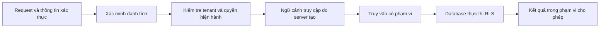

# Row-level access — kiểm soát quyền truy cập trên từng bản ghi

Một nhân viên đã đăng nhập thành công, có quyền mở màn hình hóa đơn và được phép gọi API đọc hóa đơn. Ba điều đó vẫn chưa trả lời câu hỏi: nhân viên ấy được xem hóa đơn nào?

Trong ứng dụng dùng chung bảng dữ liệu cho nhiều khách hàng, quyền `invoice:read` quá rộng nếu được hiểu là đọc mọi hàng của bảng `invoices`. Người dùng có thể được xem hóa đơn của mình, người phụ trách kế toán được xem hóa đơn trong doanh nghiệp đang làm việc, còn hóa đơn của doanh nghiệp khác phải nằm ngoài phạm vi của cả hai.

**Row-level access** là kiểm soát truy cập ở độ hạt từng bản ghi. Khi hệ quản trị cơ sở dữ liệu trực tiếp thực thi chính sách này, cơ chế thường được gọi là **Row-Level Security**, viết tắt là **RLS**. Bài học đặt cơ chế đó trong nền tảng IAM: danh tính cung cấp chủ thể đáng tin cậy; chính sách xác định phạm vi dữ liệu; điểm thực thi kiểm tra phạm vi ấy với mỗi thao tác.

## 1. Kết quả cần đạt

Sau bài học, bạn có thể:

- Phân biệt quyền gọi một chức năng với quyền truy cập một bản ghi cụ thể.
- Diễn đạt điều kiện truy cập theo tenant, chủ sở hữu, hành động và trạng thái bản ghi.
- Giải thích vì sao phải kiểm tra cả bản ghi hiện tại và giá trị được ghi mới.
- Đọc một ví dụ PostgreSQL RLS có ranh giới tenant, quyền đọc và quyền sửa riêng biệt.
- Nhận diện lỗi truyền danh tính qua connection pool, cache, báo cáo và tác vụ nền.
- Xây dựng tình huống kiểm chứng quyền bằng hai người dùng cùng tenant và người dùng ở tenant khác.

Kiến thức đầu vào cần có là xác thực, phân quyền, nguyên tắc ít quyền nhất và SQL cơ bản. Các đoạn SQL minh họa sử dụng PostgreSQL; cú pháp RLS và cách kết hợp policy cần được đối chiếu riêng nếu dùng hệ quản trị khác.

## 2. Quyền trên chức năng và quyền trên dữ liệu

### 2.1. Một bảng, nhiều phạm vi được phép

Giả sử hệ thống quản lý hóa đơn có dữ liệu sau:

| Hóa đơn | Tenant | Chủ sở hữu | Trạng thái |
| --- | --- | --- | --- |
| I1 | A | An | `draft` |
| I2 | A | Bình | `draft` |
| I3 | B | Chi | `draft` |
| I4 | A | An | `issued` |

Quy tắc nghiệp vụ của ví dụ là:

1. Mọi truy cập phải giới hạn trong tenant đang hoạt động mà người dùng đã được xác minh quyền tham gia.
2. Người dùng có quyền đọc hóa đơn được đọc hóa đơn do mình sở hữu.
3. Người có thêm quyền đọc toàn tenant được đọc mọi hóa đơn trong tenant đó.
4. Người dùng chỉ được sửa số tiền và ghi chú của hóa đơn nháp do mình sở hữu, khi có quyền sửa ở tầng ứng dụng.
5. Luồng này không cung cấp quyền xóa hoặc chuyển chủ sở hữu.

Nếu An có quyền đọc thông thường, kết quả hợp lệ là I1 và I4. Nếu Bình được cấp quyền đọc toàn tenant A, kết quả là I1, I2 và I4. I3 vẫn phải bị loại, kể cả khi Bình có vai trò kế toán của tenant A.

Khi An sửa dữ liệu, I1 có thể được sửa, còn I4 đã phát hành nên không được sửa qua luồng chỉnh hóa đơn nháp. Quyền đọc một hàng không kéo theo quyền cập nhật hàng đó.

### 2.2. Nhìn theo các lớp quyết định

| Lớp kiểm soát | Câu hỏi | Ví dụ |
| --- | --- | --- |
| Xác thực | Ai đang gửi yêu cầu? | Phiên hợp lệ xác định An |
| Quyền chức năng | Chủ thể có được gọi thao tác này? | Có `invoice:read` |
| Quyền bản ghi | Chủ thể được tác động đến hàng nào? | Hóa đơn trong A và thuộc An |
| Quyền trường dữ liệu | Được đọc hoặc sửa cột nào? | Được sửa `note`, không sửa `owner_id` |
| Ràng buộc nghiệp vụ | Trạng thái hoặc giá trị có hợp lệ? | Chỉ sửa nháp, số tiền không âm |

Một yêu cầu chỉ hợp lệ khi thỏa những lớp áp dụng cho nó. Có quyền `SELECT` trên một bảng cũng chưa chứng minh được quyền đọc tất cả các hàng bên trong bảng đó.

### 2.3. Quan hệ với RBAC, ABAC và ReBAC

Row-level access diễn tả độ hạt được bảo vệ. RBAC, ABAC hoặc ReBAC có thể cung cấp cách xây dựng điều kiện ở độ hạt ấy:

- RBAC xác định vai trò kế toán có hành động đọc hóa đơn; một ràng buộc bổ sung giới hạn vai trò trong tenant được cấp.
- ABAC so sánh thuộc tính chủ thể và bản ghi, chẳng hạn `subject.tenant_id == invoice.tenant_id`.
- ReBAC sử dụng quan hệ như người phụ trách tài khoản khách hàng, thành viên nhóm hoặc người được chia sẻ tài liệu.

Một hàng có thể chịu đồng thời nhiều điều kiện. Không nên tạo một role riêng cho từng hóa đơn chỉ để biến toàn bộ bài toán thành RBAC; số lượng role sẽ tăng theo số bản ghi và khó quản lý vòng đời.

## 3. Diễn đạt chính sách đủ chính xác

### 3.1. Tách điều kiện bắt buộc khỏi các lý do được cấp quyền

Với ví dụ hóa đơn, điều kiện đọc có thể viết như sau:

```text
allow_read(subject, invoice, context) =
    authenticated(subject)
    AND has_permission(subject, "invoice:read", context.tenant)
    AND active_member(subject, context.tenant)
    AND invoice.tenant_id == context.tenant_id
    AND (
        invoice.owner_id == subject.id
        OR has_permission(subject, "invoice:read:tenant", context.tenant)
    )
```

Điều kiện tenant đứng ngoài nhóm `OR` vì nó phải đúng với mọi lý do được phép đọc. Nếu viết thành:

```text
(same_tenant AND is_owner) OR is_accountant
```

thì nhánh kế toán có thể mở quyền ra mọi tenant. Đây là lỗi kết hợp biểu thức, dù từng điều kiện nhỏ nghe có vẻ hợp lý.

Quyền như `invoice:read:tenant` phải gắn với tenant đang được đánh giá. Người dùng là kế toán ở A và cộng tác viên ở B không mặc nhiên có quyền kế toán ở B.

### 3.2. Phân biệt hàng cũ và hàng mới

Một thao tác cập nhật có hai đối tượng cần kiểm tra:

```text
old_row: hàng đang tồn tại và được chọn để cập nhật
new_row: hàng sau khi áp dụng những giá trị mới
```

Nếu chỉ kiểm tra `old_row.owner_id == subject.id`, An có thể chọn hóa đơn của mình rồi cố đổi `tenant_id` hoặc `owner_id` sang giá trị ngoài phạm vi cho phép. Kiểm tra hàng cũ trả lời “có được chọn hàng này để sửa không”; kiểm tra hàng mới trả lời “kết quả sau sửa có còn nằm trong phạm vi được phép không”.

Trong ví dụ, quyền trên cột còn giới hạn thao tác cập nhật vào `amount_cents` và `note`. Điều kiện theo hàng và quyền theo cột giải quyết hai phần khác nhau của cùng một yêu cầu.

### 3.3. Phạm vi áp dụng cho cả tập kết quả

Kiểm tra quyền phải áp dụng nhất quán cho:

- Đọc một bản ghi theo ID và tải danh sách.
- Đếm số lượng, tìm kiếm, thống kê và phân trang.
- Cập nhật, chèn và xóa theo khả năng của luồng nghiệp vụ.
- Xuất báo cáo, xử lý nhiều ID và truy cập bằng tác vụ nền.

API trả danh sách đúng nhưng `totalCount` đếm toàn bộ tenant vẫn có thể làm lộ thông tin. API chi tiết đúng nhưng chức năng xuất CSV lấy cả bảng cũng phá vỡ phạm vi truy cập.

OWASP mô tả Broken Object Level Authorization là lỗi người dùng tác động đến đối tượng ngoài quyền của mình thông qua định danh trong yêu cầu. ID khó đoán hoặc UUID không thay thế việc kiểm tra quyền trên đối tượng. [Nguồn: OWASP API1:2023](https://api-security.owasp.org/editions/2023/en/0xa1-broken-object-level-authorization/).

## 4. Danh tính nào được đưa vào quyết định?

### 4.1. Dữ liệu request là yêu cầu, chưa phải bằng chứng

Một request có thể chứa:

```http
GET /tenants/A/invoices/I1
Authorization: Bearer <access-token>
X-User-Id: An
```

Đường dẫn nói client muốn truy cập tenant A. Header tự khai nói client muốn được nhận là An. Cả hai chưa đủ để xác định subject hoặc chứng minh tư cách thành viên tenant.

Tầng IAM cần xác minh thông tin xác thực, ánh xạ nó sang subject nội bộ, xác định tenant đang hoạt động, kiểm tra tư cách thành viên và tính quyền trong tenant ấy. Nếu dùng token, còn phải áp dụng các điều kiện xác minh tương ứng với loại token và hệ thống phát hành. Database không tự làm những bước đó chỉ vì một câu SQL đã đặt biến `subject_id`.



### 4.2. Ngữ cảnh phải đủ, có vòng đời rõ ràng

Một ngữ cảnh điển hình gồm `subject_id`, `tenant_id`, quyền của subject trong tenant và `request_id` để đối chiếu audit. Không dùng giá trị mặc định như tenant đầu tiên hoặc “system user” khi thiếu thông tin.

Trong lời gọi giữa các dịch vụ, cần xác định hành động đang chạy dưới danh tính dịch vụ hay dưới ủy quyền của người dùng. Một service account không nên tự nhận mọi quyền của mọi người dùng chỉ vì nó có thể kết nối database.

Trường hợp hỗ trợ khách hàng cần truy cập rộng hơn cũng phải được biểu diễn bằng phạm vi cụ thể: tenant đích, thời hạn, hành động được phép và lý do truy cập. Một cờ toàn cục `is_admin=true` không diễn đạt đủ những giới hạn này.

## 5. Đặt điểm thực thi ở đâu?

| Cách thực thi | Điểm mạnh | Điều phải quản lý |
| --- | --- | --- |
| Điều kiện tại repository/query | Gần mô hình nghiệp vụ, dễ kết hợp hành động | Mọi đường truy vấn phải dùng đúng điều kiện |
| Bộ đánh giá policy ở ứng dụng | Có thể xử lý nhiều thuộc tính và quan hệ | Quyết định phải được áp dụng trước khi trả dữ liệu |
| View hoặc API dữ liệu được kiểm soát | Thu hẹp giao diện truy cập cho bên gọi | Quyền trên bảng gốc và ngữ nghĩa view |
| RLS trong database | Kiểm soát hàng tại nơi truy vấn bảng | Role, policy, ngữ cảnh và mọi đường vượt qua |
| Tách database hoặc schema theo tenant | Có thêm ranh giới tổ chức dữ liệu | Định tuyến kết nối, vận hành và quyền trong tenant |

Nhiều ứng dụng kết hợp quyền hành động ở service, truy vấn có phạm vi ở repository và RLS ở database. Các lớp này phải thực thi cùng một ý nghĩa nghiệp vụ. Nếu một lớp đọc tenant từ phiên còn lớp khác đọc tenant từ body, việc thêm lớp kiểm tra không tạo ra một chính sách nhất quán.

### 5.1. Lỗi tải trước rồi mới lọc

Mã giả sau có vấn đề:

```java
var invoices = repository.findAll();
return invoices.stream()
    .filter(invoice -> mayRead(subject, invoice))
    .toList();
```

Dữ liệu vượt quyền đã đi vào bộ nhớ ứng dụng. Nó có thể xuất hiện trong log, cache, trace hoặc bị dùng để tính tổng trước khi lọc. Việc phân trang trước rồi mới lọc cũng khiến trang kết quả thiếu hàng và thông tin tổng không đúng.

Một truy vấn có phạm vi thể hiện ý định rõ hơn:

```sql
SELECT invoice_id, status, amount_cents, note
FROM billing.invoices
WHERE tenant_id = :verified_tenant_id
  AND (
      owner_id = :verified_subject_id
      OR :verified_can_read_tenant
  )
ORDER BY invoice_id;
```

Các giá trị `verified_*` do server tính từ IAM context. Dùng bind parameter giúp xử lý dữ liệu đầu vào trong câu SQL; nó không xác minh quyền của người gửi giá trị đó.

## 6. Ví dụ PostgreSQL: hóa đơn trong ứng dụng nhiều tenant

### 6.1. Giả định và ranh giới tin cậy

Ví dụ sử dụng một role kết nối chung `billing_runtime`. Backend đặt ba giá trị cho mỗi transaction: `app.tenant_id`, `app.subject_id` và `app.can_read_tenant`. Chúng được lấy từ ngữ cảnh đã xác minh của request.

**Đây là mô hình backend đáng tin cậy truyền ngữ cảnh vào database.** Các custom setting này không phải bằng chứng danh tính độc lập. Bên có khả năng chạy SQL tùy ý dưới role đó có thể cố thay đổi chúng. Vì vậy không cấp credential này cho trình duyệt, người dùng cuối hoặc công cụ SQL không được kiểm soát; không coi cơ chế này là biện pháp ngăn một backend đã bị chiếm quyền giả danh subject khác.

Mục tiêu của ví dụ là tập trung ràng buộc hàng và giảm rủi ro một đường truy vấn bỏ quên điều kiện. Việc bảo vệ kênh đặt ngữ cảnh, chống SQL injection và kiểm soát credential vẫn nằm trong thiết kế tổng thể.

Các lệnh quản trị dưới đây dành cho cơ sở dữ liệu thực hành mới. Tài khoản triển khai phải có quyền tạo role, schema và chuyển sang role sở hữu. Không dùng `billing_owner` làm credential phục vụ request.

### 6.2. Schema và dữ liệu thực hành

```sql
CREATE ROLE billing_owner NOLOGIN NOSUPERUSER NOBYPASSRLS;
CREATE ROLE billing_runtime LOGIN NOSUPERUSER NOBYPASSRLS;

CREATE SCHEMA billing AUTHORIZATION billing_owner;

SET ROLE billing_owner;

CREATE TABLE billing.invoices (
    tenant_id uuid NOT NULL,
    invoice_id uuid NOT NULL,
    owner_id uuid NOT NULL,
    status text NOT NULL CHECK (status IN ('draft', 'issued')),
    amount_cents bigint NOT NULL CHECK (amount_cents >= 0),
    note text NOT NULL DEFAULT '',
    PRIMARY KEY (tenant_id, invoice_id)
);

CREATE INDEX invoices_by_owner
    ON billing.invoices (tenant_id, owner_id, invoice_id);

-- Seed trước khi bật RLS. Các UUID chỉ là dữ liệu thực hành.
INSERT INTO billing.invoices
    (tenant_id, invoice_id, owner_id, status, amount_cents, note)
VALUES
    ('aaaaaaaa-aaaa-4aaa-8aaa-aaaaaaaaaaaa',
     '00000000-0000-4000-8000-000000000001',
     '11111111-1111-4111-8111-111111111111', 'draft', 10000, 'I1'),
    ('aaaaaaaa-aaaa-4aaa-8aaa-aaaaaaaaaaaa',
     '00000000-0000-4000-8000-000000000002',
     '22222222-2222-4222-8222-222222222222', 'draft', 20000, 'I2'),
    ('bbbbbbbb-bbbb-4bbb-8bbb-bbbbbbbbbbbb',
     '00000000-0000-4000-8000-000000000003',
     '33333333-3333-4333-8333-333333333333', 'draft', 30000, 'I3'),
    ('aaaaaaaa-aaaa-4aaa-8aaa-aaaaaaaaaaaa',
     '00000000-0000-4000-8000-000000000004',
     '11111111-1111-4111-8111-111111111111', 'issued', 40000, 'I4');
```

Trong dữ liệu này, UUID bắt đầu bằng `aaaa` là tenant A, `bbbb` là tenant B. Subject có UUID gồm các chữ số `1`, `2`, `3` lần lượt đại diện cho An, Bình và Chi.

`tenant_id` là một phần của khóa chính để biểu diễn rõ phạm vi định danh. Nếu có bảng chi tiết hóa đơn, một khóa ngoại gồm `(tenant_id, invoice_id)` giúp ràng buộc quan hệ cùng tenant. Khóa ngoại hoặc khóa chính tự nó không cấp hay từ chối quyền đọc hàng.

### 6.3. Bật RLS và tạo hàng rào tenant

Tiếp tục trong vai trò sở hữu bảng:

```sql
ALTER TABLE billing.invoices ENABLE ROW LEVEL SECURITY;
ALTER TABLE billing.invoices FORCE ROW LEVEL SECURITY;

CREATE POLICY invoices_tenant_boundary
ON billing.invoices
AS RESTRICTIVE
FOR ALL
TO billing_runtime
USING (
    tenant_id =
        nullif(current_setting('app.tenant_id', true), '')::uuid
    AND nullif(current_setting('app.subject_id', true), '')::uuid
        IS NOT NULL
)
WITH CHECK (
    tenant_id =
        nullif(current_setting('app.tenant_id', true), '')::uuid
    AND nullif(current_setting('app.subject_id', true), '')::uuid
        IS NOT NULL
);
```

Hàng rào này yêu cầu đúng tenant và có subject trong ngữ cảnh. `NULL` hoặc chuỗi rỗng được xử lý thành thiếu thông tin. UUID sai định dạng gây lỗi chuyển kiểu, không mở quyền. Tầng ứng dụng cần từ chối context không hợp lệ trước khi đến SQL và xử lý lỗi theo hướng không cấp quyền.

`FORCE ROW LEVEL SECURITY` làm chủ sở hữu bảng chịu RLS khi truy cập dữ liệu trong các trường hợp thông thường; nó không vô hiệu hóa đặc quyền superuser hoặc `BYPASSRLS`. Role runtime phải tách khỏi role sở hữu và không được có đường chuyển sang role đặc quyền. PostgreSQL cũng áp dụng cơ chế từ chối mặc định khi RLS đã bật mà không có policy phù hợp. [Nguồn: PostgreSQL — Row Security Policies](https://www.postgresql.org/docs/17/ddl-rowsecurity.html).

### 6.4. Thêm các lý do cho phép theo hành động

```sql
CREATE POLICY invoices_select
ON billing.invoices
FOR SELECT
TO billing_runtime
USING (
    owner_id =
        nullif(current_setting('app.subject_id', true), '')::uuid
    OR coalesce(
        nullif(current_setting('app.can_read_tenant', true), '')::boolean,
        false
    )
);

CREATE POLICY invoices_insert
ON billing.invoices
FOR INSERT
TO billing_runtime
WITH CHECK (
    owner_id =
        nullif(current_setting('app.subject_id', true), '')::uuid
    AND status = 'draft'
);

CREATE POLICY invoices_update
ON billing.invoices
FOR UPDATE
TO billing_runtime
USING (
    owner_id =
        nullif(current_setting('app.subject_id', true), '')::uuid
    AND status = 'draft'
)
WITH CHECK (
    owner_id =
        nullif(current_setting('app.subject_id', true), '')::uuid
    AND status = 'draft'
);

GRANT USAGE ON SCHEMA billing TO billing_runtime;
GRANT SELECT, INSERT ON billing.invoices TO billing_runtime;
GRANT UPDATE (amount_cents, note)
    ON billing.invoices TO billing_runtime;

RESET ROLE;
```

Ví dụ không cấp `DELETE`, quyền đổi `owner_id`, `tenant_id` hoặc `status`. Phát hành hóa đơn và chuyển chủ sở hữu cần những luồng được thiết kế riêng; không thể suy ra quyền thực hiện chúng từ quyền sửa ghi chú.

PostgreSQL kết hợp các policy permissive áp dụng bằng `OR`, các policy restrictive bằng `AND`; phải có permissive policy cho phép thì restrictive policy mới thu hẹp được tập hàng. `USING` kiểm tra hàng hiện tại, `WITH CHECK` kiểm tra hàng được chèn hoặc giá trị mới sau cập nhật. Một số câu lệnh ghi còn cần policy đọc phù hợp. [Nguồn: PostgreSQL — CREATE POLICY](https://www.postgresql.org/docs/17/sql-createpolicy.html).

Trong ví dụ, điều kiện tenant là restrictive policy, còn các policy theo hành động mặc định là permissive. Bởi vậy, quyền đọc toàn tenant chỉ mở rộng tập hàng bên trong tenant đã xác định. Nó không mở rộng quyền cập nhật.

`GRANT` vẫn cần thiết: policy theo hàng không thay thế quyền truy cập đối tượng hoặc cột. Chiều ngược lại cũng đúng: được cấp `UPDATE` trên hai cột không làm mọi hàng trở nên có thể cập nhật.

### 6.5. Thực hiện một request bằng role runtime

Kết nối phần thực hành này phải đăng nhập bằng `billing_runtime`, không dùng kết nối quản trị đang có đặc quyền vượt RLS.

```sql
BEGIN;

SELECT set_config(
    'app.tenant_id', 'aaaaaaaa-aaaa-4aaa-8aaa-aaaaaaaaaaaa', true
);
SELECT set_config(
    'app.subject_id', '11111111-1111-4111-8111-111111111111', true
);
SELECT set_config('app.can_read_tenant', 'false', true);

SELECT invoice_id, status, amount_cents, note
FROM billing.invoices
ORDER BY invoice_id;

UPDATE billing.invoices
SET note = 'An cập nhật hóa đơn nháp'
WHERE tenant_id = 'aaaaaaaa-aaaa-4aaa-8aaa-aaaaaaaaaaaa'
  AND invoice_id = '00000000-0000-4000-8000-000000000001';

COMMIT;
```

Với dữ liệu khởi tạo và các giả định trên, truy vấn đọc dự kiến trả I1 và I4; câu cập nhật I1 dự kiến tác động một hàng. Cập nhật I2 không chọn được hàng hợp lệ cho An. I4 được đọc nhưng không được sửa vì đã phát hành.

Các kết quả này là kỳ vọng để đối chiếu trong môi trường thực hành, không phải khẳng định đoạn SQL đã được chạy trên một database cụ thể.

Tham số thứ ba `true` của `set_config` giới hạn giá trị ở transaction hiện tại. `current_setting` với `missing_ok=true` trả `NULL` khi setting chưa tồn tại. `nullif(..., '')` còn xử lý trường hợp giá trị quan sát được là chuỗi rỗng. [Nguồn: PostgreSQL — Configuration Settings Functions](https://www.postgresql.org/docs/17/functions-admin.html#FUNCTIONS-ADMIN-SET).

## 7. Tích hợp với Java và connection pool

### 7.1. Một transaction phải dùng một ngữ cảnh

Connection pool tái sử dụng kết nối vật lý. Nếu đặt tenant A ở phạm vi session, trả kết nối về pool rồi giao cho request tenant B, ngữ cảnh cũ có thể ảnh hưởng truy vấn sau.

Trình tự cần giữ là:

1. Backend xác minh subject, tenant và quyền trong tenant.
2. Mượn connection và bắt đầu transaction.
3. Đặt đầy đủ ngữ cảnh ở phạm vi transaction.
4. Chạy mọi truy vấn liên quan trên chính connection đó.
5. Commit hoặc rollback rồi trả connection theo hợp đồng của pool.

Không đặt ngữ cảnh trên connection thứ nhất rồi để ORM lấy connection thứ hai để truy vấn. Không đổi subject giữa một transaction đã đọc hoặc ghi dữ liệu. Nếu pool hoặc proxy sử dụng chế độ gom connection đặc biệt, cần bảo đảm transaction và phần ngữ cảnh của nó gắn với đúng backend trong toàn bộ đơn vị công việc.

### 7.2. Mẫu Java cho thao tác đọc

Ví dụ dưới dùng JDBC thuần. `VerifiedContext` được tạo bởi tầng IAM của server sau khi kiểm tra tư cách thành viên; không bind record này trực tiếp từ JSON request. Tập quyền bên trong nó đã được tính cho đúng `tenantId`.

```java
import java.sql.Connection;
import java.sql.SQLException;
import java.util.ArrayList;
import java.util.List;
import java.util.Objects;
import java.util.Set;
import java.util.UUID;
import javax.sql.DataSource;

public final class InvoiceReader {
    public record VerifiedContext(
            UUID tenantId, UUID subjectId, Set<String> permissions) {
        public VerifiedContext {
            Objects.requireNonNull(tenantId);
            Objects.requireNonNull(subjectId);
            permissions = Set.copyOf(permissions);
        }
    }

    public record InvoiceView(
            UUID invoiceId, String status, long amountCents, String note) {}

    public static List<InvoiceView> firstPage(
            DataSource dataSource, VerifiedContext context)
            throws SQLException {
        Objects.requireNonNull(context);
        if (!context.permissions().contains("invoice:read")) {
            throw new SecurityException("Missing invoice:read");
        }

        try (Connection connection = dataSource.getConnection()) {
            // Hàm sở hữu transaction; không gọi trong transaction có sẵn.
            if (!connection.getAutoCommit()) {
                throw new SQLException("Expected a fresh pooled connection");
            }
            connection.setAutoCommit(false);

            try {
                String contextSql = """
                    SELECT set_config('app.tenant_id', ?, true),
                           set_config('app.subject_id', ?, true),
                           set_config('app.can_read_tenant', ?, true)
                    """;
                try (var statement = connection.prepareStatement(contextSql)) {
                    statement.setString(1, context.tenantId().toString());
                    statement.setString(2, context.subjectId().toString());
                    statement.setString(3, Boolean.toString(
                        context.permissions().contains("invoice:read:tenant")));
                    try (var result = statement.executeQuery()) {
                        if (!result.next()) {
                            throw new SQLException("Context was not installed");
                        }
                    }
                }

                String sql = """
                    SELECT invoice_id, status, amount_cents, note
                    FROM billing.invoices
                    WHERE tenant_id = ?
                    ORDER BY invoice_id
                    LIMIT 100
                    """;
                List<InvoiceView> invoices = new ArrayList<>();
                try (var statement = connection.prepareStatement(sql)) {
                    statement.setObject(1, context.tenantId());
                    try (var result = statement.executeQuery()) {
                        while (result.next()) {
                            invoices.add(new InvoiceView(
                                result.getObject("invoice_id", UUID.class),
                                result.getString("status"),
                                result.getLong("amount_cents"),
                                result.getString("note")));
                        }
                    }
                }

                connection.commit();
                return List.copyOf(invoices);
            } catch (SQLException | RuntimeException failure) {
                try {
                    connection.rollback();
                } catch (SQLException rollbackFailure) {
                    failure.addSuppressed(rollbackFailure);
                }
                throw failure;
            }
        }
    }
}
```

Mẫu yêu cầu Java hỗ trợ record và text block. Pool phải reset trạng thái transaction/auto-commit khi connection được trả lại và loại bỏ connection hỏng theo cơ chế của pool. Nếu framework đã quản lý transaction, cần tích hợp phần đặt ngữ cảnh vào đúng transaction ấy thay vì tự mở transaction lồng.

Điều kiện tenant trong truy vấn vẫn thể hiện ý định của repository; RLS kiểm tra lại phạm vi bản ghi. Cờ đọc toàn tenant luôn được đặt thành `true` hoặc `false` cho mỗi lần gọi, tránh phụ thuộc giá trị còn lại từ một lớp khác.

Quyền `invoice:read` được kiểm tra tại ứng dụng. Với một role database dùng chung như ví dụ, database tin backend đã chọn đúng hành động được phép; nó không tự biết toàn bộ quyền chức năng của người dùng cuối. Luồng ghi phải kiểm tra quyền tạo hoặc sửa tương ứng trước khi dùng quyền `INSERT`/`UPDATE` của role runtime.

### 7.3. Transaction-local không tự xác minh dữ liệu

Nếu backend lấy `subjectId` từ body rồi truyền vào `set_config`, việc dùng đúng transaction vẫn giả danh sai người. Nếu SQL injection cho phép đặt lại `app.can_read_tenant`, policy có thể nhận ngữ cảnh do kẻ tấn công điều khiển.

Vì thế có hai câu hỏi độc lập: giá trị có được cô lập giữa các request không, và ai có quyền quyết định giá trị đó. Transaction-local giải quyết phần vòng đời; việc xác minh và giới hạn điểm đặt context giải quyết phần nguồn tin cậy.

## 8. Ghi dữ liệu: quyền hàng phải đi cùng tính toàn vẹn

### 8.1. Chèn mới

Khi tạo hóa đơn, server lấy tenant và owner từ verified context, không cho client tùy ý khai hai trường đó. Policy chèn vẫn kiểm tra hàng mới để bảo vệ trường hợp repository hoặc luồng nhập dữ liệu truyền sai giá trị.

Với policy đã định nghĩa, chèn hóa đơn vào tenant B trong context A bị từ chối. Chèn vào A nhưng nhận Bình làm chủ trong context An cũng bị từ chối. Chèn một hóa đơn ở trạng thái `issued` bị từ chối vì luồng này chỉ được tạo nháp.

### 8.2. Cập nhật

Tách riêng hai điều kiện là cần thiết:

```text
Được chọn hàng để sửa:
    cùng tenant, là chủ sở hữu, trạng thái hiện tại là draft

Được chấp nhận kết quả sau sửa:
    vẫn cùng tenant, đúng chủ sở hữu, vẫn là draft
```

Khi phạm vi cập nhật chỉ gồm số tiền và ghi chú, DB privilege theo cột ngăn thay owner hoặc tenant ngay từ đầu. Nếu sau này mở rộng quyền cập nhật cột, phải đánh giá lại policy kiểm tra hàng mới và luồng chuyển quyền; không xem thay đổi `GRANT` là công việc độc lập với IAM.

Ràng buộc `CHECK (amount_cents >= 0)` bảo vệ miền giá trị. Policy bảo vệ chủ thể được thao tác. Một hóa đơn có số tiền hợp lệ vẫn có thể là hóa đơn mà người gửi không được sửa.

### 8.3. Xóa, upsert và thao tác hàng loạt

Xóa cần quyền hành động riêng, quyền database tương ứng và policy chọn hàng phù hợp. Ví dụ hiện tại cố ý không cung cấp khả năng đó. Với xóa mềm bằng `UPDATE deleted_at`, quyền xóa mềm cũng phải được xem như một hành động nghiệp vụ, không tự động đi theo quyền sửa ghi chú.

Upsert, câu lệnh có `RETURNING` và cập nhật hàng loạt có thể liên quan đồng thời đến quyền đọc, chèn và cập nhật. Cần xác định rõ từng đường thực thi; không suy từ việc `SELECT` thành công rằng `INSERT ... ON CONFLICT DO UPDATE` cũng có cùng quyền.

Khi cập nhật danh sách ID, hợp đồng API phải chọn rõ một trong các hành vi: toàn bộ thành công hoặc rollback, hay chấp nhận kết quả từng phần theo chính sách. Không im lặng báo “cập nhật thành công tất cả” nếu số hàng thực tế khác số hàng yêu cầu.

### 8.4. Thay đổi quyền và cạnh tranh dữ liệu

RLS không tự biến kiểm tra quyền thành cơ chế khóa nghiệp vụ. Nếu quyền phụ thuộc bảng thành viên, quan hệ chia sẻ hoặc người phụ trách đang thay đổi đồng thời, phải xác định thời điểm quyết định quyền có hiệu lực.

Một yêu cầu chuyển tiền hoặc phê duyệt có thể cần transaction, kiểm tra phiên bản bản ghi hoặc khóa theo nghiệp vụ ngoài policy. Với chính sách tra cứu bảng quyền khác, cũng cần xem xét snapshot và cách thu hồi quyền tác động đến transaction đang chạy. Không hứa “thu hồi tức thì” nếu token, transaction hoặc cache quyền còn giữ trạng thái cũ.

## 9. Các đường truy cập cần được xem như một phần của thiết kế

### 9.1. Đọc theo ID, danh sách và phân trang

Endpoint `GET /invoices/{id}` phải áp dụng cùng phạm vi với endpoint danh sách. Không dùng một hàm `findById` không có ngữ cảnh chỉ vì ID đã xuất hiện trong một trang trước đó.

Hàm đếm và truy vấn lấy trang phải dùng cùng tenant, subject và điều kiện quyền. Cursor phân trang không được trở thành bằng chứng cấp quyền: chủ thể có thể đã bị thu hồi quyền giữa hai trang. Mỗi yêu cầu trang tiếp theo phải được đánh giá bằng ngữ cảnh hiện hành.

Đối với bản ghi không nhìn thấy, một số API chọn trả 404 để giảm phân biệt giữa “không tồn tại” và “không được đọc”; API khác có thể có hợp đồng 403 phù hợp với đối tượng sử dụng. Cần giữ hợp đồng nhất quán và tránh tiết lộ sự tồn tại qua đường kiểm tra phụ.

### 9.2. Join và bảng liên quan

Nếu hóa đơn được bảo vệ nhưng bảng dòng hóa đơn cho phép đọc trực tiếp không giới hạn, người dùng vẫn có đường lấy dữ liệu ngoài quyền. Mỗi bảng có đường truy cập riêng phải có chiến lược bảo vệ tương ứng.

Điều kiện join cũng cần phản ánh tenant:

```sql
SELECT i.invoice_id, l.line_no, l.description
FROM billing.invoices AS i
JOIN billing.invoice_lines AS l
  ON l.tenant_id = i.tenant_id
 AND l.invoice_id = i.invoice_id;
```

Đây là minh họa nguyên tắc join; bảng `invoice_lines` không thuộc schema thực hành đã tạo ở trên. Việc join đúng không thay thế quyền truy cập trực tiếp vào bảng dòng hóa đơn.

### 9.3. Cache và chỉ mục tìm kiếm

Cache được đánh khóa chỉ bằng `invoice_id` có thể trả kết quả của người này cho người khác. Cache toàn bộ response cần tính đến tenant và phạm vi quyền hiệu lực, hoặc phải đánh giá lại quyền trước khi phục vụ dữ liệu đã cache.

Nếu quyền khác nhau giữa các người dùng trong cùng tenant, chỉ thêm tenant vào cache key vẫn chưa đủ. Một thay đổi chia sẻ hoặc thu hồi quyền cần có chiến lược làm mất hiệu lực cache phù hợp với yêu cầu của sản phẩm.

Dữ liệu đã sao chép vào search index không tự tiếp tục chịu policy của bảng nguồn. Tầng tìm kiếm phải thực thi phạm vi tài liệu tương ứng, kể cả đối với đoạn trích, gợi ý tự động và số lượng kết quả.

### 9.4. Xuất báo cáo và tác vụ nền

Tác vụ nền nên nhận subject hoặc danh tính workload, tenant, hành động, định danh công việc và phạm vi đã được cấp. Khi bắt đầu chạy hoặc phục vụ kết quả xuất, cần áp dụng quy tắc xác minh quyền phù hợp với thời điểm thực thi.

Một job tenant A không được chuyển sang context tenant B chỉ vì đã lấy connection mới. Một worker dùng role quản trị để xuất báo cáo có thể đi ngoài toàn bộ hàng rào RLS của request thông thường.

File kết quả, kho đối tượng và liên kết tải cũng cần có quyền truy cập. Bảo vệ lúc truy vấn nhưng phát hành một URL tải công khai có thể làm mất giới hạn ở bước cuối.

## 10. Những giới hạn cần hiểu đúng về database RLS

### 10.1. Tài khoản đặc quyền và đường quản trị

Không dùng tài khoản superuser, role có `BYPASSRLS`, role sở hữu hoặc role có thể tự chuyển sang những vai trò đó để mô phỏng người dùng ứng dụng. Chủ sở hữu còn có khả năng thay đổi chính sách; vì vậy tách tài khoản phục vụ request và tài khoản triển khai là ranh giới quan trọng hơn việc chỉ nhìn một lệnh `FORCE`.

RLS theo hàng cũng không áp dụng như một bộ lọc cho mọi thao tác trên toàn bảng. Chẳng hạn, không được cấp quyền `TRUNCATE` cho runtime rồi kỳ vọng chỉ xóa những hàng nó nhìn thấy. Các đặc quyền quản trị và quyền đối tượng cần được cấp theo phạm vi công việc thực tế.

### 10.2. View và hàm chạy với quyền khác

Một view không tự bảo đảm policy được đánh giá theo người gọi như bạn đang giả định. PostgreSQL có tùy chọn `security_invoker` để kiểm tra quyền trên quan hệ bên dưới theo người dùng view; `security_barrier` giải quyết khía cạnh đánh giá điều kiện khác. Cần đọc ngữ nghĩa của từng tùy chọn và quyền trên bảng gốc thay vì coi hai tùy chọn là tương đương. [Nguồn: PostgreSQL — CREATE VIEW](https://www.postgresql.org/docs/17/sql-createview.html).

Tương tự, hàm `SECURITY DEFINER` có thể truy cập dữ liệu bằng quyền của người định nghĩa. Nếu cần một API database dạng này, phải giới hạn quyền thực thi, hành động được phép và cách xử lý tên đối tượng/ngữ cảnh; không biến nó thành cửa chạy SQL tùy ý.

### 10.3. Rò rỉ qua suy luận và thông báo lỗi

RLS không phải lời hứa loại bỏ mọi kênh suy luận. Một lỗi uniqueness hoặc khóa ngoại có thể hé lộ sự tồn tại của dữ liệu mà người dùng không được đọc. Không đưa nguyên văn lỗi database chứa giá trị nhạy cảm ra API.

Giảm rò rỉ cần kết hợp mô hình khóa, cách cấp quyền, hợp đồng lỗi và kiểm soát truy vấn. Nếu sản phẩm cho phép thống kê trên tập dữ liệu nhạy cảm, còn phải đánh giá mức độ thông tin có thể suy ra từ những tổng hợp được công bố.

### 10.4. Dữ liệu sao chép và sao lưu

RLS bảo vệ tại điểm thực thi chính sách của database đó. Một bản export, bảng tổng hợp, kho dữ liệu hoặc file sao lưu cần có mô hình quyền riêng. Không mặc định policy ở bảng nguồn được chuyển cùng dữ liệu.

Quy trình sao lưu và phục hồi phải kiểm tra tính đầy đủ dưới đúng vai trò vận hành. Một truy vấn sao lưu bị lọc mà vẫn được xem là “đủ dữ liệu” có thể tạo bản sao không hoàn chỉnh.

## 11. Hiệu năng và khả năng vận hành

Thiết kế quyền nên đi cùng hình dạng truy vấn. Với truy vấn theo tenant và owner, chỉ mục `(tenant_id, owner_id, invoice_id)` là một ứng viên để đánh giá, không phải cam kết tối ưu cho mọi phân bố dữ liệu.

Hãy xem kế hoạch truy vấn bằng chính role runtime và các context đại diện: tenant nhỏ, tenant lớn, người chỉ đọc dữ liệu sở hữu và người đọc toàn tenant. Một kế hoạch đo bằng tài khoản quản trị có thể không phản ánh đường thực thi bị giới hạn quyền.

Các policy gọi hàm hoặc truy vấn bảng quyền cho nhiều hàng có thể làm tăng chi phí. Khi thêm quan hệ chia sẻ, cần đánh giá chỉ mục cho quan hệ đó, khả năng tái sử dụng quyết định và yêu cầu thu hồi quyền. Không loại bỏ điều kiện tenant để xử lý một vấn đề hiệu năng.

Về vận hành, cần phân biệt:

- Hệ thống không có bản ghi phù hợp với truy vấn nghiệp vụ.
- Chủ thể không nhìn thấy bản ghi do chính sách.
- Context bị thiếu hoặc không hợp lệ.
- Truy vấn không có quyền đối tượng, hoặc gặp lỗi dữ liệu.

API công khai có thể chủ ý gộp một số trường hợp, nhưng telemetry nội bộ cần đủ để phát hiện lỗi triển khai policy và lỗi truyền context. Không ghi access token, thông tin xác thực hoặc toàn bộ hàng dữ liệu vào log để tìm nguyên nhân.

## 12. Ma trận tự kiểm chứng quyền

Ma trận dưới sử dụng bốn hàng I1–I4 đã nêu. Mỗi tình huống cần bắt đầu từ dữ liệu thực hành đã biết, context đã xác minh và kết nối runtime thực tế. Những thử nghiệm cố ý gây lỗi nên dùng transaction riêng vì lỗi SQL có thể khiến transaction hiện tại phải rollback.

| Context và thao tác | Kỳ vọng | Điều được kiểm chứng |
| --- | --- | --- |
| An ở A, đọc thông thường | I1, I4 | Giới hạn theo owner |
| Bình ở A, đọc thông thường | I2 | Cùng tenant chưa đủ quyền |
| Bình ở A, đọc toàn tenant | I1, I2, I4 | Mở rộng đọc bên trong tenant |
| Bình ở A, đọc toàn tenant rồi tìm I3 | Không thấy I3 | Hàng rào tenant luôn bắt buộc |
| An sửa `note` của I1 | Một hàng được sửa | Chủ sở hữu và hàng nháp |
| An sửa `note` của I2 | Không có hàng được sửa | Không sửa hóa đơn của người khác |
| An sửa `note` của I4 | Không có hàng được sửa | Đọc được nhưng trạng thái không cho sửa |
| Bình có quyền đọc toàn A, sửa I1 | Không có hàng được sửa | Quyền đọc rộng không cấp quyền ghi |
| An chèn hóa đơn ở B | Lỗi policy | Kiểm tra tenant của hàng mới |
| An chèn ở A nhưng owner là Bình | Lỗi policy | Kiểm tra chủ sở hữu hàng mới |
| An chèn hóa đơn `issued` | Lỗi policy | Luồng tạo chỉ cho phép nháp |
| An đổi `owner_id` qua runtime | Lỗi quyền cột | Giới hạn trường có thể sửa |
| Runtime gọi `DELETE` | Lỗi quyền | Luồng không có quyền xóa |
| Runtime đọc mà chưa đặt context | Không thấy hàng | Thiếu ngữ cảnh không mở quyền |
| Request A kết thúc, kết nối tái dùng cho B | Chỉ dữ liệu theo context B | Cô lập context của connection pool |
| Client tự gửi quyền đọc toàn tenant | Không được backend chấp nhận | Nguồn quyền phải được xác minh |

Ngoài hàng nhìn thấy, hãy đối chiếu `COUNT`, tổng số tiền, phân trang, export và API nhận nhiều ID. Sử dụng ít nhất hai subject trong cùng tenant giúp phát hiện lỗi mà thử nghiệm chỉ với hai tenant có thể bỏ sót.

Một phép thử quan trọng là thêm một policy đọc rộng trong môi trường thử nghiệm rồi xác minh hàng rào tenant vẫn còn hiệu lực. Nếu quyền mới làm lộ dữ liệu ngoài tenant, cách kết hợp policy hoặc role áp dụng chưa phản ánh ràng buộc bắt buộc.

Các tình huống này là hướng dẫn cho người học tự thực hành; việc triển khai và nghiệm thu trên hệ thống thực phải theo quy trình kiểm chứng của hệ thống đó.

## 13. Tình huống phân tích: danh sách đúng nhưng xuất file sai

Một hệ thống hỗ trợ nhiều doanh nghiệp có màn hình danh sách hóa đơn chỉ hiển thị các hàng của người đăng nhập. Nhóm phát triển bổ sung tính năng xuất Excel bằng cách gọi `findAllByTenantId`, với lý do mọi người trong doanh nghiệp đều đã qua SSO.

An xuất file và nhận cả I2 của Bình. Tenant isolation vẫn đúng: An không thấy I3 của B. Tuy nhiên, quyền ở mức bản ghi trong tenant A đã bị mở rộng ngoài chính sách.

Nguyên nhân gồm hai giả định sai. Thứ nhất, đăng nhập bằng SSO chỉ xác định phiên và danh tính theo cấu hình của hệ thống, không cấp quyền đọc mọi hóa đơn. Thứ hai, đúng tenant chỉ là một điều kiện bắt buộc; chính sách còn yêu cầu sở hữu hoặc có quyền đọc toàn tenant.

Thiết kế phù hợp là cho tác vụ xuất dùng cùng ý nghĩa phạm vi với truy vấn tương tác, truyền context đúng vòng đời và bảo vệ file kết quả. Nếu job thật sự cần quyền tổng hợp rộng hơn, quyền đó phải được cấp cho danh tính workload hoặc luồng ủy quyền rõ ràng, có audit tương ứng.

Một yêu cầu audit hữu ích có thể lưu subject, tenant, hành động `invoice:export`, định danh job, phiên bản policy và số bản ghi đã xuất. Bản ghi audit giúp giải thích quyết định; nó không thay thế điều kiện lọc dữ liệu.

## 14. Những điểm cần ghi nhớ

Row-level access trả lời chủ thể được đọc hoặc thay đổi những bản ghi nào. Xác thực, quyền hành động, quyền trên cột và tính hợp lệ nghiệp vụ đều góp phần vào quyết định nhưng không thay thế phạm vi hàng.

Điều kiện tenant phải tồn tại trong mọi nhánh cho phép. Quyền đọc và ghi cần được mô tả riêng; với cập nhật, phải xét cả hàng cũ lẫn kết quả mới. Danh tính và quyền đưa vào database phải đến từ nguồn được xác minh, có vòng đời khớp với request hoặc đơn vị công việc.

RLS có ích khi database thực thi chính sách bằng đúng role và context. Hiệu quả ấy phụ thuộc cả các đường truy cập liên quan: connection pool, view, hàm, cache, search index, export và workload. Cách tự kiểm chứng tốt là chọn các subject khác nhau, dự đoán chính xác tập bản ghi được phép rồi đối chiếu từng hành động với dự đoán đó.
