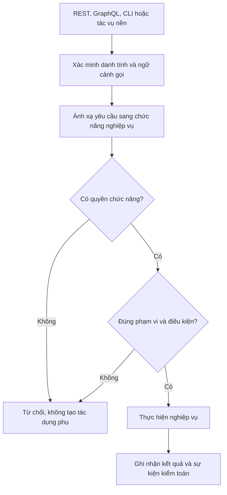

# Function-level access — Kiểm soát quyền gọi chức năng

## 1. Chức năng nào một danh tính được phép thực hiện?

Trong IAM, xác thực giúp hệ thống xác định người hoặc workload đang gửi yêu cầu. Function-level access kiểm soát bước tiếp theo: danh tính ấy có được thực hiện chức năng nghiệp vụ đang yêu cầu hay không.

Một người dùng có thể đăng nhập thành công, xem danh sách thành viên, nhưng không được khóa tài khoản của người khác. Một workload có thể đồng bộ hồ sơ nhân viên nhưng không được cấp quyền quản trị. Cả hai đều có danh tính hợp lệ; tập chức năng được phép của chúng khác nhau.

“Function” ở đây là một năng lực nghiệp vụ, chẳng hạn:

- `member.list`: liệt kê thành viên trong phạm vi được cấp.
- `member.disable`: vô hiệu hóa thành viên.
- `access.grant`: cấp quyền truy cập.
- `audit.export`: xuất dữ liệu kiểm toán.
- `session.revoke`: thu hồi phiên.
- `federation.configure`: thay đổi cấu hình liên kết danh tính.

Một chức năng có thể được gọi qua REST, GraphQL, giao diện quản trị, CLI hoặc tác vụ nền. Tên method Java hoặc một URL cụ thể chỉ là cách triển khai chức năng đó.

Sau bài này, người học cần xác định được đơn vị quyền theo chức năng, đặt kiểm tra ở phía máy chủ, kết hợp quyền chức năng với phạm vi dữ liệu và nhận ra những đường gọi có thể bỏ qua kiểm tra.

## 2. Function-level access nằm ở đâu trong mô hình kiểm soát truy cập?

Function-level access là một mức kiểm soát, không phải một mô hình thay thế RBAC, ABAC hoặc ReBAC. Các mô hình đó có thể cùng tham gia quyết định quyền gọi chức năng:

| Cách biểu diễn chính sách | Ví dụ áp dụng vào chức năng |
| --- | --- |
| RBAC | Vai trò quản trị thành viên chứa quyền `member.disable` |
| ABAC | Chỉ cho khóa tài khoản khi actor có nhiệm vụ hỗ trợ trong tenant tương ứng |
| ReBAC | Người quản trị tổ chức được quản lý các thành viên thuộc tổ chức đó |
| Chính sách kết hợp | Có quyền chức năng, đúng tenant, đủ mức xác thực và đúng quan hệ quản trị |

Ví dụ RBAC có thể cấp quyền chức năng, trong khi kiểm tra tenant dùng thuộc tính và kiểm tra quan hệ quản trị dùng dữ liệu quan hệ. Một hệ thống thực tế thường phối hợp nhiều cách biểu diễn.

Để phân tích một quyết định, có thể dùng biểu thức khái niệm:

```text
ALLOW =
    danh_tính_hợp_lệ
    AND được_phép_thực_hiện_chức_năng
    AND đúng_phạm_vi_tài_nguyên
    AND các_điều_kiện_ngữ_cảnh_được_thỏa_mãn
```

Các điều kiện cụ thể phụ thuộc nghiệp vụ. Chức năng công khai có thể cho phép người chưa đăng nhập theo một chính sách rõ ràng. Chức năng quản trị cần kiểm tra danh tính, quyền và phạm vi chặt hơn.

Ví dụ, “được cấp quyền cho thành viên” chưa đủ để kết luận actor được cấp mọi quyền:

```text
access.grant
    + đúng tenant
    + nằm trong phạm vi quản trị
    + quyền được cấp thuộc tập được phép ủy quyền
    + đáp ứng yêu cầu phê duyệt hoặc xác thực tăng cường
```

Tập quyền được phép cấp cho người khác có thể khác tập quyền actor tự sử dụng. Không nên mặc định rằng người dùng chỉ được cấp quyền họ đang có, hoặc rằng họ được cấp mọi quyền họ đang có; đây phải là quy tắc ủy quyền được thiết kế riêng.

## 3. Phân biệt quyền chức năng, đối tượng và thuộc tính

Một API có thể cần kiểm tra nhiều mức cùng lúc:

| Mức kiểm soát | Câu hỏi | Ví dụ vi phạm |
| --- | --- | --- |
| Xác thực | Danh tính gửi yêu cầu có hợp lệ không? | Chấp nhận token giả hoặc phiên đã bị vô hiệu hóa |
| Chức năng | Actor có được gọi thao tác này không? | Thành viên thông thường gọi chức năng khóa tài khoản |
| Đối tượng | Actor có được thao tác trên bản ghi này không? | Quản trị tenant A khóa người dùng của tenant B |
| Thuộc tính | Actor được đọc hoặc sửa những trường nào? | API sửa hồ sơ cho phép thêm trường `privileged=true` |
| Luồng nghiệp vụ | Thao tác có hợp lệ ở bước và điều kiện hiện tại không? | Một người vừa yêu cầu vừa tự phê duyệt cấp quyền đặc biệt |

Một actor có quyền `member.disable` nhưng chỉ trong tenant A vẫn phải bị chặn khi đích thuộc tenant B. Ngược lại, việc một hồ sơ thuộc cùng tenant không tự trao quyền khóa hồ sơ đó.

Không phải chức năng nào cũng có một ID đối tượng đơn lẻ. Xuất danh sách kiểm toán, tạo thành viên hoặc thay cấu hình SSO đều có thể cần quyền chức năng dù không có tham số `memberId`.

OWASP mô tả Broken Function Level Authorization (BFLA) là tình huống API cho phép truy cập chức năng ngoài quyền của người gọi. Việc đổi HTTP method hoặc gọi endpoint quản trị bằng tài khoản thường là những dấu hiệu cần kiểm tra; tên đường dẫn không đủ để xác định mức đặc quyền của một API. Xem [OWASP API5:2023](https://owasp.org/API-Security/editions/2023/en/0xa5-broken-function-level-authorization/).

## 4. Thiết kế danh mục chức năng và ma trận quyền

### 4.1. Bắt đầu từ hành động nghiệp vụ

Xét một hệ thống quản lý thành viên của nhiều tổ chức. Hệ thống có các thao tác sau:

| Điểm vào minh họa | Chức năng nghiệp vụ | Quyền yêu cầu | Phạm vi bổ sung |
| --- | --- | --- | --- |
| `GET /api/members` | Liệt kê thành viên | `member.list` | Tenant được phép truy cập |
| `POST /api/members` | Tạo thành viên | `member.create` | Tenant và loại tài khoản |
| `POST /api/members/{id}/disable` | Vô hiệu hóa thành viên | `member.disable` | Tenant và đối tượng quản lý |
| `POST /api/members/{id}/access-grants` | Cấp quyền | `access.grant` | Phạm vi ủy quyền và quyền đích |
| `POST /api/audit-exports` | Yêu cầu xuất kiểm toán | `audit.export` | Tenant, khoảng thời gian, dữ liệu được xem |
| `POST /api/federation-configurations` | Thay cấu hình liên kết | `federation.configure` | Tenant và điều kiện xác thực tăng cường |

Những URL này chỉ là ví dụ của ứng dụng giả định. Thay đổi URL không nên tự thay đổi ý nghĩa của quyền.

Một chức năng có nhiều điểm vào vẫn cần cùng chính sách nghiệp vụ. Nếu `POST /api/admin/disable-member` và một GraphQL mutation cùng vô hiệu hóa thành viên, cả hai phải đi qua ranh giới bảo vệ của `member.disable`.

Chiều ngược lại cũng quan trọng: cùng một endpoint có thể chứa nhiều chức năng. Với `POST /api/member-actions`, các giá trị `action=read`, `action=disable` và `action=grantAccess` không được dùng chung một kiểm tra “đã đăng nhập”.

### 4.2. Gắn vai trò với permission thay vì rải tên vai trò

Một ma trận minh họa:

| Quyền chức năng | Thành viên | Hỗ trợ tài khoản | Quản trị thành viên | Kiểm toán viên |
| --- | --- | --- | --- | --- |
| `member.list` | Không | Có | Có | Không |
| `member.create` | Không | Không | Có | Không |
| `member.disable` | Không | Có | Có | Không |
| `access.grant` | Không | Không | Theo chính sách ủy quyền | Không |
| `audit.export` | Không | Không | Không | Có |

Mọi ô “Có” vẫn chịu giới hạn tenant, đối tượng và ngữ cảnh. Bảng này không định nghĩa một vai trò toàn năng.

Giữ tên permission ổn định giúp mã nghiệp vụ kiểm tra “được làm gì”. Việc tổ chức đổi tên vai trò hoặc bổ sung nhóm nhân viên chủ yếu tác động đến ánh xạ vai trò–permission.

Không có một kích thước permission tối ưu cho mọi hệ thống. Nếu chỉ có `admin`, quyền quá rộng và khó phân tách nhiệm vụ. Nếu mỗi chi tiết nội bộ đều thành permission, danh mục có thể khó vận hành. Nên tách khi hành động có rủi ro, người thực hiện, phạm vi ủy quyền hoặc yêu cầu kiểm toán khác nhau.

Ví dụ `member.read` và `member.disable` thường đáng tách. Hai method trợ giúp cùng thực hiện bước tính toán nội bộ của một chức năng không nhất thiết cần hai permission độc lập.

## 5. Xây dựng ngữ cảnh tin cậy cho quyết định

Một permission chỉ có ý nghĩa khi gắn với một chủ thể và phạm vi đáng tin cậy.

```text
subjectId       = danh tính đã được xác minh
tenantId        = tenant đang hoạt động đã được kiểm tra membership
permissions     = quyền có hiệu lực trong tenant này
principalType   = người dùng hoặc workload
authentication  = trạng thái và mức bảo đảm xác thực khi cần
policyVersion   = phiên bản chính sách phục vụ truy vết hoặc cache
```

Client có thể gửi tenant mong muốn, nhưng máy chủ phải xác minh actor được hoạt động trong tenant đó. Header `X-Tenant-Id` không tự trở thành nguồn xác thực tenant.

Tương tự, các trường `isAdmin`, `roles`, `permissions` hoặc `actorId` trong JSON do người gọi gửi không được dùng như bằng chứng quyền hạn của chính người gọi. Nếu chức năng là sửa quyền cho một thành viên, dữ liệu quyền đích trong request là đối tượng của thao tác và phải được kiểm soát riêng.

Với access token, backend cần xác minh token theo cấu hình của hệ thống, rồi ánh xạ claim sang permission theo hợp đồng đã xác định. Một token có chữ ký hợp lệ vẫn có thể dành cho audience khác, mang scope quá hẹp hoặc chứa thông tin quyền đã cũ.

Scope OAuth và permission nghiệp vụ không nhất thiết là cùng một tập. Chẳng hạn, scope `directory.write` có thể là điều kiện cần để gọi API thư mục, còn quyền `member.disable` và phạm vi tenant được kiểm tra ở lớp nghiệp vụ.

SSO giúp người dùng đăng nhập qua một danh tính liên kết. Nó không tự cấp tất cả chức năng của ứng dụng. Workload identity cũng cần được cấp các chức năng cụ thể thay vì mặc định thừa hưởng toàn bộ quyền của service chạy nó.

## 6. Đặt kiểm tra tại ranh giới thực thi

Một luồng thực thi có thể được tổ chức như sau:



Có thể phân biệt ba trách nhiệm:

- Điểm thực thi chính sách (PEP) chặn hoặc cho phép lời gọi.
- Bộ quyết định chính sách (PDP) đánh giá permission và điều kiện.
- Nguồn thuộc tính cung cấp membership, trạng thái tài khoản, quan hệ quản trị hoặc thông tin tài nguyên.

Ba trách nhiệm này có thể nằm trong cùng tiến trình. Không cần dựng một service chính sách riêng chỉ để dùng các khái niệm trên.

Lớp HTTP có thể chặn sớm các yêu cầu thiếu quyền. Lớp ứng dụng hoặc service cần bảo vệ thao tác nghiệp vụ sao cho đường gọi khác không bỏ qua quyết định. Nếu có nhiều lớp kiểm tra, chúng nên dùng chung định nghĩa permission và chính sách thay vì tạo nhiều bản sao mâu thuẫn.

Các nguyên tắc nền tảng là cấp quyền tối thiểu, mặc định từ chối và kiểm tra quyền nhất quán trên các yêu cầu. Chức năng mới cần một quyết định cấp quyền rõ ràng; một đường gọi bị bỏ sót có thể làm mất hiệu lực của các kiểm tra còn lại. Tham khảo [OWASP Authorization Cheat Sheet](https://cheatsheetseries.owasp.org/cheatsheets/Authorization_Cheat_Sheet.html).

Kiểm tra phải diễn ra trước tác dụng phụ cần bảo vệ. Việc gửi email vô hiệu hóa, thay đổi trạng thái hoặc đẩy sự kiện rồi mới trả lỗi phân quyền vẫn là thất bại, dù response cuối cùng là lỗi.

Đối với thao tác cần đọc dữ liệu để quyết định, việc đọc phải được giới hạn phù hợp. Không nên tải toàn bộ dữ liệu nhạy cảm ra một tầng không đáng tin rồi mới lọc hoặc quyết định có được dùng hay không.

## 7. Ví dụ Java: tách quyền chức năng và phạm vi tenant

Ví dụ dưới đây tập trung vào hai chức năng: liệt kê và vô hiệu hóa thành viên. Mã dùng Java 17 trở lên, không phụ thuộc framework. Dữ liệu nằm trong bộ nhớ để làm rõ thứ tự kiểm tra.

`Actor` là snapshot ngữ cảnh do lớp xác thực và phân quyền đáng tin cậy tạo ra. Trong ứng dụng thật, không deserialize trực tiếp actor hoặc tập permission từ request của người dùng.

```java
import java.util.HashMap;
import java.util.List;
import java.util.Map;
import java.util.Objects;
import java.util.Set;

public final class FunctionLevelAccessDemo {

    enum Permission {
        MEMBER_LIST,
        MEMBER_DISABLE
    }

    record Actor(
            String subjectId,
            String tenantId,
            boolean active,
            Set<Permission> permissions) {

        Actor {
            Objects.requireNonNull(subjectId);
            Objects.requireNonNull(tenantId);
            permissions = Set.copyOf(permissions);
        }
    }

    record Member(String id, String tenantId, boolean enabled) {
    }

    record MemberKey(String tenantId, String memberId) {
    }

    static final class Forbidden extends RuntimeException {
        Forbidden(String reason) {
            super(reason);
        }
    }

    static final class NotFound extends RuntimeException {
    }

    static final class FunctionPolicy {
        void require(Actor actor, Permission permission) {
            Objects.requireNonNull(permission);

            if (actor == null || !actor.active()
                    || !actor.permissions().contains(permission)) {
                throw new Forbidden("FUNCTION_DENIED");
            }
        }
    }

    static final class MemberRepository {
        private final Map<MemberKey, Member> members = new HashMap<>();

        void seed(Member member) {
            members.put(
                    new MemberKey(member.tenantId(), member.id()),
                    member);
        }

        List<Member> listInTenant(String tenantId) {
            return members.values().stream()
                    .filter(member -> tenantId.equals(member.tenantId()))
                    .toList();
        }

        Member requireInTenant(String tenantId, String memberId) {
            Member member = members.get(new MemberKey(tenantId, memberId));
            if (member == null) {
                throw new NotFound();
            }
            return member;
        }

        void disableInTenant(String tenantId, String memberId) {
            Member current = requireInTenant(tenantId, memberId);
            members.put(
                    new MemberKey(tenantId, memberId),
                    new Member(current.id(), current.tenantId(), false));
        }
    }

    static final class MemberService {
        private final FunctionPolicy policy;
        private final MemberRepository repository;

        MemberService(
                FunctionPolicy policy,
                MemberRepository repository) {
            this.policy = policy;
            this.repository = repository;
        }

        List<Member> list(Actor actor) {
            policy.require(actor, Permission.MEMBER_LIST);
            return repository.listInTenant(actor.tenantId());
        }

        void disable(Actor actor, String memberId) {
            policy.require(actor, Permission.MEMBER_DISABLE);
            repository.disableInTenant(actor.tenantId(), memberId);
        }
    }

    public static void main(String[] args) {
        var repository = new MemberRepository();
        repository.seed(new Member("member-a", "tenant-a", true));
        repository.seed(new Member("member-b", "tenant-b", true));

        var service = new MemberService(
                new FunctionPolicy(), repository);

        var reader = new Actor(
                "reader-1", "tenant-a", true,
                Set.of(Permission.MEMBER_LIST));

        System.out.println(service.list(reader).size());

        try {
            service.disable(reader, "member-a");
        } catch (Forbidden denied) {
            System.out.println(denied.getMessage());
        }

        var operator = new Actor(
                "operator-1", "tenant-a", true,
                Set.of(Permission.MEMBER_DISABLE));

        service.disable(operator, "member-a");
        System.out.println(
                repository.requireInTenant("tenant-a", "member-a")
                        .enabled());

        try {
            service.disable(operator, "member-b");
        } catch (NotFound outsideScope) {
            System.out.println("NOT_FOUND_IN_SCOPE");
        }

        System.out.println(
                repository.requireInTenant("tenant-b", "member-b")
                        .enabled());
    }
}
```

Kết quả dự kiến:

```text
1
FUNCTION_DENIED
false
NOT_FOUND_IN_SCOPE
true
```

Có bốn điểm cần nhận ra:

1. Reader có quyền liệt kê nhưng không có quyền vô hiệu hóa, kể cả khi đích thuộc đúng tenant.
2. Operator có quyền vô hiệu hóa trong tenant A; điều đó không trao quyền thao tác trên thành viên tenant B.
3. Repository dùng cả tenant và ID khi tìm bản ghi, nên không tìm toàn cục rồi tin rằng ID đã đủ chứng minh phạm vi.
4. Trường hợp bị từ chối không thay đổi trạng thái thành viên ngoài phạm vi.

Mã chưa triển khai cơ chế xác thực, thu hồi phiên, kiểm toán, phê duyệt hoặc phân cấp quản trị. `active` chỉ là dữ liệu đầu vào minh họa, không phải một cơ chế phát hiện tài khoản vừa bị khóa.

Trong cơ sở dữ liệu thực, thao tác cập nhật cần giữ ràng buộc phạm vi ngay trong điều kiện cập nhật. Nếu chính sách phụ thuộc trạng thái có thể thay đổi đồng thời, cần thiết kế transaction, phiên bản hoặc điều kiện cập nhật thích hợp. Kiểm tra một lần rồi cập nhật một bản ghi khác là một lỗi độc lập với việc có permission chức năng.

Ví dụ cũng coi người có quyền vô hiệu hóa là được quản lý mọi thành viên trong tenant. Khi nghiệp vụ có cấp bậc quản trị hoặc tài khoản được bảo vệ, cần thêm điều kiện đối tượng trước cập nhật.

## 8. Áp dụng với Spring Security

Trong ứng dụng Spring, có thể biểu diễn kiểm tra quyền chức năng trên method service:

```java
@PreAuthorize("hasAuthority('member.disable')")
public void disableMember(String memberId) {
    memberApplicationService.disableInCurrentTenant(memberId);
}
```

Đây là trích đoạn minh họa; nó giả định method thuộc một bean được quản lý và `memberApplicationService` đã thực thi phạm vi tenant.

Method security cần được bật, chẳng hạn bằng `@EnableMethodSecurity`. `hasAuthority` so sánh authority theo chuỗi đã ánh xạ. Method không có chính sách bảo vệ không tự được bảo vệ chỉ vì method khác có annotation. Xem [Spring Security — Method Security](https://docs.spring.io/spring-security/reference/servlet/authorization/method-security.html).

Cần chú ý đường gọi qua proxy. Trong cấu hình AOP dựa trên proxy, lời gọi trực tiếp từ một method đến method khác trên cùng đối tượng có thể không đi qua interceptor. Có thể tách thao tác được bảo vệ sang bean phù hợp hoặc dùng một bộ kiểm tra tường minh tại ranh giới nghiệp vụ.

Annotation kiểm tra chức năng không thay cho logic tenant, đối tượng hoặc tập quyền được phép cấp. Khi dùng cả request security và method security, hãy kiểm thử đường gọi thực tế để chứng minh hai lớp đều hoạt động theo thiết kế.

## 9. Những cách triển khai dễ gây bỏ sót

### 9.1. Chỉ ẩn nút trên giao diện

Frontend không hiển thị nút “Khóa tài khoản” cho thành viên thường. Nếu backend chỉ yêu cầu đăng nhập, người dùng vẫn có thể gửi request trực tiếp.

Giao diện nên phản ánh quyền để tránh thao tác không khả dụng; backend phải tự quyết định lại khi nhận yêu cầu. Thông tin permission gửi cho frontend có thể cũ hoặc bị sửa ở phía client.

### 9.2. Bảo vệ một prefix URL rồi coi đó là toàn bộ quyền quản trị

Chặn `/admin/**` không bảo đảm rằng `/api/members/{id}/disable` đã được bảo vệ. Một nhóm khác có thể thêm route quản trị dưới prefix thông thường.

Danh mục cần ánh xạ từ nghiệp vụ sang tất cả điểm vào, bao gồm API phiên bản cũ, endpoint tương thích, mutation GraphQL và thao tác hàng loạt.

### 9.3. Bỏ qua method hoặc bộ phân loại thao tác

Cùng đường dẫn nhưng `GET` và `DELETE` có ý nghĩa khác nhau. Nếu ứng dụng hỗ trợ cơ chế ghi đè method, lớp kiểm tra và lớp định tuyến phải cùng hiểu thao tác cuối cùng được thực thi.

Nếu body có `action`, server cần ánh xạ giá trị đó vào một tập chức năng cho phép và kiểm tra quyền tương ứng. Giá trị không biết phải được từ chối, không rơi vào nhánh mặc định có đặc quyền.

### 9.4. Coi mọi người có “write” là được làm mọi việc

Quyền sửa thông tin liên hệ không nên tự kéo theo quyền khóa tài khoản, cấp quyền hoặc thay cấu hình liên kết. Các hành động này có hậu quả và yêu cầu ủy quyền khác nhau.

Tách quyền giúp phân công đúng trách nhiệm và thu hồi riêng chức năng nguy hiểm khi nhân sự đổi nhiệm vụ.

### 9.5. Tin cờ quyền do client cung cấp

Đoạn mã khái niệm dưới đây sai:

```text
nếu request.isAdmin == true:
    thực_hiện_thao_tác_quản_trị()
```

`isAdmin` là dữ liệu do người gọi tự khai. Backend cần lấy actor từ ngữ cảnh xác thực và quyết định quyền bằng chính sách phía máy chủ.

Cùng một nguyên tắc áp dụng với header giả mạo, tên nhóm trong body hoặc permission trong cookie không được bảo vệ và xác minh theo thiết kế.

### 9.6. Chặn ở controller nhưng bỏ qua service dùng chung

Một endpoint REST kiểm tra đúng, nhưng job import gọi thẳng service không kiểm tra và thực hiện cùng thao tác bằng tài khoản đặc quyền.

Nếu job được phép thực hiện chức năng, quyền đó phải được cấp cho workload và giới hạn rõ. Nếu job làm thay người dùng, cần giữ thông tin người khởi tạo và đánh giá điều kiện ủy quyền phù hợp.

### 9.7. Thực hiện rồi mới kiểm tra

Một handler khóa tài khoản, ghi database, sau đó mới kiểm tra actor có quyền hay không. Trả `403` không hoàn tác tác dụng phụ đã xảy ra.

Kiểm tra phải đứng trước bước thực thi. Với thay đổi đặc quyền cần phê duyệt, có thể tách chức năng yêu cầu và chức năng phê duyệt, mỗi chức năng có permission và điều kiện riêng.

## 10. Một chức năng được gọi qua nhiều service hoặc tác vụ nền

### 10.1. Gateway và service nghiệp vụ

Gateway có thể kiểm tra token và một số quyền ở mức API. Service nghiệp vụ thường có thêm dữ liệu để quyết định tenant, đối tượng, phạm vi ủy quyền và trạng thái hiện tại.

Nếu service tin header danh tính từ gateway, cần bảo đảm đường truyền và nguồn header thuộc ranh giới tin cậy, đồng thời ngăn client tự chèn một giá trị được tin như dữ liệu nội bộ.

Một service có thể không công khai Internet nhưng vẫn nhận lời gọi từ workload bị cấp quá quyền hoặc từ một luồng xử lý sai. Địa chỉ mạng nội bộ không tự mô tả quyền nghiệp vụ của actor.

### 10.2. Người gọi trực tiếp và người được đại diện

Ví dụ service trợ lý quản trị gọi service IAM để thu hồi phiên:

```text
Người dùng: support-42
Workload: support-console
Chức năng: session.revoke
Đích: member-7 trong tenant-a
```

Service IAM cần biết ai là actor có quyền và, khi có ủy quyền, workload đang đại diện cho ai. Không nên gộp hai danh tính thành một tài khoản hệ thống chung khiến mọi nhân viên hỗ trợ đều có toàn quyền.

Hệ thống có thể dùng token dành cho downstream, cơ chế ủy quyền hoặc tra cứu chính sách phía server. Cách triển khai cụ thể cần giữ được giới hạn audience, chức năng và phạm vi đã thiết kế.

### 10.3. Tác vụ bất đồng bộ

Với xuất kiểm toán, request đầu tiên tạo job; dữ liệu chỉ được tạo vài phút sau. Có ít nhất ba thời điểm cần quyết định:

| Thời điểm | Điều cần xác định |
| --- | --- |
| Tạo job | Người gọi được yêu cầu xuất dữ liệu thuộc phạm vi nào |
| Thực thi job | Workload được chạy chức năng nào và quyền của yêu cầu còn hiệu lực theo chính sách nào |
| Tải kết quả | Danh tính hiện tại được lấy kết quả cụ thể này hay không |

Có thể chọn kiểm tra lại quyền lúc thực thi, hoặc duy trì một phê duyệt có phạm vi và thời hạn cho job. Đây là lựa chọn nghiệp vụ cần quy định rõ, không phải hệ quả tự động của queue.

Thông điệp trên queue cần có provenance đáng tin cậy và dữ liệu ủy quyền được bảo vệ thích hợp. Một consumer không nên cấp quyền chỉ vì message có trường `approved=true`.

Đối với batch, quyền gọi chức năng batch không mặc định cho phép mọi phần tử. Cần quy định xử lý toàn bộ hoặc từng phần, đánh giá phạm vi từng đối tượng và kiểm thử rằng phần tử bị từ chối không tạo tác dụng phụ.

## 11. Vòng đời quyền, cache và xác thực tăng cường

### 11.1. Quyền thay đổi sau khi đăng nhập

Một nhân viên chuyển từ hỗ trợ sang kiểm toán có thể mất `member.disable` và được cấp `audit.export`. Phiên đăng nhập còn tồn tại không có nghĩa quyền cũ được giữ vô thời hạn.

Nếu permission nằm trong token tự chứa, việc đổi role trong database không tự làm thay đổi nội dung token đã phát. Hệ thống cần chọn cơ chế phù hợp: token ngắn hạn, tra cứu trạng thái, phiên bản quyền hoặc cơ chế thu hồi.

Không nên diễn đạt “JWT đã ký nên permission luôn mới”. Chữ ký xác nhận tính toàn vẹn và nguồn phát theo cấu hình xác minh; độ mới của quyền là một thuộc tính vận hành khác.

### 11.2. Cache quyết định

Cache chỉ theo `subjectId` có thể tái sử dụng kết quả cho chức năng hoặc tenant khác. Khóa cache cần phản ánh các đầu vào thực sự ảnh hưởng đến quyết định:

```text
subjectId
+ tenantId
+ function
+ phạm_vi_tài_nguyên_khi_có
+ policyVersion
+ các_thuộc_tính_ngữ_cảnh_có_liên_quan
```

Không có công thức cache cố định cho mọi chính sách. Nếu quyết định phụ thuộc quan hệ sở hữu hoặc trạng thái đối tượng, cache cần phản ánh thay đổi đó hoặc không dùng lại quyết định theo cách này.

Thời hạn cache phải phù hợp với cam kết thu hồi quyền. Khi không đánh giá được chính sách hoặc thiếu ngữ cảnh bắt buộc, chức năng nhạy cảm cần dừng trước tác dụng phụ. Sự cố hạ tầng có thể được báo là lỗi dịch vụ; không cần biến mọi lỗi quyết định thành cùng một mã `403`.

### 11.3. MFA và đặc quyền

MFA cung cấp thêm bảo đảm về quá trình xác thực. Actor đã hoàn thành MFA vẫn cần permission cho chức năng đang gọi.

Với `access.grant`, ứng dụng có thể yêu cầu thêm MFA gần đây, quyền được kích hoạt theo thời hạn và phê duyệt độc lập. Các điều kiện này bổ sung cho quyền chức năng.

Quyền được kích hoạt tạm thời phải hết hiệu lực đúng lúc. Không nên sao chép permission tạm vào một phiên dài hạn rồi quên quan hệ với lần kích hoạt đặc quyền.

## 12. Phản hồi từ chối và kiểm toán

Ở tầng HTTP, có thể phân biệt:

| Tình huống | Cách phản hồi thường dùng |
| --- | --- |
| Chưa có danh tính hợp lệ cho tài nguyên được bảo vệ | `401 Unauthorized` theo cơ chế xác thực đã dùng |
| Danh tính hợp lệ nhưng thiếu quyền chức năng | `403 Forbidden` |
| Không có đối tượng trong phạm vi được phép | Có thể dùng `404 Not Found` theo chính sách che giấu sự tồn tại |
| Không thể đánh giá do lỗi hạ tầng | Phản hồi lỗi dịch vụ phù hợp, đồng thời không thực hiện thao tác |

Việc dùng `404` cần nhất quán với hợp đồng API; nó không thay thế kiểm tra phạm vi. Không trả chi tiết tenant thật, role nội bộ hoặc tập permission nhạy cảm trong thông báo lỗi cho người không có quyền.

Một sự kiện kiểm toán cho thao tác quan trọng có thể chứa:

```json
{
  "actorId": "support-42",
  "actorType": "USER",
  "tenantId": "tenant-a",
  "function": "member.disable",
  "targetId": "member-7",
  "decision": "DENY",
  "reasonCode": "MISSING_FUNCTION_PERMISSION",
  "policyVersion": "iam-policy-17",
  "correlationId": "request-8f32"
}
```

Đây là schema minh họa. Trong thực tế cần chọn dữ liệu theo nhu cầu điều tra và chính sách bảo vệ log.

Nên ghi riêng quyết định cho phép và kết quả nghiệp vụ. `ALLOW` cho biết lời gọi vượt qua kiểm tra quyền, không chứng minh cập nhật đã thành công. Sau đó có thể xảy ra xung đột dữ liệu hoặc lỗi hệ thống.

Không ghi token đầy đủ, mật khẩu, secret của workload hoặc dữ liệu cá nhân không cần thiết vào log. Log cũng phải được phân quyền; một chức năng xem kiểm toán có thể nhạy cảm ngang với chức năng nghiệp vụ mà nó ghi nhận.

Một chuỗi `DENY` từ tài khoản thường tới nhiều chức năng quản trị có thể hữu ích cho phát hiện bất thường. Cần kết hợp ngữ cảnh để phân biệt lỗi giao diện, quyền vừa bị thu hồi và hành vi dò chức năng.

## 13. Kiểm thử quyền bằng hành vi quan sát được

Một response bị từ chối là chưa đủ. Kiểm thử cần xác minh cả trạng thái dữ liệu và các tác dụng phụ.

Ma trận sau dùng chức năng `member.disable` của ví dụ:

| Ca kiểm thử | Kết quả mong đợi |
| --- | --- |
| Không có danh tính hợp lệ | Dừng trước nghiệp vụ |
| Actor hợp lệ, không có `member.disable` | Bị từ chối, thành viên không đổi trạng thái |
| Actor chỉ có `member.list` | Không thể suy ra quyền vô hiệu hóa |
| Có permission, đúng tenant và đúng phạm vi quản trị | Thao tác được thực hiện |
| Có permission của tenant A, đích thuộc tenant B | Không sửa được đích ngoài phạm vi |
| Client gửi thêm `isAdmin=true` | Không làm thay đổi quyết định |
| Client đổi header tenant sang tenant khác | Không vượt qua kiểm tra membership và phạm vi |
| Gọi cùng chức năng qua GraphQL hoặc API cũ | Chịu chính sách tương đương |
| Dùng HTTP method khác để tới cùng nghiệp vụ | Vẫn kiểm tra chức năng cuối cùng được thực thi |
| Quyền đã hết hạn hoặc bị thu hồi | Xử lý theo cơ chế và cam kết thu hồi đã công bố |
| Không có ngữ cảnh bắt buộc hoặc policy không đánh giá được | Không tạo tác dụng phụ |
| Job chứa đối tượng thuộc nhiều tenant | Không thao tác ngoài phạm vi đã được cấp |

Các assertion nên kiểm tra rằng bản ghi không thay đổi, sự kiện nghiệp vụ không được phát và không có lệnh gửi email hoặc gọi downstream ngoài dự kiến.

Ở mức unit, kiểm tra bộ quyết định với các tập quyền và ngữ cảnh khác nhau. Ở mức integration, kiểm tra token được ánh xạ đúng thành authority, route thật đi qua ranh giới bảo vệ và phạm vi truy vấn không bị mất.

Với method security, một bài test tự tạo service bằng `new` không chứng minh interceptor của Spring đang hoạt động. Cần có bài test đi qua bean và cơ chế bảo vệ đúng như ứng dụng sử dụng.

Khi bổ sung chức năng mới, nên có ca âm tính ngay từ đầu. Chỉ kiểm thử bằng tài khoản quản trị dễ bỏ sót việc tài khoản thường cũng gọi được chức năng.

## 14. Cách triển khai và mở rộng danh mục chức năng

Một quy trình thực tế có thể đi theo các bước sau:

1. Liệt kê các hành động nghiệp vụ và mọi điểm vào thực thi chúng.
2. Xác định permission, phạm vi tenant, đối tượng và điều kiện đặc biệt.
3. Thiết kế ánh xạ role hoặc nhóm sang permission theo trách nhiệm công việc.
4. Đặt kiểm tra ở ranh giới server có thể bao phủ các đường gọi.
5. Kiểm thử các trường hợp cho phép và từ chối trước khi cấp quyền rộng.
6. Theo dõi từ chối, rà soát quyền có hiệu lực và điều chỉnh khi nhiệm vụ thay đổi.

Khi tách một quyền rộng như `member.manage`, cần xác định rõ nó từng bao gồm những chức năng nào. Việc tự động thay bằng mọi permission mới có thể giữ lại đặc quyền quá rộng.

Khi chuyển đổi, có thể đánh giá chính sách mới ở chế độ quan sát để so sánh kết quả với chính sách hiện tại. Chế độ đó chỉ có giá trị đo lường; nó chưa bảo vệ chức năng nếu chưa chặn lời gọi trái quyền.

Cũng cần phân biệt tính năng được bật với permission được cấp. Một feature flag cho biết chức năng đã mở cho một tenant không có nghĩa mọi thành viên của tenant đều được sử dụng.

## 15. Ghi nhớ khi thiết kế IAM

Function-level access trả lời “danh tính này được làm chức năng gì”. Quyết định ấy cần được thực thi phía máy chủ và áp dụng nhất quán qua các điểm vào.

Quyền chức năng là một phần của quyết định tổng thể. Hệ thống vẫn phải kiểm tra tenant, đối tượng, thuộc tính được thay đổi, phạm vi ủy quyền và các điều kiện như xác thực tăng cường hoặc phê duyệt.

Một thiết kế tốt cho phép lần theo chuỗi rõ ràng: danh tính đã được xác minh, permission có hiệu lực, chức năng đang gọi, phạm vi được phép và bằng chứng thực thi. Chuỗi đó giúp kiểm soát cấp quyền, thu hồi đặc quyền và kiểm toán trong suốt vòng đời danh tính.
