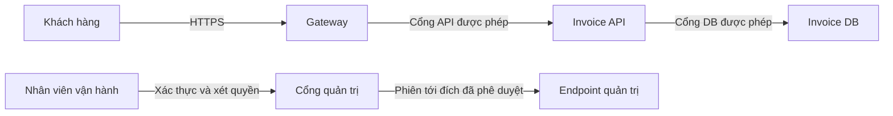

# Network-level access — Kiểm soát quyền truy cập ở lớp mạng

## 1. Network-level access giải quyết điều gì?

Một hệ thống quản lý hóa đơn có API công khai, cơ sở dữ liệu riêng và giao diện quản trị. Khách hàng cần gọi API qua Internet; API cần kết nối cơ sở dữ liệu; nhân viên vận hành đôi lúc cần mở phiên quản trị. Ba nhu cầu này tạo ra ba loại đường đi khác nhau. Nếu tất cả máy đều kết nối được tới mọi cổng của nhau, quyền đăng nhập ứng dụng có được thiết kế cẩn thận đến đâu thì hệ thống vẫn để lộ nhiều đường tiếp cận không cần thiết.

**Network-level access** là việc kiểm soát khả năng thiết lập hoặc duy trì liên lạc với một đích mạng theo chính sách. Đích có thể là máy chủ, cổng dịch vụ, nhóm workload, phân đoạn mạng hoặc tài nguyên được đưa qua một cổng truy cập. Chính sách thường xét địa chỉ nguồn, địa chỉ đích, giao thức, cổng, chiều lưu lượng và trạng thái kết nối. Một số giải pháp còn liên kết quyết định với danh tính người dùng, thiết bị hoặc workload đã được xác minh.

Trong nền tảng IAM, lớp mạng giúp giới hạn **ai hoặc thành phần nào có cơ hội tiếp cận một điểm cung cấp dịch vụ**. Sau đó, cơ chế xác thực và phân quyền của dịch vụ quyết định chủ thể được thực hiện hành động nào trên tài nguyên cụ thể.

Ví dụ:

- Máy của khách hàng có thể kết nối HTTPS tới API, nhưng không có đường kết nối trực tiếp tới PostgreSQL.
- API được kết nối cổng cơ sở dữ liệu, nhưng tài khoản cơ sở dữ liệu của API chỉ có những quyền dữ liệu cần thiết.
- Nhân viên đã đăng nhập VPN vẫn cần quyền quản trị và điều kiện truy cập phù hợp để mở phiên tới máy chủ sản xuất.
- Workload gửi thông báo có thể gọi dịch vụ email được phê duyệt, nhưng không cần mở kết nối tùy ý tới mọi mạng nội bộ.

Trong bài này, thuật ngữ chỉ kiểm soát truy cập mạng nói chung. Nó không dùng riêng để chỉ tính năng có tên Network Level Authentication của Remote Desktop.

## 2. Khả năng kết nối và quyền sử dụng tài nguyên là hai quyết định khác nhau

Hãy tách một yêu cầu đọc hóa đơn thành các câu hỏi:

| Lớp kiểm soát | Câu hỏi cần trả lời | Ví dụ điều kiện |
| --- | --- | --- |
| Đường đi mạng | Lưu lượng có đường đến dịch vụ không? | Có route tới địa chỉ API |
| Chính sách mạng | Nguồn này có được thiết lập kết nối tới đích và cổng này không? | Gateway được gọi API ở TCP 8443 |
| Bảo vệ kênh | Hai đầu có thiết lập được kênh theo yêu cầu không? | Xác minh chứng thư máy chủ |
| Xác thực | Yêu cầu đại diện cho chủ thể nào? | Token được xác minh, phiên còn hiệu lực |
| Phân quyền ứng dụng | Chủ thể có được làm việc này trên đối tượng này không? | Có quyền đọc hóa đơn của đúng tenant |
| Phân quyền dữ liệu | Tài khoản truy cập dữ liệu được phép thao tác gì? | Tài khoản API không được quản trị cơ sở dữ liệu |

Có route không có nghĩa là firewall cho phép. Firewall cho phép không có nghĩa là dịch vụ đang lắng nghe. Hoàn thành bắt tay TCP không có nghĩa là xác thực TLS thành công. Một phản hồi HTTP thành công từ trang kiểm tra sức khỏe cũng không chứng minh người gọi được đọc dữ liệu nghiệp vụ.

Với một thao tác được thiết kế phải đi qua mọi lớp trên, có thể mô tả điều kiện thành công như sau:

```text
Thao tác thành công
  = có đường đi và dịch vụ hoạt động
    AND chính sách mạng cho phép
    AND đáp ứng yêu cầu bảo vệ kênh
    AND xác thực hợp lệ
    AND phân quyền đúng hành động, đúng tài nguyên
```

Đây là mô hình phân tích cho đường truy cập đang xét, không phải quy tắc kết hợp áp dụng nguyên xi cho mọi sản phẩm. Chẳng hạn, một dịch vụ công khai có thể cho phép truy cập ẩn danh vào trang giới thiệu, còn dữ liệu hóa đơn yêu cầu danh tính đã xác thực.

Hai tình huống phải được phân biệt khi vận hành:

1. Người dùng có đúng quyền ứng dụng nhưng không kết nối được do mạng chặn. Cần kiểm tra đường đi và chính sách mạng, không cấp thêm vai trò nghiệp vụ.
2. Người dùng kết nối được nhưng không có quyền đọc đối tượng. Cần kiểm tra quyết định phân quyền, không mở rộng firewall để giải quyết lỗi.

## 3. Thành phần của một chính sách mạng

Một chính sách có ích cần diễn đạt được nhu cầu giao tiếp cụ thể thay vì chỉ ghi “cho phép hệ thống nội bộ”.

| Thành phần | Nội dung | Ví dụ trong hệ thống hóa đơn |
| --- | --- | --- |
| Nguồn | Thành phần khởi tạo kết nối | Nhóm workload `invoice-api` |
| Đích | Dịch vụ hoặc nhóm endpoint được bảo vệ | Nhóm máy `invoice-db` |
| Giao thức | Loại lưu lượng được phép | TCP |
| Cổng đích | Dịch vụ cần sử dụng | 5432 |
| Chiều | Xét từ điểm thực thi nào | Egress của API, ingress của DB |
| Điều kiện bổ sung | Điều kiện mà công cụ thực sự hỗ trợ | Nhóm thiết bị quản lý, danh tính workload |
| Vòng đời | Vì sao tồn tại và khi nào phải xem xét lại | Chủ sở hữu, lý do, thời hạn ngoại lệ |

Cùng một kết nối từ API tới DB là **egress** khi nhìn từ API và **ingress** khi nhìn từ DB. Hai phía có thể chịu các tập chính sách khác nhau. Cho phép ingress ở DB chưa đủ nếu egress của API bị chặn.

Một máy khách cũng có cổng nguồn, thường do hệ điều hành chọn cho kết nối. Không nên nhầm cổng nguồn này với cổng dịch vụ. Khi viết quy tắc cho bộ lọc không theo dõi trạng thái, cần tính cả lưu lượng trả về và cơ chế của giao thức, thay vì chỉ mở một chiều theo suy đoán.

Các trường như người phê duyệt, ngày hết hạn hoặc mã yêu cầu có thể chỉ là metadata quản trị. Ghi `expiresAt` vào một bản mô tả không tự làm firewall thu hồi quyền. Muốn hết hạn có hiệu lực phải có công cụ hỗ trợ hoặc một tiến trình thực sự gỡ quyền và xác minh kết quả.

### 3.1. Nguồn chính sách phải đến từ đâu?

Địa chỉ và nhãn chỉ hữu ích khi hệ thống biết chúng được gắn với thực thể nào. Với một policy cho phép nhóm `invoice-api`, cần trả lời thêm:

- Ai có thể đưa máy hoặc workload vào nhóm này?
- Ai có thể thay nhãn dùng để chọn nguồn?
- Khi workload bị xóa và tạo lại, liên kết nào được cập nhật?
- Người có quyền sửa policy có thể tự cấp đường truy cập cho mình không?

Nếu mọi nhóm phát triển đều tự gắn được nhãn tương đương “được truy cập DB sản xuất”, chính sách dựa trên nhãn đã trao quyền gián tiếp cho người sửa nhãn. Trong IAM, quyền thay thuộc tính đầu vào của quyết định cũng là một loại quyền cần quản lý.

## 4. Địa chỉ IP là tín hiệu mạng, không phải bằng chứng đầy đủ về danh tính

Một firewall thấy kết nối từ `10.40.8.21`. Thông tin này mô tả địa chỉ nguồn tại điểm quan sát, nhưng chưa chứng minh đó là người dùng Lan, ứng dụng kế toán hay một tiến trình được phê duyệt.

Có nhiều nguyên nhân làm địa chỉ và chủ thể không trùng nhau:

- Nhiều thiết bị dùng chung một địa chỉ sau NAT.
- Proxy hoặc load balancer trở thành nguồn mà backend nhìn thấy.
- Địa chỉ của workload thay đổi khi khởi động lại.
- Máy đã được phép kết nối có thể bị chiếm quyền.
- Hai môi trường riêng có thể sử dụng các dải địa chỉ riêng trùng nhau.

Ví dụ, cho phép địa chỉ egress của văn phòng giúp giới hạn nguồn truy cập vào một cổng quản trị. Quy tắc đó không phân biệt nhân viên vận hành với một máy khách khác dùng cùng đường ra. Dịch vụ quản trị vẫn phải xác thực từng người và kiểm tra quyền.

### 4.1. CIDR phải được đọc đúng phạm vi

CIDR mô tả một tập địa chỉ. Một dải rộng bao phủ nhiều nguồn hơn một địa chỉ đơn lẻ. Khi đánh giá rule, cần tính cả các mạng được kết nối qua peering, VPN, đường truyền riêng và các điểm trung chuyển.

`0.0.0.0/0` bao phủ mọi địa chỉ IPv4; `::/0` bao phủ mọi địa chỉ IPv6. Chúng không tự tạo route hay làm dịch vụ hoạt động, nhưng một rule cho phép các dải đó không còn giới hạn nguồn theo địa chỉ trong họ IP tương ứng.

Một hệ thống dùng cả IPv4 và IPv6 cần kiểm tra cả hai đường truy cập. Chỉ siết IPv4 trong khi dịch vụ vẫn nhận IPv6 có thể khiến mục tiêu giới hạn nguồn chưa được thực hiện.

### 4.2. Header chuyển tiếp không tự tạo ra danh tính đáng tin

Giả sử backend nhận:

```http
X-Forwarded-For: 10.40.8.21
X-User-Id: administrator
```

Nội dung của hai header không đủ để kết luận yêu cầu đến từ mạng quản trị hay người quản trị. Nếu client bên ngoài tự gửi được các giá trị này và backend tin ngay, kiểm soát đã dựa vào lời khai của bên gọi.

Khi dùng proxy có xác thực, cần xác lập ranh giới tin cậy: backend chỉ nhận đường truy cập được phê duyệt, proxy xử lý header do client cung cấp theo cấu hình rõ ràng, và thông tin danh tính được truyền bằng cơ chế có thể xác minh. Dữ liệu chuyển tiếp phục vụ truy vết cũng cần được phân biệt với dữ liệu đủ tin cậy để ra quyết định bảo mật.

## 5. Các vị trí thực thi và đặc tính cần kiểm tra

Kiểm soát có thể nằm ở firewall giữa các mạng, firewall trên máy, cơ chế gắn với tài nguyên cloud hoặc lớp mạng của nền tảng container. Mỗi vị trí quan sát được thông tin khác nhau. Cần biết chính sách được thực thi ở đâu trên đường đi, nhất là khi có proxy hoặc chuyển đổi địa chỉ.

NIST mô tả firewall là thiết bị hoặc phần mềm kiểm soát luồng lưu lượng giữa các mạng hay máy có tư thế bảo mật khác nhau. Tài liệu cũng đặt việc xây dựng, thử nghiệm và quản lý policy trong vòng đời vận hành firewall. [NIST SP 800-41 Rev. 1](https://csrc.nist.gov/pubs/sp/800/41/r1/final)

### 5.1. Theo dõi trạng thái và lưu lượng trả về

Bộ lọc có trạng thái có thể nhận diện lưu lượng thuộc kết nối được phép. Bộ lọc không có trạng thái xét từng hướng theo rule tương ứng. Vì vậy, không nên sao chép cùng một bộ rule giữa hai cơ chế rồi mặc định hành vi giống nhau.

Ví dụ cụ thể trên AWS: security group có trạng thái; lưu lượng trả lời của kết nối được cho phép được xử lý theo cơ chế này. [AWS — Security groups](https://docs.aws.amazon.com/vpc/latest/userguide/vpc-security-groups.html)

Trong khi đó, network ACL của AWS kiểm soát lưu lượng ở mức subnet và không theo dõi trạng thái; cần cho phép chiều phản hồi bằng rule phù hợp. Đây là đặc tính của dịch vụ cụ thể, không phải định nghĩa chung cho mọi thứ có tên ACL. [AWS — Network ACLs](https://docs.aws.amazon.com/vpc/latest/userguide/vpc-network-acls.html)

### 5.2. Cách kết hợp rule quyết định quyền thực tế

Đừng suy luận rằng thêm một policy “chặt” sẽ làm tổng thể chặt hơn.

Với AWS security group, rule cho phép từ nhiều group gắn vào cùng tài nguyên được tổng hợp. Security group không có rule deny tường minh. Một group còn cho phép nguồn rộng có thể khiến việc thêm một group hẹp không đạt ý định giới hạn nguồn. [AWS — Security group rules](https://docs.aws.amazon.com/vpc/latest/userguide/security-group-rules.html)

Bài học để áp dụng khi chọn công cụ:

| Câu hỏi cần kiểm tra | Lý do |
| --- | --- |
| Rule có thứ tự ưu tiên không? | Kết quả có thể phụ thuộc vị trí rule |
| Có deny tường minh không? | Một số mô hình chỉ liệt kê các luồng được phép |
| Nhiều policy kết hợp theo hợp hay giao? | Thêm policy có thể mở thêm quyền |
| Mặc định của ingress và egress là gì? | Siết một chiều không tự siết chiều còn lại |
| Policy áp dụng vào tài nguyên nào? | Rule đúng nhưng gắn sai đích vẫn không bảo vệ đúng hệ thống |
| Đường đi có thực sự qua điểm thực thi không? | Một endpoint phụ có thể tạo đường tránh |
| Policy mới tác động thế nào tới phiên cũ? | Kết nối đang tồn tại có thể có hành vi riêng |

Cần đọc semantics của đúng sản phẩm, đúng loại policy. Tên giống nhau như “network policy”, “security policy” hoặc “ACL” không bảo đảm cùng thuật toán quyết định.

## 6. Phân đoạn mạng và nguyên tắc ít quyền nhất

Phân đoạn mạng chia hệ thống thành các vùng có nhu cầu và mức nhạy cảm khác nhau. Mục tiêu là giảm số đường giao tiếp không cần thiết, đặc biệt là đường đi từ một thành phần đã bị xâm nhập sang thành phần khác.

Một thiết kế cho hệ thống hóa đơn có thể sử dụng bốn vùng:

1. Vùng tiếp nhận lưu lượng: gateway hoặc reverse proxy nhận yêu cầu từ bên ngoài.
2. Vùng ứng dụng: API xử lý nghiệp vụ.
3. Vùng dữ liệu: cơ sở dữ liệu và các kho dữ liệu nhạy cảm.
4. Vùng quản trị: đường truy cập vận hành được kiểm soát riêng.



Các mũi tên biểu diễn những luồng chủ động được thiết kế cho ví dụ. Sơ đồ chưa thể hiện DNS, đồng bộ thời gian, giám sát, sao lưu hoặc các phụ thuộc khác; những luồng thực sự cần cũng phải được xác định trước khi triển khai.

Ít quyền nhất ở lớp mạng có nghĩa là mỗi thành phần chỉ được tiếp cận các đích và dịch vụ phù hợp với chức năng:

- Gateway có đường tới API, không cần đường trực tiếp tới DB.
- API cần DB và một số phụ thuộc, không cần truy cập endpoint quản trị của mọi máy.
- Hệ thống kiểm thử không mặc nhiên được kết nối dữ liệu sản xuất.
- Bộ phận hỗ trợ không được tiếp cận toàn bộ hạ tầng chỉ vì cùng một công ty.

### 6.1. North-south và east-west

Lưu lượng đi vào hoặc đi ra khỏi một môi trường thường được gọi là north-south. Lưu lượng giữa các thành phần bên trong thường được gọi là east-west.

Một hệ thống có firewall biên chặt nhưng mạng bên trong phẳng vẫn cho phép phạm vi di chuyển lớn nếu một workload bị chiếm quyền. Chia nhỏ vùng ứng dụng và quản lý luồng giữa các workload giúp thu hẹp phạm vi đó.

**Microsegmentation** đi tới các đơn vị nhỏ hơn như nhóm workload hoặc dịch vụ. Nó có thể hữu ích khi IP thay đổi thường xuyên, nhưng chất lượng kiểm soát còn phụ thuộc việc xác định workload, quyền sửa thuộc tính và khả năng thực thi policy.

### 6.2. Egress cũng là quyền truy cập

Kiểm soát đầu vào giảm nguồn có thể chạm tới dịch vụ. Kiểm soát đầu ra giảm đích mà dịch vụ có thể chạm tới.

Trong ví dụ, API có thể cần gọi nhà cung cấp thanh toán; nhu cầu này không đồng nghĩa API cần kết nối mọi địa chỉ trên Internet hoặc mọi cổng trong mạng công ty. Nếu API bị khai thác, một chính sách egress phù hợp có thể hạn chế một số đường truy cập tiếp theo.

Tuy nhiên, cổng 443 không đồng nghĩa mọi lưu lượng qua đó đều hợp lệ. Một policy chỉ nhìn IP và cổng không hiểu toàn bộ ý nghĩa của yêu cầu HTTPS. Khi mục tiêu yêu cầu giới hạn tới dịch vụ hay hoạt động cụ thể, cần xem xét thêm cơ chế ở gateway hoặc ứng dụng và chính sách tương ứng.

## 7. VPN, truy cập theo danh tính và Zero Trust

VPN tạo một đường kết nối tới mạng hoặc các route được cấu hình. Tùy giải pháp, việc thiết lập VPN có thể gắn với danh tính và điều kiện thiết bị. Nhưng sau khi vào VPN, phạm vi thực tế vẫn phụ thuộc route, policy mạng và quyền tại dịch vụ đích.

Một thiết kế quá rộng có thể cấp cho mọi người dùng VPN khả năng tiếp cận cả mạng sản xuất. Thiết kế sát nhu cầu hơn có thể chỉ cho nhóm vận hành tiếp cận một cổng quản trị, rồi cổng này tiếp tục xét quyền theo từng đích.

Ví dụ truy cập xử lý sự cố:

```text
Người vận hành đăng nhập
  -> xác minh danh tính và điều kiện phiên
  -> kiểm tra quyền truy cập máy đích
  -> mở đường hoặc phiên đúng phạm vi
  -> ghi nhận hoạt động theo chính sách
  -> hết hạn, thu hồi và kiểm tra phiên còn tồn tại
```

Tại mỗi bước phải biết thành phần nào có trách nhiệm thực thi. Một dấu “MFA thành công” lúc đăng nhập không tự chứng minh người dùng được quản trị mọi tài nguyên.

NIST SP 800-207 nhấn mạnh không cấp niềm tin mặc định chỉ dựa vào vị trí mạng hoặc quyền sở hữu thiết bị. Điều này giúp giải thích vì sao “đang ở mạng nội bộ” chưa đủ để thay cho xác thực và phân quyền. [NIST SP 800-207](https://csrc.nist.gov/pubs/sp/800/207/final)

Trong ví dụ hóa đơn, có thể giữ phân đoạn mạng và bổ sung truy cập theo danh tính:

- Nhân viên được xét quyền tới một ứng dụng hoặc máy đích cụ thể.
- Thiết bị được đánh giá theo các điều kiện mà hệ thống thực sự thu thập và xác minh.
- Quyền tạm thời có thời hạn và người chịu trách nhiệm.
- Đường truy cập rộng được thay bằng những đường vừa đủ cho nhiệm vụ.

Chỉ đặt tên một gateway là “Zero Trust” không chứng minh các điều kiện này đã được thực hiện. Cần quan sát quyết định thực tế và kiểm tra các đường có thể đi vòng qua gateway.

## 8. Danh tính workload và mTLS bổ sung gì?

Chính sách theo địa chỉ trả lời được một phần câu hỏi về nguồn mạng. Danh tính workload giúp biểu diễn chủ thể như `invoice-api` hoặc `report-service` bằng bằng chứng có thể xác minh thay vì chỉ dựa trên nơi workload đang chạy.

Trong mô hình dùng chứng thư, mTLS có thể xác thực hai đầu của kết nối. Nhưng chứng thư hợp lệ chưa tự quyết định bên gọi được dùng mọi API. Dịch vụ hoặc proxy vẫn cần ánh xạ danh tính đã xác minh vào policy. TLS cũng không tự cung cấp phân quyền theo đối tượng nghiệp vụ. [IETF — TLS 1.3, RFC 8446](https://datatracker.ietf.org/doc/html/rfc8446)

Một ví dụ về phân quyền dịch vụ:

```text
Danh tính dịch vụ đã xác minh: report-service
Dịch vụ đích: invoice-api
Hoạt động đề nghị: đọc dữ liệu phục vụ báo cáo
Quyền dịch vụ: chỉ được gọi giao diện báo cáo đã phê duyệt

Danh tính người dùng cuối: phải có cơ chế riêng nếu nghiệp vụ cần
Tenant và phạm vi dữ liệu: tiếp tục kiểm tra tại ứng dụng
```

Nếu `report-service` gọi API thay mặt một nhân viên, bên nhận cần phân biệt danh tính dịch vụ gọi trực tiếp và danh tính người dùng được đại diện. Đưa thông tin người dùng vào một header bất kỳ không đủ thiết lập sự ủy quyền.

NIST SP 800-207A đề cập việc kết hợp danh tính ứng dụng, dịch vụ và người dùng với các tham số mạng để thực thi quyền truy cập chi tiết trong môi trường cloud-native. [NIST SP 800-207A](https://csrc.nist.gov/pubs/sp/800/207/a/final)

Trong thiết kế thực tế, cần xem cả vòng đời danh tính workload: ai cấp thông tin xác thực, dịch vụ nào được nhận, chúng được luân chuyển ra sao và việc thu hồi có hiệu lực thế nào. Một chính sách theo danh tính vẫn có thể sai nếu quyền nhận danh tính đó quá rộng.

## 9. Ví dụ thiết kế: hệ thống hóa đơn nhiều tenant

Giả sử hệ thống phục vụ nhiều doanh nghiệp. Mỗi doanh nghiệp là một tenant; khách hàng không được đọc hóa đơn của tenant khác. Hệ thống có gateway, API, DB và dịch vụ báo cáo.

Bảng sau mô tả ý định truy cập của ví dụ, không phải cấu hình có thể nạp trực tiếp vào mọi firewall:

| Nguồn | Đích | Luồng cần thiết | Kiểm soát tại đích |
| --- | --- | --- | --- |
| Khách hàng | Gateway | HTTPS công khai | Đăng nhập và kiểm soát truy cập theo chức năng |
| Gateway | Invoice API | Cổng phục vụ API | Xác minh yêu cầu và bảo vệ đường từ gateway |
| Invoice API | Invoice DB | TCP 5432 | Tài khoản DB với quyền dữ liệu cần thiết |
| Report service | Invoice API | Giao diện báo cáo | Quyền dịch vụ và phạm vi báo cáo |
| Nhân viên vận hành | Cổng quản trị | Đường quản trị đã phê duyệt | Xác thực, điều kiện phiên, quyền tới đích |
| Cổng quản trị | Endpoint quản trị | Phiên có thời hạn | Quyền hệ điều hành hoặc dịch vụ tương ứng |
| Khách hàng | Invoice DB | Không có nhu cầu trực tiếp | Không cấp đường này |
| Workload thử nghiệm | Invoice DB sản xuất | Không có nhu cầu mặc định | Chỉ xét ngoại lệ được phê duyệt riêng |

Không nên rút gọn bảng thành “mạng ứng dụng được truy cập mạng dữ liệu”, vì điều đó có thể cấp quyền cho cả những workload không liên quan.

### 9.1. Một yêu cầu hợp lệ

Người dùng thuộc tenant A đọc hóa đơn A-105:

1. Thiết bị kết nối gateway qua đường công khai được cho phép.
2. Gateway chuyển yêu cầu tới API qua luồng backend được thiết kế.
3. API xác minh danh tính hoặc nhận danh tính qua cơ chế tin cậy đã thiết lập.
4. API kiểm tra hành động đọc và quan hệ với tenant của hóa đơn.
5. API dùng tài khoản DB được cấp để lấy dữ liệu theo phạm vi hợp lệ.
6. Các lớp ghi nhận kết quả phù hợp với nhiệm vụ của chúng.

Network-level access góp phần ở các đường giao tiếp; quyết định tenant nằm ở lớp biết ý nghĩa dữ liệu.

### 9.2. Một yêu cầu sai tenant

Người dùng tenant A đổi mã yêu cầu thành hóa đơn B-208. Các kết nối vẫn đi trên cùng đường mạng và tới cùng cổng API.

Firewall thông thường không biết hóa đơn B-208 thuộc tenant B. API phải từ chối theo quy tắc nghiệp vụ. Dù có phân đoạn mạng đúng, một lỗi phân quyền đối tượng vẫn có thể làm lộ dữ liệu.

### 9.3. Một workload bị chiếm quyền

Giả sử workload gửi email bị khai thác. Nếu chỉ `invoice-api` được tiếp cận DB, workload gửi email không có đường DB như một quyền mặc định.

Đây là lợi ích thu hẹp đường tiếp cận. Nó không bảo đảm toàn bộ sự cố bị chặn: kẻ tấn công có thể tìm đường qua API mà workload đó vẫn được gọi hoặc lạm dụng thông tin xác thực bị lộ. Cần tiếp tục quản lý quyền dịch vụ, bí mật và hành động ở ứng dụng.

## 10. Minh họa Kubernetes NetworkPolicy

Ví dụ này dành cho một môi trường học có hai namespace:

- `billing-app`: chứa Pod mang nhãn `app: invoice-api`.
- `billing-data`: chứa Pod mang nhãn `app: invoice-db`.

Mục tiêu là giới hạn ingress của DB tới nguồn API; đồng thời giới hạn egress của API trong phần minh họa tới DB. Kubernetes yêu cầu giải pháp mạng hỗ trợ thực thi NetworkPolicy; chỉ tạo object policy không chứng minh lưu lượng đã được lọc. [Kubernetes — Network Policies](https://kubernetes.io/docs/concepts/services-networking/network-policies/)

### 10.1. Cho DB nhận kết nối từ đúng nguồn

```yaml
apiVersion: networking.k8s.io/v1
kind: NetworkPolicy
metadata:
  name: invoice-db-from-api
  namespace: billing-data
spec:
  podSelector:
    matchLabels:
      app: invoice-db
  policyTypes:
    - Ingress
  ingress:
    - from:
        - namespaceSelector:
            matchLabels:
              kubernetes.io/metadata.name: billing-app
          podSelector:
            matchLabels:
              app: invoice-api
      ports:
        - protocol: TCP
          port: 5432
```

Hai selector trong cùng một phần tử `from` diễn tả điều kiện đồng thời: Pod đúng nhãn nằm trong namespace được chọn. Tách chúng thành hai phần tử sẽ thay đổi tập nguồn được cho phép. [Kubernetes — NetworkPolicy API](https://kubernetes.io/docs/reference/kubernetes-api/networking/network-policy-v1/)

### 10.2. Giới hạn egress API trong đường mẫu

```yaml
apiVersion: networking.k8s.io/v1
kind: NetworkPolicy
metadata:
  name: invoice-api-to-db
  namespace: billing-app
spec:
  podSelector:
    matchLabels:
      app: invoice-api
  policyTypes:
    - Egress
  egress:
    - to:
        - namespaceSelector:
            matchLabels:
              kubernetes.io/metadata.name: billing-data
          podSelector:
            matchLabels:
              app: invoice-db
      ports:
        - protocol: TCP
          port: 5432
```

Đây là hai mảnh policy phục vụ học tập. Chúng chưa mô tả DNS hay các phụ thuộc khác của API. Việc dùng tên dịch vụ cần đường tới resolver thực tế; không nên triển khai mẫu rồi kết luận ứng dụng hỏng vì thiếu quyền DB. Luồng DNS, giám sát hoặc phụ thuộc ngoài phải được bổ sung theo môi trường thử nghiệm.

Các policy cho phép của NetworkPolicy có tính cộng. Một policy khác có thể mở thêm luồng; cần xét egress nguồn và ingress đích, cùng những giới hạn nền tảng như lưu lượng liên quan node. [Kubernetes — Network Policies](https://kubernetes.io/docs/concepts/services-networking/network-policies/)

Không dùng hai đoạn YAML để kết luận rằng tenant đã được cách ly ở dữ liệu. Các Pod cũng phải có nhãn đúng, người sửa workload phải được quản lý và tài khoản DB vẫn cần quyền phù hợp. Đây là một kiểm soát kết nối trong một thiết kế lớn hơn.

## 11. Quyền quản trị chính sách mạng cũng thuộc IAM

Có hai mặt phẳng cần phân biệt:

- **Data plane**: các kết nối đang đi qua hệ thống.
- **Control plane**: thao tác tạo, sửa hoặc gỡ chính sách chi phối các kết nối.

Một nhân viên không có quyền đọc dữ liệu có thể vẫn tạo ra rủi ro nếu được mở firewall tùy ý, gắn workload của mình vào nhóm được tin cậy hoặc tạo một endpoint công khai tới mạng dữ liệu.

Ví dụ về chuỗi cấp quyền gián tiếp:

```text
Có quyền sửa nhóm nguồn được phép
  -> thêm máy của mình vào nhóm
  -> máy có đường tới DB
  -> nếu có thêm thông tin xác thực phù hợp, tiếp cận được dữ liệu
```

Đường mạng chưa phải toàn bộ quyền dữ liệu, nhưng quyền thay đổi đường mạng đã làm thay đổi một điều kiện quan trọng của truy cập.

Một cách tổ chức cho ví dụ hóa đơn:

| Vai trò | Phạm vi cần thiết | Giới hạn cần thiết |
| --- | --- | --- |
| Nhóm ứng dụng | Đề nghị luồng phục vụ nghiệp vụ | Không tự mở mọi đích sản xuất |
| Nhóm nền tảng | Thực thi cấu hình được duyệt | Có ghi nhận thay đổi và phạm vi module |
| Người trực vận hành | Nhận quyền quản trị tạm thời | Đúng máy, đúng nhiệm vụ, có hạn |
| Người xem kiểm toán | Đọc cấu hình và lịch sử | Không đồng thời có quyền sửa chỉ vì cần quan sát |
| Tài khoản triển khai | Áp dụng policy trong phạm vi được giao | Không dùng một danh tính có quyền mọi môi trường |

Việc tách quyền cần phù hợp quy mô tổ chức. Điều cốt yếu là không bỏ qua quyền sửa policy khi đánh giá đặc quyền và đường tăng quyền.

## 12. Vòng đời một quyền truy cập mạng

Một rule tồn tại nhiều năm có thể không còn phù hợp với kiến trúc hiện tại. Cần quản lý nó theo vòng đời giống các loại quyền khác.

### 12.1. Đề nghị và cấp

Bên yêu cầu mô tả nguồn, đích, giao thức, cổng, lý do nghiệp vụ và thời hạn nếu là ngoại lệ. Chủ sở hữu tài nguyên đích xác nhận nhu cầu; bên có thẩm quyền triển khai kiểm tra phạm vi và ảnh hưởng.

“Ứng dụng không chạy” là một triệu chứng, chưa phải đặc tả quyền. Cần xác định ứng dụng đang thiếu luồng nào trước khi mở rộng chính sách.

### 12.2. Sử dụng và quan sát

Đối chiếu kết nối thực tế với ý định được duyệt. Rule có thể không được dùng vì phụ thuộc đã bị thay thế; cũng có thể tưởng không được dùng do log thiếu hoặc điểm quan sát không đúng.

Thông tin sử dụng giúp xem xét lại quyền, nhưng không nên xóa rule chỉ vì một cửa sổ ngắn không có lưu lượng. Có luồng hợp lệ chạy theo tháng, khi khôi phục dữ liệu hoặc khi chuyển vùng.

### 12.3. Thay đổi và thu hồi

Khi chuyển dịch vụ, đóng môi trường hoặc nhân sự hết nhiệm vụ, cần gỡ đường truy cập tương ứng. Không chỉ gỡ một mục trong tài liệu nếu cấu hình thực thi vẫn còn.

Đặc biệt, thay rule có thể tác động khác nhau tới kết nối mới và kết nối đang tồn tại. Muốn thu hồi khẩn cấp phải xác minh cơ chế quản lý phiên, trạng thái kết nối và các bản sao policy tại điểm thực thi.

Trong ví dụ vận hành có quyền tạm thời 30 phút, thời hạn hiệu quả phải trả lời được cả hai câu hỏi:

1. Sau thời hạn có mở được phiên mới không?
2. Phiên đã mở trước đó được xử lý theo chính sách nào?

Câu trả lời cần dựa vào hành vi công cụ được triển khai; không mặc định rằng hết hạn quyền luôn đóng ngay mọi kết nối cũ.

## 13. Kiểm tra bằng cả đường được phép và đường bị cấm

Một phép thử API kết nối thành công tới DB chỉ xác nhận một luồng dương. Nó chưa chứng minh các workload khác bị chặn.

Với ví dụ hóa đơn, có thể lập ma trận kiểm tra:

| Phép thử | Kết quả mong đợi theo thiết kế | Bằng chứng cần quan sát |
| --- | --- | --- |
| API gọi DB đúng cổng | Thiết lập được kết nối khi DB khỏe | Kết quả kết nối và log liên quan |
| Workload email gọi DB | Không thiết lập được đường DB | Kết quả phía nguồn, quyết định tại điểm lọc nếu có |
| API gọi một cổng DB không được cấp | Không được phép theo policy | Đúng cổng, đúng đích, không chỉ kết quả ping |
| Khách hàng gọi API không đăng nhập | Kết nối mạng có thể được, thao tác bảo vệ bị từ chối | Kết quả xác thực ở ứng dụng |
| Người dùng tenant A đọc hóa đơn tenant B | Bị từ chối theo quyền đối tượng | Quyết định phân quyền gắn với tài nguyên |
| Tài khoản quản trị hết hạn mở phiên mới | Bị từ chối | Trạng thái quyền và log cổng quản trị |
| Client dùng đường IPv6 | Đạt cùng mục tiêu giới hạn nguồn đã thiết kế | Route, endpoint và policy của IPv6 |
| Client gọi thẳng backend thay vì gateway | Không vượt qua ranh giới tin cậy | Kết quả đường trực tiếp và cấu hình backend |

Cần biết dịch vụ đích có thực sự hoạt động khi chạy phép thử bị chặn. Nếu DB đang tắt, kết nối thất bại từ mọi nguồn không chứng minh policy phân biệt đúng nguồn.

Một bộ kiểm tra tốt có cặp đối chứng: cùng một đích khỏe, cùng giao thức và cổng, nhưng một nguồn được cấp quyền và một nguồn không được cấp. Với phép thử thu hồi, nên kiểm tra riêng kết nối mới và phiên đang tồn tại theo mục tiêu đã định.

Policy mẫu hoặc ma trận kỳ vọng là thiết kế kiểm thử. Chỉ ghi nhận kết quả triển khai khi có môi trường và bằng chứng thực tế; việc đọc cấu hình đơn thuần chưa chứng minh đường dữ liệu đã tuân theo.

## 14. Chẩn đoán lỗi theo lớp

Một timeout không chỉ có một nguyên nhân. Nó có thể đến từ route, firewall, dịch vụ không phản hồi hoặc vấn đề khác trên đường đi. Một thông báo từ chối tức thời cũng không đủ xác định mọi chi tiết về điểm chặn.

| Quan sát | Hướng kiểm tra | Kết luận chưa được phép suy ra |
| --- | --- | --- |
| Không phân giải được tên | Resolver, cấu hình DNS, đường tới DNS | “Thiếu vai trò IAM” |
| Có địa chỉ nhưng không kết nối TCP được | Route, policy, listener, trạng thái đích | “Chắc chắn firewall chặn” |
| TCP được nhưng TLS lỗi | Danh tính đích, chuỗi tin cậy, cấu hình kênh | “Đã có quyền nghiệp vụ” |
| Ứng dụng báo lỗi xác thực | Token, phiên, cơ chế xác minh | “Cần mở thêm cổng” |
| Ứng dụng từ chối hành động | Vai trò, thuộc tính, tenant, quyền đối tượng | “Mạng đang lỗi” |
| Chỉ một số nguồn truy cập được | Khác biệt nguồn, NAT, proxy và policy | “Mọi nguồn bị chặn đều không có danh tính hợp lệ” |
| Kết nối mới bị chặn, kết nối cũ còn hoạt động | Trạng thái phiên và cơ chế thu hồi | “Rule mới chưa từng được áp dụng” |

Mã HTTP do thành phần xử lý HTTP tạo ra; bộ lọc gói thông thường không cần tạo phản hồi HTTP 401 hoặc 403. Một gateway có thể trả mã HTTP khi từ chối, còn firewall có thể bỏ gói hoặc từ chối ở lớp giao vận. Cần xác định thành phần thực sự phát sinh phản hồi.

### 14.1. Ghép bằng chứng mạng với bằng chứng danh tính

Một bản ghi kết nối hữu ích có thể chứa thời điểm, nguồn, đích, giao thức, cổng, điểm quan sát và kết quả cho phép hoặc chặn. Một bản ghi IAM có thể chứa chủ thể, phiên, tài nguyên, hành động, quyết định và phiên bản policy.

Để điều tra được, cần có cách nối hai nhóm dữ liệu:

- Ánh xạ IP về workload tại đúng thời điểm, không chỉ theo trạng thái hiện tại.
- Xác định proxy hoặc NAT đã thay đổi địa chỉ như thế nào.
- Dùng mã tương quan do hệ thống quản lý khi đi qua các lớp.
- Đồng bộ thời gian và kiểm soát quyền đọc log.
- Tránh đưa token, mật khẩu hoặc bí mật nguyên vẹn vào log.

Flow log cho biết kết nối mạng chưa chắc cho biết ai là người dùng cuối. Log đăng nhập thành công cũng chưa chứng minh người đó đã hoàn thành một thao tác trên DB.

## 15. Những đường truy cập dễ bị bỏ sót

### 15.1. Endpoint nội bộ vẫn có thể bị lạm dụng

Một dịch vụ chỉ có địa chỉ riêng có thể vẫn bị gọi từ các hệ thống khác đã có đường tới nó. Máy nhân viên, workload bị chiếm quyền hoặc một proxy được cấu hình quá rộng đều có thể trở thành nguồn trung gian.

“Không công khai trên Internet” là thông tin về một loại đường đi. Nó không thay thế việc xác định tất cả nguồn thực sự có khả năng tiếp cận.

### 15.2. SSRF có thể mượn quyền mạng của ứng dụng

Nếu API có tính năng tải nội dung theo URL do người dùng cung cấp và việc xử lý đầu vào có lỗi, bên tấn công có thể khiến API thực hiện yêu cầu tới một đích khác. Đích nhìn thấy nguồn là API, vốn có quyền mạng khác người dùng bên ngoài.

Vì thế, cần quản lý cả đích mà ứng dụng được gọi và logic xử lý URL. Egress giúp giảm một số đường, nhưng một đích vẫn nằm trong tập cho phép có thể tiếp tục bị lạm dụng. Những endpoint đặc biệt của nền tảng, như metadata hoặc dịch vụ trên node, cần kiểm tra bằng cơ chế bảo vệ thực tế của nền tảng; không mặc định mọi firewall đều lọc chúng.

### 15.3. Đường quản trị và đường ứng dụng có nhu cầu khác nhau

Dịch vụ phải phục vụ khách hàng không có nghĩa endpoint quản trị của nó cũng cần công khai. Một cổng quản trị để chung với lưu lượng ứng dụng có thể yêu cầu policy ở lớp ứng dụng nếu mạng chỉ nhìn thấy cùng địa chỉ và cổng.

Ngược lại, tách cổng hoặc địa chỉ chỉ tạo điều kiện cho chính sách mạng chi tiết hơn. Endpoint quản trị vẫn cần xác thực và phân quyền mạnh.

### 15.4. Health check không đại diện cho quyền nghiệp vụ

Một load balancer có thể gọi được endpoint kiểm tra sức khỏe. Điều đó chứng minh một đường phục vụ kiểm tra, không chứng minh mọi API được mở đúng hoặc người dùng cuối đã được xét quyền.

Khi thiết kế ngoại lệ cho giám sát, chỉ cấp đường đủ phục vụ chức năng. Không mở toàn bộ endpoint quản trị vì công cụ giám sát cần kiểm tra một trạng thái.

## 16. Sai lầm thường gặp và cách sửa tư duy

| Sai lầm | Hậu quả | Cách đặt lại câu hỏi |
| --- | --- | --- |
| Tin mọi nguồn trong mạng nội bộ | Một điểm xâm nhập có thể có nhiều đường tiếp cận | Mỗi nguồn thực sự cần tới đích nào? |
| Dùng IP như định danh người dùng duy nhất | Nhầm NAT, proxy hoặc máy dùng chung với một người | Bằng chứng danh tính được xác minh ở đâu? |
| Cấp mọi cổng để xử lý một lỗi kết nối | Tạo quyền vượt nhu cầu | Dịch vụ đang cần đúng giao thức và cổng nào? |
| Chỉ giới hạn ingress | Bỏ sót đường đầu ra không cần thiết | Workload có thể chủ động tới những đích nào? |
| Thêm policy hẹp nhưng giữ policy mở rộng | Quyền thực tế vẫn rộng | Tất cả policy được kết hợp như thế nào? |
| Chỉ xem YAML hoặc cấu hình | Không biết điểm thực thi có hiệu lực không | Có phép thử đối chứng trên đường dữ liệu chưa? |
| Dùng mạng để xử lý mọi quyền tenant | Không kiểm tra được quyền đối tượng cụ thể | Lớp nào biết chủ sở hữu tài nguyên? |
| Thu hồi tài khoản nhưng bỏ quên phiên truy cập | Quyền đã cấp có thể còn hiệu lực qua phiên cũ | Những phiên và thông tin xác thực nào cần thu hồi? |

Các sai lầm này thường xuất hiện khi một nhóm dùng một tín hiệu dễ quan sát để đại diện cho toàn bộ quyết định truy cập. Thiết kế tốt giữ rõ trách nhiệm của từng lớp và quản lý những điểm liên kết giữa chúng.

## 17. Bài tập phân tích

### Tình huống 1: VPN hoạt động nhưng DB vẫn không vào được

Một kỹ sư đăng nhập VPN thành công rồi báo không thể kết nối DB sản xuất. Nhóm hỗ trợ đề nghị cấp vai trò quản trị DB để xử lý.

**Phân tích:** Chưa có bằng chứng lỗi nằm ở quyền DB. Cần xác định VPN cấp route nào, nguồn mà DB nhìn thấy, policy giữa hai đầu và DB có lắng nghe không. Nếu kết nối đã tới dịch vụ và DB từ chối xác thực hoặc phân quyền, mới xét tiếp quyền tại DB. Không dùng vai trò quản trị như một biện pháp thử tổng quát.

### Tình huống 2: Mọi dịch vụ cùng mang nhãn được tin cậy

Policy DB chỉ cho Pod nhãn `role: trusted-client` kết nối. Nhưng mọi lập trình viên đều có thể tự tạo Pod mang nhãn này trong phạm vi được policy chọn.

**Phân tích:** Quyền tạo hoặc sửa workload đang cho phép tự đưa mình vào nhóm nguồn được cấp quyền. Cần xem lại quyền điều khiển nhãn, namespace và cách cấp danh tính workload; việc policy có selector không tự bảo đảm nguồn đáng tin.

### Tình huống 3: Chặn mạng vẫn chưa cách ly tenant

Chỉ API được kết nối DB. Một khách hàng đăng nhập hợp lệ rồi đọc được hóa đơn của doanh nghiệp khác bằng cách đổi mã hóa đơn trong URL.

**Phân tích:** Luồng mạng đã tới đúng thành phần được phép, nhưng phân quyền đối tượng sai. API phải ràng buộc chủ thể với tenant và đối tượng. Không thể suy ra quyền đọc hóa đơn chỉ từ việc kết nối đi qua gateway và API được cấp đường DB.

### Tình huống 4: Gỡ quyền tạm nhưng phiên vẫn còn

Nhân viên có quyền xử lý sự cố trong 30 phút. Hết giờ, hệ thống chặn phiên mới nhưng phiên đã mở vẫn hoạt động.

**Phân tích:** Cần đối chiếu với mục tiêu thu hồi đã định. Nếu yêu cầu phải dừng toàn bộ truy cập khi hết hạn, hệ thống cần thêm cơ chế xử lý phiên đang tồn tại và kiểm tra hiệu lực. Chỉ gỡ quyền mở phiên mới chưa đáp ứng mục tiêu đó.

## 18. Những điều người học cần làm được

Sau bài này, người học cần diễn đạt được một nhu cầu kết nối bằng nguồn, đích, giao thức, cổng, chiều và vòng đời; đồng thời xác định ai có quyền thay đổi chính sách đó.

Khi nhìn một đường truy cập, hãy trả lời riêng ba câu hỏi: đường mạng có được phép không, danh tính đã được xác minh bằng gì, và chủ thể có quyền thực hiện hành động trên tài nguyên nào. Với mỗi câu trả lời, cần chỉ ra điểm thực thi và bằng chứng quan sát phù hợp.

Trong hệ thống IAM, network-level access giúp giảm đường tiếp cận và phạm vi ảnh hưởng của sự cố. Giá trị của nó rõ nhất khi được phối hợp với danh tính người dùng, danh tính workload, quyền ứng dụng, đặc quyền quản trị và cơ chế thu hồi có thể kiểm chứng.
