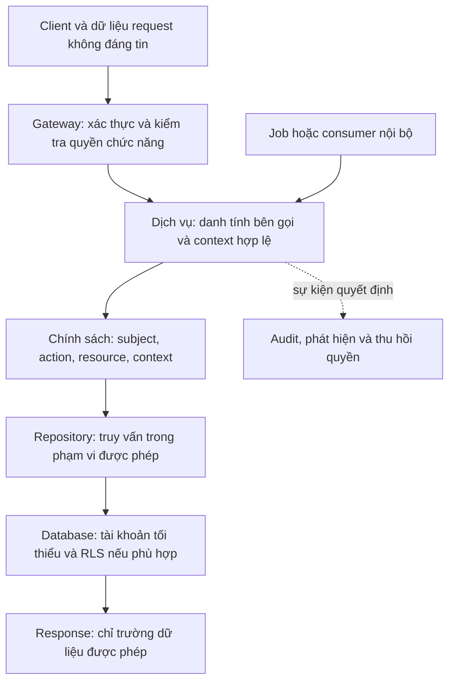

# Defense in depth cho authorization

## 1. Mục tiêu và tình huống xuất phát

Một ứng dụng quản lý hóa đơn có ba thành phần: giao diện web, API gateway và dịch vụ hóa đơn. Người dùng Lan đã đăng nhập, thuộc doanh nghiệp A và được xem những hóa đơn mình phụ trách. Trên giao diện, Lan chỉ thấy nút xem của các hóa đơn đó.

Giả sử Lan thay ID trong đường dẫn từ hóa đơn của mình sang hóa đơn của doanh nghiệp B. Gateway nhận thấy access token hợp lệ và cho request đi qua. Dịch vụ chạy `findById(id)` rồi trả toàn bộ bản ghi. Hệ thống có đăng nhập, token, gateway và giao diện phân quyền, nhưng dữ liệu vẫn bị lộ.

Vấn đề nằm ở chỗ các thành phần chưa cùng bảo vệ đúng hành động trên đúng tài nguyên. Token hợp lệ chỉ là một đầu vào của quyết định. Giao diện không phải ranh giới tin cậy. Gateway thường không có đầy đủ dữ liệu về chủ sở hữu và trạng thái hóa đơn.

Defense in depth cho authorization là thiết kế nhiều lớp kiểm soát có vai trò rõ ràng để một sai sót tại một điểm không lập tức mở toàn bộ đường tới tài nguyên. Những lớp này có thể ngăn truy cập, giới hạn phạm vi thiệt hại hoặc giúp phát hiện và thu hồi quyền khi có sự cố.

Sau bài học, người học cần có khả năng:

- Phân biệt kiểm tra danh tính, kiểm tra quyền ở cửa vào, quyền trên đối tượng và giới hạn ở tầng dữ liệu.
- Chọn nơi thực thi cho từng quy tắc, đồng thời nhận ra các đường đi có thể bỏ qua nơi đó.
- Kết hợp RBAC, ABAC hoặc ReBAC với các lớp bảo vệ mà không sao chép chính sách tùy tiện.
- Giải thích hành vi khi thiếu dữ kiện, policy engine lỗi, quyền bị thu hồi hoặc tác vụ chạy bất đồng bộ.
- Thiết kế ví dụ kiểm tra quyền trong Java và các phép kiểm chứng cho từng lớp.

Các tình huống, bảng phân quyền và mã minh họa dưới đây là thiết kế giả định phục vụ học tập; chúng không mô tả cấu hình sẵn có của một sản phẩm cụ thể.

## 2. Mô hình quyền và chiều sâu bảo vệ giải quyết hai câu hỏi khác nhau

RBAC mô tả quyền gắn với vai trò. ABAC mô tả quyết định dựa trên thuộc tính. ReBAC mô tả quyền dựa trên quan hệ. Defense in depth mô tả cách các quyết định và giới hạn được bố trí trong hệ thống, kể cả khi có lỗi hoặc có một thành phần bị xâm nhập.

Một hệ thống dùng ABAC vẫn có thể chỉ kiểm tra tại gateway rồi để dịch vụ nội bộ truy cập mọi dữ liệu. Ngược lại, một hệ thống RBAC đơn giản vẫn có thể bảo vệ nhiều lớp nếu dịch vụ kiểm tra hành động, truy vấn giới hạn tenant và tài khoản chạy ứng dụng chỉ có quyền cần thiết.

Với tình huống hóa đơn, có thể chia câu hỏi như sau:

| Câu hỏi | Ví dụ dữ kiện | Nơi có thể đánh giá |
| --- | --- | --- |
| Bên gọi là ai? | Danh tính người dùng và workload đã được xác thực | Bộ phận xác thực tại ranh giới nhận request |
| Bên gọi có thể dùng chức năng này không? | Scope `invoice:read` | Gateway và dịch vụ nhận API |
| Người dùng thuộc tenant nào? | Membership đã được hệ thống xác nhận | Dịch vụ hoặc nguồn thuộc tính quyền |
| Có được xem hóa đơn cụ thể này không? | Tenant của hóa đơn, người phụ trách, quyền xem toàn tenant | Chính sách nghiệp vụ tại dịch vụ |
| Có được trả trường dữ liệu này không? | Quyền xem thông tin thanh toán nhạy cảm | Lớp dựng response hoặc truy vấn cột phù hợp |
| Khi ứng dụng có lỗi, tài khoản DB có thể làm gì? | Quyền trên bảng, schema và hàng | Cơ sở dữ liệu và cấu hình workload |

Các kiểm soát bắt buộc trên một đường thực thi thường kết hợp theo điều kiện đồng thời:

```text
được thực hiện hành động
    = danh tính hợp lệ
      AND chức năng được phép
      AND tài nguyên thuộc phạm vi được phép
      AND điều kiện nghiệp vụ được thỏa mãn
      AND các nghĩa vụ bắt buộc đã được áp dụng
```

Công thức này mô tả thiết kế giả định của bài học. Nó không khẳng định mọi policy engine đều kết hợp các rule bằng `AND`: bên trong một chính sách, các quyền thay thế hợp lệ có thể kết hợp bằng `OR`, và cách xử lý xung đột phải được định nghĩa riêng. Điều cần tránh là cho phép một tầng sau vô hiệu hóa việc từ chối bắt buộc của tầng trước.

## 3. Đặt các lớp quanh tài nguyên và ranh giới tin cậy

### 3.1. Một đường truy cập điển hình



Sơ đồ cho thấy job nội bộ cũng đi qua lớp dịch vụ có kiểm soát. Nếu job gọi thẳng repository có quyền rộng, nhánh này có thể bỏ qua policy dù mọi request HTTP đều đã được bảo vệ.

Một lớp đáng tin cần có ba thuộc tính:

1. Có thông tin đủ tin cậy để quyết định phần việc của mình.
2. Bao phủ những đường đi cần được bảo vệ, hoặc có cơ chế đóng các đường vòng.
3. Có hành vi xác định khi thiếu dữ liệu, xảy ra lỗi hoặc nhận quyết định không hợp lệ.

### 3.2. Độ độc lập quan trọng hơn số lượng kiểm tra

Giả sử gateway, controller và service đều tin vào cùng một header `X-Role: ADMIN` do client gửi. Có ba lần so sánh chuỗi, nhưng chỉ một giả định sai: tin dữ liệu phân quyền do người yêu cầu tự khai báo. Cả ba lớp có thể bị vượt qua cùng lúc.

Một thiết kế hữu ích hơn là gateway kiểm tra token theo cấu hình tin cậy, dịch vụ lấy membership từ nguồn được quản lý, truy vấn luôn giới hạn tenant và tài khoản DB không được tự cấp thêm quyền. Mỗi lớp chặn một nhóm lỗi khác nhau.

Độ độc lập cũng có giới hạn. RLS sử dụng tenant context do cùng tiến trình ứng dụng đặt có thể chặn lỗi quên điều kiện truy vấn, nhưng không nhất thiết ngăn được kẻ đã chiếm tiến trình và có thể thay đổi context đó. Khi đánh giá một lớp, phải nêu rõ nó chống lỗi lập trình, tài khoản bị lộ hay toàn bộ workload bị kiểm soát.

### 3.3. Quan hệ với zero trust

NIST SP 800-207 nêu rằng vị trí trong mạng hoặc quyền sở hữu thiết bị không tự tạo ra sự tin cậy. Từ nguyên tắc đó, một kết luận thiết kế cho ví dụ này là lời gọi từ subnet nội bộ vẫn cần danh tính và quyết định quyền phù hợp tại dịch vụ. Đây là cách vận dụng nguyên tắc, không phải yêu cầu phải triển khai một bộ sản phẩm riêng. [Nguồn: NIST SP 800-207](https://csrc.nist.gov/pubs/sp/800/207/final).

## 4. Phân công trách nhiệm cho từng lớp

### 4.1. Giao diện: thể hiện khả năng thao tác

Giao diện có thể ẩn chức năng không phù hợp, giải thích vì sao người dùng chưa có quyền và tránh tạo các thao tác chắc chắn bị từ chối. Tuy nhiên, API vẫn phải xử lý một request được tạo ngoài giao diện.

Trong ví dụ, việc ẩn nút xuất hóa đơn giúp Lan hiểu khả năng của tài khoản. Nó không chứng minh rằng `POST /invoice-exports` đã an toàn. Kiểm tra thực tế phải gửi request trực tiếp tới API với một tài khoản không có quyền xuất.

### 4.2. Gateway: loại bỏ request không đạt điều kiện chung

Gateway phù hợp với việc kiểm tra đường vào, phương thức HTTP, token và quyền chức năng ở mức tổng quát. Dịch vụ vẫn cần kiểm tra đối tượng và điều kiện nghiệp vụ. OWASP mô tả gateway và kiểm soát tại dịch vụ là các phần bổ sung cho nhau; việc đi qua gateway chưa xác lập rằng thao tác downstream được phép. [Nguồn: OWASP Microservices Security](https://cheatsheetseries.owasp.org/cheatsheets/Microservices_Security_Cheat_Sheet.html).

Một cách phân công trong ví dụ:

```text
Gateway:
    GET /invoices/{id} cần access token hợp lệ và scope invoice:read.

Dịch vụ:
    người dùng đang hoạt động, thuộc tenant được chọn;
    hóa đơn thuộc tenant đó;
    người dùng phụ trách hóa đơn hoặc có quyền xem toàn tenant.
```

Nếu có thể gọi trực tiếp dịch vụ từ một mạng không được kiểm soát, rule gateway có thể bị bỏ qua. Biện pháp thiết kế gồm đóng đường vào ngoài dự kiến và để dịch vụ thực thi lại những điều kiện cần cho tài nguyên của mình. Hai việc này phải có người chịu trách nhiệm rõ ràng.

### 4.3. Ranh giới dịch vụ: xây dựng context có nguồn gốc

Trước khi policy nghiệp vụ chạy, dịch vụ phải biết các trường trong context đến từ đâu:

| Trường | Nguồn phù hợp trong ví dụ | Dữ liệu không được tự coi là chứng cứ quyền |
| --- | --- | --- |
| `userId` | Ánh xạ danh tính đã xác thực sang ID nội bộ | `userId` trong JSON của request |
| `tenantId` đang thao tác | Tenant được chọn sau khi xác nhận membership | Header tenant đứng riêng |
| `scopes` | Access token đã được kiểm tra theo contract | Chuỗi token chỉ được decode |
| `ownerId` của hóa đơn | Bản ghi hóa đơn từ kho dữ liệu | `ownerId` người dùng gửi để xin quyền |
| `callerService` | Danh tính workload đã xác thực | Tên dịch vụ tự khai trong header |
| Quyền xem toàn tenant | Nguồn cấp quyền do hệ thống quản lý | Trường `isAdmin` trong body |

Tenant trên đường dẫn hoặc header có thể là yêu cầu chọn tenant, nhưng phải được ràng buộc với membership của bên gọi. Không lấy giá trị đầu tiên tìm thấy rồi dùng nó làm phạm vi tin cậy.

Với JWT access token theo RFC 9068, resource server phải kiểm tra theo profile, bao gồm kiểu token, issuer, audience, chữ ký và thời hạn; chữ ký hợp lệ riêng lẻ chưa đủ. Phải phân biệt access token với ID token. Những quy tắc này bảo vệ đầu vào danh tính trước khi áp dụng policy của ứng dụng. [Nguồn: RFC 9068, mục 4](https://www.rfc-editor.org/rfc/rfc9068.html#section-4).

### 4.4. Lớp nghiệp vụ: quyết định trên hành động và tài nguyên thật

Policy nghiệp vụ xử lý câu hỏi gần nhất với mục đích truy cập. Chẳng hạn, `invoice:read` cho phép yêu cầu chức năng đọc; policy vẫn cần biết hóa đơn nào đang được đọc.

Một quyết định có thể dựa trên:

- RBAC: vai trò kế toán có permission đọc hóa đơn trong tenant.
- ABAC: tài khoản đang hoạt động và hóa đơn có độ nhạy phù hợp.
- ReBAC: người dùng được phân công phụ trách hóa đơn.
- Điều kiện nghiệp vụ: chỉ người có quyền điều chỉnh mới được sửa hóa đơn đã phát hành.

Không nhất thiết dùng đủ ba mô hình. Hãy chọn biểu diễn phù hợp với quan hệ quyền thực tế, rồi đặt việc thực thi ở nơi mọi thao tác được bảo vệ đều đi qua.

### 4.5. Repository và database: thu hẹp phạm vi dữ liệu

Một phương thức `findByTenantAndId(tenantId, invoiceId)` diễn đạt phạm vi rõ hơn `findById(invoiceId)` trong hệ thống đa tenant. Nó giảm nguy cơ lấy nhầm bản ghi khác tenant trước khi kiểm tra tiếp các điều kiện trong tenant.

Phạm vi truy vấn có thể cần thêm điều kiện chủ sở hữu, quan hệ hoặc tập ID được policy cho phép. Chỉ lọc tenant không đủ khi hai người trong cùng tenant có quyền khác nhau.

RLS là một lựa chọn bổ sung. Trong PostgreSQL, cần chú ý các ngoại lệ: superuser và role có `BYPASSRLS` bỏ qua RLS; chủ bảng thường cũng bỏ qua nếu không áp dụng cấu hình phù hợp. RLS không bao phủ mọi loại thao tác như `TRUNCATE`. Vì vậy kiểm chứng bằng tài khoản ứng dụng thực tế có ý nghĩa hơn kiểm chứng bằng tài khoản quản trị. [Nguồn: PostgreSQL Row Security Policies](https://www.postgresql.org/docs/current/ddl-rowsecurity.html).

Tài khoản chạy dịch vụ trong ví dụ chỉ nên có quyền dữ liệu cần thiết. Tài khoản migration có thể cần thay đổi schema, nhưng không vì thế mà tiến trình xử lý request cũng nhận cùng quyền đó.

### 4.6. Đầu ra: giới hạn cả hàng và trường

Quyền đọc một hóa đơn chưa mặc nhiên cho phép xem mọi trường liên quan. Một màn hình có thể được xem tổng tiền và trạng thái nhưng không được xem số tài khoản nhận tiền hoặc ghi chú điều tra.

Lớp response nên tạo kiểu dữ liệu thể hiện đúng tập trường được trả. Tránh serialize nguyên entity rồi hy vọng client tự ẩn dữ liệu nhạy cảm. Với truy vấn lớn, chọn cột từ đầu còn giúp giảm lượng dữ liệu nhạy cảm đi qua bộ nhớ và các thành phần trung gian.

## 5. Chính sách thống nhất, thực thi tại các nơi cần thiết

Hai thuật ngữ hữu ích khi tổ chức authorization:

- **PDP — Policy Decision Point:** thành phần đánh giá chính sách và trả quyết định.
- **PEP — Policy Enforcement Point:** thành phần dùng quyết định để cho phép, từ chối hoặc áp dụng nghĩa vụ như giới hạn trường dữ liệu.

PDP có thể là một thư viện trong ứng dụng hoặc một dịch vụ riêng. PEP có thể nằm tại API, lớp nghiệp vụ hoặc nơi truy cập dữ liệu. Một PDP dùng chung không tự bảo đảm rằng mọi đường gọi đều có PEP.

Giả sử cả REST API và consumer hàng đợi đều gọi `InvoiceService.readInvoice`. Nếu việc kiểm tra tài nguyên nằm trong phương thức dịch vụ đó, hai đường đi có thể dùng chung chính sách. Nếu chỉ controller HTTP có kiểm tra, consumer sẽ có đường vòng.

Khi dùng nhiều PEP, nên phân định:

| Thành phần | Quy tắc sở hữu trong ví dụ | Dữ liệu để điều tra |
| --- | --- | --- |
| Gateway | Contract token và scope của route | Route, issuer được chấp nhận, kết quả xác thực |
| InvoiceService | Quyền trên hóa đơn và trạng thái nghiệp vụ | Action, resource ID, reason code, phiên bản policy |
| Repository | Hợp đồng truy vấn luôn có phạm vi | Loại truy vấn và tenant context |
| Database | Giới hạn quyền của role và RLS nếu có | Role thực thi, policy dữ liệu áp dụng |
| Response mapper | Tập trường được công bố | Loại view hoặc nghĩa vụ che trường |

Không sao chép toàn bộ danh sách vai trò vào gateway, controller, service và SQL rồi cập nhật từng nơi bằng tay. Các bản sao có thể lệch nhau khi phát sinh quyền mới hoặc khi thu hồi quyền cũ.

Có thể dùng chung policy và bộ dữ liệu kiểm chứng, đồng thời giữ các giới hạn bổ sung ở tầng khác: chẳng hạn policy xác định quyền xem hóa đơn, còn DB giới hạn tenant và đặc quyền. Cần kiểm tra cả trường hợp hệ thống từ chối nhầm người có quyền, vì xung đột giữa các lớp cũng tạo lỗi vận hành.

## 6. Ví dụ Java: kiểm tra chức năng, đối tượng và đầu ra

### 6.1. Quy tắc của ví dụ

Đối với `READ_INVOICE`, thiết kế giả định yêu cầu:

1. Caller context được tạo từ quá trình xác thực đáng tin cậy.
2. Người dùng đang hoạt động và membership của tenant còn hiệu lực.
3. Caller có scope `invoice:read`.
4. Hóa đơn thuộc tenant của context.
5. Caller là người phụ trách hóa đơn hoặc có quyền đọc toàn tenant.
6. Chỉ trả `InvoiceView` đã chọn trường.

Các kiểu và lớp bên dưới minh họa logic Java 17 trở lên. Những interface kho dữ liệu cần có triển khai của ứng dụng; đây không phải một cấu hình framework hoàn chỉnh. Việc kiểm tra token, nạp dữ kiện quyền với độ mới yêu cầu và xuất audit là trách nhiệm tích hợp được nêu rõ bên ngoài đoạn mã.

### 6.2. Policy không nhận thuộc tính quyền từ request body

```java
import java.math.BigDecimal;
import java.util.Objects;
import java.util.Optional;
import java.util.Set;
import java.util.UUID;

record CallerContext(UUID userId, UUID tenantId, Set<String> scopes) {
    CallerContext {
        Objects.requireNonNull(userId);
        Objects.requireNonNull(tenantId);
        scopes = Set.copyOf(scopes);
    }
}

// Nạp từ nguồn quyền được quản lý, không bind trực tiếp từ JSON client.
record AccessFacts(
        boolean activeUser,
        boolean currentTenantMember,
        boolean readAllInvoices) {
}

record Invoice(
        UUID id,
        UUID tenantId,
        UUID ownerId,
        String status,
        BigDecimal total) {
}

enum Decision {
    PERMIT,
    ACCOUNT_DISABLED,
    TENANT_MEMBERSHIP_REQUIRED,
    MISSING_SCOPE,
    TENANT_MISMATCH,
    RESOURCE_ACCESS_DENIED
}

final class InvoicePolicy {
    Decision canRead(CallerContext caller, AccessFacts facts, Invoice invoice) {
        if (!facts.activeUser()) {
            return Decision.ACCOUNT_DISABLED;
        }
        if (!facts.currentTenantMember()) {
            return Decision.TENANT_MEMBERSHIP_REQUIRED;
        }
        if (!caller.scopes().contains("invoice:read")) {
            return Decision.MISSING_SCOPE;
        }
        if (!caller.tenantId().equals(invoice.tenantId())) {
            return Decision.TENANT_MISMATCH;
        }

        boolean owner = caller.userId().equals(invoice.ownerId());
        if (!owner && !facts.readAllInvoices()) {
            return Decision.RESOURCE_ACCESS_DENIED;
        }
        return Decision.PERMIT;
    }
}
```

`readAllInvoices` có nghĩa là quyền đọc toàn bộ hóa đơn **trong tenant đã chọn**, không phải quyền xuyên tenant. `AccessFacts` phải được nạp bằng cả `userId` và `tenantId`; nếu chỉ tra quyền theo người dùng rồi bỏ qua tenant, ý nghĩa này bị phá vỡ.

Nhánh trả `PERMIT` chỉ xuất hiện sau khi các điều kiện bắt buộc đều đạt. Danh tính nội bộ `userId` phải ánh xạ đúng namespace của nhà phát hành danh tính; không tùy tiện coi cùng chuỗi `sub` từ các issuer khác nhau là cùng một người.

### 6.3. Service giữ kiểm tra tài nguyên trên đường dùng chung

```java
interface InvoiceRepository {
    Optional<Invoice> findByTenantAndId(UUID tenantId, UUID invoiceId);
}

interface AccessFactsProvider {
    // Phải nạp facts đúng tenant và thỏa contract về độ mới.
    // Không lấy được dữ kiện bắt buộc thì phải báo lỗi.
    AccessFacts load(UUID userId, UUID tenantId);
}

record InvoiceView(UUID id, String status, BigDecimal total) {
}

final class ResourceUnavailableException extends RuntimeException {
}

final class InvoiceService {
    private final InvoiceRepository repository;
    private final AccessFactsProvider factsProvider;
    private final InvoicePolicy policy;

    InvoiceService(
            InvoiceRepository repository,
            AccessFactsProvider factsProvider,
            InvoicePolicy policy) {
        this.repository = repository;
        this.factsProvider = factsProvider;
        this.policy = policy;
    }

    InvoiceView readInvoice(CallerContext caller, UUID invoiceId) {
        Objects.requireNonNull(caller);
        Objects.requireNonNull(invoiceId);

        AccessFacts facts = Objects.requireNonNull(
                factsProvider.load(caller.userId(), caller.tenantId()));

        Invoice invoice = repository
                .findByTenantAndId(caller.tenantId(), invoiceId)
                .orElseThrow(ResourceUnavailableException::new);

        Decision decision = policy.canRead(caller, facts, invoice);
        if (decision != Decision.PERMIT) {
            // Reason code được ghi ở audit nội bộ khi tích hợp.
            throw new ResourceUnavailableException();
        }

        return new InvoiceView(invoice.id(), invoice.status(), invoice.total());
    }
}
```

Trong thiết kế này, lớp ngoài có thể ánh xạ `ResourceUnavailableException` thành một phản hồi không phân biệt tài nguyên không tồn tại với tài nguyên người dùng không được xem. Chọn 403 hay 404 cần theo contract API và yêu cầu tránh lộ sự tồn tại; reason code chi tiết chỉ dùng ở phía có quyền điều tra.

Đoạn mã có các lớp giới hạn khác nhau:

- Repository chỉ tìm trong tenant được xác nhận.
- Policy vẫn xác nhận tenant, nên một lỗi triển khai repository trả sai tenant có thể bị chặn.
- Policy kiểm tra tiếp quyền trên đối tượng trong cùng tenant.
- View chỉ trả các trường đã chọn.

Nếu `factsProvider` lỗi, phương thức không chạy đến phần trả dữ liệu. Không thêm khối `catch` chuyển lỗi đó thành `readAllInvoices = true`. Lớp xử lý lỗi cần trả tình trạng dịch vụ phù hợp, tránh biến lỗi hạ tầng thành một quyền mới.

Ví dụ đọc dữ liệu chưa giải quyết mọi yêu cầu về nhất quán. Facts và hóa đơn có thể thay đổi sau khi được nạp. Nếu nghiệp vụ yêu cầu thu hồi tức thời hoặc cập nhật nhạy cảm, phải bổ sung mô hình nhất quán như phần tiếp theo; chỉ đặt hai lệnh đọc cạnh nhau không tạo ra một snapshot chung.

## 7. Tính nhất quán: quyền phải đúng lúc hành động xảy ra

### 7.1. Khoảng cách giữa kiểm tra và sử dụng

Một lỗi TOCTOU — time of check to time of use — có thể xuất hiện khi kiểm tra trạng thái rồi cập nhật sau đó:

```text
t0: Đọc hóa đơn; trạng thái là DRAFT và Lan đang phụ trách.
t1: Policy cho phép chỉnh sửa bản nháp.
t2: Một giao dịch khác phát hành hóa đơn hoặc chuyển người phụ trách.
t3: Request cũ cập nhật hóa đơn chỉ theo ID.
```

Quyết định tại `t1` không đủ để chứng minh cập nhật tại `t3` còn phù hợp. Một phương án trong ví dụ là optimistic concurrency kết hợp điều kiện nghiệp vụ trong lệnh cập nhật:

```sql
UPDATE invoice
SET description = :description,
    version = version + 1
WHERE id = :invoice_id
  AND tenant_id = :tenant_id
  AND owner_id = :user_id
  AND status = 'DRAFT'
  AND version = :expected_version;
```

Đây là SQL minh họa cho nhánh chỉ người phụ trách được sửa bản nháp. Các tham số dùng binding của driver hoặc thư viện dữ liệu, không nối chuỗi. Nếu không có hàng nào được cập nhật, ứng dụng phải xử lý như thao tác chưa thực hiện; không tự thử lại bằng câu lệnh bỏ điều kiện.

Phiên bản và các điều kiện trên bảo vệ những thuộc tính xuất hiện trong chính câu lệnh. Chúng không tự khóa membership hoặc policy ở một hệ thống khác. Với quyền nằm ngoài DB, cần xác định riêng cửa sổ thu hồi chấp nhận được, cơ chế xác nhận gần thời điểm thực thi hoặc giao thức nghiệp vụ phù hợp.

Khóa hàng trong transaction cũng là một lựa chọn cho một số thao tác, nhưng phải bao phủ đúng dữ liệu cần giữ ổn định và có quy ước cập nhật tương ứng. Việc thêm transaction không tự giải quyết mọi race condition giữa nhiều nguồn quyền.

### 7.2. Quyền và kết quả cache có độ mới khác nhau

Thiết kế giả định đặt hai yêu cầu:

- Đọc hóa đơn thông thường cho phép dữ kiện quyền chậm tối đa 30 giây.
- Xuất dữ liệu nhạy cảm yêu cầu kiểm tra trạng thái cấp quyền tại thời điểm bắt đầu thực thi, và kiểm tra lại trước khi phát hành tệp nếu tác vụ chạy lâu.

Các con số và mốc kiểm tra này là lựa chọn minh họa, không phải giá trị tiêu chuẩn cho mọi hệ thống.

Khóa cache cho một quyết định cần phản ánh các yếu tố mà policy sử dụng. Chẳng hạn:

```text
subject + tenant + action + resource
        + phiên bản quan hệ/quyền
        + phiên bản policy
        + thuộc tính context có ảnh hưởng
```

Chỉ dùng `resourceId` làm khóa có thể khiến quyết định của người này được tái sử dụng cho người khác. Chỉ dùng vai trò cũng có thể bỏ qua tenant hoặc quan hệ sở hữu. Nếu dùng version để vô hiệu hóa cache, phải có cơ chế đáng tin cậy để biết version đã thay đổi; thêm tên trường version vào khóa mà không cập nhật nó không giúp thu hồi quyền.

Token còn hạn cũng không tự chứng minh membership vẫn còn hiệu lực. Cần lựa chọn thời hạn token, dữ kiện quyền phía server và cơ chế vô hiệu hóa sao cho đáp ứng yêu cầu thu hồi của hành động.

## 8. Lời gọi nội bộ, ủy quyền và tác vụ bất đồng bộ

### 8.1. Giữ riêng người yêu cầu và dịch vụ thực thi

Giả sử `report-service` yêu cầu `invoice-service` đọc hóa đơn thay cho Lan. Có ít nhất hai danh tính cần quan tâm:

```text
Người khởi tạo: Lan.
Workload đang gọi: report-service.
Hành động: đọc hóa đơn phục vụ một báo cáo cụ thể.
Phạm vi: tenant A và tập hóa đơn được phép.
```

Trong mô hình ủy quyền của ví dụ, yêu cầu chỉ được thực thi nếu Lan có quyền trên dữ liệu, `report-service` được phép thực hiện chức năng đó và phạm vi ủy quyền hợp lệ. Không lấy hợp quyền của hai bên, vì quyền kỹ thuật rộng của workload có thể làm tăng quyền của người yêu cầu.

mTLS giúp xác thực các bên kết nối, nhưng không tự chứng minh Lan được đọc hóa đơn đang yêu cầu. Tương tự, một assertion có chữ ký bảo vệ tính toàn vẹn của context, nhưng bên nhận vẫn phải đánh giá quyền theo ngữ nghĩa đã thống nhất. [Nguồn: OWASP Microservices Security](https://cheatsheetseries.owasp.org/cheatsheets/Microservices_Security_Cheat_Sheet.html).

Để giảm nguy cơ confused deputy, context ủy quyền trong ví dụ phải ràng buộc với đúng dịch vụ nhận, hành động, tenant, tài nguyên hoặc phạm vi và thời hạn. Không chuyển tiếp một header nhận diện người dùng tự do rồi cho mọi dịch vụ nội bộ diễn giải nó là quyền quản trị.

Với một workload chạy độc lập, không có người dùng ủy quyền, phải định nghĩa policy cho chính workload đó. Không tạo người dùng giả chỉ để vượt qua kiểm tra bắt buộc của một API dành cho người dùng.

### 8.2. Hàng đợi tạo thêm khoảng cách thời gian

Một yêu cầu xuất báo cáo được chấp nhận lúc 09:00, nhưng worker bắt đầu chạy lúc 09:20. Nếu Lan bị thu hồi quyền lúc 09:10, việc từng được phép tạo job không nhất thiết cho phép xuất dữ liệu lúc 09:20.

Một luồng thiết kế cho ví dụ:

1. Khi tạo job, kiểm tra quyền yêu cầu xuất và lưu danh tính khởi tạo cùng phạm vi dự kiến.
2. Consumer xác thực nguồn thông điệp và danh tính workload của mình.
3. Khi chạy, nạp lại dữ kiện quyền cần thiết theo contract về độ mới.
4. Tạo dữ liệu trong phạm vi đã được cho phép, không nâng phạm vi theo quyền rộng của consumer.
5. Trước khi giao tệp, kiểm tra điều kiện phát hành và quyền nhận tệp theo policy.
6. Ghi kết quả và xử lý retry bằng cơ chế idempotency đã định nghĩa.

Không coi trường `approved: true` trong một thông điệp là chứng cứ đầy đủ. Nếu nghiệp vụ dùng một grant bền vững để tác vụ tiếp tục sau khi người tạo mất quyền, grant đó phải được cấp và quản lý có chủ đích: phạm vi, thời hạn, khả năng thu hồi và người có quyền tạo grant đều cần rõ ràng.

Retry cũng không miễn kiểm tra quyền. Tuy nhiên, retry phải tôn trọng trạng thái nghiệp vụ đã thực hiện: tránh thực hiện lại một giao dịch thành công chỉ vì bước gửi kết quả trước đó lỗi.

## 9. Bao phủ những đường đọc và ghi thường bị bỏ sót

Kiểm tra một API chi tiết là chưa đủ khi cùng tài nguyên còn xuất hiện ở tìm kiếm, xuất tệp và công cụ quản trị.

| Đường truy cập | Lỗi có thể xảy ra trong ví dụ | Kiểm soát cần bố trí |
| --- | --- | --- |
| Đọc theo ID | Thay ID để xem hóa đơn khác | Kiểm tra đối tượng và tenant |
| Danh sách, tìm kiếm | Trả hóa đơn ngoài phạm vi hoặc tổng số nhạy cảm | Lọc quyền trước phân trang và tính tổng |
| Bulk update | Một ID hợp lệ che lẫn nhiều ID không có quyền | Kiểm tra từng tài nguyên hoặc truy vấn bảo đảm toàn phạm vi |
| GraphQL hoặc resolver khác | Resolver phụ truy cập repository trực tiếp | Dùng đường dịch vụ có policy và kiểm soát trường |
| Export | Endpoint chi tiết đúng quyền nhưng xuất toàn bảng | Policy xuất riêng và truy vấn dữ liệu có phạm vi |
| Tệp trong object storage | Biết URL là tải được tài liệu | Quyền trên object và cơ chế cấp quyền tải phù hợp |
| WebSocket hoặc subscription | Mất quyền nhưng tiếp tục nhận dữ liệu | Policy khi đăng ký và cơ chế cập nhật/đóng luồng |
| Trang quản trị | Vai trò quản trị tenant bị hiểu thành quản trị toàn hệ thống | Tách loại quyền và phạm vi quản trị |
| Công cụ support | Nhân viên hỗ trợ có quyền xem mọi tenant lâu dài | Cấp quyền có thời hạn và phạm vi ca hỗ trợ |

Với danh sách, lọc trong bộ nhớ sau khi đã lấy một trang từ toàn bảng có thể làm sai phân trang và bỏ sót việc giới hạn tổng số. Nên đẩy phạm vi xuống truy vấn hoặc dùng cơ chế truy vấn có hiểu quyền. Nếu có nhiều nguồn dữ liệu, cần xác định chính xác nguồn nào chịu trách nhiệm lọc.

Với bulk operation, phải chọn trước hành vi khi một phần tài nguyên bị từ chối. Có thể từ chối toàn bộ hoặc trả kết quả từng phần theo contract. Không trả trạng thái thành công chung trong khi một phần thao tác vượt quyền đã được thực hiện.

Với URL ký sẵn, trong thiết kế bearer URL, bất kỳ ai giữ URL còn hiệu lực đều có thể sử dụng trong giới hạn của URL. Vì thế cần cân nhắc phạm vi object, thời hạn, khả năng chia sẻ và yêu cầu kiểm tra lại quyền. Việc API phát hành URL đúng quyền không đồng nghĩa mọi lượt tải sau đó đều kiểm tra quyền hiện tại của người dùng.

## 10. Hành vi khi một lớp không thể quyết định

OWASP khuyến nghị mặc định từ chối và kiểm tra quyền trên mọi request được bảo vệ. Khi áp dụng vào hệ thống nhiều lớp, điều đó đòi hỏi phân biệt rõ quyết định từ chối với lỗi không đủ dữ kiện; cả hai đều không được tự chuyển thành cho phép hành động đang cần chứng cứ quyền. [Nguồn: OWASP Authorization Cheat Sheet](https://cheatsheetseries.owasp.org/cheatsheets/Authorization_Cheat_Sheet.html).

| Tình huống | Hành vi trong thiết kế giả định | Điều không được suy diễn |
| --- | --- | --- |
| Thiếu membership bắt buộc | Chặn thao tác cần membership | Tenant trên URL là bằng chứng membership |
| Policy engine timeout | Không thực hiện hành động được bảo vệ; trả lỗi dịch vụ phù hợp | Timeout tương đương `PERMIT` |
| Quyết định chứa action hoặc resource khác | Bỏ quyết định, chặn thao tác | Chỉ cần chữ `PERMIT` là đủ |
| Cache quyền đã quá hạn | Nạp dữ kiện mới hoặc chặn theo contract | Giá trị cũ luôn tốt hơn từ chối |
| Không dựng được view đã che trường | Không trả entity nguyên bản | Chỉ cần UI không hiển thị trường nhạy cảm |
| Không thiết lập được tenant context của DB | Không chạy truy vấn cần context | Chuyển sang tenant mặc định hoặc toàn hệ thống |

Nếu có cơ chế vận hành khi PDP trung tâm gián đoạn, ví dụ dùng bản policy đã ký và đồng bộ sẵn tại dịch vụ, thì đó phải là chế độ được thiết kế và kiểm chứng trước. Tính hợp lệ, độ mới, phạm vi hành động và điều kiện dừng phải rõ. Không gọi một nhánh `catch -> allow` là cơ chế bảo đảm sẵn sàng.

Đối với tài nguyên công khai, quyền công khai phải được mô tả bằng rule rõ ràng. Nó không phải đường dự phòng tự bật khi hệ thống không xác định được người dùng.

## 11. Audit, phát hiện và vòng đời quyền

Các lớp phòng ngừa có thể vẫn gặp lỗi, vì vậy cần lưu dấu quyết định đủ để điều tra. Một bản ghi minh họa:

```json
{
  "event": "authorization_decision",
  "requestId": "req-example-001",
  "subjectId": "user-lan",
  "callerWorkload": "invoice-api",
  "tenantId": "tenant-a",
  "action": "invoice.read",
  "resourceId": "invoice-example-017",
  "decision": "DENY",
  "reasonCode": "RESOURCE_ACCESS_DENIED",
  "policyVersion": "invoice-policy-example-v3",
  "enforcementPoint": "InvoiceService.readInvoice"
}
```

Các ID trong ví dụ là dữ liệu giả. Khi triển khai, phải kiểm soát quyền đọc audit, thời gian lưu và mức độ nhận diện cần thiết. Không ghi access token, thông tin xác thực hoặc toàn bộ hóa đơn chỉ để hỗ trợ truy vết. Reason code nội bộ không nhất thiết phù hợp để đưa ra response công khai.

Phát hiện có thể tập trung vào mẫu hành vi như nhiều lần yêu cầu hóa đơn khác tenant, một workload đột ngột gọi action chưa từng dùng hoặc số lượng bản ghi xuất tăng bất thường. Ngưỡng cần được hiệu chỉnh theo hệ thống; không xem mỗi lần bị từ chối là một cuộc tấn công.

Vòng đời quyền hoàn chỉnh còn cần:

- Thu hồi membership khi người dùng rời doanh nghiệp hoặc đổi trách nhiệm.
- Hết hạn quyền hỗ trợ tạm thời và quyền đặc biệt.
- Xóa quyền workload không còn dùng sau khi tách dịch vụ.
- Đồng bộ thay đổi tới cache, token hoặc grant theo thời hạn thu hồi đã cam kết.
- Rà soát quyền quản trị và quyền truy cập trực tiếp kho dữ liệu.

Audit giúp phát hiện và khôi phục kiểm soát; nó không ngăn dữ liệu bị đọc sai trong một request đã được cho phép. Với một số thao tác nhạy cảm, nghiệp vụ có thể yêu cầu lưu audit bền vững trước hoặc cùng giao dịch. Khi đó phải thiết kế cơ chế như transactional outbox và hành vi khi không lưu được. Không mặc định mọi sự cố hệ thống log đều phải làm dừng mọi API, cũng không mặc định mọi thao tác được phép bỏ qua audit.

## 12. Kiểm chứng từng lớp và khả năng chống đường vòng

### 12.1. Ma trận kiểm chứng cho ví dụ hóa đơn

| Ca kiểm chứng | Kết quả mong đợi | Lớp cần quan sát |
| --- | --- | --- |
| Lan xem hóa đơn mình phụ trách trong tenant A | Trả đúng view được phép | Luồng hợp lệ từ API tới đầu ra |
| Lan có scope nhưng xem hóa đơn người khác trong tenant A | Từ chối nếu không có quyền đọc toàn tenant | Policy trên đối tượng |
| Lan thay ID sang tenant B | Không nhận dữ liệu tenant B | Repository và kiểm tra tenant |
| Token có chữ ký hợp lệ nhưng sai audience | Từ chối trước nghiệp vụ | Xác thực token tại ranh giới |
| Client tự thêm `X-Role: ADMIN` | Không làm thay đổi quyền | Xây dựng context |
| Bỏ qua UI và gọi endpoint export | Vẫn kiểm tra quyền xuất | API và service xuất |
| Gọi service bằng đường nội bộ được phép trong môi trường kiểm thử | Vẫn có kiểm tra quyền tài nguyên | Ranh giới service |
| Dữ kiện quyền không tải được | Không trả hóa đơn | Xử lý lỗi của provider và PEP |
| Quyền Lan bị thu hồi trước khi export job chạy | Job tuân theo policy thực thi đã định nghĩa | Consumer, cache và vòng đời grant |
| Connection pool chuyển từ tenant A sang B | Không dùng lại context tenant A | Quản lý context DB |
| Đọc entity có trường nhạy cảm | Response chỉ chứa trường của view | Mapper hoặc truy vấn cột |

Không chỉ kiểm tra HTTP status. Phải kiểm tra response body, dữ liệu đã thay đổi hay chưa, tác vụ phụ đã được tạo hay chưa và dấu vết quyết định. Một API trả 403 sau khi đã cập nhật dữ liệu vẫn là lỗi authorization.

### 12.2. Chủ động vô hiệu hóa một lớp trong môi trường thử nghiệm

Để biết chiều sâu có tác dụng, có thể tạo lỗi có kiểm soát trong môi trường kiểm thử:

- Cho repository giả lập trả nhầm hóa đơn khác tenant, xem policy còn chặn được không.
- Bỏ rule scope tại gateway trong một cấu hình thử riêng, xem dịch vụ còn giữ điều kiện cần không.
- Đặt cache quyết định sai subject, xem bộ kiểm chứng có phát hiện rò rỉ chéo người dùng không.
- Gọi cùng use case từ consumer, xem có đường gọi repository bỏ qua service không.
- Mô phỏng PDP timeout, xem có nhánh mặc định cho phép không.

Các thử nghiệm này phải có phạm vi và dữ liệu giả phù hợp. Không vô hiệu hóa kiểm soát trên môi trường sản xuất để chứng minh kiến trúc có nhiều lớp.

Không kỳ vọng mọi lớp đều phát hiện mọi lỗi. Mapper đầu ra không thể sửa một quyết định cho phép sửa hóa đơn trái quyền; một bảng audit cũng không thể thay thế điều kiện tenant trong truy vấn. Mỗi thử nghiệm phải gắn với tuyên bố cụ thể của lớp đang đánh giá.

## 13. Những cách làm tạo cảm giác có nhiều lớp nhưng vẫn yếu

### 13.1. Chỉ đếm số lần kiểm tra

Ba lần gọi cùng một hàm với cùng dữ liệu sai có thể tạo ba kết quả sai giống nhau. Hãy xem các lớp có nguồn tin cậy, phạm vi và giả định độc lập đến đâu.

### 13.2. Dùng UUID hoặc đường dẫn khó đoán làm quyền truy cập

ID khó đoán có thể giảm khả năng dò tìm, nhưng người dùng vẫn có thể nhận ID từ liên kết, lịch sử hoặc tài liệu chia sẻ. Chính sách phải đánh giá quyền khi ID đã được biết.

### 13.3. Coi mạng nội bộ, CORS, WAF hoặc rate limit là quyền trên đối tượng

Các cơ chế này có nhiệm vụ riêng: giới hạn đường kết nối, tương tác của trình duyệt hoặc lưu lượng. Chúng không tự biết Lan có quan hệ gì với một hóa đơn cụ thể. Cần kiểm tra trực tiếp hành động và tài nguyên.

### 13.4. Cấp quyền quản trị rộng để xử lý lỗi phân quyền

Nếu một job thiếu permission, cấp role toàn quyền cho mọi consumer có thể khiến job chạy được nhưng làm tăng phạm vi thiệt hại. Trước hết phải xác định action và tập tài nguyên đúng với mục đích của job.

### 13.5. Coi RLS là bằng chứng toàn bộ ứng dụng đã an toàn

RLS giới hạn dữ liệu theo chính sách của DB, nhưng ứng dụng còn có object storage, tìm kiếm, cache, hàng đợi và dữ liệu đã xuất. Cũng cần kiểm soát context và đặc quyền của role DB. Không nên tuyên bố RLS bảo vệ một đường truy cập chưa được kiểm chứng.

### 13.6. Đặt quyền ở controller nhưng cho mọi nơi dùng repository

Kiểm soát tại controller có thể hiệu quả với đường HTTP hiện có. Khi bổ sung scheduler, CLI hoặc consumer, quyền phải tiếp tục được thực thi trên đường nghiệp vụ tương ứng. Quy ước kiến trúc và phép kiểm chứng đường gọi giúp giữ thuộc tính đó khi hệ thống mở rộng.

## 14. Bài tập thiết kế có gợi ý

### Tình huống 1: Gateway đã kiểm tra `invoice:read`

Một lập trình viên đề xuất bỏ kiểm tra quyền ở service để giảm độ trễ. Hãy nêu dữ kiện gateway còn thiếu và lỗi có thể xuất hiện.

**Gợi ý:** gateway có thể chưa biết chủ sở hữu, tenant thực của bản ghi hoặc trạng thái quyền hiện tại. Cần phân biệt chi phí kiểm tra token lặp lại với nhu cầu kiểm tra tài nguyên tại nơi có dữ kiện; không gộp hai vấn đề thành một quyết định bỏ mọi kiểm soát ở service.

### Tình huống 2: Kết quả tìm kiếm an toàn nhưng tổng số bị lộ

Endpoint trả đúng mười hóa đơn Lan được phép xem, nhưng `totalCount` được tính trên toàn doanh nghiệp B do một truy vấn khác dùng thiếu tenant. Điều gì đã sai?

**Gợi ý:** metadata của response cũng là dữ liệu cần phân quyền. Truy vấn tổng số phải cùng phạm vi quyền với tập kết quả theo contract. Cần kiểm chứng cả hàng, trường và thông tin tổng hợp.

### Tình huống 3: RLS dùng tenant context của connection pool

Request trước đặt tenant A, request sau thuộc tenant B nhưng không thiết lập lại context. Hãy mô tả điều kiện để lỗi này dẫn tới rò rỉ và cách kiểm chứng.

**Gợi ý:** xem phạm vi sống của context, việc dọn context khi trả connection và hành vi khi tenant bị thiếu. Có thể thiết kế context gắn với transaction khi DB hỗ trợ, đồng thời kiểm tra ràng buộc tenant phía ứng dụng. Phải chạy thử bằng role thực tế, không chỉ bằng tài khoản quản trị.

### Tình huống 4: Quyền bị thu hồi trong khi xuất tệp

Job đã đọc xong một phần dữ liệu thì người tạo mất quyền. Có bắt buộc tiếp tục hay dừng ngay không?

**Gợi ý:** câu trả lời phụ thuộc contract nghiệp vụ về độ mới và grant. Hãy xác định các mốc kiểm tra, xử lý tệp đã tạo, quyền nhận kết quả và hành vi retry. Tránh hứa thu hồi tức thời khi kiến trúc chỉ làm mới quyền theo khoảng thời gian.

### Tình huống 5: Service bị chiếm toàn bộ tiến trình

Hệ thống có policy trong Java và RLS lấy context do chính service đặt. Hai lớp này có bảo đảm chặn mọi truy cập chéo tenant không?

**Gợi ý:** phân tích quyền của tiến trình bị chiếm: có thể đổi context, dùng credential nào, kết nối trực tiếp được kho nào. Một giới hạn bảo vệ lỗi lập trình không tự có hiệu lực tương đương trước quyền điều khiển toàn workload. Có thể cần thêm ranh giới credential, dữ liệu hoặc tenant theo mô hình đe dọa thực tế.

## 15. Tự đánh giá một thiết kế authorization nhiều lớp

Khi đọc một sơ đồ hệ thống, hãy chọn một hành động cụ thể như xuất hóa đơn và lần theo toàn bộ đường tới dữ liệu. Với mỗi điểm kiểm soát, trả lời:

1. Nó bảo vệ chức năng, đối tượng, trường dữ liệu hay đặc quyền kỹ thuật nào?
2. Dữ kiện quyền đến từ đâu, ai có thể sửa và được phép cũ bao lâu?
3. Những đường gọi nào đi qua nó; đường nào có thể bỏ qua?
4. Nếu nó trả lỗi, thiếu dữ kiện hoặc dùng quyết định cũ thì hành động có tiếp tục không?
5. Nếu một lớp khác bị cấu hình sai, lớp này còn giữ được giới hạn gì?
6. Có bằng chứng kiểm chứng cho cả người được phép và người không được phép không?
7. Khi quyền thay đổi, những token, cache, job, tệp và grant nào cần cập nhật?

Một thiết kế có chiều sâu phải trả lời được bằng các kiểm soát cụ thể trên đường thực thi. Số lượng gateway, annotation hay sản phẩm bảo mật không tự chứng minh rằng một người chỉ có thể thực hiện đúng hành động trên đúng tài nguyên trong phạm vi quyền hiện tại của mình.
