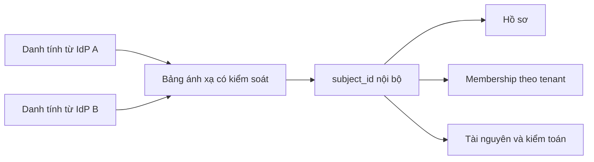

# Stable subject identifier

## 1. Mục tiêu: giữ đúng chủ thể khi thông tin thay đổi

Trong IAM, **subject** là chủ thể mà hệ thống cần nhận diện để gắn quyền, phiên đăng nhập, tài nguyên và lịch sử hoạt động. Chủ thể có thể là tài khoản người dùng hoặc danh tính của một workload. Bài này tập trung vào tài khoản người dùng; nguyên tắc định danh cũng áp dụng cho service account nếu hệ thống định nghĩa rõ phạm vi của nó.

**Stable subject identifier** là mã định danh giữ nguyên cho cùng một chủ thể trong phạm vi đã xác định. Email, tên hiển thị, phương thức xác thực và vai trò có thể đổi, nhưng những thay đổi ấy không làm tài khoản trở thành một chủ thể khác.

Ví dụ, một nền tảng học tập có người dùng:

```text
subject_id   = 71e8c059-69cd-4b52-a185-efcb08693ed0
display_name = Nguyễn An
email        = an.nguyen@example.com
```

Sau khi người dùng đổi email:

```text
subject_id   = 71e8c059-69cd-4b52-a185-efcb08693ed0
display_name = Nguyễn An
email        = an@example.org
```

Các khóa học đã mua, bài làm, bình luận và bản ghi kiểm toán vẫn liên quan đến cùng `subject_id`. Nếu ứng dụng dùng email làm khóa chủ sở hữu, thao tác đổi địa chỉ có thể làm dữ liệu trông như bị mất hoặc tạo ra cơ hội nhận nhầm tài khoản.

Sau bài này, người học cần giải thích được tính ổn định và phạm vi duy nhất của mã định danh, thiết kế ánh xạ danh tính bên ngoài vào tài khoản nội bộ, đồng thời phân biệt việc biết mã chủ thể với việc có quyền truy cập tài nguyên.

## 2. Chủ thể, tài khoản, thông tin đăng nhập và thuộc tính

Một con người có thể có nhiều tài khoản độc lập: tài khoản cá nhân, tài khoản công ty hoặc tài khoản quản trị. Vì vậy, cần nói rõ mã đang định danh **tài khoản nào**, thay vì giả định một mã luôn đại diện cho một con người trên mọi hệ thống.

| Thành phần | Câu hỏi nó trả lời | Ví dụ |
| --- | --- | --- |
| Subject identifier | Đây là chủ thể nào trong phạm vi này? | UUID của tài khoản nội bộ |
| Login identifier | Người dùng nhập gì để tìm tài khoản khi đăng nhập? | Email, username |
| Credential | Người dùng chứng minh quyền kiểm soát tài khoản bằng gì? | Mật khẩu, passkey |
| Profile attribute | Hệ thống mô tả chủ thể như thế nào? | Tên hiển thị, ngôn ngữ |
| Authorization attribute | Chính sách xét điều kiện cấp quyền từ đâu? | Membership, role, department |
| Session identifier | Đây là phiên hoạt động nào? | Mã phiên được tạo sau đăng nhập |
| External identity key | Nhà cung cấp bên ngoài xác nhận danh tính nào? | Cặp issuer và subject của OIDC |

Một tài khoản có thể thay mật khẩu nhiều lần, thêm passkey rồi xóa phương thức cũ. Những việc này thay **cách xác thực**, không nhất thiết thay chủ thể.

Tương tự, nhân viên chuyển phòng ban hoặc bị gỡ quyền quản trị vẫn là tài khoản cũ. Các thuộc tính phân quyền phải được cập nhật và đánh giá lại; mã định danh ổn định không làm quyền cũ tự động còn hiệu lực.

Không dùng số định danh quốc gia hoặc mã nhân sự làm khóa tài khoản chỉ để tạo cảm giác “chắc chắn”. Chúng thuộc những miền dữ liệu khác, có yêu cầu bảo vệ và quy trình quản lý riêng; việc đưa chúng vào mọi URL, log và khóa ngoại sẽ mở rộng sự phụ thuộc không cần thiết.

## 3. Những thuộc tính cần có trong thiết kế

Một hợp đồng định danh nên mô tả ít nhất năm điều:

1. **Phạm vi duy nhất:** mã duy nhất trong một ứng dụng, một tenant hay toàn bộ miền danh tính?
2. **Tính bất biến:** những sự kiện nào được phép xảy ra mà mã vẫn giữ nguyên?
3. **Không cấp lại:** sau khi tài khoản kết thúc, mã cũ có bị dùng cho chủ thể khác không?
4. **Nguồn cấp mã:** thành phần nào được phép tạo và thành phần nào chỉ được tham chiếu?
5. **Quy tắc so sánh:** có phân biệt chữ hoa, chữ thường, khoảng trắng hoặc biểu diễn chuỗi không?

Một lựa chọn cho nền tảng học tập là:

```text
Phạm vi:
  subject_id duy nhất trong miền tài khoản của nền tảng.

Cấp mã:
  dịch vụ tài khoản cấp mã khi tạo tài khoản;
  ứng dụng khách không chọn mã để nhận quyền.

Bất biến:
  đổi email, tên, mật khẩu, MFA hoặc role không đổi subject_id.

Kết thúc:
  tài khoản đã xóa không làm subject_id trở lại kho mã khả dụng.

So sánh:
  subject_id nội bộ được xử lý theo kiểu UUID;
  định danh bên ngoài được so sánh theo hợp đồng của giao thức.
```

“Ổn định” luôn gắn với một phạm vi và vòng đời cụ thể. Một mã của tài khoản nội bộ không có nghĩa nó phải giống mã mà đối tác nhìn thấy, hay phải giống mã đăng nhập từ mọi nhà cung cấp.

Tính duy nhất và tính ổn định là hai yêu cầu khác nhau. Một chuỗi mới ngẫu nhiên ở mỗi lần đăng nhập có thể rất khó trùng nhưng không ổn định. Ngược lại, một username không đổi trong thời gian dài vẫn có thể được cấp lại sau khi người dùng nghỉ việc.

## 4. Vì sao email và username thường không phù hợp làm khóa chủ thể?

Xét tình huống sau:

```text
Ngày 1:
  Lan dùng lan@example.com và sở hữu báo cáo R.

Ngày 30:
  Lan đổi sang lan.private@example.org.

Ngày 60:
  tổ chức cấp lan@example.com cho một nhân viên khác.

Thiết kế sai:
  report.owner = "lan@example.com"

Hậu quả:
  nhân viên mới có thể bị nhận là chủ báo cáo cũ.
```

Vấn đề là **tái cấp một thuộc tính**, không nhất thiết là lỗi xác minh email. Nhân viên mới có thể chứng minh họ kiểm soát hộp thư hiện tại một cách hoàn toàn hợp lệ.

Username cũng có thể được đổi để sửa tên, đồng bộ quy tắc đặt tên hoặc phục vụ tái tổ chức. Số điện thoại có thể thay đổi chủ sử dụng. Tên hiển thị không có yêu cầu duy nhất ngay từ đầu.

Trong thiết kế đề xuất, tài nguyên lưu:

```text
report.owner_subject_id = 71e8c059-69cd-4b52-a185-efcb08693ed0
```

Email chỉ là thuộc tính liên hệ và có thể là một cách tìm tài khoản trong luồng đăng nhập. Thay email không đổi khóa chủ sở hữu.

Một email có cờ `verified` chứng minh điều gì còn phụ thuộc quy trình xác minh. Nó không tự chứng minh rằng tài khoản ở hai hệ thống thuộc cùng một người, cũng không đủ để tự động hợp nhất quyền truy cập.

Không khắc phục vấn đề bằng cách băm email:

```text
subject_id = SHA-256(email)
```

Email đổi thì giá trị băm đổi. Email được cấp lại thì giá trị băm lặp lại. Hàm băm không bổ sung một hợp đồng về vòng đời mà đầu vào vốn không có; với tập email đoán được, nó cũng không tạo ra bảo đảm ẩn danh.

## 5. Định danh nội bộ và danh tính bên ngoài

Khi hỗ trợ SSO, ứng dụng nên tách hai lớp:



Sơ đồ thể hiện một thiết kế ứng dụng: nhiều phương thức đăng nhập có thể dẫn đến cùng một tài khoản nếu chúng đã được liên kết hợp lệ. Không suy ra rằng cứ xuất hiện hai email giống nhau thì phải tạo hai cạnh ánh xạ.

Trong OpenID Connect, khóa định danh dùng cặp `(iss, sub)`; `sub` có phạm vi trong issuer và phân biệt chữ hoa, chữ thường. Không dùng riêng `sub` để nhận diện qua nhiều issuer. [OpenID Connect Core, §2 và §5.7](https://openid.net/specs/openid-connect-core-1_0.html#ClaimStability).

Ví dụ ứng dụng:

```text
iss = https://login.alpha.example
sub = 7391

iss = https://login.beta.example
sub = 7391
```

Hai khóa khác nhau dù chuỗi `sub` giống nhau. Trong mô hình của bài, chúng ánh xạ tới hai `subject_id` khác nhau trừ khi quy trình liên kết tài khoản đã xác nhận một quan hệ khác.

Đừng tạo khóa bằng phép nối không có cấu trúc:

```text
issuer + ":" + sub
```

Các ký tự phân cách có thể xuất hiện trong thành phần. Dùng hai cột, một đối tượng khóa có hai trường hoặc một định dạng tuần tự hóa không nhập nhằng.

Tên kết nối do ứng dụng đặt, chẳng hạn `corporate-sso`, là cấu hình vận hành. Nó không tự thay thế issuer được tin cậy trong quá trình xác thực.

## 6. Nhận diện chỉ xảy ra sau khi xác thực nguồn danh tính

Một bản JSON chứa `iss` và `sub` không đủ để xác thực người dùng. Bất kỳ ai cũng có thể tự gửi:

```json
{
  "iss": "https://login.alpha.example",
  "sub": "7391"
}
```

Ứng dụng chỉ dùng khóa bên ngoài sau khi tầng xác thực đã hoàn tất kiểm tra cần thiết theo giao thức và cấu hình triển khai: nguồn phát hành được tin cậy, chữ ký, đối tượng nhận token, thời hạn và các ràng buộc của luồng đăng nhập như nonce khi áp dụng.

Đây là ranh giới thiết kế giữa **xác thực chứng cứ** và **tra cứu tài khoản**:

```text
Chứng cứ nhận từ trình duyệt
    -> tầng xác thực kiểm tra
    -> danh tính đã được xác nhận
    -> tra cứu ánh xạ
    -> kiểm tra trạng thái tài khoản
    -> đánh giá tenant và quyền trên tài nguyên
```

Không lấy `subject_id` trong request body rồi coi đó là người đang đăng nhập. Với endpoint chỉnh hồ sơ của chính mình, actor được lấy từ security context do server thiết lập. Mã tài khoản mà client gửi, nếu endpoint có nhận, chỉ là đối tượng yêu cầu tác động và phải được kiểm tra quyền riêng.

Cũng không giả định mọi access token có định dạng JWT hoặc dùng ID token để gọi mọi API. Kiểu token, đối tượng nhận và cách kiểm tra thuộc hợp đồng của hệ thống xác thực; bài này minh họa việc xử lý danh tính sau ranh giới đó.

## 7. Mô hình dữ liệu minh họa

Ví dụ PostgreSQL dưới đây chọn `subject_id` duy nhất toàn ứng dụng. Một chủ thể có thể tham gia nhiều tenant. Đây là quyết định thiết kế của ví dụ, không phải yêu cầu bắt buộc của mọi hệ thống IAM.

```sql
CREATE TABLE iam_subject (
    subject_id UUID PRIMARY KEY,
    subject_kind TEXT NOT NULL
        CHECK (subject_kind IN ('HUMAN', 'WORKLOAD')),
    lifecycle_state TEXT NOT NULL
        CHECK (lifecycle_state IN ('ACTIVE', 'DISABLED', 'DELETED')),
    created_at TIMESTAMPTZ NOT NULL DEFAULT CURRENT_TIMESTAMP,
    deleted_at TIMESTAMPTZ,
    CHECK (
        (lifecycle_state = 'DELETED' AND deleted_at IS NOT NULL)
        OR
        (lifecycle_state <> 'DELETED' AND deleted_at IS NULL)
    )
);

CREATE TABLE subject_profile (
    subject_id UUID PRIMARY KEY
        REFERENCES iam_subject(subject_id),
    display_name TEXT NOT NULL,
    contact_email TEXT
);

CREATE TABLE external_identity (
    issuer TEXT COLLATE "C" NOT NULL,
    external_subject TEXT COLLATE "C" NOT NULL,
    subject_id UUID NOT NULL
        REFERENCES iam_subject(subject_id),
    binding_state TEXT NOT NULL
        CHECK (binding_state IN ('ACTIVE', 'REVOKED')),
    linked_at TIMESTAMPTZ NOT NULL DEFAULT CURRENT_TIMESTAMP,
    PRIMARY KEY (issuer, external_subject)
);

CREATE TABLE tenant_membership (
    tenant_id UUID NOT NULL,
    subject_id UUID NOT NULL
        REFERENCES iam_subject(subject_id),
    membership_state TEXT NOT NULL
        CHECK (membership_state IN ('ACTIVE', 'SUSPENDED', 'LEFT')),
    PRIMARY KEY (tenant_id, subject_id)
);

CREATE TABLE learning_submission (
    submission_id UUID PRIMARY KEY,
    tenant_id UUID NOT NULL,
    owner_subject_id UUID NOT NULL,
    answer_text TEXT NOT NULL,
    FOREIGN KEY (tenant_id, owner_subject_id)
        REFERENCES tenant_membership(tenant_id, subject_id)
);
```

Các điểm cần hiểu từ mô hình:

- `subject_profile` tách khỏi danh tính cốt lõi để thay đổi hồ sơ không kéo theo thay khóa.
- Một khóa bên ngoài chỉ có một hàng ánh xạ. Không cho cùng `(issuer, external_subject)` âm thầm trỏ tới hai tài khoản.
- `binding_state` cho phép thu hồi phương thức đăng nhập mà vẫn giữ lịch sử ánh xạ.
- `tenant_membership` biểu diễn quan hệ của tài khoản với tenant; tài khoản tồn tại không có nghĩa nó là thành viên mọi tenant.
- Khóa ngoại của bài làm kiểm tra membership có bản ghi tồn tại, **không kiểm tra** membership đang hoạt động hoặc người gọi có quyền. Tầng phân quyền vẫn phải kiểm tra điều kiện đó.

Collation `"C"` trong ví dụ nhằm giữ cách so sánh định danh ngoài theo chuỗi chính xác. Không tự lowercase, trim, URL-decode hoặc bỏ dấu gạch chéo cuối issuer để “gom dữ liệu”. Những thao tác ấy có thể biến hai khóa khác nhau thành một. Tầng xác thực phải đối chiếu issuer theo hợp đồng giao thức; tầng lưu trữ cần giữ cùng ý nghĩa so sánh.

Ví dụ không ràng buộc `contact_email` duy nhất vì nó chỉ là thông tin liên hệ. Nếu sản phẩm dùng email làm login identifier duy nhất trong một tenant, hãy thiết kế bảng và quy trình riêng cho login identifier, gồm xác minh, trạng thái, phạm vi duy nhất và xử lý đổi địa chỉ. Không dùng yêu cầu đó để thay thế khóa tài khoản.

DDL này chưa có cơ chế cấm mọi câu lệnh `DELETE` hoặc thay `subject_id`. Muốn thực thi bất biến trong vận hành, cần giới hạn quyền ghi, cung cấp API quản trị phù hợp và bổ sung cơ chế bảo vệ ở database khi cần. Một lời cam kết trong tên cột không tự ngăn được người có quyền SQL đổi dữ liệu.

## 8. Cấp mã: định dạng là một phần nhỏ của hợp đồng

Mã có thể là số tuần tự, UUID hoặc chuỗi do dịch vụ danh tính cấp. Điều cốt lõi là quy tắc sinh, phạm vi duy nhất, chính sách không cấp lại và cách tất cả thành phần sử dụng mã.

UUID có thể thuận tiện khi nhiều thành phần cần tạo mã; chọn biến thể phải xét đặc tính sinh mã và lưu trữ. Dù chọn UUID, vẫn cần ràng buộc duy nhất. Định dạng khó đoán không thay kiểm tra quyền. [RFC 9562, §6.7, §6.9 và §8](https://www.rfc-editor.org/rfc/rfc9562.html#section-6.7).

Trong ví dụ Java, có thể cấp mã nội bộ bằng:

```java
UUID subjectId = UUID.randomUUID();
```

`UUID.randomUUID()` tạo UUID phiên bản 4 bằng bộ sinh số ngẫu nhiên giả có tính chất mật mã theo hợp đồng API Java. [Java SE 17 — UUID.randomUUID()](https://docs.oracle.com/en/java/javase/17/docs/api/java.base/java/util/UUID.html#randomUUID()).

Đừng tạo lại mã ở mỗi lần đăng nhập:

```java
// Sai nếu chạy cho mọi lần đăng nhập của tài khoản đã tồn tại.
UUID currentUserId = UUID.randomUUID();
```

Cần phân biệt “cấp mã khi tạo tài khoản” với “tra cứu mã khi người dùng quay lại”. Trường hợp đăng nhập lại phải lấy tài khoản đã được ánh xạ, không tạo một subject mới chỉ vì có phiên mới.

Mã số tuần tự cũng có thể ổn định nếu hệ thống quản lý đúng vòng đời. Tuy nhiên, để lộ mã số thường dễ đoán không được trở thành cách vượt quyền. Ngược lại, không thể dùng xác suất đoán UUID thấp để kết luận một endpoint đã an toàn.

## 9. Ví dụ Java: ánh xạ đúng issuer và giữ nguyên tài khoản

Chương trình sau chỉ minh họa lớp tra cứu danh tính trong bộ nhớ. Nó dùng Java 17 trở lên, không có thư viện ngoài. Các giá trị đầu vào trong `main` là fixture minh họa cho danh tính **đã được tầng xác thực xác nhận**; chương trình không kiểm tra token.

```java
import java.util.Map;
import java.util.Objects;
import java.util.UUID;

public class StableSubjectDemo {

    enum State {
        ACTIVE, DISABLED, DELETED
    }

    record ExternalKey(String issuer, String subject) {
        ExternalKey {
            Objects.requireNonNull(issuer, "issuer");
            Objects.requireNonNull(subject, "subject");

            if (issuer.isBlank() || subject.isBlank()) {
                throw new IllegalArgumentException("Empty identity key");
            }
        }
    }

    record Account(UUID id, State state, String contactEmail) {
        Account {
            Objects.requireNonNull(id, "id");
            Objects.requireNonNull(state, "state");
        }

        Account withEmail(String email) {
            return new Account(id, state, email);
        }
    }

    record IdentityBinding(UUID subjectId, boolean active) {
    }

    static UUID resolve(
            ExternalKey verifiedIdentity,
            Map<ExternalKey, IdentityBinding> bindings,
            Map<UUID, Account> accounts) {

        IdentityBinding binding = bindings.get(verifiedIdentity);
        if (binding == null || !binding.active()) {
            throw new SecurityException("No active identity binding");
        }

        Account account = accounts.get(binding.subjectId());
        if (account == null || account.state() != State.ACTIVE) {
            throw new SecurityException("Account is not active");
        }

        return account.id();
    }

    public static void main(String[] args) {
        UUID anId = UUID.fromString(
                "71e8c059-69cd-4b52-a185-efcb08693ed0");
        UUID binhId = UUID.fromString(
                "c6edcf59-b76e-4dcc-9e6b-b938056bf211");

        ExternalKey alpha = new ExternalKey(
                "https://login.alpha.example", "7391");
        ExternalKey beta = new ExternalKey(
                "https://login.beta.example", "7391");

        Map<ExternalKey, IdentityBinding> bindings = Map.of(
                alpha, new IdentityBinding(anId, true),
                beta, new IdentityBinding(binhId, true)
        );

        Account an = new Account(
                anId, State.ACTIVE, "an.nguyen@example.com");
        Account renamed = an.withEmail("an@example.org");
        Account binh = new Account(
                binhId, State.ACTIVE, "binh@example.com");

        Map<UUID, Account> accounts = Map.of(
                anId, renamed,
                binhId, binh
        );

        UUID resolvedAlpha = resolve(alpha, bindings, accounts);
        UUID resolvedBeta = resolve(beta, bindings, accounts);

        System.out.println("Email changed, same subject: "
                + an.id().equals(renamed.id()));
        System.out.println("Same sub, different issuers: "
                + !resolvedAlpha.equals(resolvedBeta));
        System.out.println("Alpha resolves to An: "
                + resolvedAlpha.equals(anId));

        Map<UUID, Account> disabledAccounts = Map.of(
                anId, new Account(
                        anId, State.DISABLED, renamed.contactEmail()),
                binhId, binh
        );

        try {
            resolve(alpha, bindings, disabledAccounts);
        } catch (SecurityException expected) {
            System.out.println("Disabled account rejected");
        }
    }
}
```

Kết quả dự kiến:

```text
Email changed, same subject: true
Same sub, different issuers: true
Alpha resolves to An: true
Disabled account rejected
```

`record ExternalKey` giữ hai thành phần riêng, nên `Map` phân biệt issuer bằng quy tắc so sánh chuỗi của Java. Hàm `withEmail` giữ nguyên `id`. Hàm `resolve` từ chối binding bị thu hồi và tài khoản không hoạt động.

Tên biến `verifiedIdentity` không phải một biện pháp bảo vệ: bất kỳ mã Java nào có quyền gọi hàm vẫn có thể tự dựng `ExternalKey`. Khi tích hợp thực tế, adapter lấy dữ liệu từ security context đã kiểm tra; không ánh xạ request body tùy ý vào tham số này.

Chương trình cũng chưa thực hiện phân quyền trên bài làm hoặc tenant. Kết quả `resolve` trả lời “tài khoản nào đang được nhận diện”; tầng tiếp theo còn phải trả lời “tài khoản đó có được thực hiện hành động này trong tenant này hay không”.

## 10. Định danh ổn định trong phân quyền và sở hữu tài nguyên

Giả sử An muốn đọc bài làm `submission-42`. Điều kiện nhận diện là một phần của quyết định, nhưng chưa đủ.

Một quy tắc cho thao tác đọc bài của chính mình có thể là:

```text
allow khi:
  subject đang ACTIVE
  AND membership của subject trong tenant đang ACTIVE
  AND tenant của tài nguyên khớp tenant đã được phép chọn
  AND owner_subject_id của tài nguyên bằng subject_id của actor
```

Đây chỉ là nhánh “chính chủ”. Vai trò giảng viên được đọc bài của lớp cần quy tắc riêng gắn với lớp, tenant và hành động được phép.

Một mẫu truy vấn thu hẹp dữ liệu:

```sql
SELECT s.submission_id, s.answer_text
FROM learning_submission s
JOIN tenant_membership m
  ON m.tenant_id = s.tenant_id
 AND m.subject_id = s.owner_subject_id
JOIN iam_subject p
  ON p.subject_id = m.subject_id
WHERE s.submission_id = :submission_id
  AND s.tenant_id = :authorized_tenant_id
  AND s.owner_subject_id = :actor_subject_id
  AND m.membership_state = 'ACTIVE'
  AND p.lifecycle_state = 'ACTIVE';
```

`:actor_subject_id` đến từ danh tính đã giải quyết trên server. `:authorized_tenant_id` là tenant đã được kiểm tra cho actor và request. Tham số hóa truy vấn là điều kiện cần để xử lý đầu vào SQL, nhưng không tự biến tenant do client gửi thành tenant đã được phép truy cập.

Nếu dùng mã subject chỉ duy nhất trong từng tenant, khóa logic phải gồm cả tenant. Khi đó, bỏ `tenant_id` khỏi khóa cache, khóa ngoại hoặc điều kiện truy vấn có thể làm một tài khoản bị nhận nhầm thành tài khoản trùng mã ở tenant khác.

Không lấy vai trò từ cách mã được đặt:

```text
admin_001
teacher_002
```

Tiền tố có thể hỗ trợ hiển thị loại tài nguyên theo quy ước nội bộ, nhưng quyền phải đến từ dữ liệu và chính sách có thẩm quyền. Đổi role không nên đòi đổi subject identifier.

## 11. Vòng đời: khóa tài khoản, xóa và quay lại

Tính ổn định phải được giải thích cho các tình huống vòng đời cụ thể.

| Sự kiện | Cách xử lý trong thiết kế ví dụ | Tác động cần xem xét |
| --- | --- | --- |
| Đổi tên hoặc email | Giữ subject, cập nhật hồ sơ | Không thay khóa sở hữu |
| Đổi mật khẩu hoặc thêm passkey | Giữ subject | Cập nhật credential và phiên theo chính sách |
| Thu hồi một SSO binding | Giữ subject, đánh dấu binding thu hồi | Không cho đăng nhập bằng binding đó |
| Khóa tài khoản | Giữ subject, chuyển trạng thái | Chặn truy cập và xử lý phiên còn hiệu lực |
| Rời một tenant | Giữ subject, cập nhật membership | Gỡ quyền thuộc tenant đó |
| Xóa tài khoản | Kết thúc vòng đời, không cấp mã cũ cho người khác | Xử lý dữ liệu cá nhân và quan hệ còn lưu |
| Tạo tài khoản mới sau xóa | Cấp subject mới | Không tự thừa kế quyền từ tài khoản cũ |
| Khôi phục tài khoản theo quy trình | Có thể khôi phục cùng subject nếu chính sách cho phép | Xác minh đây là phục hồi tài khoản cũ |

Cần phân biệt “tạo mới” với “khôi phục”. Một người quay lại bằng email cũ không đủ để kết luận được quyền phục hồi tài khoản đã kết thúc.

Trong mô hình SQL, hàng `iam_subject` có thể đóng vai trò tombstone sau khi dữ liệu hồ sơ được xử lý theo chính sách lưu giữ. Tombstone tối thiểu giúp bảo vệ quy tắc không cấp lại và duy trì tính toàn vẹn tham chiếu. Thiết kế thực tế phải cân nhắc dữ liệu nào còn cần giữ và ai được truy cập.

Không cấp lại mã không đồng nghĩa phải giữ toàn bộ hồ sơ cá nhân mãi mãi. Ngược lại, xóa hồ sơ không có nghĩa được phép cấp mã cũ cho người khác. Hai quyết định này phục vụ hai mục đích khác nhau.

Với `external_identity`, thiết kế ví dụ giữ hàng ở trạng thái `REVOKED` để tránh tái gắn tự động vào tài khoản mới. Nếu cần thay quan hệ ánh xạ, phải có thao tác quản trị riêng với bằng chứng, kiểm tra xung đột và dấu vết kiểm toán.

## 12. Liên kết và hợp nhất tài khoản

Một subject có thể có nhiều binding sau quy trình liên kết:

```text
(login.alpha.example, alpha-7391) -> subject S
(login.beta.example, beta-8520)   -> subject S
```

Quy trình liên kết nên xác nhận quyền kiểm soát cả tài khoản hiện tại lẫn danh tính mới ở mức phù hợp với rủi ro, kiểm tra binding mới chưa gắn với tài khoản khác, rồi ghi thay đổi trong transaction.

Các bước ứng dụng có thể thực hiện:

1. Yêu cầu người dùng đang ở phiên hợp lệ của tài khoản đích; yêu cầu xác thực lại nếu thao tác cần.
2. Thực hiện luồng xác thực với nhà cung cấp cần liên kết và ràng buộc kết quả với yêu cầu liên kết ban đầu.
3. Kiểm tra quy tắc tổ chức: nhà cung cấp này có được phép liên kết vào loại tài khoản hoặc tenant đó không?
4. Tạo binding nếu chưa tồn tại; nếu đã trỏ tới chính tài khoản này thì xử lý như kết quả lặp hợp lệ.
5. Nếu binding trỏ tới subject khác, báo xung đột và chuyển sang quy trình xử lý tài khoản trùng đã được thiết kế.
6. Ghi kiểm toán về actor, tài khoản đích, nguồn liên kết và kết quả; thông báo theo chính sách sản phẩm.

Không sửa binding đang thuộc tài khoản khác bằng câu lệnh tiện lợi như:

```sql
-- Nguy hiểm trong luồng tự động liên kết tài khoản.
ON CONFLICT (issuer, external_subject)
DO UPDATE SET subject_id = EXCLUDED.subject_id;
```

Câu lệnh ấy có thể biến xung đột danh tính thành chuyển quyền đăng nhập. Trong luồng tạo mới, xung đột phải được đọc lại và kiểm tra; không mặc định “bản ghi gửi đến sau thắng”.

Hai yêu cầu đăng nhập lần đầu cũng có thể chạy đồng thời. Transaction tạo subject và binding phải có cách xử lý ràng buộc duy nhất: một transaction thắng, transaction còn lại rollback việc tạo dư rồi đọc binding hợp lệ. Không để mỗi request tạo một tài khoản khác nhau rồi tùy ý chọn một cái.

**Hợp nhất hai tài khoản** phức tạp hơn liên kết một phương thức đăng nhập. Cần quyết định tài khoản nào tiếp tục tồn tại, chuyển tài nguyên nào, xử lý quyền xung đột và lưu lịch sử của tài khoản kết thúc. Không viết lại log quá khứ để làm như hai tài khoản chưa từng độc lập.

## 13. Chuyển nhà cung cấp danh tính và tích hợp cấp phát

Khi đổi IdP, subject bên ngoài có thể thay đổi. Hệ thống nên bảo toàn tài khoản nội bộ bằng một kế hoạch migration có chứng cứ:

```text
Trước:
  binding từ IdP cũ -> subject nội bộ S

Trong migration:
  xác minh và bổ sung binding từ IdP mới -> S

Sau:
  xác nhận đăng nhập mới hoạt động;
  thu hồi binding cũ theo kế hoạch.
```

Không giả định email giống nhau là đủ để tạo hàng ánh xạ mới cho mọi tài khoản. Cần nguồn đối chiếu có thẩm quyền, kiểm tra duy nhất, xử lý tài khoản trùng, ngoại lệ và khả năng quay lại khi migration lỗi.

Thay hostname hoặc đường dẫn issuer cũng phải được xem là thay đổi trong hợp đồng danh tính, không chỉ là sửa một URL trong database. Không áp dụng `replace` hàng loạt lên issuer để làm khóa cũ và mới trông giống nhau.

Trong SCIM, `id` do service provider cấp là mã ổn định và không cấp lại; `externalId` do provisioning client quản lý. Hai trường có vai trò khác nhau. [RFC 7643, §3.1](https://www.rfc-editor.org/rfc/rfc7643.html#section-3.1).

Từ sự phân biệt đó, thiết kế tích hợp nên lưu rõ nguồn provisioning và mã mà nguồn đó dùng để đối chiếu. Không mặc định SCIM `id`, HR employee ID, OIDC `sub` và `subject_id` nội bộ là cùng một giá trị. Muốn đồng nhất chúng cần hợp đồng rõ ràng và kiểm chứng qua vòng đời tạo, cập nhật, khóa và phục hồi.

## 14. Tính riêng tư và phạm vi công bố định danh

Mã ổn định giúp liên kết dữ liệu đúng người, nhưng cũng có thể giúp các bên nối lịch sử hoạt động nếu cùng một mã được công bố rộng rãi.

OIDC có kiểu `public` và `pairwise`. Pairwise hỗ trợ tách định danh theo sector, nên các client thuộc cùng sector có thể nhận cùng mã. [OpenID Connect Core, §8 và §8.1](https://openid.net/specs/openid-connect-core-1_0.html#SubjectIDTypes).

Đối với thiết kế ứng dụng của bài, hệ quả là không cần gửi subject nội bộ toàn cục cho mọi đối tác. Có thể tạo một lớp mã công bố theo phạm vi đối tác và ánh xạ có kiểm soát về subject nội bộ.

Tuy nhiên, việc đổi `client_id`, sector hoặc cấu hình IdP cần được đánh giá về tác động nhận diện. Nếu một binding thay đổi thì phải xử lý bằng quy trình chuyển đổi; không tự động hợp nhất danh tính dựa trên email để “sửa” sự gián đoạn.

Một mã ngẫu nhiên không mang tên người dùng vẫn có thể liên quan đến dữ liệu cá nhân khi tổ chức có bảng ánh xạ. Chỉ dùng mã thay tên không đủ để kết luận dữ liệu đã ẩn danh.

Với log vận hành, có thể ghi mã nội bộ cần thiết cho truy vết và hạn chế người đọc. Không đưa toàn bộ token, credential hoặc mọi thuộc tính hồ sơ vào log chỉ để nhận diện chủ thể. Trong metric, đặt subject identifier làm nhãn cho mọi sự kiện còn có thể tạo số lượng chuỗi thời gian rất lớn.

## 15. Phiên, cache và kiểm toán

Một subject có thể có nhiều phiên cùng lúc. Mỗi lần đăng nhập tạo phiên mới không nên tạo subject mới; ngược lại, khóa tài khoản không được bị vô hiệu hóa bởi cache chỉ nhớ “subject đã tồn tại”.

Ví dụ phân tách:

```text
subject_id      = S
session_id      = phiên trên trình duyệt A
session_id      = phiên trên điện thoại B
membership     = S thuộc tenant T với trạng thái hiện tại
credential     = một hoặc nhiều phương thức xác thực của S
```

Nếu hệ thống cache kết quả ánh xạ `(issuer, sub) -> S`, cần xác định cách cache nhận biết binding bị thu hồi. Nếu cache quyết định phân quyền, phải xét tenant, hành động, tài nguyên, phiên bản chính sách và các trạng thái có thể thay đổi. Chỉ có subject identifier ổn định không làm quyết định cũ luôn đúng.

Cách kiểm tra trạng thái có thể là truy vấn dữ liệu hiện hành, cache có cơ chế invalidation, hoặc chiến lược token và thu hồi đã thiết kế. Chọn cách nào cần gắn với thời gian có hiệu lực mong muốn khi khóa tài khoản hoặc gỡ quyền.

Một bản ghi kiểm toán minh họa:

```json
{
  "eventType": "SUBMISSION_READ",
  "actorSubjectId": "71e8c059-69cd-4b52-a185-efcb08693ed0",
  "tenantId": "b2f1f4b1-c648-4fc6-8a09-0c774a2b518f",
  "resourceType": "LEARNING_SUBMISSION",
  "resourceId": "submission-42",
  "decision": "ALLOW",
  "occurredAt": "2026-11-26T03:00:00Z"
}
```

Đây là ví dụ cấu trúc sự kiện, không phải bản ghi truy cập có thật. Hệ thống thực tế còn cần correlation ID và ngữ cảnh chính sách thích hợp để giải thích quyết định.

Khi admin thao tác thay người dùng, tách actor thực sự và subject bị tác động. Nếu mọi thao tác đều ghi người được hỗ trợ như actor, lịch sử sẽ che mất ai đã thực hiện thay đổi.

## 16. Những lỗi thiết kế thường gặp

| Thiết kế dễ gây lỗi | Vấn đề | Cách xử lý trong mô hình đề xuất |
| --- | --- | --- |
| Lưu email làm owner của tài nguyên | Email đổi hoặc được cấp lại | Lưu khóa subject ổn định |
| Dùng riêng `sub` qua nhiều IdP | Va chạm giữa các issuer | Dùng khóa có cấu trúc `(issuer, sub)` |
| Lowercase mọi định danh ngoài | Làm mất phân biệt của khóa | Giữ quy tắc so sánh theo hợp đồng |
| Sinh subject mới ở mỗi login | Tài khoản và dữ liệu bị phân mảnh | Tra cứu binding trước luồng tạo mới |
| Tự liên kết vì email giống nhau | Nhận nhầm hoặc chuyển quyền tài khoản | Có quy trình xác nhận và xử lý xung đột |
| Chấp nhận subject từ client làm actor | Giả mạo danh tính request | Lấy actor từ security context |
| UUID khó đoán nên bỏ kiểm tra quyền | Lộ mã là lộ tài nguyên | Kiểm tra hành động, tenant và quan hệ |
| Cache quyền chỉ theo subject | Bỏ qua tenant và thay đổi quyền | Thiết kế cache theo ngữ cảnh quyết định |
| Xóa rồi cấp lại mã cho người mới | Gắn nhầm dữ liệu và lịch sử cũ | Không tái sử dụng mã |
| Đồng bộ mọi ID về cùng một chuỗi | Nhầm miền cấp phát và vòng đời | Duy trì ánh xạ có nguồn gốc rõ ràng |

## 17. Tình huống tự luyện

### Tình huống A: đổi email

Một người đổi `mai@company.example` thành `mai@example.org`. Bảng mua khóa học vẫn lưu `buyer_subject_id = S1`.

**Kết quả mong muốn:** cùng một tài khoản vẫn đọc được lịch sử mua hợp lệ. Quy trình đổi email cập nhật thuộc tính và xác minh địa chỉ theo chính sách; không tạo subject mới hay chuyển khóa ngoại của toàn bộ giao dịch.

### Tình huống B: email được tái cấp

Sau khi tài khoản S1 kết thúc, tổ chức cấp địa chỉ email cũ cho người khác. Người mới đăng nhập qua IdP với khóa ngoài mới.

**Kết quả mong muốn:** không tự nhận quyền của S1. Nếu tạo tài khoản mới thì nhận S2. Muốn phục hồi hoặc chuyển dữ liệu phải có quy trình riêng; kiểm soát hộp thư hiện tại không tự chứng minh quyền với tài khoản cũ.

### Tình huống C: hai issuer trả cùng subject

```text
https://idp-one.example, sub = 900
https://idp-two.example, sub = 900
```

**Kết quả mong muốn:** tra cứu hai khóa khác nhau. Một bản ghi chỉ lưu `external_subject = 900` không đủ làm khóa cho môi trường này.

### Tình huống D: người dùng rời tenant

Subject S1 vẫn hoạt động trong tenant A nhưng đã rời tenant B.

**Kết quả mong muốn:** S1 không dùng trạng thái tài khoản toàn cục để tiếp tục truy cập B. Phải xét membership và quyền trong tenant của tài nguyên, kể cả khi token hoặc phiên được tạo trước thời điểm rời.

### Tình huống E: liên kết bị xung đột

Người dùng đang ở tài khoản S1 muốn liên kết một danh tính ngoài hiện trỏ tới S2.

**Kết quả mong muốn:** báo xung đột có kiểm soát. Không sửa đích binding thành S1. Nếu sản phẩm hỗ trợ hợp nhất, thực hiện quy trình hợp nhất được xác nhận và kiểm toán riêng.

### Tình huống F: tài khoản bị khóa nhưng mã không đổi

Một tài khoản đang có phiên đăng nhập bị chuyển sang `DISABLED`.

**Kết quả mong muốn:** mã vẫn định danh đúng tài khoản trong lịch sử, còn các request tiếp theo chịu cơ chế kiểm tra trạng thái và thu hồi đã thiết kế. Tính ổn định của mã không phải lý do duy trì quyền truy cập.

## 18. Điểm cần ghi nhớ khi áp dụng

Một subject identifier tốt giúp toàn hệ thống cùng tham chiếu đúng một chủ thể dù hồ sơ, phương thức xác thực và quyền thay đổi. Hợp đồng về phạm vi và vòng đời quan trọng hơn việc chọn một chuỗi trông giống mã định danh.

Khi thiết kế một tính năng IAM, hãy chỉ ra rõ nơi cấp mã, nơi xác thực chứng cứ, nơi ánh xạ tài khoản và nơi quyết định quyền. Tài nguyên tham chiếu subject ổn định; danh tính ngoài có namespace; thuộc tính có thể đổi; việc liên kết tài khoản cần chứng cứ; khóa và xóa tài khoản phải có hiệu lực trên truy cập hiện tại.

Các mô hình SQL, chương trình Java và tình huống trong bài là ví dụ thiết kế để luyện cách phân tách trách nhiệm. Khi đưa vào hệ thống thực tế, cần cụ thể hóa quy trình cấp phát, bảo vệ bất biến dữ liệu, xử lý đồng thời và cập nhật trạng thái theo yêu cầu của sản phẩm.
