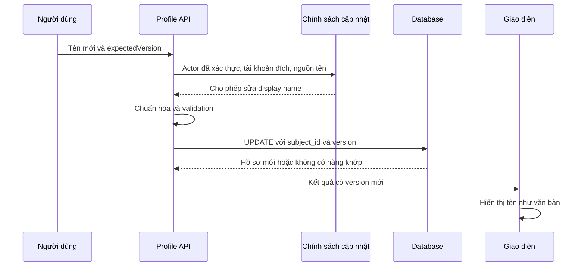

# Display name

## 1. Tên hiển thị giải quyết vấn đề gì trong IAM?

**Display name**, hay tên hiển thị, là nhãn văn bản mà ứng dụng dùng để giới thiệu một chủ thể với người khác: người viết bình luận, học viên trong lớp, người gửi lời mời hoặc quản trị viên thực hiện một thao tác.

Ví dụ, một tài khoản trên nền tảng học tập có hồ sơ:

```json
{
  "subjectId": "71e8c059-69cd-4b52-a185-efcb08693ed0",
  "displayName": "Nguyễn Minh An"
}
```

Người dùng có thể đổi tên thành “Minh An” để phù hợp cách xưng hô trong lớp học. Tài khoản vẫn giữ nguyên khóa định danh; các bài làm, quyền trong tenant và lịch sử hoạt động tiếp tục tham chiếu chủ thể cũ.

Tên hiển thị giúp con người đọc giao diện dễ hơn, nhưng nó không tự chứng minh người đang thao tác là ai. Hai tài khoản có thể cùng tên, một tài khoản có thể đổi tên, và một tên trông giống tên quản trị viên vẫn có thể do người dùng tự đặt.

Trong nền tảng IAM, cần quản lý đồng thời hai mối quan hệ:

- **Quan hệ dữ liệu:** tên hiển thị thuộc hồ sơ của một subject đã có mã ổn định.
- **Quan hệ tin cậy:** ai được đặt tên, nguồn nào được cập nhật và giao diện phải thể hiện độ tin cậy đến đâu.

Sau bài này, người học cần biết thiết kế thuộc tính display name, xử lý tên đa ngôn ngữ, giới hạn quyền sửa, đồng bộ dữ liệu từ IdP và hiển thị tên mà không biến nó thành định danh hoặc bằng chứng cấp quyền.

## 2. Phân biệt tên hiển thị với các thuộc tính khác

| Thuộc tính | Mục đích | Có thích hợp làm khóa chủ thể không? |
| --- | --- | --- |
| Subject identifier | Tham chiếu ổn định một tài khoản trong phạm vi xác định | Có, theo hợp đồng cấp mã |
| Display name | Gọi tên chủ thể trên giao diện | Không |
| Username hoặc handle | Cách đăng nhập hoặc nhắc tên theo quy tắc sản phẩm | Không mặc định; có thể thay đổi hoặc được cấp lại |
| Email | Liên hệ hoặc tìm tài khoản trong một luồng đăng nhập | Không mặc định |
| Legal name | Tên dùng cho một nghiệp vụ có yêu cầu xác minh cụ thể | Không thay thế khóa tài khoản |
| Given name, family name | Thành phần tên nếu nghiệp vụ thực sự cần | Không |
| Role hoặc verified badge | Thể hiện quyền hay một kết quả xác minh có phạm vi | Phải do hệ thống có thẩm quyền quản lý |

Tên hiển thị không nhất thiết là tên pháp lý. Một diễn đàn học tập có thể cho phép biệt danh; một hệ thống doanh nghiệp có thể lấy tên từ directory. Cần công bố rõ quy tắc của sản phẩm thay vì gọi mọi tên nhập vào là “tên đã xác minh”.

Nếu cần tên để in chứng chỉ, ứng dụng nên có trường hoặc quy trình riêng. Việc người dùng đổi tên gọi trong phần bình luận không nên tự sửa tên trên chứng chỉ đã phát hành.

Trong SCIM, `displayName` là nhãn dùng để hiển thị người dùng; schema không yêu cầu giá trị duy nhất. Nó khác các thành phần của thuộc tính `name` và khác `nickName`. [RFC 7643, §4.1.1 và §8.1](https://www.rfc-editor.org/rfc/rfc7643.html#section-4.1.1).

Đây là ngữ nghĩa của SCIM, không phải yêu cầu mọi database phải dùng cùng cách đặt tên cột. Khi tích hợp hệ thống, cần ánh xạ thuộc tính theo hợp đồng của từng nguồn.

## 3. Những việc tuyệt đối không dựa vào display name

### 3.1. Không dùng làm khóa tìm tài khoản duy nhất

Thiết kế sau không đủ để nhận diện chủ thể:

```sql
SELECT subject_id
FROM subject_profile
WHERE display_name = :name;
```

Truy vấn có thể trả nhiều hàng. Kể cả hiện tại chỉ có một hàng, người khác vẫn có thể đặt tên giống hoặc người cũ đổi tên sau đó.

Trong một màn hình tìm người để thêm vào lớp, tên chỉ giúp tìm **danh sách ứng viên**. Khi người thao tác chọn một hàng, request phải gửi mã chủ thể của chính hàng đó; server tiếp tục kiểm tra quyền thực hiện lời mời hoặc thay đổi membership.

### 3.2. Không dùng để quyết định quyền

Các quy tắc sau đều sai về mô hình tin cậy:

```text
displayName == "Admin"       -> cho phép quản trị
displayName chứa "Teacher"  -> cho phép chấm bài
displayName kết thúc "@X"   -> coi là nhân viên tổ chức X
```

Vai trò và quan hệ tổ chức phải đến từ dữ liệu phân quyền có thẩm quyền. Người dùng tự sửa tên không được làm thay đổi bất kỳ role hoặc membership nào.

Nếu một chính sách ABAC dùng thuộc tính hồ sơ, phải chỉ rõ thuộc tính đó do ai kiểm soát và vì sao có thể tin cậy. Một display name tự khai thường không phù hợp làm bằng chứng cho quyền có giá trị.

### 3.3. Không dùng để liên kết tài khoản

Hai IdP đều trả tên “Nguyễn An” không có nghĩa đó là cùng người. Tên gần giống, tên không dấu hoặc cùng avatar cũng không đủ.

Liên kết phải dựa trên danh tính đã xác thực và quy trình xác nhận quyền kiểm soát tài khoản. Display name chỉ phục vụ hiển thị trong bước xác nhận; nó không thay thế bằng chứng.

## 4. Thiết kế trường tên cho người dùng đa ngôn ngữ

Tên người không luôn theo mẫu “first name + last name”. Thứ tự thành phần, số lượng từ, khoảng trắng và hệ chữ thay đổi theo ngữ cảnh văn hóa. Không nên bắt buộc chia tên thành hai phần chỉ để hiển thị một nhãn. [W3C — Personal names around the world](https://www.w3.org/International/questions/qa-personal-names).

Với một cộng đồng học tập quốc tế, có thể dùng một trường “Tên hiển thị” và giải thích:

```text
Tên này xuất hiện trong lớp học và các bình luận.
Bạn có thể dùng tên thường gọi.
Tên hiển thị không dùng để đăng nhập.
```

Một số dữ liệu minh họa cần được cân nhắc trong thiết kế:

```text
Nguyễn Thị Minh Anh
O'Connor
Anne-Marie
李明
محمد
Sukarno
```

Danh sách chỉ minh họa sự đa dạng, không phải tập mẫu đầy đủ để xây một regex “tên hợp lệ”.

Những thao tác tự động dễ gây sai:

- Ép mọi tên phải có dấu cách để suy ra có họ và tên.
- Chỉ cho phép `A-Z`, làm mất tên có dấu hoặc hệ chữ khác.
- Viết hoa chữ đầu mọi từ theo một quy tắc cố định.
- Xóa dấu nháy đơn hoặc dấu nối vì coi chúng là ký tự nguy hiểm.
- Tự đảo thứ tự các phần của tên theo ngôn ngữ giao diện.
- Buộc người dùng thêm một họ giả để vượt qua validation.

Nếu nghiệp vụ cần tên theo cấu trúc, hãy thu thập cấu trúc đó cho đúng mục đích và vẫn có quy tắc định dạng tên rõ ràng. Không cố khôi phục mọi thành phần tên từ chuỗi display name bằng cách tách theo khoảng trắng.

Đối với workload, display name có thể mô tả dịch vụ như “Bộ đồng bộ điểm”. Loại chủ thể phải là trường có cấu trúc riêng; không suy ra đó là con người hay service account từ cách tên được viết.

## 5. Unicode: hiển thị, chuẩn hóa và độ dài

### 5.1. Chuỗi nhìn giống nhau có thể có biểu diễn khác nhau

Một chữ có dấu có thể được mã hóa bằng ký tự dựng sẵn hoặc chuỗi gồm chữ cơ sở và dấu kết hợp. NFC là một dạng chuẩn hóa theo tương đương canonical; nó không phải cơ chế phát hiện giả mạo hay xóa khác biệt giữa mọi chuỗi nhìn giống nhau. [Unicode UAX #15](https://unicode.org/reports/tr15/).

Ví dụ phục vụ thiết kế:

```text
José
Jose + U+0301
```

Ứng dụng có thể chọn lưu display name ở NFC để hạn chế khác biệt biểu diễn. Đây là lựa chọn về lưu trữ văn bản, không làm tên trở thành duy nhất.

Không tự thay NFC bằng quy trình “bỏ dấu, lowercase, xóa dấu câu” để lưu tên chính thức. Những bước ấy có thể phục vụ một chỉ mục tìm kiếm riêng, nhưng làm mất cách viết mà người dùng muốn hiển thị.

### 5.2. “100 ký tự” cần được định nghĩa

Khi đặt giới hạn, phải phân biệt:

| Đơn vị | Ý nghĩa trong triển khai |
| --- | --- |
| Byte UTF-8 | Dung lượng khi mã hóa để truyền hoặc lưu |
| UTF-16 code unit | Đơn vị mà `String.length()` của Java đếm |
| Unicode code point | Giá trị Unicode; một code point có thể cần hai code unit |
| Grapheme cluster | Nhóm mà người dùng thường cảm nhận như một ký tự hiển thị |

Ví dụ Java:

```java
String label = "An 😀";
int codeUnits = label.length();  // 5
int codePoints = label.codePointCount(0, label.length()); // 4
```

Một tên có dấu kết hợp hoặc emoji ghép còn có thể có số grapheme cluster khác số code point. Không nói “100 ký tự người dùng nhìn thấy” nếu implementation chỉ kiểm tra `length()`.

Hợp đồng của ví dụ trong bài chọn tối đa 100 code point sau chuẩn hóa và 400 byte UTF-8. Đây là giới hạn minh họa của sản phẩm, không phải giới hạn do IAM hoặc Unicode quy định. Giao diện cần diễn đạt đúng và backend là nơi thực thi có thẩm quyền.

### 5.3. Không cắt chuỗi tùy tiện

Cắt bằng số byte có thể làm hỏng dữ liệu UTF-8; cắt giữa hai code unit có thể tách một surrogate pair. Cắt theo code point vẫn có thể tách một grapheme cluster.

Nếu tên vượt giới hạn lưu, nên trả lỗi rõ ràng thay vì âm thầm cắt rồi lưu một tên khác. Nếu chỉ rút gọn trên UI, giữ nguyên dữ liệu gốc và cung cấp cách đọc tên đầy đủ khi phù hợp.

## 6. Xử lý ký tự điều khiển và văn bản hai chiều

Tên người dùng là dữ liệu không tin cậy ngay cả khi nó xuất phát từ một IdP đã xác thực. Xác thực nguồn token không tự làm mọi thuộc tính hồ sơ phù hợp với mọi vị trí hiển thị.

Một tên có xuống dòng có thể làm bảng danh sách hoặc log dạng dòng trông như có thêm một bản ghi. Ký tự điều khiển hướng hiển thị có thể khiến nội dung lân cận khó đọc đúng. W3C mô tả khác biệt giữa các dấu điều khiển bidi và nhu cầu cô lập nội dung khi trộn hướng chữ. [W3C — How to use Unicode controls for bidi text](https://www.w3.org/International/questions/qa-bidi-unicode-controls).

Trong sản phẩm minh họa, tên hiển thị là một dòng. Chính sách đầu vào từ chối control character, ký tự phân cách dòng và các bidi control do người dùng chèn. Giao diện chịu trách nhiệm trình bày hướng chữ bằng markup cố định.

Điều này **không có nghĩa cấm tiếng Ả Rập hoặc Hebrew**. Nội dung tự nhiên của các hệ chữ viết từ phải sang trái vẫn được chấp nhận. Cấm một số ký tự điều khiển và cấm cả một hệ chữ là hai việc khác nhau.

Ví dụ UI:

```html
<span class="member-label">
  <bdi dir="auto" id="member-name"></bdi>
</span>
```

`bdi` giúp cô lập hướng của phần tên với nội dung xung quanh. Giá trị tên phải được gán như văn bản; không chèn chuỗi người dùng thành HTML. [W3C — Inline markup and bidirectional text in HTML](https://www.w3.org/International/articles/inline-bidi-markup/).

Không xóa toàn bộ ký tự có loại Unicode `FORMAT` theo một quy tắc đơn giản nếu chưa xét ngôn ngữ. Một số ký tự như zero width joiner hoặc non-joiner có ý nghĩa trong cách biểu diễn chữ. Chính sách cần có phạm vi rõ ràng và được kiểm tra với những ngôn ngữ sản phẩm hỗ trợ.

## 7. Hiển thị tên an toàn trên giao diện

### 7.1. Giữ tên ở ngữ cảnh văn bản

Ví dụ dữ liệu người dùng:

```text

```

Nó có thể vượt qua một bộ kiểm tra độ dài và không chứa control character. Điều đó không có nghĩa được chèn thẳng vào HTML.

Với một phần tử văn bản thông thường:

```javascript
const nameNode = document.getElementById("member-name");
nameNode.textContent = profile.displayName;
```

`textContent` trên phần tử phù hợp giữ giá trị như văn bản thay vì diễn giải thành markup. Nếu dùng template, giữ cơ chế escaping theo ngữ cảnh của framework. [OWASP — Cross Site Scripting Prevention Cheat Sheet](https://cheatsheetseries.owasp.org/cheatsheets/Cross_Site_Scripting_Prevention_Cheat_Sheet.html).

Không dùng:

```javascript
// Sai: chuỗi tên được diễn giải như HTML.
nameNode.innerHTML = profile.displayName;
```

Validation tên và xử lý đầu ra giải quyết các vấn đề khác nhau. Một bộ lọc đầu vào không thay thế việc sử dụng đúng API hiển thị.

Không HTML-encode rồi lưu tên như `O&#39;Connor` trong trường hồ sơ chính. Hãy lưu văn bản Unicode và encode khi đưa nó vào ngữ cảnh cần encode; nếu không, các client khác có thể hiển thị entity nguyên văn hoặc encode lần nữa.

### 7.2. Badge phải tách khỏi tên

Tên tự khai “Admin ✓” hoặc “Hỗ trợ nền tảng” không phải vai trò được xác minh. UI nên tách rõ:

```text
[ảnh đại diện] Minh An    [Giảng viên của lớp này]
             tên tự khai  badge do hệ thống tạo
```

Badge chỉ được hiển thị từ dữ liệu có thẩm quyền và có phạm vi cụ thể. “Giảng viên của lớp A” không có nghĩa “quản trị viên toàn nền tảng”.

Nếu sản phẩm hạn chế tên gây nhầm lẫn với nhân viên hỗ trợ, đó là chính sách chống lạm dụng. Cơ chế phân quyền vẫn phải độc lập với việc tên có được duyệt hay không.

### 7.3. Phân biệt người trùng tên mà không làm lộ dữ liệu

Hai học viên cùng tên “Minh An” vẫn là hai tài khoản hợp lệ. UI có thể bổ sung nhãn tổ chức, lớp học hoặc mã tham chiếu phù hợp với người xem.

Không tự động công khai email, số điện thoại hoặc mã nhân sự cho cả lớp chỉ để phân biệt tên. Thông tin phụ phải đi qua quy tắc về quyền xem hồ sơ.

Trong thao tác nhạy cảm như giao quyền quản trị, màn hình xác nhận cần đủ ngữ cảnh để người thao tác nhận đúng tài khoản. Server vẫn xử lý bằng subject identifier của hàng đã chọn.

## 8. Ai được sửa tên và nguồn nào có thẩm quyền?

Một ứng dụng có thể nhận tên từ người dùng, directory doanh nghiệp, provisioning hoặc quy trình hỗ trợ. Nếu nhiều nguồn cùng ghi một cột mà không có quy tắc ưu tiên, tên sẽ bị thay qua lại.

Ba lựa chọn thiết kế thường gặp:

| Mô hình | Nguồn quyết định tên dùng trên UI | Điều cần làm rõ |
| --- | --- | --- |
| Người dùng tự quản lý | Giá trị do người dùng đặt | IdP chỉ điền lần đầu hay có được ghi đè? |
| Directory quản lý | Nguồn tổ chức có thẩm quyền | Người dùng có được yêu cầu sửa hoặc dùng preferred name không? |
| Tách giá trị theo mục đích | Tên từ directory và tên thường gọi là hai trường | UI chọn trường nào trong từng ngữ cảnh? |

Ví dụ mô hình tách:

```json
{
  "subjectId": "71e8c059-69cd-4b52-a185-efcb08693ed0",
  "directoryDisplayName": "Nguyễn Minh An",
  "preferredDisplayName": "Minh An",
  "effectiveDisplayName": "Minh An"
}
```

Đây là schema ứng dụng minh họa, không phải schema bắt buộc của OIDC hoặc SCIM.

`effectiveDisplayName` có thể là dữ liệu dẫn xuất theo quy tắc sản phẩm. Không để client gửi nó như một cách ghi đè mọi nguồn.

Nếu tenant có tên riêng cho cùng một subject, cần mô hình hồ sơ theo tenant hoặc override có phạm vi. Một thay đổi tên trong tenant A không nên bất ngờ thay danh xưng trong tenant B nếu sản phẩm đã cam kết hai hồ sơ độc lập.

Khi nhận thuộc tính từ IdP, chỉ cập nhật sau khi đã xác thực và xác định đúng subject. Tên lấy từ token chỉ được dùng trong chính sách cập nhật hồ sơ đã chọn; không dùng nó để tìm tài khoản cần gắn token.

## 9. Mô hình dữ liệu và cập nhật tên có kiểm soát

Ví dụ PostgreSQL dưới đây dùng một tên hiển thị toàn cục cho mỗi tài khoản. Nếu sản phẩm có tên riêng theo tenant, cần mở rộng khóa và phạm vi cập nhật; không dùng schema này rồi coi một thay đổi toàn cục là thay đổi trong một tenant.

```sql
CREATE TABLE iam_subject (
    subject_id UUID PRIMARY KEY,
    lifecycle_state TEXT NOT NULL
        CHECK (lifecycle_state IN ('ACTIVE', 'DISABLED', 'DELETED'))
);

CREATE TABLE subject_profile (
    subject_id UUID PRIMARY KEY
        REFERENCES iam_subject(subject_id),
    display_name TEXT,
    display_name_source TEXT NOT NULL
        CHECK (display_name_source IN ('USER', 'DIRECTORY', 'SYSTEM')),
    profile_version BIGINT NOT NULL DEFAULT 0
        CHECK (profile_version >= 0),
    updated_at TIMESTAMPTZ NOT NULL DEFAULT CURRENT_TIMESTAMP,
    CHECK (
        display_name IS NULL
        OR (
            char_length(display_name) BETWEEN 1 AND 100
            AND octet_length(display_name) <= 400
        )
    )
);
```

`display_name` không có ràng buộc `UNIQUE`, vì hai người có thể cùng tên. `NULL` biểu diễn hồ sơ chưa có tên hoặc tên đã được gỡ theo quy trình của sản phẩm; nó không đồng nghĩa được phép ghi một chuỗi toàn khoảng trắng.

Ràng buộc SQL bảo vệ một phần giới hạn kích thước. Nó chưa thực thi NFC, quy tắc ký tự điều khiển hoặc quyền ai được sửa. Backend phải áp dụng chính sách tương ứng trên mọi đường ghi: self-service, admin và provisioning.

Một request tự sửa tên có thể là:

```http
PATCH /me/profile
Content-Type: application/json

{
  "displayName": "Minh An",
  "expectedVersion": 7
}
```

Server lấy actor từ security context, xác nhận tài khoản được phép tự sửa trường này và kiểm tra nguồn hiện hành. Đừng nhận `role`, `subjectId` hoặc `displayNameSource` từ body rồi ghi hàng loạt vào entity.

Sau validation, câu cập nhật cho nhánh self-service có thể là:

```sql
UPDATE subject_profile p
SET display_name = :validated_display_name,
    display_name_source = 'USER',
    profile_version = p.profile_version + 1,
    updated_at = CURRENT_TIMESTAMP
WHERE p.subject_id = :actor_subject_id
  AND p.profile_version = :expected_version
  AND EXISTS (
      SELECT 1
      FROM iam_subject s
      WHERE s.subject_id = p.subject_id
        AND s.lifecycle_state = 'ACTIVE'
  )
RETURNING p.subject_id,
          p.display_name,
          p.profile_version,
          p.updated_at;
```

Các placeholder được bind bằng cơ chế tham số hóa của thư viện truy cập dữ liệu. Kiểm tra quyền sửa tên và chính sách nguồn phải là một phần nhất quán của transaction hoặc cơ chế đồng thời tương đương; không dựa vào một lần đọc quyền đã lỗi thời.

Nếu không có hàng trả về, có thể phiên bản đã đổi, hồ sơ chưa tồn tại hoặc tài khoản không còn hoạt động. Ứng dụng xử lý theo trạng thái đã xác định, không báo cập nhật thành công và không tự bỏ điều kiện version để thử ghi đè.

Đổi tên không cập nhật `subject_id`, không chuyển quyền sở hữu tài nguyên và không thêm membership. Nếu thao tác admin sửa tên của người khác, phải có quyền riêng với tài khoản đích và ghi rõ actor thực hiện.

## 10. Java minh họa chính sách tên hiển thị

Chương trình sau dành cho Java 17 trở lên và chỉ dùng thư viện chuẩn. Nó minh họa validation của một sản phẩm cụ thể:

- Giới hạn đầu vào thô trước khi chuẩn hóa.
- Lưu ở NFC và bỏ khoảng trắng đầu cuối theo `String.strip()`.
- Tối đa 100 code point và 400 byte UTF-8 sau chuẩn hóa.
- Từ chối control character, ký tự phân cách dòng, surrogate đơn lẻ và một nhóm bidi control.
- Yêu cầu ít nhất một chữ cái hoặc chữ số; đây là quyết định của ví dụ, không phải định nghĩa phổ quát của tên người.
- Giữ nguyên subject khi thay tên.

```java
import java.nio.charset.StandardCharsets;
import java.text.Normalizer;
import java.util.UUID;

public class DisplayNameDemo {

    private static final int MAX_RAW_CODE_UNITS = 1000;
    private static final int MAX_CODE_POINTS = 100;
    private static final int MAX_UTF8_BYTES = 400;

    record Profile(UUID subjectId, String displayName, long version) {
    }

    static String requireDisplayName(String raw) {
        if (raw == null || raw.length() > MAX_RAW_CODE_UNITS) {
            throw new IllegalArgumentException("Invalid input size");
        }

        String normalized = Normalizer.normalize(
                raw, Normalizer.Form.NFC);

        normalized.codePoints().forEach(cp -> {
            int type = Character.getType(cp);
            boolean forbidden =
                    type == Character.CONTROL
                    || type == Character.LINE_SEPARATOR
                    || type == Character.PARAGRAPH_SEPARATOR
                    || type == Character.SURROGATE
                    || isBidiControl(cp);

            if (forbidden) {
                throw new IllegalArgumentException(
                        "Control or malformed character");
            }
        });

        String name = normalized.strip();
        int codePoints = name.codePointCount(0, name.length());
        int utf8Bytes = name.getBytes(StandardCharsets.UTF_8).length;

        if (codePoints < 1
                || codePoints > MAX_CODE_POINTS
                || utf8Bytes > MAX_UTF8_BYTES) {
            throw new IllegalArgumentException("Display name is too long or empty");
        }

        boolean hasLetterOrDigit =
                name.codePoints().anyMatch(Character::isLetterOrDigit);

        if (!hasLetterOrDigit) {
            throw new IllegalArgumentException(
                    "Display name needs a letter or digit");
        }

        return name;
    }

    private static boolean isBidiControl(int cp) {
        return cp == 0x061C
                || cp == 0x200E
                || cp == 0x200F
                || (cp >= 0x202A && cp <= 0x202E)
                || (cp >= 0x2066 && cp <= 0x2069);
    }

    static Profile rename(Profile current, String requestedName) {
        String name = requireDisplayName(requestedName);
        return new Profile(
                current.subjectId(),
                name,
                Math.addExact(current.version(), 1L));
    }

    public static void main(String[] args) {
        UUID anId = UUID.fromString(
                "71e8c059-69cd-4b52-a185-efcb08693ed0");
        UUID anotherId = UUID.fromString(
                "c6edcf59-b76e-4dcc-9e6b-b938056bf211");

        Profile before = new Profile(anId, "Nguyễn Minh An", 7L);
        Profile after = rename(before, "  Minh An  ");
        Profile another = new Profile(anotherId, "Minh An", 0L);

        System.out.println("Subject unchanged: "
                + before.subjectId().equals(after.subjectId()));
        System.out.println("Display name: " + after.displayName());
        System.out.println("Version: " + after.version());
        System.out.println("Duplicate name allowed: "
                + after.displayName().equals(another.displayName()));
        System.out.println("NFC example: "
                + requireDisplayName("Jose\u0301"));

        try {
            requireDisplayName("An\nAdmin");
        } catch (IllegalArgumentException expected) {
            System.out.println("Newline rejected");
        }

        String htmlLikeName = "";
        System.out.println("HTML-like text remains text data: "
                + requireDisplayName(htmlLikeName).equals(htmlLikeName));
    }
}
```

Kết quả dự kiến:

```text
Subject unchanged: true
Display name: Minh An
Version: 8
Duplicate name allowed: true
NFC example: José
Newline rejected
HTML-like text remains text data: true
```

`Normalizer.normalize` cung cấp các dạng chuẩn hóa Unicode trong Java; ví dụ chọn `NFC`. [Java SE 17 — Normalizer](https://docs.oracle.com/en/java/javase/17/docs/api/java.base/java/text/Normalizer.html).

`String.length()` đếm code unit UTF-16; `codePointCount` dùng cho giới hạn code point của ví dụ. `strip()` dựa trên cách Java phân loại whitespace, không có nghĩa xóa mọi ký tự vô hình hoặc mọi loại khoảng trắng Unicode. [Java SE 17 — String](https://docs.oracle.com/en/java/javase/17/docs/api/java.base/java/lang/String.html).

Có ba giới hạn cần hiểu khi đọc chương trình:

Thứ nhất, nó không xác thực hay phân quyền người gọi. Hàm `rename` chỉ minh họa cách biến đổi hồ sơ sau khi ứng dụng đã kiểm tra quyền. Không dùng việc hàm nhận một `Profile` làm bằng chứng người gọi sở hữu tài khoản đó.

Thứ hai, tăng `version` trong bộ nhớ không ngăn hai request thực tế ghi đè nhau. Cần điều kiện `expectedVersion` ở nơi lưu trữ như ví dụ SQL hoặc cơ chế đồng thời tương đương.

Thứ ba, chuỗi giống HTML vẫn được chấp nhận như văn bản. Đây là chủ ý để cho thấy validation theo chính sách tên không phải HTML sanitizer. Kết quả phải được hiển thị đúng ngữ cảnh; nếu sản phẩm muốn cấm markup trong tên vì trải nghiệm, có thể thêm quy tắc riêng nhưng vẫn phải giữ bảo vệ đầu ra.

Chính sách chữ cái hoặc chữ số cũng không phát hiện mọi tên gây hiểu nhầm, mọi chuỗi chỉ có dấu kết hợp ở vị trí lạ hoặc mọi trường hợp giả mạo Unicode. Nó là ví dụ có giới hạn cụ thể, không phải bộ xác minh tên người.

## 11. Quy trình đổi tên từ đầu đến cuối

Một luồng cập nhật có thể được tổ chức như sau:



Sơ đồ minh họa nhánh được phép. Nếu chính sách từ chối hoặc validation thất bại, không thực hiện cập nhật.

Đổi tên thường không cần cấp tài khoản mới hay làm thay đổi phiên đăng nhập. Tuy nhiên, nếu phiên hoặc token đang chứa bản sao tên cũ, UI có thể tiếp tục thấy giá trị cũ đến khi refresh dữ liệu. Nên có nguồn hồ sơ rõ ràng để hiển thị, tránh mỗi màn hình tự chọn một bản sao khác nhau.

Không nhất thiết phát hành lại toàn bộ token chỉ để sửa nhãn hiển thị. Nếu ứng dụng chọn đồng bộ token hoặc session, phải giải thích độ trễ và không nhầm việc cập nhật nhãn với việc cấp hoặc thu hồi quyền.

Khi cần chống lạm dụng đổi tên liên tục, có thể có giới hạn tần suất hoặc lịch sử phục vụ xử lý khiếu nại. Đây là chính sách sản phẩm, cần tách khỏi tính bất biến của subject và tránh khiến người dùng phải tạo tài khoản mới chỉ để sửa một lỗi chính tả.

## 12. Đồng bộ tên từ SSO hoặc provisioning

### 12.1. Không ghi đè tùy tiện ở mọi lần đăng nhập

Giả sử người dùng đặt tên thường gọi là “Minh An”, còn directory vẫn gửi “Nguyễn Minh An”. Nếu mỗi lần SSO đều ghi đè display name, tên vừa sửa sẽ biến mất.

Cần chọn một quy tắc rõ ràng, chẳng hạn:

```text
Tên tự quản lý:
  IdP chỉ gợi ý khi hồ sơ chưa có tên.
  Sau khi người dùng đặt tên, login không ghi đè.

Tên do directory quản lý:
  Nguồn directory có quyền cập nhật.
  UI giải thích vì sao không sửa trực tiếp được.

Mô hình tách:
  Directory cập nhật directoryDisplayName.
  Người dùng cập nhật preferredDisplayName.
  UI tính effectiveDisplayName theo ngữ cảnh.
```

Ba mô hình là các lựa chọn, không phải ba bước phải thực hiện cùng lúc.

### 12.2. Phân biệt thiếu thuộc tính, null và yêu cầu xóa

Thông điệp không có tên có thể nghĩa nguồn không phát hành thuộc tính đó, scope không cho phép đọc hoặc dữ liệu đang thiếu. Không mặc định biến sự thiếu mặt thành lệnh xóa tên hiện có.

Ngược lại, một thao tác xóa thuộc tính được giao thức hoặc hợp đồng provisioning định nghĩa rõ có thể phải được áp dụng. Parser và adapter cần giữ được sự khác nhau giữa “không cập nhật trường này”, “đặt giá trị mới” và “xóa giá trị”.

Không biến mọi trường hợp thành một câu lệnh:

```text
profile.displayName = incoming.displayName hoặc ""
```

Bản cập nhật phải xác định nguồn có quyền với trường nào, giá trị đã được chuẩn hóa chưa và có xung đột với phiên bản hiện tại không.

### 12.3. Tên từ tổ chức vẫn cần xử lý khi hiển thị

Directory có thể chứa lỗi nhập liệu hoặc dữ liệu từ nguồn khác. Một thuộc tính do tổ chức quản lý không được miễn quy tắc độ dài, hiển thị văn bản, kiểm tra quyền xem hoặc hạn chế ghi log.

Nếu dữ liệu nguồn không đáp ứng chính sách đích, nên ghi nhận lỗi tích hợp và chọn cách xử lý có kiểm soát: giữ tên hợp lệ hiện tại, dùng nhãn dự phòng hoặc yêu cầu sửa ở nguồn. Không âm thầm chuyển sang tin một khóa tên khác để liên kết tài khoản.

## 13. Tìm kiếm, sắp xếp và chọn người dùng

Display name rất hữu ích cho tìm kiếm, nhưng kết quả tìm kiếm là tập ứng viên.

Một API minh họa:

```json
{
  "items": [
    {
      "subjectId": "71e8c059-69cd-4b52-a185-efcb08693ed0",
      "displayName": "Minh An",
      "contextLabel": "Lớp Java cơ bản"
    },
    {
      "subjectId": "c6edcf59-b76e-4dcc-9e6b-b938056bf211",
      "displayName": "Minh An",
      "contextLabel": "Lớp bảo mật ứng dụng"
    }
  ]
}
```

`contextLabel` là thông tin mà người gọi đã được phép xem trong ví dụ. Nó không phải dữ liệu cứ có trong database là được trả về.

Khi chọn người để giao một tác vụ hoặc cấp quyền, client gửi `subjectId` của kết quả đã chọn. Server kiểm tra lại tài khoản, tenant, quan hệ và quyền hiện hành tại thời điểm thực hiện.

Có thể tạo chỉ mục tìm kiếm không dấu hoặc xử lý theo locale nếu phù hợp với người dùng mục tiêu. Chỉ mục ấy là dữ liệu dẫn xuất để tìm kiếm; không ghi đè tên gốc và không dùng nó làm ràng buộc duy nhất.

Sắp xếp cũng cần được xác định theo yêu cầu sản phẩm. Thứ tự từ phép so sánh chuỗi mặc định không mặc nhiên là thứ tự tên mà người dùng ở mọi ngôn ngữ mong đợi.

Nếu nhiều hàng có cùng tên, cần một khóa phụ ổn định để phân trang nhất quán, ví dụ subject identifier trong phạm vi truy vấn. Display name có thể đổi giữa hai lần đọc, nên một hệ thống yêu cầu phân trang thật chặt còn cần cơ chế snapshot hoặc cursor phù hợp.

Không công khai một directory có khả năng dò tài khoản chỉ vì trường tên không phải credential. Quyền tìm và phạm vi kết quả là một phần của thiết kế IAM.

## 14. Kiểm toán: tên hiện tại và tên tại thời điểm sự kiện

Nếu lịch sử chỉ lưu chuỗi “Minh An đã xóa bài”, người dùng đổi tên thành “Hệ thống” có thể khiến câu chuyện quá khứ khó hiểu hoặc dễ bị lợi dụng.

Bản ghi sự kiện nên lấy mã chủ thể làm tham chiếu chính:

```json
{
  "eventType": "PROFILE_DISPLAY_NAME_UPDATED",
  "actorSubjectId": "71e8c059-69cd-4b52-a185-efcb08693ed0",
  "targetSubjectId": "71e8c059-69cd-4b52-a185-efcb08693ed0",
  "profileVersion": 8,
  "source": "USER",
  "occurredAt": "2026-11-26T04:00:00Z"
}
```

Đây là sự kiện minh họa, không phải dữ liệu vận hành có thật.

Trong thao tác hỗ trợ, `actorSubjectId` và `targetSubjectId` có thể khác nhau. Lưu chúng riêng giúp biết ai đã sửa tên của ai.

Có hai cách hiển thị tên trong lịch sử, cần chọn có chủ đích:

| Cách hiển thị | Ưu điểm | Điều cần cân nhắc |
| --- | --- | --- |
| Tra cứu tên hiện tại từ subject | Người xem nhận ra hồ sơ hiện tại | Nhãn cũ có thể biến mất khỏi cách kể sự kiện |
| Lưu thêm snapshot tên khi sự kiện xảy ra | Giữ ngữ cảnh tại thời điểm đó | Phải bảo vệ và quản lý dữ liệu tên cũ |

Snapshot không thay thế subject identifier. Nếu lưu tên cũ, cần có lý do nghiệp vụ, phạm vi người đọc và thời gian lưu phù hợp. Không tự động công khai mọi tên trước đây trong hồ sơ người dùng.

Với log dạng văn bản, dùng cơ chế ghi log có cấu trúc và xử lý ký tự điều khiển đúng cách. Không nối chuỗi tên vào một dòng rồi tin rằng validation của một endpoint duy nhất đã bảo vệ mọi nguồn dữ liệu.

## 15. Quyền riêng tư, nhãn dự phòng và khả năng sử dụng

Một display name có thể ít nhạy cảm hơn thông tin xác thực, nhưng vẫn là dữ liệu cá nhân hoặc có thể tiết lộ quan hệ tổ chức. Cần xác định nơi nào tên được thấy: trong lớp, trong tenant, trong kết quả tìm kiếm hay trên trang công khai.

Không nên dùng cùng một mặc định cho mọi màn hình:

```text
Lớp học:
  tên hiển thị theo quyền xem thành viên.

Trang công khai:
  tên công khai do người dùng hoặc chính sách cho phép.

Bảng hỗ trợ:
  tên và ngữ cảnh bổ sung cho nhân viên có quyền.

Tài khoản đã xóa:
  nhãn dự phòng theo chính sách lưu giữ và giao diện.
```

Nếu tên còn thiếu, một nhãn như “Người dùng” có thể phù hợp trong ngữ cảnh không nhạy cảm. Màn hình quản trị có thể cần mã tham chiếu hỗ trợ phân biệt, nhưng không nên cho phép một quyết định cấp quyền chỉ dựa trên nhãn dự phòng chung.

Đừng tự lấy phần trước dấu `@` của email làm tên công khai. Nó có thể chứa tên thật, mã nhân sự hoặc thông tin người dùng chưa muốn công bố.

Khi rút gọn tên dài trên màn hình, cần có cách truy cập nội dung đầy đủ phù hợp với bàn phím và công nghệ hỗ trợ; đừng chỉ dựa vào một tooltip khi rê chuột. Ảnh đại diện hoặc chữ cái đầu là hỗ trợ nhận biết, không phải bằng chứng danh tính.

Không suy ra cách xưng hô, giới tính, quốc tịch hoặc quyền tổ chức từ tên hiển thị nếu tính năng cần dữ liệu có thẩm quyền cho các mục đích đó.

## 16. Các tình huống tự luyện

### Tình huống A: hai người cùng tên

Hai tài khoản S1 và S2 đều có display name “Lê Minh”. Admin muốn cấp quyền chấm bài cho S2.

**Cách xử lý:** tìm kiếm trả cả hai ứng viên với ngữ cảnh được phép xem. Thao tác cấp quyền dùng subject identifier của S2 và kiểm tra quyền trong lớp hoặc tenant. Không ép đổi tên hoặc thêm hậu tố vào khóa chủ thể để tạo vẻ duy nhất.

### Tình huống B: tên bắt chước quản trị viên

Một học viên đổi tên thành “Ban quản trị ✓”.

**Cách xử lý:** tên không làm phát sinh role. UI chỉ tạo badge chính thức từ dữ liệu được xác minh, áp dụng chính sách chống giả mạo nếu sản phẩm có. Những người duyệt yêu cầu nhạy cảm cần thấy ngữ cảnh đủ để tránh nhận nhầm.

### Tình huống C: người dùng sửa tên nhưng SSO hoàn tác

Sau khi sửa thành “Minh An”, lần đăng nhập sau tên lại thành “Nguyễn Minh An”.

**Cách xử lý:** xác định mô hình thẩm quyền cập nhật. Nếu tên tự quản lý, login không ghi đè lựa chọn hiện tại. Nếu directory quản lý, UI phải giải thích nguồn và quy trình sửa. Không thêm logic ghi đè theo thứ tự request đến.

### Tình huống D: chuỗi có dấu kết hợp

Hai đầu vào biểu diễn cùng một tên bằng dạng dựng sẵn và dấu kết hợp.

**Cách xử lý:** áp dụng chính sách chuẩn hóa đã chọn nhất quán, rồi kiểm tra giới hạn theo đơn vị đã công bố. Việc tên chuẩn hóa giống nhau không phải lý do hợp nhất tài khoản.

### Tình huống E: tên chứa chuỗi giống HTML

Một nguồn tích hợp gửi chuỗi có dấu `<` và `>`.

**Cách xử lý:** dữ liệu vẫn là văn bản không tin cậy. Dùng API hoặc template xử lý đúng ngữ cảnh. Chính sách sản phẩm có thể từ chối tên ấy vì lý do trải nghiệm, nhưng việc từ chối không thay yêu cầu bảo vệ đầu ra.

### Tình huống F: hai cửa sổ cùng sửa hồ sơ

Hai cửa sổ đều đọc version 7, rồi gửi hai tên khác nhau.

**Cách xử lý:** lần cập nhật đầu thành công và tạo version 8. Request còn dùng version 7 không được âm thầm ghi đè. Ứng dụng thông báo xung đột hoặc tải hồ sơ mới để người dùng xử lý.

### Tình huống G: người dùng đổi tên sau một thao tác cũ

Người xem lịch sử cần xác định ai đã thực hiện một hành động tháng trước.

**Cách xử lý:** truy vết bằng subject identifier, không tìm bằng tên hiện tại. Nếu lịch sử hiển thị snapshot tên, giải thích đó là tên tại thời điểm sự kiện và áp dụng chính sách quyền xem tên cũ.

### Tình huống H: tên ngoài ngôn ngữ quen thuộc

Một người dùng có tên không chứa dấu cách hoặc viết bằng hệ chữ phải sang trái.

**Cách xử lý:** không tự kết luận tên sai. Giữ mô hình nhập phù hợp, xử lý hướng hiển thị và kiểm tra chính sách kỹ thuật đã công bố thay vì áp đặt cấu trúc tên của một ngôn ngữ.

## 17. Những câu hỏi cần trả lời khi triển khai

Trước khi đưa display name vào một tính năng, hãy xác định được: tên dùng trong ngữ cảnh nào, ai được xem, ai được sửa, nguồn nào có quyền ghi đè, giới hạn được đo bằng đơn vị gì và nơi nào thực hiện chuẩn hóa.

Sau đó kiểm tra các quan hệ của tính năng: đổi tên có giữ nguyên subject không; chọn một người trùng tên có gửi đúng mã không; badge có tách khỏi nội dung tự khai không; dữ liệu có được hiển thị như văn bản không; việc đồng bộ có xử lý thiếu trường và xung đột không; lịch sử có còn truy vết được sau đổi tên không.

Một thiết kế IAM rõ ràng giữ tên hiển thị ở đúng vai trò: giúp con người nhận biết và giao tiếp, còn danh tính ổn định, bằng chứng xác thực và quyết định quyền được quản lý bằng các cơ chế có thẩm quyền riêng.
