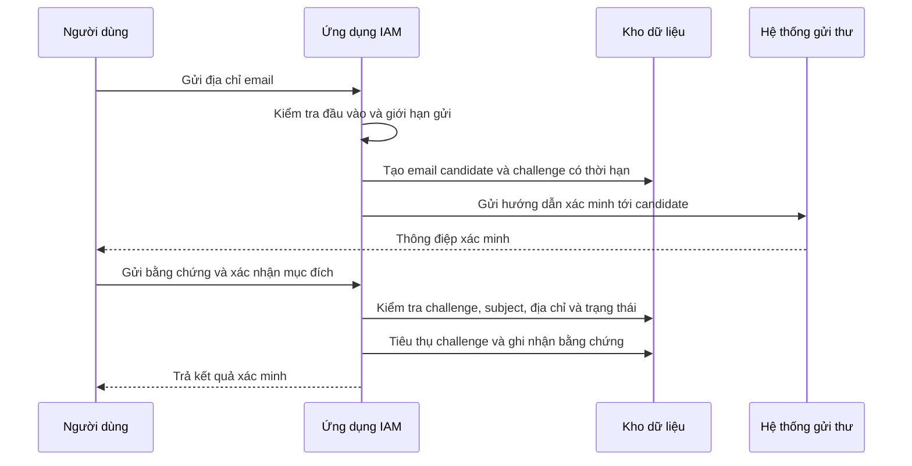

# Email attribute — Thuộc tính email trong quản lý danh tính

## 1. Email là thuộc tính có nhiều vai trò

Trong một hệ thống IAM, email thường xuất hiện ngay ở màn hình đăng ký. Người dùng nhập địa chỉ, nhận thông báo rồi có thể dùng chính địa chỉ đó để đăng nhập. Vì vậy, email dễ bị coi là “danh tính của người dùng”.

Thực tế, cùng một địa chỉ có thể phục vụ nhiều mục đích khác nhau:

| Vai trò của email | Câu hỏi hệ thống cần trả lời |
| --- | --- |
| Thông tin hồ sơ | Người dùng khai địa chỉ liên hệ nào? |
| Kênh thông báo | Hệ thống nên gửi thông báo đến đâu? |
| Tên đăng nhập | Chuỗi này đang ánh xạ tới tài khoản nào? |
| Kênh xác minh | Ai có thể nhận và sử dụng thông điệp gửi tới địa chỉ này? |
| Kênh khôi phục | Có được phép dùng hộp thư này để bắt đầu hoặc hoàn tất khôi phục không? |
| Thuộc tính từ IdP | Bên phát hành danh tính đang khẳng định điều gì về địa chỉ này? |
| Tín hiệu trong chính sách | Địa chỉ này có đủ tin cậy cho điều kiện truy cập đang xét không? |

Mỗi vai trò có điều kiện riêng. Một email hợp lệ về cú pháp chưa chắc nhận được thư. Một email nhận được thư chưa chắc thuộc về đúng người cần cấp quyền. Một email đã được xác minh cũng không tự trao quyền quản trị.

Ví dụ, Linh có tài khoản nội bộ `usr-1042`, email công việc `linh@example.com` và email dự phòng `linh.personal@example.net`. Khi Linh đổi tên hoặc chuyển đơn vị, địa chỉ công việc có thể thay đổi. Tài khoản, lịch sử cấp quyền và các sự kiện kiểm toán vẫn phải gắn với đúng chủ thể ban đầu.

Bài học tập trung vào cách mô hình hóa, xác minh, sử dụng và thay đổi thuộc tính email trong IAM. Các luồng đăng nhập, SSO, cấp phát tài khoản và khôi phục được dùng để làm rõ ranh giới tin cậy của thuộc tính này.

## 2. Tách email khỏi khóa định danh của tài khoản

### 2.1. Email có thể thay đổi hoặc được cấp lại

Một địa chỉ không phải lúc nào cũng gắn vĩnh viễn với một người:

- Nhân viên đổi tên hoặc đổi miền email của công ty.
- Người dùng ngừng sử dụng hộp thư cá nhân.
- Một tổ chức cấp lại địa chỉ của người đã nghỉ việc.
- Một hộp thư chung được nhiều người cùng quản lý.
- Một người có nhiều địa chỉ, alias hoặc địa chỉ chuyển tiếp.
- Một địa chỉ vẫn giữ nguyên nhưng người có quyền truy cập hộp thư đã thay đổi.

Nếu dữ liệu nghiệp vụ dùng email làm khóa liên kết chính, việc đổi email có thể kéo theo sửa lịch sử, sai liên kết hoặc chuyển quyền ngoài ý muốn.

Một mô hình đơn giản hơn:

```text
subjectId: usr-1042
    ├── hồ sơ người dùng
    ├── danh sách email
    ├── liên kết với IdP
    ├── membership trong tenant
    ├── quyền có hiệu lực
    └── lịch sử kiểm toán
```

`subjectId` là khóa nội bộ ổn định do ứng dụng quản lý. Email là một thuộc tính hoặc một danh sách thuộc tính gắn với khóa đó.

### 2.2. Đăng nhập bằng email vẫn có thể dùng khóa nội bộ

Cho phép người dùng nhập email khi đăng nhập không bắt buộc ứng dụng dùng email làm khóa chính.

```text
Email nhập khi đăng nhập
    -> tra cứu theo chính sách của ứng dụng
    -> xác định subjectId
    -> xác thực tài khoản
    -> tạo phiên gắn với subjectId
```

Nếu có nhiều tenant hoặc nhiều tài khoản cùng dùng một địa chỉ liên hệ, cơ chế tra cứu cần thêm ngữ cảnh hoặc một bước lựa chọn được thiết kế rõ. Không lấy bản ghi đầu tiên trả về từ database rồi coi đó là đúng tài khoản.

Địa chỉ email cũng không phải bí mật. Biết email của một tài khoản không chứng minh người gửi yêu cầu là chủ tài khoản.

### 2.3. Khóa liên kết trong OIDC

Trong OIDC, cặp `iss` và `sub` được dùng để nhận diện ổn định subject tại issuer; email không được bảo đảm là duy nhất. Vì vậy, liên kết đăng nhập liên kết nên lưu khóa issuer–subject thay vì dùng email làm khóa danh tính. Xem [OpenID Connect Core, mục 5.7](https://openid.net/specs/openid-connect-core-1_0.html#ClaimStability).

Hai IdP có cùng giá trị `sub` chưa chắc mô tả cùng một chủ thể. Ngược lại, hai subject cùng có một chuỗi email cũng chưa đủ chứng minh nên hợp nhất tài khoản.

Ứng dụng cần quản lý riêng quan hệ:

```text
(issuer, externalSubject) -> internalSubjectId
```

Khi email thay đổi, quan hệ đã xác lập không tự chuyển sang một tài khoản nội bộ khác.

## 3. Mô hình dữ liệu cần giữ được ý nghĩa và nguồn gốc

Một field `email: string` có thể đủ để hiển thị hồ sơ nhưng thường thiếu thông tin cho các quyết định nhạy cảm.

Ví dụ mô hình ứng dụng tự định nghĩa:

```json
{
  "subjectId": "usr-1042",
  "emails": [
    {
      "id": "email-21",
      "value": "linh@example.com",
      "type": "work",
      "primary": true,
      "source": "enterprise-directory",
      "verificationStatus": "VERIFIED",
      "verifiedAt": "2026-11-20T02:15:00Z",
      "verificationAuthority": "tenant-directory-7",
      "recoveryEnabled": false,
      "deliveryStatus": "UNKNOWN",
      "version": 4
    }
  ]
}
```

Các tên field trên là thiết kế minh họa, không phải schema mặc định của OIDC hoặc SCIM.

| Nhóm thông tin | Ý nghĩa |
| --- | --- |
| Giá trị email | Địa chỉ đang được lưu theo chính sách đầu vào |
| Loại địa chỉ | Ví dụ công việc, cá nhân hoặc liên hệ khác |
| Primary | Địa chỉ được ưu tiên cho một mục đích đã xác định |
| Nguồn | Người dùng tự khai, directory, IdP hoặc quy trình hỗ trợ |
| Bằng chứng xác minh | Trạng thái, thời điểm và bên đã xác minh |
| Điều kiện sử dụng | Có được dùng cho thông báo hoặc khôi phục không |
| Trạng thái giao nhận | Thông tin về khả năng gửi thư theo quan sát của hệ thống |
| Phiên bản | Hỗ trợ chống cập nhật dựa trên dữ liệu đã cũ |

Không nên dùng một cờ duy nhất để thay cho mọi ý nghĩa. `primary=true` không đồng nghĩa đã xác minh; `deliveryStatus=DELIVERED` không đồng nghĩa người dùng đã chứng minh quyền kiểm soát hộp thư.

Ngay cả từ “primary” cũng cần phạm vi rõ: email chính để hiển thị, để liên hệ hay để đăng nhập? Nếu hệ thống chỉ cho một primary trên mỗi tài khoản, cần kiểm soát điều đó khi cập nhật đồng thời.

Một địa chỉ chưa biết trạng thái xác minh nên được biểu diễn là chưa có bằng chứng phù hợp. Đừng biến giá trị thiếu thành `VERIFIED` chỉ để tương thích một màn hình cũ.

## 4. Xác minh email chứng minh được điều gì?

### 4.1. Phân biệt các loại kiểm tra

| Kiểm tra | Điều có thể kết luận | Điều chưa thể kết luận |
| --- | --- | --- |
| Cú pháp địa chỉ được chấp nhận | Chuỗi phù hợp tập định dạng ứng dụng hỗ trợ | Hộp thư tồn tại hoặc thuộc đúng người |
| Kiểm tra miền/DNS theo chính sách | Có thông tin kỹ thuật liên quan miền | Chủ tài khoản kiểm soát hộp thư |
| Nhà cung cấp báo chấp nhận thư | Hệ thống gửi đã nhận một kết quả giao nhận | Người cần xác minh đã đọc hoặc sử dụng thư |
| Hoàn tất challenge gửi qua email | Có bằng chứng truy cập thông điệp theo thiết kế challenge | Danh tính pháp lý hoặc quyền nghiệp vụ |
| Directory xác nhận email công việc | Nguồn quản trị đang gắn địa chỉ với subject | Người đó được phép làm mọi việc trong tổ chức |
| Email có cùng hậu tố miền | Chuỗi địa chỉ chứa miền mong đợi | Membership hiện hành hoặc quyền trong tenant |

Việc gửi một link rồi quan sát người nhận hoàn tất quy trình là bằng chứng có phạm vi: quyền truy cập thông điệp tại thời điểm đó theo giả định của hệ thống. Hộp thư có thể được chia sẻ, chuyển tiếp hoặc bị chiếm quyền.

Xác minh email không thay cho định danh nhân sự, kiểm tra membership hoặc phê duyệt cấp đặc quyền.

### 4.2. Bằng chứng gắn với đúng giá trị

Giả sử:

```text
email = linh@example.com
verificationStatus = VERIFIED
```

Nếu người dùng sửa thành `other@example.net`, không thể giữ nguyên trạng thái xác minh cũ. Bằng chứng đã tạo cho địa chỉ trước đó không nói gì về địa chỉ mới.

Nên coi một bằng chứng là gắn với ít nhất:

```text
subject
+ địa chỉ cụ thể
+ mục đích xác minh
+ yêu cầu hoặc phiên bản đang xử lý
+ bên xác minh
+ thời điểm và thời hạn khi có
```

Trong quy trình đổi email, địa chỉ hiện tại có thể tiếp tục hoạt động, còn địa chỉ mới được lưu như một candidate chưa xác minh. Cách này tránh làm mất ngay kênh khôi phục chỉ vì người dùng nhập sai một ký tự.

### 4.3. Trạng thái xác minh có yếu tố thời gian

`verifiedAt` giúp biết khi nào hệ thống có bằng chứng. Nó không bảo đảm người cũ vẫn kiểm soát hộp thư ở hiện tại.

Việc yêu cầu xác minh lại cần phù hợp rủi ro: ví dụ thay kênh khôi phục, có dấu hiệu chiếm tài khoản, directory thay đổi chủ sở hữu hoặc địa chỉ được cấp lại. Không có một thời hạn xác minh phổ quát cho mọi ứng dụng.

Cũng cần tách dữ liệu không còn mới khỏi dữ liệu sai. Một lần giao nhận thất bại có thể làm kênh liên lạc tạm không sử dụng được; nó không tự xác định một người khác đã sở hữu email đó.

## 5. Định dạng và chuẩn hóa email

### 5.1. Đừng dùng một regex đơn giản làm toàn bộ chính sách

Địa chỉ email có các quy tắc cú pháp phức tạp hơn “có một dấu @ và dấu chấm”. Ứng dụng nên chọn thư viện xử lý phù hợp, xác định tập địa chỉ được hỗ trợ và áp dụng nhất quán ở UI, API, lưu trữ và gửi thư.

Một ứng dụng có thể hỗ trợ một tập con để bảo đảm tương thích với hạ tầng gửi của mình. Khi từ chối một định dạng ngoài tập đó, cần phân biệt “ứng dụng chưa hỗ trợ” với khẳng định rằng địa chỉ ấy không hợp lệ trong mọi hệ thống thư.

Đầu vào cho một thuộc tính email thường là địa chỉ đơn, không phải nguyên chuỗi display name như `Linh <linh@example.com>`, trừ khi API chủ động hỗ trợ kiểu đó.

Cần ngăn ký tự điều khiển đi vào vị trí header không phù hợp, không ghép chuỗi đầu vào trực tiếp để tạo header thư, và dùng API gửi thư có cấu trúc.

### 5.2. Chữ hoa và chữ thường

Theo SMTP, phần local-part cần được bảo toàn chữ hoa/thường và có thể có ý nghĩa phân biệt; phần miền tuân theo DNS và không phân biệt hoa/thường. Vì vậy, lowercase toàn bộ địa chỉ không phải phép chuẩn hóa đúng cho mọi mailbox. Xem [RFC 5321, mục 2.4](https://www.rfc-editor.org/rfc/rfc5321.html#section-2.4).

Ví dụ:

```text
Linh@EXAMPLE.COM
Linh@example.com
linh@example.com
```

Có thể chuẩn hóa phần miền theo chính sách xử lý DNS của ứng dụng. Hai local-part `Linh` và `linh` có được coi như nhau khi tra cứu tài khoản hay không là một lựa chọn sản phẩm cần ghi rõ và đánh giá xung đột.

Nếu hệ thống chọn đăng nhập không phân biệt hoa/thường, cần áp dụng cùng cách so sánh khi tạo, sửa, tra cứu và kiểm tra trùng. Không nên đưa dữ liệu cũ vào quy tắc mới mà tự động gộp các tài khoản đang xung đột.

### 5.3. Dấu chấm, dấu cộng và alias

Không tự động xóa dấu chấm hoặc phần sau dấu `+` cho mọi miền:

```text
linh.team@example.com
linhteam@example.com
linh+project@example.com
linh@example.com
```

Những địa chỉ này có tương đương hay không phụ thuộc hệ thống nhận thư và cấu hình của miền. Quy tắc của một nhà cung cấp không phải quy tắc toàn Internet.

Ngay cả khi hai địa chỉ đều chuyển tới cùng hộp thư, việc gộp hai tài khoản ứng dụng vẫn là một quyết định liên kết danh tính riêng.

### 5.4. Email quốc tế hóa

Địa chỉ có ký tự ngoài ASCII cần được hỗ trợ đồng bộ từ kiểm tra đầu vào đến gửi thư. SMTPUTF8 là phần mở rộng phục vụ địa chỉ email quốc tế hóa. Xem [RFC 6531](https://www.rfc-editor.org/rfc/rfc6531.html).

Miền quốc tế hóa và local-part quốc tế hóa là hai vấn đề khác nhau. Không áp dụng phép đổi miền sang dạng ASCII cho toàn bộ địa chỉ rồi coi đó là hỗ trợ hoàn chỉnh.

Ngoài tương thích kỹ thuật, giao diện cần cân nhắc các ký tự trông giống nhau và cách hiển thị miền khi người dùng xác nhận đổi địa chỉ.

### 5.5. Tách giá trị hiển thị và khóa so sánh khi cần

Một thiết kế có thể giữ:

```text
value: địa chỉ được lưu để sử dụng và hiển thị
comparisonKey: khóa tra cứu theo chính sách ứng dụng
normalizationVersion: phiên bản quy tắc tạo khóa
```

Khóa so sánh không cần được đưa ra API công khai. Quan trọng là mọi đường ghi và tra cứu phải dùng cùng quy tắc, còn giá trị gửi thư vẫn được bảo toàn theo khả năng hệ thống hỗ trợ.

Khi thay đổi quy tắc, cần phân tích xung đột dữ liệu trước. Một phép “làm sạch” email có thể vô tình chuyển hai tài khoản khác nhau thành cùng khóa.

## 6. Tính duy nhất là một chính sách có phạm vi

“Email phải duy nhất” cần được diễn đạt đầy đủ: duy nhất trong một tenant, một hệ thống đăng nhập hay toàn bộ sản phẩm? Chỉ email đăng nhập phải duy nhất hay mọi địa chỉ liên hệ đều phải duy nhất?

Một sản phẩm có thể chọn:

| Chính sách | Hệ quả cần xử lý |
| --- | --- |
| Một email đăng nhập trên toàn hệ thống | Cần quy tắc tra cứu và xử lý trùng toàn cục |
| Một email đăng nhập trong mỗi tenant | Đăng nhập cần biết hoặc xác định đúng tenant |
| Cho phép email liên hệ dùng chung | Không thể dùng email đó để tự chọn duy nhất một tài khoản |
| Nhiều email trên một tài khoản | Cần phân biệt primary, alias và email dùng cho khôi phục |
| Chỉ địa chỉ đủ điều kiện mới được dùng đăng nhập | Luồng đăng ký và kích hoạt cần tách trạng thái |

Ràng buộc dữ liệu phải thực thi theo chính sách đã chọn. Ví dụ, nếu email đăng nhập cần duy nhất trong tenant, một khóa duy nhất có thể dựa trên `tenant_id` và `email_comparison_key` của các bản ghi đủ điều kiện đăng nhập.

Không chỉ dùng quy trình:

```text
SELECT kiểm tra chưa trùng
    -> một khoảng thời gian
    -> INSERT
```

Hai yêu cầu đồng thời có thể cùng vượt qua bước kiểm tra. Cần có ràng buộc tại kho dữ liệu hoặc cơ chế đồng bộ tương đương và xử lý xung đột khi ghi.

Không nên để một email tự khai, chưa được xác minh chiếm chỗ vô thời hạn rồi ngăn chủ hộp thư đăng ký. Nếu có giữ chỗ, cần thời hạn và quy trình giải quyết xung đột rõ ràng.

Cũng không được “sửa” xung đột bằng cách tự nhập quyền, đơn hàng hoặc membership từ hai tài khoản vào nhau. Hợp nhất dữ liệu là một thao tác có ảnh hưởng riêng.

## 7. Luồng xác minh email gắn với một yêu cầu cụ thể

Một luồng minh họa cho email mới:



Một bản ghi challenge phía server có thể chứa:

```text
challengeId
subjectId
tenantId nếu thuộc phạm vi tenant
emailCandidateId hoặc phiên bản giá trị
purpose = VERIFY_EMAIL
tokenDigest
expiresAt
consumedAt
attemptCount khi cần
```

Token xác minh cần khó đoán, có thời hạn và được quản lý để không dùng lại. Các nguyên tắc tương tự về token một lần, lưu trữ an toàn và chống tự động hóa được OWASP trình bày cho luồng khôi phục mật khẩu; khi áp dụng vào xác minh email, vẫn phải ràng buộc đúng mục đích. Xem [OWASP Forgot Password Cheat Sheet](https://cheatsheetseries.owasp.org/cheatsheets/Forgot_Password_Cheat_Sheet.html).

Trong một thiết kế dùng opaque token ngẫu nhiên có entropy cao, có thể lưu digest thay vì token thô. Server cần kiểm tra token bằng cơ chế phù hợp và xử lý việc tiêu thụ một lần cùng cập nhật trạng thái theo cách chống tranh chấp.

Nếu dùng mã ngắn, giới hạn số lần thử và giới hạn gửi đặc biệt quan trọng. Lưu digest của một mã có không gian nhỏ không tự làm mã đó chống được dò đoán khi dữ liệu lưu trữ bị lộ.

### 7.1. Các ràng buộc cần giữ

- Challenge của địa chỉ A không xác minh địa chỉ B.
- Challenge của subject A không được áp dụng cho subject B.
- Challenge trong tenant A không được chuyển sang tenant B.
- Token cho xác minh email không được dùng như token đặt lại mật khẩu.
- Token đã hết hạn, đã dùng hoặc bị hủy không được hoàn tất yêu cầu.
- Nếu candidate đã đổi, bằng chứng cũ phải bị từ chối hoặc chỉ được áp dụng cho candidate cũ theo quy trình riêng.

Việc click một URL có thể bị phần mềm quét thư hoặc cơ chế xem trước tự động thực hiện. Với thao tác nhạy cảm, trang mở từ link nên cho người dùng nhìn thấy mục đích và hoàn tất bước xác nhận thích hợp, thay vì coi mọi lần tải trang là ý định thay đổi tài khoản.

Trang xác minh không nên nhúng nội dung bên thứ ba làm lộ token qua URL hoặc dữ liệu tham chiếu. Token cũng không nên xuất hiện trong log truy cập không được bảo vệ.

## 8. Đổi email là thay đổi có thể tác động đến quyền kiểm soát tài khoản

### 8.1. Không ghi đè địa chỉ hiện tại ngay khi nhận request

Nếu email được dùng đăng nhập hoặc khôi phục, đổi nó có thể thay đổi người có khả năng lấy lại tài khoản.

Một quy trình nên phân biệt:

```text
Email hiện tại:
    linh@example.com
    trạng thái: đã xác minh

Yêu cầu thay đổi:
    newValue: linh.new@example.net
    trạng thái: chờ xác minh
    requestId: change-58
    expiresAt: thời hạn của yêu cầu
```

Tài khoản vẫn là `usr-1042`. Email mới chưa được dùng ngay làm kênh khôi phục chỉ vì request đã được nhận.

Đổi email cần xác minh lại chủ thể theo mức rủi ro. OWASP khuyến nghị xác thực lại, lưu địa chỉ mới ở trạng thái chờ, xác nhận địa chỉ mới và xử lý địa chỉ cũ theo quy trình phù hợp; hướng dẫn phân biệt trường hợp có MFA và chưa có MFA. Xem [OWASP — Changing a User’s Registered Email Address](https://cheatsheetseries.owasp.org/cheatsheets/Authentication_Cheat_Sheet.html#changing-a-users-registered-email-address).

Ứng dụng dùng passkey hoặc SSO cần chọn cách xác thực lại phù hợp với tài khoản; không bắt mọi người nhập một mật khẩu cục bộ mà tài khoản của họ chưa từng có.

### 8.2. Điều kiện hoàn tất

Một thiết kế có thể yêu cầu các điều kiện sau:

```text
Yêu cầu đang có hiệu lực
AND chủ thể đã được xác thực lại theo chính sách
AND bằng chứng cho đúng địa chỉ mới đã được xác minh
AND các bước xác nhận bổ sung đã hoàn tất nếu cần
AND không vi phạm ràng buộc trùng email
AND phiên bản tài khoản chưa thay đổi theo cách làm yêu cầu mất hiệu lực
```

Việc commit nên cập nhật đồng bộ email, bằng chứng xác minh và trạng thái yêu cầu. Nếu tiêu thụ token rồi cập nhật thất bại, hoặc cập nhật thành công mà token vẫn dùng lại được, hệ thống có thể rơi vào trạng thái khó phục hồi hoặc tạo điều kiện tranh chấp.

Sau thay đổi, cần xử lý chỉ mục đăng nhập, cache, challenge đang tồn tại và thông báo theo chính sách. Nếu phiên chứa bản sao email, bản sao đó không được dùng để ghi ngược dữ liệu cũ vào hồ sơ.

### 8.3. Khi mất quyền truy cập email cũ

Đây là luồng khôi phục có rủi ro riêng, không nên biến thành đường tắt “không nhận được thư thì bỏ xác nhận”.

Có thể cần bằng chứng đã thiết lập trước, xác thực bằng authenticator khác hoặc quy trình hỗ trợ được kiểm soát. Quyền sửa email của nhân viên hỗ trợ cũng cần phạm vi, ghi nhận và phê duyệt tương ứng với khả năng chiếm quyền tài khoản mà thao tác đó tạo ra.

Thông báo tới địa chỉ cũ không tự giải quyết mọi trường hợp. Địa chỉ cũ có thể không còn an toàn. Hệ thống cần quyết định kênh nào đáng tin cho từng tình huống và tránh gửi dữ liệu nhạy cảm không cần thiết.

## 9. Ví dụ Java: giá trị mới không kế thừa bằng chứng cũ

Ví dụ sau dùng Java 17 trở lên để biểu diễn một bất biến dữ liệu: bằng chứng xác minh thuộc về một giá trị email cụ thể.

Mã không triển khai gửi thư, xác thực token hoặc xác thực lại người dùng. Các thao tác xác minh trong ví dụ chỉ được gọi từ phần server đáng tin cậy sau khi đã kiểm tra bằng chứng.

```java
import java.time.Instant;
import java.util.Objects;

public final class EmailAttributeExample {

    enum VerificationStatus {
        UNVERIFIED,
        VERIFIED
    }

    record VerificationEvidence(
            String authority,
            Instant verifiedAt) {

        VerificationEvidence {
            Objects.requireNonNull(authority);
            Objects.requireNonNull(verifiedAt);
        }
    }

    record EmailAttribute(
            String value,
            VerificationStatus status,
            VerificationEvidence evidence) {

        EmailAttribute {
            Objects.requireNonNull(value);
            Objects.requireNonNull(status);

            if (value.isBlank()) {
                throw new IllegalArgumentException("EMAIL_REQUIRED");
            }

            boolean verified = status == VerificationStatus.VERIFIED;
            if (verified != (evidence != null)) {
                throw new IllegalArgumentException(
                        "INCONSISTENT_VERIFICATION_STATE");
            }
        }

        static EmailAttribute unverified(String validatedValue) {
            return new EmailAttribute(
                    validatedValue,
                    VerificationStatus.UNVERIFIED,
                    null);
        }

        EmailAttribute verifiedByTrustedFlow(
                String expectedValue,
                VerificationEvidence verifiedEvidence) {

            if (!value.equals(expectedValue)) {
                throw new IllegalArgumentException(
                        "EVIDENCE_FOR_DIFFERENT_VALUE");
            }

            return new EmailAttribute(
                    value,
                    VerificationStatus.VERIFIED,
                    Objects.requireNonNull(verifiedEvidence));
        }

        EmailAttribute candidateFor(String validatedNewValue) {
            return unverified(validatedNewValue);
        }
    }

    public static void main(String[] args) {
        var oldEmail = EmailAttribute
                .unverified("linh@example.com")
                .verifiedByTrustedFlow(
                        "linh@example.com",
                        new VerificationEvidence(
                                "application-email-challenge",
                                Instant.parse("2026-11-20T02:15:00Z")));

        var candidate = oldEmail.candidateFor("linh.new@example.net");

        System.out.println(oldEmail.status());
        System.out.println(candidate.status());
        System.out.println(candidate.evidence() == null);

        try {
            candidate.verifiedByTrustedFlow(
                    "linh@example.com",
                    oldEmail.evidence());
        } catch (IllegalArgumentException rejected) {
            System.out.println(rejected.getMessage());
        }
    }
}
```

Kết quả dự kiến:

```text
VERIFIED
UNVERIFIED
true
EVIDENCE_FOR_DIFFERENT_VALUE
```

Các tên `validatedValue` chỉ nói lên hợp đồng của ví dụ: đầu vào đã qua bộ kiểm tra và chuẩn hóa phù hợp trước đó. Kiểm tra `isBlank()` trong constructor không phải bộ xác thực cú pháp email.

Phép so sánh `expectedValue` là so sánh với giá trị đã được ràng buộc trong challenge phía server. Nó không phải quy tắc so sánh mailbox tổng quát.

Quan trọng hơn, một đối tượng Java có tên `VerificationEvidence` không tự trở thành bằng chứng đáng tin. Client không được gửi JSON rồi yêu cầu backend dựng trực tiếp trạng thái `VERIFIED`. Ranh giới API phải chỉ cho phép sửa những field người dùng được quyền khai báo.

Trong ứng dụng có lưu trữ, candidate còn cần gắn với subject, tenant, requestId và version. Cập nhật cuối cùng cần bảo đảm yêu cầu vẫn là yêu cầu hiện hành và token được tiêu thụ đúng một lần.

## 10. Email và email_verified trong OIDC

Ví dụ một phần claim:

```json
{
  "iss": "https://login.example.com",
  "sub": "external-user-781",
  "email": "linh@example.com",
  "email_verified": true
}
```

Đây là tập claim rút gọn để giải thích thuộc tính, không phải ID Token đầy đủ có thể dùng ngay.

Trong OIDC, `email_verified=true` cho biết OP đã thực hiện bước khẳng định người dùng kiểm soát email tại thời điểm xác minh; phương thức cụ thể phụ thuộc ngữ cảnh tin cậy. Nó không bảo đảm quyền kiểm soát hiện tại mãi mãi. Xem [OpenID Connect Core, mục 5.1](https://openid.net/specs/openid-connect-core-1_0.html#StandardClaims).

Ứng dụng chỉ sử dụng claim sau khi xác minh phản hồi theo giao thức và chính sách issuer. Nếu claim thiếu, sai kiểu hoặc nguồn không đủ tin cậy, không tự coi email là đã xác minh.

Khi nhập email từ IdP, nên giữ provenance riêng thay vì ghi rằng chính ứng dụng đã gửi challenge. Nếu lần đăng nhập sau trả email khác, cần xử lý đó là cập nhật thuộc tính theo hợp đồng tích hợp, giữ nguyên liên kết subject đã xác lập.

## 11. Trùng email không đủ để liên kết hai tài khoản

Giả sử ứng dụng đã có tài khoản cục bộ:

```text
subjectId = usr-1042
email = linh@example.com
```

Một lần đăng nhập SSO mới trả về:

```text
issuer = https://another-idp.example.net
sub = external-999
email = linh@example.com
```

Nếu ứng dụng chỉ tìm email rồi gán luôn phiên SSO cho `usr-1042`, quyền truy cập tài khoản cục bộ phụ thuộc vào khả năng khẳng định email của IdP mới.

Ngay cả khi nguồn mới gửi một cờ xác minh, cần xem nguồn đó có được tin cậy cho việc liên kết với tài khoản này hay không. Một IdP cho phép người dùng tự sửa email tùy ý không tương đương directory doanh nghiệp có quy trình quản trị được thỏa thuận.

Một luồng liên kết có thể yêu cầu người dùng xác thực lại tài khoản hiện hữu, xác thực danh tính ngoài và xác nhận thao tác liên kết. Nếu dùng ánh xạ do doanh nghiệp cấp phát, cần có nguồn và khóa đối chiếu đáng tin cậy riêng.

OWASP cũng hướng dẫn bảo vệ liên kết tài khoản liên kết bằng bằng chứng quyền kiểm soát tài khoản hiện có thay vì chỉ dựa vào một email trùng. Xem [OWASP — Secure Federated Account Linking](https://cheatsheetseries.owasp.org/cheatsheets/Authentication_Cheat_Sheet.html#secure-federated-account-linking).

### 11.1. Tài khoản đăng ký trước nhưng chưa xác minh

Một người có thể tạo bản ghi bằng email của người khác mà chưa kiểm soát hộp thư. Khi chủ hộp thư thật đăng nhập sau đó, hệ thống không nên tự coi bản ghi chờ đó là nền tảng đáng tin rồi giữ nguyên mọi phương thức đăng nhập hoặc phiên đã tạo trước.

Cần có chính sách xử lý đăng ký chưa hoàn tất, các liên kết đã tồn tại và bằng chứng của chủ tài khoản. Nếu chuyển quyền kiểm soát một bản ghi chờ cho người dùng hợp lệ, phải bảo đảm những đường đăng nhập do bên khác thiết lập không còn tạo quyền truy cập trái phép.

### 11.2. Email được cấp lại

Một nhân viên mới nhận email cũ của người đã nghỉ việc có thể nhận thư gửi tới địa chỉ đó. Điều này không tự làm nhân viên mới trở thành subject của người cũ trong ứng dụng.

Vì vậy, việc khôi phục tài khoản doanh nghiệp nên được phối hợp với lifecycle nhân sự, directory và chính sách authenticator. Không nên duy trì vô thời hạn một đường “có mailbox là lấy lại mọi tài khoản lịch sử” mà không xét việc cấp lại địa chỉ.

## 12. Email trong SCIM và cấp phát tài khoản

SCIM biểu diễn `emails` là thuộc tính nhiều giá trị, có các thành phần như `value`, `type` và `primary`. `primary` thể hiện lựa chọn ưu tiên, không phải bằng chứng xác minh hộp thư. Core schema không định nghĩa `emails[].verified` như một cờ xác minh email chuẩn. Xem [RFC 7643, mục 4.1.2](https://www.rfc-editor.org/rfc/rfc7643.html#section-4.1.2).

Ví dụ payload rút gọn:

```json
{
  "schemas": [
    "urn:ietf:params:scim:schemas:core:2.0:User"
  ],
  "userName": "directory-user-1042",
  "emails": [
    {
      "value": "linh@example.com",
      "type": "work",
      "primary": true
    },
    {
      "value": "linh.personal@example.net",
      "type": "home"
    }
  ]
}
```

Không có cờ xác minh trong payload trên. Nếu muốn tin cậy địa chỉ từ nguồn provisioning, ứng dụng cần một hợp đồng nguồn dữ liệu và cách ghi nhận provenance; không suy ra từ việc field đã có giá trị.

Khi đồng bộ, cần xác định nguồn có thẩm quyền cho từng thuộc tính. Ví dụ directory quản lý email công việc, còn người dùng quản lý email cá nhân. Tránh để một lần đồng bộ ghi đè địa chỉ đã xác minh bằng giá trị tự khai từ nguồn có độ tin cậy thấp hơn.

Nếu issuer không cung cấp thời điểm xác minh email, không lấy thời điểm phát token hay thời điểm đồng bộ rồi ghi thành `verifiedAt`. Có thể lưu riêng `observedAt` và ghi rằng thời điểm xác minh thực tế chưa biết.

Xóa một địa chỉ, vô hiệu hóa tài khoản và thu hồi phiên là các thay đổi có ý nghĩa khác nhau. Khi nhân viên nghỉ việc, chỉ xóa email không bảo đảm người đó mất quyền truy cập. Ngược lại, địa chỉ thay đổi không nhất thiết có nghĩa tài khoản phải bị xóa.

## 13. Dùng email trong chính sách truy cập

### 13.1. Hậu tố miền không thay thế membership

Một điều kiện như sau quá đơn giản:

```text
nếu email chứa "@example.com":
    cho phép truy cập tenant doanh nghiệp
```

Nó chưa trả lời email do ai cung cấp, đã được xác minh theo cách nào và người đó có membership hiện hành hay không.

Kiểm tra chuỗi cũng có thể sai nếu không phân tích đúng phần miền. Chẳng hạn `person@example.com.other.invalid` không thuộc miền `example.com`. Nên kiểm tra miền đã được parser xác định bằng quy tắc rõ ràng, thay vì tìm một đoạn con.

Dù so sánh miền chính xác, quyết định truy cập doanh nghiệp vẫn cần dựa vào nguồn có thẩm quyền và chính sách membership. Miền email có thể bao gồm nhà thầu, hộp thư dùng chung hoặc người đã hết nhiệm vụ.

Email có thể là một đầu vào của ABAC, nhưng độ tin cậy của đầu vào phải đủ cho quyết định. Nếu người dùng tự sửa thuộc tính rồi chính thuộc tính ấy cấp đặc quyền, quyền sửa hồ sơ đã trở thành đường tự cấp quyền.

### 13.2. Lời mời vào tenant

Một lời mời gửi tới email cần có quy tắc gắn với tài khoản chấp nhận:

```text
Lời mời:
    tenantId = tenant-a
    intendedEmail = linh@example.com
    requestedRole = member
    expiresAt = thời hạn

Khi chấp nhận:
    xác định subject đã đăng nhập
    kiểm tra bằng chứng địa chỉ theo chính sách lời mời
    kiểm tra token và trạng thái lời mời
    tạo membership cho đúng subject, đúng tenant
```

Chỉ sở hữu URL lời mời có đủ hay không là lựa chọn chính sách cần được xác định. Một URL bị chuyển tiếp không nên vô tình cấp đặc quyền cho tài khoản không phải người dự kiến.

Vai trò được mời cũng phải nằm trong quyền cấp của người gửi. Xác minh email người nhận không sửa được lỗi người gửi có thể mời người khác vào vai trò quản trị vượt quyền.

### 13.3. Workload và địa chỉ liên hệ

Một service account có thể có email liên hệ của nhóm vận hành. Người kiểm soát hộp thư liên hệ không tự là danh tính workload và không nên được mặc định nhận secret của workload.

Danh tính workload cần khóa định danh, phương thức xác thực và quyền riêng. Email liên hệ phục vụ thông báo hoặc trách nhiệm sở hữu theo chính sách.

## 14. Email như một kênh khôi phục

Nếu email được dùng để lấy lại tài khoản, độ an toàn của kênh khôi phục ảnh hưởng trực tiếp đến độ an toàn của tài khoản.

Nên tách các câu hỏi:

| Câu hỏi | Ví dụ dữ liệu hoặc chính sách liên quan |
| --- | --- |
| Đây có phải địa chỉ hiện hành không? | Trạng thái email và version |
| Có bằng chứng phù hợp không? | Nguồn xác minh, địa chỉ được xác minh |
| Có được dùng cho khôi phục không? | Cấu hình và chính sách tài khoản |
| Tài khoản cần mức bảo đảm nào? | Loại tài khoản và đặc quyền |
| Có sự kiện rủi ro không? | Email vừa đổi, nghi ngờ chiếm tài khoản |
| Những phiên hoặc authenticator nào cần xử lý sau khôi phục? | Chính sách vòng đời truy cập |

Một email đã xác minh dùng cho thông báo không nhất thiết được dùng khôi phục. Tài khoản đặc quyền hoặc workload có thể cần cơ chế riêng.

Không nên đồng nhất mã gửi qua email với MFA chống phishing. Nếu cùng hộp thư có thể đặt lại mật khẩu và thay đổi mọi yếu tố khác, các lớp bảo vệ có thể cùng phụ thuộc vào một điểm kiểm soát.

Với request khôi phục công khai, nên hạn chế tiết lộ tài khoản có tồn tại hay không, kiểm soát gửi quá mức và tránh khác biệt phản hồi dễ bị khai thác. Đây cũng là các vấn đề được nêu trong [OWASP Forgot Password Cheat Sheet](https://cheatsheetseries.owasp.org/cheatsheets/Forgot_Password_Cheat_Sheet.html).

Một phản hồi chung không có nghĩa phải gửi thư tới mọi địa chỉ nhập vào. Backend vẫn cần xác định kênh phù hợp và bảo vệ hệ thống gửi khỏi lạm dụng.

## 15. Bảo vệ quyền sửa thuộc tính và dữ liệu cá nhân

### 15.1. Tách field người dùng khai báo và field do server quyết định

Một API tự phục vụ có thể cho phép người dùng đề nghị giá trị email mới. Nó không nên nhận toàn bộ đối tượng nội bộ như sau rồi ghi thẳng:

```json
{
  "value": "other@example.net",
  "verificationStatus": "VERIFIED",
  "verificationAuthority": "trusted-directory",
  "recoveryEnabled": true
}
```

Các field xác minh và quyền sử dụng cần do server cập nhật thông qua nghiệp vụ được bảo vệ. Nếu dùng cơ chế binding tự động, cần allowlist field được phép nhận và chặn việc sửa thuộc tính bảo vệ qua các endpoint phụ.

Nhân viên hỗ trợ, tài khoản provisioning và người dùng tự sửa hồ sơ có phạm vi khác nhau. Cần ghi nhận ai sửa giá trị, ai xác minh và quy trình nào đã cho phép thay đổi.

### 15.2. Hạn chế lộ địa chỉ qua API và log

Email thường là dữ liệu nhận diện cá nhân. Chỉ trả địa chỉ đầy đủ khi người gọi và chức năng thực sự cần. Việc nhiều thành viên cùng tenant không tự cho phép mọi người liệt kê tất cả email.

Đối với audit, ưu tiên khóa subject ổn định và loại sự kiện:

```json
{
  "eventType": "EMAIL_CHANGE_COMPLETED",
  "actorId": "usr-1042",
  "targetSubjectId": "usr-1042",
  "emailAttributeId": "email-22",
  "changeRequestId": "change-58",
  "result": "SUCCESS"
}
```

Nếu cần lưu địa chỉ cũ và mới cho điều tra, kho bằng chứng đó phải có quyền đọc và thời hạn giữ phù hợp. Không đưa token xác minh hoặc link khôi phục nguyên vẹn vào sự kiện.

Masking giúp giảm lộ qua giao diện, nhưng không biến dữ liệu phía server thành vô danh. Băm email bằng hàm băm thông thường cũng không tự ẩn danh đáng tin cậy vì địa chỉ có thể bị đoán và đối chiếu.

Nội dung email hiển thị trong HTML cần được xử lý theo ngữ cảnh đầu ra. Việc đã xác minh hộp thư không làm chuỗi đó trở thành HTML an toàn.

### 15.3. Đảm bảo thay đổi lan truyền có kiểm soát

Khi email đổi, có thể cần cập nhật chỉ mục đăng nhập, hệ thống thông báo và bản sao hồ sơ. Các consumer nên dùng `subjectId` làm khóa và xử lý version để sự kiện đến muộn không khôi phục địa chỉ cũ.

Nếu email là dữ liệu do directory quản lý, cho sửa cục bộ rồi để lần sync sau ghi ngược mà không thông báo sẽ tạo trải nghiệm khó hiểu và dữ liệu tin cậy không nhất quán.

## 16. Ma trận kiểm thử cho thuộc tính email

Các phép kiểm tra nên xác minh trạng thái dữ liệu và quyền truy cập sau thao tác, không chỉ mã HTTP:

| Tình huống | Kết quả mong đợi |
| --- | --- |
| Địa chỉ đúng cú pháp nhưng chưa xác minh | Không tự có bằng chứng xác minh hoặc quyền khôi phục |
| Người dùng đổi giá trị sau khi đã xác minh | Giá trị mới không kế thừa bằng chứng cũ |
| Token dành cho candidate cũ | Không xác minh candidate mới |
| Token dùng cho subject hoặc tenant khác | Bị từ chối |
| Token hết hạn hoặc đã tiêu thụ | Không hoàn tất yêu cầu thêm lần nữa |
| Hai request đồng thời chiếm cùng email đăng nhập | Ràng buộc duy nhất được giữ theo phạm vi đã chọn |
| Hai request cùng tiêu thụ một token | Tối đa một lần hoàn tất thay đổi có hiệu lực |
| Sửa email nhưng gửi kèm field xác minh | Không cho client tự đặt field bảo vệ |
| Claim thiếu cờ xác minh hoặc sai kiểu | Không mặc định coi đã xác minh |
| Hai issuer đưa cùng email | Không tự hợp nhất tài khoản |
| Email trong token đổi nhưng issuer–subject giữ nguyên | Cập nhật thuộc tính theo hợp đồng, không đổi nhầm subject |
| Payload provisioning có primary nhưng không có bằng chứng | Không suy ra hộp thư đã được xác minh |
| Quy tắc chuẩn hóa thay đổi gây trùng | Phát hiện xung đột trước khi áp dụng, không tự gộp dữ liệu |
| Email được cấp lại cho người khác | Không tự chuyển dữ liệu lịch sử và đặc quyền của subject cũ |
| Sự kiện cập nhật cũ đến sau sự kiện mới | Không ghi lùi giá trị hiện hành |
| Gửi xác minh hoặc khôi phục quá mức | Giới hạn được thực thi, không gây gửi thư vô hạn |

Nên có kiểm thử tích hợp cho đường gửi, nhận xác nhận và commit vì unit test của model không chứng minh token thực sự được ràng buộc đúng ở API.

Với đổi email, cần kiểm tra tài khoản vẫn đăng nhập được theo trạng thái đã thiết kế khi yêu cầu hết hạn hoặc bị hủy. Việc gửi thư thất bại không nên làm mất ngay kênh truy cập hiện hữu.

Khi kiểm thử địa chỉ có dấu cộng, chữ hoa hoặc ký tự quốc tế, kỳ vọng phải dựa trên chính sách hỗ trợ của ứng dụng. Không viết test mặc định mọi alias là một tài khoản hoặc mọi dạng chữ hoa là một mailbox khác.

## 17. Những nguyên tắc cần vận dụng

Email là thuộc tính có thể thay đổi, được chia sẻ hoặc được cấp lại. Giữ khóa định danh tài khoản ổn định giúp các thay đổi đó không chuyển quyền và lịch sử sang sai người.

Mỗi bằng chứng xác minh cần có nguồn gốc và gắn với đúng địa chỉ. “Có email”, “email đã xác minh”, “được dùng để khôi phục” và “được cấp quyền nghiệp vụ” là các trạng thái cần được quản lý riêng.

Khi thiết kế IAM, hãy lần theo vòng đời: giá trị đến từ đâu, ai có thể sửa, bằng chứng nào được chấp nhận, điều kiện nào cho phép sử dụng và điều gì xảy ra khi giá trị thay đổi. Cách nhìn này giúp email phục vụ đăng nhập, SSO, thông báo và khôi phục mà vẫn giữ rõ ranh giới danh tính và quyền truy cập.
