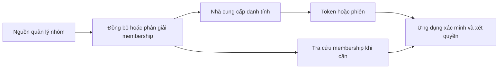

# Group attribute — Thuộc tính nhóm trong quản lý danh tính

## 1. Group attribute cho biết điều gì?

Lan là nhân viên thuộc nhóm xử lý hóa đơn và nhóm dự án triển khai hệ thống kế toán. Khi Lan đăng nhập một ứng dụng, ứng dụng có thể nhận hoặc tra cứu thông tin về các nhóm của Lan. Thông tin này là một đầu vào để xét quyền, nhưng chưa tự trả lời Lan được đọc, sửa hay phê duyệt hóa đơn nào.

**Group attribute** là thuộc tính biểu diễn quan hệ thành viên giữa một danh tính và một hoặc nhiều nhóm. Nhóm có thể tập hợp người dùng theo đơn vị tổ chức, dự án, nhiệm vụ vận hành, quyền truy cập được cấp hoặc một tiêu chí được hệ thống quản lý.

Trong một mô hình đơn giản:

```text
Danh tính: Lan
Các nhóm:
  - Nhóm xử lý hóa đơn
  - Nhóm dự án kế toán
```

Để dùng trong IAM, hệ thống cần biết nhiều hơn tên nhóm:

- Nhóm nào được nói đến và thuộc miền quản lý nào?
- Nguồn nào xác nhận Lan là thành viên?
- Quan hệ đó là trực tiếp, suy ra qua nhóm khác hay tính theo quy tắc?
- Bằng chứng phản ánh thời điểm nào?
- Policy nào chuyển thông tin nhóm thành quyền trên tài nguyên?

Bài học này tập trung vào group attribute như một thuộc tính danh tính. Người học cần biết cách biểu diễn, trao đổi, kiểm chứng và quản lý nó trong xác thực liên kết, cấp phát tài khoản và phân quyền. Không nên coi một mảng chuỗi mang tên `groups` là toàn bộ hệ thống quản lý quyền.

## 2. Phân biệt nhóm, thuộc tính nhóm, vai trò và quyền

| Khái niệm | Ý nghĩa | Ví dụ |
| --- | --- | --- |
| Nhóm | Một thực thể tập hợp các thành viên | Nhóm nhân viên kế toán miền Nam |
| Membership | Quan hệ một danh tính thuộc một nhóm | Lan là thành viên nhóm kế toán miền Nam |
| Group attribute | Cách biểu diễn các quan hệ nhóm của danh tính | Danh sách định danh nhóm trong hồ sơ đã xác minh |
| Vai trò | Một tập trách nhiệm hoặc khả năng của ứng dụng | Người phê duyệt hóa đơn |
| Quyền | Hành động được phép trên phạm vi tài nguyên | Phê duyệt hóa đơn tenant A dưới một hạn mức |
| Claim nhóm | Thông tin nhóm được một bên phát hành đưa vào token hoặc assertion | Claim chứa định danh nhóm được ứng dụng nhận |
| Tenant | Phạm vi khách hàng hoặc tổ chức mà ứng dụng cách ly | Doanh nghiệp A trong nền tảng hóa đơn |

Một nhóm có thể được ánh xạ vào một vai trò, nhưng hai khái niệm không đồng nhất. Nhóm dự án có thể chỉ phục vụ trao đổi công việc. Nhóm kế toán có thể được dùng cho nhiều ứng dụng, còn mỗi ứng dụng gán các quyền khác nhau theo chính sách riêng.

Ví dụ:

```text
Nhóm g-invoice-reviewers
  -> ánh xạ được phê duyệt
  -> vai trò invoice-reviewer
  -> quyền đọc và nhận xét hóa đơn của tenant A
```

Chuỗi này có ít nhất ba phần có thể thay đổi độc lập: thành viên của nhóm, ánh xạ nhóm sang vai trò và tập quyền của vai trò. Điều tra quyền phải xét cả ba.

Ngược lại, nếu ứng dụng ghi “mọi người trong nhóm Finance đều là quản trị viên”, nó đang đặt một policy rất rộng lên nhóm tổ chức. Việc nhóm có tên phù hợp với phòng ban không chứng minh mọi thành viên cần cùng mức quyền.

## 3. Group attribute thường có nhiều giá trị

Một người có thể thuộc nhiều nhóm đồng thời. Do đó, group attribute thường cần biểu diễn một tập membership, không phải một ô văn bản duy nhất.

Một biểu diễn nội bộ có thể là:

```json
{
  "subjectKey": {
    "issuer": "https://login.example.test",
    "subjectId": "user-145"
  },
  "groupKeys": [
    {
      "authority": "company-directory",
      "directoryId": "directory-a",
      "groupId": "g-invoice-reviewers"
    },
    {
      "authority": "company-directory",
      "directoryId": "directory-a",
      "groupId": "g-accounting-project"
    }
  ]
}
```

Đây là mô hình minh họa do ứng dụng tự định nghĩa, không phải schema bắt buộc của OIDC, SCIM hoặc một nhà cung cấp cụ thể. `subjectKey` và `groupKeys` chỉ có giá trị bảo mật khi được tạo từ nguồn tin cậy, sau các bước xác minh và ánh xạ thích hợp.

Một số đặc điểm cần quy định:

- Membership có được hiểu như tập hợp, không phụ thuộc thứ tự hay không?
- Các định danh được so sánh theo quy tắc nào?
- Một nguồn có thể trả nhiều mục trùng nhau không?
- Mảng biểu diễn nhóm trực tiếp, nhóm suy ra hay cả hai?
- Danh sách có đầy đủ trong phạm vi policy cần xét không?

Không nên nối nhóm thành chuỗi rồi kiểm tra bằng tìm kiếm chuỗi con:

```text
Dữ liệu: "invoice-admin-assistant,project-member"
Kiểm tra sai: chuỗi có chứa "invoice-admin" hay không
```

Tên dài hơn chứa cùng một đoạn ký tự không chứng minh có membership trong nhóm quản trị. Kiểm tra cần dựa trên các phần tử có kiểu và định danh đúng theo hợp đồng dữ liệu.

## 4. Định danh nhóm phải tách khỏi tên hiển thị

Một directory có thể có nhóm:

```text
groupId: g-204
displayName: Finance
```

Tên hiển thị phục vụ người dùng; định danh phục vụ liên kết thực thể. Trong thiết kế nên dùng định danh ổn định mà nguồn bảo đảm cho nhóm, rồi thêm ngữ cảnh của nguồn nếu định danh chỉ duy nhất trong một phạm vi.

| Giá trị | Có thể dùng để làm gì? | Điều cần kiểm tra |
| --- | --- | --- |
| Tên hiển thị | Hiển thị và tìm kiếm cho con người | Có thể đổi tên hoặc trùng tên |
| Định danh nhóm | Tham chiếu nhóm trong policy | Duy nhất trong phạm vi nào, vòng đời ra sao |
| Đường dẫn nhóm | Định vị trong một cấu trúc quản lý | Di chuyển nhóm có làm đổi đường dẫn không |
| Tên nguồn hoặc directory | Phân biệt các miền nhóm | Nguồn có được ứng dụng tin cậy cho quyền này không |
| Mã tenant ứng dụng | Giới hạn phạm vi quyền | Có ánh xạ được duyệt từ directory sang tenant không |

### 4.1. Đổi tên không nên vô tình làm đổi quyền

Nếu nhóm `g-204` đổi tên từ Finance thành Accounting, ánh xạ dựa trên định danh có thể giữ nguyên quan hệ với cùng thực thể. Policy dựa trên tên có thể mất tác dụng hoặc bắt nhầm một nhóm khác có tên cũ.

Tuy nhiên, tên mới có thể phản ánh thay đổi mục đích của nhóm. Định danh ổn định giúp tránh lỗi kỹ thuật khi đổi tên, nhưng không thay thế việc xem lại nhóm còn phù hợp với quyền hay không.

### 4.2. Xóa và tạo lại không mặc nhiên là cùng nhóm

Nếu nhóm cũ bị xóa rồi một nhóm mới cùng tên được tạo, cần coi đây là một thực thể mới trừ khi quy trình quản trị đã xác nhận và cấp lại ánh xạ. Không tự chuyển quyền đặc biệt chỉ vì tên mới khớp tên cũ.

Cần kiểm tra cam kết của directory về tính ổn định và tái sử dụng định danh. Ứng dụng không nên tự giả định mọi hệ thống đều có cùng quy tắc vòng đời.

### 4.3. Cùng groupId ở hai nguồn có thể là hai nhóm khác nhau

```text
Nguồn nội bộ / directory A / groupId 204
Nguồn đối tác / directory B / groupId 204
```

Hai khóa này không được gộp chỉ vì phần `204` giống nhau. Một khóa nội bộ có thể cần kết hợp authority, directory và groupId; cấu trúc thực tế phụ thuộc nguồn bảo đảm tính duy nhất ở đâu.

## 5. Bằng chứng membership cần những thông tin nào?

Danh sách nhóm trong hồ sơ không tự nói rõ nó đáng tin đến đâu hoặc còn mới không. Khi hệ thống dùng nhóm để xét quyền, nên quản lý bằng chứng phục vụ quyết định.

Ví dụ về một kết quả tra cứu nội bộ:

```json
{
  "subject": "company-directory/user-145",
  "group": "company-directory/directory-a/g-invoice-reviewers",
  "membershipResult": "MEMBER",
  "membershipMode": "DIRECT",
  "observedAt": "2026-11-26T02:00:00Z",
  "source": "approved-membership-resolver",
  "evidenceRef": "membership-check-582"
}
```

Các field trên cũng là quy ước minh họa của ứng dụng. `observedAt` là thời điểm hệ thống quan sát hoặc nhận bằng chứng membership theo hợp đồng đã định, không tự động là thời điểm membership được tạo.

Những thông tin quan trọng gồm:

1. **Chủ thể:** bằng chứng thuộc đúng danh tính đang thực hiện yêu cầu.
2. **Nhóm và nguồn:** đúng nhóm trong miền được tin cậy.
3. **Cách suy ra:** trực tiếp hay có xét quan hệ khác.
4. **Độ mới:** bằng chứng còn đáp ứng yêu cầu của thao tác không.
5. **Phạm vi kết quả:** xác nhận riêng một membership hay liệt kê cả tập nhóm.
6. **Trạng thái:** có kết luận được hay đang thiếu dữ liệu.
7. **Khả năng truy vết:** có thể điều tra nguồn và phiên bản policy liên quan.

Một field có tên `trusted: true` do client gửi không biến dữ liệu thành đáng tin. Độ tin cậy phải đến từ ranh giới xử lý: thành phần nào được quyền tạo bằng chứng, lấy từ đâu và đã xác minh điều gì.

### 5.1. Ba kết quả khác nhau

Với câu hỏi “Lan có thuộc nhóm phê duyệt không?”, cần phân biệt:

| Kết quả | Ý nghĩa | Cách dùng |
| --- | --- | --- |
| MEMBER | Đã xác nhận membership theo ngữ nghĩa yêu cầu | Có thể là một điều kiện của policy |
| NOT_MEMBER | Có đủ bằng chứng để kết luận không thuộc nhóm cần xét | Không đáp ứng điều kiện thành viên |
| UNKNOWN | Chưa thể kết luận vì lỗi, thiếu phạm vi hoặc dữ liệu không đạt yêu cầu | Xử lý theo policy khi thiếu bằng chứng |

Một danh sách đầy đủ, hợp lệ và không có nhóm đích có thể chứng minh NOT_MEMBER trong phạm vi đó. Một danh sách bị cắt hoặc một lỗi timeout không có cùng ý nghĩa.

Ngược lại, không phải quyết định nào cũng cần tải toàn bộ mọi nhóm của người dùng. Nếu một dịch vụ tin cậy xác nhận đúng membership mà policy cần, kết quả xác nhận đó có thể đủ cho điều kiện tương ứng.

## 6. Nguồn thuộc tính và đường lan truyền

Một hệ thống có thể lấy membership từ directory, cơ sở dữ liệu của ứng dụng, hệ thống quản trị quyền hoặc dữ liệu đã đồng bộ. Cần chỉ rõ nguồn chịu trách nhiệm cho từng loại nhóm.

Một đường lan truyền minh họa:



Sơ đồ cho thấy hai cách cung cấp thông tin: đưa dữ liệu vào token hoặc tra cứu qua thành phần được ứng dụng tin cậy. Một hệ thống có thể dùng cả hai, nhưng phải biết khi nào mỗi loại bằng chứng được chấp nhận.

Ví dụ, nhóm dự án được quản lý tại hệ thống cộng tác có thể phù hợp để cấp quyền đọc tài liệu dự án. Nhóm quản trị sản xuất cần chủ sở hữu và quy trình cấp quyền riêng. Không nên nhập tất cả nhóm từ mọi nguồn rồi coi chúng có cùng thẩm quyền.

Nếu hai nguồn mâu thuẫn, cần một quy tắc giải quyết được thiết kế trước. “Nguồn nào trả lời trước thì dùng” hoặc “hợp tất cả nhóm từ mọi nguồn” có thể làm tăng quyền ngoài ý định.

## 7. Nhóm tĩnh, nhóm động và nhóm lồng nhau

### 7.1. Nhóm tĩnh

Membership được thêm hoặc gỡ trực tiếp bởi người hoặc hệ thống có thẩm quyền. Cần biết ai được phép thay đổi thành viên và trên cơ sở nào.

Ví dụ: nhóm `invoice-reviewers` có các thành viên đã được chủ sở hữu quy trình phê duyệt. Việc một quản trị viên directory có thể sửa nhóm không có nghĩa mọi thao tác sửa đều được phép về mặt nghiệp vụ.

### 7.2. Nhóm động

Membership được tính theo một biểu thức trên các thuộc tính khác. Ví dụ về ý tưởng:

```text
Nhân viên đang hoạt động
AND department = "Accounting"
AND employmentType = "Employee"
```

Đây là biểu thức mô tả nghiệp vụ, không phải cú pháp của một sản phẩm cụ thể.

Độ tin cậy của nhóm động phụ thuộc cả quyền sửa quy tắc lẫn quyền sửa thuộc tính đầu vào. Nếu người dùng tự sửa được department mà nhóm động này lại có quyền phê duyệt tiền, có thể xuất hiện đường tự tăng quyền.

Một tài liệu triển khai thực tế của Microsoft cũng lưu ý việc kiểm soát quyền ghi các thuộc tính dùng trong quy tắc nhóm động. [Microsoft Entra — Dynamic membership groups](https://learn.microsoft.com/en-us/entra/identity/users/groups-dynamic-membership)

Nhóm động có thể được tính bất đồng bộ. Việc hồ sơ nhân sự đã đổi không chứng minh membership ở mọi ứng dụng đã đổi ngay.

### 7.3. Nhóm lồng nhau

Giả sử:

```text
Lan là thành viên trực tiếp của Accounting-South.
Accounting-South là thành viên của Invoice-Reviewers.
```

Nếu policy và nguồn dữ liệu có hỗ trợ suy diễn bắc cầu, Lan có thể được xét là thành viên gián tiếp của Invoice-Reviewers. Nếu policy chỉ chấp nhận membership trực tiếp, chuỗi trên chưa đáp ứng điều kiện.

Cần định nghĩa rõ:

- Có xét nhóm lồng nhau không?
- Có giới hạn loại nhóm hoặc miền mà đường suy diễn được đi qua không?
- Resolver có xử lý vòng lặp và giới hạn tài nguyên không?
- Nếu không thể hoàn tất việc phân giải, nó báo UNKNOWN như thế nào?
- Có ghi được đường membership để người quản trị giải thích quyền không?

Một đường hợp lệ được nguồn tin cậy xác nhận có thể chứng minh membership bắc cầu. Nhưng việc không tìm thấy đường trong một lần duyệt bị dừng sớm không chứng minh không có membership. Đặc biệt, không dùng kết quả chưa đầy đủ để kết luận người dùng không thuộc một nhóm bị hạn chế.

Không có quy tắc chung rằng mọi token, mọi directory và mọi ứng dụng đều mở rộng nhóm lồng nhau giống nhau. Hợp đồng tích hợp phải ghi rõ ý nghĩa của tập nhóm nhận được.

## 8. Chuyển membership thành quyết định phân quyền

Membership là một dữ kiện. Quyền là kết quả của việc áp dụng policy lên chủ thể, hành động, tài nguyên và các điều kiện cần thiết.

### 8.1. Ánh xạ sang vai trò

Ứng dụng có thể quản lý một ánh xạ rõ ràng:

| Nhóm được tin cậy | Tenant ứng dụng | Vai trò được cấp | Phạm vi |
| --- | --- | --- | --- |
| directory-a / g-invoice-readers | tenant-a | invoice-reader | Đọc hóa đơn tenant-a |
| directory-a / g-invoice-reviewers | tenant-a | invoice-reviewer | Nhận xét hóa đơn tenant-a |
| directory-a / g-invoice-approvers | tenant-a | invoice-approver | Đề nghị phê duyệt theo policy |
| directory-b / g-invoice-readers | tenant-b | invoice-reader | Đọc hóa đơn tenant-b |

Nhóm phê duyệt chỉ đáp ứng một phần điều kiện. Thao tác còn có thể bị giới hạn bởi trạng thái hóa đơn, hạn mức, quan hệ với người lập hoặc yêu cầu phiên xác thực.

Một thành viên thuộc nhiều nhóm có thể nhận nhiều vai trò. Nhưng không nên mặc định quyền cuối cùng luôn là hợp của mọi quyền: hệ thống có thể có ràng buộc tách biệt trách nhiệm hoặc quy tắc từ chối. Cần quy định cách kết hợp policy thay vì để hành vi xuất hiện tình cờ trong code.

### 8.2. Dùng nhóm như một thuộc tính trong ABAC

Ví dụ policy của ứng dụng:

```text
Cho phép đề nghị phê duyệt nếu:
  - danh tính đang hoạt động;
  - có membership hợp lệ trong nhóm phê duyệt được ánh xạ;
  - hóa đơn thuộc đúng tenant được cấp;
  - người đề nghị phê duyệt không phải người tạo hóa đơn;
  - số tiền nằm trong hạn mức của người đó;
  - bằng chứng membership đáp ứng yêu cầu độ mới.
```

Cách dùng này đặt nhóm cạnh các thuộc tính khác thay vì để nó quyết định mọi quyền. NIST mô tả ABAC là phương pháp đánh giá thuộc tính của chủ thể, đối tượng, thao tác và có thể cả môi trường theo policy. [NIST SP 800-162](https://csrc.nist.gov/pubs/sp/800/162/upd2/final)

### 8.3. Nhóm tổ chức và nhóm được chia sẻ tài nguyên

“Lan thuộc phòng kế toán” và “nhóm dự án của Lan được chia sẻ tài liệu X” là hai quan hệ khác nhau. Trong trường hợp chia sẻ, ngoài membership còn cần quan hệ nhóm được truy cập đúng tài nguyên.

```text
Lan thuộc nhóm Project-A
AND tài liệu X được chia sẻ cho Project-A với quyền đọc
=> Lan có thể đọc X theo policy này
```

Membership Project-A không tự cho phép đọc mọi tài liệu của doanh nghiệp. Cần theo dấu cả quan hệ với tài nguyên, không chỉ tập nhóm của người dùng.

### 8.4. Tách biệt trách nhiệm

Nếu người lập hóa đơn cũng thuộc nhóm phê duyệt, policy vẫn có thể cấm người đó tự phê duyệt hóa đơn mình tạo. Quyền nhóm không làm mất một ràng buộc ở mức đối tượng.

Các xung đột nhạy cảm có thể cần xử lý khi cấp membership và khi thực hiện thao tác. Chỉ kiểm tra vào thời điểm thêm nhóm có thể bỏ sót thay đổi về tài nguyên, nhiệm vụ hoặc các quyền được cấp sau đó.

## 9. Group attribute trong SCIM

SCIM phục vụ trao đổi và quản lý danh tính giữa các hệ thống. Cần phân biệt hai hướng biểu diễn:

- Thuộc tính `groups` trên tài nguyên User mô tả những nhóm người dùng thuộc về.
- Thuộc tính `members` trên tài nguyên Group mô tả các thành viên của nhóm.

RFC 7643 quy định `User.groups` là thuộc tính chỉ đọc; thay đổi membership được thực hiện qua tài nguyên Group theo contract tương ứng. Schema không tự định nghĩa quyền nghiệp vụ sinh ra từ membership. [IETF — RFC 7643, mục 4.1.2 và 4.2](https://www.rfc-editor.org/rfc/rfc7643.html#section-4.1.2)

Ví dụ một tài nguyên Group do server trả về:

```json
{
  "schemas": [
    "urn:ietf:params:scim:schemas:core:2.0:Group"
  ],
  "id": "g-invoice-reviewers",
  "displayName": "Invoice Reviewers",
  "members": [
    {
      "value": "user-145",
      "$ref": "https://directory.example.test/scim/v2/Users/user-145",
      "display": "Lan"
    }
  ]
}
```

Trong ví dụ, `id` là định danh nhóm và `members[].value` tham chiếu định danh thành viên tại dịch vụ SCIM. `displayName` và `display` giúp con người đọc dữ liệu; ứng dụng cần dùng định danh và nguồn phù hợp để liên kết thực thể.

Không coi ví dụ JSON là bằng chứng rằng mọi connector đều đồng bộ nhóm theo cùng cách. Khi tích hợp phải kiểm tra loại tài nguyên hỗ trợ, tập nhóm được đồng bộ, khả năng biểu diễn membership và độ trễ.

Nếu ứng dụng có thêm nhóm cục bộ, cần định nghĩa quyền sở hữu: nhóm nào do nguồn ngoài quản lý, nhóm nào do ứng dụng quản lý và thay đổi ở đâu được coi là chuẩn. Nếu nguồn ngoài sở hữu membership mà ứng dụng tự sửa cùng dữ liệu, lượt đồng bộ sau có thể khôi phục trạng thái cũ hoặc tạo ra mâu thuẫn.

Một lỗi phổ biến là cố sửa `groups` như một thuộc tính hồ sơ người dùng thông thường rồi cho rằng quyền đã được cấp. Phải xác minh thay đổi membership tại đúng tài nguyên và đọc lại trạng thái được dịch vụ chấp nhận.

## 10. Group attribute trong token và assertion

Một nhà cung cấp danh tính có thể đưa membership vào token hoặc assertion để ứng dụng không phải tra cứu directory cho mọi yêu cầu. Cần kiểm tra hợp đồng phát hành và tiêu thụ thông tin này.

### 10.1. Không mặc định mọi claim groups có cùng schema

OIDC Core không yêu cầu mọi ID token phải có `groups` trong tập claim chuẩn của nó. Việc nhận được dữ liệu nhóm phụ thuộc hợp đồng và cấu hình tích hợp. [OpenID Connect Core — Claims](https://openid.net/specs/openid-connect-core-1_0.html#Claims)

Đồng thời, không nên khẳng định `groups` luôn là một tên claim hoàn toàn tự đặt: RFC 9068 có quy định claim nhóm cho profile JWT access token và dẫn chiếu cách biểu diễn thuộc tính SCIM. [IETF — RFC 9068, mục 2.2.3.1](https://www.rfc-editor.org/rfc/rfc9068.html#section-2.2.3.1)

Bởi vậy, ứng dụng cần biết chính xác mình đang nhận:

| Điều cần thống nhất | Ví dụ câu hỏi |
| --- | --- |
| Loại thông điệp | ID token, access token, SAML assertion hay kết quả UserInfo? |
| Tên thuộc tính | Claim tên `groups` hay một tên đã được cấu hình khác? |
| Kiểu dữ liệu | Mảng định danh, mảng object hay cấu trúc riêng? |
| Ý nghĩa | Nhóm trực tiếp hay đã mở rộng? |
| Phạm vi | Tất cả nhóm hay chỉ nhóm được chọn cho ứng dụng? |
| Nguồn | Nhóm do directory nào quản lý? |
| Khi dữ liệu quá lớn | Có báo thiếu, phân trang hoặc cơ chế tra cứu bổ sung không? |

Không chuyển mọi cấu trúc thành chuỗi rồi dùng chung một hàm tìm kiếm. Phần chuyển đổi phải kiểm tra schema và tạo mô hình nội bộ có ngữ nghĩa rõ ràng.

### 10.2. Đúng token cho đúng bên nhận

ID token phục vụ client trong luồng xác thực OIDC; API nhận access token theo hợp đồng bảo vệ tài nguyên. Không dùng ID token thay access token cho API chỉ vì nó có claim nhóm thuận tiện.

Trước khi sử dụng claim, thành phần nhận phải xác minh token hoặc assertion theo giao thức và profile áp dụng, gồm đúng bên phát hành, bên nhận, thời hạn và các điều kiện cần thiết. Việc giải mã payload để nhìn thấy `groups` chưa thực hiện những kiểm tra đó. [Microsoft identity platform — Tokens and claims overview](https://learn.microsoft.com/en-us/entra/identity-platform/security-tokens)

Một access token cũng không bắt buộc luôn có định dạng JWT mà client được tự diễn giải. Chỉ dùng cách xử lý đã được quy định cho token mà hệ thống nhận.

### 10.3. Chữ ký hợp lệ chưa chứng minh nhóm còn hiện hành

Chữ ký giúp xác minh thông điệp theo mô hình tin cậy của giao thức. Nó không khiến dữ liệu được sao chép vào token tự thay đổi khi directory thay đổi.

Ví dụ, một token được phát hành khi Lan là thành viên nhóm phê duyệt có thể còn mang nhóm đó sau khi Lan đã bị gỡ khỏi nhóm. Ứng dụng cần policy độ mới và thu hồi phù hợp với rủi ro của hành động.

Ngoài ra, nguồn phát hành được tin cậy để xác thực một người dùng chưa chắc đã được tin cậy để khẳng định người đó là quản trị viên ứng dụng. Phạm vi thẩm quyền đối với nhóm và ánh xạ quyền phải được chấp thuận riêng.

## 11. Độ mới và thu hồi membership

Một thay đổi tại nguồn có thể phải đi qua nhiều thành phần trước khi tác động tới quyết định truy cập.

Ví dụ về dòng thời gian giả định:

| Thời điểm | Sự kiện |
| --- | --- |
| 09:00 | Lan nhận token có nhóm phê duyệt |
| 09:05 | Chủ sở hữu gỡ Lan khỏi nhóm tại directory |
| 09:07 | Bản đồng bộ của ứng dụng đã nhận thay đổi |
| 09:08 | Lan gửi yêu cầu với token được phát hành lúc 09:00 |
| 09:30 | Token cũ hết thời hạn theo cấu hình ví dụ |

Nếu ứng dụng chỉ dựa vào claim trên token, việc bản đồng bộ đã cập nhật lúc 09:07 chưa chắc tác động tới yêu cầu 09:08. Nếu ứng dụng bắt buộc tra cứu nguồn đã cập nhật cho thao tác phê duyệt, kết quả có thể khác.

Các mốc trên chỉ minh họa hai đường xét quyền, không mô tả bảo đảm thời gian của một sản phẩm.

### 11.1. Thời điểm phát hành token không nhất thiết là thời điểm quan sát membership

Một nhà cung cấp danh tính có thể phát hành token từ dữ liệu đã đồng bộ trước đó. Token mới có thể chứa membership cũ nếu nguồn trung gian chưa cập nhật.

Vì vậy, “token vừa phát hành” và “membership vừa được xác nhận tại nguồn chuẩn” là hai điều cần tách biệt. Nếu hành động có yêu cầu độ mới chặt, cần biết thời điểm nào được dùng và nguồn có thể cam kết điều gì.

### 11.2. Các cơ chế quản lý độ trễ

Một hệ thống có thể phối hợp:

- Token hoặc phiên có thời hạn phù hợp.
- Tra cứu membership cho thao tác nhạy cảm.
- Làm mới cache hoặc vô hiệu hóa theo sự kiện thay đổi.
- Thu hồi phiên và quyền tại ứng dụng.
- Kiểm tra quyền ngay trước thao tác có ảnh hưởng lớn.
- Đối soát để phát hiện sự kiện bị bỏ lỡ hoặc đồng bộ chậm.

Không cơ chế nào tự bao phủ mọi đường. Chẳng hạn, gỡ membership không tự xóa một vai trò cục bộ đã được cấp độc lập; vô hiệu hóa phiên đăng nhập không tự chứng minh mọi access token đang lưu hành bị API từ chối.

### 11.3. Đặt mục tiêu thu hồi có thể kiểm tra

Thay vì ghi “gỡ nhóm có hiệu lực ngay”, hãy xác định:

```text
Sau khi nguồn chuẩn xác nhận gỡ membership:
  - quyết định nào phải ngừng cho phép;
  - qua những đường truy cập nào;
  - trong khoảng thời gian tối đa nào;
  - bằng chứng nào dùng để xác nhận điều đó.
```

Đường lan truyền nối tiếp và các cơ chế kiểm tra song song có cách tạo độ trễ khác nhau. Không đơn giản lấy một TTL bất kỳ làm độ trễ thu hồi toàn hệ thống; cần phân tích tất cả đường vẫn có thể cho phép.

Một yêu cầu đã được xếp hàng cũng cần policy rõ ràng: xét quyền lúc nhận yêu cầu, lúc thực thi hay cả hai. Lưu một quyết định cho phép quá lâu có thể làm hành động xảy ra sau khi membership đã bị thu hồi.

## 12. Dữ liệu thiếu, bị cắt và cache

### 12.1. Không có claim không luôn đồng nghĩa không có nhóm

Claim có thể vắng vì không được cấu hình, bộ lọc không chọn nhóm, token thuộc một loại khác hoặc nhà cung cấp dùng cơ chế bổ sung. Cần theo hợp đồng dữ liệu để biết khi nào vắng claim có nghĩa là tập nhóm rỗng.

Microsoft Entra có cơ chế báo vượt giới hạn nhóm trong token và hướng dẫn ứng dụng lấy membership qua Microsoft Graph. Đây là một ví dụ thực tế của trường hợp không được coi claim vắng là kết luận không có membership. [Microsoft — Access token groups overage](https://learn.microsoft.com/en-us/entra/identity-platform/access-token-claims-reference#groups-overage-claim)

Không tự suy luận các giới hạn số lượng hoặc cách xử lý của nhà cung cấp này áp dụng cho mọi hệ thống.

### 12.2. Phân trang phải được xử lý theo nhu cầu quyết định

Nếu API trả nhiều trang nhóm, trang đầu chưa chắc có nhóm cần tìm. Với câu hỏi phủ định “người này không ở nhóm hạn chế”, không thấy nhóm trên trang đầu là chưa đủ.

Một dịch vụ hỗ trợ kiểm tra trực tiếp membership cụ thể có thể tránh tải toàn bộ danh sách. Nếu dùng danh sách, resolver cần biết đã hoàn thành phạm vi cần thiết chưa và phải báo thiếu bằng chứng khi chưa thể kết luận.

Nếu có thông tin chỉ dẫn truy vấn bổ sung trong dữ liệu liên kết, không gọi tùy ý mọi URL được gửi tới. Nguồn, endpoint, quyền gọi và phạm vi truy vấn phải thuộc tích hợp được tin cậy, tránh làm lộ thông tin xác thực hoặc tạo đường truy cập ngoài ý định.

### 12.3. Cache không được trộn chủ thể và miền quản lý

Một khóa cache chỉ là `user-145` có thể nhầm hai danh tính khác nguồn. Một khóa chỉ gồm chủ thể có thể trộn kết quả trực tiếp với kết quả đã mở rộng nhóm.

Khóa và metadata cache cần đủ để phân biệt:

- Danh tính trong miền đã xác minh.
- Directory hoặc nguồn nhóm.
- Ngữ nghĩa membership được truy vấn.
- Phạm vi nhóm hoặc policy liên quan.
- Thời điểm quan sát và hạn dùng của bằng chứng.
- Phiên bản quy tắc nếu kết quả phụ thuộc một quy tắc thay đổi.

Cache kết quả MEMBER quá lâu có thể giữ quyền đã gỡ. Cache NOT_MEMBER quá lâu có thể trì hoãn quyền mới được cấp. Cache kết quả lỗi thành “không có nhóm” có thể phá vỡ cả hai loại quyết định.

Một cache phục vụ quyết định cho phép cần kiểm tra độ mới; việc mục dữ liệu vẫn tồn tại trong bộ nhớ không chứng minh nó còn được phép dùng.

### 12.4. Khi không đủ bằng chứng

Với thao tác bắt buộc membership, UNKNOWN không đáp ứng điều kiện cho phép. Ứng dụng có thể báo chưa xác minh được quyền hoặc từ chối thao tác theo chính sách, đồng thời ghi lý do để vận hành xử lý.

Điều này không bắt buộc chặn mọi chức năng của ứng dụng. Một trang công khai hoặc thao tác dựa trên bằng chứng độc lập có thể có policy khác. Mục tiêu là không tự mở quyền mà dữ liệu thiếu đang được dùng để quyết định.

Nếu dùng nhóm cấm như một điều kiện phủ định, càng phải thận trọng: không xác minh được nhóm cấm không có nghĩa người dùng đã vượt qua điều kiện đó.

## 13. Nhóm trong hệ thống nhiều tenant và liên kết danh tính

Một nền tảng có thể nhận danh tính từ nhiều tổ chức. Mỗi tổ chức đều có nhóm mang tên Finance hoặc Administrators. Tên giống nhau không tạo ra quyền giống nhau trong nền tảng.

Một ánh xạ an toàn hơn phải gắn nguồn, nhóm và phạm vi ứng dụng:

```text
Nguồn đã được chấp thuận: directory-a
Nhóm: g-invoice-approvers
Tenant đích: tenant-a
Vai trò đích: invoice-approver
Phạm vi: hóa đơn tenant-a
```

Không tự tạo ánh xạ:

```text
Bất kỳ nguồn nào có nhóm tên Administrators
  -> quản trị toàn nền tảng
```

### 13.1. Phân biệt tenant nguồn và tenant ứng dụng

Directory có thể có khái niệm tenant riêng; ứng dụng cũng có mô hình tenant phục vụ khách hàng. Hai khái niệm có thể liên quan nhưng không nhất thiết là cùng một khóa.

Một doanh nghiệp có thể sử dụng nhiều nguồn danh tính, hoặc một nguồn có thể phục vụ các đơn vị được ứng dụng tách thành nhiều tenant. Cần một quan hệ ánh xạ đã được quản lý, không suy từ tên miền email hoặc một tham số do client tự gửi.

### 13.2. Khách mời và tài khoản bên ngoài

Một người được mời vào tổ chức chưa tự có mọi quyền của nhân viên. Policy nhóm cần xem họ được cấp membership nào trong phạm vi nào và nguồn nào có thẩm quyền xác nhận.

Nếu ứng dụng muốn công nhận một nhóm đối tác, cần phê duyệt rõ quyền mà nhóm đó sinh ra. Điều này cũng trao một phần khả năng cấp quyền cho người quản lý membership bên đối tác, nên phải xét cả quyền quản trị nhóm từ nguồn đó.

### 13.3. Ràng buộc tài nguyên vẫn cần thiết

Lan có thể có quyền trong tenant A và không có quyền trong tenant B. Khi Lan gửi yêu cầu với mã hóa đơn của B, ứng dụng cần xét tenant của đối tượng lấy từ nguồn dữ liệu tin cậy.

Chỉ kiểm tra “có nhóm phê duyệt” rồi truy cập hóa đơn theo ID toàn hệ thống có thể làm vượt ranh giới tenant. Membership, ánh xạ quyền và tài nguyên phải được ghép đúng trong cùng quyết định.

## 14. Ví dụ policy trong ứng dụng Java

Giả sử ứng dụng hóa đơn có các điều kiện sau cho thao tác đề nghị phê duyệt:

1. Danh tính đã được xác thực và còn hoạt động.
2. Ngữ cảnh tenant của người dùng đã được ứng dụng chấp nhận.
3. Có ánh xạ được quản lý tới nhóm phê duyệt của tenant đó.
4. Bằng chứng membership thuộc đúng người, đúng nhóm và còn đủ mới.
5. Hóa đơn đang chờ phê duyệt và người đề nghị không phải người tạo.

Đoạn Java dưới đây minh họa riêng các điều kiện đó. Dữ liệu đầu vào phải do tầng xác thực, resolver membership và kho policy tin cậy tạo; không deserialize chúng trực tiếp từ body HTTP rồi coi là bằng chứng.

```java
import java.time.Duration;
import java.time.Instant;

public final class GroupPolicyExample {

    record SubjectKey(String issuer, String subjectId) {}

    record GroupKey(
            String authority,
            String directoryId,
            String groupId) {}

    enum MembershipResult {
        MEMBER, NOT_MEMBER, UNKNOWN
    }

    record MembershipEvidence(
            SubjectKey subject,
            GroupKey group,
            MembershipResult result,
            Instant observedAt) {}

    record Actor(
            SubjectKey subject,
            String activeTenantId,
            boolean active) {}

    record Invoice(
            String tenantId,
            SubjectKey createdBy,
            boolean pendingApproval) {}

    record GroupBinding(
            String tenantId,
            GroupKey requiredGroup,
            Duration maxEvidenceAge) {}

    static boolean canRequestApproval(
            Actor actor,
            Invoice invoice,
            GroupBinding binding,
            MembershipEvidence evidence,
            Instant now) {

        if (!actor.active() || !invoice.pendingApproval()) {
            return false;
        }

        if (!binding.tenantId().equals(invoice.tenantId())
                || !actor.activeTenantId().equals(invoice.tenantId())) {
            return false;
        }

        if (actor.subject().equals(invoice.createdBy())) {
            return false;
        }

        if (!actor.subject().equals(evidence.subject())
                || !binding.requiredGroup().equals(evidence.group())) {
            return false;
        }

        if (evidence.result() != MembershipResult.MEMBER) {
            return false;
        }

        Duration maxAge = binding.maxEvidenceAge();
        if (maxAge.isNegative() || maxAge.isZero()) {
            return false;
        }

        Duration age = Duration.between(evidence.observedAt(), now);
        return !age.isNegative() && age.compareTo(maxAge) < 0;
    }
}
```

Mẫu giả định các field bắt buộc đã được kiểm tra khác null khi tạo model. Nó dùng `record` để diễn đạt mô hình dữ liệu, không triển khai token validation, gọi directory hoặc xác minh nguồn ngay trong hàm policy.

Các điểm cần đọc từ ví dụ:

- So sánh `SubjectKey` đầy đủ để tránh dùng bằng chứng của người khác.
- So sánh `GroupKey` đầy đủ để tránh nhầm nhóm trùng định danh ở nguồn khác.
- Ràng buộc tenant của ánh xạ và tài nguyên trong cùng quyết định.
- UNKNOWN không trở thành một membership hợp lệ.
- `observedAt` phải giữ ý nghĩa thời điểm bằng chứng từ nguồn; đọc lại cache không được tự đặt nó thành thời gian hiện tại.
- Hạn dùng bằng chứng là cấu hình policy do server quản lý.
- Việc người dùng có nhóm không bỏ qua điều kiện trạng thái và người tạo hóa đơn.

Đây chưa phải toàn bộ quy trình phê duyệt tiền. Ứng dụng có thể cần hạn mức, điều kiện phiên, kiểm soát đồng thời và ghi nhận nghiệp vụ. Nếu trạng thái hóa đơn thay đổi giữa lúc kiểm tra và lúc ghi, cần bảo vệ quyết định tại thao tác cập nhật bằng cơ chế phù hợp.

Trong hệ thống thực tế, nên trả thêm mã lý do như `MEMBERSHIP_UNKNOWN`, `WRONG_GROUP_SCOPE` hoặc `EVIDENCE_TOO_OLD` để phục vụ vận hành. Không nhất thiết cung cấp mọi chi tiết nội bộ đó cho client bên ngoài.

## 15. Quản trị nhóm và vòng đời quyền

Membership dùng để phân quyền là dữ liệu có khả năng thay đổi quyền truy cập. Vì vậy, người quản lý nhóm, người sửa quy tắc và tài khoản đồng bộ đều nằm trong phạm vi quản trị IAM.

### 15.1. Quyền sửa nhóm có thể tương đương khả năng cấp quyền

Nếu nhóm G được ánh xạ sang quyền triển khai sản xuất, người có thể thêm thành viên vào G có thể gián tiếp cấp quyền triển khai. Người đó không cần trực tiếp sửa policy trong ứng dụng để gây ra thay đổi này.

Cần quản lý ít nhất ba loại đặc quyền:

| Đặc quyền | Ảnh hưởng có thể có |
| --- | --- |
| Thêm hoặc gỡ thành viên | Cấp hoặc thu hồi quyền qua membership |
| Sửa quy tắc nhóm động hoặc thuộc tính đầu vào | Thay đổi tập thành viên được tính ra |
| Sửa ánh xạ nhóm sang quyền | Thay đổi quyền cho toàn bộ thành viên hiện tại |

Quyền đổi chủ sở hữu nhóm, tạo nhóm lồng nhau hoặc điều khiển nguồn đồng bộ cũng có thể tạo ảnh hưởng gián tiếp. Khi xét đặc quyền, cần theo dấu đường tác động thay vì chỉ nhìn vai trò mang tên administrator.

### 15.2. Không dùng chung một nhóm cho mọi mục đích

Một nhóm dùng cho lịch họp hoặc gửi email có thể được quản lý linh hoạt hơn nhóm cấp quyền đặc biệt. Nếu dùng chung nhóm cho cả hai mục đích, một thao tác cộng tác thông thường có thể vô tình cấp quyền hệ thống.

Có thể tách nhóm tổ chức, nhóm cộng tác và nhóm cấp quyền khi chúng cần chủ sở hữu hoặc quy trình khác nhau. Việc tách cần giữ được khả năng quản lý; tạo quá nhiều nhóm không có chủ sở hữu rõ ràng cũng làm quyền khó kiểm soát.

### 15.3. Cấp và thu hồi theo vòng đời công việc

Khi nhân viên chuyển nhiệm vụ, không nên chỉ thêm nhóm mới mà bỏ qua nhóm cũ. Cần xem lại những membership không còn cần thiết, cả trực tiếp lẫn gián tiếp.

Một quy trình quản lý có thể gồm:

```text
Đề nghị có lý do
  -> chủ sở hữu phê duyệt
  -> cập nhật nguồn quản lý membership
  -> xác nhận đồng bộ và quyền tại ứng dụng
  -> rà soát định kỳ hoặc khi đổi nhiệm vụ
  -> thu hồi và kiểm tra đường quyền còn lại
```

Quyền có thời hạn cần thành phần thực sự gỡ hoặc ngừng công nhận membership khi hết hạn. Một field ngày hết hạn trong mô tả nhóm không tự tạo ra cơ chế thu hồi.

### 15.4. Nhóm không thay thế danh tính workload

Một hệ thống có thể hỗ trợ nhóm cho service account hoặc loại chủ thể khác; cần kiểm tra khả năng thực tế thay vì mặc định nhóm người dùng cũng áp dụng cho workload.

Nếu workload được cấp quyền qua nhóm, vẫn cần danh tính và thông tin xác thực riêng, phạm vi quyền phù hợp, chủ sở hữu và cơ chế thu hồi. Không dùng chung một tài khoản người dùng trong nhóm đặc quyền cho nhiều dịch vụ chỉ để đơn giản hóa việc cấp quyền.

## 16. Ghi nhận, chẩn đoán và giảm lộ dữ liệu

### 16.1. Nhật ký quyết định nên giải thích được nguồn quyền

Với một thao tác phê duyệt, thông tin phục vụ điều tra có thể gồm:

- Khóa chủ thể đã xác minh.
- Tenant, hành động và tài nguyên được xét.
- Nhóm hoặc ánh xạ đã tham gia quyết định.
- Nguồn và thời điểm của bằng chứng membership.
- Cách suy ra membership, nếu liên quan.
- Phiên bản policy và kết quả.
- Mã tương quan tới sự kiện đồng bộ hoặc thay đổi quyền.

Không cần chép toàn bộ danh sách nhóm và token nguyên vẹn vào mọi log. Nhóm có thể tiết lộ dự án nhạy cảm, chức năng công việc hoặc quyền đặc biệt. Cần giới hạn thông tin theo mục tiêu điều tra, quản lý quyền đọc log và thời gian lưu giữ.

Token có chữ ký cũng không mặc nhiên được mã hóa. Việc đưa nhiều tên nhóm nhạy cảm vào token có thể làm thông tin đó xuất hiện ở các bên nhận hoặc điểm ghi log ngoài nhu cầu.

### 16.2. Chẩn đoán theo chuỗi dữ liệu

Khi người dùng báo thiếu quyền, có thể lần lượt kiểm tra:

| Điểm kiểm tra | Câu hỏi |
| --- | --- |
| Nguồn membership | Thành viên có tồn tại ở đúng directory không? |
| Ngữ nghĩa | Ứng dụng cần membership trực tiếp hay gián tiếp? |
| Đồng bộ | Thay đổi đã tới bản sao dùng để xét quyền chưa? |
| Token hoặc phiên | Được tạo trước hay sau thay đổi, có chứa đúng dữ liệu theo contract không? |
| Resolver và cache | Có trả kết quả cũ, thiếu trang hoặc nhầm chủ thể không? |
| Ánh xạ | Đúng nhóm, đúng nguồn và đúng tenant không? |
| Policy tài nguyên | Có điều kiện nào khác chưa đáp ứng không? |

Không giải quyết bằng cách thêm người dùng vào một nhóm quản trị rộng chỉ để thử. Việc đó có thể che mất lỗi nguồn, cache hoặc ánh xạ và tạo thêm quyền không cần thiết.

Khi quyền vẫn còn sau khi đã gỡ nhóm, kiểm tra thêm vai trò cục bộ, nhóm lồng nhau, đường cấp quyền độc lập và phiên đang tồn tại. Một nhóm đã bị gỡ không chứng minh mọi đường quyền khác đã mất.

## 17. Ma trận kiểm tra cho group attribute

Bảng sau là thiết kế kiểm tra cho ví dụ hóa đơn, không phải báo cáo đã chạy trên một hệ thống triển khai:

| Tình huống | Kết quả cần kiểm chứng |
| --- | --- |
| Có membership đúng nhóm, đúng nguồn, đúng tenant và còn mới | Điều kiện nhóm được đáp ứng; vẫn xét các điều kiện khác |
| Có nhóm cùng tên nhưng khác định danh | Không tự nhận quyền của nhóm đích |
| Có cùng groupId ở directory khác | Không trộn với nhóm đã ánh xạ |
| Nhóm cũ đổi tên nhưng giữ cùng thực thể | Hành vi theo policy định danh và quy trình quản trị đã định |
| Nhóm bị xóa rồi tạo nhóm mới cùng tên | Không tự kế thừa ánh xạ đặc quyền |
| Chỉ có membership gián tiếp, policy yêu cầu trực tiếp | Không đáp ứng điều kiện nhóm |
| Resolver không hoàn tất việc suy ra nhóm | Không dùng kết quả thiếu để khẳng định không có membership |
| Token hợp lệ nhưng membership quá cũ cho thao tác | Không cho phép chỉ dựa vào bằng chứng đó |
| Claim nhóm vắng do cơ chế báo vượt giới hạn | Thực hiện đường xác minh đã định hoặc trả trạng thái thiếu bằng chứng |
| Claim có schema sai | Không diễn giải tùy ý thành danh sách nhóm được tin cậy |
| Client tự gửi tên nhóm qua request | Không xem là membership được xác minh |
| Cache của người khác hoặc tenant khác | Không dùng làm bằng chứng cho chủ thể hiện tại |
| Người thuộc nhóm phê duyệt tự phê duyệt hóa đơn mình tạo | Ràng buộc tách biệt trách nhiệm vẫn có hiệu lực |
| Người tenant A yêu cầu hóa đơn tenant B | Ranh giới tài nguyên vẫn được thực thi |
| Gỡ membership nhưng còn vai trò cục bộ | Phát hiện đường cấp quyền độc lập theo thiết kế |

Ngoài kết quả cho phép hoặc từ chối, cần kiểm tra lý do và bằng chứng. Một phép thử bị từ chối vì token hết hạn chưa kiểm chứng được rule nhóm. Một phép thử được cho phép nhờ vai trò quản trị độc lập chưa chứng minh ánh xạ nhóm đang hoạt động.

Đối với thu hồi, nên thử trên phiên và đường truy cập mà người dùng thực sự đang dùng. Nếu chỉ tạo token mới sau khi gỡ nhóm, có thể bỏ sót hành vi của token hoặc phiên được tạo trước đó.

## 18. Bài tập phân tích

### Tình huống 1: Cùng tên nhóm ở hai doanh nghiệp

Tenant A và tenant B đều có nhóm Finance. Ứng dụng ánh xạ mọi claim có chuỗi Finance sang quyền đọc báo cáo tài chính của tenant A.

**Phân tích:** Ứng dụng đã bỏ mất nguồn và phạm vi nhóm. Cần ánh xạ một khóa nhóm được tin cậy tới vai trò trong đúng tenant; sau đó vẫn xét tenant của báo cáo. Tên nhóm không phải bằng chứng đủ về quyền liên tenant.

### Tình huống 2: Đã gỡ nhóm nhưng người dùng còn phê duyệt được

Directory xác nhận gỡ membership lúc 10:00. Người dùng tiếp tục dùng phiên được tạo lúc 09:45, và ứng dụng không tra cứu membership khi phê duyệt.

**Phân tích:** Cần kiểm tra bằng chứng mà ứng dụng đang dùng, độ trễ lan truyền và policy thu hồi. Có thể quyền được sao chép vào phiên hoặc cache. Không kết luận directory thất bại chỉ từ việc thao tác vẫn được; phải theo dấu quyết định thực tế và các đường quyền độc lập.

### Tình huống 3: Người dùng tự sửa thuộc tính phòng ban

Nhóm phê duyệt được tính theo `department = Accounting`. Trang hồ sơ cho phép người dùng tự sửa department.

**Phân tích:** Quyền sửa thuộc tính đầu vào đang trở thành một đường ảnh hưởng membership. Cần quản lý nguồn chuẩn và quyền ghi department, hoặc thay thiết kế cấp quyền. Chỉ bảo vệ API sửa nhóm là chưa đủ.

### Tình huống 4: Không thấy nhóm cấm trên trang đầu

Ứng dụng có policy từ chối xuất dữ liệu cho thành viên nhóm Restricted. API directory trả nhiều trang; ứng dụng chỉ đọc trang đầu và không thấy Restricted nên cho phép.

**Phân tích:** Không thấy trong kết quả thiếu chưa chứng minh không thuộc nhóm. Cần hoàn tất phạm vi truy vấn hoặc dùng kiểm tra membership cụ thể đáng tin cậy. Nếu chưa thể kết luận, điều kiện phủ định chưa được xác minh.

### Tình huống 5: Token mới nhưng dữ liệu vẫn cũ

Token vừa được phát hành có nhóm đặc quyền đã bị gỡ tại nguồn vài phút trước. Nhà cung cấp danh tính đang đọc từ một bản sao đồng bộ chậm.

**Phân tích:** Thời điểm phát hành token không bảo đảm thời điểm quan sát membership tại nguồn chuẩn. Cần đánh giá độ mới của cả chuỗi dữ liệu và chọn cơ chế xét quyền phù hợp với thao tác đặc biệt.

## 19. Những điều người học cần làm được

Khi nhận một group attribute, người học cần xác định được chủ thể, khóa nhóm, nguồn có thẩm quyền, ngữ nghĩa membership và độ mới của bằng chứng. Khi dùng nó để phân quyền, cần chỉ ra policy chuyển membership thành hành động trên phạm vi tài nguyên nào.

Với mỗi nhóm cấp quyền, cần biết ai có thể thay thành viên, sửa quy tắc hoặc thay ánh xạ. Với mỗi lần thu hồi, cần xác minh những token, phiên, cache và quyền cục bộ nào còn có thể tiếp tục cho phép.

Một group attribute có ích trong IAM không chỉ là danh sách tên nhóm. Nó là dữ liệu về quan hệ thành viên được quản lý và kiểm chứng, rồi được áp dụng cùng các điều kiện của hành động, tài nguyên và vòng đời quyền.
