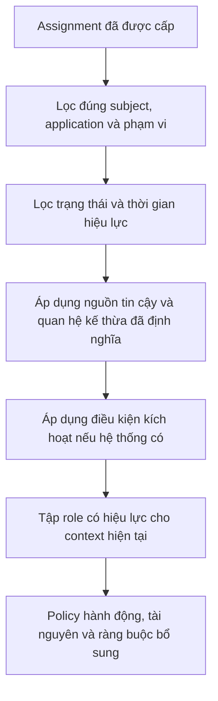

# Role attribute

## 1. Role là một thuộc tính danh tính mang ý nghĩa gì?

Role attribute là thuộc tính biểu diễn các vai trò mà một danh tính được gán hoặc đang được phép sử dụng trong một phạm vi xác định. Giá trị có thể là `BILLING_READER`, `BILLING_APPROVER` hoặc `COURSE_INSTRUCTOR`, tùy từ vựng của hệ thống.

Một thuộc tính role có thể xuất hiện trong hồ sơ người dùng, kho cấp quyền, dữ liệu provisioning, kết quả truy vấn authorization hoặc một claim của token. Vị trí lưu không tự làm cho giá trị đó đáng tin hay còn hiệu lực. Hệ thống phải biết ai được phép khẳng định role, role áp dụng ở đâu và thời điểm nào được dùng để ra quyết định.

Ví dụ, Lan có vai trò `BILLING_APPROVER` tại doanh nghiệp A. Khi Lan chuyển sang thao tác với doanh nghiệp B, chỉ kiểm tra chuỗi `BILLING_APPROVER` trong hồ sơ tổng hợp là chưa đủ. Role tại A không tự tạo quyền duyệt hóa đơn tại B.

Trong bài học này, ứng dụng hóa đơn là tình huống giả định để làm rõ cách quản lý role attribute trong IAM. Các tên role, schema, thời hạn và chính sách minh họa đều là lựa chọn của ví dụ, không phải chuẩn chung bắt buộc.

Sau bài học, người học cần có khả năng:

- Phân biệt role với permission, group, chức danh và OAuth scope.
- Biểu diễn tập role cùng phạm vi application, tenant và thời gian hiệu lực.
- Xác định nguồn có thẩm quyền, quyền chỉnh sửa và quy tắc ánh xạ role.
- Phân biệt role được gán, role được kích hoạt và quyền thực tế của một hành động.
- Xử lý dữ liệu thiếu, role không nhận diện được, cache cũ và thay đổi quyền.
- Đọc một ví dụ Java để hiểu cách tạo tập role có hiệu lực từ dữ kiện được quản lý.

## 2. Role attribute và mô hình RBAC liên hệ như thế nào?

Trong RBAC, người dùng được gán role và role được liên kết với các quyền. Thuộc tính role là một cách biểu diễn phía người dùng của quan hệ đó; nó chưa phải toàn bộ mô hình. Vẫn cần định nghĩa mỗi role cho phép thao tác gì và các giới hạn nào áp dụng. Cách phân biệt người dùng, role và quyền phù hợp với mô tả nền tảng của NIST về RBAC. [Nguồn: NIST Role Based Access Control](https://csrc.nist.gov/projects/role-based-access-control).

Một ví dụ đơn giản:

```text
Danh tính Lan
    được gán BILLING_READER tại tenant A

BILLING_READER của ứng dụng billing
    ánh xạ tới invoice.read

Một request cụ thể
    cần invoice.read
    và hóa đơn phải thuộc phạm vi tài nguyên được phép
```

Ba lớp dữ liệu cần được phân biệt:

| Lớp | Ví dụ | Câu hỏi nó trả lời |
| --- | --- | --- |
| Role definition | `BILLING_READER` gồm permission `invoice.read` | Role được định nghĩa như thế nào? |
| Role assignment | Lan nhận `BILLING_READER` tại tenant A đến một thời điểm nhất định | Ai được gán role, trong phạm vi nào? |
| Effective role attribute | Tập role hợp lệ của Lan cho billing/tenant A tại thời điểm xét | Policy hiện có thể sử dụng những role nào? |

Nếu đưa `roles: ["BILLING_READER"]` vào context nhưng đánh mất tenant và thời hạn của assignment, một thông tin có phạm vi đã bị biến thành thông tin tưởng như toàn cục.

Role cũng có thể là một đầu vào của ABAC. Ví dụ policy cho phép duyệt khi người dùng có role phù hợp, hóa đơn cùng tenant, số tiền nằm trong hạn mức và người duyệt không phải người tạo. Việc dùng role attribute không bắt buộc mọi quyết định chỉ được dựa vào role.

## 3. Những khái niệm gần nhau nhưng không được tráo đổi

| Khái niệm | Ý nghĩa trong ví dụ | Sai lầm nếu coi tương đương role |
| --- | --- | --- |
| Permission | `invoice.approve` là hành động được cho phép theo chính sách | Coi tên role là toàn bộ điều kiện cho phép một hóa đơn cụ thể |
| Group | `finance-team-a` là nhóm người được quản lý chung | Tự cho mọi nhóm có chữ finance quyền duyệt |
| Job title | `Finance Manager` là chức danh trong hồ sơ nhân sự | Ai sửa được chức danh thì tự nhận quyền quản trị |
| Department | `FINANCE` là đơn vị tổ chức | Bỏ qua việc một số nhân viên chỉ được đọc |
| OAuth scope | `invoice:read` là chuỗi scope trong contract truy cập API | Bỏ mọi kiểm tra người dùng và tài nguyên khi scope tồn tại |
| Entitlement | Một quyền lợi hoặc khả năng truy cập được hệ thống định nghĩa | Cho rằng mọi entitlement đều có cấu trúc và ý nghĩa như role |
| Ownership | Lan là người phụ trách hóa đơn H1 | Coi Lan được sửa mọi hóa đơn vì có role nhân viên |

Một nhóm có thể được ánh xạ thành role, nhưng ánh xạ đó là chính sách cần được quản lý. Ví dụ, chỉ group có ID ổn định `group-finance-approvers-a` từ directory được chỉ định mới ánh xạ tới `BILLING_APPROVER` tại tenant A. Không quyết định bằng tên hiển thị dễ đổi hoặc bằng một phép tìm chuỗi như `contains("admin")`.

Chức danh và bộ phận có thể là dữ kiện để cấp role theo quy tắc đã phê duyệt. Ví dụ, nhân viên tài chính đang hoạt động có thể được cấp quyền đọc cơ bản. Việc biến chức danh thành quyền duyệt hoặc quyền quản trị cần quyết định riêng về trách nhiệm, hạn mức và kiểm soát xung đột.

## 4. Mô hình dữ liệu: đừng chỉ lưu một chuỗi `role`

### 4.1. Một danh tính có thể có nhiều role

Một người có thể vừa đọc hóa đơn, vừa xuất báo cáo. Nếu dùng một trường duy nhất và ghi đè mỗi khi cấp quyền mới, hệ thống dễ làm mất role cũ hoặc tạo cách ưu tiên không được định nghĩa.

Biểu diễn tập role đơn giản trong một context đã có phạm vi rõ ràng:

```json
{
  "application": "billing",
  "tenantId": "tenant-a",
  "effectiveRoles": [
    "BILLING_READER",
    "REPORT_EXPORTER"
  ]
}
```

`effectiveRoles` là trường riêng của ví dụ. Mảng không có ý nghĩa rằng role đứng đầu mạnh nhất. Policy sử dụng tập giá trị theo contract; không chọn role đầu tiên để ra quyết định.

### 4.2. Assignment phải giữ lại ngữ cảnh cấp quyền

Khi quản lý vòng đời, một bản ghi assignment cần nhiều thông tin hơn tên role:

```json
{
  "assignmentId": "grant-example-101",
  "subject": {
    "issuer": "https://identity.example.test",
    "subjectId": "user-lan"
  },
  "application": "billing",
  "tenantId": "tenant-a",
  "roleCode": "BILLING_APPROVER",
  "state": "ACTIVE",
  "validFrom": "2026-11-26T02:00:00Z",
  "validUntil": "2026-11-26T10:00:00Z",
  "authority": "billing-access-control",
  "grantReason": "Thay ca duyệt hóa đơn đã được phê duyệt",
  "version": 12
}
```

Đây là schema nội bộ giả định, không phải một bản ghi SCIM chuẩn. Các mốc thời gian dùng UTC để biểu diễn nhất quán. Tên authority trong JSON chỉ là định danh nguồn; nó không phải bằng chứng mật mã rằng nguồn đó đã thực sự cấp role.

Các trường giải quyết những câu hỏi khác nhau:

- `assignmentId`: phân biệt hai lần cấp cùng một role để phục vụ thu hồi và kiểm toán.
- `subject`: định danh đúng người trong namespace của issuer.
- `application` và `tenantId`: xác định phạm vi role.
- `roleCode`: khóa nghiệp vụ ổn định của role definition.
- `state`: assignment đã được kích hoạt, bị đình chỉ hay bị thu hồi.
- `validFrom`, `validUntil`: cửa sổ hiệu lực của lần cấp quyền.
- `authority`: nguồn có thẩm quyền mà hệ thống đã kiểm chứng khi tiếp nhận dữ liệu.
- `version`: hỗ trợ phát hiện thay đổi và đồng bộ nếu có cơ chế cập nhật tương ứng.

Một người có thể nhận cùng một role qua hai nguồn hoặc hai assignment khác nhau. Thu hồi một assignment không nhất thiết làm role biến mất nếu còn một assignment hợp lệ khác. Kho cấp quyền phải giữ được quan hệ nguồn gốc để giải thích vì sao role vẫn có hiệu lực.

### 4.3. Tách mã role và nhãn hiển thị

```text
roleCode: BILLING_APPROVER
displayName: Người duyệt hóa đơn
```

Mã role dùng trong policy cần ổn định. Nhãn hiển thị có thể đổi theo ngôn ngữ hoặc cách gọi trong tổ chức. Đổi nhãn từ “Người duyệt hóa đơn” sang “Chuyên viên phê duyệt” không nên vô tình đổi quyền.

Không dùng tiền tố, dấu cách hoặc thứ tự chữ để suy ra thứ bậc. `SUPER_READER` không tự kế thừa `READER`; `ADMIN` không tự lớn hơn mọi role khác. Nếu có role hierarchy, quan hệ kế thừa phải được định nghĩa và kiểm chứng phía hệ thống.

## 5. Phạm vi là một phần của ý nghĩa role

### 5.1. Role cùng tên có thể thuộc các namespace khác nhau

Trong ứng dụng học tập, `INSTRUCTOR` có thể được tạo bài giảng. Trong một hệ thống điều phối nội bộ, tên tương tự có thể mang quyền khác. Chỉ giữ một chuỗi role toàn cục sẽ khiến các hệ thống diễn giải lẫn nhau.

Một khóa định nghĩa role có thể gồm:

```text
namespace hoặc application + roleCode
```

Một assignment cụ thể còn cần subject và phạm vi dữ liệu:

```text
subject + application + tenant/resource scope + roleCode + validity
```

Tùy hệ thống, phạm vi có thể là tổ chức, dự án, khóa học hoặc một tài nguyên riêng. Không bắt buộc nhét mọi loại phạm vi vào một chuỗi tên role. Lưu phạm vi có cấu trúc thường dễ kiểm tra hơn việc phân tích `ADMIN_PROJECT_A_TENANT_B` ở nhiều nơi.

### 5.2. Ví dụ một người có quyền khác nhau ở hai tenant

| Subject | Application | Tenant | Role | Hiệu lực |
| --- | --- | --- | --- | --- |
| Lan | billing | A | `BILLING_APPROVER` | Đang có hiệu lực |
| Lan | billing | B | `BILLING_READER` | Đang có hiệu lực |
| Lan | learning | A | `COURSE_INSTRUCTOR` | Đang có hiệu lực |

Khi Lan duyệt hóa đơn tại B, hệ thống phải sử dụng role trong context `billing/B`. Role duyệt tại A và role giảng viên của ứng dụng learning không đáp ứng yêu cầu đó.

Chọn tenant trên giao diện chỉ là yêu cầu chuyển context. Phía server phải xác nhận membership, role và tài nguyên tương ứng. Không cho phép client gửi `activeTenant=A` nhưng truy vấn hóa đơn B rồi chỉ kiểm tra role A.

### 5.3. Quyền quản trị tenant và quản trị nền tảng

Một tenant admin có thể quản lý thành viên của doanh nghiệp mình. Platform admin có thể thực hiện một số thao tác vận hành toàn nền tảng. Đây là hai phạm vi quyền khác nhau, dù cả hai đều có chữ admin trong tên hiển thị.

Policy cấp role phải xác định tenant admin được cấp những role nào, cho ai và trong tenant nào. Không mặc định người có quyền quản lý người dùng được phép cấp mọi role mà hệ thống từng định nghĩa.

Các truy cập đặc biệt xuyên tenant, nếu nghiệp vụ cần, phải có loại quyền và đường phê duyệt rõ ràng. Không coi thiếu `tenantId` là dấu hiệu ngầm rằng role có phạm vi toàn cầu.

## 6. Role được gán, role được kích hoạt và role có hiệu lực

Một role có thể đã xuất hiện trong kho cấp quyền nhưng chưa được dùng cho request hiện tại.



Trong thiết kế giả định:

- **Assigned roles:** role được ghi nhận qua các assignment.
- **Eligible roles:** role mà người dùng đủ điều kiện kích hoạt theo quy trình đặc quyền, nếu có.
- **Activated roles:** role đã được kích hoạt cho phiên hoặc cửa sổ thời gian cụ thể.
- **Effective roles:** tập role được policy chấp nhận cho context đang xét sau các bước lọc cần thiết.

Các tên trạng thái có thể khác giữa sản phẩm. Không phải hệ thống nào cũng có đầy đủ bước eligible và activated. Điều quan trọng là không dùng sự tồn tại của một assignment thay cho mọi điều kiện còn lại.

Ví dụ, Lan được phép yêu cầu kích hoạt `BILLING_APPROVER` trong ca trực, nhưng còn cần phê duyệt và xác thực bổ sung. Đưa role này vào token như thể đã hoạt động ngay khi mới đủ điều kiện có thể làm bỏ qua quy trình kích hoạt.

Nếu dùng role hierarchy, role có hiệu lực có thể bao gồm role kế thừa. Ví dụ `BILLING_APPROVER` kế thừa quyền đọc nếu chính sách quy định như vậy. Đây là quan hệ được quản lý; không tự suy ra từ tên. Việc kích hoạt cũng chỉ được chọn trong tập role được hệ thống cho phép sử dụng, không chấp nhận bất kỳ role nào client gửi.

## 7. Nguồn có thẩm quyền và quyền chỉnh sửa thuộc tính

### 7.1. Đăng nhập tin cậy không đồng nghĩa mọi role đều được tin

Một IdP bên ngoài có thể được chấp nhận để xác thực người dùng của tenant A, nhưng chưa chắc có thẩm quyền cấp role quản trị nền tảng. Phạm vi tin cậy phải được định nghĩa theo loại thuộc tính và đối tượng mà nguồn đó được quản lý.

Một ví dụ phân công nguồn:

| Nguồn | Dữ kiện được quản lý | Giới hạn |
| --- | --- | --- |
| Hệ thống nhân sự | Trạng thái nhân viên, bộ phận, chức danh | Không tự cấp platform admin |
| Directory doanh nghiệp | Membership nhóm được tổ chức quản lý | Chỉ những group ID có mapping mới ảnh hưởng role ứng dụng |
| Bộ phận cấp quyền billing | Assignment role billing theo tenant | Không tạo role của ứng dụng khác |
| Tenant admin | Một tập role được phép cấp trong tenant của mình | Không mở rộng sang tenant khác hoặc role nền tảng |
| Người dùng tự sửa hồ sơ | Tên hiển thị, tùy chọn giao diện theo thiết kế | Không sửa role attribute dùng cho authorization |

Một giá trị tự khai có thể được lưu để phục vụ đăng ký, nhưng không nên chuyển thành quyền đang hoạt động nếu chưa qua quy trình xác minh và cấp quyền phù hợp.

### 7.2. API cập nhật hồ sơ là điểm dễ phát sinh leo thang quyền

Request hợp lệ để sửa hồ sơ có thể chỉ cần:

```json
{
  "displayName": "Lan Nguyen",
  "preferredLanguage": "vi"
}
```

Nếu server bind trực tiếp JSON vào entity người dùng chứa cả `roles`, một client có thể bổ sung:

```json
{
  "displayName": "Lan Nguyen",
  "roles": ["PLATFORM_ADMIN"]
}
```

Biện pháp thiết kế là dùng DTO có danh sách trường được phép cập nhật và tách luồng quản lý role khỏi luồng tự sửa hồ sơ. Quyền gọi API cấp role phải được kiểm tra độc lập với quyền cập nhật thông tin cá nhân.

Ngay cả người được gọi API cấp role cũng cần bị ràng buộc bởi quyền ủy nhiệm: role được phép cấp, tenant đích, danh tính nhận, thời hạn tối đa và yêu cầu phê duyệt. Cần xem cả khả năng tự cấp role hoặc tự nâng quyền qua nhiều bước.

### 7.3. Role suy ra từ thuộc tính khác

Một quy tắc giả định:

```text
Nếu nhân viên đang hoạt động
AND bộ phận FINANCE do HR xác nhận
AND membership tenant A còn hiệu lực
thì có thể cấp BILLING_READER tại tenant A.
```

Quy tắc này cần chủ sở hữu, phiên bản và cơ chế gỡ quyền khi đầu vào thay đổi. Nếu thay bộ phận mà role suy ra vẫn còn mãi, hệ thống đang tích lũy quyền cũ.

Không dùng domain email hoặc một chuỗi tự khai như `department=FINANCE` làm điều kiện duy nhất để cấp quyền nhạy cảm. Phải đánh giá nguồn và khả năng người yêu cầu sửa được dữ kiện đó.

## 8. Trao đổi role qua SCIM và token

### 8.1. Role trong SCIM

RFC 7643 mô tả `roles` là thuộc tính đa trị của User. Schema của nó dùng các giá trị phức hợp với những trường như `value`, `display`, `type`, `primary`; chuẩn không quy định từ vựng role chung. Vì vậy bên gửi và bên nhận vẫn cần thống nhất ý nghĩa của giá trị. [Nguồn: RFC 7643, mục 4.1.2 và schema User](https://www.rfc-editor.org/rfc/rfc7643.html#section-4.1.2).

Một phần dữ liệu minh họa theo cách biểu diễn đó:

```json
{
  "roles": [
    {
      "value": "billing-reader",
      "display": "Người đọc hóa đơn",
      "type": "application",
      "primary": true
    }
  ]
}
```

Đoạn trên chỉ là phần thuộc tính, không phải toàn bộ SCIM User resource. Từ `application` và giá trị `billing-reader` là quy ước của ví dụ. `primary` biểu diễn giá trị chính hoặc ưu tiên trong thuộc tính đa trị; không tự có nghĩa là quyền mạnh nhất hay quyền quản trị. Tenant, thời hạn và quy tắc cấp quyền vẫn cần contract thích hợp, không được suy ra từ nhãn hiển thị.

SCIM phục vụ trao đổi và quản lý dữ liệu danh tính. Hệ thống nhận provisioning phải xác thực nguồn, kiểm tra quyền cập nhật và áp dụng mapping được phê duyệt. Một payload đúng schema không tự trở thành một quyết định cho phép truy cập.

### 8.2. Role trong JWT access token

RFC 9068 đề cập các claim `roles`, `groups`, `entitlements` để mang thuộc tính authorization và hướng dẫn tham chiếu SCIM; không định nghĩa bộ tên role phổ quát. Resource server vẫn kết hợp dữ kiện nhận được với context để quyết định quyền. [Nguồn: RFC 9068, mục 2.2.3.1 và mục 4](https://www.rfc-editor.org/rfc/rfc9068.html#section-2.2.3.1).

Một triển khai riêng có thể thống nhất một claim tùy chỉnh như sau:

```json
{
  "iss": "https://identity.example.test",
  "sub": "user-lan",
  "aud": "billing-api",
  "app_tenant": "tenant-a",
  "app_roles": ["billing-reader", "billing-approver"]
}
```

Đây chỉ là một phần claims theo contract riêng để minh họa; không phải access token hoàn chỉnh hay schema claim `roles` bắt buộc của RFC 9068. `app_tenant` và `app_roles` là tên tự định nghĩa, dùng trong một hệ thống riêng đã thống nhất ý nghĩa.

Luồng xử lý cần phân biệt:

1. Xác thực token theo profile áp dụng: chữ ký, nguồn phát hành, audience, thời hạn, loại token và các điều kiện bắt buộc.
2. Kiểm tra issuer đó có thẩm quyền khẳng định role cho application và tenant này không.
3. Kiểm tra cấu trúc claim và ánh xạ tên bên ngoài sang mã role nội bộ.
4. Xác định dữ kiện token có đủ mới cho hành động hay cần tra cứu thêm.
5. Áp dụng policy trên action và resource.

Các kiểm tra profile cho JWT access token được mô tả trong [RFC 9068, mục 4](https://www.rfc-editor.org/rfc/rfc9068.html#section-4). Không dùng một ID token chỉ vì nó chứa trường có tên role để thay cho access token mà API yêu cầu.

Chữ ký bảo vệ payload khỏi bị sửa sau khi phát hành. Nó không chứng minh role chưa bị thu hồi kể từ lúc phát hành, cũng không cho một issuer thẩm quyền ngoài phạm vi mà resource server đã cấu hình.

### 8.3. Mapping phải gắn với nguồn và phạm vi

Ví dụ contract ánh xạ:

| Nguồn và phạm vi được chấp nhận | Giá trị bên ngoài | Role nội bộ |
| --- | --- | --- |
| IdP doanh nghiệp A, billing, tenant A | `billing-reader` | `BILLING_READER` tại A |
| IdP doanh nghiệp A, billing, tenant A | `billing-approver` | `BILLING_APPROVER` tại A |
| IdP doanh nghiệp A, billing, tenant B | `billing-approver` | Không được cấp qua nguồn này |
| IdP doanh nghiệp A, nền tảng | `platform-admin` | Không được cấp qua nguồn này |

Đối với claim tùy chỉnh `app_roles`, ví dụ chọn contract là mảng chuỗi thuộc danh sách đóng. Nếu nhận chuỗi thay cho mảng, phần tử khác kiểu hoặc giá trị không được nhận diện, adapter phải báo lỗi theo contract và không tạo quyền từ dữ liệu đó. Đây là lựa chọn của ví dụ; một integration khác có thể bỏ qua role không biết nếu chính sách tương thích cho phép, nhưng không được tự biến nó thành role mặc định có quyền.

Không tự chuyển mọi giá trị sang chữ hoa, xóa dấu cách rồi chấp nhận bất kỳ tên nào trùng với enum nội bộ. Quy tắc chuẩn hóa phải theo contract của từng nguồn và không tạo ra va chạm. Giữ mã ổn định, mapping tường minh và phiên bản mapping giúp điều tra khi quyền thay đổi.

## 9. Ví dụ Java: tạo tập role có hiệu lực đúng phạm vi

### 9.1. Contract của ví dụ

Đoạn mã Java 17 trở lên dưới đây xử lý snapshot cấp quyền nội bộ sau khi tầng tích hợp đã xác thực nguồn và ánh xạ dữ liệu. Nó không xác thực JWT, không xử lý SCIM và không cho phép bind request body thành dữ kiện tin cậy.

Ví dụ chọn các quy tắc:

- Snapshot chỉ mô tả một subject và một tenant.
- Role được lọc theo ứng dụng billing.
- Mỗi mã role có tập authority được chấp nhận riêng.
- Tài khoản và membership phải đang hoạt động.
- Assignment phải được bật và nằm trong khoảng hiệu lực `[validFrom, validUntil)`.
- Snapshot phải mới hơn giới hạn 30 giây; giá trị này chỉ phục vụ minh họa.
- Không triển khai role hierarchy hoặc quy trình kích hoạt đặc quyền trong đoạn mã này.

### 9.2. Các kiểu dữ liệu

```java
import java.time.Duration;
import java.time.Instant;
import java.util.EnumSet;
import java.util.List;
import java.util.Map;
import java.util.Objects;
import java.util.Set;
import java.util.UUID;

enum RoleCode {
    BILLING_READER,
    BILLING_APPROVER
}

record SubjectKey(String issuer, String subjectId) {
    SubjectKey {
        Objects.requireNonNull(issuer);
        Objects.requireNonNull(subjectId);
        if (issuer.isBlank() || subjectId.isBlank()) {
            throw new IllegalArgumentException("Missing subject identity");
        }
    }
}

record RoleGrant(
        UUID assignmentId,
        String authority,
        String application,
        UUID tenantId,
        RoleCode role,
        boolean enabled,
        Instant validFrom,
        Instant validUntil) {
    RoleGrant {
        Objects.requireNonNull(assignmentId);
        Objects.requireNonNull(authority);
        Objects.requireNonNull(application);
        Objects.requireNonNull(tenantId);
        Objects.requireNonNull(role);
        Objects.requireNonNull(validFrom);
        if (validUntil != null && !validUntil.isAfter(validFrom)) {
            throw new IllegalArgumentException("Invalid validity interval");
        }
    }
}

record RoleSnapshot(
        SubjectKey subject,
        UUID tenantId,
        boolean accountActive,
        boolean membershipActive,
        Instant observedAt,
        long version,
        List<RoleGrant> grants) {
    RoleSnapshot {
        Objects.requireNonNull(subject);
        Objects.requireNonNull(tenantId);
        Objects.requireNonNull(observedAt);
        grants = List.copyOf(grants);
    }
}
```

`validUntil = null` trong schema nội bộ này có nghĩa là chưa đặt thời điểm hết hạn, không có nghĩa assignment không bao giờ được thu hồi. `version` là giá trị phục vụ theo dõi thay đổi; tự khai báo version trong một payload không làm payload đáng tin.

`SubjectKey` giữ cả issuer và subject ID để tránh trộn hai người ở hai nguồn khác nhau chỉ vì chuỗi subject giống nhau. Chuỗi issuer phải được tầng xác thực đối chiếu đúng contract, không lấy tùy ý từ request rồi coi là tin cậy.

### 9.3. Resolver không nâng quyền khi dữ liệu thiếu hoặc cũ

```java
final class RoleResolver {
    private static final String APPLICATION = "billing";
    private static final Duration MAX_AGE = Duration.ofSeconds(30);

    private static final Map<RoleCode, Set<String>> AUTHORITIES = Map.of(
            RoleCode.BILLING_READER,
            Set.of("billing-access-control", "hr-role-bridge"),
            RoleCode.BILLING_APPROVER,
            Set.of("billing-access-control"));

    Set<RoleCode> resolve(
            SubjectKey requestedSubject,
            UUID requestedTenant,
            RoleSnapshot snapshot,
            Instant now) {
        Objects.requireNonNull(requestedSubject);
        Objects.requireNonNull(requestedTenant);
        Objects.requireNonNull(snapshot);
        Objects.requireNonNull(now);

        if (!requestedSubject.equals(snapshot.subject())
                || !requestedTenant.equals(snapshot.tenantId())) {
            throw new IllegalArgumentException("Snapshot context mismatch");
        }

        Instant observedAt = snapshot.observedAt();
        if (observedAt.isAfter(now)
                || !now.isBefore(observedAt.plus(MAX_AGE))) {
            throw new IllegalStateException("Role snapshot is not fresh");
        }

        if (!snapshot.accountActive() || !snapshot.membershipActive()) {
            return Set.of();
        }

        EnumSet<RoleCode> effective = EnumSet.noneOf(RoleCode.class);
        for (RoleGrant grant : snapshot.grants()) {
            if (!requestedTenant.equals(grant.tenantId())) {
                throw new IllegalArgumentException("Grant tenant mismatch");
            }
            if (!APPLICATION.equals(grant.application())) {
                continue;
            }

            Set<String> allowedAuthorities = AUTHORITIES.get(grant.role());
            if (allowedAuthorities == null
                    || !allowedAuthorities.contains(grant.authority())) {
                throw new IllegalArgumentException("Role authority mismatch");
            }

            boolean started = !now.isBefore(grant.validFrom());
            boolean notExpired = grant.validUntil() == null
                    || now.isBefore(grant.validUntil());

            if (grant.enabled() && started && notExpired) {
                effective.add(grant.role());
            }
        }
        return Set.copyOf(effective);
    }
}
```

Các chuỗi authority trong mã là khóa cấu hình nội bộ. Resolver chỉ có ý nghĩa khi dữ liệu đến từ kho hoặc adapter đã xác minh; cho client tự gửi `authority="billing-access-control"` sẽ phá vỡ giả định đầu vào.

Trong ví dụ, nguồn `hr-role-bridge` được cấp quyền tạo role đọc nhưng không được tạo role duyệt. Đây là lý do không chỉ duy trì một danh sách nguồn được tin cho tất cả role.

Thời điểm `observedAt` phải phản ánh mốc xác nhận dữ kiện có ý nghĩa theo contract. Đọc lại một bản cache cũ rồi thay `observedAt` bằng giờ hiện tại không làm quyền mới hơn. Một snapshot có độ mới 30 giây cũng chỉ cung cấp bảo đảm tương ứng, không phải thu hồi tức thời.

Nếu snapshot có assignment không hợp lệ hoặc nguồn vượt thẩm quyền, ví dụ chọn báo lỗi toàn bộ phép giải. Có thể thiết kế cơ chế cách ly dữ liệu khác, nhưng không được trả tập role có quyền dựa trên một snapshot mà hệ thống chưa xác định được tính tin cậy. Tầng API cần ánh xạ lỗi thành phản hồi và audit phù hợp, không đưa thông tin nội bộ trực tiếp ra ngoài.

### 9.4. Tập role chưa phải kết quả cuối cùng cho tài nguyên

Sau khi resolver trả `BILLING_APPROVER`, policy duyệt hóa đơn vẫn cần kiểm tra các điều kiện nghiệp vụ:

```text
Cho phép invoice.approve khi:
    effectiveRoles chứa BILLING_APPROVER
    AND tài nguyên thuộc đúng application và tenant đang xét
    AND hóa đơn đang chờ duyệt
    AND người duyệt không phải người tạo
    AND số tiền nằm trong hạn mức của người duyệt
    AND các điều kiện xác thực bổ sung được đáp ứng nếu có
```

Policy cũng phải sử dụng dữ kiện đủ mới cho loại hành động và xử lý thay đổi giữa lúc kiểm tra với lúc cập nhật. Resolver trong bài chỉ minh họa thuộc tính role; nó không thay thế kiểm soát truy cập đối tượng, tính nhất quán giao dịch hay kiểm tra quyền tại điểm thực thi.

## 10. Vòng đời role attribute

### 10.1. Cấp, điều chỉnh và thu hồi

Một vòng đời có thể bao gồm:

1. **Đề nghị:** xác định danh tính, role, phạm vi, lý do và thời hạn cần thiết.
2. **Phê duyệt:** kiểm tra người cấp có thẩm quyền và assignment không vi phạm ràng buộc.
3. **Ghi nhận:** tạo assignment có ID và dấu vết nguồn gốc.
4. **Phân phối:** cập nhật directory, cache, token hoặc kho authorization theo kiến trúc.
5. **Sử dụng:** tạo tập role có hiệu lực cho context của từng hành động.
6. **Rà soát:** xác nhận quyền vẫn cần thiết khi tổ chức hoặc nhiệm vụ thay đổi.
7. **Thu hồi/hết hạn:** vô hiệu hóa assignment và xử lý các bản sao dữ kiện liên quan.

Việc thay role của một người và việc thay permission của một role là hai loại thay đổi khác nhau. Nếu thêm `invoice.export` vào `BILLING_READER`, mọi người đang nhận role đó có thể được tăng quyền mà không có assignment mới nào. Vì vậy role definition và mapping cũng cần phiên bản, người phê duyệt và đánh giá tác động.

### 10.2. Quyền có thể tồn tại ở nhiều bản sao

Khi thu hồi role, các nơi cần xem xét có thể gồm:

- Bản ghi assignment gốc.
- Membership nhóm tạo ra assignment suy dẫn.
- Cache effective roles tại dịch vụ.
- Token chứa role đã phát hành.
- Phiên có role đã kích hoạt.
- Job đã xếp hàng hoặc grant cấp cho tác vụ dài.

Xóa role khỏi directory không tự sửa nội dung token đã phát hành. Thiết kế phải định nghĩa cách sử dụng dữ kiện phía server, giới hạn thời hạn hoặc cơ chế vô hiệu hóa thích hợp. Không tuyên bố thu hồi hoàn tất trước khi các đường truy cập còn trong phạm vi yêu cầu đã đáp ứng thời hạn thu hồi.

### 10.3. Ví dụ tiến trình thu hồi

```text
09:00: Lan nhận BILLING_APPROVER tại tenant A trong ca trực.
09:30: Một token được phát hành, có dữ kiện role tại thời điểm phát hành.
09:35: Assignment bị thu hồi trong kho cấp quyền.
09:36: Lan gửi yêu cầu duyệt bằng token vẫn còn hạn.
```

Nếu API chỉ kiểm tra role trong token, nó có thể vẫn cho phép ở 09:36. Nếu contract yêu cầu thu hồi trong vòng 30 giây, cần cơ chế kiểm tra hoặc làm mới dữ kiện đáp ứng giới hạn đó. Chỉ giảm thời gian cache mà token vẫn được dùng như nguồn role độc lập có thể không đạt mục tiêu.

Khi đo thời gian thu hồi, cần tính cả việc phát hiện thay đổi nguồn, truyền sự kiện, cập nhật cache, tác vụ đang chạy và những giai đoạn mất kết nối. Một giá trị TTL đơn lẻ không mô tả toàn bộ độ trễ của hệ thống.

## 11. Nhiều role, xung đột và phân tách nhiệm vụ

### 11.1. Không có thứ tự mạnh yếu mặc định

Một người có thể nhận cả `BILLING_READER` và `REPORT_EXPORTER`. Chính sách có thể hợp các permission cho phép của hai role, nhưng hành động cụ thể vẫn chịu các ràng buộc bổ sung. Không chọn role “cao nhất” bằng tên, số thứ tự hoặc vị trí trong mảng.

Nếu có explicit deny, policy engine phải định nghĩa cách kết hợp allow và deny. Role attribute bản thân nó không quyết định deny có ưu tiên hay không. Việc đó thuộc ngữ nghĩa chính sách.

### 11.2. Static và dynamic separation of duties

Trong một thiết kế, hai role có thể bị cấm gán đồng thời để tránh xung đột trách nhiệm. Ví dụ, tài khoản quản trị cấp quyền không đồng thời nhận một role kiểm toán độc lập theo quy tắc của tổ chức. Đây là ràng buộc tại thời điểm cấp quyền.

Một thiết kế khác có thể cho một người vừa tạo vừa duyệt hóa đơn, nhưng không được tự duyệt hóa đơn do mình tạo. Đây là ràng buộc theo giao dịch, cần biết resource và người tạo, không thể chỉ kiểm tra tập role tổng quát.

| Ràng buộc | Dữ kiện cần biết | Nơi xử lý chính trong ví dụ |
| --- | --- | --- |
| Không gán đồng thời hai role xung đột | Tập assignment và quan hệ xung đột | Luồng cấp quyền |
| Không kích hoạt hai role cùng phiên | Role đủ điều kiện và session activation | Luồng kích hoạt |
| Không duyệt hóa đơn do mình tạo | Danh tính người duyệt và `createdBy` của hóa đơn | Policy thực thi nghiệp vụ |
| Không vượt hạn mức duyệt | Role, hạn mức và số tiền | Policy hành động cụ thể |

Chỉ từ chối ở giao diện cấp quyền không đủ nếu API, provisioning hoặc tác vụ import vẫn có thể tạo assignment vi phạm. Ràng buộc cần được đặt ở nơi kiểm soát được tất cả đường ghi liên quan, với xử lý cạnh tranh phù hợp.

## 12. Dữ liệu thiếu, sai hoặc không còn đủ mới

| Tình huống | Cách hiểu cần giữ | Hành vi có thể chọn theo contract |
| --- | --- | --- |
| Không có role nào được cấp | Người dùng không có role cho phạm vi đang xét | Trả tập rỗng và từ chối hành động cần role |
| Claim role không được phát hành | Chưa chắc chứng minh được trạng thái cấp quyền | Tra nguồn được chỉ định hoặc từ chối điều kiện cần role |
| Claim sai kiểu | Dữ liệu vi phạm contract | Báo lỗi dữ kiện, không tự ép sang role có quyền |
| Role lạ | Chưa có mapping được phê duyệt | Báo lỗi hoặc bỏ qua theo integration contract |
| Nguồn không được cấp quyền quản lý role đó | Thiếu thẩm quyền khẳng định | Không tạo quyền từ giá trị này |
| Snapshot cũ | Chưa đáp ứng yêu cầu về độ mới | Làm mới hoặc chặn thao tác cần dữ kiện mới |
| Tenant thiếu hoặc mâu thuẫn | Không xác định được phạm vi role | Từ chối hoặc yêu cầu context hợp lệ theo API |
| Directory lỗi | Không lấy được dữ kiện, khác với tập role thật sự rỗng | Không dùng role quyền cao làm dự phòng |

Phải phân biệt “không có role” với “không đọc được role”. Hai tình huống có thể cùng dẫn tới không thực hiện hành động, nhưng cần reason code và cách khắc phục khác nhau. Nếu trộn chúng trong log, đội vận hành khó biết người dùng thực sự thiếu quyền hay hệ thống cấp quyền đang gián đoạn.

Một quyền công khai hoặc quyền cơ bản sau đăng ký phải được mô tả rõ. Không dùng `roles` vắng mặt làm điều kiện tự động gán `ADMIN`, cũng không mặc định người đã xác thực luôn có quyền nghiệp vụ tối thiểu ngoài contract.

## 13. Kiểm chứng role attribute

Các kiểm chứng sau đánh giá cách biểu diễn và sử dụng thuộc tính; không chỉ nhìn nút hiển thị trên giao diện.

| Ca kiểm chứng | Kết quả cần quan sát |
| --- | --- |
| Lan có role duyệt tại A, đọc tại B | Không duyệt được hóa đơn B bằng role A |
| Hai issuer phát cùng subject ID | Không trộn assignment của hai danh tính |
| Người dùng sửa hồ sơ và thêm `roles` | Không thay đổi kho cấp quyền |
| HR bridge gửi role duyệt mà chỉ được cấp role đọc | Adapter hoặc resolver không chấp nhận quyền vượt thẩm quyền |
| Role có `validFrom` trong tương lai | Chưa xuất hiện trong tập effective |
| Thời điểm xét bằng `validUntil` | Role đã hết hiệu lực theo khoảng thời gian của ví dụ |
| Assignment bị vô hiệu hóa | Không tạo role từ assignment đó |
| Thu hồi một trong hai assignment cùng role | Chỉ mất role nếu không còn đường cấp hợp lệ khác |
| Snapshot quá tuổi cho phép | Không tiếp tục sử dụng như dữ kiện mới |
| Đổi `displayName` của role | Permission không đổi nếu role definition không đổi |
| Nhận role bên ngoài không có mapping | Không xuất hiện role đặc quyền mặc định |
| Người dùng tạo và duyệt cùng hóa đơn | Policy giao dịch áp dụng ràng buộc phân tách nhiệm vụ |
| Thêm permission vào role definition | Đánh giá được những subject bị tăng quyền |

Với cache, nên kiểm tra khóa có đủ subject, issuer, application và tenant, cùng dữ kiện phiên bản hoặc hiệu lực mà thiết kế sử dụng. Cache keyed chỉ theo `userId` có thể tái sử dụng role tenant A khi người đó chuyển sang B.

Với provisioning, cần kiểm tra cả đường xóa và cập nhật. Một đường đồng bộ chỉ thêm role mà không gỡ role cũ khi người dùng đổi nhóm sẽ tạo tình trạng tích lũy quyền.

Với cập nhật đồng thời, cần kiểm tra khả năng hai yêu cầu cấp role riêng lẻ đều hợp lệ nhưng khi ghi cùng lúc tạo tổ hợp bị cấm. Chỉ đọc danh sách hiện tại rồi ghi không có cơ chế nhất quán có thể không bảo đảm được ràng buộc đó.

## 14. Audit và giải thích quyền

Khi người dùng hỏi “Tại sao tôi có role này?”, hệ thống nên truy được đường cấp quyền thay vì chỉ trả một mảng chuỗi.

Một sự kiện cấp role minh họa có thể ghi:

```json
{
  "event": "role_assignment_granted",
  "assignmentId": "grant-example-101",
  "subjectId": "user-lan",
  "application": "billing",
  "tenantId": "tenant-a",
  "roleCode": "BILLING_APPROVER",
  "actorId": "admin-example-07",
  "approvalRef": "approval-example-42",
  "mappingVersion": "billing-role-mapping-v2",
  "assignmentVersion": 12
}
```

Các giá trị là dữ liệu giả. Khi triển khai, thông tin định danh, lý do cấp và lịch sử quyền cần được giới hạn truy cập theo mục đích kiểm toán. Không ghi token hoặc bí mật xác thực để chứng minh role.

Một lời giải thích quyền đầy đủ có thể là:

```text
Lan có BILLING_READER tại tenant A
vì đang thuộc group ID X do directory A quản lý;
mapping phiên bản M ánh xạ group X sang role đó;
assignment Y còn hiệu lực tại thời điểm T.
```

Giải thích cũng cần cho việc từ chối: role đúng nhưng khác tenant, assignment hết hạn, nguồn không có thẩm quyền, role chưa kích hoạt hoặc điều kiện resource không đạt. Chi tiết nội bộ này không nhất thiết được đưa nguyên vẹn ra response công khai.

Việc rà soát nên bao gồm assignment, role definition và mapping. Một đợt rà soát chỉ xác nhận danh sách người có role sẽ bỏ sót việc nội dung quyền của chính role đã mở rộng.

## 15. Bài tập vận dụng

### Tình huống 1: Một trường `role = ADMIN`

Ứng dụng cho phép người dùng tham gia nhiều doanh nghiệp nhưng chỉ có một trường role trên bảng user. Quản trị viên của A mời Lan làm admin A; sau đó Lan cũng thấy trang quản trị B. Cần sửa mô hình ở điểm nào?

**Gợi ý:** role assignment cần gắn với membership hoặc phạm vi tenant, và điểm thực thi phải dùng context đúng. Chỉ đổi tên `ADMIN` thành `TENANT_ADMIN` nhưng vẫn lưu toàn cục không giải quyết được vấn đề.

### Tình huống 2: Có chữ ký nên tin mọi role

IdP của một khách hàng phát claim chứa `platform-admin`. Resource server đã xác thực chữ ký. Có nên chấp nhận role đó không?

**Gợi ý:** xác thực bên phát không thay thế việc giới hạn thẩm quyền của bên phát. Xem mapping theo issuer, application, tenant và loại role được phép cấp. Khách hàng có thể quản lý thành viên tenant của họ mà không quản lý quyền nền tảng.

### Tình huống 3: Thu hồi xong trong database nhưng người dùng vẫn thao tác

Kho assignment đã vô hiệu hóa role duyệt, nhưng access token cũ còn hạn hai giờ. API chỉ đọc role trong token. Hãy chỉ ra khoảng trống trong lời hứa thu hồi quyền.

**Gợi ý:** xác định tất cả nơi quyết định dựa vào bản sao role và cơ chế làm mới. Muốn cam kết thời gian thu hồi phải có thiết kế đáp ứng trên đường thực thi, không chỉ có cập nhật tại nguồn.

### Tình huống 4: `primary = true` trong dữ liệu role

Một adapter coi role có `primary = true` là role quản trị và bỏ qua những role còn lại. Lỗi nằm ở đâu?

**Gợi ý:** nhãn ưu tiên trong thuộc tính đa trị không định nghĩa tập permission hay cấp đặc quyền. Role phải được giải nghĩa theo mã và mapping, không theo cờ hiển thị hoặc thứ tự.

### Tình huống 5: Role biến mất rồi xuất hiện lại

Quản trị viên thu hồi một assignment `BILLING_READER`, nhưng lần đồng bộ sau từ group directory lại tạo quyền đọc. Điều gì cần được phân tích?

**Gợi ý:** xem role có những đường cấp nào và nguồn nào là chủ sở hữu. Nếu group membership vẫn là đầu vào cấp quyền, phải xử lý đường cấp đó hoặc định nghĩa ngoại lệ có kiểm soát. Không xóa từng bản sao rồi coi nguồn sinh quyền vẫn còn là lỗi ngẫu nhiên.

## 16. Những câu hỏi cần trả lời trước khi dùng role trong policy

Một role attribute đủ rõ để phục vụ IAM cần trả lời được:

1. Giá trị này là mã ổn định hay nhãn hiển thị?
2. Nó thuộc namespace, application và tenant nào?
3. Ai được phép cấp, sửa, xác nhận và thu hồi nó?
4. Nó là role được gán, đủ điều kiện kích hoạt hay đã có hiệu lực?
5. Thời hạn và trạng thái nào làm assignment được sử dụng?
6. Mapping từ nguồn bên ngoài được quản lý và kiểm chứng thế nào?
7. Khi quyền thay đổi, token, cache, phiên và tác vụ đang chạy phản ánh thay đổi sau bao lâu?
8. Policy còn phải kiểm tra resource, hạn mức và phân tách nhiệm vụ nào?

Một chuỗi role chỉ có giá trị bảo vệ khi hệ thống giữ được ý nghĩa, phạm vi và nguồn gốc của nó đến điểm ra quyết định. Quản lý thuộc tính đó tốt giúp việc cấp quyền, kiểm toán và thu hồi trở nên giải thích được, đồng thời hạn chế việc một role hợp lệ ở nơi này bị sử dụng thành quyền không phù hợp ở nơi khác.
